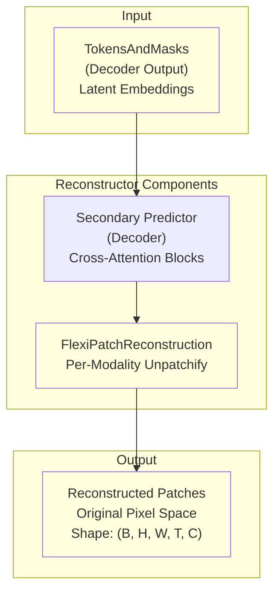
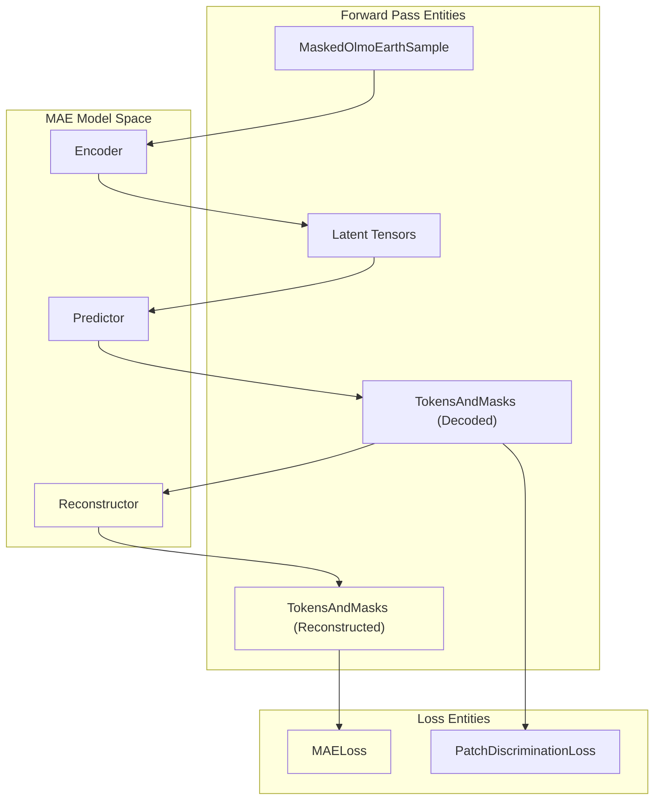
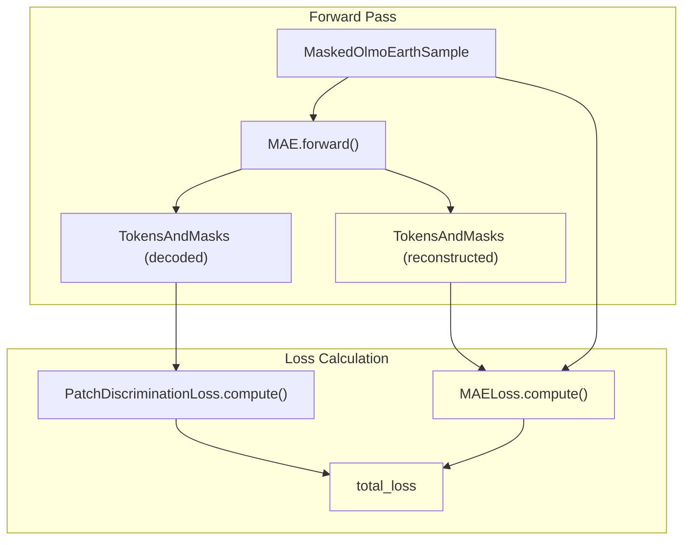

<!-- source: DeepWiki mcp.deepwiki.com · repo allenai/olmoearth_pretrain · page 4.4 Reconstructor for MAE · fetched 2026-10-26 -->

# Reconstructor for MAE

<details>
<summary>Relevant source files</summary>

The following files were used as context for generating this wiki page:

- [olmoearth_pretrain/nn/pooled_modality_predictor.py](olmoearth_pretrain/nn/pooled_modality_predictor.py)
- [olmoearth_pretrain/nn/st_model.py](olmoearth_pretrain/nn/st_model.py)
- [olmoearth_pretrain/nn/tokenization.py](olmoearth_pretrain/nn/tokenization.py)
- [olmoearth_pretrain/train/loss.py](olmoearth_pretrain/train/loss.py)
- [olmoearth_pretrain/train/train_module/train_module.py](olmoearth_pretrain/train/train_module/train_module.py)
- [scripts/official/ablations/base_high_entropy_dataset.py](scripts/official/ablations/base_high_entropy_dataset.py)
- [scripts/official/ablations/base_mae.py](scripts/official/ablations/base_mae.py)
- [scripts/official/ablations/base_random_masking.py](scripts/official/ablations/base_random_masking.py)
- [tests/integration/nn/test_mae.py](tests/integration/nn/test_mae.py)
- [tests/unit/train/test_loss.py](tests/unit/train/test_loss.py)

</details>


## Purpose and Scope

The **Reconstructor** is an optional component that maps latent-space predictions back to pixel space, enabling Masked Autoencoder (MAE) style reconstruction objectives. It transforms the output of the [Predictor and Decoder](#4.2) from learned embedding representations into reconstructed patches that match the original input dimensions.

This component is used when training with MAE loss (see [Loss Functions](#5.2)) in addition to or instead of latent-space contrastive losses. For general model architecture, see [Model Architecture](#4). For the complete MAE training approach, see [Training Modules](#5.3).

**Sources:** [tests/integration/nn/test_mae.py:9-13](), [tests/integration/nn/test_mae.py:126-132](), [olmoearth_pretrain/nn/mae.py:10-41]()

---

## Architecture Overview

The Reconstructor acts as a bridge between latent embeddings and pixel space, enabling pixel-level reconstruction objectives.



**Reconstructor Data Flow**

The Reconstructor consists of two main components:

1. **Secondary Predictor**: A `Predictor` instance that processes latent embeddings through additional cross-attention blocks [olmoearth_pretrain/nn/flexi_vit.py:116-125]().
2. **FlexiPatchReconstruction**: Modality-specific unpatchification layers that convert embeddings back to pixel values [olmoearth_pretrain/nn/flexi_vit.py:126-130]().

**Sources:** [olmoearth_pretrain/nn/flexi_vit.py:9-12](), [tests/integration/nn/test_mae.py:126-131]()

---

## Configuration

The Reconstructor is configured via `ReconstructorConfig`, which specifies the modalities to reconstruct and the decoder architecture to use.

### ReconstructorConfig Structure

| Parameter | Type | Description |
|-----------|------|-------------|
| `supported_modality_names` | `list[str]` | Modalities to reconstruct (typically excludes non-spatial modalities like `latlon`) |
| `max_patch_size` | `int` | Maximum patch size for unpatchification |
| `decoder_config` | `PredictorConfig` | Configuration for the internal decoder |

### Example Configuration

```python
# From scripts/official/ablations/base_mae.py
reconstructor_config = ReconstructorConfig(
    decoder_config=decoder_config,
    supported_modality_names=common.training_modalities,
    max_patch_size=MAX_PATCH_SIZE,
)
```

**Sources:** [scripts/official/ablations/base_mae.py:129-133](), [tests/integration/nn/test_mae.py:126-130]()

---

## Integration with Model Architecture

The Reconstructor is an optional component in the `MAE` model architecture, enabled when MAE-style pixel reconstruction is desired alongside or instead of latent contrastive learning.



**MAE with Optional Reconstructor**

### Configuration in MAEConfig

```python
# From scripts/official/ablations/base_mae.py
model_config = MAEConfig(
    encoder_config=encoder_config, 
    reconstructor_config=reconstructor_config
)
```

When `reconstructor_config` is specified, it enables pixel-space reconstruction for `MAELoss`.

**Sources:** [scripts/official/ablations/base_mae.py:134-137](), [tests/integration/nn/test_mae.py:131-132]()

---

## Forward Pass Mechanics

The Reconstructor processes decoded latent embeddings and produces pixel-space reconstructions while preserving mask information.

### Input Format

The Reconstructor expects `TokensAndMasks` output from the predictor:

```python
# Shape examples from test_mae.py
# (B, H_patched, W_patched, T, num_band_sets, embedding_dim)
decoded = TokensAndMasks(
    sentinel2_l2a=torch.randn(B, H_p, W_p, T, S, D),
    sentinel2_l2a_mask=torch.ones(B, H_p, W_p, T, S) * MaskValue.DECODER.value,
    ...
)
```

### Output Format

The Reconstructor produces pixel-space reconstructions matching original input dimensions:

```python
# Shape examples from test_mae.py
# (B, H, W, T, C) where C is the number of bands
reconstructed = TokensAndMasks(
    sentinel2_l2a=torch.randn(B, H, W, T, C),
    sentinel2_l2a_mask=torch.ones(B, H, W, T, S) * MaskValue.DECODER.value,
    ...
)
```

### Mask Preservation

The Reconstructor preserves mask values from the input, ensuring that:
- Only masked tokens are reconstructed (mask value = `MaskValue.DECODER`) [tests/integration/nn/test_mae.py:64-65]()
- Unmasked tokens retain their original mask values (mask value = `MaskValue.ONLINE_ENCODER`) [tests/integration/nn/test_mae.py:57-60]()
- This enables selective loss computation on reconstructed regions via `MAELoss` [olmoearth_pretrain/train/loss.py:348-355]().

**Sources:** [tests/integration/nn/test_mae.py:137-156](), [olmoearth_pretrain/train/loss.py:348-360]()

---

## Usage in Training

The Reconstructor enables MAE loss computation in training modules by providing pixel-space predictions.

### Training Module Configuration

```python
# From scripts/official/ablations/base_mae.py
return MAETrainModuleConfig(
    optim_config=AdamWConfig(lr=0.0001, weight_decay=0.02, fused=False),
    rank_microbatch_size=32,
    masking_config=get_masking_config(),
    mae_loss_config=LossConfig(
        loss_config={"type": "mae", "loss_function": "SmoothL1Loss", "beta": 0.1}
    ),
    ...
)
```

### Loss Computation Flow



**Combined Loss Computation with Reconstructor**

### Example Training Batch

```python
# Logic from test_mae.py
mae = MAE(encoder, predictor, reconstructor)
latent, decoded, reconstructed = mae.forward(x, patch_size)

# Compute MAE loss on pixel reconstructions
loss_mae = MAELoss()
loss = loss_mae.compute(reconstructed, x)

# Compute latent contrastive loss (Patch Discrimination)
loss_mim = PatchDiscriminationLoss()
loss += loss_mim.compute(decoded, target_output)
```

**Sources:** [tests/integration/nn/test_mae.py:159-176](), [scripts/official/ablations/base_mae.py:144-161]()

---

## Shape Validation and Testing

The test suite validates that the Reconstructor correctly transforms embeddings back to pixel space while preserving shapes and masks.

### Shape Assertions from Tests

| Component | Input Shape | Output Shape |
|-----------|-------------|--------------|
| `sentinel2_l2a` | `(B, H_patched, W_patched, T, S, embed_dim)` | `(B, H, W, T, C)` |
| `sentinel2_l2a_mask` | `(B, H_patched, W_patched, T, S)` | `(B, H, W, T, S)` |
| `worldcover` | `(B, H_patched, W_patched, 1, 1, embed_dim)` | `(B, H, W, 1, 1)` |

Where:
- `H_patched = H // patch_size` [tests/integration/nn/test_mae.py:132]()
- `W_patched = W // patch_size` [tests/integration/nn/test_mae.py:132]()
- `C` = number of bands in the modality [tests/integration/nn/test_mae.py:52]()

### Mask Value Preservation

```python
# From test_mae.py assertions
assert (reconstructed.worldcover_mask == MaskValue.DECODER.value).all()
assert (reconstructed.sentinel2_l2a_mask == MaskValue.ONLINE_ENCODER.value).all()
```

The Reconstructor preserves the original mask values, indicating which regions were masked for reconstruction and which were visible to the encoder.

**Sources:** [tests/integration/nn/test_mae.py:137-156]()

---

## Gradient Flow Validation

The test suite verifies proper gradient flow through the Reconstructor during backpropagation.

### Gradient Assertions from Tests

```python
# From test_mae.py
if mae.reconstructor is not None:
    for name, param in mae.reconstructor.named_parameters():
        if not any(
            ignore_param in name
            for ignore_param in [
                "pos_embed",
                "month_embed",
            ]
        ):
            assert param.grad is not None, name
```

The Reconstructor's parameters receive gradients from the MAE loss, enabling end-to-end training of the pixel-space reconstruction pathway.

**Sources:** [tests/integration/nn/test_mae.py:202-212]()

---

## Modality Selection

The Reconstructor typically operates on a subset of modalities, excluding those that are not spatially organized or not suitable for pixel reconstruction.

### Common Modalities for Reconstruction

| Modality | Reconstructed? | Reason |
|----------|-----------|--------|
| `sentinel2_l2a` | Yes | Primary satellite imagery |
| `sentinel1` | Yes | SAR imagery |
| `worldcover` | Yes | Land cover classification |
| `latlon` | No | Coordinate information, not pixel data |

### Configuration Example

```python
# From scripts/official/ablations/base_mae.py
config.training_modalities = [
    Modality.SENTINEL2_L2A.name,
    Modality.SENTINEL1.name,
    Modality.LANDSAT.name,
    Modality.WORLDCOVER.name,
    ...
]
# These are passed to ReconstructorConfig
```

**Sources:** [scripts/official/ablations/base_mae.py:90-100](), [scripts/official/ablations/base_mae.py:129-133]()

---

## Key Implementation Details

### Coordinate with MAE Model

The `MAE` class in `olmoearth_pretrain.nn.mae` wraps the encoder, predictor, and reconstructor into a unified model for Masked Autoencoder training:

```python
# From test_mae.py
mae = MAE(encoder, predictor, reconstructor)
latent, decoded, reconstructed = mae.forward(x, patch_size)
```

The MAE model orchestrates the forward pass through all three components and returns outputs at each stage.

### Loss Computation Pattern

When using the Reconstructor, training typically combines two objectives:

1. **Pixel-space MAE Loss**: Computed via `MAELoss` between `reconstructed` output and original input [olmoearth_pretrain/train/loss.py:348-355]().
2. **Latent-space Contrastive Loss**: Computed via `PatchDiscriminationLoss` between `decoded` output and target encoder embeddings [olmoearth_pretrain/train/loss.py:188-203]().

This dual objective enables learning both pixel-level details and high-level semantic representations.

**Sources:** [tests/integration/nn/test_mae.py:131-176](), [olmoearth_pretrain/train/loss.py:188-203](), [olmoearth_pretrain/train/loss.py:348-355]()

---

