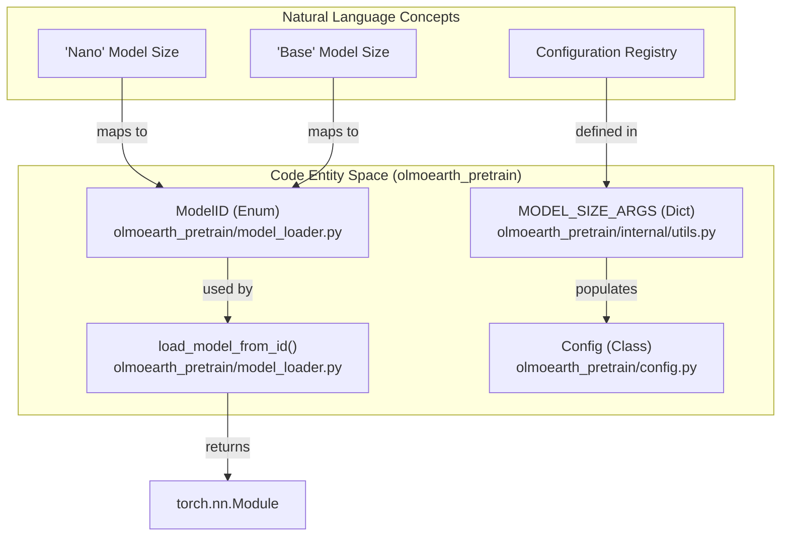
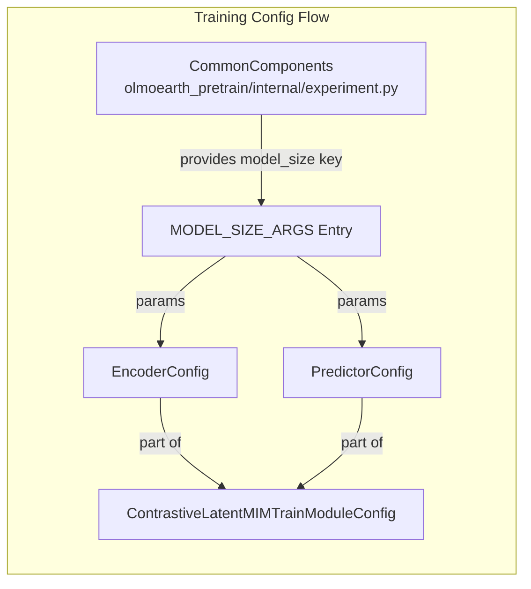
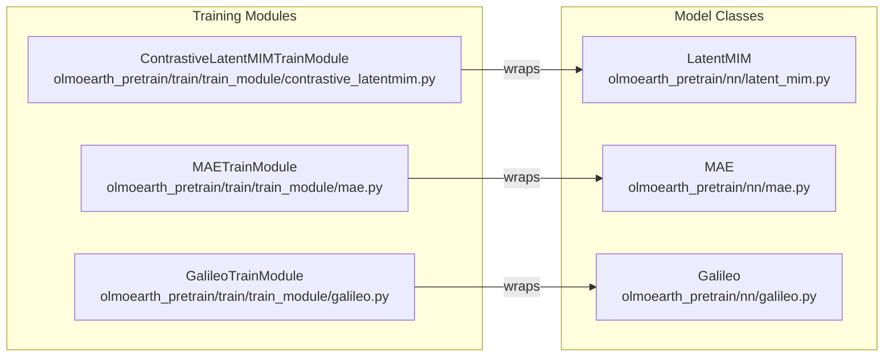

<!-- source: DeepWiki mcp.deepwiki.com · repo allenai/olmoearth_pretrain · page 4.5 Model Size Configurations · fetched 2026-10-26 -->

# Model Size Configurations

<details>
<summary>Relevant source files</summary>

The following files were used as context for generating this wiki page:

- [olmoearth_pretrain/model_loader.py](olmoearth_pretrain/model_loader.py)
- [olmoearth_pretrain/train/train_module/contrastive_latentmim.py](olmoearth_pretrain/train/train_module/contrastive_latentmim.py)
- [olmoearth_pretrain/train/train_module/galileo.py](olmoearth_pretrain/train/train_module/galileo.py)
- [olmoearth_pretrain/train/train_module/latent_mim.py](olmoearth_pretrain/train/train_module/latent_mim.py)
- [olmoearth_pretrain/train/train_module/mae.py](olmoearth_pretrain/train/train_module/mae.py)
- [olmoearth_pretrain/train/utils.py](olmoearth_pretrain/train/utils.py)
- [scripts/official/script.py](scripts/official/script.py)
- [tests/unit/train/test_utils.py](tests/unit/train/test_utils.py)

</details>


This document describes the available model size configurations in OlmoEarth, their hyperparameters, and how to use them in training and evaluation workflows. For information about the model architecture components that these configurations parameterize, see [FlexiVit Encoder](#4.1) and [Predictor and Decoder](#4.2).

## Purpose and Scope

Model size configurations define the architectural hyperparameters for OlmoEarth models at different scales. These configurations control the depth, width, and attention head counts for both the encoder and decoder components. This document covers:

- The `MODEL_SIZE_ARGS` registry containing all available configurations.
- Official release sizes (Nano, Tiny, Base, Large) and their specifications.
- Experimental configuration variants used in ablation studies.
- How to apply configurations in training scripts.
- Hardware requirements and parameter counts for each size.

## Model Size Registry

All model size configurations are defined in the `MODEL_SIZE_ARGS` dictionary in `olmoearth_pretrain/internal/utils.py`. This centralized registry allows training scripts to reference configurations by name rather than specifying hyperparameters individually.

### Natural Language Space to Code Entity Space

The following diagram maps high-level model size concepts to the specific code entities used to define and load them.



**Sources:** [olmoearth_pretrain/internal/utils.py:48-193](), [olmoearth_pretrain/model_loader.py:44-55](), [olmoearth_pretrain/model_loader.py:57-75]()

## Configuration Parameters

Each model size configuration specifies seven key hyperparameters that control the model architecture:

| Parameter | Description | Affects |
|-----------|-------------|---------|
| `encoder_depth` | Number of transformer blocks in encoder | Model capacity, computational cost |
| `encoder_embedding_size` | Hidden dimension of encoder | Memory usage, capacity |
| `encoder_num_heads` | Number of attention heads in encoder | Attention granularity |
| `decoder_depth` | Number of transformer blocks in decoder | Reconstruction quality |
| `decoder_embedding_size` | Hidden dimension of decoder | Memory usage |
| `decoder_num_heads` | Number of attention heads in decoder | Attention granularity |
| `mlp_ratio` | Ratio of MLP hidden size to embedding size | Always 4.0 for all configs |

**Sources:** [olmoearth_pretrain/internal/utils.py:48-193]()

## Official Release Configurations

The four officially released OlmoEarth model sizes are defined in the `ModelID` enum and correspond to specific pre-trained weights on Hugging Face.

| Model Size | Enum Value | Encoder Params | Decoder Params | Encoder Config | Typical Hardware |
|------------|------------|----------------|----------------|----------------|------------------|
| **Nano** | `OLMOEARTH_V1_NANO` | 1.4M | 800K | 4 layers, 128-dim | 4x GPUs (16GB+) |
| **Tiny** | `OLMOEARTH_V1_TINY` | 6.2M | 1.9M | 12 layers, 192-dim | 4-8x GPUs (24GB+) |
| **Base** | `OLMOEARTH_V1_BASE` | 89M | 30M | 12 layers, 768-dim | 8x GPUs (40GB+) |
| **Large** | `OLMOEARTH_V1_LARGE` | 308M | 53M | 24 layers, 1024-dim | 8x GPUs (80GB) |

**Note:** Base and Large use shallow decoders (4 layers) instead of matching encoder depth for computational efficiency.

**Sources:** [olmoearth_pretrain/model_loader.py:44-55](), [olmoearth_pretrain/internal/utils.py:48-193]()

## Applying Model Size Configurations

### In Training Scripts

Model size configurations are applied by retrieving them from `MODEL_SIZE_ARGS` and passing parameters to the encoder and decoder config builders.



In the training system, the `ContrastiveLatentMIMTrainModuleConfig` uses these architectural settings to initialize the `LatentMIM` model.

**Sources:** [scripts/official/script.py:97-132](), [olmoearth_pretrain/train/train_module/contrastive_latentmim.py:36-64](), [olmoearth_pretrain/train/train_module/contrastive_latentmim.py:79-152]()

### Loading Pre-trained Models

To load a specific configuration with pre-trained weights, the `model_loader` provides utility functions:

```python
from olmoearth_pretrain.model_loader import load_model_from_id, ModelID

# Load the Nano model weights from Hugging Face
model = load_model_from_id(ModelID.OLMOEARTH_V1_NANO)
```

**Sources:** [olmoearth_pretrain/model_loader.py:57-75]()

## Complete Configuration Catalog

### Standard Configurations

These configurations match encoder and decoder depths:

| Config Key | Enc Depth | Enc Dim | Enc Heads | Dec Depth | Dec Dim | Dec Heads |
|------------|-----------|---------|-----------|-----------|---------|-----------|
| `nano` | 4 | 128 | 8 | 4 | 128 | 8 |
| `tiny` | 12 | 192 | 3 | 12 | 192 | 3 |
| `base` | 12 | 768 | 12 | 12 | 768 | 12 |
| `large` | 24 | 1024 | 16 | 24 | 1024 | 16 |

**Sources:** [olmoearth_pretrain/internal/utils.py:48-102]()

### Shallow Decoder Variants

These configurations use 4 decoder layers regardless of encoder depth, reducing computational cost. The officially released Base and Large models use these variants.

| Config Key | Enc Depth | Enc Dim | Enc Heads | Dec Depth | Dec Dim | Dec Heads |
|------------|-----------|---------|-----------|-----------|---------|-----------|
| `base_shallow_decoder` | 12 | 768 | 12 | 4 | 768 | 12 |
| `large_shallow_decoder` | 24 | 1024 | 16 | 4 | 1024 | 16 |

**Sources:** [olmoearth_pretrain/internal/utils.py:103-138]()

## Hardware Requirements and Recommendations

### Training Hardware Guidelines

| Model Size | Min GPUs | GPU Memory | Recommended Cluster |
|------------|----------|------------|---------------------|
| Nano | 4 | 16GB+ | Local/Small cluster |
| Tiny | 4-8 | 24GB+ | Small cluster |
| Base | 8 | 40GB+ | Medium cluster |
| Large | 8 | 80GB (A100/H100) | Large cluster |

**Notes:**
- Training uses `DataParallelConfig` with FSDP by default [scripts/official/script.py:127-131]().
- Microbatch sizes are configured via `rank_microbatch_size` (e.g., 32 for Nano/Tiny) [scripts/official/script.py:109]().
- Memory usage is monitored via `GPUMemoryMonitorCallback` [scripts/official/script.py:17]().

**Sources:** [scripts/official/script.py:127-131](), [scripts/official/script.py:109](), [olmoearth_pretrain/train/utils.py:74-102]()

### Inference Hardware

For inference and evaluation tasks:
- **Nano/Tiny:** Single GPU (16GB+)
- **Base:** Single GPU (40GB+) or distributed
- **Large:** Single GPU (80GB) recommended

**Sources:** [olmoearth_pretrain/model_loader.py:135-139]()

## Using Configurations in Custom Scripts

To create a custom training script with a different model size, the `build_train_module_config` function in `scripts/official/script.py` serves as the primary entry point for architectural setup.

1. **Select a configuration:** Retrieve parameters from `MODEL_SIZE_ARGS`.
2. **Apply to Training Module:** The `ContrastiveLatentMIMTrainModuleConfig` [olmoearth_pretrain/train/train_module/contrastive_latentmim.py:36]() accepts the model instance built from these hyperparameters.
3. **Configure Optimizer:** Set learning rates and weight decay based on model scale (e.g., `lr=0.0001` for Base) [scripts/official/script.py:108]().

**Sources:** [scripts/official/script.py:97-132](), [olmoearth_pretrain/train/train_module/contrastive_latentmim.py:36-64]()

## Relationship to Model Architecture Components

The configurations defined here directly parameterize the model architecture components. The `LatentMIM` model (or variants like `Galileo` or `MAE`) is built using these settings.



**Sources:** [olmoearth_pretrain/train/train_module/contrastive_latentmim.py:79-152](), [olmoearth_pretrain/train/train_module/mae.py:73-161](), [olmoearth_pretrain/train/train_module/galileo.py:86-166]()

---

