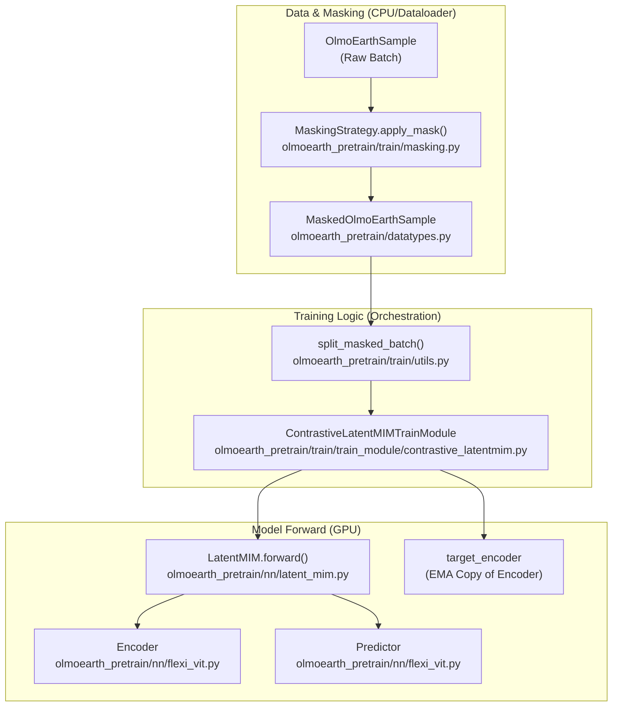
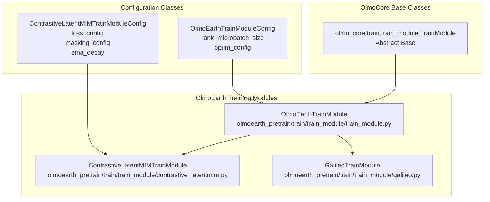
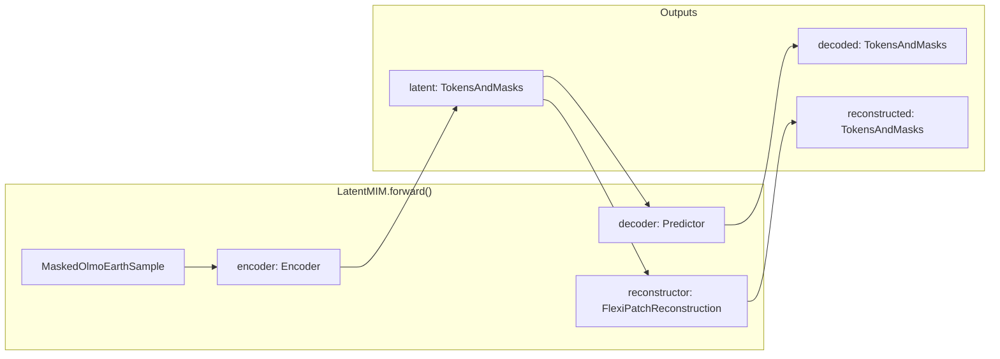

<!-- source: DeepWiki mcp.deepwiki.com · repo allenai/olmoearth_pretrain · page 5 Training System · fetched 2026-10-26 -->

# Training System

Relevant source files

The following files were used as context for generating this wiki page:

- [olmoearth_pretrain/data/transform.py](olmoearth_pretrain/data/transform.py)
- [olmoearth_pretrain/nn/flexi_vit.py](olmoearth_pretrain/nn/flexi_vit.py)
- [olmoearth_pretrain/nn/galileo.py](olmoearth_pretrain/nn/galileo.py)
- [olmoearth_pretrain/nn/latent_mim.py](olmoearth_pretrain/nn/latent_mim.py)
- [olmoearth_pretrain/nn/mae.py](olmoearth_pretrain/nn/mae.py)
- [olmoearth_pretrain/train/masking.py](olmoearth_pretrain/train/masking.py)
- [olmoearth_pretrain/train/train_module/contrastive_latentmim.py](olmoearth_pretrain/train/train_module/contrastive_latentmim.py)
- [olmoearth_pretrain/train/train_module/galileo.py](olmoearth_pretrain/train/train_module/galileo.py)
- [olmoearth_pretrain/train/train_module/latent_mim.py](olmoearth_pretrain/train/train_module/latent_mim.py)
- [olmoearth_pretrain/train/train_module/mae.py](olmoearth_pretrain/train/train_module/mae.py)
- [olmoearth_pretrain/train/utils.py](olmoearth_pretrain/train/utils.py)
- [scripts/official/script.py](scripts/official/script.py)
- [tests/integration/eval/test_geobench_dataset_with_model.py](tests/integration/eval/test_geobench_dataset_with_model.py)
- [tests/integration/nn/test_flexi_vit.py](tests/integration/nn/test_flexi_vit.py)
- [tests/integration/nn/test_latent_mim.py](tests/integration/nn/test_latent_mim.py)
- [tests/unit/internal/test_experiment.py](tests/unit/internal/test_experiment.py)
- [tests/unit/train/test_masking.py](tests/unit/train/test_masking.py)
- [tests/unit/train/test_utils.py](tests/unit/train/test_utils.py)

## Purpose and Scope

This document covers the complete training system for OlmoEarth, including the training loop orchestration, loss computation, optimization, and distributed training infrastructure. The training system coordinates data loading, model forward/backward passes, gradient computation, and parameter updates to train the FlexiVit encoder-decoder architecture using self-supervised learning objectives.

For details on the model architecture being trained, see [Model Architecture](#4). For masking strategies applied to input data, see [Masking Strategies](#5.1). For individual loss function implementations, see [Loss Functions](#5.2). For distributed training configuration and FSDP setup, see [Distributed Training with FSDP](#5.5). For experiment configuration and launching, see [Experiment Orchestration](#7).

## Training System Overview

The training system implements a self-supervised learning pipeline where a model learns representations from unlabeled satellite imagery by predicting masked regions. The system supports contrastive learning (matching predictions to target encoder outputs) and reconstruction learning (predicting pixel values), with multiple auxiliary losses for regularization.

### Code to Natural Language Mapping: Training Flow
The following diagram associates the logical training steps with specific code entities used in the pretraining pipeline.

**Sources:** [olmoearth_pretrain/train/train_module/contrastive_latentmim.py:178-279](), [olmoearth_pretrain/nn/latent_mim.py:54-92](), [olmoearth_pretrain/train/masking.py:72-83]()

## Training Module Architecture

The training system is organized around a hierarchy of training modules that handle the training loop, optimization, and distributed training.

**Sources:** [olmoearth_pretrain/train/train_module/train_module.py:43-125](), [olmoearth_pretrain/train/train_module/contrastive_latentmim.py:36-76](), [olmoearth_pretrain/train/train_module/galileo.py:86-139]()

### OlmoEarthTrainModule

`OlmoEarthTrainModule` is the base training module providing core training infrastructure including optimizer management, distributed training setup, gradient clipping, and checkpoint save/load.

| Component | Configuration Field | Description |
|-----------|-------------------|-------------|
| Optimizer | `optim_config: OptimConfig` | Optimizer configuration (typically AdamW) [scripts/official/script.py:108-108]() |
| Transform | `transform_config: TransformConfig` | Data augmentation configuration [olmoearth_pretrain/train/train_module/train_module.py:89-89]() |
| Batch Size | `rank_microbatch_size: int` | Micro-batch size per rank for gradient accumulation [olmoearth_pretrain/train/train_module/train_module.py:92-92]() |
| Autocast | `autocast_precision: DType \| None` | Mixed precision training dtype (bf16/fp16) [olmoearth_pretrain/train/train_module/train_module.py:98-98]() |
| Gradient Clipping | `max_grad_norm: float \| None` | Maximum gradient norm for clipping [olmoearth_pretrain/train/train_module/train_module.py:99-99]() |
| Learning Rate | `scheduler: Scheduler \| None` | Learning rate schedule [olmoearth_pretrain/train/train_module/train_module.py:100-100]() |
| Distributed | `dp_config: DataParallelConfig \| None` | FSDP or DDP configuration [olmoearth_pretrain/train/train_module/train_module.py:96-96]() |

**Sources:** [olmoearth_pretrain/train/train_module/train_module.py:126-496]()

### ContrastiveLatentMIMTrainModule

`ContrastiveLatentMIMTrainModule` implements self-supervised training with contrastive learning and masked image modeling objectives. It supports an `ema_decay` parameter (default `(0.996, 1.0)`) for updating the target encoder [olmoearth_pretrain/train/train_module/contrastive_latentmim.py:55-55]().

**Training Strategy:**
1. Apply masks to create views.
2. Forward pass through online encoder and decoder.
3. Forward pass through target encoder (no gradients) [olmoearth_pretrain/nn/latent_mim.py:48-49]().
4. Compute primary loss (typically `PatchDiscriminationLoss`) [olmoearth_pretrain/train/train_module/contrastive_latentmim.py:45-47]().
5. Update target encoder via EMA [olmoearth_pretrain/train/train_module/train_module.py:497-524]().

**Sources:** [olmoearth_pretrain/train/train_module/contrastive_latentmim.py:76-311]()

## Training Loop Execution

The training loop is orchestrated by the `train_batch()` method, which handles microbatching, gradient accumulation, and distributed training synchronization.

### Microbatching and Gradient Accumulation

Microbatching splits a batch into smaller chunks to fit within GPU memory. The `split_masked_batch` function divides a `MaskedOlmoEarthSample` batch into microbatches [olmoearth_pretrain/train/utils.py:13-27]().

**Gradient Accumulation Behavior:**
- For FSDP: `set_is_last_backward(is_last_mb)` controls synchronization [olmoearth_pretrain/train/train_module/train_module.py:402-404]().
- For DDP: `no_sync()` context prevents gradient synchronization until the last microbatch [olmoearth_pretrain/train/train_module/train_module.py:405-414]().

**Sources:** [olmoearth_pretrain/train/train_module/contrastive_latentmim.py:178-279](), [olmoearth_pretrain/train/utils.py:13-49](), [tests/unit/train/test_utils.py:12-68]()

## Forward Pass Components

The training forward pass involves multiple model components with specific roles.

### Code Entity Space: LatentMIM Forward
The following diagram shows how `LatentMIM` coordinates sub-modules during the training forward pass.

**Sources:** [olmoearth_pretrain/nn/latent_mim.py:54-92](), [olmoearth_pretrain/nn/flexi_vit.py:72-181]()

## Target Encoder and EMA Updates

The target encoder provides stable learning targets through exponential moving average (EMA) updates.

### Update Implementation
The `update_target_encoder()` method in `OlmoEarthTrainModule` performs in-place EMA updates. It specifically handles `DTensor` for FSDP-sharded parameters by updating local shards [olmoearth_pretrain/train/train_module/train_module.py:512-516]().

**Sources:** [olmoearth_pretrain/train/train_module/train_module.py:497-524]()

## Loss Computation and Aggregation

Multiple losses can be combined during training. The primary objective is often `PatchDiscriminationLoss`, which compares decoded predictions to target encoder outputs [olmoearth_pretrain/train/loss.py:246-261]().

| Loss Component | Purpose |
|---------------|---------|
| `PatchDiscriminationLoss` | Main contrastive objective [olmoearth_pretrain/train/loss.py:246-261]() |
| `MAELoss` | Pixel reconstruction (optional) [olmoearth_pretrain/train/loss.py:433-455]() |
| `KoLeoLoss` | Uniformity regularization (optional) [olmoearth_pretrain/train/loss.py:504-533]() |
| `InfoNCELoss` | Instance-level contrastive (optional) [olmoearth_pretrain/train/loss.py:465-492]() |

**Sources:** [olmoearth_pretrain/train/loss.py:23-44](), [olmoearth_pretrain/train/train_module/contrastive_latentmim.py:155-171]()

## Optimization and Gradient Management

### Gradient Clipping
The system supports distributed gradient clipping. The `_clip_grad_norm()` method handles `DTensor` by reducing the norm across the data parallel group before clipping [olmoearth_pretrain/train/train_module/train_module.py:481-483]().

### Learning Rate Scheduling
Learning rates are updated after each optimizer step using a scheduler like `CosWithWarmup` [scripts/official/script.py:125-125](). The `optim_step()` method records the learning rate for each parameter group [olmoearth_pretrain/train/train_module/train_module.py:387-391]().

**Sources:** [olmoearth_pretrain/train/train_module/train_module.py:373-398](), [olmoearth_pretrain/train/train_module/train_module.py:464-495]()

## Distributed Training with FSDP

OlmoEarth leverages Fully Sharded Data Parallel (FSDP) for efficient large-scale training.

- **Mixed Precision:** Configurable via `MixedPrecisionPolicy` for parameters and reductions [olmoearth_pretrain/nn/latent_mim.py:102-105]().
- **Sharding:** Models like `LatentMIM` implement `apply_fsdp()` to shard the encoder, decoder, and target encoder individually before sharding the top-level module [olmoearth_pretrain/nn/latent_mim.py:94-113]().

For details, see [Distributed Training with FSDP](#5.5).

**Sources:** [olmoearth_pretrain/nn/latent_mim.py:94-115](), [olmoearth_pretrain/train/train_module/train_module.py:221-245]()

## Training Callbacks

Callbacks are used for monitoring and checkpointing.
- **W&B Logging:** `OlmoEarthWandBCallback` handles metric reporting [scripts/official/script.py:183-188]().
- **Speed Monitoring:** `OlmoEarthSpeedMonitorCallback` tracks throughput [scripts/official/script.py:215-215]().
- **Checkpointing:** `CheckpointerCallback` manages model saving [scripts/official/script.py:213-213]().

For details, see [Training Callbacks](#5.6).

**Sources:** [scripts/official/script.py:183-218]()

---

