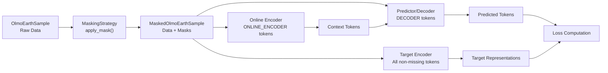
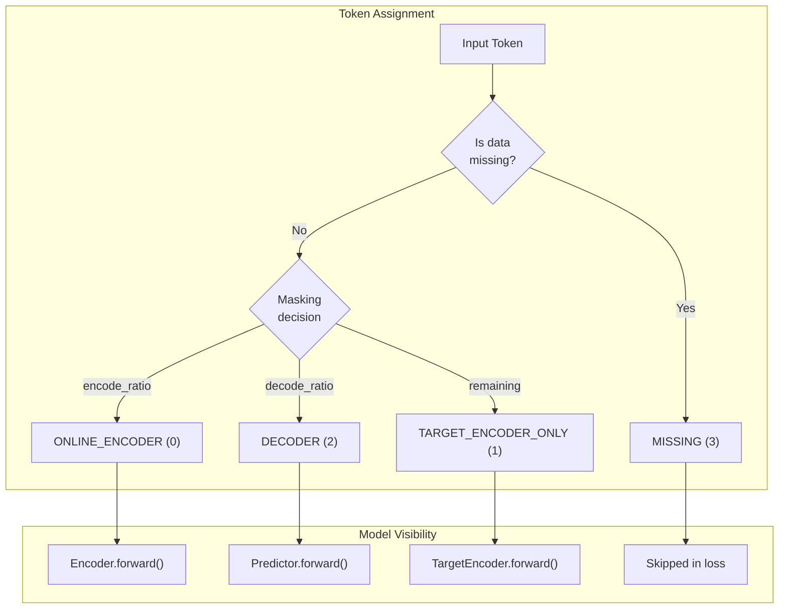
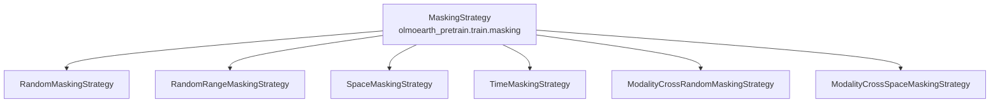
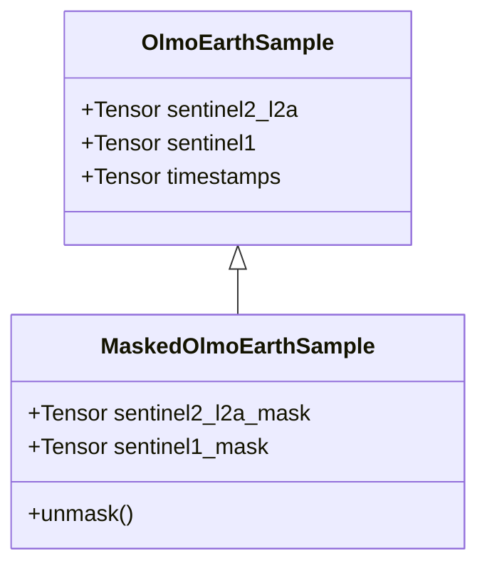

<!-- source: DeepWiki mcp.deepwiki.com · repo allenai/olmoearth_pretrain · page 5.1 Masking Strategies · fetched 2026-10-26 -->

# Masking Strategies

<details>
<summary>Relevant source files</summary>

The following files were used as context for generating this wiki page:

- [olmoearth_pretrain/data/transform.py](olmoearth_pretrain/data/transform.py)
- [olmoearth_pretrain/nn/flexi_vit.py](olmoearth_pretrain/nn/flexi_vit.py)
- [olmoearth_pretrain/nn/galileo.py](olmoearth_pretrain/nn/galileo.py)
- [olmoearth_pretrain/nn/latent_mim.py](olmoearth_pretrain/nn/latent_mim.py)
- [olmoearth_pretrain/nn/mae.py](olmoearth_pretrain/nn/mae.py)
- [olmoearth_pretrain/train/masking.py](olmoearth_pretrain/train/masking.py)
- [tests/integration/eval/test_geobench_dataset_with_model.py](tests/integration/eval/test_geobench_dataset_with_model.py)
- [tests/integration/nn/test_flexi_vit.py](tests/integration/nn/test_flexi_vit.py)
- [tests/integration/nn/test_latent_mim.py](tests/integration/nn/test_latent_mim.py)
- [tests/unit/internal/test_experiment.py](tests/unit/internal/test_experiment.py)
- [tests/unit/train/test_masking.py](tests/unit/train/test_masking.py)

</details>


## Purpose and Scope

This page documents the masking strategies used in OlmoEarth pretraining. Masking is a core component of self-supervised learning where portions of the input data are hidden from the model, which must then learn to predict or reconstruct the masked content. This page covers the available masking strategies, their configuration parameters, and the data structures they produce.

For information about how masking integrates with the training loop, see [Training System](#5). For details on loss functions that operate on masked data, see [Loss Functions](#5.2).

## Masking Overview

Masking strategies determine which tokens are visible to different components of the model during training:

- **Online Encoder** sees unmasked tokens (`ONLINE_ENCODER`) and processes them to create context [olmoearth_pretrain/nn/flexi_vit.py:71-72]().
- **Predictor/Decoder** attempts to reconstruct masked tokens (`DECODER`) using cross-attention over encoder outputs [olmoearth_pretrain/nn/latent_mim.py:83-85]().
- **Target Encoder** processes all tokens (without gradients) to provide stable targets for contrastive learning [olmoearth_pretrain/nn/latent_mim.py:46-52]().

### High-Level Data Flow



Sources: [olmoearth_pretrain/train/masking.py:33-82](), [olmoearth_pretrain/nn/latent_mim.py:54-92]()

## Mask Values

The `MaskValue` enum defines the semantic meaning of mask values assigned to each token. Each token in the input can have one of four mask values:

| Mask Value | Integer | Description |
|------------|---------|-------------|
| `ONLINE_ENCODER` | 0 | Token is visible to the online encoder; used to build context |
| `TARGET_ENCODER_ONLY` | 1 | Token is visible only to the target encoder; provides contrastive targets |
| `DECODER` | 2 | Token is masked and must be predicted by the decoder |
| `MISSING` | 3 | Token represents missing data (e.g., cloudy pixels, absent modality) |

### Masking Decision Logic



**Key Invariant:** For each sample, `encode_ratio + decode_ratio ≤ 1.0`. The remaining fraction `(1 - encode_ratio - decode_ratio)` is assigned to `TARGET_ENCODER_ONLY` [olmoearth_pretrain/train/masking.py:138-151]().

Sources: [olmoearth_pretrain/datatypes.py:22-26](), [olmoearth_pretrain/train/masking.py:111-170]()

## Masking Strategy Classes

All masking strategies inherit from the `MaskingStrategy` base class and implement `apply_mask()` [olmoearth_pretrain/train/masking.py:33-82]().



Sources: [olmoearth_pretrain/train/masking.py:10-20]()

### RandomMaskingStrategy

Randomly assigns mask values to each patch independently. Each patch has a probability of `encode_ratio` of being `ONLINE_ENCODER`, `decode_ratio` of being `DECODER`, and the remainder of being `TARGET_ENCODER_ONLY`.

**Characteristics:**
- Each patch is masked independently.
- All pixels within a patch receive the same mask value [tests/unit/train/test_masking.py:69-76]().
- Suitable for learning local patch representations.

Sources: [tests/unit/train/test_masking.py:62-68](), [olmoearth_pretrain/train/masking.py:111-170]()

### RandomRangeMaskingStrategy

Similar to `RandomMaskingStrategy`, but the `encode_ratio` varies randomly per sample within a specified range `[min_encode_ratio, max_encode_ratio]` [tests/unit/train/test_masking.py:703-758]().

**Characteristics:**
- Each sample in a batch gets a different encode ratio.
- Useful for training models to handle varying amounts of context.

Sources: [tests/unit/train/test_masking.py:16](), [tests/unit/train/test_masking.py:703-758]()

### SpaceMaskingStrategy

Masks contiguous spatial regions. This encourages the model to learn spatially coherent representations and understand spatial relationships across larger areas.

**Characteristics:**
- Creates spatially contiguous masked regions.
- All timesteps at a given spatial location share the same mask [tests/unit/train/test_masking.py:116-157]().
- Patch-level consistency is maintained.

Sources: [tests/unit/train/test_masking.py:18](), [tests/unit/train/test_masking.py:134-140]()

### TimeMaskingStrategy

Masks contiguous temporal slices. At randomly selected timesteps, all spatial locations are masked together, forcing the model to interpolate missing timesteps [tests/unit/train/test_masking.py:159-220]().

**Characteristics:**
- Entire timesteps are masked uniformly across space.
- Ensures at least one modality is present at each timestep to avoid completely empty inputs.

Sources: [tests/unit/train/test_masking.py:19](), [tests/unit/train/test_masking.py:159-220]()

### ModalityCrossSpaceMaskingStrategy

Implements cross-modal masked modeling with spatial structure. For each spatial location, it randomly selects which modalities (band sets) are visible to the encoder versus decoder [tests/unit/train/test_masking.py:760-828]().

**Characteristics:**
- Promotes learning of relationships between different satellite sensors (e.g., Sentinel-1 vs Sentinel-2).
- Can prevent the encoder and decoder from seeing the same band sets if configured.

Sources: [tests/unit/train/test_masking.py:14](), [tests/unit/train/test_masking.py:760-828]()

## MaskedOlmoEarthSample

The `MaskedOlmoEarthSample` class is the primary container for data after masking. It includes the original data tensors plus corresponding `*_mask` tensors [olmoearth_pretrain/datatypes.py:16-19]().

### Data Structure Bridge



**Mask Shapes:**
Mask shapes match data shapes except in the channel dimension. For modalities with band sets, the mask has one value per band set [tests/unit/train/test_masking.py:101-106]().

- **Sentinel-2:** Data `(B, H, W, T, 12)`, Mask `(B, H, W, T, 3)` (for 3 band sets).
- **Lat/Lon:** Data `(B, 2)`, Mask `(B, 1)`.

Sources: [tests/unit/train/test_masking.py:32-36](), [tests/unit/train/test_masking.py:101-106]()

## Implementation Details

### Handling Missing Data
Masking strategies automatically detect `MISSING_VALUE` (-9999) in the input tensors. If any band in a band set is missing, the entire band set for that patch/timestep is marked with `MaskValue.MISSING` (3) [olmoearth_pretrain/train/masking.py:84-110]().

### Patch-Level Consistency
The `_create_random_mask` method ensures consistency by creating a mask at the patch resolution and then repeating it across the full image dimensions [olmoearth_pretrain/train/masking.py:120-170]().

```python
# Internal logic in _create_random_mask
if modality.is_spatial:
    patch_size = patch_size_at_16 * modality.image_tile_size_factor
    mask_shape[1] //= patch_size
    mask_shape[2] //= patch_size
    # ... create mask ...
    mask = repeat(mask, "b h w ... -> b (h hp) (w wp) ...", hp=patch_size, wp=patch_size)
```

Sources: [olmoearth_pretrain/train/masking.py:84-110](), [olmoearth_pretrain/train/masking.py:120-170]()

## Configuration Parameters

Masking is configured via `MaskingConfig` [tests/unit/internal/test_experiment.py:21]().

| Parameter | Type | Description |
|-----------|------|-------------|
| `strategy_config` | dict | Dictionary containing `type` and strategy-specific ratios |
| `encode_ratio` | float | Fraction of patches for the Online Encoder |
| `decode_ratio` | float | Fraction of patches for the Predictor/Decoder |

**Example Config:**
```python
masking_config = MaskingConfig(
    strategy_config={
        "type": "random",
        "encode_ratio": 0.1,
        "decode_ratio": 0.75,
    }
)
```

Sources: [tests/unit/internal/test_experiment.py:101-102](), [tests/unit/internal/test_experiment.py:131-137]()

## Summary Table: Masking Strategies

| Strategy | Spatial Structure | Temporal Structure | Cross-Modal | Typical Use |
|----------|------------------|-------------------|-------------|-------------|
| `Random` | Independent | Independent | No | Standard MAE/MIM |
| `Space` | Contiguous Blocks | Shared across T | No | Spatial context learning |
| `Time` | Full Frame | Contiguous Slices | No | Temporal interpolation |
| `CrossSpace`| Contiguous Blocks | Independent | Yes | Sensor fusion |

Sources: [tests/unit/train/test_masking.py:10-20](), [olmoearth_pretrain/train/masking.py:111-170]()

---

