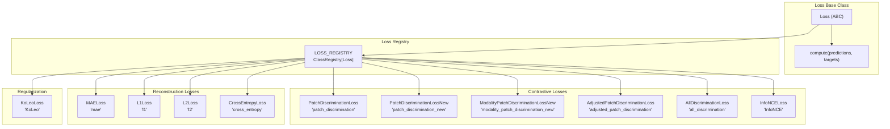
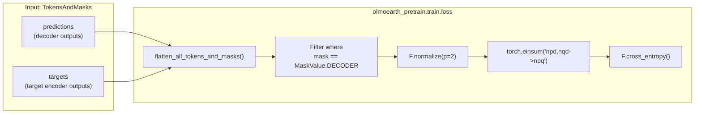
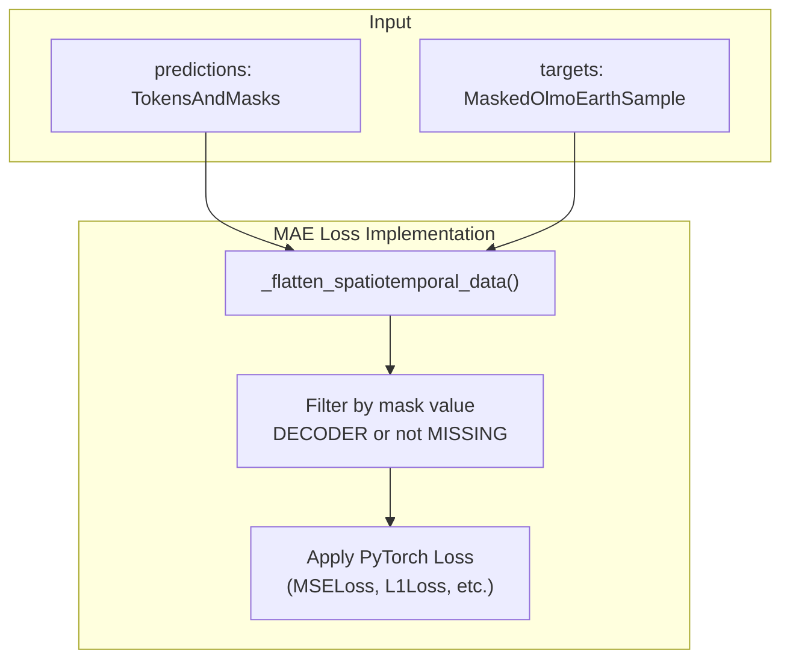
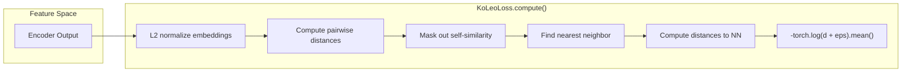
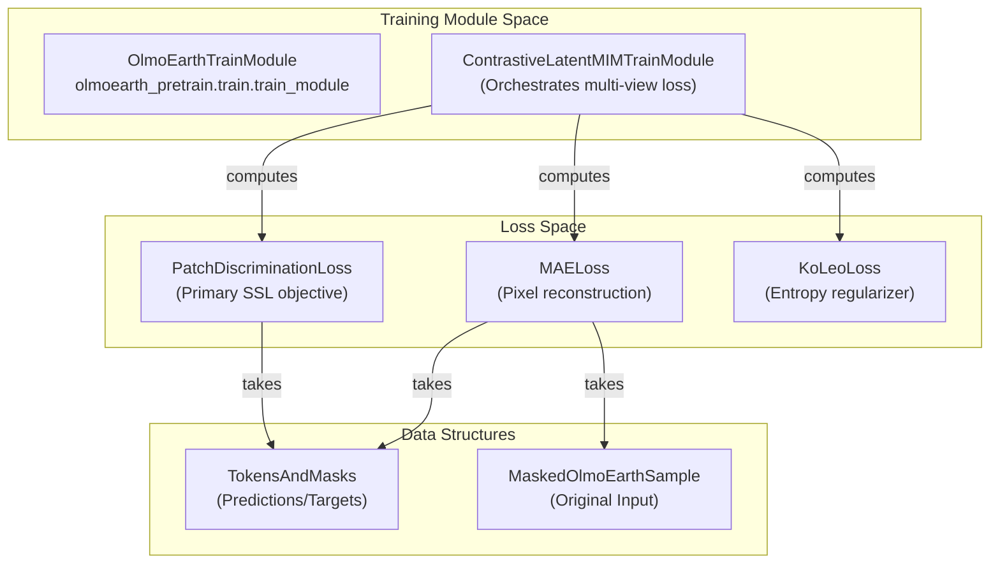

<!-- source: DeepWiki mcp.deepwiki.com · repo allenai/olmoearth_pretrain · page 5.2 Loss Functions · fetched 2026-10-26 -->

# Loss Functions

Relevant source files

The following files were used as context for generating this wiki page:

- [olmoearth_pretrain/nn/pooled_modality_predictor.py](olmoearth_pretrain/nn/pooled_modality_predictor.py)
- [olmoearth_pretrain/nn/st_model.py](olmoearth_pretrain/nn/st_model.py)
- [olmoearth_pretrain/nn/tokenization.py](olmoearth_pretrain/nn/tokenization.py)
- [olmoearth_pretrain/train/loss.py](olmoearth_pretrain/train/loss.py)
- [olmoearth_pretrain/train/train_module/train_module.py](olmoearth_pretrain/train/train_module/train_module.py)
- [scripts/official/ablations/base_high_entropy_dataset.py](scripts/official/ablations/base_high_entropy_dataset.py)
- [scripts/official/ablations/base_mae.py](scripts/official/ablations/base_mae.py)
- [scripts/official/ablations/base_random_masking.py](scripts/official/ablations/base_random_masking.py)
- [tests/integration/eval/test_geobench_dataset_with_model.py](tests/integration/eval/test_geobench_dataset_with_model.py)
- [tests/integration/nn/test_latent_mim.py](tests/integration/nn/test_latent_mim.py)
- [tests/integration/nn/test_mae.py](tests/integration/nn/test_mae.py)
- [tests/unit/internal/test_experiment.py](tests/unit/internal/test_experiment.py)
- [tests/unit/train/test_loss.py](tests/unit/train/test_loss.py)
- [tests/unit/train/test_masking.py](tests/unit/train/test_masking.py)

This page documents the loss functions used during pretraining in the OlmoEarth system. Loss functions measure the quality of model predictions and provide gradients for optimization. The system supports multiple loss types including contrastive losses (for self-supervised learning), reconstruction losses (for masked auto-encoding), and regularization losses. For information about how losses are integrated into the training loop, see [Training Modules](5.3). For details on how tokens are masked before loss computation, see [Masking Strategies](5.1).

## Loss Function Architecture

All loss functions inherit from the abstract `Loss` base class and are registered in the `LOSS_REGISTRY` for dynamic instantiation. Losses operate primarily on `TokensAndMasks` objects, which contain both predicted and target token embeddings along with mask information indicating which tokens should contribute to the loss.

Title: Loss Function Class Hierarchy

Sources: [olmoearth_pretrain/train/loss.py:25-46](), [olmoearth_pretrain/train/loss.py:187-188](), [olmoearth_pretrain/train/loss.py:267-268]()

The `Loss` abstract base class defines the interface:

| Method | Signature | Purpose |
|--------|-----------|---------|
| `compute` | `(predictions: Any, targets: Any, **kwargs) → Tensor` | Computes loss value between predictions and targets |
| `_expand_and_reciprocate` | `(t: Tensor) → Tensor` | Helper for batch-size invariant averaging |

Sources: [olmoearth_pretrain/train/loss.py:30-44]()

## Contrastive Losses

Contrastive losses encourage the model to produce similar representations for semantically related patches while distinguishing them from unrelated patches.

### Patch Discrimination Loss

The patch discrimination loss performs contrastive learning by treating each masked patch as a positive pair with its target encoding and all other patches within the same sample as negatives.

Title: Patch Discrimination Data Flow

Sources: [olmoearth_pretrain/train/loss.py:188-264](), [olmoearth_pretrain/train/loss.py:372-447]()

The original implementation (`PatchDiscriminationLoss`) masks out negatives from other samples in the batch when `mask_other_samples=True`, ensuring contrastive learning occurs only within each sample. This prevents the loss from being sensitive to batch composition.

**Configuration parameters:**

| Parameter | Type | Default | Description |
|-----------|------|---------|-------------|
| `tau` | float | 0.1 | Softmax temperature for scaling similarities |
| `pred2unit` | bool | False | Whether to standardize predictions using batch statistics |
| `mask_other_samples` | bool | True | Whether to mask negatives from other samples |

Sources: [olmoearth_pretrain/train/loss.py:197-204](), [olmoearth_pretrain/train/loss.py:382-386]()

The newer implementation (`PatchDiscriminationLossNew`) is more memory-efficient by processing each sample's tokens independently rather than creating a full similarity matrix for the entire batch.

Sources: [olmoearth_pretrain/train/loss.py:188-264]()

### Adjusted Patch Discrimination Loss

The adjusted patch discrimination loss applies Gaussian-based weighting to negative samples, focusing more on hard negatives (those with high similarity to the anchor).

The weight for each negative is computed as:
`weight = (1 / (σ * sqrt(2π))) * exp(-((sim - μ)² / (2σ²)))`

| Parameter | Type | Default | Description |
|-----------|------|---------|-------------|
| `mu` | float | 0.7 | Mean of Gaussian distribution (target similarity for hard negatives) |
| `sigma` | float | 1.0 | Standard deviation (controls focus sharpness) |

Sources: [olmoearth_pretrain/train/loss.py:450-560]()

### InfoNCE Loss

InfoNCE (Information Noise-Contrastive Estimation) is a contrastive loss that operates on instance-level embeddings rather than patch-level tokens. It encourages similar representations for augmented views of the same sample.

| Parameter | Type | Default | Description |
|-----------|------|---------|-------------|
| `tau` | float | 0.1 | Temperature for scaling logits |
| `weight` | float | 1.0 | Scaling factor for loss contribution |

Sources: [olmoearth_pretrain/train/loss.py:724-759]()

## Reconstruction Losses

Reconstruction losses measure the difference between model predictions and ground truth values in pixel or feature space.

### MAE Loss

The MAE (Masked Auto-Encoding) loss computes reconstruction error between predicted and original values for masked tokens. It operates on `TokensAndMasks` representations that have been decoded back to the original data space by the reconstructor.

Title: MAE Reconstruction Pipeline

Sources: [olmoearth_pretrain/train/loss.py:616-694]()

The MAE loss supports various underlying loss functions and masking strategies:

| Parameter | Type | Default | Description |
|-----------|------|---------|-------------|
| `loss_function` | str | "MSELoss" | PyTorch loss class name (MSELoss, L1Loss, etc.) |
| `only_decode` | bool | True | Only compute loss on DECODER masked tokens |
| `weight` | float | 1.0 | Scaling factor for loss contribution |

Sources: [olmoearth_pretrain/train/loss.py:623-633]()

## Regularization

### KoLeo Loss

The KoLeo regularizer is based on the Kozachenko-Leonenko differential entropy estimator and encourages uniform distribution of features within a batch, preventing representation collapse.

Title: KoLeo Regularization Logic

Sources: [olmoearth_pretrain/train/loss.py:762-852]()

The KoLeo loss operates in two modes:

| Mode | Description |
|------|-------------|
| `instance` | Computes regularization on pooled instance embeddings |
| `patch` | Computes regularization on individual patch embeddings |

Sources: [olmoearth_pretrain/train/loss.py:768-771]()

## Loss Computation Pipeline

The following diagram bridges the Natural Language concepts to the Code Entity Space by showing how the `ContrastiveLatentMIMTrainModule` interacts with loss classes.

Title: Training System Loss Integration

Sources: [olmoearth_pretrain/train/train_module/contrastive_latentmim.py:178-310](), [olmoearth_pretrain/train/loss.py:17-20]()

### Mask Value Semantics

Losses use mask values defined in `MaskValue` to determine which tokens to include in loss computation:

| Mask Value | Numeric Value | Loss Behavior |
|------------|---------------|---------------|
| `DECODER` | 2 | Tokens included in loss computation (masked during encoding) |
| `ONLINE_ENCODER` | 1 | Visible to encoder, excluded from most losses |
| `MISSING` | -1 | Missing data, always excluded from loss |

Sources: [olmoearth_pretrain/train/masking.py:13-23](), [olmoearth_pretrain/train/loss.py:84-86]()

### Batch Size Invariance

The patch discrimination loss implements batch size invariance using reciprocal weighting to ensure samples with different numbers of tokens are weighted fairly.

Sources: [olmoearth_pretrain/train/loss.py:36-43](), [olmoearth_pretrain/train/loss.py:106-108]()

---

