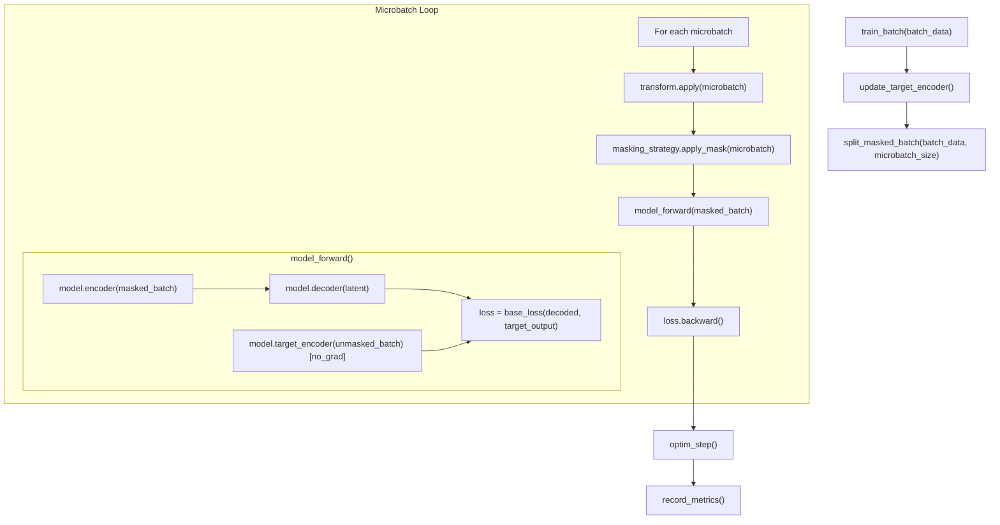
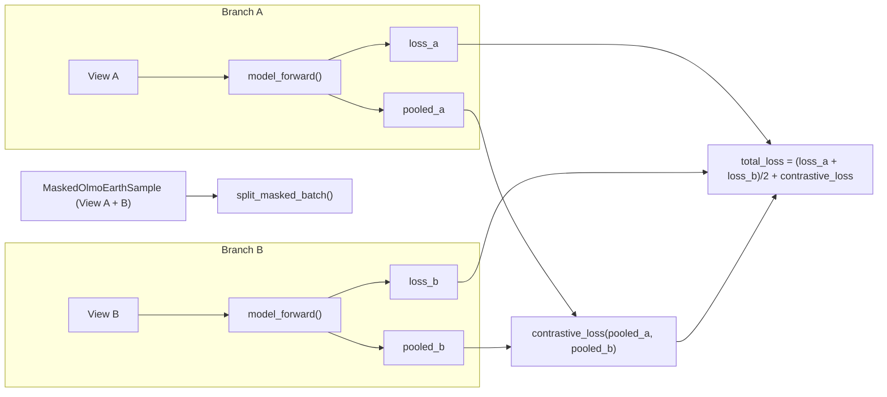

<!-- source: DeepWiki mcp.deepwiki.com · repo allenai/olmoearth_pretrain · page 5.3 Training Modules · fetched 2026-10-26 -->

# Training Modules

<details>
<summary>Relevant source files</summary>

The following files were used as context for generating this wiki page:

- [olmoearth_pretrain/train/train_module/contrastive_latentmim.py](olmoearth_pretrain/train/train_module/contrastive_latentmim.py)
- [olmoearth_pretrain/train/train_module/galileo.py](olmoearth_pretrain/train/train_module/galileo.py)
- [olmoearth_pretrain/train/train_module/latent_mim.py](olmoearth_pretrain/train/train_module/latent_mim.py)
- [olmoearth_pretrain/train/train_module/mae.py](olmoearth_pretrain/train/train_module/mae.py)
- [olmoearth_pretrain/train/utils.py](olmoearth_pretrain/train/utils.py)
- [scripts/official/script.py](scripts/official/script.py)
- [tests/integration/nn/test_mae.py](tests/integration/nn/test_mae.py)
- [tests/integration/train/train_module/test_contrastive_latentmim.py](tests/integration/train/train_module/test_contrastive_latentmim.py)
- [tests/integration/train/train_module/test_latent_mim.py](tests/integration/train/train_module/test_latent_mim.py)
- [tests/integration/train/train_module/test_latent_mim_mae.py](tests/integration/train/train_module/test_latent_mim_mae.py)
- [tests/unit/train/test_utils.py](tests/unit/train/test_utils.py)

</details>


Training modules are responsible for orchestrating the complete training loop for a single batch. They coordinate between the model architecture, masking strategies, loss functions, and optimization components to implement the self-supervised learning objectives used in OlmoEarth pretraining.

For information about the masking strategies applied by training modules, see [Masking Strategies](#5.1). For details on the loss functions computed during training, see [Loss Functions](#5.2). For optimizer and scheduler configuration, see [Optimization and Scheduling](#5.4).

## Overview

Training modules extend the `TrainModule` interface from `olmo_core` and provide specialized implementations for self-supervised Earth observation pretraining. The training module hierarchy consists of:

- **`OlmoEarthTrainModule`**: Base class providing common functionality for distributed training, optimization, and metric logging. [olmoearth_pretrain/train/train_module/train_module.py:43-573]()
- **`LatentMIMTrainModule`**: Implements latent masked image modeling with a target encoder. [olmoearth_pretrain/train/train_module/latent_mim.py:74-122]()
- **`ContrastiveLatentMIMTrainModule`**: Extends LatentMIM with contrastive learning objectives (e.g., InfoNCE) and dual-view data augmentation. [olmoearth_pretrain/train/train_module/contrastive_latentmim.py:79-152]()
- **`MAETrainModule`**: Specifically designed for Masked Autoencoder objectives, supporting both pixel-space reconstruction and latent discrimination. [olmoearth_pretrain/train/train_module/mae.py:73-120]()
- **`GalileoTrainModule`**: An experimental module supporting dual-loss configurations and multi-view training. [olmoearth_pretrain/train/train_module/galileo.py:86-139]()

Each training module is configured via a corresponding `Config` class that specifies the model, optimizer, loss functions, masking strategy, and training hyperparameters.

**Sources:** [olmoearth_pretrain/train/train_module/train_module.py:43-124](), [olmoearth_pretrain/train/train_module/contrastive_latentmim.py:36-77](), [olmoearth_pretrain/train/train_module/latent_mim.py:33-72]()

## Training Module Architecture

```mermaid
graph TB
    subgraph "Configuration Layer"
        OTMC["OlmoEarthTrainModuleConfig"]
        LMTMC["LatentMIMTrainModuleConfig"]
        CLMTMC["ContrastiveLatentMIMTrainModuleConfig"]
        MAETMC["MAETrainModuleConfig"]
    end
    
    subgraph "Training Module Layer"
        OTM["OlmoEarthTrainModule"]
        LMTM["LatentMIMTrainModule"]
        CLMTM["ContrastiveLatentMIMTrainModule"]
        MAETM["MAETrainModule"]
    end
    
    subgraph "Components"
        MASK["MaskingConfig"]
        LOSS["LossConfig"]
        OPTIM["OptimConfig"]
        TRANS["TransformConfig"]
        SCHED["Scheduler"]
    end
    
    subgraph "Model Space"
        MODEL_LM["LatentMIM"]
        MODEL_MAE["MAE"]
        ENCODER["Encoder"]
        DECODER["Predictor"]
        RECONS["Reconstructor"]
    end
    
    OTMC --> OTM
    LMTMC --> LMTM
    CLMTMC --> CLMTM
    MAETMC --> MAETM
    
    LMTM --|extends| OTM
    CLMTM --|extends| OTM
    MAETM --|extends| OTM
    
    OTMC --> OPTIM
    OTMC --> TRANS
    OTMC --> SCHED
    
    LMTMC --> MASK
    LMTMC --> LOSS
    
    CLMTMC --> LOSS
    
    OTM --> MODEL_LM
    MAETM --> MODEL_MAE
    
    MODEL_LM --> ENCODER
    MODEL_LM --> DECODER
    
    MODEL_MAE --> ENCODER
    MODEL_MAE --> DECODER
    MODEL_MAE --> RECONS
```

**Sources:** [olmoearth_pretrain/train/train_module/train_module.py:43-124](), [olmoearth_pretrain/train/train_module/contrastive_latentmim.py:36-109](), [olmoearth_pretrain/train/train_module/mae.py:32-120]()

## Base Training Module (`OlmoEarthTrainModule`)

The `OlmoEarthTrainModule` class provides the foundation for all training modules in the codebase. It handles distributed training setup, optimizer management, gradient clipping, and metric logging.

### Key Responsibilities

| Responsibility | Description |
|---------------|-------------|
| **Distributed Training** | Configures FSDP or DDP based on `DataParallelConfig`. [olmoearth_pretrain/train/train_module/train_module.py:200-246]() |
| **Optimizer Management** | Builds and manages the optimizer from `OptimConfig`. [olmoearth_pretrain/train/train_module/train_module.py:255-265]() |
| **Gradient Handling** | Clips gradients and handles gradient accumulation across microbatches. [olmoearth_pretrain/train/train_module/train_module.py:464-495]() |
| **Learning Rate Scheduling** | Applies learning rate schedules via `Scheduler`. [olmoearth_pretrain/train/train_module/train_module.py:440-450]() |
| **Mixed Precision** | Enables autocast with configurable dtype. [olmoearth_pretrain/train/train_module/train_module.py:147-160]() |
| **State Management** | Handles checkpoint saving/loading with distributed state dict support. [olmoearth_pretrain/train/train_module/train_module.py:530-573]() |

### Core Methods

#### Target Encoder Updates

For models with a target encoder (EMA-based), the training module provides an update method. The EMA decay value linearly increases from `start_ema` to `end_ema` over the course of training. [olmoearth_pretrain/train/train_module/train_module.py:497-505]()

```python
def update_target_encoder(self) -> None:
    """Update target encoder parameters using EMA."""
    # ... logic to calculate current EMA value based on global step ...
    with torch.no_grad():
        for p, tp in zip(self.model.encoder.parameters(), self.model.target_encoder.parameters()):
            if isinstance(p.data, DTensor):
                # Handle FSDP sharded parameters
                p_local = p.data.to_local()
                tp_local = tp.data.to_local()
                tp_local.mul_(cur_ema_value).add_(p_local, alpha=(1 - cur_ema_value))
            else:
                tp.data.mul_(cur_ema_value).add_(p.data, alpha=(1 - cur_ema_value))
```

**Sources:** [olmoearth_pretrain/train/train_module/train_module.py:497-525]()

## LatentMIM Training Module

The `LatentMIMTrainModule` implements the core latent masked image modeling training procedure. It coordinates masking, encoder/decoder forward passes, target encoder computation, and loss calculation.

### Configuration

```python
@dataclass
class LatentMIMTrainModuleConfig(OlmoEarthTrainModuleConfig):
    loss_config: LossConfig  # Primary loss (e.g., PatchDiscrimination)
    masking_config: MaskingConfig  # Masking strategy
    token_exit_cfg: dict[str, int]  # Exit layer per modality
    ema_decay: tuple[float, float] = (0.996, 1.0)  # EMA range
    max_grad_norm: float = 1.0
    mae_loss_config: LossConfig | None = None  # Optional MAE loss
```

**Sources:** [olmoearth_pretrain/train/train_module/latent_mim.py:33-53]()

### Training Loop Flow



**Sources:** [olmoearth_pretrain/train/train_module/latent_mim.py:164-211](), [olmoearth_pretrain/train/train_module/contrastive_latentmim.py:178-279]()

## ContrastiveLatentMIM Training Module

The `ContrastiveLatentMIMTrainModule` extends the basic LatentMIM approach with contrastive learning objectives. It is designed to work with batches containing two masked views (e.g., from `collate_double_masked_batched`). [olmoearth_pretrain/train/train_module/contrastive_latentmim.py:178-185]()

### Dual Augmentation Strategy

The contrastive training module creates two independently augmented and masked views of each input:



**Sources:** [olmoearth_pretrain/train/train_module/contrastive_latentmim.py:209-246](), [tests/integration/train/train_module/test_contrastive_latentmim.py:162-176]()

### Loss Computation

The contrastive training module supports multiple loss components:

| Loss Component | Purpose | Configuration |
|---------------|---------|---------------|
| **Primary Loss** | PatchDiscrimination between decoder predictions and target encoder | `loss_config`. [olmoearth_pretrain/train/train_module/contrastive_latentmim.py:45-47]() |
| **Contrastive Loss** | InfoNCE between pooled representations of two views | `contrastive_config`. [olmoearth_pretrain/train/train_module/contrastive_latentmim.py:57]() |
| **MAE Loss** | Reconstruction loss for pixel-space predictions | `mae_loss_config`. [olmoearth_pretrain/train/train_module/contrastive_latentmim.py:48]() |
| **Regularization** | KoLeo regularization on embeddings | `regularizer_config`. [olmoearth_pretrain/train/train_module/contrastive_latentmim.py:105]() |

**Sources:** [olmoearth_pretrain/train/train_module/contrastive_latentmim.py:155-176]()

## Usage Example: Official Pretraining Script

In the official pretraining setup, the `ContrastiveLatentMIMTrainModule` is configured to use a `modality_patch_discrimination_new` loss and an `InfoNCE` contrastive loss. [scripts/official/script.py:111-122]()

```python
def build_train_module_config(common: CommonComponents) -> ContrastiveLatentMIMTrainModuleConfig:
    return ContrastiveLatentMIMTrainModuleConfig(
        optim_config=AdamWConfig(lr=0.0001, weight_decay=0.02),
        rank_microbatch_size=32,
        masking_config=get_masking_config(common),
        loss_config=LossConfig(
            loss_config={"type": "modality_patch_discrimination_new", "tau": 0.1}
        ),
        contrastive_config=LossConfig(
            loss_config={"type": "InfoNCE", "weight": 0.1}
        ),
        token_exit_cfg={modality: 0 for modality in common.training_modalities},
        ema_decay=(1.0, 1.0), # Fixed EMA for some experiments
    )
```

**Sources:** [scripts/official/script.py:97-132]()

## Utility Functions

### Microbatch Splitting

The `split_masked_batch` function is critical for fitting large global batches into GPU memory. It slices a `MaskedOlmoEarthSample` along the batch dimension into smaller chunks. [olmoearth_pretrain/train/utils.py:13-27]()

```python
def split_masked_batch(batch: MaskedOlmoEarthSample, microbatch_size: int) -> list[MaskedOlmoEarthSample]:
    batch_size = batch.batch_size
    if batch_size <= microbatch_size:
        return [batch]
    # ... logic to split tensors across all fields (timestamps, sentinel2_l2a, etc.) ...
```

**Sources:** [olmoearth_pretrain/train/utils.py:13-49](), [tests/unit/train/test_utils.py:12-66]()

### Memory Monitoring

The training system includes utilities to monitor memory usage of the main process and its children (e.g., dataloader workers), logging RSS, PSS, and USS stats. [olmoearth_pretrain/train/utils.py:52-102]()

**Sources:** [olmoearth_pretrain/train/utils.py:52-102]()

---

