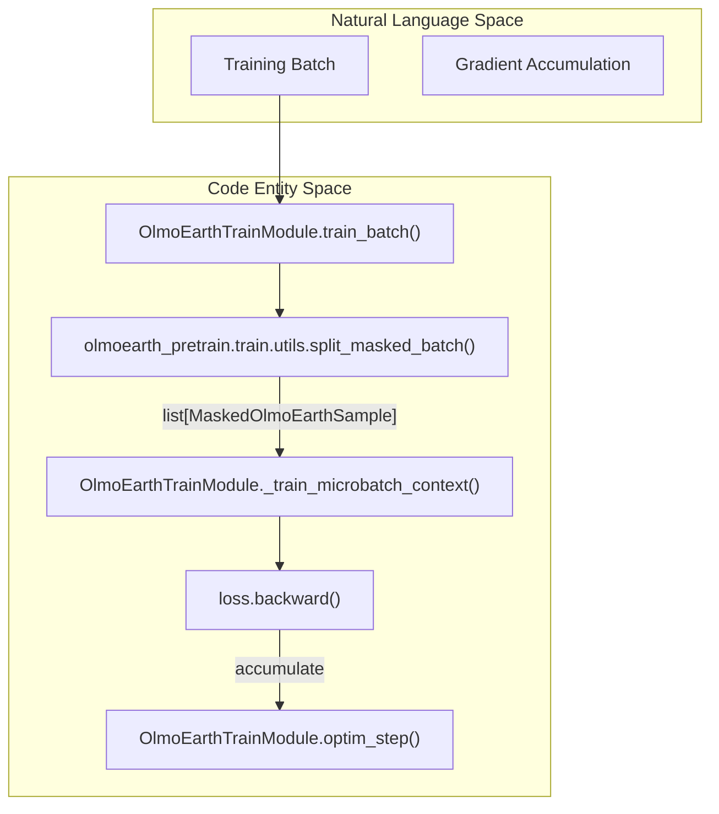

<!-- source: DeepWiki mcp.deepwiki.com · repo allenai/olmoearth_pretrain · page 5.4 Optimization and Scheduling · fetched 2026-10-26 -->

# Optimization and Scheduling

<details>
<summary>Relevant source files</summary>

The following files were used as context for generating this wiki page:

- [olmoearth_pretrain/train/train_module/contrastive_latentmim.py](olmoearth_pretrain/train/train_module/contrastive_latentmim.py)
- [olmoearth_pretrain/train/train_module/galileo.py](olmoearth_pretrain/train/train_module/galileo.py)
- [olmoearth_pretrain/train/train_module/latent_mim.py](olmoearth_pretrain/train/train_module/latent_mim.py)
- [olmoearth_pretrain/train/train_module/mae.py](olmoearth_pretrain/train/train_module/mae.py)
- [olmoearth_pretrain/train/utils.py](olmoearth_pretrain/train/utils.py)
- [scripts/official/script.py](scripts/official/script.py)
- [tests/unit/train/test_utils.py](tests/unit/train/test_utils.py)

</details>


## Purpose and Scope

This page documents the optimization and learning rate scheduling components of the OlmoEarth training system. It covers:

- **Optimizer configuration** (AdamW and other optimizers from `olmo_core`)
- **Learning rate schedulers** for warmup and decay
- **Gradient clipping** for training stability
- **Exponential Moving Average (EMA) updates** for the target encoder
- **Mixed precision training** with autocast
- **Microbatching and gradient accumulation** strategies

For information about the loss functions being optimized, see [Loss Functions](#5.2). For distributed training setup with FSDP, see [Distributed Training with FSDP](#5.5). For the overall training loop that invokes these optimization steps, see [Training Modules](#5.3).

Sources: [olmoearth_pretrain/train/train_module/train_module.py:1-573](), [olmoearth_pretrain/train/train_module/contrastive_latentmim.py:1-311]()

---

## Optimizer Configuration

The optimizer is configured through the `OptimConfig` class from `olmo_core.optim`. This configuration is part of the `OlmoEarthTrainModuleConfig` and is instantiated during training module initialization.

### Configuration Structure

```mermaid
graph TB
    subgraph "Code Entity Space"
        OlmoEarthTrainModuleConfig["OlmoEarthTrainModuleConfig"]
        OptimConfig["olmo_core.optim.OptimConfig"]
        Optimizer["torch.optim.Optimizer"]
        SkipStepOptimizer["olmo_core.optim.SkipStepOptimizer"]
        AdamWConfig["olmo_core.optim.AdamWConfig"]
    end

    OlmoEarthTrainModuleConfig -->|"contains"| OptimConfig
    OptimConfig -->|"build()"| Optimizer
    Optimizer -.->|"may be wrapped as"| SkipStepOptimizer
    
    AdamWConfig --|> OptimConfig
    
    AdamW["AdamW"]
    SGD["SGD"]
    
    Optimizer -.->|"typically"| AdamW
    Optimizer -.->|"or"| SGD
```

**Sources:** [olmoearth_pretrain/train/train_module/train_module.py:43-86](), [olmoearth_pretrain/train/train_module/train_module.py:251-256](), [scripts/official/script.py:108]()

### Optimizer Instantiation

The optimizer is built from the configuration in the `OlmoEarthTrainModule.__init__` method:

```python
# Line 253-255
self.optimizer: Optimizer = optim_config.build(
    self.model,
)
```

In typical pretraining scripts, `AdamWConfig` is used with a weight decay of 0.02 and fused kernels disabled [scripts/official/script.py:108]().

**Key Configuration Parameters:**

| Parameter | Type | Description |
|-----------|------|-------------|
| `optim_config` | `OptimConfig` | Complete optimizer configuration from `olmo_core` |
| `rank_microbatch_size` | `int` | Microbatch size per rank for gradient accumulation |
| `max_grad_norm` | `float \| None` | Maximum gradient norm for clipping (default: 1.0) |
| `scheduler` | `Scheduler \| None` | Optional learning rate scheduler |

**Sources:** [olmoearth_pretrain/train/train_module/train_module.py:62-81](), [olmoearth_pretrain/train/train_module/train_module.py:147-182](), [scripts/official/script.py:108-125]()

---

## Learning Rate Scheduling

Learning rate scheduling is implemented through the optional `Scheduler` parameter in the training module configuration. The scheduler is applied at each optimization step, before the optimizer step is executed.

### Scheduler Implementation

The scheduler is applied per parameter group within `OlmoEarthTrainModule.optim_step()`:

```python
# Lines 386-391
if self.scheduler is not None:
    for group_idx, group in enumerate(self.optimizer.param_groups):
        new_lr = self.scheduler.set_lr(group, self.trainer)
        self.trainer.record_metric(
            f"LR (group {group_idx})", new_lr, namespace="optim"
        )
```

**Common Scheduler Patterns:**

Pretraining typically uses `CosWithWarmup` (Cosine decay with linear warmup). For example, a common configuration uses 8,000 warmup steps [scripts/official/script.py:125]().

| Pattern | Class | Description |
|---------|-------|-------------|
| Linear Warmup | `CosWithWarmup` | Linearly increase LR from 0 to target over N steps [scripts/official/script.py:11]() |
| Cosine Decay | `CosWithWarmup` | Cosine annealing after the warmup phase |

**Sources:** [olmoearth_pretrain/train/train_module/train_module.py:386-391](), [scripts/official/script.py:125]()

---

## Gradient Clipping

Gradient clipping is a critical component for training stability. The system implements custom gradient clipping logic to handle distributed training scenarios, particularly with FSDP.

### Implementation Details

The `_clip_grad_norm()` method implements gradient clipping with distributed training support. It manually collects parameters and gradients to compute a total norm that accounts for `DTensor` sharding [olmoearth_pretrain/train/train_module/train_module.py:464-495]().

```python
# Lines 483-485
# Handle DTensor for distributed training
if isinstance(total_norm, DTensor):
    total_norm = total_norm.full_tensor()
```

**Key Features:**

1. **DTensor Handling**: For FSDP, gradients may be distributed tensors (`DTensor`). The code reduces them to get the true total norm across all ranks [olmoearth_pretrain/train/train_module/train_module.py:483-485]().
2. **Gradient Norm Logging**: The total norm is logged before clipping, providing visibility into gradient magnitudes [olmoearth_pretrain/train/train_module/train_module.py:494]().

**Sources:** [olmoearth_pretrain/train/train_module/train_module.py:464-495](), [olmoearth_pretrain/train/train_module/contrastive_latentmim.py:56]()

---

## EMA Updates for Target Encoder

In contrastive learning approaches like `ContrastiveLatentMIM`, a target encoder is used to provide stable targets. This target encoder is updated via Exponential Moving Average (EMA) of the online encoder's parameters.

### EMA Update Process

The `update_target_encoder()` method in `OlmoEarthTrainModule` performs the update:

```python
# Lines 515-524
for p, tp in zip(
    self.model.encoder.parameters(), self.model.target_encoder.parameters()
):
    if isinstance(p.data, DTensor):
        # Handle FSDP sharded parameters
        p_local = p.data.to_local()
        tp_local = tp.data.to_local()
        tp_local.mul_(cur_ema_value).add_(
            p_local, alpha=(1 - cur_ema_value)
        )
    else:
        # Fallback for regular tensors
        tp.data.mul_(cur_ema_value).add_(p.data, alpha=(1 - cur_ema_value))
```

**EMA Configuration:**

| Parameter | Type | Default | Description |
|-----------|------|---------|-------------|
| `ema_decay` | `tuple[float, float]` | `(0.996, 1.0)` | Start and end EMA decay values [olmoearth_pretrain/train/train_module/contrastive_latentmim.py:55]() |

The EMA coefficient linearly increases from `start_ema` to `end_ema` over the course of training. This allows for more rapid target adaptation early in training and increased stability later [olmoearth_pretrain/train/train_module/train_module.py:501-506]().

**Sources:** [olmoearth_pretrain/train/train_module/train_module.py:497-524](), [olmoearth_pretrain/train/train_module/contrastive_latentmim.py:55](), [olmoearth_pretrain/train/train_module/contrastive_latentmim.py:153]()

---

## Mixed Precision Training

Mixed precision training uses lower precision (typically `bfloat16`) for forward and backward passes to reduce memory usage and increase throughput.

### Autocast Context Manager

The system uses PyTorch's `autocast` context manager, controlled by the `autocast_precision` parameter [olmoearth_pretrain/train/train_module/train_module.py:416-428]().

```python
# Lines 416-428
@contextlib.contextmanager
def _model_forward_context(
    self, no_sync: bool = False
) -> Generator[None, None, None]:
    with contextlib.ExitStack() as stack:
        if self.autocast_precision is not None:
            stack.enter_context(
                torch.autocast(self.device.type, dtype=self.autocast_precision)
            )
        # ... sync logic ...
        yield
```

**Sources:** [olmoearth_pretrain/train/train_module/train_module.py:78](), [olmoearth_pretrain/train/train_module/train_module.py:416-428](), [scripts/official/script.py:129]()

---

## Microbatching and Gradient Accumulation

Microbatching allows training with larger effective batch sizes than can fit in GPU memory by splitting a batch into smaller microbatches and accumulating gradients.

### Microbatch Processing Flow



**Sources:** [olmoearth_pretrain/train/train_module/contrastive_latentmim.py:178-279](), [olmoearth_pretrain/train/utils.py:13-49]()

### Implementation Details

#### Batch Splitting
The `split_masked_batch` function divides a `MaskedOlmoEarthSample` into a list of smaller samples based on `rank_microbatch_size` [olmoearth_pretrain/train/utils.py:13-49]().

#### Training Loop with Microbatches
In `ContrastiveLatentMIMTrainModule.train_batch()`, each microbatch is processed within a context that manages gradient synchronization [olmoearth_pretrain/train/train_module/contrastive_latentmim.py:201-259]().

```python
# Lines 201-202
microbatches = split_masked_batch(batch, self.rank_microbatch_size)
num_microbatches = len(microbatches)
```

The system ensures that the `global_batch_size` is divisible by the product of `rank_microbatch_size` and the world size to maintain consistent gradient updates [olmoearth_pretrain/train/train_module/train_module.py:314-325]().

**Sources:** [olmoearth_pretrain/train/train_module/train_module.py:311-336](), [olmoearth_pretrain/train/train_module/contrastive_latentmim.py:201-259](), [olmoearth_pretrain/train/utils.py:13-49]()

---

