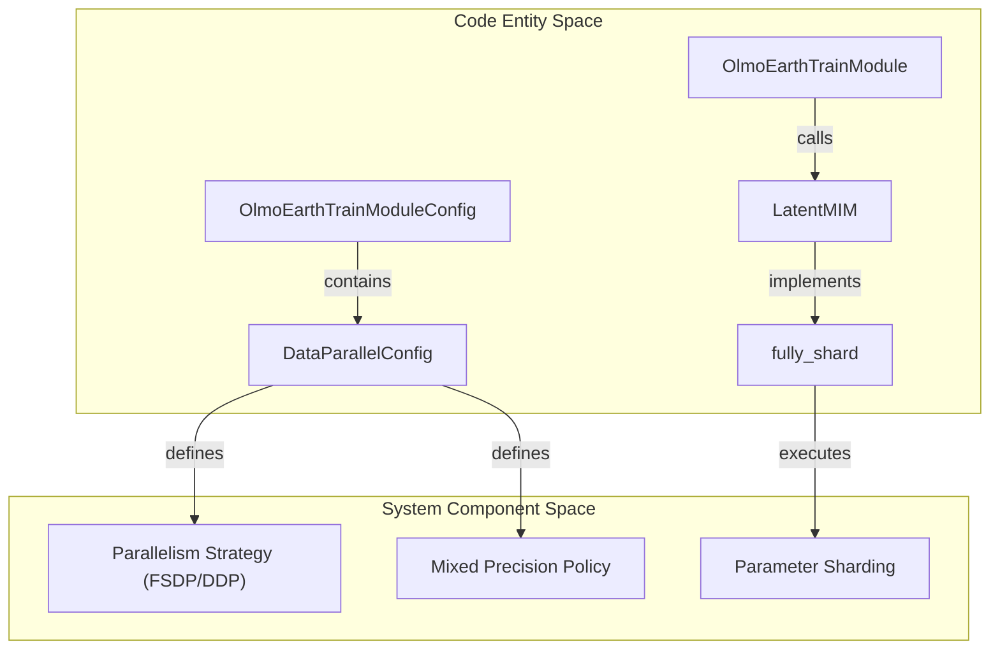
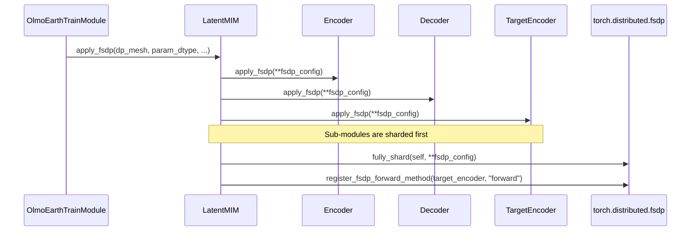
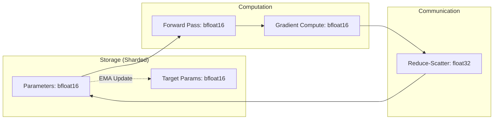
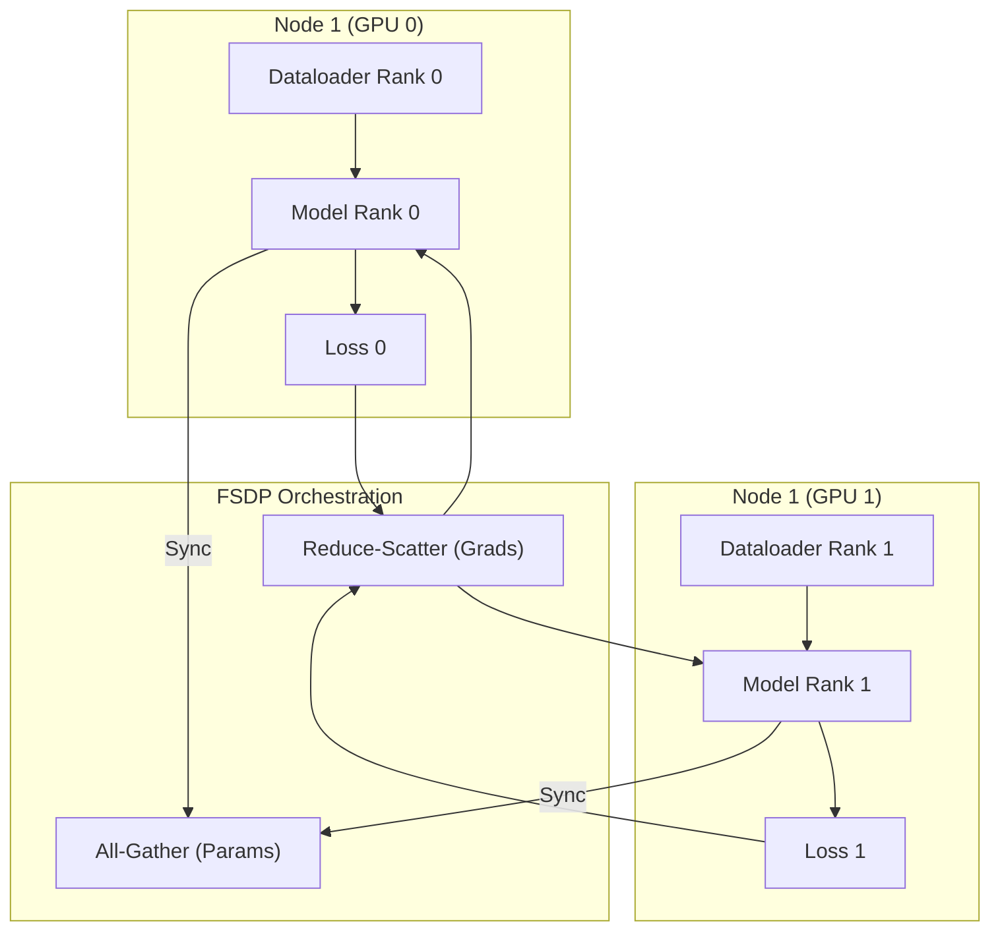

<!-- source: DeepWiki mcp.deepwiki.com · repo allenai/olmoearth_pretrain · page 5.5 Distributed Training with FSDP · fetched 2026-10-26 -->

# Distributed Training with FSDP

Relevant source files

The following files were used as context for generating this wiki page:

- [.github/workflows/lint.yaml](.github/workflows/lint.yaml)
- [.github/workflows/tests.yaml](.github/workflows/tests.yaml)
- [README.md](README.md)
- [olmoearth_pretrain/data/transform.py](olmoearth_pretrain/data/transform.py)
- [olmoearth_pretrain/internal/common.py](olmoearth_pretrain/internal/common.py)
- [olmoearth_pretrain/nn/flexi_vit.py](olmoearth_pretrain/nn/flexi_vit.py)
- [olmoearth_pretrain/nn/galileo.py](olmoearth_pretrain/nn/galileo.py)
- [olmoearth_pretrain/nn/latent_mim.py](olmoearth_pretrain/nn/latent_mim.py)
- [olmoearth_pretrain/nn/mae.py](olmoearth_pretrain/nn/mae.py)
- [olmoearth_pretrain/py.typed](olmoearth_pretrain/py.typed)
- [olmoearth_pretrain/train/masking.py](olmoearth_pretrain/train/masking.py)
- [pyproject.toml](pyproject.toml)
- [tests/integration/nn/test_flexi_vit.py](tests/integration/nn/test_flexi_vit.py)
- [uv.lock](uv.lock)

## Purpose and Scope

This page documents how OlmoEarth utilizes **Fully Sharded Data Parallel (FSDP)** for distributed training across multiple GPUs and nodes. FSDP is the primary data parallelism strategy used to train large OlmoEarth models efficiently by sharding model parameters, gradients, and optimizer states across devices.

For information about:
- Overall training workflow and masking strategies, see [5.1 Masking Strategies]() and [5.3 Training Modules]().
- Training module structure and optimization, see [5.4 Optimization and Scheduling]().
- Multi-node cluster deployment on Beaker, see [7.4 Beaker Cluster Integration]().

---

## FSDP Overview

**Fully Sharded Data Parallel (FSDP)** is PyTorch's native distributed training strategy that shards model parameters, gradients, and optimizer states across all available devices. Unlike standard Distributed Data Parallel (DDP) which replicates the full model on each device, FSDP significantly reduces memory usage per device, enabling training of larger models like OlmoEarth Base and Large.

### Key Benefits

| Feature | FSDP | DDP |
|---------|------|-----|
| Memory per device | Model size / N devices | Full model size |
| Supported model sizes | Very large (>1B params) | Limited by single GPU memory |
| Communication overhead | Moderate (all-gather/reduce-scatter) | Lower (all-reduce only) |
| Setup complexity | Moderate | Simple |

**Sources:** [olmoearth_pretrain/nn/latent_mim.py:94-115](), [README.md:52-57]()

---

## Configuration Structure

Distributed training is configured through the `DataParallelConfig` (aliased from `olmo_core`), which is integrated into the `OlmoEarthTrainModuleConfig`.

### Distributed Training Entity Map

This diagram maps high-level distributed concepts to specific code entities and their relationships.

**Sources:** [olmoearth_pretrain/nn/latent_mim.py:128-170](), [olmoearth_pretrain/nn/latent_mim.py:11-15]()

---

## FSDP Application to Model

The application of FSDP occurs within the model's `apply_fsdp` method. In OlmoEarth, the `LatentMIM` class coordinates the sharding of its constituent parts (Encoder, Decoder, Target Encoder).

### LatentMIM FSDP Implementation

The `LatentMIM.apply_fsdp` method applies sharding recursively to sub-modules before sharding the top-level container.

**Key Steps:**
1. **Mixed Precision Policy**: Created using `MixedPrecisionPolicy` with `param_dtype` (e.g., `bfloat16`) and `reduce_dtype` (typically `float32`) [olmoearth_pretrain/nn/latent_mim.py:102-104]().
2. **Recursive Sharding**: Calls `apply_fsdp` on `self.encoder`, `self.decoder`, and `self.target_encoder` [olmoearth_pretrain/nn/latent_mim.py:107-109]().
3. **Top-level Shard**: The entire `LatentMIM` module is wrapped using `fully_shard` [olmoearth_pretrain/nn/latent_mim.py:113]().
4. **Forward Method Registration**: The target encoder's forward method is explicitly registered with FSDP to ensure correct synchronization during the EMA update process [olmoearth_pretrain/nn/latent_mim.py:114]().

**Sources:** [olmoearth_pretrain/nn/latent_mim.py:94-115](), [olmoearth_pretrain/nn/flexi_vit.py:11-11]()

---

## Mixed Precision Training

OlmoEarth leverages `bfloat16` for memory efficiency and throughput, while maintaining `float32` for critical reductions.

### Precision Strategy Flow

- **`param_dtype`**: Typically `torch.bfloat16`. This reduces the memory footprint of model weights and activations [olmoearth_pretrain/nn/latent_mim.py:103]().
- **`reduce_dtype`**: Typically `torch.float32`. This ensures that gradient aggregations across GPUs do not suffer from underflow/overflow issues common in low-precision formats [olmoearth_pretrain/nn/latent_mim.py:98]().

**Sources:** [olmoearth_pretrain/nn/latent_mim.py:94-115](), [olmoearth_pretrain/nn/flexi_vit.py:8-10]()

---

## Throughput Optimization

Training Earth observation models involves high-dimensional spatial-temporal data. Several techniques are used to maximize GPU throughput.

### 1. Torch Compile
The `LatentMIM` model supports `torch.compile` to optimize kernels across the encoder and decoder blocks. This is applied after FSDP wrapping.
[olmoearth_pretrain/nn/latent_mim.py:116-125]()

### 2. NCCL Debugging
For cluster-scale training, NCCL environment variables are managed via the launch configuration to debug synchronization bottlenecks.
[olmoearth_pretrain/internal/common.py:88-108]()

### 3. Distributed Environment Variables
The system automatically propagates necessary environment variables for distributed coordination on Beaker clusters.
[olmoearth_pretrain/internal/common.py:142-174]()

| Variable | Description | Source |
|----------|-------------|--------|
| `NCCL_DEBUG` | Sets verbosity of NCCL logs | [internal/common.py:97]() |
| `TORCH_NCCL_BLOCKING_WAIT` | Forces synchronous error reporting | [internal/common.py:99]() |
| `GOOGLE_APPLICATION_CREDENTIALS` | For data access in distributed environments | [internal/common.py:143]() |

---

## Multi-GPU Data Flow

The data flow in a distributed setting ensures that each GPU processes a unique microbatch while maintaining global synchronization for the target encoder.

**Sources:** [olmoearth_pretrain/nn/latent_mim.py:54-92](), [olmoearth_pretrain/nn/flexi_vit.py:11-12]()

---

## Troubleshooting FSDP

### Common Failure Modes

1. **Initialization Order**: FSDP wrapping must occur before the optimizer is initialized. If the optimizer is created first, it will point to the un-sharded parameters, leading to incorrect updates or OOM.
2. **Device Mesh Mismatch**: Ensure the `dp_mesh` provided to `apply_fsdp` matches the physical GPU topology [olmoearth_pretrain/nn/latent_mim.py:105]().
3. **EMA Desync**: In `LatentMIM`, the `target_encoder` parameters are not updated via gradients but via EMA. FSDP requires the `target_encoder` forward method to be registered so it can correctly handle parameter gathering during the forward pass [olmoearth_pretrain/nn/latent_mim.py:114]().

**Sources:** [olmoearth_pretrain/nn/latent_mim.py:47-52](), [olmoearth_pretrain/nn/latent_mim.py:114-114]()

---

