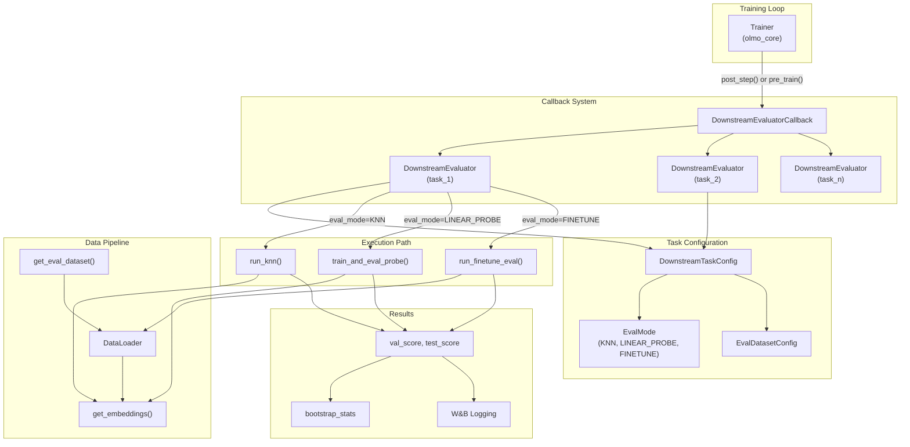
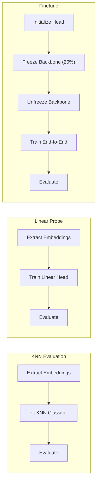
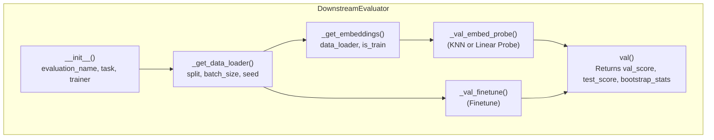
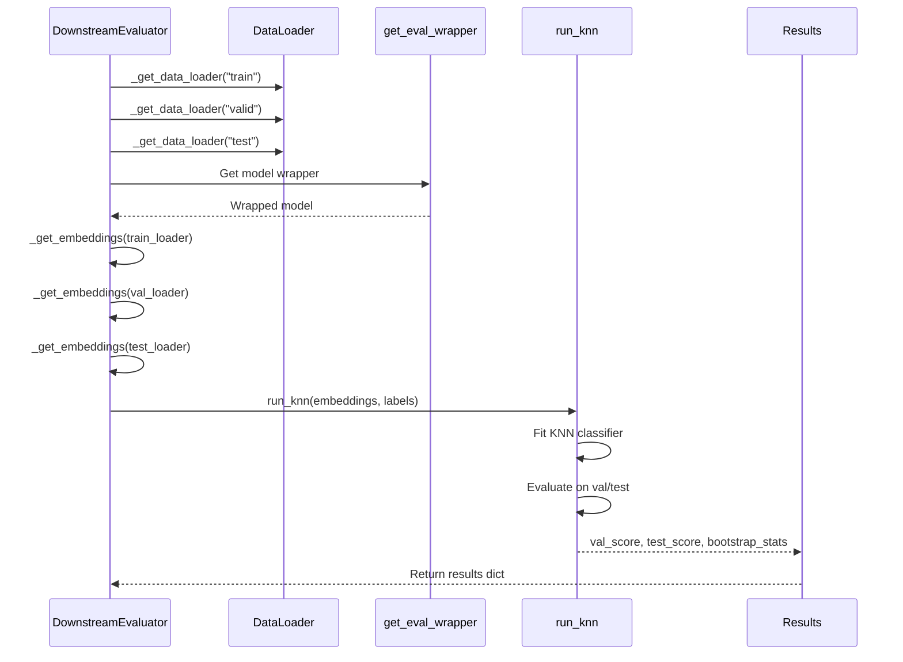
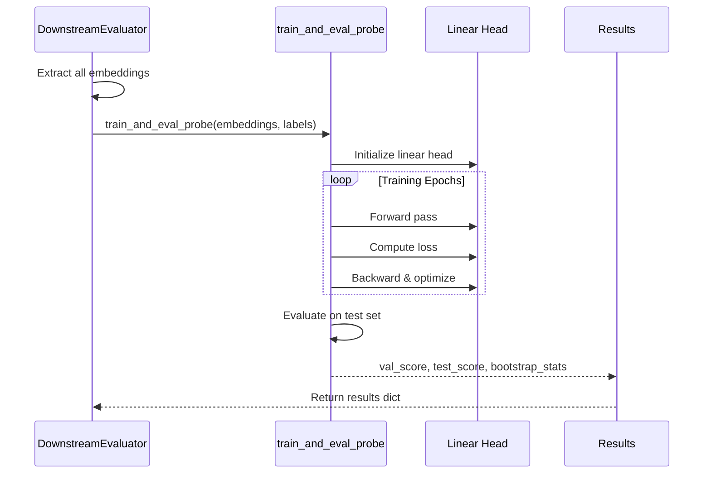
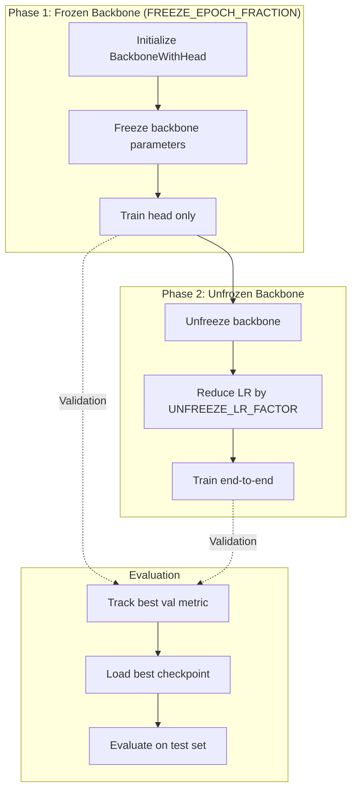

<!-- source: DeepWiki mcp.deepwiki.com · repo allenai/olmoearth_pretrain · page 6 Evaluation System · fetched 2026-10-26 -->

# Evaluation System

<details>
<summary>Relevant source files</summary>

The following files were used as context for generating this wiki page:

- [olmoearth_pretrain/evals/finetune/evaluate.py](olmoearth_pretrain/evals/finetune/evaluate.py)
- [olmoearth_pretrain/evals/finetune/train.py](olmoearth_pretrain/evals/finetune/train.py)
- [olmoearth_pretrain/evals/knn.py](olmoearth_pretrain/evals/knn.py)
- [olmoearth_pretrain/evals/linear_probe.py](olmoearth_pretrain/evals/linear_probe.py)
- [olmoearth_pretrain/evals/metrics.py](olmoearth_pretrain/evals/metrics.py)
- [olmoearth_pretrain/internal/all_evals.py](olmoearth_pretrain/internal/all_evals.py)
- [olmoearth_pretrain/internal/constants.py](olmoearth_pretrain/internal/constants.py)
- [olmoearth_pretrain/internal/full_eval_sweep.py](olmoearth_pretrain/internal/full_eval_sweep.py)
- [olmoearth_pretrain/internal/full_eval_sweep_finetune.py](olmoearth_pretrain/internal/full_eval_sweep_finetune.py)
- [olmoearth_pretrain/train/callbacks/evaluator_callback.py](olmoearth_pretrain/train/callbacks/evaluator_callback.py)
- [scripts/tools/get_max_eval_metrics_from_wandb.py](scripts/tools/get_max_eval_metrics_from_wandb.py)
- [scripts/tools/validate_segmentation_metrics.py](scripts/tools/validate_segmentation_metrics.py)
- [tests/integration/eval/test_finetune.py](tests/integration/eval/test_finetune.py)
- [tests/integration/eval/test_probe.py](tests/integration/eval/test_probe.py)
- [tests/unit/eval/__init__.py](tests/unit/eval/__init__.py)
- [tests/unit/eval/test_metrics.py](tests/unit/eval/test_metrics.py)
- [tests/unit/internal/test_full_eval_sweep.py](tests/unit/internal/test_full_eval_sweep.py)

</details>


## Purpose and Scope

The Evaluation System provides infrastructure for measuring the quality of pretrained models on downstream tasks during and after training. It supports three evaluation modes: KNN classification (embedding-based), linear probing (frozen backbone with trainable head), and full model finetuning. The system is designed to run periodically during training via callbacks or standalone using evaluation sweep scripts.

This document covers the complete evaluation pipeline from task configuration to metric reporting. For information about the training system that invokes these evaluations, see [Training System](#5). For details on model architectures being evaluated, see [Model Architecture](#4).

## System Architecture

The evaluation system is implemented as a callback-based architecture that integrates with the training loop. The `DownstreamEvaluatorCallback` orchestrates multiple `DownstreamEvaluator` instances, each responsible for evaluating a single task.



**Sources:** [olmoearth_pretrain/train/callbacks/evaluator_callback.py:117-782](), [olmoearth_pretrain/train/callbacks/evaluator_callback.py:1-46]()

## Evaluation Modes

The system supports three evaluation modes defined in the `EvalMode` enum:

| Mode | Description | Use Case | Trainable Parameters |
|------|-------------|----------|---------------------|
| `KNN` | K-nearest neighbors on embeddings | Quick assessment, no training | None |
| `LINEAR_PROBE` | Train linear head on frozen features | Standard evaluation | Head only |
| `FINETUNE` | End-to-end finetuning | Maximum performance | All parameters |



The mode is selected either by explicitly setting `eval_mode` in the task configuration or automatically based on task type via `get_eval_mode()`.

**Sources:** [olmoearth_pretrain/train/callbacks/evaluator_callback.py:57-63](), [olmoearth_pretrain/evals/datasets/configs.py:29-30]()

## Downstream Evaluator Components

### DownstreamEvaluator Class

The `DownstreamEvaluator` class manages evaluation for a single task:



Key methods:

- `_get_data_loader()`: Creates DataLoader for train/val/test splits with optional seeding for reproducibility.
- `_get_embeddings()`: Extracts embeddings using the encoder wrapped by `get_eval_wrapper()`.
- `_val_embed_probe()`: Executes KNN or linear probe evaluation paths.
- `_val_finetune()`: Executes full finetuning evaluation using `run_finetune_eval`.
- `val()`: Main entry point that routes to appropriate evaluation mode.

**Sources:** [olmoearth_pretrain/train/callbacks/evaluator_callback.py:120-432]()

### DownstreamTaskConfig

Configuration for a single evaluation task:

```python
@dataclass
class DownstreamTaskConfig:
    dataset: str  # Dataset identifier
    eval_mode: EvalMode | None = None
    
    # Common parameters
    num_workers: int = 8
    pooling_type: str = PoolingType.MEAN
    norm_stats_from_pretrained: bool = True
    patch_size: int = 4
    
    # LP / KNN
    embedding_batch_size: int = 128
    
    # LP
    probe_lr: float | None = None
    probe_batch_size: int = 32
    linear_probe_eval_interval: int = 50
    
    # FT
    ft_lr: float | None = None
    ft_batch_size: int = 32
    finetune_seed: int = 42
    
    # Training
    epochs: int = 50
    eval_interval: Duration = field(default_factory=lambda: Duration.epochs(1))
```

**Sources:** [olmoearth_pretrain/train/callbacks/evaluator_callback.py:66-115]()

## Evaluation Workflow

### KNN Evaluation Path



**Sources:** [olmoearth_pretrain/train/callbacks/evaluator_callback.py:277-334](), [olmoearth_pretrain/evals/knn.py:40]()

### Linear Probe Path

The linear probe path trains a task-specific head (e.g., `ProbeType.LINEAR`) on top of frozen embeddings.



**Sources:** [olmoearth_pretrain/train/callbacks/evaluator_callback.py:277-334](), [olmoearth_pretrain/evals/linear_probe.py:41]()

### Finetune Path

The finetuning path uses a two-phase approach implemented in `run_finetune_eval`:



Key implementation details:
- Uses `BackboneWithHead` wrapper that combines encoder with task-specific head.
- Backbone is frozen for the first portion of epochs (default `FREEZE_EPOCH_FRACTION` = 0.2).
- Uses `ReduceLROnPlateau` scheduler for optimization.
- Evaluates using `eval_cls` or `eval_seg` depending on `TaskType`.

**Sources:** [olmoearth_pretrain/evals/finetune/train.py:113-375](), [olmoearth_pretrain/evals/finetune/constants.py:26-32]()

## Task Configuration System

### Task Registries

Two dictionaries in `all_evals.py` define available tasks:

```python
# For KNN and Linear Probe evaluation
EVAL_TASKS = {
    "m_eurosat": DownstreamTaskConfig(...),
    "m_forestnet": DownstreamTaskConfig(...),
    "m_sa_crop_type": DownstreamTaskConfig(...),
    # ... more tasks
}

# For finetuning evaluation  
FT_EVAL_TASKS = {
    "m_eurosat": DownstreamTaskConfig(...),
    "m_bigearthnet": DownstreamTaskConfig(...),
    # ... more tasks
}
```

**Sources:** [olmoearth_pretrain/internal/all_evals.py:66-392]()

## Evaluation Sweeps

Evaluation sweeps run multiple evaluation configurations with different hyperparameters.

### Linear Probe / KNN Sweep

The `full_eval_sweep.py` script orchestrates hyperparameter sweeps across learning rates, normalization modes, and pooling types.

```python
LP_LRs = [1e-4, 5e-4, 1e-3, 5e-3, 1e-2, 5e-2, 1e-1, 5e-1]
Normalization_MODES = ["pre_trained", "dataset"]
pooling_types = [PoolingType.MEAN, PoolingType.MAX]
```

**Sources:** [olmoearth_pretrain/internal/full_eval_sweep.py:30-32]()

### Finetune Sweep

The `full_eval_sweep_finetune.py` script provides finetuning sweeps, utilizing `MODEL_PRESETS` to handle model-specific normalization logic.

```python
FT_LRS = [1e-4, 5e-4, 1e-3]

MODEL_PRESETS: dict[str, ModelPreset] = {
    "dino_v3": ModelPreset(per_task_overrides={"norm_method": "NormMethod.NORM_YES_CLIP_MIN_MAX_INT"}),
    "terramind": ModelPreset(supports_pretrained_normalizer=True),
    # ...
}
```

**Sources:** [olmoearth_pretrain/internal/full_eval_sweep_finetune.py:50-185]()

## Evaluation Metrics and Analysis

### Metric Classes

The system uses `EvalResult` to store metrics for both classification and segmentation tasks.

```python
@dataclass
class EvalResult:
    primary: float
    primary_metric: EvalMetric
    primary_metric_key: str
    metrics: dict[str, float]
```

Standard metrics include `ACCURACY`, `F1`, `MIOU`, and `MICRO_F1`. For segmentation, it also computes `OVERALL_ACC` and `MACRO_ACC`.

**Sources:** [olmoearth_pretrain/evals/metrics.py:13-160]()

### Analysis Tools

The script `get_max_eval_metrics_from_wandb.py` provides tools to aggregate and extract the best results from W&B sweeps, grouping by run prefix and identifying the maximum validation scores across different hyperparameter configurations.

**Sources:** [scripts/tools/get_max_eval_metrics_from_wandb.py:170-193]()

## Data Loading and Preprocessing

### Evaluation Dataset Loading

Data loaders for evaluation are created with deterministic seeding to ensure reproducibility.

```python
def _seed_worker(worker_id: int, base_seed: int) -> None:
    worker_seed = base_seed + worker_id
    random.seed(worker_seed)
    np.random.seed(worker_seed)
    torch.manual_seed(worker_seed)
```

**Sources:** [olmoearth_pretrain/train/callbacks/evaluator_callback.py:49-55]()

### Segmentation Post-processing

During segmentation evaluation (e.g., in `eval_seg`), the system handles spatial resolution mismatches between model outputs and ground truth labels using bilinear interpolation.

```python
if logits.shape[-2:] != label.shape[-2:]:
    logits = F.interpolate(
        logits.float(),
        size=label.shape[-2:],
        mode="bilinear",
        align_corners=True,
    )
```

**Sources:** [olmoearth_pretrain/evals/finetune/evaluate.py:81-87]()

---

