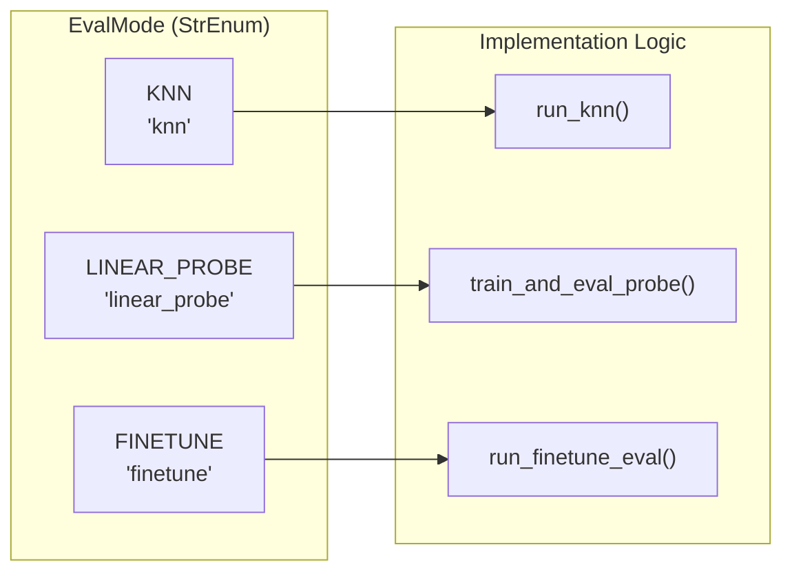
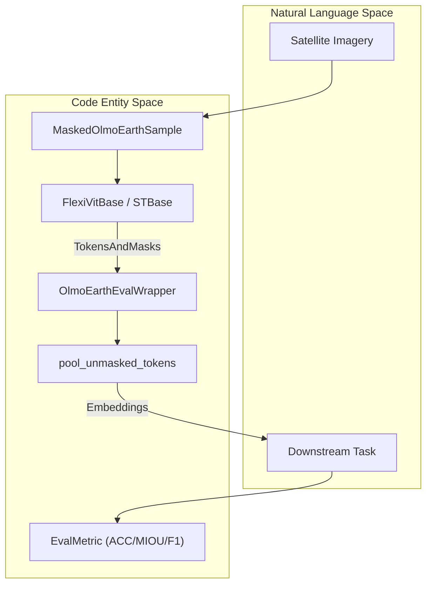
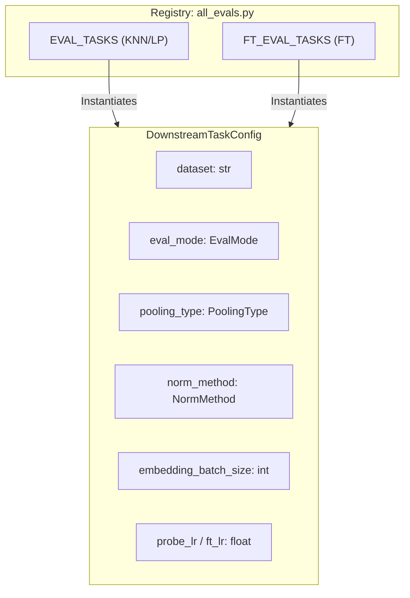

<!-- source: DeepWiki mcp.deepwiki.com · repo allenai/olmoearth_pretrain · page 6.1 Evaluation Overview and Task Types · fetched 2026-10-26 -->

# Evaluation Overview and Task Types

Relevant source files

The following files were used as context for generating this wiki page:

- [olmoearth_pretrain/evals/datasets/utils.py](olmoearth_pretrain/evals/datasets/utils.py)
- [olmoearth_pretrain/evals/embeddings.py](olmoearth_pretrain/evals/embeddings.py)
- [olmoearth_pretrain/evals/eval_wrapper.py](olmoearth_pretrain/evals/eval_wrapper.py)
- [olmoearth_pretrain/internal/all_evals.py](olmoearth_pretrain/internal/all_evals.py)
- [olmoearth_pretrain/internal/constants.py](olmoearth_pretrain/internal/constants.py)
- [olmoearth_pretrain/internal/full_eval_sweep_finetune.py](olmoearth_pretrain/internal/full_eval_sweep_finetune.py)
- [olmoearth_pretrain/nn/pooling.py](olmoearth_pretrain/nn/pooling.py)
- [olmoearth_pretrain/train/callbacks/evaluator_callback.py](olmoearth_pretrain/train/callbacks/evaluator_callback.py)
- [scripts/tools/validate_segmentation_metrics.py](scripts/tools/validate_segmentation_metrics.py)
- [tests/unit/eval/__init__.py](tests/unit/eval/__init__.py)
- [tests/unit/internal/test_full_eval_sweep.py](tests/unit/internal/test_full_eval_sweep.py)

This page provides a high-level technical overview of the evaluation system in OlmoEarth. It details the implementation of different evaluation modes (KNN, Linear Probe, Finetuning), the categorization of task types (Classification, Segmentation), and how these are orchestrated via the `DownstreamEvaluator`.

## Evaluation Modes

The OlmoEarth evaluation system supports three distinct evaluation modes, defined by the `EvalMode` enum in `olmoearth_pretrain/train/callbacks/evaluator_callback.py`. These modes represent a spectrum of adaptation from zero-shot embedding similarity to full model parameter updates.

**Evaluation Mode Implementation**

**Sources:** [olmoearth_pretrain/train/callbacks/evaluator_callback.py:57-62](), [olmoearth_pretrain/train/callbacks/evaluator_callback.py:39-41]()

| Evaluation Mode | Description | Trainable Components | File Reference |
|----------------|-------------|---------------------|----------------|
| `EvalMode.KNN` | K-Nearest Neighbors on frozen embeddings | None (fully frozen) | [olmoearth_pretrain/evals/knn.py]() |
| `EvalMode.LINEAR_PROBE` | Training a linear head on frozen features | Head only (Linear/MLP) | [olmoearth_pretrain/evals/linear_probe.py]() |
| `EvalMode.FINETUNE` | End-to-end model training | Backbone + Head | [olmoearth_pretrain/evals/finetune.py]() |

## Task Types and Data Flow

Evaluation tasks are categorized into `TaskType.CLASSIFICATION` and `TaskType.SEGMENTATION`. The `EvalWrapper` classes bridge the gap between the raw model output and the specific requirements of these tasks by handling spatial and temporal pooling.

**Code Entity Space: Model to Task Mapping**

**Sources:** [olmoearth_pretrain/evals/eval_wrapper.py:104-148](), [olmoearth_pretrain/nn/pooling.py:135-162](), [olmoearth_pretrain/train/callbacks/evaluator_callback.py:42-43]()

### Classification Tasks
Classification tasks predict labels for an entire sample. The system supports both single-label (e.g., `m-eurosat`) and multi-label (e.g., `m-bigearthnet`) datasets.
- **Pooling:** Typically uses `PoolingType.MEAN` or `PoolingType.MAX` to collapse spatial and temporal dimensions into a single vector `(B, D)`.
- **Primary Metrics:** Defaults to `EvalMetric.ACCURACY` or `EvalMetric.MACRO_F1`.

### Segmentation Tasks
Segmentation tasks predict per-pixel labels.
- **Pooling:** Uses `spatial_pooling=True` in `pool_unmasked_tokens` to retain spatial dimensions, resulting in features of shape `(B, H, W, D)`.
- **Primary Metrics:** Defaults to `EvalMetric.MIOU`.
- **Implementation:** For `LINEAR_PROBE` and `FINETUNE`, the model outputs are unpatchified to match the input resolution.

**Sources:** [olmoearth_pretrain/nn/pooling.py:135-162](), [olmoearth_pretrain/internal/all_evals.py:67-101](), [olmoearth_pretrain/train/callbacks/evaluator_callback.py:108-114]()

## Task Configuration

Tasks are defined using the `DownstreamTaskConfig` class. This configuration dictates how the `DownstreamEvaluator` initializes data loaders and optimization loops.

**Configuration Hierarchy**

**Sources:** [olmoearth_pretrain/train/callbacks/evaluator_callback.py:66-115](), [olmoearth_pretrain/internal/all_evals.py:66-392]()

### Normalization Strategies
The `norm_method` and `norm_stats_from_pretrained` fields are critical for evaluation performance.
- **`norm_stats_from_pretrained=True`**: Uses the mean/std values the model saw during pretraining.
- **`norm_stats_from_pretrained=False`**: Uses dataset-specific statistics (often required for tasks like `mados` or `m-forestnet`).
- **Methods:** Supported methods include `STANDARDIZE`, `NORM_NO_CLIP_2_STD`, and `NORM_YES_CLIP_MIN_MAX_INT`.

**Sources:** [olmoearth_pretrain/train/callbacks/evaluator_callback.py:98-100](), [olmoearth_pretrain/internal/all_evals.py:72-73](), [olmoearth_pretrain/internal/full_eval_sweep_finetune.py:104-110]()

## Implementation: DownstreamEvaluator

The `DownstreamEvaluator` is the central class that manages the lifecycle of an evaluation task within the `DownstreamEvaluatorCallback`.

### Key Functions
1. **`_get_embeddings()`**: Iterates through a `DataLoader` and uses an `EvalWrapper` to extract features. It handles device placement and mixed-precision `autocast`.
2. **`_val_embed_probe()`**: Orchestrates `KNN` and `LINEAR_PROBE`. It first extracts embeddings for train/val/test splits and then passes them to the respective solvers.
3. **`_val_finetune()`**: Orchestrates full model finetuning. It initializes a `run_finetune_eval` loop which handles the two-phase (frozen/unfrozen) training strategy.

**Sources:** [olmoearth_pretrain/evals/embeddings.py:15-69](), [olmoearth_pretrain/train/callbacks/evaluator_callback.py:277-334](), [olmoearth_pretrain/train/callbacks/evaluator_callback.py:346-415]()

### Evaluation Result Handling
Results are encapsulated in `EvalResult` objects, which include metrics and optional bootstrap statistics (mean, std, confidence intervals) for uncertainty estimation.

| Field | Description |
|-------|-------------|
| `val_score` | Primary metric on the validation set. |
| `test_score` | Primary metric on the test set. |
| `bootstrap_stats` | Dictionary of statistics if `n_bootstrap > 0`. |

**Sources:** [olmoearth_pretrain/train/callbacks/evaluator_callback.py:420-431](), [olmoearth_pretrain/evals/metrics.py:42]()

## Evaluation Sweeps

To find optimal hyperparameters (especially learning rates and pooling types), the repository provides sweep scripts:
- **`full_eval_sweep.py`**: Sweeps `LP_LRs` ([1e-4, 5e-4, 1e-3, 5e-3, 1e-2, 5e-2, 1e-1]) and `PoolingType` (MEAN/MAX) for Linear Probes.
- **`full_eval_sweep_finetune.py`**: Sweeps `FT_LRS` ([1e-4, 5e-4, 1e-3]) for full model finetuning.

**Sources:** [olmoearth_pretrain/internal/full_eval_sweep_finetune.py:49-53](), [tests/unit/internal/test_full_eval_sweep.py:11-21]()

---

