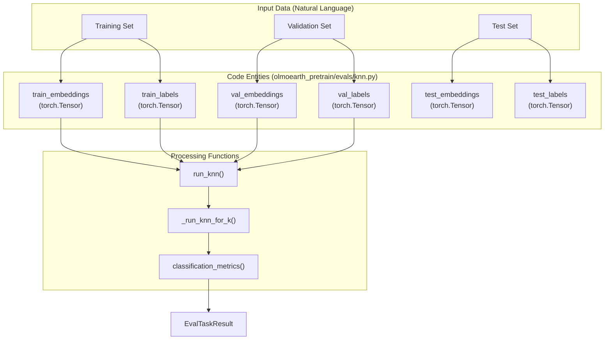
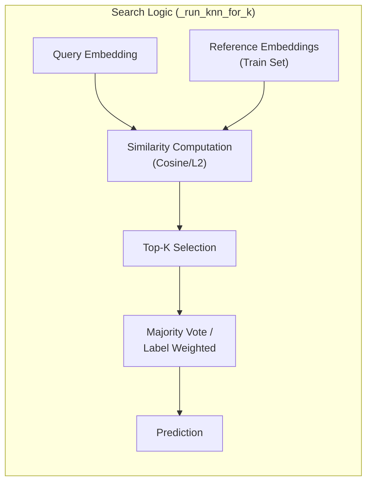

<!-- source: DeepWiki mcp.deepwiki.com · repo allenai/olmoearth_pretrain · page 6.2 KNN Evaluation · fetched 2026-10-26 -->

# KNN Evaluation

<details>
<summary>Relevant source files</summary>

The following files were used as context for generating this wiki page:

- [olmoearth_pretrain/evals/finetune/evaluate.py](olmoearth_pretrain/evals/finetune/evaluate.py)
- [olmoearth_pretrain/evals/finetune/train.py](olmoearth_pretrain/evals/finetune/train.py)
- [olmoearth_pretrain/evals/knn.py](olmoearth_pretrain/evals/knn.py)
- [olmoearth_pretrain/evals/linear_probe.py](olmoearth_pretrain/evals/linear_probe.py)
- [olmoearth_pretrain/evals/metrics.py](olmoearth_pretrain/evals/metrics.py)
- [olmoearth_pretrain/internal/full_eval_sweep.py](olmoearth_pretrain/internal/full_eval_sweep.py)
- [scripts/tools/get_max_eval_metrics_from_wandb.py](scripts/tools/get_max_eval_metrics_from_wandb.py)
- [tests/integration/eval/test_finetune.py](tests/integration/eval/test_finetune.py)
- [tests/integration/eval/test_probe.py](tests/integration/eval/test_probe.py)
- [tests/unit/eval/test_metrics.py](tests/unit/eval/test_metrics.py)

</details>


## Purpose and Scope

This document describes the K-Nearest Neighbors (KNN) evaluation mode in the OlmoEarth pretraining system. KNN evaluation is an **embedding-based** downstream task assessment method that measures the quality of learned representations by performing nearest-neighbor classification in the embedding space. This evaluation mode does not involve training any additional parameters beyond the pretrained encoder.

For information about training a linear classifier on top of frozen features, see [6.3 Linear Probing](). For full model finetuning with trainable backbones, see [6.4 Full Model Finetuning](). For a high-level overview of all evaluation approaches, see [6.1 Evaluation Overview and Task Types]().

## Overview

KNN evaluation assesses the quality of learned representations by:
1. Extracting fixed embeddings from a pretrained encoder for train, validation, and test sets [olmoearth_pretrain/evals/knn.py:24-32]().
2. Using k-nearest neighbors in embedding space to classify validation/test samples based on training set labels [olmoearth_pretrain/evals/knn.py:68-76]().
3. Computing classification metrics without any gradient updates or parameter training [olmoearth_pretrain/evals/knn.py:77-83]().

This approach is particularly useful for:
- **Fast evaluation**: No training loop required, only forward passes to extract embeddings.
- **Zero-parameter assessment**: Evaluates representation quality without additional learnable parameters.
- **Computational efficiency**: Suitable for frequent in-loop evaluations during pretraining.

Sources: [olmoearth_pretrain/evals/knn.py:1-21](), [olmoearth_pretrain/evals/metrics.py:13-24]()

## KNN Evaluation Pipeline

The following diagram shows the complete KNN evaluation pipeline from model to metrics, highlighting the relationship between the natural language concepts and the code entities.

### Natural Language to Code Entity Space: Data Flow


Sources: [olmoearth_pretrain/evals/knn.py:24-63](), [olmoearth_pretrain/evals/knn.py:68-83](), [olmoearth_pretrain/evals/metrics.py:32-39]()

## Configuration

KNN evaluation behavior is driven by the `EvalDatasetConfig` and specific parameters passed to the execution function.

| Parameter | Type | Description | File Reference |
|-----------|------|-------------|----------------|
| `k` | `int` | Number of nearest neighbors (default 20) | [olmoearth_pretrain/evals/knn.py:33]() |
| `is_multilabel` | `bool` | Whether the task is multi-label (e.g. BigEarthNet) | [olmoearth_pretrain/evals/knn.py:67]() |
| `skip_idx` | `bool` | Skip the first neighbor (used when evaluating on training set) | [olmoearth_pretrain/evals/knn.py:34]() |
| `n_bootstrap` | `int` | Samples for uncertainty estimation | [olmoearth_pretrain/evals/knn.py:35]() |
| `primary_metric` | `EvalMetric` | Metric used for ranking (Accuracy, F1, etc.) | [olmoearth_pretrain/evals/knn.py:37]() |

Sources: [olmoearth_pretrain/evals/knn.py:24-39](), [olmoearth_pretrain/evals/metrics.py:13-24]()

## Implementation Details

### Multi-Label vs. Single-Label Logic

The system branches its logic based on whether the dataset is multi-label (like BigEarthNet) or single-label (like EuroSAT).

- **Single-Label**: Performs a single KNN pass to predict the class index [olmoearth_pretrain/evals/knn.py:68-76]().
- **Multi-Label**: Iterates through each class, treating it as a binary classification problem. It stacks these binary predictions to form the final multi-label prediction tensor [olmoearth_pretrain/evals/knn.py:135-164]().

### Internal KNN Execution

The core logic resides in `_run_knn_for_k`. While the high-level code calls this, the implementation typically relies on efficient similarity search.


Sources: [olmoearth_pretrain/evals/knn.py:68-76](), [olmoearth_pretrain/evals/knn.py:137-146]()

## Standalone Evaluation and Sweeps

KNN evaluation can be run as part of a larger evaluation sweep using `full_eval_sweep.py`. This script orchestrates runs across different checkpoints and hyperparameter configurations.

### Hyperparameter Sweeps
The sweep system allows testing different data processing strategies that affect KNN performance:
- **Normalization Modes**: `pre_trained` vs `dataset` [olmoearth_pretrain/internal/full_eval_sweep.py:31]().
- **Pooling Types**: `MEAN` vs `MAX` pooling of spatial tokens [olmoearth_pretrain/internal/full_eval_sweep.py:32]().

### Command Example
```bash
python -m olmoearth_pretrain.internal.full_eval_sweep \
    --checkpoint_path=/path/to/checkpoints/step450000 \
    --module_path=scripts/latent_mim_all_data.py
```
Sources: [olmoearth_pretrain/internal/full_eval_sweep.py:1-4](), [olmoearth_pretrain/internal/full_eval_sweep.py:104-111]()

## Metrics and Results

The evaluation returns an `EvalTaskResult` which encapsulates the performance across different splits.

### EvalTaskResult Structure
- `val_result`: An `EvalResult` containing metrics for the validation set [olmoearth_pretrain/evals/metrics.py:35]().
- `test_result`: An `EvalResult` containing metrics for the test set [olmoearth_pretrain/evals/metrics.py:36]().
- `bootstrap_stats`: Statistics (mean, std) if bootstrapping was enabled [olmoearth_pretrain/evals/metrics.py:37]().

### Supported Metrics
The `classification_metrics` function computes several standard scores:
- **Accuracy**: For single-label tasks [olmoearth_pretrain/evals/metrics.py:16]().
- **F1 Score**: Micro and Macro F1 for multi-label tasks [olmoearth_pretrain/evals/metrics.py:17-19]().

Sources: [olmoearth_pretrain/evals/metrics.py:31-42](), [olmoearth_pretrain/evals/knn.py:77-83](), [olmoearth_pretrain/evals/knn.py:165-171]()

## Comparison with Linear Probing

| Feature | KNN Evaluation | Linear Probing |
|---------|----------------|----------------|
| **File** | `olmoearth_pretrain/evals/knn.py` | `olmoearth_pretrain/evals/linear_probe.py` |
| **Training** | None (Lazy) | AdamW Optimizer [olmoearth_pretrain/evals/linear_probe.py:182]() |
| **Complexity** | $O(N)$ at inference | $O(1)$ at inference (after training) |
| **Parameters** | 0 | `in_dim` $\times$ `num_classes` [olmoearth_pretrain/evals/linear_probe.py:113]() |
| **Use Case** | Feature clustering quality | Feature linear separability |

Sources: [olmoearth_pretrain/evals/knn.py:24-39](), [olmoearth_pretrain/evals/linear_probe.py:124-144]()

---

