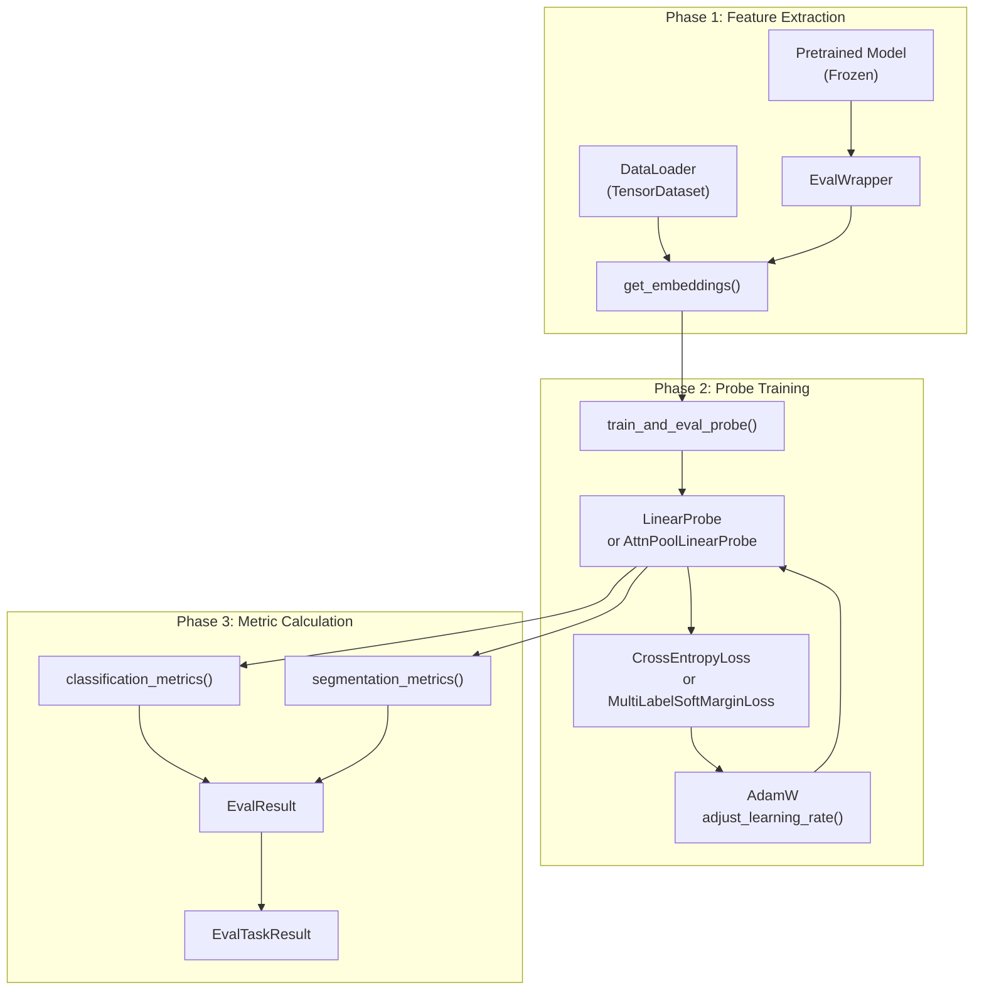
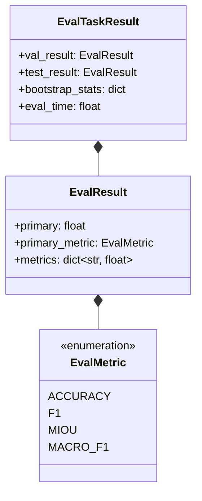

<!-- source: DeepWiki mcp.deepwiki.com · repo allenai/olmoearth_pretrain · page 6.3 Linear Probing · fetched 2026-10-26 -->

# Linear Probing

Relevant source files

The following files were used as context for generating this wiki page:

- [olmoearth_pretrain/evals/finetune/evaluate.py](olmoearth_pretrain/evals/finetune/evaluate.py)
- [olmoearth_pretrain/evals/finetune/train.py](olmoearth_pretrain/evals/finetune/train.py)
- [olmoearth_pretrain/evals/knn.py](olmoearth_pretrain/evals/knn.py)
- [olmoearth_pretrain/evals/linear_probe.py](olmoearth_pretrain/evals/linear_probe.py)
- [olmoearth_pretrain/evals/metrics.py](olmoearth_pretrain/evals/metrics.py)
- [olmoearth_pretrain/internal/constants.py](olmoearth_pretrain/internal/constants.py)
- [olmoearth_pretrain/internal/full_eval_sweep.py](olmoearth_pretrain/internal/full_eval_sweep.py)
- [scripts/tools/get_max_eval_metrics_from_wandb.py](scripts/tools/get_max_eval_metrics_from_wandb.py)
- [tests/integration/eval/test_finetune.py](tests/integration/eval/test_finetune.py)
- [tests/integration/eval/test_probe.py](tests/integration/eval/test_probe.py)
- [tests/unit/eval/test_metrics.py](tests/unit/eval/test_metrics.py)
- [tests/unit/internal/test_full_eval_sweep.py](tests/unit/internal/test_full_eval_sweep.py)

Linear probing is an evaluation method that trains a lightweight linear classifier on top of frozen pretrained model features to assess representation quality. This approach provides a middle ground between KNN evaluation (which requires no training) and full finetuning (which updates all parameters), allowing rapid assessment of downstream task performance while maintaining computational efficiency.

For information about embedding-based evaluation without training, see [6.2 KNN Evaluation](). For information about end-to-end finetuning with trainable backbones, see [6.4 Full Model Finetuning](). For an overview of all evaluation approaches, see [6.1 Evaluation Overview and Task Types]().

## Overview

Linear probing extracts embeddings from a frozen pretrained encoder, then trains a simple linear classifier (or an attention-pooling head) to predict task labels. The frozen backbone ensures that evaluation measures the quality of learned representations rather than the model's ability to adapt to new tasks. This method is particularly useful for:

- **Rapid evaluation** during pretraining via callbacks.
- **Hyperparameter sweeps** to find optimal learning rates and pooling strategies.
- **Comparing models** with consistent evaluation protocols.
- **Segmentation tasks** where pixel-level predictions are required.

Sources: [olmoearth_pretrain/evals/linear_probe.py:1-31](), [olmoearth_pretrain/internal/full_eval_sweep.py:1-33]()

## Evaluation Pipeline

The linear probing pipeline consists of three phases: embedding extraction, classifier training, and evaluation.

### Data Flow and Architecture

The following diagram bridges the conceptual evaluation steps with the specific code entities responsible for execution.

**Diagram: Linear Probing System Architecture**

Sources: [olmoearth_pretrain/evals/linear_probe.py:124-152](), [olmoearth_pretrain/evals/metrics.py:31-43](), [olmoearth_pretrain/evals/utils.py:1-30]()

## Implementation Details

### Probe Architectures

The repository provides two main classes for linear probing in `olmoearth_pretrain/evals/linear_probe.py`:

1.  **`LinearProbe`**: A standard linear layer `nn.Linear(in_dim, out_dim)` used for classification tasks. It optionally includes a `nn.BatchNorm1d` layer [olmoearth_pretrain/evals/linear_probe.py:107-121]().
2.  **`AttnPoolLinearProbe`**: An advanced probe for segmentation tasks that uses learnable query tokens to perform attention pooling over spatial feature tokens [olmoearth_pretrain/evals/linear_probe.py:41-104]().

### Training Logic

The core training loop is implemented in `train_and_eval_probe`. It handles:
- **Task Detection**: Automatically configures the output dimension based on `TaskType.CLASSIFICATION` or `TaskType.SEGMENTATION` [olmoearth_pretrain/evals/linear_probe.py:161-190]().
- **Segmentation Rearrangement**: For segmentation, it maps patch-level embeddings to pixel-level logits using `rearrange` and `F.interpolate` to match ground truth resolutions [olmoearth_pretrain/evals/linear_probe.py:255-274]().
- **Optimization**: Uses `AdamW` with a cosine decay schedule via `adjust_learning_rate` [olmoearth_pretrain/evals/linear_probe.py:228-232]().

Sources: [olmoearth_pretrain/evals/linear_probe.py:41-232](), [olmoearth_pretrain/evals/utils.py:1-30]()

## Hyperparameter Sweeps

To find the optimal linear probe performance, the system supports extensive sweeps over learning rates, normalization modes, and pooling types.

### Sweep Parameters

The sweep logic in `olmoearth_pretrain/internal/full_eval_sweep.py` defines standard ranges for Earth observation tasks:
- **Learning Rates (`LP_LRs`)**: `[1e-4, 5e-4, 1e-3, 5e-3, 1e-2, 5e-2, 1e-1, 5e-1]` [olmoearth_pretrain/internal/full_eval_sweep.py:30]().
- **Normalization Modes**: `["pre_trained", "dataset"]` [olmoearth_pretrain/internal/full_eval_sweep.py:31]().
- **Pooling Types**: `[PoolingType.MEAN, PoolingType.MAX]` [olmoearth_pretrain/internal/full_eval_sweep.py:32]().

### Model-Specific Overrides

Different baseline models require specific normalization methods to perform correctly during linear probing:

| Function | Model/Source | Normalization Method |
| :--- | :--- | :--- |
| `get_dino_v3_args` | DinoV3 | `NormMethod.NORM_YES_CLIP_MIN_MAX_INT` |
| `get_croma_args` | Croma | `NormMethod.NORM_YES_CLIP_2_STD` |
| `get_panopticon_args` | Panopticon | `NormMethod.STANDARDIZE` |
| `get_tessera_args` | Tessera | `NormMethod.NO_NORM` (if using pretrained) |

Sources: [olmoearth_pretrain/internal/full_eval_sweep.py:135-194](), [olmoearth_pretrain/internal/full_eval_sweep.py:30-33]()

## Metrics and Evaluation

The evaluation system uses a unified `EvalResult` container to handle various metrics across different task types.

### Classification Metrics
For classification, the system computes Accuracy and F1 scores using `sklearn.metrics` [olmoearth_pretrain/evals/metrics.py:10-11]().
- **Single-label**: Defaults to `EvalMetric.ACCURACY` [olmoearth_pretrain/evals/metrics.py:110]().
- **Multi-label**: Defaults to `EvalMetric.F1` [olmoearth_pretrain/evals/metrics.py:110]().

### Segmentation Metrics
For segmentation, the system builds a confusion matrix using `torch.bincount` to calculate [olmoearth_pretrain/evals/metrics.py:163-203]():
- **mIoU** (Primary metric) [olmoearth_pretrain/evals/metrics.py:148]().
- **Overall Accuracy**.
- **Macro F1**.
- **Per-class F1**.

### Result Hierarchy

**Diagram: Evaluation Result Code Entities**

Sources: [olmoearth_pretrain/evals/metrics.py:13-55](), [olmoearth_pretrain/evals/metrics.py:124-160]()

## Best Practices

1.  **Learning Rate Sweeps**: Always sweep the learning rate when evaluating a new checkpoint, as the optimal LR for a linear probe can vary significantly between pretraining stages [olmoearth_pretrain/internal/full_eval_sweep.py:1-15]().
2.  **Early Stopping**: Use `select_best_by_primary_metric=True` to ensure the final test results are reported from the epoch with the highest validation performance [olmoearth_pretrain/evals/linear_probe.py:138]().
3.  **Normalization Consistency**: Ensure the `norm_method` matches the expected input distribution of the pretrained model. Using `norm_stats_from_pretrained=True` is generally recommended for models trained with specific internal normalization [olmoearth_pretrain/internal/full_eval_sweep.py:89-95]().
4.  **Segmentation Ignore Labels**: Use `SEGMENTATION_IGNORE_LABEL = -1` to mask out invalid pixels (e.g., padding or nodata) from both loss and metric calculations [olmoearth_pretrain/evals/metrics.py:28]().

Sources: [olmoearth_pretrain/evals/linear_probe.py:138-144](), [olmoearth_pretrain/internal/full_eval_sweep.py:122-132](), [olmoearth_pretrain/evals/metrics.py:26-28]()

---

