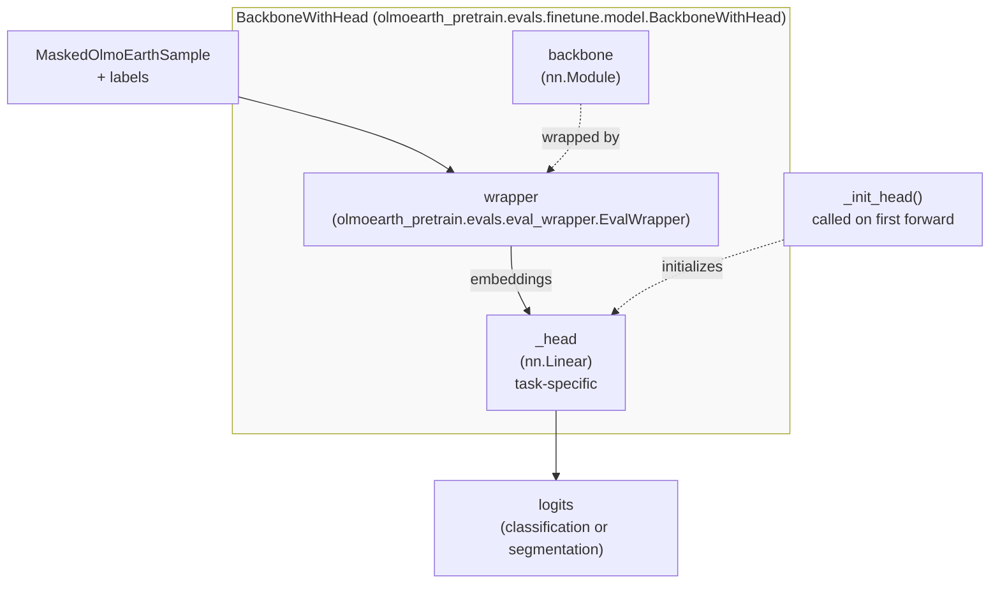
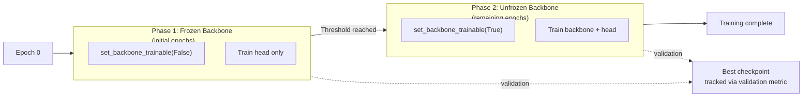

<!-- source: DeepWiki mcp.deepwiki.com · repo allenai/olmoearth_pretrain · page 6.4 Full Model Finetuning · fetched 2026-10-26 -->

# Full Model Finetuning

<details>
<summary>Relevant source files</summary>

The following files were used as context for generating this wiki page:

- [data/rslearn_dataset_configs/config_sentinel2_l2a.json](data/rslearn_dataset_configs/config_sentinel2_l2a.json)
- [olmoearth_pretrain/evals/finetune/__init__.py](olmoearth_pretrain/evals/finetune/__init__.py)
- [olmoearth_pretrain/evals/finetune/checkpoint.py](olmoearth_pretrain/evals/finetune/checkpoint.py)
- [olmoearth_pretrain/evals/finetune/model.py](olmoearth_pretrain/evals/finetune/model.py)
- [olmoearth_pretrain/internal/all_evals.py](olmoearth_pretrain/internal/all_evals.py)
- [olmoearth_pretrain/internal/full_eval_sweep_finetune.py](olmoearth_pretrain/internal/full_eval_sweep_finetune.py)
- [olmoearth_pretrain/train/callbacks/evaluator_callback.py](olmoearth_pretrain/train/callbacks/evaluator_callback.py)
- [scripts/tools/validate_segmentation_metrics.py](scripts/tools/validate_segmentation_metrics.py)
- [tests/integration/eval/test_finetune_checkpoint.py](tests/integration/eval/test_finetune_checkpoint.py)
- [tests/unit/eval/__init__.py](tests/unit/eval/__init__.py)

</details>


## Purpose and Scope

This document describes the full model finetuning evaluation mode in OlmoEarth, where both the pretrained backbone and a task-specific head are trained end-to-end on downstream tasks. Unlike KNN evaluation ([6.2]()) which uses frozen embeddings, or linear probing ([6.3]()) which trains only a linear head on frozen features, finetuning allows the entire model to adapt to the target task. This approach typically yields the highest performance but requires more compute and careful hyperparameter tuning.

For general evaluation concepts and task types, see [Evaluation Overview](). For running evaluation sweeps across multiple hyperparameters, see [Running Evaluation Sweeps]().

---

## Finetuning Architecture

### BackboneWithHead Module

The finetuning system wraps the pretrained encoder in a `BackboneWithHead` module that combines the backbone model with a dynamically-initialized task-specific head.



**Architecture Diagram: BackboneWithHead combines pretrained encoder with task-specific head**

The head dimension is determined dynamically on the first forward pass based on the embedding dimension produced by the wrapper. This logic is handled in `_init_head` [olmoearth_pretrain/evals/finetune/model.py:45-54]():

- **Classification tasks**: Linear layer mapping `emb_dim → num_classes`.
- **Segmentation tasks**: Linear layer mapping `emb_dim → (num_classes × patch_size²)`, with rearrangement to pixel space.

Sources: [olmoearth_pretrain/evals/finetune/model.py:15-69]()

### Two-Phase Training Strategy

Finetuning typically uses a two-phase approach to stabilize training and prevent catastrophic forgetting of pretrained representations. The logic is orchestrated by `run_finetune_eval` [olmoearth_pretrain/evals/finetune/train.py:3]() (imported as `run_finetune_eval` in [olmoearth_pretrain/evals/finetune/__init__.py:3]()).



**Training Flow Diagram: Two-phase finetuning with frozen then unfrozen backbone**

The utility `set_backbone_trainable` [olmoearth_pretrain/evals/finetune/model.py:89-93]() toggles `requires_grad` for all backbone parameters.

Sources: [olmoearth_pretrain/evals/finetune/model.py:89-93](), [olmoearth_pretrain/evals/finetune/train.py:3]()

---

## Training Process

### Checkpoint Management

Finetuning uses a specialized checkpointing system for atomicity and resume capability. The `save_training_checkpoint` function [olmoearth_pretrain/evals/finetune/checkpoint.py:15-54]() writes to a temporary file before moving it to the final destination to ensure POSIX atomicity.

| Field | Description |
|-----------|-------------|
| `epoch` | Current training epoch |
| `model_state` | State dict of the `BackboneWithHead` |
| `optimizer_state` | State of the optimizer |
| `scheduler_state` | State of the learning rate scheduler |
| `best_state` | Best model state found so far |
| `best_val_metric` | Value of the primary metric for `best_state` |
| `backbone_unfrozen` | Boolean flag indicating the current phase |

Sources: [olmoearth_pretrain/evals/finetune/checkpoint.py:30-38](), [tests/integration/eval/test_finetune_checkpoint.py:39-57]()

### Model State Snapshots

To avoid corruption of the main training loop's model during evaluation callbacks, the system uses `snapshot_state_dict` [olmoearth_pretrain/evals/finetune/model.py:84-86]() to clone parameters onto the CPU.

Sources: [olmoearth_pretrain/evals/finetune/model.py:84-86]()

---

## Configuration

### Task Configuration for Finetuning

Finetuning tasks are configured via `DownstreamTaskConfig` [olmoearth_pretrain/train/callbacks/evaluator_callback.py:66-115]() with `eval_mode=EvalMode.FINETUNE`.

| Parameter | Description | Code Reference |
|-----------|-------------|----------------|
| `ft_lr` | Learning rate for finetuning | [olmoearth_pretrain/train/callbacks/evaluator_callback.py:84]() |
| `ft_batch_size` | Batch size for finetuning | [olmoearth_pretrain/train/callbacks/evaluator_callback.py:85]() |
| `finetune_seed` | Seed for reproducibility | [olmoearth_pretrain/train/callbacks/evaluator_callback.py:86]() |
| `epochs` | Total number of epochs | [olmoearth_pretrain/train/callbacks/evaluator_callback.py:88]() |

Sources: [olmoearth_pretrain/train/callbacks/evaluator_callback.py:66-115]()

### Finetuning Task Registry

The `FT_EVAL_TASKS` dictionary [olmoearth_pretrain/internal/all_evals.py:284]() (referenced in [olmoearth_pretrain/internal/full_eval_sweep_finetune.py:43]()) defines standard finetuning configurations.

| Task Name | Dataset | Task Type | Primary Metric |
|-----------|---------|-----------|----------------|
| `m_eurosat` | m-eurosat | Classification | Accuracy |
| `m_so2sat` | m-so2sat | Classification | Accuracy |
| `pastis_sentinel2` | pastis | Segmentation | mIoU |
| `mados` | mados | Classification | Micro F1 |

Sources: [olmoearth_pretrain/internal/all_evals.py:66-210](), [olmoearth_pretrain/internal/full_eval_sweep_finetune.py:53]()

---

## Running Finetuning Sweeps

### Sweep Orchestration

The script `olmoearth_pretrain/internal/full_eval_sweep_finetune.py` is the primary entry point for launching large-scale finetuning experiments. It supports sweeping over learning rates defined in `FT_LRS` [olmoearth_pretrain/internal/full_eval_sweep_finetune.py:50](): `[1e-4, 5e-4, 1e-3]`.

### Model Presets

The sweep script uses `MODEL_PRESETS` [olmoearth_pretrain/internal/full_eval_sweep_finetune.py:103-181]() to define model-specific normalization methods and patch sizes.

```python
# Example: Galileo preset
"galileo": ModelPreset(
    per_task_overrides={"norm_method": "NormMethod.NORM_NO_CLIP_2_STD"},
    task_specific_overrides={
        "m_sa_crop_type": {"ft_batch_size": 1},
        "pastis_sentinel2": {"ft_batch_size": 2},
    },
    launch_script_key="galileo",
    supports_pretrained_normalizer=True,
),
```

Sources: [olmoearth_pretrain/internal/full_eval_sweep_finetune.py:159-168]()

### Argument Formatting

The script dynamically generates command-line overrides for the trainer using helper functions:
- `_format_per_task_args`: Repeats an override for every task in the sweep [olmoearth_pretrain/internal/full_eval_sweep_finetune.py:56-65]().
- `_format_task_specific_args`: Applies overrides to specific tasks [olmoearth_pretrain/internal/full_eval_sweep_finetune.py:68-79]().

Sources: [olmoearth_pretrain/internal/full_eval_sweep_finetune.py:56-79]()

---

## Validation and Testing

### Integration Testing

Finetuning checkpointing is verified via integration tests in `tests/integration/eval/test_finetune_checkpoint.py`. This test ensures that:
1. Checkpoints can be saved and loaded [tests/integration/eval/test_finetune_checkpoint.py:40-52]().
2. The `epoch` and `backbone_unfrozen` states are correctly restored [tests/integration/eval/test_finetune_checkpoint.py:54-55]().

Sources: [tests/integration/eval/test_finetune_checkpoint.py:29-57]()

### Metric Validation

The script `scripts/tools/validate_segmentation_metrics.py` provides a utility to validate both Linear Probing (LP) and Finetuning (FT) on datasets like `pastis` and `m-eurosat` using a tiny model configuration [scripts/tools/validate_segmentation_metrics.py:170-205]().

Sources: [scripts/tools/validate_segmentation_metrics.py:170-205]()

---

