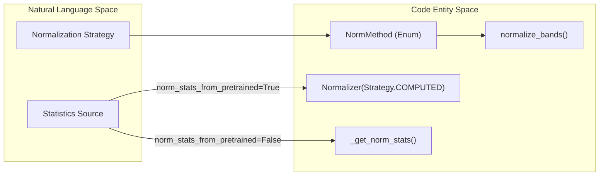

<!-- source: DeepWiki mcp.deepwiki.com · repo allenai/olmoearth_pretrain · page 6.5 Evaluation Task Configurations · fetched 2026-10-26 -->

# Evaluation Task Configurations

<details>
<summary>Relevant source files</summary>

The following files were used as context for generating this wiki page:

- [data/rslearn_dataset_configs/config_sentinel2_l2a.json](data/rslearn_dataset_configs/config_sentinel2_l2a.json)
- [olmoearth_pretrain/evals/datasets/__init__.py](olmoearth_pretrain/evals/datasets/__init__.py)
- [olmoearth_pretrain/evals/datasets/breizhcrops.py](olmoearth_pretrain/evals/datasets/breizhcrops.py)
- [olmoearth_pretrain/evals/datasets/floods_dataset.py](olmoearth_pretrain/evals/datasets/floods_dataset.py)
- [olmoearth_pretrain/evals/datasets/geobench_dataset.py](olmoearth_pretrain/evals/datasets/geobench_dataset.py)
- [olmoearth_pretrain/evals/datasets/mados_dataset.py](olmoearth_pretrain/evals/datasets/mados_dataset.py)
- [olmoearth_pretrain/evals/datasets/normalize.py](olmoearth_pretrain/evals/datasets/normalize.py)
- [olmoearth_pretrain/evals/datasets/pastis_dataset.py](olmoearth_pretrain/evals/datasets/pastis_dataset.py)
- [olmoearth_pretrain/evals/datasets/rslearn_dataset.py](olmoearth_pretrain/evals/datasets/rslearn_dataset.py)
- [tests/unit/eval/datasets/test_normalize.py](tests/unit/eval/datasets/test_normalize.py)

</details>


## Purpose and Scope

This page documents the configuration system for downstream evaluation tasks in OlmoEarth. It covers the structure of task configurations, available evaluation tasks, task-specific parameters, and model-specific presets for normalization and other settings. The system is designed to handle diverse datasets including GeoBench, BreizhCrops, PASTIS-R, and custom `rslearn` datasets.

For information about the evaluation modes (KNN, Linear Probe, Finetuning), see [6.1](), [6.2](), [6.3](), and [6.4](). For running hyperparameter sweeps across tasks, see [6.6]().

---

## Task Configuration Structure

Evaluation tasks are configured using the `DownstreamTaskConfig` dataclass, which centralizes all task-specific parameters including dataset selection, evaluation mode, batch sizes, learning rates, normalization methods, and more.

### DownstreamTaskConfig Parameters

The `DownstreamTaskConfig` class defines the following configuration parameters:

| Parameter | Type | Default | Description |
|-----------|------|---------|-------------|
| `dataset` | `str` | *required* | Dataset identifier (e.g., "m-eurosat", "pastis", "sen1floods11", "breizhcrops") |
| `eval_mode` | `EvalMode` | `None` | Evaluation mode: `KNN`, `LINEAR_PROBE`, or `FINETUNE` |
| `num_workers` | `int` | `8` | Number of DataLoader workers |
| `pooling_type` | `str` | `MEAN` | Spatial pooling method: `MEAN`, `MAX`, or `CLS` |
| `norm_stats_from_pretrained` | `bool` | `True` | Whether to use pretrained normalization statistics |
| `norm_method` | `NormMethod` | `NORM_NO_CLIP` | Normalization method (see [Normalization Methods](#normalization-methods)) |
| `input_modalities` | `list[str]` | `[]` | Input modalities (e.g., `["SENTINEL1", "SENTINEL2_L2A"]`) |
| `input_layers` | `list[str]` | `[]` | Input layers for rslearn datasets |
| `embedding_batch_size` | `int` | `128` | Batch size for embedding extraction (KNN/Linear Probe) |
| `probe_lr` | `float` | `None` | Learning rate for linear probe training |
| `probe_batch_size` | `int` | `32` | Batch size for linear probe training |
| `ft_lr` | `float` | `None` | Learning rate for finetuning |
| `ft_batch_size` | `int` | `32` | Batch size for finetuning |
| `epochs` | `int` | `50` | Number of training epochs |
| `partition` | `str` | `TRAIN1X` | Dataset partition to use (e.g., `default`, `0.01x_train`) |

Sources: [olmoearth_pretrain/train/callbacks/evaluator_callback.py:60-93](), [olmoearth_pretrain/evals/datasets/__init__.py:22-32]()

---

## Natural Language to Code Entity Mapping

The following diagram bridges the high-level task concepts to the specific implementation classes and registry functions used in the codebase.

### Evaluation Registry Mapping
Title: "Evaluation Registry and Dataset Loading Flow"
```mermaid
graph TD
    subgraph "Natural Language Space"
        Task["Downstream Task"]
        DatasetName["Dataset Name (e.g. 'mados')"]
        Split["Data Split (train/val/test)"]
    end

    subgraph "Code Entity Space"
        Registry["get_eval_dataset()"]
        MADOS["MADOSDataset"]
        GEO["GeobenchDataset"]
        PASTIS["PASTISRDataset"]
        RSLEARN["RslearnToOlmoEarthDataset"]
        BREIZH["BreizhCropsDataset"]
        FLOODS["Sen1Floods11Dataset"]
    end

    Task --> Registry
    DatasetName --> Registry
    Registry -->|eval_dataset=='mados'| MADOS
    Registry -->|eval_dataset.startswith('m-')| GEO
    Registry -->|eval_dataset.startswith('pastis')| PASTIS
    Registry -->|eval_dataset=='breizhcrops'| BREIZH
    Registry -->|eval_dataset=='sen1floods11'| FLOODS
    Registry -->|else| RSLEARN
```
Sources: [olmoearth_pretrain/evals/datasets/__init__.py:34-106](), [olmoearth_pretrain/evals/datasets/rslearn_dataset.py:80-110]()

### Dataset Normalization Logic
Title: "Normalization Method to Implementation Mapping"

Sources: [olmoearth_pretrain/evals/datasets/normalize.py:48-61](), [olmoearth_pretrain/evals/datasets/normalize.py:121-149](), [olmoearth_pretrain/evals/datasets/breizhcrops.py:149-152]()

---

## Normalization Methods

The `NormMethod` enum defines strategies for normalizing satellite imagery. The choice of method significantly impacts model performance, especially when using frozen backbones.

### Available Normalization Methods

| Method | Description | Implementation |
|--------|-------------|----------------|
| `NO_NORM` | No normalization applied | Returns image as-is |
| `STANDARDIZE` | Z-score: `(x - mean) / std` | Standard statistical normalization |
| `NORM_NO_CLIP_2_STD` | Normalize to `[mean-2*std, mean+2*std]` | Default OlmoEarth pretraining style |
| `NORM_YES_CLIP_2_STD` | 2-std normalization clipped to `[0, 1]` | Ensures bounded input range |
| `NORM_YES_CLIP_MIN_MAX_INT` | Min-max then 8-bit quantization | Used for DINOv3-style baselines |

Sources: [olmoearth_pretrain/evals/datasets/normalize.py:48-61](), [olmoearth_pretrain/evals/datasets/normalize.py:121-149]()

---

## Dataset-Specific Configurations

### 1. BreizhCrops (Crop Type Mapping)
BreizhCrops uses Sentinel-2 L1C data. It supports monthly averaging and requires specific band mapping from OlmoEarth internal names to BreizhCrops names (e.g., "02 - Blue" to "B2").

*   **File**: `olmoearth_pretrain/evals/datasets/breizhcrops.py`
*   **Key Params**: `monthly_average: bool`, `norm_method: str`
*   **Stats**: Hardcoded `BAND_STATS` [olmoearth_pretrain/evals/datasets/breizhcrops.py:35-49]() merged with min/max stats [olmoearth_pretrain/evals/datasets/breizhcrops.py:122-139]().

### 2. GeoBench (Multi-Task Benchmarking)
GeoBench datasets (prefixed with `m-`) include classification and segmentation tasks. They support both Sentinel-2 and Landsat-8.

*   **File**: `olmoearth_pretrain/evals/datasets/geobench_dataset.py`
*   **Logic**: Maps GeoBench `Stats` objects to OlmoEarth normalization arrays [olmoearth_pretrain/evals/datasets/geobench_dataset.py:163-179]().
*   **Band Imputation**: Automatically handles missing bands via `impute_normalization_stats` [olmoearth_pretrain/evals/datasets/geobench_dataset.py:140-144]().

### 3. PASTIS-R (Multi-Modal)
PASTIS-R supports both Sentinel-1 (SAR) and Sentinel-2 (Optical) modalities.

*   **File**: `olmoearth_pretrain/evals/datasets/pastis_dataset.py`
*   **Input Modalities**: `["sentinel1", "sentinel2_l2a"]` [olmoearth_pretrain/evals/datasets/pastis_dataset.py:56-56]().
*   **SAR Normalization**: Uses `S1_BAND_STATS` with `vv` and `vh` means/stds [olmoearth_pretrain/evals/datasets/pastis_dataset.py:47-50]().

### 4. RSLearn Datasets (Custom Ingestion)
The `RslearnToOlmoEarthDataset` allows using any dataset ingested via the `rslearn` pipeline.

*   **File**: `olmoearth_pretrain/evals/datasets/rslearn_dataset.py`
*   **Configuration**: Requires a JSON configuration file (e.g., `data/rslearn_dataset_configs/config_sentinel2_l2a.json`) [data/rslearn_dataset_configs/config_sentinel2_l2a.json:1-50]().
*   **Temporal Logic**: Generates monthly timestamps for time-series tasks [olmoearth_pretrain/evals/datasets/rslearn_dataset.py:40-77]().

---

## Configuring Tasks via CLI Overrides

Task configurations can be customized via command-line overrides. This is the primary mechanism for hyperparameter tuning.

### Override Pattern
```bash
--trainer.callbacks.downstream_evaluator.tasks.<task_name>.<parameter>=<value>
```

### Examples
| Goal | CLI Override |
|------|--------------|
| **LR for Linear Probe** | `--trainer.callbacks.downstream_evaluator.tasks.mados.probe_lr=0.005` |
| **Batch Size for FT** | `--trainer.callbacks.downstream_evaluator.tasks.pastis_sentinel2.ft_batch_size=16` |
| **Disable Pretrained Norm** | `--trainer.callbacks.downstream_evaluator.tasks.m_eurosat.norm_stats_from_pretrained=False` |
| **Change Pooling** | `--trainer.callbacks.downstream_evaluator.tasks.sen1floods11.pooling_type=max` |

Sources: [olmoearth_pretrain/internal/full_eval_sweep_finetune.py:32-55](), [olmoearth_pretrain/train/callbacks/evaluator_callback.py:60-93]()

---

## Summary of Registries

Evaluation tasks are organized into two registries in `all_evals.py`:

1.  **`EVAL_TASKS`**: Configured for KNN and Linear Probing. Focuses on frozen feature extraction [olmoearth_pretrain/internal/all_evals.py:67-304]().
2.  **`FT_EVAL_TASKS`**: Configured for full model finetuning. Includes higher batch sizes and task-specific learning rates [olmoearth_pretrain/internal/all_evals.py:306-392]().

The registry selection is controlled by the `FINETUNE` environment variable [olmoearth_pretrain/internal/all_evals.py:395-437]().

Sources: `olmoearth_pretrain/evals/datasets/__init__.py`, `olmoearth_pretrain/evals/datasets/normalize.py`, `olmoearth_pretrain/train/callbacks/evaluator_callback.py`, `olmoearth_pretrain/internal/all_evals.py`.

---

