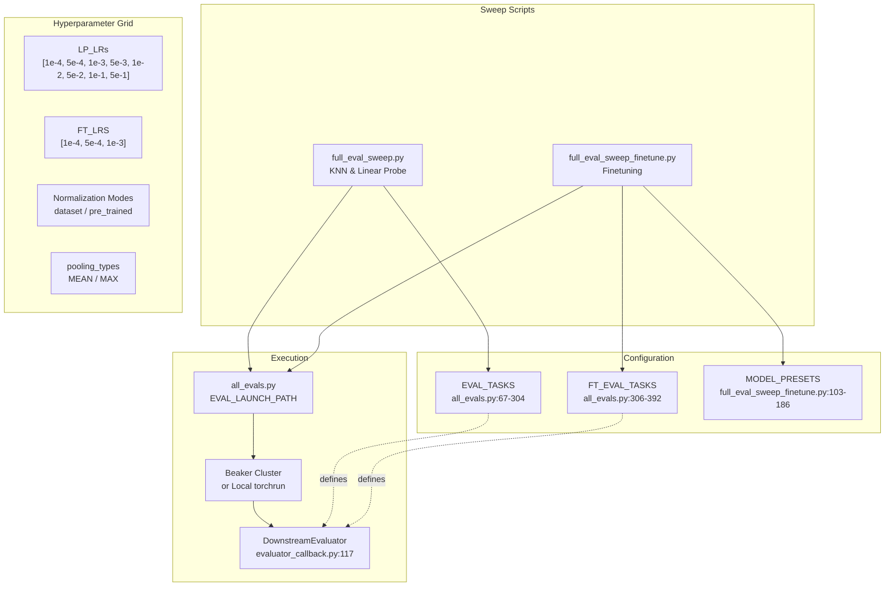
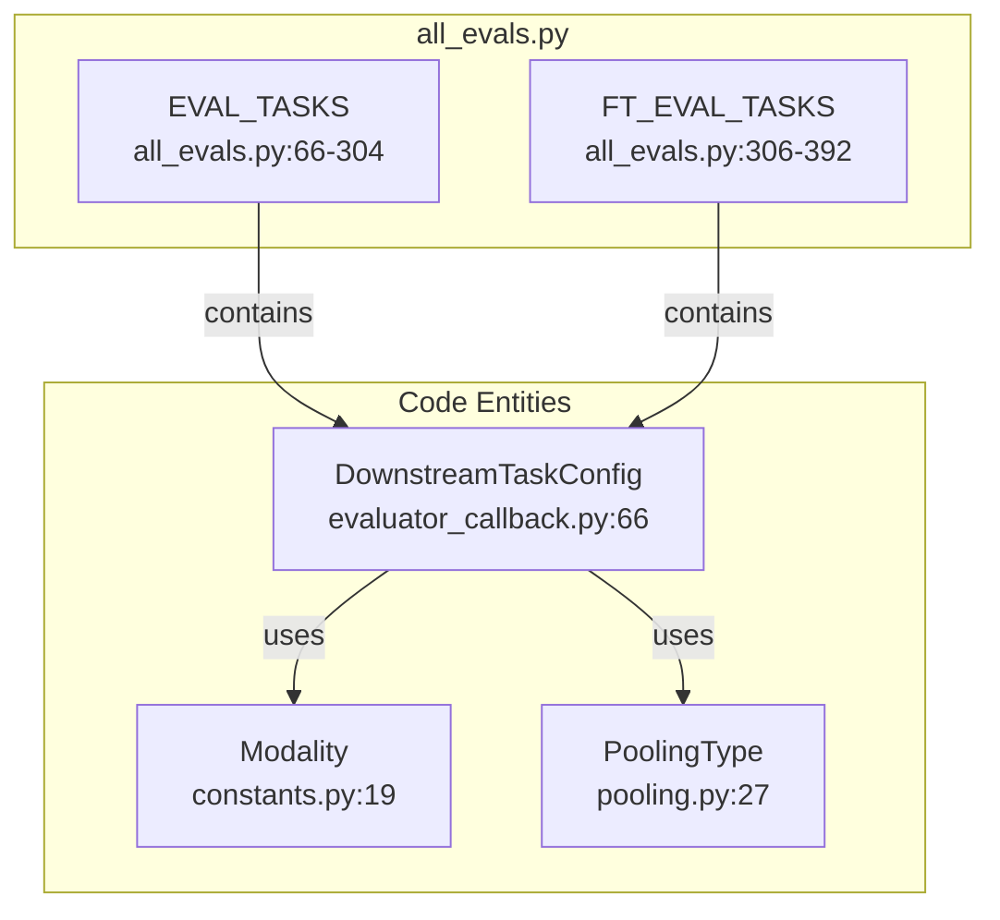
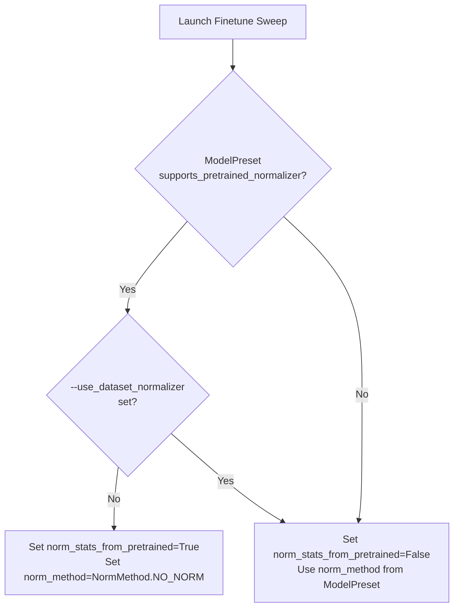

<!-- source: DeepWiki mcp.deepwiki.com · repo allenai/olmoearth_pretrain · page 6.6 Running Evaluation Sweeps · fetched 2026-10-26 -->

# Running Evaluation Sweeps

<details>
<summary>Relevant source files</summary>

The following files were used as context for generating this wiki page:

- [olmoearth_pretrain/internal/all_evals.py](olmoearth_pretrain/internal/all_evals.py)
- [olmoearth_pretrain/internal/constants.py](olmoearth_pretrain/internal/constants.py)
- [olmoearth_pretrain/internal/full_eval_sweep_finetune.py](olmoearth_pretrain/internal/full_eval_sweep_finetune.py)
- [olmoearth_pretrain/train/callbacks/evaluator_callback.py](olmoearth_pretrain/train/callbacks/evaluator_callback.py)
- [scripts/tools/validate_segmentation_metrics.py](scripts/tools/validate_segmentation_metrics.py)
- [tests/unit/eval/__init__.py](tests/unit/eval/__init__.py)
- [tests/unit/internal/test_full_eval_sweep.py](tests/unit/internal/test_full_eval_sweep.py)

</details>


This page describes how to run hyperparameter sweeps for evaluating pretrained models on downstream tasks. Evaluation sweeps systematically test different combinations of learning rates, normalization methods, and pooling strategies to find optimal configurations for each task.

For information about individual evaluation modes, see [KNN Evaluation](6.2), [Linear Probing](6.3), and [Full Model Finetuning](6.4). For details on available evaluation tasks, see [Evaluation Task Configurations](6.5).

## Overview

The codebase provides two specialized scripts for running evaluation sweeps:

1.  **`full_eval_sweep.py`** - Sweeps for KNN and linear probe evaluation (embedding-based methods).
2.  **`full_eval_sweep_finetune.py`** - Sweeps for full model finetuning.

Both scripts automate the process of launching multiple evaluation runs with different hyperparameter combinations, either locally or on Beaker clusters.



**Diagram: Evaluation Sweep Architecture**

Sources: [olmoearth_pretrain/internal/all_evals.py:67-392](), [olmoearth_pretrain/internal/full_eval_sweep_finetune.py:103-186](), [olmoearth_pretrain/train/callbacks/evaluator_callback.py:117-129]()

## KNN and Linear Probe Sweeps

The `full_eval_sweep.py` script generates and runs sweeps for embedding-based evaluation methods (KNN and linear probe). It sweeps over learning rates, normalization methods, and pooling types.

### Basic Usage

```bash
# Run sweep for an OlmoEarth checkpoint
python -m olmoearth_pretrain.internal.full_eval_sweep \
    --cluster=ai2/jupiter \
    --checkpoint_path=/weka/dfive-default/helios/checkpoints/user/run_name/step450000 \
    --module_path=scripts/official/base.py

# Run defaults only (no sweep)
python -m olmoearth_pretrain.internal.full_eval_sweep \
    --cluster=ai2/jupiter \
    --checkpoint_path=/path/to/checkpoint \
    --module_path=scripts/official/base.py \
    --defaults_only
```

Sources: [olmoearth_pretrain/internal/full_eval_sweep_finetune.py:1-31]()

### Hyperparameter Grid

The script sweeps over the following dimensions defined in `olmoearth_pretrain/internal/full_eval_sweep.py`:

| Parameter | Values | Description |
| :--- | :--- | :--- |
| Learning Rate (`LP_LRs`) | `[1e-4, 5e-4, 1e-3, 5e-3, 1e-2, 5e-2, 1e-1, 5e-1]` | For linear probe training. |
| Normalization (`Normalization_MODES`) | `["dataset", "pre_trained"]` | Use dataset statistics or pretrained normalizer. |
| Pooling Type (`pooling_types`) | `["MEAN", "MAX"]` | Spatial pooling method for embeddings. |

Sources: [tests/unit/internal/test_full_eval_sweep.py:11-21](), [tests/unit/internal/test_full_eval_sweep.py:100-131]()

## Finetune Sweeps

The `full_eval_sweep_finetune.py` script runs sweeps specifically for full model finetuning. It uses a targeted learning rate grid and model-specific presets.

### Basic Usage

```bash
# Run finetune sweep for an OlmoEarth checkpoint
python olmoearth_pretrain/internal/full_eval_sweep_finetune.py \
    --checkpoint_path=/weka/dfive-default/helios/checkpoints/user/run/step667200 \
    --project_name=2025_finetune_sweep \
    --module_path=scripts/official/base.py \
    --cluster=ai2/jupiter
```

Sources: [olmoearth_pretrain/internal/full_eval_sweep_finetune.py:13-19]()

### Finetune Learning Rate Grid

Finetuning uses a restricted learning rate range:
*   `FT_LRS = [1e-4, 5e-4, 1e-3]` [olmoearth_pretrain/internal/full_eval_sweep_finetune.py:50]()
*   With `--defaults_only`, only `1e-4` is used [olmoearth_pretrain/internal/full_eval_sweep_finetune.py:26]().

### Model Presets

`ModelPreset` [olmoearth_pretrain/internal/full_eval_sweep_finetune.py:90-100]() objects define model-specific configurations for normalization and task-specific batch sizes:

```python
MODEL_PRESETS: dict[str, ModelPreset] = {
    "galileo": ModelPreset(
        per_task_overrides={"norm_method": "NormMethod.NORM_NO_CLIP_2_STD"},
        task_specific_overrides={
            "m_sa_crop_type": {"ft_batch_size": 1},
            "pastis_sentinel2": {"ft_batch_size": 2},
            "m_cashew_plant": {"ft_batch_size": 4},
        },
        launch_script_key="galileo",
        supports_pretrained_normalizer=True,
    ),
    "terramind": ModelPreset(
        per_task_overrides={"norm_method": "NormMethod.STANDARDIZE"},
        launch_script_key="terramind",
        supports_pretrained_normalizer=True,
    ),
}
```

Sources: [olmoearth_pretrain/internal/full_eval_sweep_finetune.py:147-168]()

## Task Registry

Both sweep scripts use centralized task registries in `olmoearth_pretrain/internal/all_evals.py` that define default parameters for each downstream task.



**Diagram: Task Registry and Code Dependencies**

Sources: [olmoearth_pretrain/internal/all_evals.py:66-392](), [olmoearth_pretrain/train/callbacks/evaluator_callback.py:66-115]()

### Task Configuration Fields (`DownstreamTaskConfig`)

Key fields used during sweeps:
*   `dataset`: The name of the evaluation dataset [olmoearth_pretrain/train/callbacks/evaluator_callback.py:69]().
*   `eval_mode`: `EvalMode.KNN`, `EvalMode.LINEAR_PROBE`, or `EvalMode.FINETUNE` [olmoearth_pretrain/train/callbacks/evaluator_callback.py:92]().
*   `pooling_type`: Spatial pooling method (e.g., `PoolingType.MEAN`) [olmoearth_pretrain/train/callbacks/evaluator_callback.py:71]().
*   `norm_stats_from_pretrained`: Boolean determining if pretraining stats are used for normalization [olmoearth_pretrain/train/callbacks/evaluator_callback.py:72]().
*   `primary_metric`: The metric used for validation (e.g., `EvalMetric.ACCURACY`, `EvalMetric.MIOU`) [olmoearth_pretrain/train/callbacks/evaluator_callback.py:112]().

Sources: [olmoearth_pretrain/train/callbacks/evaluator_callback.py:66-115](), [olmoearth_pretrain/internal/all_evals.py:67-78]()

## Command Building and Execution

The scripts generate command strings that invoke `all_evals.py` with specific overrides.

### Integration with `all_evals.py`

`all_evals.py` acts as the entry point for the evaluation process. It performs the following steps:
1.  **Load User Module**: Uses `load_user_module` to dynamically load the training script (e.g., `base.py`) provided via `TRAIN_SCRIPT_PATH` [olmoearth_pretrain/internal/all_evals.py:40-63]().
2.  **Determine Task Registry**: Selects `FT_EVAL_TASKS` if the `FINETUNE` environment variable is set, otherwise uses `EVAL_TASKS` [olmoearth_pretrain/internal/all_evals.py:428]().
3.  **Configure Evaluator**: Sets up the `DownstreamEvaluatorCallbackConfig` with the chosen tasks and sets `eval_on_startup=True` to trigger evaluation immediately [olmoearth_pretrain/internal/all_evals.py:427-432]().

Sources: [olmoearth_pretrain/internal/all_evals.py:40-63](), [olmoearth_pretrain/internal/all_evals.py:427-432]()

### Normalization Decision Logic

The finetune sweep script has specific logic for choosing between pretrained and dataset normalization:



**Diagram: Normalization Selection Flow**

Sources: [olmoearth_pretrain/internal/full_eval_sweep_finetune.py:90-100](), [olmoearth_pretrain/internal/full_eval_sweep_finetune.py:330-343]()

## Advanced Usage and Metrics

### Validation of Metrics

For validating the evaluation pipeline itself, the script `scripts/tools/validate_segmentation_metrics.py` can be used. It runs a minimal set of tasks (`pastis_lp`, `pastis_ft`, `m-eurosat`) using a tiny model checkpoint to ensure metrics like mIoU and Accuracy are computed correctly across modes [scripts/tools/validate_segmentation_metrics.py:170-201]().

### Bootstrap Analysis

The `DownstreamEvaluator` supports uncertainty estimation via bootstrapping. By setting `n_bootstrap` (e.g., via `--trainer.callbacks.downstream_evaluator.n_bootstrap=100`), the evaluator will compute bootstrap statistics for the primary metrics [olmoearth_pretrain/train/callbacks/evaluator_callback.py:127-141]().

Sources: [olmoearth_pretrain/train/callbacks/evaluator_callback.py:127-141](), [scripts/tools/validate_segmentation_metrics.py:170-201]()

---

