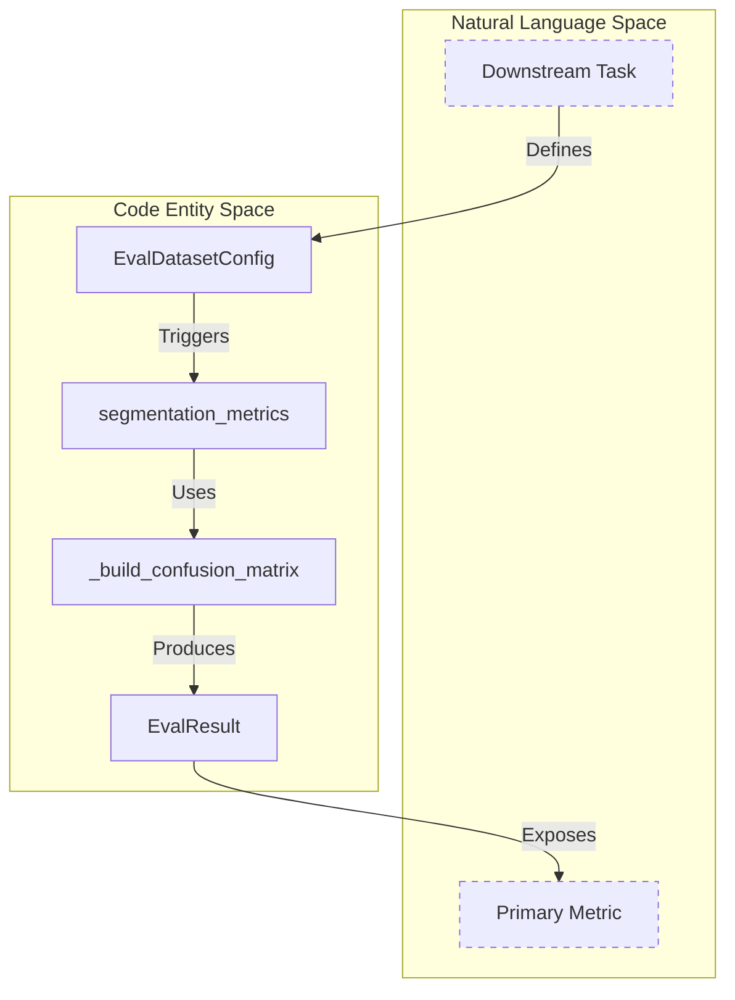
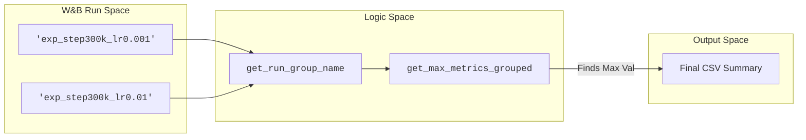

<!-- source: DeepWiki mcp.deepwiki.com · repo allenai/olmoearth_pretrain · page 6.7 Evaluation Metrics and Analysis · fetched 2026-10-26 -->

# Evaluation Metrics and Analysis

Relevant source files

The following files were used as context for generating this wiki page:

- [olmoearth_pretrain/evals/finetune/evaluate.py](olmoearth_pretrain/evals/finetune/evaluate.py)
- [olmoearth_pretrain/evals/finetune/train.py](olmoearth_pretrain/evals/finetune/train.py)
- [olmoearth_pretrain/evals/knn.py](olmoearth_pretrain/evals/knn.py)
- [olmoearth_pretrain/evals/linear_probe.py](olmoearth_pretrain/evals/linear_probe.py)
- [olmoearth_pretrain/evals/metrics.py](olmoearth_pretrain/evals/metrics.py)
- [olmoearth_pretrain/internal/full_eval_sweep.py](olmoearth_pretrain/internal/full_eval_sweep.py)
- [scripts/tools/get_max_eval_metrics_from_wandb.py](scripts/tools/get_max_eval_metrics_from_wandb.py)
- [tests/integration/eval/test_finetune.py](tests/integration/eval/test_finetune.py)
- [tests/integration/eval/test_probe.py](tests/integration/eval/test_probe.py)
- [tests/unit/eval/test_metrics.py](tests/unit/eval/test_metrics.py)

This page explains the metrics reported during downstream task evaluation, how they are computed and logged, and how to extract and analyze results from Weights & Biases (W&B). For information on configuring and running evaluations, see [Evaluation Task Configurations](#6.5) and [Running Evaluation Sweeps](#6.6).

## Overview

The OlmoEarth evaluation system reports task-specific metrics during training and provides tools for analyzing results across hyperparameter sweeps. All metrics are logged to W&B and can be extracted programmatically for analysis. The system supports optional bootstrap uncertainty estimation for embedding-based methods (KNN and Linear Probing).

## Metric Types by Task Type

### Classification Tasks

Classification tasks report metrics via `classification_metrics` [olmoearth_pretrain/evals/metrics.py:218-256](), typically focusing on **accuracy** (single-label) or **F1-score** (multi-label).

*   **Single-Label Classification**: Uses accuracy as the primary metric [olmoearth_pretrain/evals/metrics.py:110]().
*   **Multi-Label Classification**: Uses F1-score as the primary metric [olmoearth_pretrain/evals/metrics.py:110]().

The `EvalResult` class handles the selection of the primary metric and stores a superset of all computed metrics [olmoearth_pretrain/evals/metrics.py:42-55]().

### Segmentation Tasks

Segmentation tasks report **mean Intersection over Union (mIoU)** as the primary metric [olmoearth_pretrain/evals/metrics.py:148](). Other reported metrics include `overall_acc`, `macro_acc`, `macro_f1`, and `micro_f1` [olmoearth_pretrain/evals/metrics.py:137-143]().

The mIoU computation utilizes a confusion matrix [olmoearth_pretrain/evals/metrics.py:163-203]() and correctly handles ignore labels (value `-1`) defined by `SEGMENTATION_IGNORE_LABEL` [olmoearth_pretrain/evals/metrics.py:28]().

**Sources:**
- [olmoearth_pretrain/evals/metrics.py:28-203]()
- [olmoearth_pretrain/evals/metrics.py:218-256]()

## Validation and Test Scores

Each evaluation task returns an `EvalTaskResult` container [olmoearth_pretrain/evals/metrics.py:32-39]():

| Field | Description | Type |
|-------|-------------|------|
| `val_result` | Validation set performance | `EvalResult` |
| `test_result` | Test set performance | `EvalResult` |
| `bootstrap_stats` | Uncertainty estimates | `dict[str, Any]` |
| `eval_time` | Runtime for evaluation | `float` |

For finetuning, the `run_finetune_eval` function manages the training loop and performs evaluation on both sets [olmoearth_pretrain/evals/finetune/train.py:113-132](). For linear probing, `train_and_eval_probe` handles the process [olmoearth_pretrain/evals/linear_probe.py:124-144]().

**Sources:**
- [olmoearth_pretrain/evals/metrics.py:32-39]()
- [olmoearth_pretrain/evals/finetune/train.py:113-132]()
- [olmoearth_pretrain/evals/linear_probe.py:124-144]()

## Bootstrap Statistics

Bootstrap resampling provides uncertainty estimates for KNN and linear probe evaluations. This is achieved by sampling predictions and labels with replacement to compute distribution statistics.

### Configuration and Implementation

Bootstrap is triggered by the `n_bootstrap` parameter in evaluation functions:
*   **KNN**: `_bootstrap_knn_test` [olmoearth_pretrain/evals/knn.py:107-118]()
*   **Linear Probe**: `_bootstrap_probe_test` [olmoearth_pretrain/evals/linear_probe.py:145-152]() (implied by usage)

The statistics typically include the mean and standard deviation of the primary metric across bootstrap samples [olmoearth_pretrain/evals/knn.py:236-250]().

**Sources:**
- [olmoearth_pretrain/evals/knn.py:107-250]()
- [olmoearth_pretrain/evals/linear_probe.py:139-140]()

## W&B Logging and Analysis

### W&B Integration

Evaluation results are logged to Weights & Biases via the `OlmoEarthWandBCallback` [olmoearth_pretrain/evals/finetune/train.py:47-51](). For finetuning, validation metrics are logged per epoch [olmoearth_pretrain/evals/finetune/train.py:265-275]().

### Analysis Tools

The repository includes a specialized script `get_max_eval_metrics_from_wandb.py` to aggregate results from large sweeps [scripts/tools/get_max_eval_metrics_from_wandb.py:1-12]().

#### Run Grouping Logic

The script groups runs by stripping hyperparameter suffixes from the run name using `get_run_group_name` [scripts/tools/get_max_eval_metrics_from_wandb.py:33-53](). It can also group by baseline model name and size [scripts/tools/get_max_eval_metrics_from_wandb.py:119-151]().

#### Metric Selection

The script iterates through grouped runs and identifies the run with the maximum value for each validation metric [scripts/tools/get_max_eval_metrics_from_wandb.py:180-210](). It can also retrieve the corresponding test metrics for those best validation runs [scripts/tools/get_max_eval_metrics_from_wandb.py:154-156]().

**Sources:**
- [scripts/tools/get_max_eval_metrics_from_wandb.py:33-210]()
- [olmoearth_pretrain/evals/finetune/train.py:47-51]()

## Sweep Parameter Analysis

The `full_eval_sweep.py` script defines the search space for evaluation parameters, including:
*   **Learning Rates**: `LP_LRs = [1e-4, 5e-4, 1e-3, 5e-3, 1e-2, 5e-2, 1e-1, 5e-1]` [olmoearth_pretrain/internal/full_eval_sweep.py:30]()
*   **Normalization Modes**: `pre_trained` or `dataset` [olmoearth_pretrain/internal/full_eval_sweep.py:31]()
*   **Pooling Types**: `MEAN` or `MAX` [olmoearth_pretrain/internal/full_eval_sweep.py:32]()

The script generates command-line arguments to override these parameters across all evaluation tasks [olmoearth_pretrain/internal/full_eval_sweep.py:37-95]().

**Sources:**
- [olmoearth_pretrain/internal/full_eval_sweep.py:30-95]()

---

