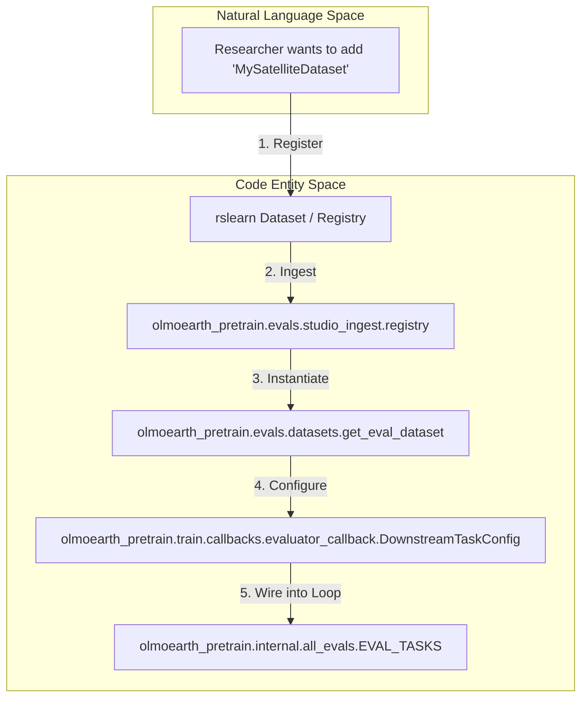
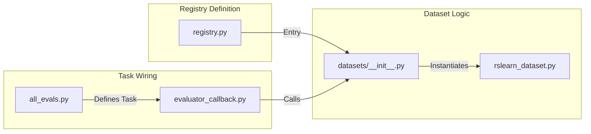

<!-- source: DeepWiki mcp.deepwiki.com · repo allenai/olmoearth_pretrain · page 6.8 Adding New Evaluation Datasets · fetched 2026-10-26 -->

# Adding New Evaluation Datasets

Relevant source files

The following files were used as context for generating this wiki page:

- [docs/Adding-Eval-Datasets.md](docs/Adding-Eval-Datasets.md)
- [olmoearth_pretrain/config.py](olmoearth_pretrain/config.py)
- [olmoearth_pretrain/evals/constants.py](olmoearth_pretrain/evals/constants.py)
- [olmoearth_pretrain/evals/datasets/__init__.py](olmoearth_pretrain/evals/datasets/__init__.py)
- [olmoearth_pretrain/evals/datasets/breizhcrops.py](olmoearth_pretrain/evals/datasets/breizhcrops.py)
- [olmoearth_pretrain/evals/datasets/configs.py](olmoearth_pretrain/evals/datasets/configs.py)
- [olmoearth_pretrain/evals/datasets/floods_dataset.py](olmoearth_pretrain/evals/datasets/floods_dataset.py)
- [olmoearth_pretrain/evals/datasets/geobench_dataset.py](olmoearth_pretrain/evals/datasets/geobench_dataset.py)
- [olmoearth_pretrain/evals/datasets/mados_dataset.py](olmoearth_pretrain/evals/datasets/mados_dataset.py)
- [olmoearth_pretrain/evals/datasets/normalize.py](olmoearth_pretrain/evals/datasets/normalize.py)
- [olmoearth_pretrain/evals/datasets/pastis_dataset.py](olmoearth_pretrain/evals/datasets/pastis_dataset.py)
- [olmoearth_pretrain/evals/datasets/pastis_processor.py](olmoearth_pretrain/evals/datasets/pastis_processor.py)
- [olmoearth_pretrain/evals/datasets/paths.py](olmoearth_pretrain/evals/datasets/paths.py)
- [olmoearth_pretrain/evals/datasets/rslearn_dataset.py](olmoearth_pretrain/evals/datasets/rslearn_dataset.py)
- [olmoearth_pretrain/internal/all_evals.py](olmoearth_pretrain/internal/all_evals.py)
- [olmoearth_pretrain/internal/full_eval_sweep_finetune.py](olmoearth_pretrain/internal/full_eval_sweep_finetune.py)
- [olmoearth_pretrain/train/callbacks/evaluator_callback.py](olmoearth_pretrain/train/callbacks/evaluator_callback.py)
- [scripts/tools/validate_segmentation_metrics.py](scripts/tools/validate_segmentation_metrics.py)
- [tests/unit/eval/__init__.py](tests/unit/eval/__init__.py)
- [tests/unit/test_config.py](tests/unit/test_config.py)

This guide outlines the process for integrating new evaluation datasets into the OlmoEarth pretraining framework. The system supports a variety of data formats, including legacy specialized datasets (GeoBench, MADOS, PASTIS) and modern `rslearn` datasets managed via a central registry.

## Overview of the Evaluation Data Flow

The evaluation system is designed to be extensible, allowing users to plug in new datasets that can be used for K-Nearest Neighbors (KNN) evaluation, Linear Probing (LP), or Full Model Finetuning (FT).

### High-Level Data Ingestion

**Sources:** [olmoearth_pretrain/evals/datasets/__init__.py:34-44](), [olmoearth_pretrain/train/callbacks/evaluator_callback.py:66-115](), [olmoearth_pretrain/internal/all_evals.py:66-78]()

---

## 1. Dataset Registration and Ingestion

New datasets should ideally be formatted as `rslearn` datasets. Once a dataset is available in `rslearn` format, it is integrated via the `rslearn_dataset.py` bridge.

### The `rslearn` Bridge
The `RslearnToOlmoEarthDataset` class [olmoearth_pretrain/evals/datasets/rslearn_dataset.py:80-90]() acts as a wrapper that converts `rslearn` outputs into `MaskedOlmoEarthSample` objects.

| Component | Role |
| :--- | :--- |
| `get_dataset_entry` | Fetches metadata from the registry [olmoearth_pretrain/evals/datasets/__init__.py:99-100](). |
| `from_registry_entry` | Factory function to build the dataset instance [olmoearth_pretrain/evals/datasets/rslearn_dataset.py:174-183](). |
| `get_timestamps` | Generates monthly temporal metadata required by the model [olmoearth_pretrain/evals/datasets/rslearn_dataset.py:40-54](). |

**Sources:** [olmoearth_pretrain/evals/datasets/rslearn_dataset.py:40-110](), [olmoearth_pretrain/evals/datasets/__init__.py:99-106]()

---

## 2. Normalization and Statistics

Correct normalization is critical for evaluation. The framework supports two primary strategies:
1.  **Pretrained Stats:** Using the global mean/std from the pretraining dataset [olmoearth_pretrain/evals/datasets/rslearn_dataset.py:165-166]().
2.  **Dataset-Specific Stats:** Using stats computed specifically for the downstream task.

### Computing Band Stats
If `norm_stats_from_pretrained` is set to `False`, the dataset must provide its own statistics (mean, std, min, max). These are often stored in a JSON file or passed via `ds_norm_stats` [olmoearth_pretrain/evals/datasets/rslearn_dataset.py:103-106]().

The `normalize_bands` function [olmoearth_pretrain/evals/datasets/normalize.py:121-131]() supports multiple methods:
- `NORM_NO_CLIP_2_STD`: Default method, matches pretraining [olmoearth_pretrain/evals/datasets/normalize.py:127-129]().
- `STANDARDIZE`: Simple `(x - mean) / std` [olmoearth_pretrain/evals/datasets/normalize.py:142-143]().
- `NORM_YES_CLIP_MIN_MAX_INT`: Min-max scaling followed by 8-bit quantization [olmoearth_pretrain/evals/datasets/normalize.py:82-85]().

**Sources:** [olmoearth_pretrain/evals/datasets/normalize.py:48-61](), [olmoearth_pretrain/evals/datasets/rslearn_dataset.py:128-136]()

---

## 3. Wiring up New Tasks

To make a new dataset available in the evaluation loop, it must be added to the registry and then configured as a `DownstreamTaskConfig`.

### System Configuration Diagram

### Steps to Add a Task:
1.  **Define the Task Config:** Add an entry to `EVAL_TASKS` in `olmoearth_pretrain/internal/all_evals.py`.
2.  **Specify Modalities:** Ensure the `input_modalities` match those defined in `Modality` (e.g., `SENTINEL2_L2A`) [olmoearth_pretrain/internal/all_evals.py:75]().
3.  **Set Metrics:** Choose a `primary_metric` (e.g., `ACCURACY`, `MACRO_F1`, `MIOU`) [olmoearth_pretrain/internal/all_evals.py:77]().

**Sources:** [olmoearth_pretrain/internal/all_evals.py:66-101](), [olmoearth_pretrain/train/callbacks/evaluator_callback.py:66-92]()

---

## 4. Implementation Details for Specialized Datasets

If the dataset does not fit the `rslearn` pattern, it can be implemented as a standalone `torch.utils.data.Dataset`. Existing examples include:

### Legacy Dataset Implementations
| Dataset | File | Key Characteristic |
| :--- | :--- | :--- |
| **GeoBench** | `geobench_dataset.py` | Handles Landsat/S2 multi-band imputation [olmoearth_pretrain/evals/datasets/geobench_dataset.py:140-144](). |
| **MADOS** | `mados_dataset.py` | Requires custom `.pt` preprocessing and band interpolation [olmoearth_pretrain/evals/datasets/mados_dataset.py:142-146](). |
| **PASTIS-R** | `pastis_dataset.py` | Multi-modal (S1 + S2) temporal sequences [olmoearth_pretrain/evals/datasets/pastis_dataset.py:53-69](). |
| **Sen1Floods11** | `floods_dataset.py` | Tile-based segmentation with S1/S2 pairs [olmoearth_pretrain/evals/datasets/floods_dataset.py:153-158](). |

**Sources:** [olmoearth_pretrain/evals/datasets/geobench_dataset.py:62-90](), [olmoearth_pretrain/evals/datasets/mados_dataset.py:103-115](), [olmoearth_pretrain/evals/datasets/pastis_dataset.py:53-80](), [olmoearth_pretrain/evals/datasets/floods_dataset.py:177-192]()

---

## 5. Running Evaluation Sweeps

Once the dataset is wired into `all_evals.py`, you can run a full evaluation sweep using the `full_eval_sweep_finetune.py` script.

### Key Functions for Sweeps
- `_format_per_task_args`: Repeats configuration overrides for every task in the sweep [olmoearth_pretrain/internal/full_eval_sweep_finetune.py:56-65]().
- `MODEL_PRESETS`: Defines model-specific normalization methods that should be applied during evaluation [olmoearth_pretrain/internal/full_eval_sweep_finetune.py:103-110]().

**Sources:** [olmoearth_pretrain/internal/full_eval_sweep_finetune.py:49-65](), [olmoearth_pretrain/internal/full_eval_sweep_finetune.py:103-150]()

---

