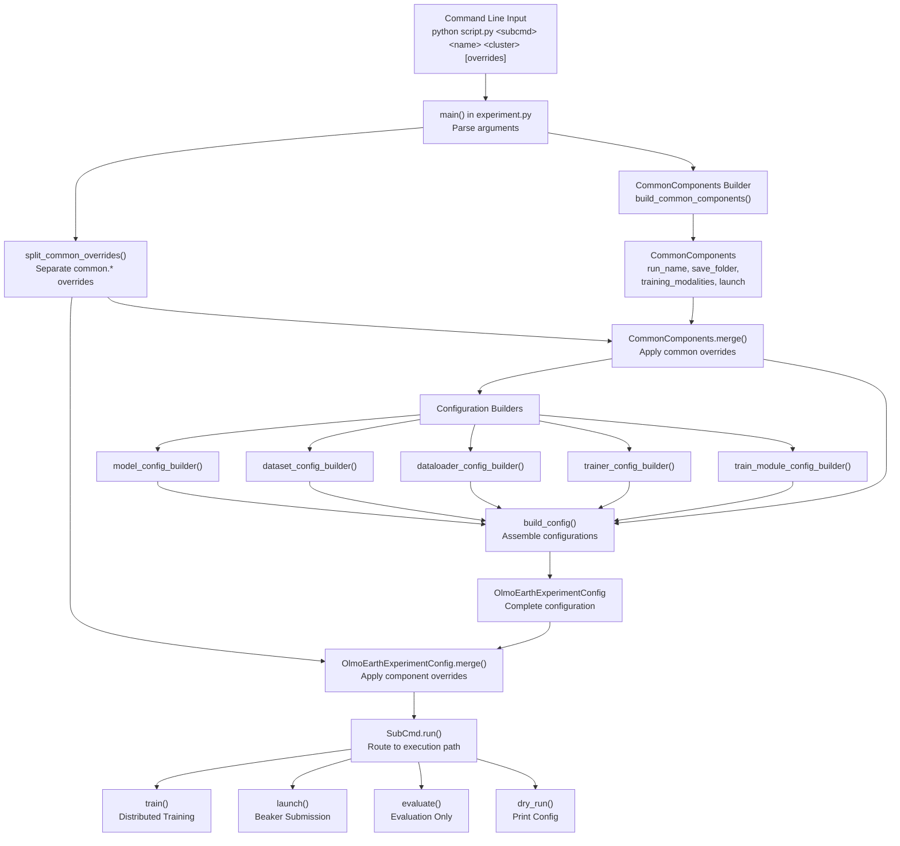
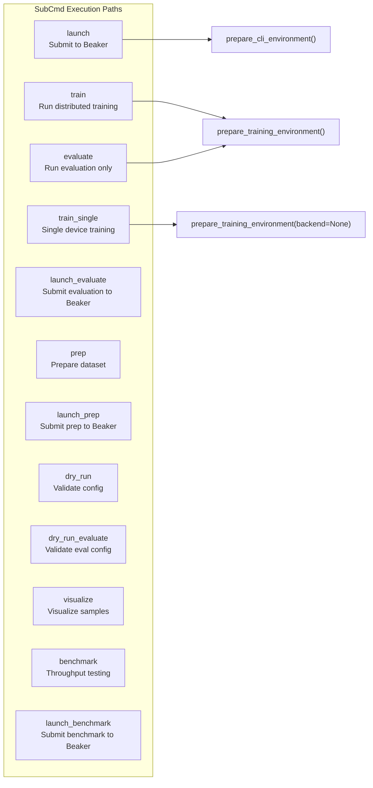
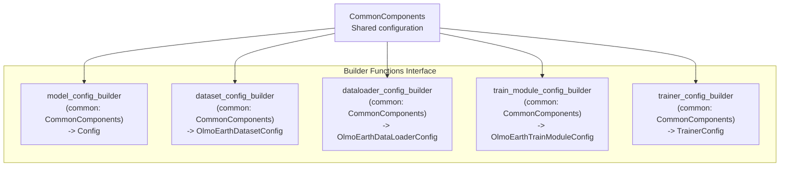
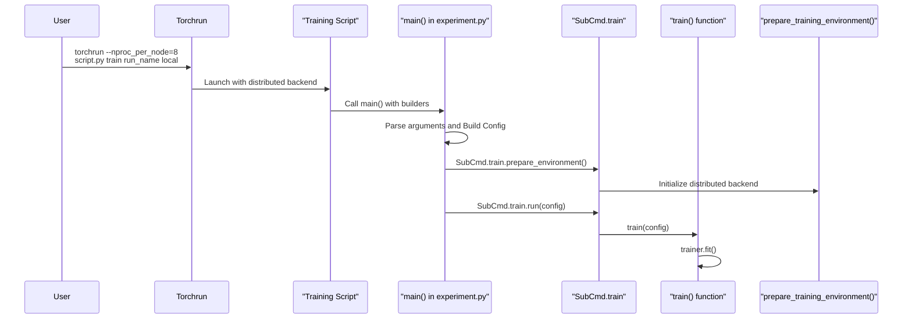
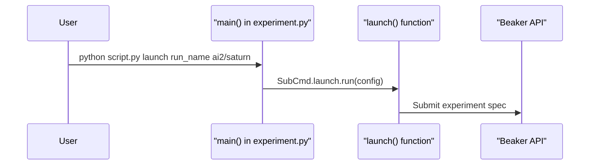

<!-- source: DeepWiki mcp.deepwiki.com · repo allenai/olmoearth_pretrain · page 7 Experiment Orchestration · fetched 2026-10-26 -->

# Experiment Orchestration

<details>
<summary>Relevant source files</summary>

The following files were used as context for generating this wiki page:

- [.github/workflows/lint.yaml](.github/workflows/lint.yaml)
- [.github/workflows/tests.yaml](.github/workflows/tests.yaml)
- [README.md](README.md)
- [docs/Evaluation.md](docs/Evaluation.md)
- [docs/Pretraining.md](docs/Pretraining.md)
- [olmoearth_pretrain/internal/common.py](olmoearth_pretrain/internal/common.py)
- [olmoearth_pretrain/internal/experiment.py](olmoearth_pretrain/internal/experiment.py)
- [olmoearth_pretrain/internal/utils.py](olmoearth_pretrain/internal/utils.py)
- [olmoearth_pretrain/py.typed](olmoearth_pretrain/py.typed)
- [pyproject.toml](pyproject.toml)
- [scripts/archived/20251027_finetune.sh](scripts/archived/20251027_finetune.sh)
- [uv.lock](uv.lock)

</details>


## Purpose and Scope

This page provides a comprehensive guide to the experiment orchestration system in OlmoEarth, which handles configuring and running experiments from local development to cluster deployment. The system uses a builder-based configuration pattern combined with command-line overrides to enable flexible experiment management across different execution environments.

This page covers the high-level architecture and core components of the orchestration system. For specific topics:
- Configuration building details: see [Configuration System](#7.1)
- Available subcommands and their usage: see [SubCommands Reference](#7.2)
- Creating custom training scripts: see [Training Scripts](#7.3)
- Beaker cluster deployment: see [Beaker Cluster Integration](#7.4)
- Experiment tracking with W&B: see [Weights & Biases Integration](#7.5)
- Command-line override patterns: see [CLI Overrides and Advanced Configuration](#7.6)

For information about the training process itself, see [Training System](#5). For evaluation workflows, see [Evaluation System](#6).

## System Architecture

### Overall Execution Flow

The experiment orchestration system follows a pipeline from command-line input through configuration assembly to execution:



**Sources:** [olmoearth_pretrain/internal/experiment.py:460-556](), [olmoearth_pretrain/internal/experiment.py:181-220]()

### Core Configuration Classes

The system uses several key configuration classes to organize experiment parameters:

```mermaid
graph TB
    subgraph "Configuration Hierarchy"
        COMMON["CommonComponents<br/>run_name: str<br/>save_folder: str<br/>training_modalities: list[str]<br/>launch: OlmoEarthBeakerLaunchConfig | None"]
        
        EXP_CONFIG["OlmoEarthExperimentConfig"]
        
        MODEL["model: Config<br/>(LatentMIMConfig)"]
        DATASET["dataset: Config<br/>(OlmoEarthDatasetConfig)"]
        DATALOADER["data_loader: OlmoEarthDataLoaderConfig"]
        TRAINMOD["train_module: OlmoEarthTrainModuleConfig"]
        TRAINER["trainer: TrainerConfig"]
        LAUNCH["launch: OlmoEarthBeakerLaunchConfig | None"]
        
        EXP_CONFIG --> MODEL
        EXP_CONFIG --> DATASET
        EXP_CONFIG --> DATALOADER
        EXP_CONFIG --> TRAINMOD
        EXP_CONFIG --> TRAINER
        EXP_CONFIG --> LAUNCH
        
        COMMON -.."provides shared values".-> MODEL
        COMMON -.."provides shared values".-> DATASET
        COMMON -.."provides shared values".-> DATALOADER
        COMMON -.."provides shared values".-> TRAINMOD
        COMMON -.."provides shared values".-> TRAINER
        COMMON -.."provides launch config".-> LAUNCH
    end
    
    subgraph "Builder Functions"
        COMMON_BUILDER["build_common_components()"]
        MODEL_BUILDER["model_config_builder()"]
        DATASET_BUILDER["dataset_config_builder()"]
        DATALOADER_BUILDER["dataloader_config_builder()"]
        TRAINMOD_BUILDER["train_module_config_builder()"]
        TRAINER_BUILDER["trainer_config_builder()"]
    end
    
    COMMON_BUILDER --> COMMON
    MODEL_BUILDER --> MODEL
    DATASET_BUILDER --> DATASET
    DATALOADER_BUILDER --> DATALOADER
    TRAINMOD_BUILDER --> TRAINMOD
    TRAINER_BUILDER --> TRAINER
```

**Sources:** [olmoearth_pretrain/internal/experiment.py:74-109](), [olmoearth_pretrain/internal/experiment.py:127-140]()

## Core Components

### CommonComponents

The `CommonComponents` class encapsulates configuration items shared across all experiment components:

| Field | Type | Description |
|-------|------|-------------|
| `run_name` | `str` | Unique identifier for the experiment run |
| `save_folder` | `str` | Directory path for saving checkpoints and outputs |
| `training_modalities` | `list[str]` | List of modality names to use in training (e.g., `["SENTINEL2_L2A", "SENTINEL1"]`) |
| `launch` | `OlmoEarthBeakerLaunchConfig \| None` | Configuration for Beaker cluster submission (None for local runs) |
| `nccl_debug` | `bool` | Enable detailed NCCL debugging output |

The `CommonComponents` object is built by `build_common_components()` in each training script and passed to all configuration builder functions, ensuring consistent settings across components.

**Sources:** [olmoearth_pretrain/internal/experiment.py:74-109](), [olmoearth_pretrain/internal/common.py:212-267]()

### OlmoEarthExperimentConfig

The `OlmoEarthExperimentConfig` class is the top-level configuration that assembles all component configurations:

```python
@dataclass
class OlmoEarthExperimentConfig(Config):
    run_name: str
    model: Config
    dataset: Config
    data_loader: OlmoEarthDataLoaderConfig
    train_module: OlmoEarthTrainModuleConfig
    trainer: TrainerConfig
    launch: OlmoEarthBeakerLaunchConfig | None = None
    visualize: OlmoEarthVisualizeConfig | None = None
    init_seed: int = 12536
```

This configuration is built by `build_config()`, which calls all the builder functions and merges CLI overrides.

**Sources:** [olmoearth_pretrain/internal/experiment.py:127-140](), [olmoearth_pretrain/internal/experiment.py:181-220]()

### SubCmd Enum

The `SubCmd` enum defines all available subcommands for experiment execution:



Each subcommand implements two key methods:
- `prepare_environment()`: Sets up the execution environment (CLI vs training)
- `run()`: Executes the appropriate action for the subcommand

**Sources:** [olmoearth_pretrain/internal/experiment.py:382-473]()

### Configuration Builder Pattern

The system uses a builder pattern where each component provides a builder function that takes `CommonComponents` as input:



**Sources:** [olmoearth_pretrain/internal/experiment.py:181-220](), [scripts/official/base.py:28-55]()

## Training Script Structure

Training scripts follow a standard structure with builder functions and a main entry point. Standard scripts like `scripts/official/base.py` define the specific model architecture while importing common data and trainer builders from a shared `script.py`.

### Standard Script Template

```python
from script import (
    build_common_components,
    build_dataloader_config,
    build_dataset_config,
    build_train_module_config,
    build_trainer_config,
    build_visualize_config,
)
from olmoearth_pretrain.internal.experiment import CommonComponents, main

def build_model_config(common: CommonComponents) -> LatentMIMConfig:
    # Model architecture definition
    ...

if __name__ == "__main__":
    main(
        common_components_builder=build_common_components,
        model_config_builder=build_model_config,
        ...
    )
```

**Sources:** [scripts/official/base.py:1-67]()

### Builder Function Responsibilities

| Builder Function | Responsibility | Key Configuration Items |
|-----------------|----------------|------------------------|
| `build_common_components()` | Initialize shared settings | `run_name`, `save_folder`, `training_modalities`, `launch` config |
| `build_model_config()` | Define model architecture | Encoder/decoder configs, embedding sizes, depths, heads |
| `build_dataset_config()` | Specify data sources | H5PY directory paths, modality lists, normalization |
| `build_dataloader_config()` | Configure data loading | Batch sizes, workers, token budgets, patch sizes |
| `build_train_module_config()` | Set training parameters | Optimizer, scheduler, masking, losses, FSDP config |
| `build_trainer_config()` | Configure training loop | Duration, callbacks, checkpointing, evaluation tasks |

**Sources:** [scripts/official/script.py:55-247]()

## Execution Paths

### Local Training Execution

For local training with `torchrun`:



**Sources:** [olmoearth_pretrain/internal/experiment.py:278-302](), [olmoearth_pretrain/internal/experiment.py:401-420](), [olmoearth_pretrain/internal/experiment.py:443-447]()

### Beaker Cluster Submission

For cluster submission with the `launch` subcommand, the system builds a `BeakerLaunchConfig` that clones the repo and sets up the environment on the remote node.



**Sources:** [olmoearth_pretrain/internal/experiment.py:348-355](), [olmoearth_pretrain/internal/common.py:110-209]()

## Configuration Override System

### Override Resolution Order

The configuration system applies overrides in a specific sequence:
1. `split_common_overrides()` separates `--common.*` flags.
2. `CommonComponents.merge()` applies common overrides.
3. Builder functions are called with updated `CommonComponents`.
4. `OlmoEarthExperimentConfig.merge()` applies final component-level overrides.

**Sources:** [olmoearth_pretrain/internal/experiment.py:168-178](), [olmoearth_pretrain/internal/experiment.py:196-220]()

### Override Syntax

Overrides use dotted notation to target specific configuration fields, such as `--model.encoder_config.depth=24` or `--data_loader.global_batch_size=512`.

**Sources:** [olmoearth_pretrain/internal/experiment.py:168-178]()

## Cluster and Environment Configuration

### Launch Configuration for Beaker

The `OlmoEarthBeakerLaunchConfig` manages cluster submission, including mounting Weka buckets and setting environment secrets like `BEAKER_TOKEN` and `WANDB_API_KEY`.

**Sources:** [olmoearth_pretrain/internal/experiment.py:45-65](), [olmoearth_pretrain/internal/common.py:110-209]()

### Root Directory Resolution

The system determines the save folder based on the cluster name using `get_root_dir()`. Weka clusters (e.g., jupiter, saturn) use `/weka/dfive-default/olmoearth_pretrain`, while local runs use `./local_output`.

**Sources:** [olmoearth_pretrain/internal/common.py:58-77]()

## Integration with Training and Evaluation

### Training Execution
The `train()` function initializes the model, dataset, and trainer. It applies `seed_all()` and configures callbacks like `WandBCallback` and `ConfigSaverCallback` before calling `trainer.fit()`.

**Sources:** [olmoearth_pretrain/internal/experiment.py:278-302]()

### Evaluation Execution
The `evaluate()` function uses `MockOlmoEarthDataLoader` and `MockLatentMIMTrainModule` to trigger evaluation callbacks without running actual training iterations.

**Sources:** [olmoearth_pretrain/internal/experiment.py:305-323](), [olmoearth_pretrain/internal/utils.py:196-275]()

---

