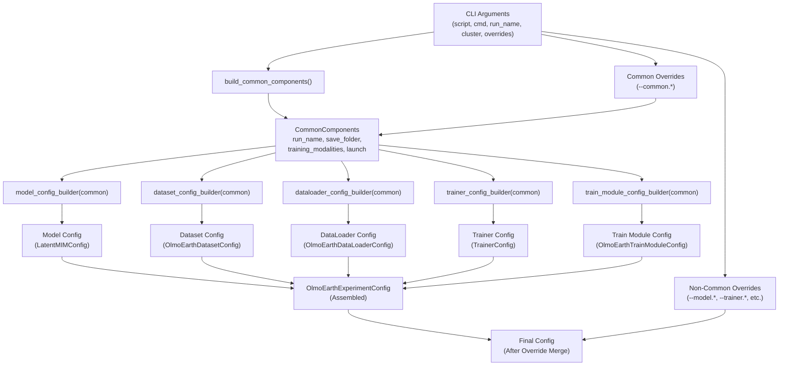
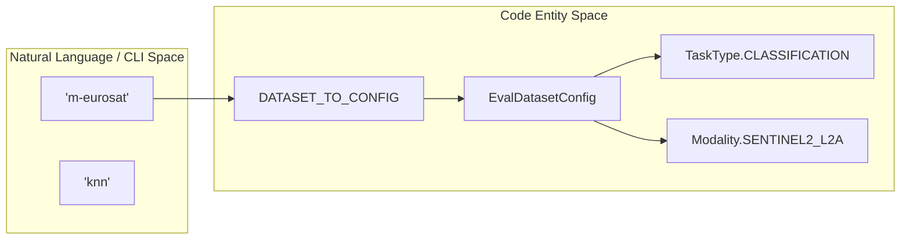
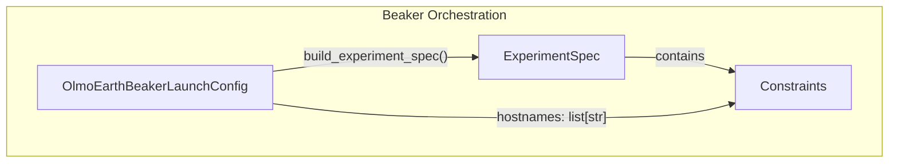

<!-- source: DeepWiki mcp.deepwiki.com · repo allenai/olmoearth_pretrain · page 7.1 Configuration System · fetched 2026-10-26 -->

# Configuration System

Relevant source files

The following files were used as context for generating this wiki page:

- [docs/Adding-Eval-Datasets.md](docs/Adding-Eval-Datasets.md)
- [docs/Evaluation.md](docs/Evaluation.md)
- [docs/Pretraining.md](docs/Pretraining.md)
- [olmoearth_pretrain/config.py](olmoearth_pretrain/config.py)
- [olmoearth_pretrain/evals/constants.py](olmoearth_pretrain/evals/constants.py)
- [olmoearth_pretrain/evals/datasets/configs.py](olmoearth_pretrain/evals/datasets/configs.py)
- [olmoearth_pretrain/evals/datasets/pastis_processor.py](olmoearth_pretrain/evals/datasets/pastis_processor.py)
- [olmoearth_pretrain/evals/datasets/paths.py](olmoearth_pretrain/evals/datasets/paths.py)
- [olmoearth_pretrain/internal/experiment.py](olmoearth_pretrain/internal/experiment.py)
- [olmoearth_pretrain/internal/utils.py](olmoearth_pretrain/internal/utils.py)
- [scripts/archived/20251027_finetune.sh](scripts/archived/20251027_finetune.sh)
- [tests/unit/test_config.py](tests/unit/test_config.py)

This page documents the configuration system used in OlmoEarth pretraining experiments. The system uses a builder pattern with override capabilities to construct experiment configurations from modular components.

## Overview

The configuration system separates experiment configuration into two phases:

1.  **Configuration Construction**: Builder functions create configuration objects from `CommonComponents`.
2.  **Configuration Merging**: CLI overrides are applied to the constructed configuration using a dot-notation system.

This architecture allows for reusable configuration templates (like model size presets) while supporting flexible customization via command-line arguments.

**Sources:** [olmoearth_pretrain/internal/experiment.py:1-207](), [olmoearth_pretrain/config.py:1-17]()

## Configuration Architecture

The system is built around three key concepts:
*   **CommonComponents**: Shared settings (run name, modalities, launch info) used by all builder functions.
*   **Builder Functions**: Callables that construct specific subsystem configurations (e.g., `model_config_builder`).
*   **Configuration Classes**: Dataclasses that define experiment parameters, inheriting from a base `Config` class.

### Configuration Flow Diagram
The following diagram illustrates how CLI arguments are transformed into a final merged configuration.

**Sources:** [olmoearth_pretrain/internal/experiment.py:181-207](), [olmoearth_pretrain/internal/experiment.py:75-108]()

## CommonComponents

`CommonComponents` is a configuration class that stores settings shared across all experiment components. It is constructed first and passed to all builder functions.

### Fields

| Field | Type | Description |
| :--- | :--- | :--- |
| `run_name` | `str` | Unique identifier for this experiment run [olmoearth_pretrain/internal/experiment.py:89]() |
| `save_folder` | `str` | Path to save checkpoints and logs [olmoearth_pretrain/internal/experiment.py:90]() |
| `training_modalities` | `list[str]` | List of modality names to train on [olmoearth_pretrain/internal/experiment.py:91]() |
| `launch` | `OlmoEarthBeakerLaunchConfig \| None` | Optional Beaker launch configuration [olmoearth_pretrain/internal/experiment.py:92]() |
| `tokenization_config` | `TokenizationConfig \| None` | Custom tokenization for band groupings [olmoearth_pretrain/internal/experiment.py:94]() |

### Validation
The `validate()` method ensures that `training_modalities` only contains valid names from the `Modality` registry [olmoearth_pretrain/internal/experiment.py:96-105]().

**Sources:** [olmoearth_pretrain/internal/experiment.py:75-108]()

## Model Size Presets

The system provides standard architectural presets for the FlexiVit backbone. These are stored in `MODEL_SIZE_ARGS` and are used within builder functions to populate `EncoderConfig` and `PredictorConfig`.

| Size | Encoder Depth | Embedding Size | Heads | MLP Ratio |
| :--- | :--- | :--- | :--- | :--- |
| **Nano** | 4 | 128 | 8 | 4.0 |
| **Tiny** | 12 | 192 | 3 | 4.0 |
| **Base** | 12 | 768 | 12 | 4.0 |
| **Large** | 24 | 1024 | 16 | 4.0 |
| **Giga** | 40 | 1536 | 24 | 4.0 |

**Sources:** [olmoearth_pretrain/internal/utils.py:48-193]()

## Override System

The override system allows command-line arguments to modify configuration values without changing code. Overrides use dotted notation to specify nested configuration fields.

### Common vs. Non-Common Overrides
The `split_common_overrides` function separates overrides into two categories:
1.  **Common Overrides**: Prefixed with `common.`. These are merged into `CommonComponents` *before* the builders are called [olmoearth_pretrain/internal/experiment.py:170-178]().
2.  **Standard Overrides**: These are merged into the final `OlmoEarthExperimentConfig` *after* it has been assembled [olmoearth_pretrain/internal/experiment.py:205]().

### Configuration Class Implementation
The `Config` class provides cross-compatibility for environments with and without `olmo-core`:
*   **With `olmo-core`**: Inherits from `olmo_core.config.Config`, supporting full OmegaConf merging and CLI dotlist overrides [olmoearth_pretrain/config.py:30-36]().
*   **Standalone**: Uses `_StandaloneConfig` for minimal inference-only support, resolving classes via a `_CLASS_` field in serialized dictionaries [olmoearth_pretrain/config.py:65-168]().

**Sources:** [olmoearth_pretrain/config.py:1-170](), [olmoearth_pretrain/internal/experiment.py:168-178]()

## Evaluation Task Configuration

Downstream evaluations are configured using `DownstreamTaskConfig` (found in training scripts) and mapped to `EvalDatasetConfig`.

| Config Field | Description |
| :--- | :--- |
| `task_type` | `CLASSIFICATION` or `SEGMENTATION` [olmoearth_pretrain/evals/datasets/configs.py:26]() |
| `imputes` | List of band pairs for missing data imputation [olmoearth_pretrain/evals/datasets/configs.py:27]() |
| `supported_modalities` | List of `Modality` names available for the task [olmoearth_pretrain/evals/datasets/configs.py:30]() |
| `height_width` | Input/Output dimensions (required for segmentation) [olmoearth_pretrain/evals/datasets/configs.py:33]() |

**Sources:** [olmoearth_pretrain/evals/datasets/configs.py:22-49](), [olmoearth_pretrain/evals/datasets/configs.py:51-184]()

## Beaker Launch Configuration

For AI2 internal researchers, `OlmoEarthBeakerLaunchConfig` extends the standard `BeakerLaunchConfig` to support targeting specific hostnames.

The `build_experiment_spec` method overrides the default cluster constraint with a hostname constraint if a list of hostnames is provided [olmoearth_pretrain/internal/experiment.py:53-65]().

**Sources:** [olmoearth_pretrain/internal/experiment.py:44-65]()

---

