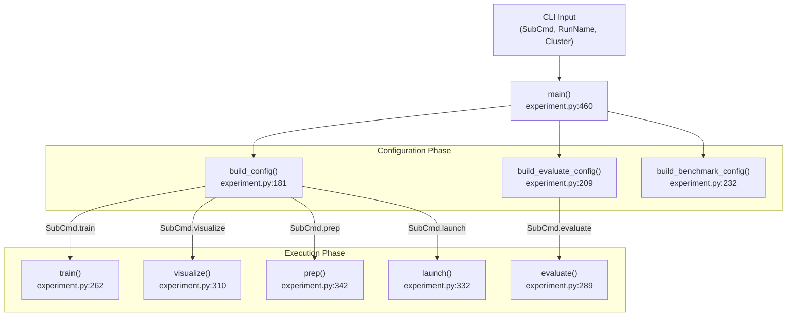
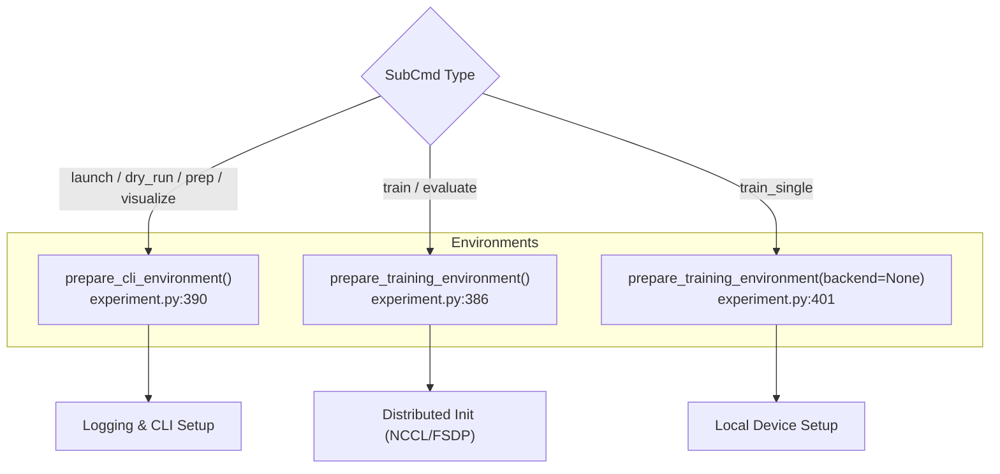

<!-- source: DeepWiki mcp.deepwiki.com · repo allenai/olmoearth_pretrain · page 7.2 SubCommands Reference · fetched 2026-10-26 -->

# SubCommands Reference

<details>
<summary>Relevant source files</summary>

The following files were used as context for generating this wiki page:

- [docs/Evaluation.md](docs/Evaluation.md)
- [docs/Pretraining.md](docs/Pretraining.md)
- [olmoearth_pretrain/internal/experiment.py](olmoearth_pretrain/internal/experiment.py)
- [olmoearth_pretrain/internal/utils.py](olmoearth_pretrain/internal/utils.py)
- [olmoearth_pretrain/train/train_module/contrastive_latentmim.py](olmoearth_pretrain/train/train_module/contrastive_latentmim.py)
- [olmoearth_pretrain/train/train_module/galileo.py](olmoearth_pretrain/train/train_module/galileo.py)
- [olmoearth_pretrain/train/train_module/latent_mim.py](olmoearth_pretrain/train/train_module/latent_mim.py)
- [olmoearth_pretrain/train/train_module/mae.py](olmoearth_pretrain/train/train_module/mae.py)
- [olmoearth_pretrain/train/utils.py](olmoearth_pretrain/train/utils.py)
- [scripts/archived/20251027_finetune.sh](scripts/archived/20251027_finetune.sh)
- [scripts/official/script.py](scripts/official/script.py)
- [tests/unit/train/test_utils.py](tests/unit/train/test_utils.py)

</details>


This document provides a complete reference for all subcommands available in the OlmoEarth pretraining experiment system. These subcommands control how experiments are executed, from local training to cluster deployment to evaluation-only runs.

For information about the configuration system that these subcommands operate on, see **7.1 Configuration System**. For details on training scripts that invoke these subcommands, see **7.3 Training Scripts**. For Beaker cluster integration, see **7.4 Beaker Cluster Integration**.

## Overview

The experiment system uses a subcommand-based CLI pattern where a single script can be invoked with different subcommands to perform different operations. All subcommands are defined in the `SubCmd` enum and share a common configuration building process but execute different code paths.

**Command Syntax:**
```bash
python scripts/<script>.py <SUBCOMMAND> <RUN_NAME> <CLUSTER> [OVERRIDES...]
```

**For multi-GPU training:**
```bash
torchrun [OPTIONS] scripts/<script>.py <SUBCOMMAND> <RUN_NAME> <CLUSTER> [OVERRIDES...]
```

Sources: [olmoearth_pretrain/internal/experiment.py:364-375](), [docs/Pretraining.md:54-68]()

## SubCommand Enum Definition

The `SubCmd` enum defines all available subcommands with associated execution logic. The class includes methods for environment preparation and execution routing.

| SubCommand | Purpose | Environment Setup | Implementation Method |
|------------|---------|-------------------|-----------------------|
| `train` | Run distributed training | `prepare_training_environment()` | `train(config)` |
| `train_single` | Run single-device training | `prepare_training_environment(backend=None)` | `train(config)` |
| `launch` | Submit training job to Beaker | `prepare_cli_environment()` | `launch(config)` |
| `evaluate` | Run evaluation on checkpoints | `prepare_training_environment()` | `evaluate(config)` |
| `launch_evaluate` | Submit evaluation to Beaker | `prepare_cli_environment()` | `launch(config)` |
| `dry_run` | Validate training config | `prepare_cli_environment()` | `print(config)` |
| `dry_run_evaluate` | Validate evaluation config | `prepare_cli_environment()` | `print(config)` |
| `prep` | Prepare dataset for training | `prepare_cli_environment()` | `prep(config)` |
| `launch_prep` | Submit prep job to Beaker | `prepare_cli_environment()` | `launch_prep(config)` |
| `visualize` | Generate dataset visualizations | `prepare_cli_environment()` | `visualize(config)` |
| `benchmark` | Run throughput benchmarking | `prepare_cli_environment()` | `benchmark(config)` |
| `launch_benchmark` | Submit benchmark to Beaker | `prepare_cli_environment()` | `launch_benchmark(config)` |

Sources: [olmoearth_pretrain/internal/experiment.py:280-294](), [olmoearth_pretrain/internal/experiment.py:385-457]()

## SubCommand Execution Flow

The diagram below illustrates how the CLI input is routed through the configuration builders to the final execution logic.

### CLI to Code Entity Mapping
Title: CLI Command Routing and Execution Flow

Sources: [olmoearth_pretrain/internal/experiment.py:460-556](), [olmoearth_pretrain/internal/experiment.py:181-247]()

## Training Subcommands

### train

Executes distributed training. This subcommand initializes the full training environment including FSDP (if configured), builds the model, dataset, and dataloader, and runs the training loop.

**Execution Steps:**
1. Calls `prepare_training_environment()` to initialize the distributed backend.
2. Seeds RNG with `config.init_seed`.
3. Builds components: `model`, `train_module`, `dataset`, `data_loader`, and `trainer`.
4. Adds standard callbacks: `ConfigSaverCallback`, `WandBCallback`.
5. Executes `trainer.fit()`.
6. Calls `teardown_training_environment()`.

Sources: [olmoearth_pretrain/internal/experiment.py:262-286](), [olmoearth_pretrain/internal/experiment.py:386-387]()

### train_single

Executes training on a single device. It is functionally identical to `train` but forces `dp_config` to `None` to disable distributed logic.

**Environment:** Calls `prepare_training_environment(backend=None)` to skip distributed initialization.

Sources: [olmoearth_pretrain/internal/experiment.py:401-402](), [olmoearth_pretrain/internal/experiment.py:437-447]()

### launch

Submits a training job to the Beaker cluster. It does not run training locally but uses the `OlmoEarthBeakerLaunchConfig` to build and submit an `ExperimentSpec`.

Sources: [olmoearth_pretrain/internal/experiment.py:332-339](), [olmoearth_pretrain/internal/experiment.py:420-421]()

## Evaluation Subcommands

### evaluate

Runs evaluation tasks defined in the trainer configuration. To satisfy the `Trainer` requirements without running full training, it uses "Mock" components.

**Implementation Details:**
- **Model:** Real model built from `config.model`.
- **Dataloader:** `MockOlmoEarthDataLoader` which returns an empty iterator.
- **Train Module:** `MockLatentMIMTrainModule` which provides no-op train and eval steps.
- **Trigger:** `trainer.fit()` is called, which immediately transitions to running the evaluation callbacks (e.g., `DownstreamEvaluatorCallback`).

Sources: [olmoearth_pretrain/internal/experiment.py:289-307](), [olmoearth_pretrain/internal/utils.py:196-276]()

### dry_run_evaluate

Prints the `OlmoEarthEvaluateConfig` to the console for inspection. This is critical for verifying that model load paths and evaluation task registries are correctly configured before launching.

Sources: [olmoearth_pretrain/internal/experiment.py:422-423](), [docs/Evaluation.md:99-107]()

## Dataset and Utility Subcommands

### visualize

Generates PNG visualizations of samples from the dataset. It uses the `visualize_sample` utility to render multi-modal data into a viewable format.

**Configuration (`OlmoEarthVisualizeConfig`):**
- `output_dir`: Path to save images.
- `num_samples`: Number of random samples to process.
- `global_step`: If provided, fast-forwards the dataloader to a specific state before visualizing.

Sources: [olmoearth_pretrain/internal/experiment.py:111-118](), [olmoearth_pretrain/internal/experiment.py:310-329]()

### prep

Used to initialize the dataset state, such as generating shuffle indices. It builds the `OlmoEarthDataset` and `OlmoEarthDataLoader` and calls `data_loader.reshuffle()`.

Sources: [olmoearth_pretrain/internal/experiment.py:342-350]()

### benchmark

Measures the throughput of the model (tokens/sec or samples/sec). It uses a `ThroughputBenchmarkRunner` to execute timed passes of the model's forward and backward steps.

Sources: [olmoearth_pretrain/internal/experiment.py:250-253](), [olmoearth_pretrain/internal/experiment.py:452-453]()

## Internal Logic: Environment and Configuration

The system uses a two-stage process: first building the configuration object, then preparing the environment based on the subcommand type.

### Environment Preparation Logic
Title: SubCommand Environment Requirements

Sources: [olmoearth_pretrain/internal/experiment.py:385-404]()

### Configuration Builders

The `main` entrypoint routes to specific builder functions based on the subcommand:

1.  **`build_config`**: Used for `train`, `launch`, `dry_run`, `prep`, and `visualize`. It assembles the full `OlmoEarthExperimentConfig` including model, dataset, and trainer.
2.  **`build_evaluate_config`**: Used for `evaluate` and `launch_evaluate`. It focuses on the model and evaluation callbacks within the trainer.
3.  **`build_benchmark_config`**: Used for benchmarking subcommands.

Sources: [olmoearth_pretrain/internal/experiment.py:181-247](), [olmoearth_pretrain/internal/experiment.py:516-554]()

## Summary of SubCommand Classes

| Class | Purpose | Key Fields |
|-------|---------|------------|
| `OlmoEarthExperimentConfig` | Main pretraining config | `model`, `dataset`, `data_loader`, `trainer` |
| `OlmoEarthEvaluateConfig` | Evaluation config | `model`, `trainer`, `train_module` (optional) |
| `BenchmarkExperimentConfig` | Throughput config | `benchmark`, `model` |
| `OlmoEarthBeakerLaunchConfig` | Beaker submission config | `hostnames`, `num_gpus`, `cluster` |

Sources: [olmoearth_pretrain/internal/experiment.py:127-166](), [olmoearth_pretrain/internal/experiment.py:45-51]()

---

