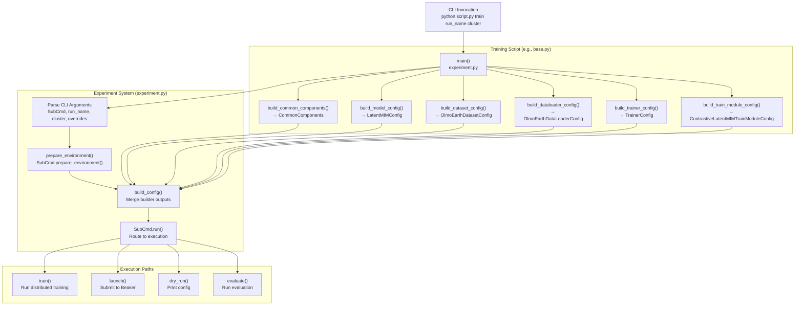
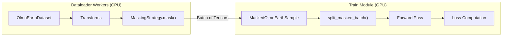

<!-- source: DeepWiki mcp.deepwiki.com · repo allenai/olmoearth_pretrain · page 7.3 Training Scripts · fetched 2026-10-26 -->

# Training Scripts

<details>
<summary>Relevant source files</summary>

The following files were used as context for generating this wiki page:

- [.gitignore](.gitignore)
- [olmoearth_pretrain/train/train_module/contrastive_latentmim.py](olmoearth_pretrain/train/train_module/contrastive_latentmim.py)
- [olmoearth_pretrain/train/train_module/galileo.py](olmoearth_pretrain/train/train_module/galileo.py)
- [olmoearth_pretrain/train/train_module/latent_mim.py](olmoearth_pretrain/train/train_module/latent_mim.py)
- [olmoearth_pretrain/train/train_module/mae.py](olmoearth_pretrain/train/train_module/mae.py)
- [olmoearth_pretrain/train/utils.py](olmoearth_pretrain/train/utils.py)
- [scripts/official/script.py](scripts/official/script.py)
- [tests/unit/train/test_utils.py](tests/unit/train/test_utils.py)

</details>


This page documents how to create and customize training scripts for OlmoEarth pretraining. Training scripts define the configuration builders that assemble all components needed for an experiment, utilizing the `olmo-core` framework for orchestration.

## Purpose and Scope

Training scripts serve as entry points for experiments. Each script:
- Defines builder functions that construct configuration objects for all system components [scripts/official/script.py:53-248]().
- Calls the `main()` function from `experiment.py` which handles CLI parsing, subcommand routing, and execution [olmoearth_pretrain/internal/experiment.py:460-557]().
- Provides a centralized location to define hyperparameters like learning rates, masking ratios, and model dimensions [scripts/official/script.py:108-132]().

## Script Architecture

The training scripts bridge high-level experiment intent with low-level code entities by providing builders for specific configuration classes.

### Natural Language to Code Entity Mapping

| Concept | Code Entity (Class/Function) | Role |
| :--- | :--- | :--- |
| **Experiment Entry** | `main()` | Orchestrates CLI parsing and builder execution [olmoearth_pretrain/internal/experiment.py:460]() |
| **Shared Context** | `CommonComponents` | Holds run names, save paths, and modality lists [olmoearth_pretrain/internal/experiment.py:73]() |
| **Data Flow** | `OlmoEarthDataLoaderConfig` | Configures batch sizes and worker counts [olmoearth_pretrain/data/dataloader.py]() |
| **Optimization** | `ContrastiveLatentMIMTrainModuleConfig` | Defines the training objective and optimizer [olmoearth_pretrain/train/train_module/contrastive_latentmim.py:36]() |
| **Monitoring** | `OlmoEarthWandBCallback` | Configures Weights & Biases logging [olmoearth_pretrain/train/callbacks/wandb.py]() |

### System Data Flow


**Sources:** [olmoearth_pretrain/internal/experiment.py:460-557](), [scripts/official/script.py:53-248]()

## Builder Function Pattern

All training scripts follow a consistent builder pattern where each component is constructed by a dedicated builder function.

### Required Builder Functions

| Builder Function | Return Type | Purpose |
|:---|:---|:---|
| `build_common_components()` | `CommonComponents` | Shared configuration (run_name, save_folder) [scripts/official/script.py:53]() |
| `build_model_config()` | `LatentMIMConfig` | Architecture (encoder/predictor specs) [scripts/official/base.py:28]() |
| `build_dataset_config()` | `OlmoEarthDatasetConfig` | Data source paths and modalities [scripts/official/script.py:164]() |
| `build_dataloader_config()` | `OlmoEarthDataLoaderConfig` | Batching, token budget, and worker config [scripts/official/script.py:135]() |
| `build_trainer_config()` | `TrainerConfig` | Training loop duration and callbacks [scripts/official/script.py:172]() |
| `build_train_module_config()` | `OlmoEarthTrainModuleConfig` | Optimizer, losses, and masking [scripts/official/script.py:97]() |

**Sources:** [scripts/official/script.py:53-248](), [olmoearth_pretrain/internal/experiment.py:165-207]()

## Training Module Configurations

The repository supports several training modules, each requiring a specific configuration builder. The most common is the `ContrastiveLatentMIMTrainModule`.

### Contrastive Latent MIM Configuration
This module implements self-supervised learning with a target encoder updated via Exponential Moving Average (EMA) [olmoearth_pretrain/train/train_module/contrastive_latentmim.py:126]().

```python
def build_train_module_config(common: CommonComponents) -> ContrastiveLatentMIMTrainModuleConfig:
    return ContrastiveLatentMIMTrainModuleConfig(
        optim_config=AdamWConfig(lr=0.0001, weight_decay=0.02),
        rank_microbatch_size=32,
        masking_config=get_masking_config(common),
        loss_config=LossConfig(loss_config={"type": "modality_patch_discrimination_new", "tau": 0.1}),
        contrastive_config=LossConfig(loss_config={"type": "InfoNCE", "weight": 0.1}),
        ema_decay=(1.0, 1.0), # Target encoder update rate
        dp_config=DataParallelConfig(name=DataParallelType.fsdp, param_dtype=DType.bfloat16),
    )
```
**Sources:** [scripts/official/script.py:97-132](), [olmoearth_pretrain/train/train_module/contrastive_latentmim.py:36-76]()

### Masked Autoencoder (MAE) Configuration
For MAE-style reconstruction tasks, the `MAETrainModule` is used [olmoearth_pretrain/train/train_module/mae.py:73]().

```python
def build_train_module_config(common: CommonComponents) -> MAETrainModuleConfig:
    return MAETrainModuleConfig(
        mae_loss_config=LossConfig(loss_config={"type": "mae", "loss_function": "SmoothL1Loss"}),
        masking_config=MaskingConfig(strategy_config={"type": "random"}),
        token_exit_cfg={modality: 0 for modality in common.training_modalities},
    )
```
**Sources:** [olmoearth_pretrain/train/train_module/mae.py:32-70]()

## Dataloader and Masking

A critical optimization in OlmoEarth is performing masking in the dataloader workers (CPU) rather than the training module (GPU) to maximize throughput [scripts/official/script.py:140-142]().



The `split_masked_batch` utility is used to divide large batches into micro-batches for gradient accumulation [olmoearth_pretrain/train/utils.py:13-49]().

**Sources:** [olmoearth_pretrain/train/utils.py:13-49](), [scripts/official/script.py:135-161]()

## Shared Component Builders

To avoid redundancy, model-specific scripts (like `base.py`) often import shared builders from a central `script.py`.

### Shared Configuration Hierarchy

| File | Content |
| :--- | :--- |
| `scripts/official/script.py` | Default builders for Dataset, Dataloader, Trainer, and TrainModule [scripts/official/script.py:1-248]() |
| `scripts/official/base.py` | Specific `build_model_config()` for the "Base" architecture [scripts/official/base.py:28-56]() |
| `olmoearth_pretrain/internal/common.py` | `build_common_components_default()` implementation [scripts/official/script.py:57]() |

**Sources:** [scripts/official/script.py:1-248](), [scripts/official/base.py:1-68]()

## Example: Creating a Custom Script

To create a new experiment script:

1.  **Copy a template**: Start with `scripts/official/base.py`.
2.  **Modify Architecture**: Adjust `EncoderConfig` and `PredictorConfig` in `build_model_config()`.
3.  **Customize Losses**: Edit `build_train_module_config()` to change loss types (e.g., swapping `InfoNCE` for `PatchDiscrimination`).
4.  **Add Evaluation Tasks**: Update `EVAL_TASKS` in `build_trainer_config()` to include new downstream datasets [scripts/official/script.py:190-200]().

### Custom Model Builder Example
```python
def build_model_config(common: CommonComponents) -> LatentMIMConfig:
    # Use predefined sizes or manual overrides
    from olmoearth_pretrain.internal.utils import MODEL_SIZE_ARGS
    model_size = MODEL_SIZE_ARGS["base"]
    
    encoder_config = EncoderConfig(
        embedding_size=model_size["encoder_embedding_size"],
        depth=12,
        num_heads=12,
        supported_modality_names=common.training_modalities,
        max_patch_size=8,
    )
    # ... build predictor and return LatentMIMConfig
```
**Sources:** [scripts/official/base.py:28-56](), [olmoearth_pretrain/internal/utils.py:48-193]()

## Memory and Performance Monitoring

Training scripts include callbacks for monitoring system health:
- `GPUMemoryMonitorCallback`: Tracks GPU memory usage during training [scripts/official/script.py:17]().
- `OlmoEarthSpeedMonitorCallback`: Tracks training throughput (samples/sec) [scripts/official/script.py:37]().
- `GarbageCollectorCallback`: Periodically clears Python GC to prevent memory fragmentation [scripts/official/script.py:189]().

**Sources:** [scripts/official/script.py:12-40](), [olmoearth_pretrain/train/callbacks/__init__.py]()

---

