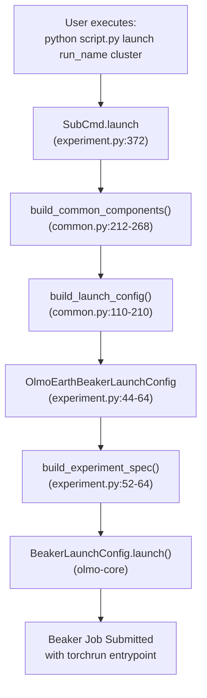
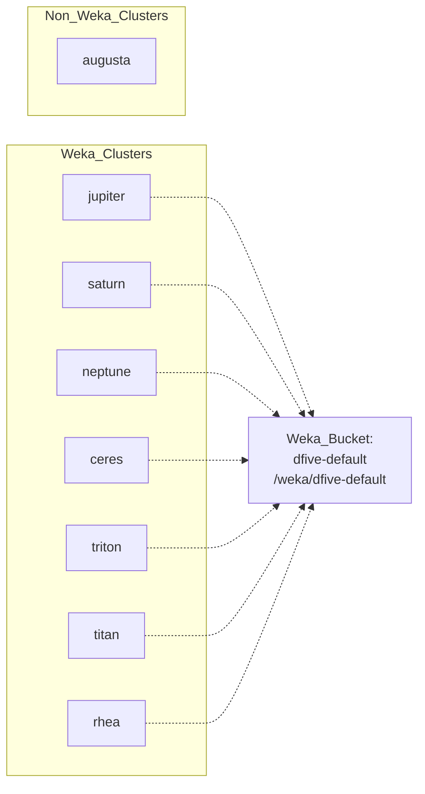
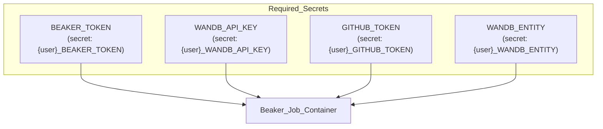
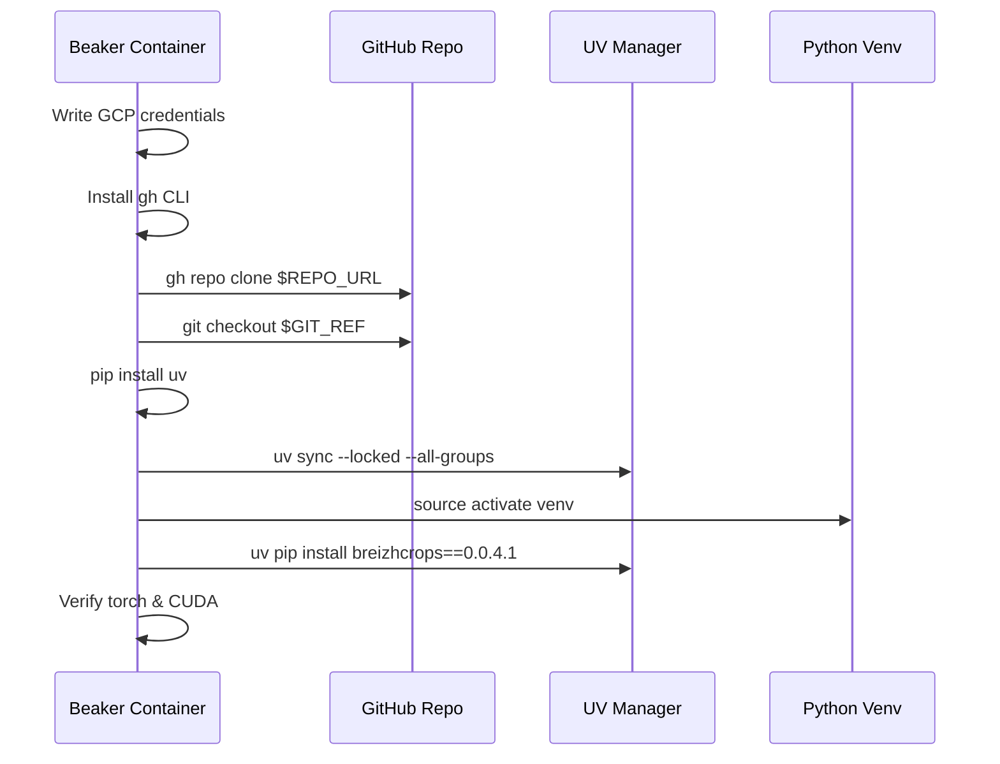

<!-- source: DeepWiki mcp.deepwiki.com · repo allenai/olmoearth_pretrain · page 7.4 Beaker Cluster Integration · fetched 2026-10-26 -->

# Beaker Cluster Integration

<details>
<summary>Relevant source files</summary>

The following files were used as context for generating this wiki page:

- [.github/workflows/lint.yaml](.github/workflows/lint.yaml)
- [.github/workflows/tests.yaml](.github/workflows/tests.yaml)
- [README.md](README.md)
- [docs/Evaluation.md](docs/Evaluation.md)
- [docs/Pretraining.md](docs/Pretraining.md)
- [olmoearth_pretrain/internal/common.py](olmoearth_pretrain/internal/common.py)
- [olmoearth_pretrain/internal/experiment.py](olmoearth_pretrain/internal/experiment.py)
- [olmoearth_pretrain/internal/utils.py](olmoearth_pretrain/internal/utils.py)
- [olmoearth_pretrain/py.typed](olmoearth_pretrain/py.typed)
- [pyproject.toml](pyproject.toml)
- [scripts/archived/20251027_finetune.sh](scripts/archived/20251027_finetune.sh)
- [uv.lock](uv.lock)

</details>


This page explains how to launch OlmoEarth pretraining and evaluation experiments on AI2's Beaker cluster infrastructure. It covers Beaker-specific configuration, cluster selection, environment setup, secrets management, and the job submission workflow.

For general training launch commands and local execution, see [Training Scripts](#7.3). For experiment configuration and overrides, see [Configuration System](#7.1).

---

## Overview of Beaker Integration

Beaker is AI2's internal cluster management system for running distributed training jobs. The OlmoEarth repository integrates with Beaker through the `olmo-core` library, extending its launch configuration to support:

- **Cluster targeting**: Submit jobs to specific AI2 clusters (Saturn, Jupiter, etc.) via `OlmoEarthBeakerLaunchConfig` [olmoearth_pretrain/internal/experiment.py:45-51]().
- **Weka storage**: Mount shared filesystems for datasets and checkpoints using `BeakerWekaBucket` [olmoearth_pretrain/internal/common.py:30-32]().
- **Secrets management**: Inject credentials for W&B, GitHub, GCP, and Beaker [olmoearth_pretrain/internal/common.py:191-198]().
- **Environment provisioning**: Automated setup of Python environments via `uv` in the `setup_steps` [olmoearth_pretrain/internal/common.py:185-208]().
- **Docker containerization**: Run jobs in standardized PyTorch containers such as `OLMoCoreBeakerImage.stable_cu128` [olmoearth_pretrain/internal/common.py:183-183]().

The integration is primarily implemented in two modules:
- `olmoearth_pretrain/internal/experiment.py` - Core launch logic and configuration [olmoearth_pretrain/internal/experiment.py:1-457]().
- `olmoearth_pretrain/internal/common.py` - Cluster-specific defaults and builders [olmoearth_pretrain/internal/common.py:1-268]().

**Sources:** [olmoearth_pretrain/internal/experiment.py:1-457](), [olmoearth_pretrain/internal/common.py:1-268]()

---

## Beaker Launch Flow

The diagram below illustrates the flow from a user CLI command to a running Beaker job, highlighting the relationship between `experiment.py` and `common.py`.



**Sources:** [olmoearth_pretrain/internal/experiment.py:366-457](), [olmoearth_pretrain/internal/common.py:110-268]()

---

## OlmoEarthBeakerLaunchConfig

The `OlmoEarthBeakerLaunchConfig` class extends `olmo-core`'s `BeakerLaunchConfig` with hostname targeting support, allowing jobs to be pinned to specific machines.

### Class Definition

```python
@dataclass
class OlmoEarthBeakerLaunchConfig(BeakerLaunchConfig):
    """Extend BeakerLaunchConfig with hostnames option."""
    
    hostnames: list[str] | None = None
    
    def build_experiment_spec(
        self, torchrun: bool = True, entrypoint: str | None = None
    ) -> ExperimentSpec:
        # Overrides cluster constraint with hostname if provided
```
[olmoearth_pretrain/internal/experiment.py:45-66]()

### Key Configuration Fields

The configuration inherits all fields from `BeakerLaunchConfig` and adds/configures:

| Field | Type | Description |
|-------|------|-------------|
| `hostnames` | `list[str] \| None` | Specific Beaker host names to target (overrides cluster constraint) [olmoearth_pretrain/internal/experiment.py:51-51](). |
| `name` | `str` | Job name (auto-appended with UUID) [olmoearth_pretrain/internal/common.py:176-176](). |
| `clusters` | `list[str]` | Target cluster names (e.g., `["ai2/saturn"]`) [olmoearth_pretrain/internal/common.py:181-181](). |
| `weka_buckets` | `list[BeakerWekaBucket]` | Weka storage mounts [olmoearth_pretrain/internal/common.py:182-182](). |
| `num_nodes` | `int` | Number of nodes for distributed training [olmoearth_pretrain/internal/common.py:184-184](). |
| `num_gpus` | `int` | GPUs per node [olmoearth_pretrain/internal/common.py:185-185](). |
| `beaker_image` | `str` | Docker image to use [olmoearth_pretrain/internal/common.py:183-183](). |
| `priority` | `BeakerPriority` | Job priority (low/normal/high/urgent) [olmoearth_pretrain/internal/common.py:189-189](). |
| `env_vars` | `list[BeakerEnvVar]` | Environment variables [olmoearth_pretrain/internal/common.py:190-190](). |
| `env_secrets` | `list[BeakerEnvSecret]` | Secret environment variables [olmoearth_pretrain/internal/common.py:191-198](). |

**Sources:** [olmoearth_pretrain/internal/experiment.py:44-70](), [olmoearth_pretrain/internal/common.py:110-210]()

---

## Supported Clusters and Storage

### Cluster Logic

The system distinguishes between clusters that support Weka (AI2's high-performance storage) and those that do not (e.g., Augusta).



### Cluster List

The following clusters support Weka storage mounts [olmoearth_pretrain/internal/common.py:35-43]():

```python
WEKA_CLUSTER_NAMES = [
    "jupiter", "saturn", "neptune", "ceres",
    "triton", "titan", "rhea"
]
```

**Augusta Cluster**: Does not support Weka mounts. When targeting Augusta, `weka_buckets` is set to an empty list [olmoearth_pretrain/internal/common.py:133-138]().

### Weka Bucket Configuration

```python
DEFAULT_OLMOEARTH_PRETRAIN_WEKA_BUCKET = BeakerWekaBucket(
    "dfive-default",           # Bucket name
    "/weka/dfive-default"      # Mount path
)
```
[olmoearth_pretrain/internal/common.py:30-32]()

The Weka bucket is mounted at `/weka/dfive-default` and typically contains:
- Pretraining datasets: `/weka/dfive-default/helios/dataset/` [docs/Pretraining.md:113-113]().
- Checkpoints: `/weka/dfive-default/helios/checkpoints/` [docs/Evaluation.md:68-71]().

**Sources:** [olmoearth_pretrain/internal/common.py:27-43](), [olmoearth_pretrain/internal/common.py:127-138]()

---

## Environment Setup and Secrets

### Secrets Configuration

Beaker jobs require specific secrets to be configured in the user's Beaker account to handle authentication for tracking and data access.



The secrets are injected as `BeakerEnvSecret` objects [olmoearth_pretrain/internal/common.py:191-198]():

```python
env_secrets=[
    BeakerEnvSecret(name="BEAKER_TOKEN", secret=f"{beaker_user}_BEAKER_TOKEN"),
    BeakerEnvSecret(name="WANDB_API_KEY", secret=f"{beaker_user}_WANDB_API_KEY"),
    BeakerEnvSecret(name="GITHUB_TOKEN", secret=f"{beaker_user}_GITHUB_TOKEN"),
    BeakerEnvSecret(name="WANDB_ENTITY", secret=f"{beaker_user}_WANDB_ENTITY"),
]
```

**Sources:** [olmoearth_pretrain/internal/common.py:177-198]()

### Environment Variables

Additional environment variables are propagated to the container [olmoearth_pretrain/internal/common.py:142-174]():

| Variable | Source | Purpose |
|----------|--------|---------|
| `GOOGLE_APPLICATION_CREDENTIALS` | Fixed path | GCP authentication [olmoearth_pretrain/internal/common.py:143-145](). |
| `NCCL_DEBUG` | Override | NCCL debugging level [olmoearth_pretrain/internal/common.py:97-97](). |
| `TRAIN_SCRIPT_PATH` | Host Env | Custom training script path [olmoearth_pretrain/internal/common.py:151-154](). |
| `CHECKPOINT_DIR` | Host Env | Base directory for checkpoints [olmoearth_pretrain/internal/common.py:156-159](). |

NCCL debugging can be enabled via the `--common.nccl_debug=True` override [olmoearth_pretrain/internal/common.py:80-85]().

**Sources:** [olmoearth_pretrain/internal/common.py:80-108](), [olmoearth_pretrain/internal/common.py:142-174]()

---

## Setup Steps Sequence

The Beaker job executes a series of shell commands to provision the environment from a clean state.



### Setup Steps Implementation

The setup sequence is defined in `build_launch_config()` [olmoearth_pretrain/internal/common.py:185-208]():

```python
setup_steps=[
    # GCP Credentials
    'echo "$GCP_CREDENTIALS" > $GOOGLE_APPLICATION_CREDENTIALS',
    # Clone Repo
    "conda install gh --channel conda-forge",
    "gh repo clone $REPO_URL .",
    'git checkout "$GIT_REF"',
    # Install UV & Sync
    "pip install uv",
    "uv sync --locked --all-groups",
    # Activate and verify
    'source "$(dirname $(uv run python -c "import sys; print(sys.executable)"))/activate"',
    "uv pip install breizhcrops==0.0.4.1",
    "uv run python -c 'import torch; print(torch.__version__)'",
]
```

**Sources:** [olmoearth_pretrain/internal/common.py:185-208]()

---

## Docker Image Configuration

Beaker jobs use the stable `olmo-core` image configured for CUDA 12.8 [olmoearth_pretrain/internal/common.py:183-183]():

```python
beaker_image=f"petew/{OLMoCoreBeakerImage.stable_cu128}"
```

The image provides:
- **PyTorch 2.7.1** with CUDA 12.8 [README.md:44-44]().
- **UV** compatibility for fast dependency resolution.
- **Conda** for auxiliary tool installation (like `gh`).

**Sources:** [olmoearth_pretrain/internal/common.py:183-183](), [README.md:44-44]()

---

## Launching Experiments on Beaker

### Basic Launch Command

To submit a training job to Beaker, use the `launch` subcommand [docs/Pretraining.md:104-109]():

```bash
python scripts/official/base.py launch my_run_name ai2/saturn \
  --launch.num_gpus=8 \
  --trainer.max_duration.value=300
```

### Multi-Cluster Targeting

The `clusters` argument can accept a list [olmoearth_pretrain/internal/common.py:125-126]():

```bash
python scripts/official/base.py launch base_run "['ai2/saturn', 'ai2/jupiter']"
```

### Hostname Targeting

To target specific hosts within a cluster using `OlmoEarthBeakerLaunchConfig` [olmoearth_pretrain/internal/experiment.py:51-64]():

```bash
python scripts/official/base.py launch base_run ai2/saturn \
  --launch.hostnames="['host1', 'host2']"
```

**Sources:** [olmoearth_pretrain/internal/experiment.py:51-64](), [olmoearth_pretrain/internal/common.py:110-210](), [docs/Pretraining.md:104-109]()

---

## Save Directory Configuration

The `save_folder` path is determined by the cluster type to ensure results are stored on the appropriate shared filesystem [olmoearth_pretrain/internal/common.py:58-77]():

```python
def get_root_dir(cluster: str) -> str:
    if any(weka_cluster_name in cluster for weka_cluster_name in WEKA_CLUSTER_NAMES):
        # Weka-enabled clusters
        root_dir = f"/weka/{DEFAULT_OLMOEARTH_PRETRAIN_WEKA_BUCKET.bucket}/{PROJECT_NAME}"
    elif "augusta" in cluster:
        # Augusta (No Weka)
        root_dir = f"/unused/{PROJECT_NAME}"
    elif LOCAL_CLUSTER_NAME in cluster:
        root_dir = "./local_output"
    return root_dir
```

The final folder follows the pattern: `{root_dir}/checkpoints/{beaker_user}/{run_name}` [olmoearth_pretrain/internal/common.py:262-264]().

**Sources:** [olmoearth_pretrain/internal/common.py:58-77](), [olmoearth_pretrain/internal/common.py:262-264]()

---

## Evaluation Launches

Evaluation sweeps use the `launch_evaluate` subcommand via the `full_eval_sweep.py` script [docs/Evaluation.md:31-46]().

```bash
python -m olmoearth_pretrain.internal.full_eval_sweep \
  --cluster=ai2/ceres \
  --checkpoint_path=/weka/path/to/checkpoint \
  --module_path=scripts/official/base.py
```

This triggers `OlmoEarthEvaluateConfig` logic which submits a job to Beaker with the `evaluate` entrypoint [olmoearth_pretrain/internal/experiment.py:148-157]().

**Sources:** [docs/Evaluation.md:31-46](), [olmoearth_pretrain/internal/experiment.py:148-157]()

---

