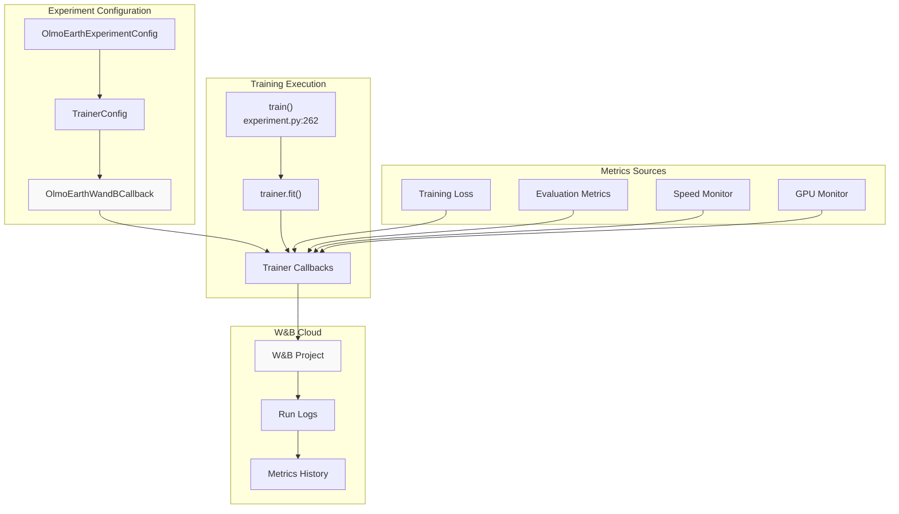
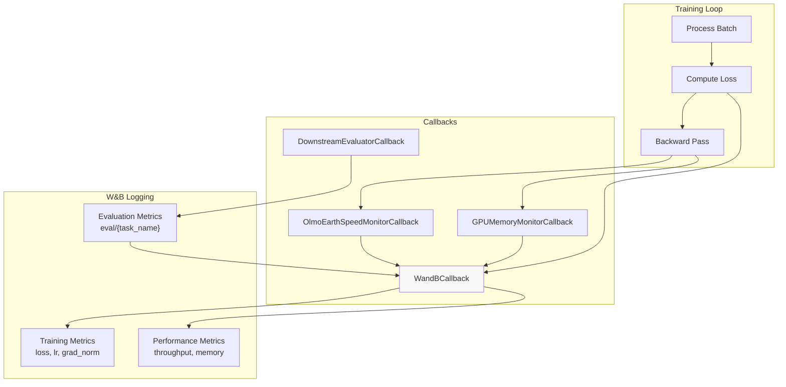
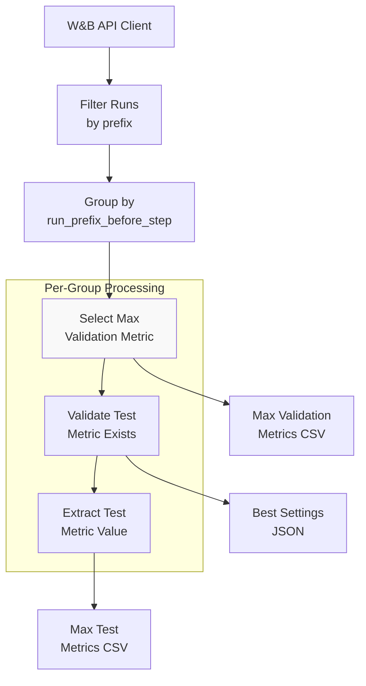

<!-- source: DeepWiki mcp.deepwiki.com · repo allenai/olmoearth_pretrain · page 7.5 Weights & Biases Integration · fetched 2026-10-26 -->

# Weights & Biases Integration

<details>
<summary>Relevant source files</summary>

The following files were used as context for generating this wiki page:

- [olmoearth_pretrain/internal/constants.py](olmoearth_pretrain/internal/constants.py)
- [tests/unit/internal/test_full_eval_sweep.py](tests/unit/internal/test_full_eval_sweep.py)

</details>


## Purpose and Scope

This page documents the integration of Weights & Biases (W&B) for experiment tracking and metrics logging in the OlmoEarth pretraining system. It covers callback configuration, authentication setup, metrics logging during training and evaluation, and retrieving results from the W&B API.

For information about configuring the overall experiment system, see [Configuration System](). For details on evaluation metrics and tasks, see [Evaluation Metrics and Analysis]().

---

## Overview

The OlmoEarth pretraining system uses W&B for comprehensive experiment tracking, including:
- Training configuration and hyperparameters
- Training and evaluation metrics over time
- Model checkpoints and artifacts
- Downstream evaluation results (KNN, linear probe, finetuning)
- Hardware utilization and performance statistics

The integration is built around the `OlmoEarthWandBCallback` class, which extends the `WandBCallback` from `olmo-core` with OlmoEarth-specific functionality.

**Key Integration Points:**



**Sources:** [olmoearth_pretrain/internal/experiment.py:262-307](), [scripts/official/script.py:146-248]()

---

## Authentication and Environment Setup

### W&B API Key

Before running any training or evaluation, you must authenticate with W&B by setting the `WANDB_API_KEY` environment variable:

```bash
export WANDB_API_KEY="your_wandb_api_key_here"
```

The system also defines internal constants for the default W&B entity:
- `WANDB_ENTITY = "eai-ai2"` [olmoearth_pretrain/internal/constants.py:4-4]()

### Disabling W&B Logging

To disable W&B logging entirely (useful for debugging or when W&B is unavailable), add the following override to your training command:

```bash
--trainer.callbacks.wandb.enabled=False
```

**Sources:** [olmoearth_pretrain/internal/constants.py:1-7]()

---

## W&B Callback Configuration

### Callback Registration

The W&B callback is registered in the trainer configuration builder. Here's how it's configured in the official training scripts:

```python
# From build_trainer_config()
wandb_callback = OlmoEarthWandBCallback(
    name=common.run_name,
    project=WANDB_PROJECT,
    entity=WANDB_ENTITY, # From internal.constants
    enabled=True,
)

trainer_config = (
    TrainerConfig(...)
    .with_callback("wandb", wandb_callback)
    .with_callback("config_saver", ConfigSaverCallback())
    # ... other callbacks
)
```

**Key Configuration Parameters:**

| Parameter | Type | Description | Example |
|-----------|------|-------------|---------|
| `name` | `str` | Run name displayed in W&B | `"base_lr0.0001_wd0.02"` |
| `project` | `str` | W&B project name | `"olmoearth_pretrain_knn_and_lp_evals"` |
| `entity` | `str` | W&B username or team | `"eai-ai2"` |
| `enabled` | `bool` | Enable/disable W&B logging | `True` |

**Sources:** [scripts/official/script.py:146-162](), [olmoearth_pretrain/internal/constants.py:3-4]()

### Configuration Dictionary Synchronization

The experiment configuration is automatically synchronized with W&B. During training setup, the config dictionary is assigned to both the W&B callback and the config saver callback:

```python
# From train() function in experiment.py
config_dict = config.as_config_dict()
cast(WandBCallback, trainer.callbacks["wandb"]).config = config_dict
cast(ConfigSaverCallback, trainer.callbacks["config_saver"]).config = config_dict
trainer.fit()
```

This ensures that all hyperparameters, model architecture details, and training settings are logged to W&B and can be used for filtering and comparing runs.

**Sources:** [olmoearth_pretrain/internal/experiment.py:282-286](), [olmoearth_pretrain/internal/experiment.py:303-307]()

---

## Metrics Logging

### Training Metrics

Training metrics are automatically logged by the W&B callback at intervals specified by `metrics_collect_interval` in the `TrainerConfig`. Common training metrics logged include:
- Loss values (primary loss, auxiliary losses)
- Learning rate
- Gradient norms
- Training throughput (samples/second, tokens/second)

### Evaluation Metrics

Evaluation metrics from downstream tasks are logged with the `eval/` prefix. The format depends on the evaluation mode:

**KNN and Linear Probe Metrics:**
- `eval/{task_name}` - Validation metric (e.g., accuracy, mIoU)
- `eval/test/{task_name}` - Test metric (if `run_on_test=True`)

**Finetuning Metrics:**
- `eval/{task_name}` - Validation metric at each evaluation interval
- `eval/test/{task_name}` - Final test metric

Example metric names:
- `eval/m-eurosat` - EuroSAT classification accuracy
- `eval/mados` - MADOS segmentation mIoU
- `eval/test/pastis` - PASTIS test set mIoU

**Sources:** [scripts/tools/get_max_eval_metrics_from_wandb.py:149-158](), [scripts/official/script.py:165-205]()

### Metrics Flow Diagram



**Sources:** [scripts/official/script.py:206-237](), [olmoearth_pretrain/internal/experiment.py:280-286]()

---

## W&B Project Organization

### Project Naming Conventions

Training runs are typically organized into W&B projects based on the experiment phase or purpose. The internal constants define default projects for evaluation:

| Project Type | Constant/Name | Example |
|--------------|------------------|---------|
| Pretraining | Phase Description | `"2025_10_02_phase2"` |
| Evaluation | `EVAL_WANDB_PROJECT` | `"olmoearth_pretrain_knn_and_lp_evals"` |

**Sources:** [olmoearth_pretrain/internal/constants.py:3-3]()

### Run Naming Patterns

Run names typically encode key hyperparameters for easy identification. The `full_eval_sweep` utility automates the generation of these combinations for hyperparameter sweeps.

**Evaluation Sweeps:**
The `loop_through_params` function generates combinations of:
- Learning Rates (`LP_LRs`) [olmoearth_pretrain/internal/full_eval_sweep.py:12-12]()
- Normalization Modes (`Normalization_MODES`) [olmoearth_pretrain/internal/full_eval_sweep.py:13-13]()
- Pooling Types (`pooling_types`) [olmoearth_pretrain/internal/full_eval_sweep.py:20-20]()

**Sources:** [olmoearth_pretrain/internal/full_eval_sweep.py:100-159](), [tests/unit/internal/test_full_eval_sweep.py:100-159]()

---

## Retrieving Metrics from W&B

### Using the W&B API

The repository includes a script for retrieving and aggregating metrics from W&B runs: `scripts/tools/get_max_eval_metrics_from_wandb.py`.

**Basic Usage:**

```bash
# Get max metrics across all runs with a specific prefix
python scripts/tools/get_max_eval_metrics_from_wandb.py \
  --project_name olmoearth_pretrain_knn_and_lp_evals \
  --run_prefix nano_lr0.001_wd0.002_step370000
```

### Metric Aggregation Logic

The script groups runs and computes maximum metrics with the following logic:



**Key Features:**

1. **Grouping:** Runs are grouped by prefix before `_step` or by baseline model name and size if `--group_baseline_model_and_size` is used. [scripts/tools/get_max_eval_metrics_from_wandb.py:91-124]()

2. **Validation-Based Selection:** For each metric, the script finds the run with the highest validation score. [scripts/tools/get_max_eval_metrics_from_wandb.py:131-224]()

3. **Metric Extraction:** It identifies relevant metrics using patterns like `eval/` and `eval/test/`. [scripts/tools/get_max_eval_metrics_from_wandb.py:149-158]()

**Sources:** [scripts/tools/get_max_eval_metrics_from_wandb.py:31-224]()

---

## Integration with Evaluation Sweeps

The evaluation system uses W&B to track extensive hyperparameter sweeps.

### Parameter Combinations
The `build_commands` function in `full_eval_sweep.py` constructs CLI arguments for W&B logging based on the task registry. It uses helper functions like `create_linear_probe_arg` to target specific W&B-logged metrics.

```python
# From internal/full_eval_sweep.py
def create_linear_probe_arg(task_name: str, arg_name: str) -> str:
    return f"--trainer.callbacks.downstream_evaluator.tasks.{task_name}.{arg_name}={{arg}}"
```

**Sources:** [olmoearth_pretrain/internal/full_eval_sweep.py:15-21](), [tests/unit/internal/test_full_eval_sweep.py:74-98]()

### Model-Specific Argument Generation
The system generates model-specific normalization arguments for W&B tracking of baselines:
- `get_dino_v3_args()` [olmoearth_pretrain/internal/full_eval_sweep.py:163-173]()
- `get_panopticon_args()` [olmoearth_pretrain/internal/full_eval_sweep.py:176-184]()
- `get_galileo_args()` [olmoearth_pretrain/internal/full_eval_sweep.py:187-200]()

**Sources:** [olmoearth_pretrain/internal/full_eval_sweep.py:160-200](), [tests/unit/internal/test_full_eval_sweep.py:160-200]()

---

## Code Entity Reference

### Key Classes and Functions

| Entity | Location | Purpose |
|--------|----------|---------|
| `OlmoEarthWandBCallback` | `olmoearth_pretrain.train.callbacks` | Custom W&B callback for pretraining |
| `EVAL_WANDB_PROJECT` | `olmoearth_pretrain/internal/constants.py:3` | Default project for evaluations |
| `WANDB_ENTITY` | `olmoearth_pretrain/internal/constants.py:4` | Default AI2 team entity |
| `loop_through_params` | `olmoearth_pretrain/internal/full_eval_sweep.py:100` | Generates sweep combinations |
| `get_run_groups` | `scripts/tools/get_max_eval_metrics_from_wandb.py:38` | Grouping logic for W&B runs |

**Sources:** [olmoearth_pretrain/internal/constants.py:1-7](), [olmoearth_pretrain/internal/full_eval_sweep.py:1-200](), [scripts/tools/get_max_eval_metrics_from_wandb.py:1-530]()

---

