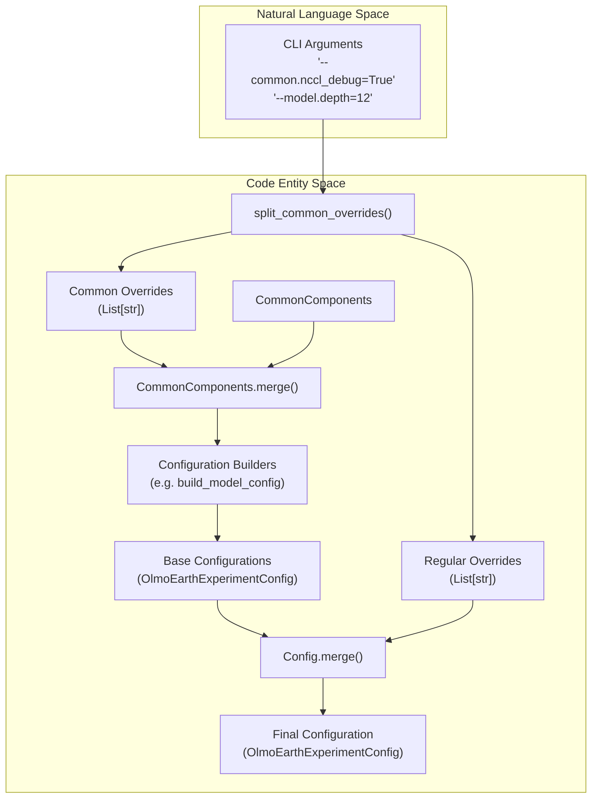
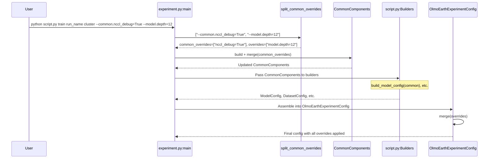

<!-- source: DeepWiki mcp.deepwiki.com · repo allenai/olmoearth_pretrain · page 7.6 CLI Overrides and Advanced Configuration · fetched 2026-10-26 -->

# CLI Overrides and Advanced Configuration

<details>
<summary>Relevant source files</summary>

The following files were used as context for generating this wiki page:

- [docs/Evaluation.md](docs/Evaluation.md)
- [docs/Pretraining.md](docs/Pretraining.md)
- [olmoearth_pretrain/internal/experiment.py](olmoearth_pretrain/internal/experiment.py)
- [olmoearth_pretrain/internal/utils.py](olmoearth_pretrain/internal/utils.py)
- [olmoearth_pretrain/train/train_module/contrastive_latentmim.py](olmoearth_pretrain/train/train_module/contrastive_latentmim.py)
- [olmoearth_pretrain/train/train_module/galileo.py](olmoearth_pretrain/train/train_module/galileo.py)
- [olmoearth_pretrain/train/train_module/latent_mim.py](olmoearth_pretrain/train/train_module/latent_mim.py)
- [olmoearth_pretrain/train/train_module/mae.py](olmoearth_pretrain/train/train_module/mae.py)
- [olmoearth_pretrain/train/utils.py](olmoearth_pretrain/train/utils.py)
- [scripts/archived/20251027_finetune.sh](scripts/archived/20251027_finetune.sh)
- [scripts/official/script.py](scripts/official/script.py)
- [tests/unit/train/test_utils.py](tests/unit/train/test_utils.py)

</details>


This document explains how to use command-line overrides to customize experiment configurations without modifying Python code. For general information about launching experiments, see [Experiment Orchestration](#7). For details on configuration builders and the config system architecture, see [Configuration System](#7.1).

## Purpose and Scope

Command-line overrides allow you to modify any configuration parameter when launching training or evaluation runs. This is essential for:
- Running hyperparameter sweeps without code changes.
- Adapting configurations to different hardware setups (e.g., adjusting `rank_microbatch_size`).
- Quick experimentation during development.
- Submitting jobs with slight variations to cluster environments.

The override system uses dotted notation to navigate nested configuration objects and applies changes at runtime before the experiment begins.

## Override System Architecture

The override system follows a merge-based pattern where user-provided CLI arguments are merged into configuration objects built by the training scripts.

### Configuration Data Flow


**Sources:** [olmoearth_pretrain/internal/experiment.py:168-178](), [olmoearth_pretrain/internal/experiment.py:181-206]()

The configuration merging process occurs in two phases:
1. **Common overrides** (prefixed with `common.`) are stripped of the prefix and applied first to the `CommonComponents` object [olmoearth_pretrain/internal/experiment.py:170-174]().
2. **Regular overrides** are applied to the final assembled configuration after all builder functions execute [olmoearth_pretrain/internal/experiment.py:204-205]().

### Configuration Building Sequence


**Sources:** [olmoearth_pretrain/internal/experiment.py:181-206](), [olmoearth_pretrain/internal/experiment.py:75-94]()

## Override Syntax

### Basic Dotted Notation

Use dot notation to navigate nested configuration objects:
`--top_level_field.nested_field.value=123`

| Override Pattern | Configuration Target | Type |
|-----------------|---------------------|------|
| `--dataset.h5py_dir=/path/to/data` | `OlmoEarthDatasetConfig.h5py_dir` | string |
| `--data_loader.global_batch_size=512` | `OlmoEarthDataLoaderConfig.global_batch_size` | int |
| `--train_module.optim_config.lr=0.0001` | `AdamWConfig.lr` | float |
| `--trainer.max_duration.epochs=100` | `Duration.epochs` | int |
| `--train_module.token_exit_cfg.sentinel2_l2a=4` | `token_exit_cfg` (Dict) | int |

**Sources:** [olmoearth_pretrain/internal/experiment.py:204-205](), [docs/Pretraining.md:85-89](), [scripts/official/script.py:123]()

### List Overrides

Lists require escaped brackets to prevent shell interpretation or double quotes:

```bash
# Correct - escaped brackets
--common.training_modalities=\[sentinel2_l2a,sentinel1\]

# Also correct - quoted
--common.training_modalities='[sentinel2_l2a,sentinel1]'
```

**Common list override examples:**
- **Modalities:** `--common.training_modalities=\[sentinel2_l2a,sentinel1,landsat\]` [olmoearth_pretrain/internal/experiment.py:91]()
- **Masking:** `--train_module.masking_config.strategy_config.only_decode_modalities=\[worldcover,srtm\]` [scripts/official/script.py:84-91]()

### Boolean Overrides

Boolean values can be specified as `True`, `true`, `1`, `False`, `false`, or `0`.
Example: `--trainer.callbacks.wandb.enabled=False` [scripts/official/script.py:187]()

## Common Overrides vs Regular Overrides

### Common Overrides
Prefixed with `common.` and applied to the `CommonComponents` object. This is critical because builder functions (like `build_dataset_config`) often depend on fields in `CommonComponents` (like `training_modalities`) to initialize other parts of the config [olmoearth_pretrain/internal/experiment.py:203]().

| Override | Type | Purpose |
|----------|------|---------|
| `--common.run_name` | string | Override run name [olmoearth_pretrain/internal/experiment.py:89]() |
| `--common.save_folder` | string | Override checkpoint save location [olmoearth_pretrain/internal/experiment.py:90]() |
| `--common.training_modalities` | list[str] | Override modalities used in training [olmoearth_pretrain/internal/experiment.py:91]() |
| `--common.nccl_debug` | bool | Enable NCCL debugging [olmoearth_pretrain/internal/experiment.py:93]() |

**Sources:** [olmoearth_pretrain/internal/experiment.py:75-94](), [olmoearth_pretrain/internal/experiment.py:198-201]()

### Regular Overrides
Applied to the fully assembled `OlmoEarthExperimentConfig`.
Example: `--trainer.max_duration.epochs=300` [docs/Pretraining.md:107]()

## Finding Available Override Parameters

### Using Dry Run Mode
The `dry_run` subcommand prints the complete configuration without executing training. This is the best way to see the full path of any parameter you wish to override.
```bash
python scripts/official/base.py dry_run test_config local
```
**Sources:** [olmoearth_pretrain/internal/experiment.py:288](), [docs/Pretraining.md:99-102]()

### Key Configuration Classes

| Configuration Class | File Location | Purpose |
|-------------------|---------------|---------|
| `OlmoEarthExperimentConfig` | [olmoearth_pretrain/internal/experiment.py:127-139]() | Main pretrain experiment config |
| `CommonComponents` | [olmoearth_pretrain/internal/experiment.py:75-94]() | Shared settings across builders |
| `OlmoEarthDatasetConfig` | [olmoearth_pretrain/data/dataset.py:166-170]() | H5PY directory and modalities |
| `OlmoEarthDataLoaderConfig` | [olmoearth_pretrain/data/dataloader.py:137-161]() | Batch size, workers, token budget |
| `ContrastiveLatentMIMTrainModuleConfig` | [olmoearth_pretrain/train/train_module/contrastive_latentmim.py:36-58]() | Loss, masking, EMA, and optimizer |

## Common Override Patterns

### Training Throughput and Memory
- **Batch Size:** `--data_loader.global_batch_size=1024` [scripts/official/script.py:149]()
- **Microbatch Size:** `--train_module.rank_microbatch_size=16` (to avoid OOM) [scripts/official/script.py:109]()
- **Workers:** `--data_loader.num_workers=16` [scripts/official/script.py:148]()

### Masking and Loss
- **Masking Ratio:** `--train_module.masking_config.strategy_config.encode_ratio=0.75` [scripts/official/script.py:81]()
- **Contrastive Weight:** `--train_module.contrastive_config.loss_config.weight=0.5` [scripts/official/script.py:120]()
- **EMA Decay:** `--train_module.ema_decay=\[0.99,1.0\]` [scripts/official/script.py:126]()

### Model Architecture (FlexiVit)
The model configuration often uses helper dictionaries like `MODEL_SIZE_ARGS` in `olmoearth_pretrain/internal/utils.py`. You can override individual parameters:
- **Depth:** `--model.encoder_config.depth=24` [olmoearth_pretrain/internal/utils.py:89]()
- **Embedding Size:** `--model.encoder_config.embedding_size=1024` [olmoearth_pretrain/internal/utils.py:87]()

## Troubleshooting

### Precedence Rules
1. **Last override wins:** If `--model.depth=12 --model.depth=24` is provided, depth will be 24.
2. **CLI beats defaults:** Overrides applied in `main()` overwrite values set in `script.py` builders [olmoearth_pretrain/internal/experiment.py:204-205]().
3. **Common precedes Builders:** `common.` overrides are applied before builders are called, ensuring builders see the updated common values [olmoearth_pretrain/internal/experiment.py:200-202]().

### Common Errors
- **`KeyError`:** Occurs if the dotted path does not exist in the configuration tree. Use `dry_run` to verify paths.
- **Type Errors:** Occurs if you provide a string to an integer field. The `merge` function performs type validation.
- **Missing `common.` prefix:** If you override `training_modalities` without the `common.` prefix, the builder functions will still use the old defaults, and the override will only be applied to the final config (which might be too late if the builder used the list to initialize other components).

**Sources:** [olmoearth_pretrain/internal/experiment.py:181-206](), [olmoearth_pretrain/internal/utils.py:13-43]()

---

