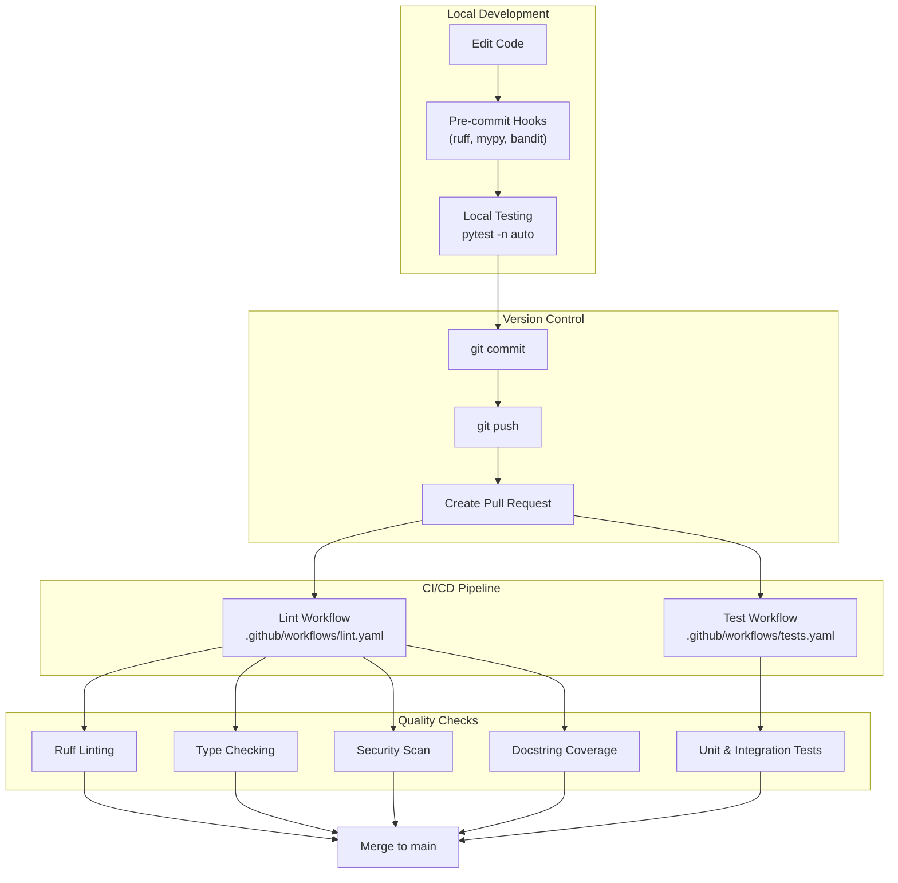
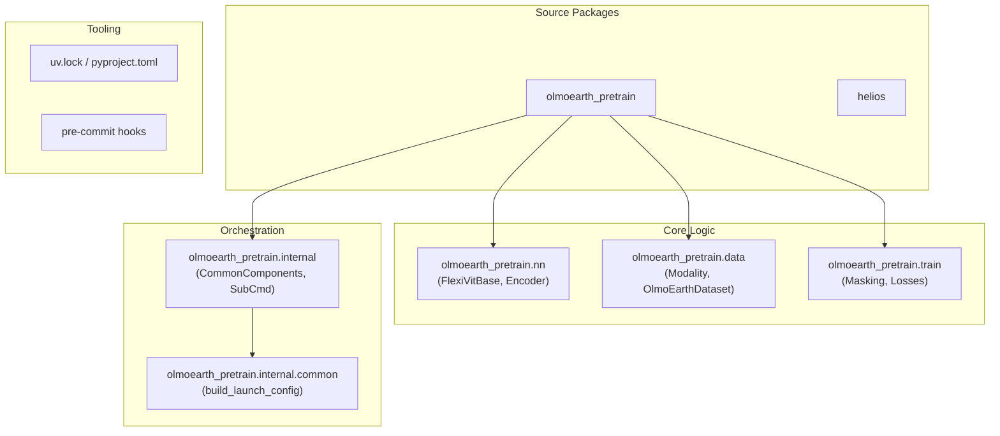

<!-- source: DeepWiki mcp.deepwiki.com · repo allenai/olmoearth_pretrain · page 8 Development Guide · fetched 2026-10-26 -->

# Development Guide

<details>
<summary>Relevant source files</summary>

The following files were used as context for generating this wiki page:

- [.github/workflows/lint.yaml](.github/workflows/lint.yaml)
- [.github/workflows/tests.yaml](.github/workflows/tests.yaml)
- [.gitignore](.gitignore)
- [.pre-commit-config.yaml](.pre-commit-config.yaml)
- [README.md](README.md)
- [olmoearth_pretrain/internal/common.py](olmoearth_pretrain/internal/common.py)
- [olmoearth_pretrain/nn/encodings.py](olmoearth_pretrain/nn/encodings.py)
- [olmoearth_pretrain/py.typed](olmoearth_pretrain/py.typed)
- [pyproject.toml](pyproject.toml)
- [tests/unit/nn/test_flexi_vit.py](tests/unit/nn/test_flexi_vit.py)
- [uv.lock](uv.lock)

</details>


This page provides an overview of development practices, tools, and workflows for contributing to the OlmoEarth pretraining repository. It covers environment setup, code quality standards, testing, and the CI/CD pipeline. For detailed information on specific topics, see:
- Testing infrastructure and running tests: [Testing Infrastructure](#8.1)
- Debugging tools and local development scripts: [Debug Scripts and Tools](#8.2)
- Continuous integration workflows: [CI/CD Pipeline](#8.3)
- Code formatting and linting standards: [Code Style and Linting](#8.4)

## Development Environment Setup

The OlmoEarth repository uses **uv** as its package and dependency manager, replacing traditional tools like pip and conda. All dependencies are specified in [pyproject.toml:1-142]() and locked in [uv.lock:1-end]().

### Installing uv and Dependencies

```bash
# Install uv
curl -LsSf https://astral.sh/uv/install.sh | sh

# Clone the repository
git clone git@github.com:allenai/olmoearth_pretrain.git
cd olmoearth_pretrain

# Sync all dependencies (including training, eval, beaker groups)
uv sync --locked --all-extras --python 3.12

# Install pre-commit hooks
uv tool install pre-commit --with pre-commit-uv --force-reinstall

# Activate the virtual environment
source .venv/bin/activate
```

The `uv sync` command creates a virtual environment in `.venv/` and installs all dependencies from the lock file. The project recommends Python 3.12 [README.md:24-35]().

### Dependency Groups

The project organizes dependencies into optional groups defined in [pyproject.toml:69-145]():

| Group | Purpose | Key Packages |
|-------|---------|--------------|
| **training** | Model training & distributed | `ai2-olmo-core`, `torch`, `wandb` |
| **eval** | Evaluation benchmarks | `geobench`, `claymodel`, `rslearn`, `timm` |
| **beaker** | Cluster deployment | `beaker-py`, `docker`, `google-cloud-compute` |
| **dataset-creation** | Data preprocessing | `rslearn`, `rasterio`, `rioxarray` |
| **dev** | Development tools | `pytest`, `ruff`, `pre-commit`, `interrogate` |
| **flash-attn** | Hardware acceleration | `flash-attn` |
| **all-no-flash** | Full suite (minus flash) | Combines training, beaker, eval, etc. |

**Sources:** [pyproject.toml:69-145](), [README.md:24-44]()

## Development Workflow Overview



**Sources:** [.pre-commit-config.yaml:1-92](), [.github/workflows/lint.yaml:1-40](), [.github/workflows/tests.yaml:1-63]()

## Code Quality Tools

### Pre-commit Hooks

Pre-commit hooks run automatically before each commit to enforce code quality standards. Configuration is in [.pre-commit-config.yaml:1-92]().

```bash
# Run hooks manually on all files
pre-commit run --all-files
```

Key hooks from [.pre-commit-config.yaml:9-91]():

- **Ruff** (lines 76-81): Fast Python linter and formatter. Configured to use Google convention and auto-sort imports [pyproject.toml:34-41]().
- **mypy** (lines 34-49): Static type checker. Enforces untyped definitions checks.
- **Bandit** (lines 50-57): Security vulnerability scanner.
- **Interrogate** (lines 58-75): Docstring coverage checker. Requires ≥80% coverage in `olmoearth_pretrain/`.
- **Hadolint** (lines 82-91): Dockerfile linter.

**Sources:** [.pre-commit-config.yaml:1-92](), [pyproject.toml:34-42]()

## Testing Infrastructure

The repository uses `pytest` for testing. A critical part of the infrastructure is verifying model loading with both full and minimal dependencies.

### Quick Test Commands

```bash
# Full test suite (requires training dependencies)
uv run --extra all-no-flash pytest tests/

# Model loading tests with minimal dependencies (no olmo-core)
uv run --extra dev pytest tests_minimal_deps/
```

The test suite is split into:
1. `tests/`: Standard unit and integration tests [pyproject.toml:43-46]().
2. `tests_minimal_deps/`: Verification that inference and model loading work without the heavy `olmo-core` training library [README.md:95-111]().

**Sources:** [README.md:95-111](), [.github/workflows/tests.yaml:1-63](), [pyproject.toml:43-49]()

## CI/CD Pipeline

The repository uses GitHub Actions for continuous integration.

### Lint Workflow
**File:** [.github/workflows/lint.yaml:1-40]()
Runs on every pull request. It syncs the `dev` extra and executes `pre-commit run --all-files`.

### Test Workflow
**File:** [.github/workflows/tests.yaml:1-63]()
Runs on push and pull requests to `main`. It performs two distinct jobs:
1. **Full Dependencies**: Installs `all-extras` and runs the complete `tests/` suite.
2. **Inference-Only**: Installs only `dev` (minimal) dependencies and runs `tests_minimal_deps/` to ensure library portability.

**Sources:** [.github/workflows/lint.yaml:1-40](), [.github/workflows/tests.yaml:1-63]()

## Debugging and Cluster Orchestration

### Environment Variables
The codebase uses environment variables to propagate configurations to Beaker cluster experiments.

| Variable | Purpose | Source |
|----------|---------|--------|
| `TRAIN_SCRIPT_PATH` | Path to the training script to execute | [olmoearth_pretrain/internal/common.py:151-154]() |
| `CHECKPOINT_DIR` | Directory for loading/saving checkpoints | [olmoearth_pretrain/internal/common.py:156-159]() |
| `FINETUNE` | Flag for finetuning mode | [olmoearth_pretrain/internal/common.py:165-168]() |
| `NCCL_DEBUG` | Distributed communication debugging | [olmoearth_pretrain/internal/common.py:96-100]() |

### Cluster Configuration
The `get_root_dir` function handles pathing for different environments:
- **Weka Clusters** (`jupiter`, `saturn`, etc.): Uses `/weka/dfive-default/olmoearth_pretrain` [olmoearth_pretrain/internal/common.py:63-66]().
- **Augusta**: Uses `/unused/olmoearth_pretrain` [olmoearth_pretrain/internal/common.py:67-72]().
- **Local**: Uses `./local_output` [olmoearth_pretrain/internal/common.py:73-74]().

### NCCL Debugging
For troubleshooting multi-GPU hangs, the system can enable detailed NCCL logging via `set_nccl_debug_env_vars`, which sets `NCCL_DEBUG=DETAIL` and `TORCH_NCCL_BLOCKING_WAIT=1` [olmoearth_pretrain/internal/common.py:88-108]().

**Sources:** [olmoearth_pretrain/internal/common.py:1-174]()

## Project Architecture



**Sources:** [pyproject.toml:25-27](), [olmoearth_pretrain/internal/common.py:19-24](), [tests/unit/nn/test_flexi_vit.py:9-23]()

---

