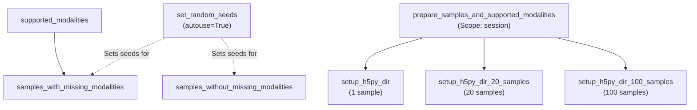
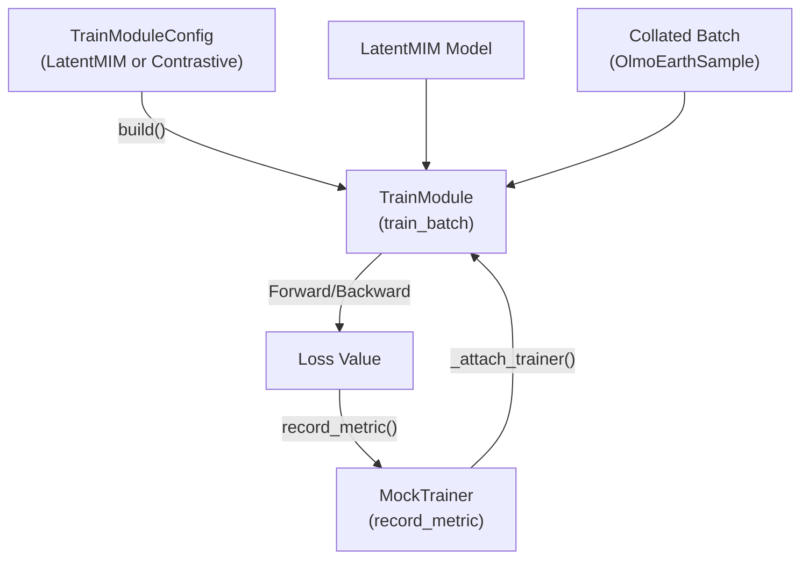

<!-- source: DeepWiki mcp.deepwiki.com · repo allenai/olmoearth_pretrain · page 8.1 Testing Infrastructure · fetched 2026-10-26 -->

# Testing Infrastructure

Relevant source files

The following files were used as context for generating this wiki page:

- [olmoearth_pretrain/data/constants.py](olmoearth_pretrain/data/constants.py)
- [olmoearth_pretrain/evals/finetune/__init__.py](olmoearth_pretrain/evals/finetune/__init__.py)
- [olmoearth_pretrain/evals/finetune/checkpoint.py](olmoearth_pretrain/evals/finetune/checkpoint.py)
- [olmoearth_pretrain/evals/finetune/model.py](olmoearth_pretrain/evals/finetune/model.py)
- [scripts/vnext/new_masking/base_collapsed_bandsets_ndvi.py](scripts/vnext/new_masking/base_collapsed_bandsets_ndvi.py)
- [tests/conftest.py](tests/conftest.py)
- [tests/integration/data/test_dataloader.py](tests/integration/data/test_dataloader.py)
- [tests/integration/data/test_dataset.py](tests/integration/data/test_dataset.py)
- [tests/integration/eval/test_finetune_checkpoint.py](tests/integration/eval/test_finetune_checkpoint.py)
- [tests/integration/train/train_module/test_contrastive_latentmim.py](tests/integration/train/train_module/test_contrastive_latentmim.py)
- [tests/integration/train/train_module/test_latent_mim.py](tests/integration/train/train_module/test_latent_mim.py)
- [tests/integration/train/train_module/test_latent_mim_mae.py](tests/integration/train/train_module/test_latent_mim_mae.py)
- [tests/unit/data/test_dataset.py](tests/unit/data/test_dataset.py)
- [tests/unit/data/test_visualize.py](tests/unit/data/test_visualize.py)
- [tests/unit/dataset/test_sample.py](tests/unit/dataset/test_sample.py)

This page documents the testing infrastructure for the OlmoEarth pretraining codebase, including test organization, shared fixtures, testing patterns, and how to run and write tests. For information about CI/CD workflows and continuous integration, see [CI/CD Pipeline](8.3). For debugging tools and scripts, see [Debug Scripts and Tools](8.2).

## Overview and Scope

The OlmoEarth testing infrastructure is organized using `pytest` and includes both unit tests (isolated component testing) and integration tests (end-to-end workflows). Tests are located in the `tests/` directory and are structured to match the main codebase organization. The infrastructure emphasizes:

- **Reproducibility**: Automatic random seed setting for deterministic tests.
- **Efficiency**: Session-scoped fixtures for expensive operations like H5PY dataset creation.
- **Reusability**: Shared fixtures in `conftest.py` for common test data.
- **Coverage**: Tests spanning data pipeline, model architecture, training, and evaluation.

---

## Test Directory Structure

The test suite is organized into unit and integration tests, mirroring the main codebase structure:

**Test Categories**:

| Category | Location | Purpose |
|----------|----------|---------|
| Unit Tests | `tests/unit/` | Test individual components in isolation |
| Integration Tests | `tests/integration/` | Test end-to-end workflows and component interactions |
| Shared Fixtures | `tests/conftest.py` | Reusable pytest fixtures available to all tests |

**Sources**: [tests/conftest.py:1-490](), [tests/integration/data/test_dataset.py:1-20]()

---

## Core Testing Fixtures

### Fixture Hierarchy

The following diagram illustrates the relationship between key fixtures used across the test suite.

Title: Fixture Dependency Graph

**Sources**: [tests/conftest.py:40-49](), [tests/conftest.py:86-114](), [tests/conftest.py:342-408]()

### Automatic Random Seed Setting

The `set_random_seeds` fixture is automatically applied to all tests via `autouse=True`, ensuring reproducible test results:

[tests/conftest.py:40-49]()

This fixture sets seeds for:
- NumPy random number generator.
- PyTorch random state.
- Python's `random` module.
- PyTorch deterministic algorithms and CUDNN backends.

**Sources**: [tests/conftest.py:40-49]()

### Session-Scoped H5PY Datasets

Three session-scoped fixtures provide H5PY test datasets with varying sizes to balance test speed and coverage. These fixtures use the `prepare_samples_func` to create realistic multi-modal satellite imagery datasets containing Sentinel-2 L2A, Sentinel-1, WorldCover, and OpenStreetMap raster data [tests/conftest.py:95-164]().

| Fixture | Samples | Use Case |
|---------|---------|----------|
| `setup_h5py_dir` | 1 | Basic functionality tests |
| `setup_h5py_dir_20_samples` | 20 | Dataset filtering and sampling tests |
| `setup_h5py_dir_100_samples` | 100 | Dataloader and distributed training tests |

**Sources**: [tests/conftest.py:86-227](), [tests/conftest.py:229-288]()

---

## Test Categories

### Data Pipeline Tests

#### Dataset Tests

**Unit Tests** ([tests/unit/data/test_dataset.py]()):
- `test_collate_olmoearth_pretrain`: Batch collation with missing modalities [tests/unit/data/test_dataset.py:24-49]().
- `test_fill_missing_timesteps`: Filling missing temporal data using `MISSING_VALUE` [tests/unit/data/test_dataset.py:122-154]().
- `test_fill_missing_modality`: Handling entirely missing modalities by creating zero-filled tensors with `MISSING_VALUE` [tests/unit/data/test_dataset.py:155-180]().
- `test_get_valid_start_ts_with_cropped_timesteps`: Logic for finding valid temporal windows [tests/unit/data/test_dataset.py:95-110]().

**Integration Tests** ([tests/integration/data/test_dataset.py]()):
- `test_helios_dataset`: Full dataset loading and retrieval using `GetItemArgs` [tests/integration/data/test_dataset.py:20-52]().
- `test_load_sample_correct_band_order`: Verification that data is loaded according to `ModalitySpec.bandsets_as_indices()` [tests/integration/data/test_dataset.py:57-114]().

**Sources**: [tests/unit/data/test_dataset.py:24-180](), [tests/integration/data/test_dataset.py:20-114]()

#### DataLoader Tests

Integration tests for the `OlmoEarthDataLoader` class verify batching, shuffling, and state restoration:

[tests/integration/data/test_dataloader.py:20-61]()

Key tests:
- `test_helios_dataloader`: Basic dataloader functionality and state dict loading [tests/integration/data/test_dataloader.py:20-61]().
- `test_helios_dataloader_dataset_percentage`: Dataset filtering with dataloader [tests/integration/data/test_dataloader.py:63-108]().
- `test_dataset_percentage_consistent_across_epochs`: Reproducibility across epochs [tests/integration/data/test_dataloader.py:165-212]().

**Sources**: [tests/integration/data/test_dataloader.py:1-212]()

### Training Module Tests

Training module tests use a `MockTrainer` class to simulate the training environment without requiring a full distributed setup. This allows testing the `train_batch` logic, including loss computation and metric recording.

Title: Training Module Integration Flow

**Key Test Files**:

1. **LatentMIM Training** ([tests/integration/train/train_module/test_latent_mim.py]()):
   - `test_train_batch_without_missing_modalities`: Happy path training [tests/integration/train/train_module/test_latent_mim.py:154-180]().
   - `test_train_batch_with_missing_modalities`: Training with incomplete data [tests/integration/train/train_module/test_latent_mim.py:182-208]().

2. **LatentMIM + MAE Training** ([tests/integration/train/train_module/test_latent_mim_mae.py]()):
   - Tests combined patch discrimination and MAE losses using `ReconstructorConfig` [tests/integration/train/train_module/test_latent_mim_mae.py:73-91]().

3. **Contrastive LatentMIM Training** ([tests/integration/train/train_module/test_contrastive_latentmim.py]()):
   - Tests `InfoNCE` contrastive loss and `collate_double_masked_batched` [tests/integration/train/train_module/test_contrastive_latentmim.py:162-190]().

**Sources**: [tests/integration/train/train_module/test_latent_mim.py:127-180](), [tests/integration/train/train_module/test_latent_mim_mae.py:168-194](), [tests/integration/train/train_module/test_contrastive_latentmim.py:162-190]()

### Evaluation and Checkpointing Tests

Tests for finetuning checkpoints ensure that the model state, optimizer state, and training metadata (like `best_val_metric` and `backbone_unfrozen`) are preserved correctly:

[tests/integration/eval/test_finetune_checkpoint.py:29-57]()

This uses `save_training_checkpoint` and `load_training_checkpoint` defined in the finetune module [olmoearth_pretrain/evals/finetune/checkpoint.py:15-75]().

**Sources**: [tests/integration/eval/test_finetune_checkpoint.py:29-57](), [olmoearth_pretrain/evals/finetune/checkpoint.py:15-75]()

---

## Writing New Tests

### Common Testing Patterns

#### Pattern: Testing with Mock Data

Create simple test data inline for focused unit tests, often using `OlmoEarthSample` containers:

[tests/unit/dataset/test_sample.py:152-179]()

#### Pattern: Testing with Shared Fixtures

Use session-scoped fixtures for expensive setup, such as creating H5PY directories:

[tests/unit/data/test_visualize.py:13-39]()

#### Pattern: Mock Training Environment

Use the `MockTrainer` pattern for training module tests to verify metric recording without launching a full trainer:

[tests/integration/train/train_module/test_latent_mim.py:127-152]()

### Summary of Coverage

| Component | Coverage |
|-----------|----------|
| **Data Pipeline** | Dataset loading, collation, missing data handling [tests/unit/data/test_dataset.py](). |
| **Visualization** | Sample visualization utility [tests/unit/data/test_visualize.py](). |
| **Training Modules** | Latent MIM, MAE, and Contrastive objectives [tests/integration/train/train_module/](). |
| **Checkpoints** | Atomic saving and loading of finetuning states [olmoearth_pretrain/evals/finetune/checkpoint.py](). |

**Sources**: [tests/unit/data/test_dataset.py:1-180](), [tests/unit/data/test_visualize.py:1-39](), [tests/integration/train/train_module/test_latent_mim.py:1-208](), [olmoearth_pretrain/evals/finetune/checkpoint.py:1-75]()

---

