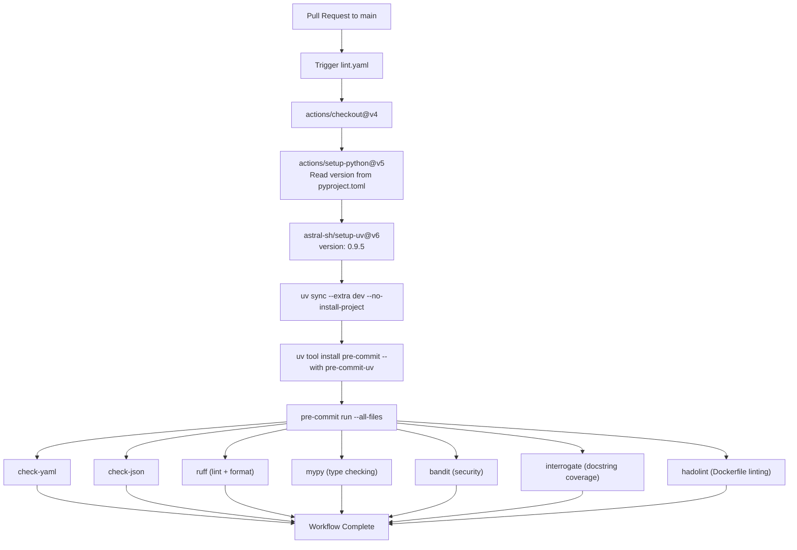
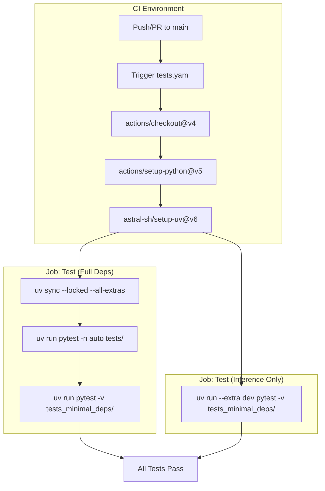
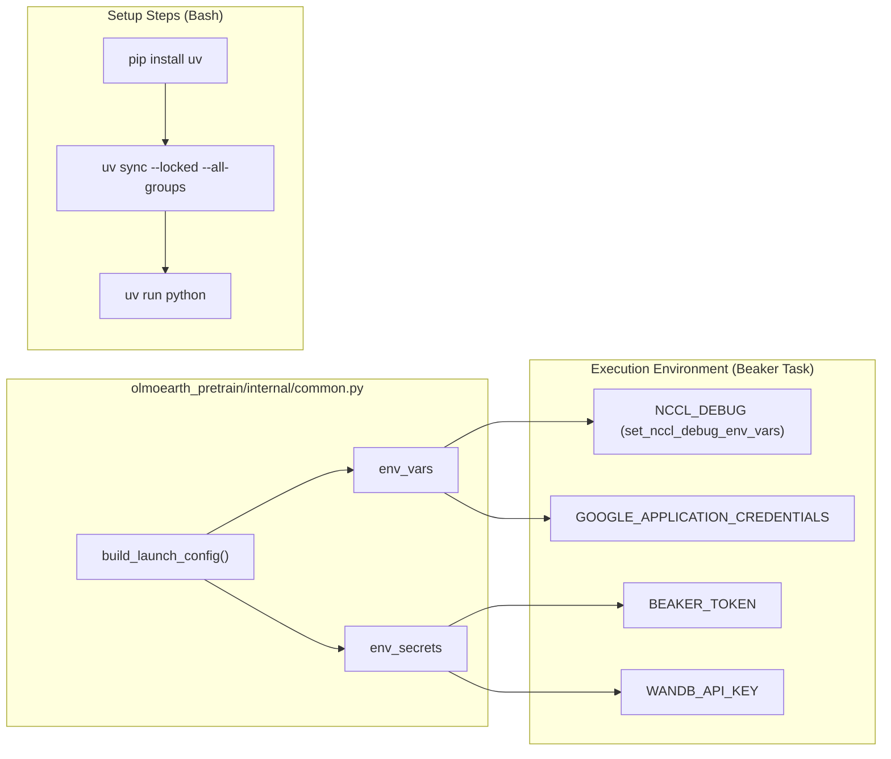

<!-- source: DeepWiki mcp.deepwiki.com · repo allenai/olmoearth_pretrain · page 8.3 CI/CD Pipeline · fetched 2026-10-26 -->

# CI/CD Pipeline

Relevant source files

The following files were used as context for generating this wiki page:

- [.cursor/rules/check-beaker-job-status.mdc](.cursor/rules/check-beaker-job-status.mdc)
- [.cursor/rules/daily-experiment-report.mdc](.cursor/rules/daily-experiment-report.mdc)
- [.cursor/rules/debug-beaker-experiments.mdc](.cursor/rules/debug-beaker-experiments.mdc)
- [.cursor/rules/experiments.mdc](.cursor/rules/experiments.mdc)
- [.cursor/rules/general.mdc](.cursor/rules/general.mdc)
- [.cursor/worktrees.json](.cursor/worktrees.json)
- [.github/experiment-report-users.json](.github/experiment-report-users.json)
- [.github/workflows/daily-experiment-report.yaml](.github/workflows/daily-experiment-report.yaml)
- [.github/workflows/lint.yaml](.github/workflows/lint.yaml)
- [.github/workflows/tests.yaml](.github/workflows/tests.yaml)
- [.pre-commit-config.yaml](.pre-commit-config.yaml)
- [README.md](README.md)
- [docs/EXPERIMENT_REPORTS.md](docs/EXPERIMENT_REPORTS.md)
- [olmoearth_pretrain/internal/common.py](olmoearth_pretrain/internal/common.py)
- [olmoearth_pretrain/nn/encodings.py](olmoearth_pretrain/nn/encodings.py)
- [olmoearth_pretrain/py.typed](olmoearth_pretrain/py.typed)
- [pyproject.toml](pyproject.toml)
- [tests/unit/nn/test_flexi_vit.py](tests/unit/nn/test_flexi_vit.py)
- [uv.lock](uv.lock)

This document describes the continuous integration and continuous deployment (CI/CD) infrastructure for the OlmoEarth pretraining repository. The CI/CD pipeline ensures code quality through automated linting, type checking, security scanning, and testing on every pull request and push to the main branch.

For information about local development workflows and debugging, see [8.2 Debug Scripts and Tools](). For code style guidelines and manual linting commands, see [8.4 Code Style and Linting]().

## Overview

The CI/CD pipeline consists of three primary components:

1.  **GitHub Actions workflows** that run on pull requests and pushes.
2.  **Pre-commit hooks** for local validation before committing.
3.  **Automated dependency management** using `uv`.

All CI/CD workflows use the same tooling and configuration as local development, ensuring consistency between local and remote environments.

## GitHub Actions Workflows

### Lint Workflow

The lint workflow performs comprehensive code quality checks including type checking, security scanning, code formatting, and documentation coverage verification.

**Workflow Diagram: Lint Pipeline**

**Sources:** [.github/workflows/lint.yaml:1-40]()

**Configuration Details:**

| Aspect | Configuration |
|--------|--------------|
| Trigger Events | Pull requests to `main` branch |
| Concurrency | Cancel in-progress runs for same PR |
| Runner | `ubuntu-latest` |
| Python Version | Read from `pyproject.toml` |
| UV Version | `0.9.5` |

**Key Steps:**

1.  **Checkout**: Uses `actions/checkout@v4` with LFS disabled [[.github/workflows/lint.yaml:17-19]]().
2.  **Python Setup**: Reads Python version from [pyproject.toml:10]() (`requires-python = ">=3.11, <3.14"`) [[.github/workflows/lint.yaml:21-24]]().
3.  **Install UV**: Installs `uv` package manager version `0.9.5` [[.github/workflows/lint.yaml:26-30]]().
4.  **Install Dependencies**: Runs `uv sync --extra dev --no-install-project` to install development dependencies [[.github/workflows/lint.yaml:34]]().
5.  **Install Pre-commit**: Uses `uv tool install pre-commit --with pre-commit-uv` [[.github/workflows/lint.yaml:35]]().
6.  **Run Pre-commit**: Executes `pre-commit run --all-files` to run all configured hooks [[.github/workflows/lint.yaml:39]]().

**Sources:** [.github/workflows/lint.yaml:1-40](), [pyproject.toml:10]()

### Test Workflow

The test workflow runs the test suite across multiple configurations to ensure compatibility and functionality.

**Workflow Diagram: Test Pipeline Strategy**

**Sources:** [.github/workflows/tests.yaml:1-63]()

**Configuration Details:**

| Aspect | Configuration |
|--------|--------------|
| Trigger Events | Push to `main`, Pull requests to `main` |
| Runner | `ubuntu-latest` |
| Parallelization | `pytest -n auto` (auto-detects CPU count) |

**Key Jobs:**

1.  **Test (full dependencies)**:
    *   Installs all extras (training, beaker, eval, etc.) via `uv sync --locked --all-extras` [[.github/workflows/tests.yaml:32]]().
    *   Runs the standard test suite in `tests/` using `pytest-xdist` [[.github/workflows/tests.yaml:36]]().
    *   Runs model loader tests in `tests_minimal_deps/` with `olmo-core` present [[.github/workflows/tests.yaml:40]]().
2.  **Test (inference-only dependencies)**:
    *   Verifies that model loading works without training dependencies like `olmo-core` [[.github/workflows/tests.yaml:59-62]]().
    *   Runs `uv run --extra dev pytest -v tests_minimal_deps/` [[.github/workflows/tests.yaml:62]]().

**Sources:** [.github/workflows/tests.yaml:12-63](), [README.md:97-110]()

## Pre-commit Hooks Configuration

Pre-commit hooks run locally before each commit to catch issues early. The same hooks are executed in the GitHub Actions lint workflow.

**Sources:** [.pre-commit-config.yaml:1-93]()

### Hook Categories

**1. Basic File Checks** (`pre-commit-hooks`)
These hooks from `https://github.com/pre-commit/pre-commit-hooks` perform fundamental file validation [[.pre-commit-config.yaml:8-33]]():
*   `check-yaml`, `check-json`, `check-toml`: Syntax validation.
*   `end-of-file-fixer`, `trailing-whitespace`: Formatting.
*   `check-added-large-files`: Blocks files >2000KB (excludes `wheels/`) [[.pre-commit-config.yaml:21-23]]().

**2. Type Checking** (`mypy`)
Enforces strict type checking [[.pre-commit-config.yaml:34-49]]():
*   `--disallow-untyped-defs`: Requires type annotations for all functions.
*   Excludes: Protobuf files (`*_pb2_*.py`) and `scripts/`.

**3. Security Scanning** (`bandit`)
Scans for security vulnerabilities with specific ignores for scientific computing [[.pre-commit-config.yaml:50-57]]():
*   `B101`: Ignores `assert` statement ban.
*   `B614`: Ignores `torch` unsafe load warnings.

**4. Documentation Coverage** (`interrogate`)
Enforces docstring standards via `uv run interrogate` [[.pre-commit-config.yaml:63]]():
*   `--fail-under=80`: Requires at least 80% docstring coverage [[.pre-commit-config.yaml:74]]().
*   Target: `olmoearth_pretrain` package [[.pre-commit-config.yaml:71]]().

**5. Code Formatting** (`ruff`)
Runs `ruff` for linting and `ruff-format` for layout [[.pre-commit-config.yaml:76-82]](). Configuration in `pyproject.toml` uses Google convention for docstrings [[pyproject.toml:41]]() and selects `D` (Docstrings), `I` (Imports), and `UP` (Upgrade) rules [[pyproject.toml:38]]().

**6. Dockerfile Linting** (`hadolint`)
Runs `hadolint` to validate Dockerfiles, ignoring `DL3008` (pinned apt packages) [[.pre-commit-config.yaml:82-92]]().

## Development Tools Configuration

### Pytest Configuration
Test configuration in `pyproject.toml` defines the search path and import mode [[pyproject.toml:43-49]]().
The `dev` extra includes `pytest-xdist` for parallel execution [[pyproject.toml:119]]().

### Package Configuration
The project uses `uv` for dependency management with platform-specific PyTorch indices [[pyproject.toml:54-67]]():
*   **Linux**: Uses `pytorch-cu128` (CUDA 12.8) [[pyproject.toml:56,65]]().
*   **Other**: Uses `pytorch-cpu` [[pyproject.toml:55,60]]().

### Dependency Groups
Dependencies are segmented into optional extras [[pyproject.toml:69-145]]():
*   `training`: Core pretraining dependencies including `ai2-olmo-core` [[pyproject.toml:70-71]]().
*   `eval`: Evaluation framework dependencies [[pyproject.toml:122-139]]().
*   `dataset-creation`: Tools for data ingestion (`rslearn`, `rasterio`) [[pyproject.toml:96-112]]().
*   `all-no-flash`: Combines all extras except `flash-attn` [[pyproject.toml:143-145]]().

## CI/CD and Beaker Integration

The Beaker launch infrastructure in `olmoearth_pretrain/internal/common.py` mirrors the CI/CD setup to ensure experiments run in a consistent environment.

**Code Entity Space: Beaker Launch Environment**

**Sources:** [olmoearth_pretrain/internal/common.py:110-209]()

**Key Setup Steps:**
*   The launch config specifies `petew/OLMoCoreBeakerImage.stable_cu128` as the base image [[olmoearth_pretrain/internal/common.py:183]]().
*   It clones the repository and performs `uv sync --locked --all-groups` to replicate the environment exactly as specified in the lockfile [[olmoearth_pretrain/internal/common.py:202]]().

**Sources:** [olmoearth_pretrain/internal/common.py:110-209](), [pyproject.toml:69-145]()

---

