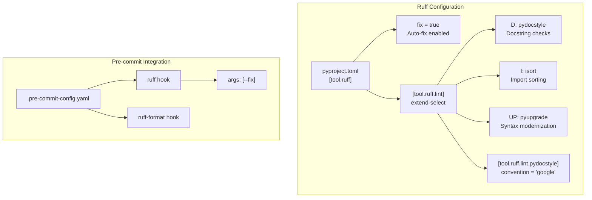
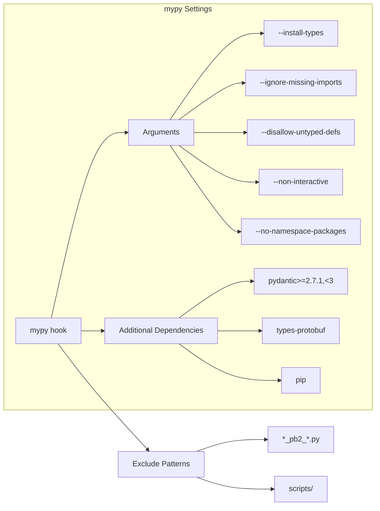
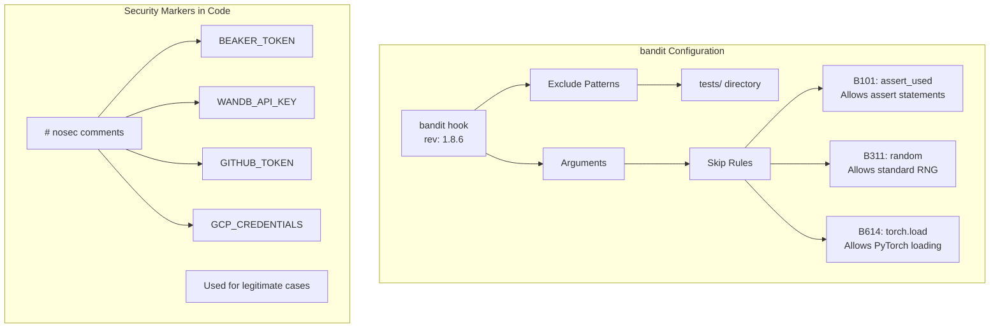
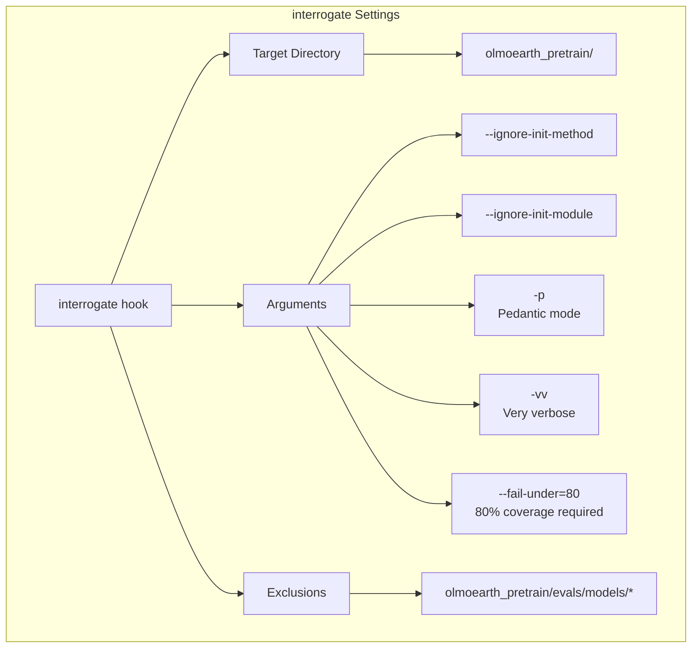
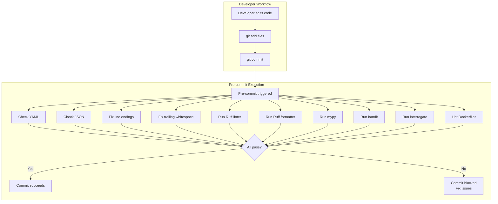
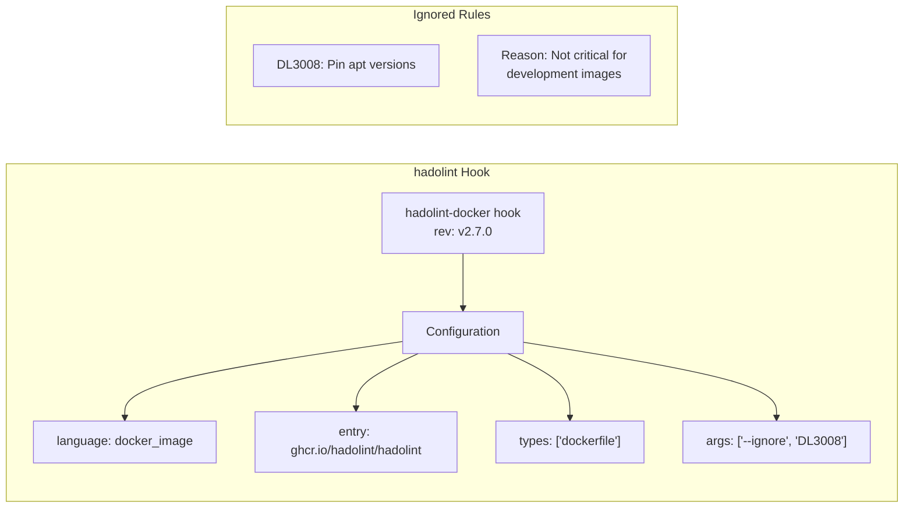
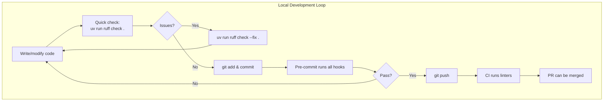

<!-- source: DeepWiki mcp.deepwiki.com · repo allenai/olmoearth_pretrain · page 8.4 Code Style and Linting · fetched 2026-10-26 -->

# Code Style and Linting

<details>
<summary>Relevant source files</summary>

The following files were used as context for generating this wiki page:

- [.github/workflows/lint.yaml](.github/workflows/lint.yaml)
- [.github/workflows/tests.yaml](.github/workflows/tests.yaml)
- [.pre-commit-config.yaml](.pre-commit-config.yaml)
- [README.md](README.md)
- [olmoearth_pretrain/internal/common.py](olmoearth_pretrain/internal/common.py)
- [olmoearth_pretrain/nn/encodings.py](olmoearth_pretrain/nn/encodings.py)
- [olmoearth_pretrain/py.typed](olmoearth_pretrain/py.typed)
- [pyproject.toml](pyproject.toml)
- [tests/unit/nn/test_flexi_vit.py](tests/unit/nn/test_flexi_vit.py)
- [uv.lock](uv.lock)

</details>


This page documents the code quality tooling used in the OlmoEarth pretraining repository, including formatters, linters, type checkers, security scanners, and documentation coverage tools. These tools ensure consistent code style, catch potential bugs early, and maintain high code quality standards across the codebase.

For information about testing infrastructure, see [Testing Infrastructure](#8.1). For CI/CD pipeline details beyond linting, see [CI/CD Pipeline](#8.3).

---

## Overview of Tooling

The repository uses a comprehensive suite of code quality tools integrated through pre-commit hooks and GitHub Actions:

| Tool | Purpose | Configuration |
|------|---------|---------------|
| **Ruff** | Fast Python linter and formatter | `pyproject.toml` |
| **mypy** | Static type checker | `.pre-commit-config.yaml` |
| **bandit** | Security vulnerability scanner | `.pre-commit-config.yaml` |
| **interrogate** | Docstring coverage checker | `.pre-commit-config.yaml` |
| **hadolint** | Dockerfile linter | `.pre-commit-config.yaml` |
| **pre-commit** | Git hook framework | `.pre-commit-config.yaml` |

**Sources:** [pyproject.toml:34-49](), [.pre-commit-config.yaml:1-93]()

---

## Ruff Configuration

Ruff serves as both the primary linter and code formatter, replacing multiple traditional tools (Black, isort, flake8, etc.) with a single fast Rust-based implementation.

### Ruff Settings



**Ruff Lint Rules Enabled:**
- **D (pydocstyle):** Enforces Google-style docstring conventions
- **I (isort):** Automatically sorts and organizes imports
- **UP (pyupgrade):** Modernizes Python syntax for newer versions

The `fix = true` setting enables automatic fixing of linting issues where possible.

**Sources:** [pyproject.toml:34-49](), [.pre-commit-config.yaml:77-82]()

### Google-Style Docstrings

All functions, classes, and modules must follow Google-style docstring conventions:

```python
def build_launch_config(
    *,
    name: str,
    cmd: list[str],
    clusters: list[str] | str,
    task_name: str = "train",
    workspace: str = WORKSPACE,
    budget: str = BUDGET,
    nccl_debug: bool = False,
) -> OlmoEarthBeakerLaunchConfig:
    """Build a launch config for an OlmoEarth Pretrain experiment.

    THis will be the default setup, any changes that are temporary should be overriden
    on the commandline
    """
```

**Sources:** [olmoearth_pretrain/internal/common.py:110-124](), [pyproject.toml:48-49]()

---

## Type Checking with mypy

Static type checking is enforced using mypy with strict settings to catch type errors before runtime.

### mypy Configuration



**Key mypy flags:**
- `--disallow-untyped-defs`: All function signatures must have type annotations
- `--ignore-missing-imports`: Allows third-party libraries without type stubs
- `--non-interactive`: Prevents interactive prompts during CI runs
- `--no-namespace-packages`: Disables namespace package support

**Sources:** [.pre-commit-config.yaml:35-50]()

### Type Annotation Examples

Functions must include complete type annotations for parameters and return values. The `py.typed` file [olmoearth_pretrain/py.typed:1]() indicates that the package supports type checking.

```python
def get_1d_sincos_pos_encoding(pos: torch.Tensor, encoding_dim: int) -> torch.Tensor:
    """Get 1D sin cos position encoding for a given set of positions.

    Args:
        pos: a list of positions to be encoded: size (L,) this can be a time or space dimension
        encoding_dim: output dimension for each position
    Returns:
        encoding: position encoding for the given positions: size (L, D)
    """
```

**Sources:** [olmoearth_pretrain/nn/encodings.py:16-24](), [olmoearth_pretrain/py.typed:1]()

---

## Security Scanning with bandit

Bandit scans Python code for common security vulnerabilities and unsafe patterns.

### bandit Configuration

The repository uses bandit version 1.8.6+ with specific exclusions:



**Suppressed Rules:**
- **B101:** Allows `assert` statements (common in tests)
- **B311:** Allows standard random number generators (non-cryptographic use cases)
- **B614:** Allows `torch.load()` for model loading

**Legitimate Security Suppressions:**

The codebase uses `# nosec` comments to mark intentional security patterns that are safe in context:

```python
env_secrets=[
    BeakerEnvSecret(name="BEAKER_TOKEN", secret=f"{beaker_user}_BEAKER_TOKEN"),
    BeakerEnvSecret(
        name="WANDB_API_KEY", secret=f"{beaker_user}_WANDB_API_KEY"
    ),  # nosec
    BeakerEnvSecret(name="GITHUB_TOKEN", secret=f"{beaker_user}_GITHUB_TOKEN"),  # nosec
    BeakerEnvSecret(name="GCP_CREDENTIALS", secret="HELIOS_GCP_CREDENTIALS"),  # nosec
]
```

**Sources:** [.pre-commit-config.yaml:51-58](), [olmoearth_pretrain/internal/common.py:191-198]()

---

## Documentation Coverage with interrogate

Interrogate ensures minimum docstring coverage across the codebase.

### interrogate Configuration



**interrogate Requirements:**
- Minimum 80% docstring coverage across the codebase
- Excludes `__init__` methods and modules (often self-documenting)
- Excludes third-party evaluation models
- Pedantic mode enabled for stricter checks

**Sources:** [.pre-commit-config.yaml:60-76]()

---

## Pre-commit Hook System

Pre-commit hooks run automatically before each commit, ensuring code quality checks happen locally before pushing to remote.

### Pre-commit Hook Workflow



**Standard Pre-commit Hooks:**

The repository uses several built-in pre-commit hooks from `pre-commit/pre-commit-hooks`:

| Hook | Purpose |
|------|---------|
| `check-yaml` | Validates YAML syntax |
| `check-json` | Validates JSON syntax and formats it |
| `check-toml` | Validates TOML syntax |
| `end-of-file-fixer` | Ensures files end with newline |
| `trailing-whitespace` | Removes trailing whitespace |
| `mixed-line-ending` | Enforces consistent line endings |
| `requirements-txt-fixer` | Sorts requirements files |
| `check-case-conflict` | Prevents case-sensitivity issues |
| `check-added-large-files` | Blocks files >2MB (configurable) |
| `check-merge-conflict` | Detects unresolved merge conflicts |
| `detect-aws-credentials` | Prevents AWS credential leaks |
| `detect-private-key` | Prevents private key leaks |

**Sources:** [.pre-commit-config.yaml:8-33]()

### Installing Pre-commit Hooks

```bash
# Install uv and pre-commit
uv sync --only-group dev
uv tool install pre-commit --with pre-commit-uv --force-reinstall

# Install git hooks
pre-commit install

# Run manually on all files
pre-commit run --all-files
```

**Sources:** [README.md:31-33](), [.github/workflows/lint.yaml:32-39]()

---

## CI/CD Linting Pipeline

The GitHub Actions workflow enforces linting in continuous integration, preventing non-compliant code from being merged.

### Lint Workflow Architecture

```mermaid
graph TB
    subgraph "GitHub Actions Workflow"
        TRIGGER["Trigger: Pull Request<br/>to main branch"]
        
        TRIGGER --> SETUP["Setup Environment"]
        
        SETUP --> CHECKOUT["Checkout code<br/>actions/checkout@v4"]
        CHECKOUT --> PYTHON["Setup Python<br/>actions/setup-python@v5"]
        PYTHON --> UV["Install uv 0.9.5<br/>astral-sh/setup-uv@v6"]
        
        UV --> DEPS["Install Dependencies"]
        DEPS --> SYNC["uv sync --extra dev --no-install-project"]
        SYNC --> TOOL["uv tool install pre-commit"]
        
        TOOL --> RUN["Run All Linters"]
        RUN --> EXEC["pre-commit run --all-files"]
        
        EXEC --> RESULT{Pass?}
        RESULT -->|Yes| SUCCESS["✓ PR can merge"]
        RESULT -->|No| FAIL["✗ PR blocked"]
    end
    
    subgraph "Concurrency Control"
        CONC["Concurrency Group"]
        CONC --> GROUP["workflow-ref"]
        CONC --> CANCEL["cancel-in-progress: true"]
    end
```



**Workflow Configuration:**

The lint workflow runs on every pull request to `main`:

```yaml
name: Lint (type checking, security, code quality, ruff)

on:
  pull_request:
    branches:
      - "main"

concurrency:
  group: ${{ github.workflow }}-${{ github.ref }}
  cancel-in-progress: true
```

Key features:
- **Concurrency control:** Cancels previous runs when new commits are pushed
- **Dev dependencies only:** Uses `--extra dev --no-install-project` for faster installation
- **Force reinstall:** Ensures latest pre-commit with `--force-reinstall`

**Sources:** [.github/workflows/lint.yaml:1-40]()

---

## Dockerfile Linting

Docker images are linted using hadolint to ensure best practices in container builds.

### hadolint Configuration



**hadolint runs as a Docker container:**
- Uses official `ghcr.io/hadolint/hadolint` image
- Only runs on files detected as Dockerfiles
- Ignores `DL3008` (apt version pinning) for flexibility

**Sources:** [.pre-commit-config.yaml:83-92]()

---

## Configuration File Reference

### pyproject.toml

The `pyproject.toml` file contains project metadata and Ruff configuration:

```toml
[tool.ruff]
fix = true

[tool.ruff.lint]
extend-select = ["D", "I", "UP"]

[tool.ruff.lint.pydocstyle]
convention = "google"
```

**Key sections:**
- `[project]`: Package metadata, dependencies, Python version requirements
- `[tool.ruff]`: Ruff linter configuration
- `[tool.pytest.ini_options]`: Test configuration (see [Testing Infrastructure](#8.1))
- `[tool.uv.sources]`: Custom package sources (PyTorch, Clay model, GeoBench)

**Sources:** [pyproject.toml:1-152]()

### .pre-commit-config.yaml

Defines all pre-commit hooks and their configurations. The file is organized into repositories:

| Repository | Hooks | Purpose |
|------------|-------|---------|
| `pre-commit/pre-commit-hooks` | Multiple | Standard file checks |
| `pre-commit/mirrors-mypy` | `mypy` | Type checking |
| `PyCQA/bandit` | `bandit` | Security scanning |
| `local` | `interrogate` | Documentation coverage |
| `astral-sh/ruff-pre-commit` | `ruff`, `ruff-format` | Linting and formatting |
| `hadolint/hadolint` | `hadolint-docker` | Dockerfile linting |

**Sources:** [.pre-commit-config.yaml:1-93]()

---

## Running Linters Locally

### Quick Commands

```bash
# Run all pre-commit hooks on staged files
pre-commit run

# Run all hooks on entire codebase
pre-commit run --all-files

# Run specific hook
pre-commit run ruff --all-files
pre-commit run mypy --all-files
pre-commit run interrogate --all-files

# Run Ruff directly (faster for iteration)
uv run ruff check .
uv run ruff format .

# Run mypy directly
uv run mypy olmoearth_pretrain/

# Run interrogate directly
uv run interrogate olmoearth_pretrain/ --fail-under=80
```

### Development Workflow



**Best Practices:**
1. Run `ruff check .` frequently during development for fast feedback
2. Use `ruff check --fix .` to auto-fix simple issues
3. Let pre-commit hooks catch issues before pushing
4. If pre-commit fails, fix issues and `git add` the fixes before committing again
5. CI will run the same checks as pre-commit, so passing locally means passing in CI

**Sources:** [.pre-commit-config.yaml:77-82](), [.github/workflows/lint.yaml:32-39]()

---

## Code Style Examples

### Module-Level Docstrings

Every Python module should start with a docstring:

```python
"""A collection of functions for creating position encodings for the OlmoEarth Pretrain model.

These functions are based on the following repository:
https://github.com/bair-climate-initiative/scale-mae/blob/main/mae/util/pos_embed.py

They cover the following:
- 2D sinusoidal position encoding (for spatial data)
- 1D sinusoidal position encoding (for temporal data)
- Month encoding (for temporal data)
"""
```

**Sources:** [olmoearth_pretrain/nn/encodings.py:1-10]()

### Class Docstrings

Classes should document their purpose and key attributes:

```python
class TestCompositeEncodings:
    """Unit tests for the CompositeEncodings class."""

    @pytest.fixture
    def composite_encodings(
        self,
    ) -> CompositeEncodings:
        """Create composite encoder fixture for testing."""
        composite_encodings = CompositeEncodings(
            embedding_size=16,
            supported_modalities=[
                Modality.SENTINEL2_L2A,
                Modality.LATLON,
                Modality.WORLDCOVER,
            ],
            max_sequence_length=12,
            random_channel_embeddings=True,
        )
        return composite_encodings
```

**Sources:** [tests/unit/nn/test_flexi_vit.py:28-46]()

### Function Docstrings

Functions must document parameters, return values, and any exceptions raised:

```python
def get_1d_sincos_pos_encoding(pos: torch.Tensor, encoding_dim: int) -> torch.Tensor:
    """Get 1D sin cos position encoding for a given set of positions.

    Args:
        pos: a list of positions to be encoded: size (L,) this can be a time or space dimension
        encoding_dim: output dimension for each position
    Returns:
        encoding: position encoding for the given positions: size (L, D)
    """
```

**Sources:** [olmoearth_pretrain/nn/encodings.py:16-24]()

---

## Troubleshooting Common Issues

### mypy Type Errors

**Issue:** `error: Function is missing a type annotation`

**Solution:** Add type hints to all function signatures:
```python
# Bad
def process_data(data):
    return data

# Good
from torch import Tensor
def process_data(data: Tensor) -> Tensor:
    return data
```

### Ruff Import Sorting

**Issue:** Imports are in wrong order after editing

**Solution:** Run `uv run ruff check --fix .` to auto-fix import order

### interrogate Failures

**Issue:** Docstring coverage below 80%

**Solution:** Add docstrings to classes/functions without them. Use `interrogate olmoearth_pretrain/ -vv` to see which items are missing docstrings.

### Pre-commit Hook Failures

**Issue:** Pre-commit blocks commit

**Solution:**
1. Read the error messages to understand what failed
2. Run the specific failing hook: `pre-commit run <hook-name> --all-files`
3. Fix issues and stage the fixes: `git add .`
4. Try committing again

**Sources:** [.pre-commit-config.yaml:60-76](), [pyproject.toml:34-49]()

---

## Summary

The OlmoEarth repository maintains code quality through:

1. **Ruff** for fast linting and formatting with Google-style docstrings
2. **mypy** for static type checking with strict settings
3. **bandit** for security vulnerability scanning
4. **interrogate** for 80% minimum docstring coverage
5. **hadolint** for Dockerfile best practices
6. **Pre-commit hooks** for local enforcement before commits
7. **GitHub Actions** for CI enforcement on pull requests

All tools are configured in `pyproject.toml` and `.pre-commit-config.yaml`, with CI workflow defined in `.github/workflows/lint.yaml`. Developers should install pre-commit hooks locally and run linters frequently during development to catch issues early.

**Sources:** [pyproject.toml:34-49](), [.pre-commit-config.yaml:1-93](), [.github/workflows/lint.yaml:1-40]()

---

