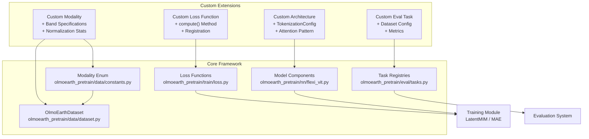
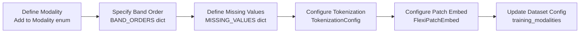
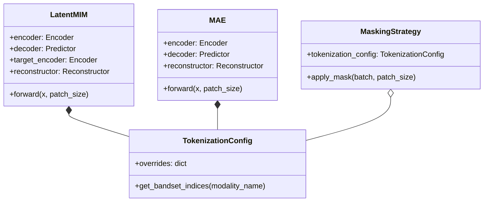

<!-- source: DeepWiki mcp.deepwiki.com · repo allenai/olmoearth_pretrain · page 9 Advanced Topics · fetched 2026-10-26 -->

# Advanced Topics

Relevant source files

The following files were used as context for generating this wiki page:

- [olmoearth_pretrain/data/transform.py](olmoearth_pretrain/data/transform.py)
- [olmoearth_pretrain/nn/flexi_vit.py](olmoearth_pretrain/nn/flexi_vit.py)
- [olmoearth_pretrain/nn/galileo.py](olmoearth_pretrain/nn/galileo.py)
- [olmoearth_pretrain/nn/latent_mim.py](olmoearth_pretrain/nn/latent_mim.py)
- [olmoearth_pretrain/nn/mae.py](olmoearth_pretrain/nn/mae.py)
- [olmoearth_pretrain/train/masking.py](olmoearth_pretrain/train/masking.py)
- [scripts/vnext/tokenization_ablations/base_all_bands_single_token.py](scripts/vnext/tokenization_ablations/base_all_bands_single_token.py)
- [scripts/vnext/tokenization_ablations/base_single_band_s2.py](scripts/vnext/tokenization_ablations/base_single_band_s2.py)
- [scripts/vnext/tokenization_ablations/base_spectral_grouping.py](scripts/vnext/tokenization_ablations/base_spectral_grouping.py)
- [tests/integration/nn/test_flexi_vit.py](tests/integration/nn/test_flexi_vit.py)
- [tests/integration/nn/test_mae.py](tests/integration/nn/test_mae.py)
- [tests/integration/nn/test_tokenization.py](tests/integration/nn/test_tokenization.py)
- [tests/unit/nn/test_tokenization.py](tests/unit/nn/test_tokenization.py)

This page covers advanced usage patterns for extending and customizing the OlmoEarth pretraining framework. Topics include adding support for new satellite data modalities, implementing custom loss functions, defining new evaluation tasks, and experimenting with architectural variants like custom tokenization. These techniques are intended for researchers and developers who need to adapt the framework for specialized research objectives or new data sources.

For basic training and evaluation workflows, see [Getting Started](#2). For standard configuration patterns, see [Experiment Orchestration](#7). For contributing code improvements, see [Development Guide](#8).

---

## Extension Architecture Overview

The OlmoEarth framework is designed with multiple extension points that allow customization without modifying core components. The primary extension mechanisms operate through:

1.  **Modality Registration**: Adding new data sources via the `Modality` enum and corresponding dataset loaders.
2.  **Loss Function Registry**: Registering custom loss functions that integrate with the training loop.
3.  **Task Registry**: Defining new evaluation tasks with dataset-specific configurations.
4.  **Model Component Interfaces**: Implementing custom encoder/decoder architectures (e.g., `Encoder`, `Predictor`, `Reconstructor`) that conform to expected interfaces.

### Extension Points Architecture

**Sources**: [olmoearth_pretrain/data/constants.py:1-50](), [olmoearth_pretrain/nn/flexi_vit.py:1-100](), [olmoearth_pretrain/train/loss.py:1-50](), [olmoearth_pretrain/nn/latent_mim.py:25-92]()

---

## Custom Modalities

Adding a new modality requires defining its specifications, integrating it into the data loading pipeline, and providing normalization statistics. For a detailed guide, see [Custom Modalities](#9.1).

### Modality Definition Process

**Sources**: [olmoearth_pretrain/data/constants.py:14-30](), [olmoearth_pretrain/nn/tokenization.py:6-43]()

### Key Implementation Concepts

*   **Band Groups**: You can customize how bands are grouped into tokens using `ModalityTokenization`. For example, you can treat each band as a separate token or group them by spectral similarity [olmoearth_pretrain/nn/tokenization.py:26-43]().
*   **Missing Data**: The `MaskingStrategy` uses `MISSING_VALUE` to identify invalid pixels and update the `MaskValue` accordingly [olmoearth_pretrain/train/masking.py:84-110]().
*   **Resolution Awareness**: `FlexiPatchEmbed` supports multi-resolution data by adjusting patch sizes based on the `image_tile_size_factor` of the modality [olmoearth_pretrain/nn/flexi_vit.py:31-34]().

---

## Custom Loss Functions

The training system supports multiple loss functions that can be combined. For a detailed guide on creating and registering them, see [Custom Loss Functions](#9.2).

### Loss Function Interface

Custom losses should implement a `compute` method that accepts predictions and targets.

| Loss Class | File | Purpose |
| :--- | :--- | :--- |
| `MAELoss` | [olmoearth_pretrain/train/loss.py]() | Pixel-level reconstruction error |
| `PatchDiscriminationLoss` | [olmoearth_pretrain/train/loss.py]() | Latent-level discrimination (MIM) |
| `InfoNCELoss` | [olmoearth_pretrain/train/loss.py]() | Contrastive representation learning |
| `KoLeoLoss` | [olmoearth_pretrain/train/loss.py]() | Regularization for embedding uniformity |

**Sources**: [olmoearth_pretrain/train/loss.py:1-200](), [tests/integration/nn/test_mae.py:158-175]()

---

## Custom Evaluation Tasks

The evaluation system allows adding new downstream benchmarks. For a detailed guide, see [Custom Evaluation Tasks](#9.3).

Tasks are registered and configured to run against pretrained checkpoints. Common task types include:
*   **KNN Classification**: Evaluating frozen features using nearest neighbors.
*   **Linear Probing**: Training a linear head on frozen backbone features.
*   **Finetuning**: End-to-end training with a task-specific decoder.

---

## Model Variants and Architecture Experiments

The framework supports architectural experiments, particularly regarding how data is tokenized and processed. For details, see [Model Variants and Architecture Experiments](#9.4).

### Tokenization Ablations
A common area of experimentation is the `TokenizationConfig`, which allows overriding how bands are mapped to tokens for specific modalities [olmoearth_pretrain/nn/tokenization.py:45-75]().

| Experiment | Configuration | Hypothesis |
| :--- | :--- | :--- |
| **Single Band** | Each band = 1 token | Better fine-grained spectral features [scripts/vnext/tokenization_ablations/base_single_band_s2.py:1-13]() |
| **Spectral Grouping** | Group by similarity (RGB, NIR, etc.) | Better semantic alignment with physics [scripts/vnext/tokenization_ablations/base_spectral_grouping.py:1-17]() |
| **All-in-One** | All bands = 1 token | Capture holistic spectral signatures [scripts/vnext/tokenization_ablations/base_all_bands_single_token.py:1-13]() |

**Sources**: [olmoearth_pretrain/nn/tokenization.py:12-75](), [tests/unit/nn/test_tokenization.py:12-193]()

---

## Dataset Creation Pipeline

The pretraining dataset is created from raw satellite imagery using `rslearn`. For an end-to-end guide, see [Dataset Creation Pipeline](#9.5).

This pipeline involves:
1.  **Sampling**: Selecting locations (e.g., using OpenStreetMap) and time ranges.
2.  **Window Creation**: Defining spatial/temporal windows for data extraction.
3.  **Ingestion**: Fetching data from providers (Sentinel Hub, Planetary Computer).
4.  **H5PY Conversion**: Packing processed tensors into the optimized H5PY format used by the `OlmoEarthDataset` [olmoearth_pretrain/data/dataset.py]().

---

## Summary of Advanced Components

**Sources**: [olmoearth_pretrain/nn/latent_mim.py:25-92](), [olmoearth_pretrain/nn/mae.py:24-60](), [olmoearth_pretrain/nn/tokenization.py:45-75](), [olmoearth_pretrain/train/masking.py:33-82]()

---

