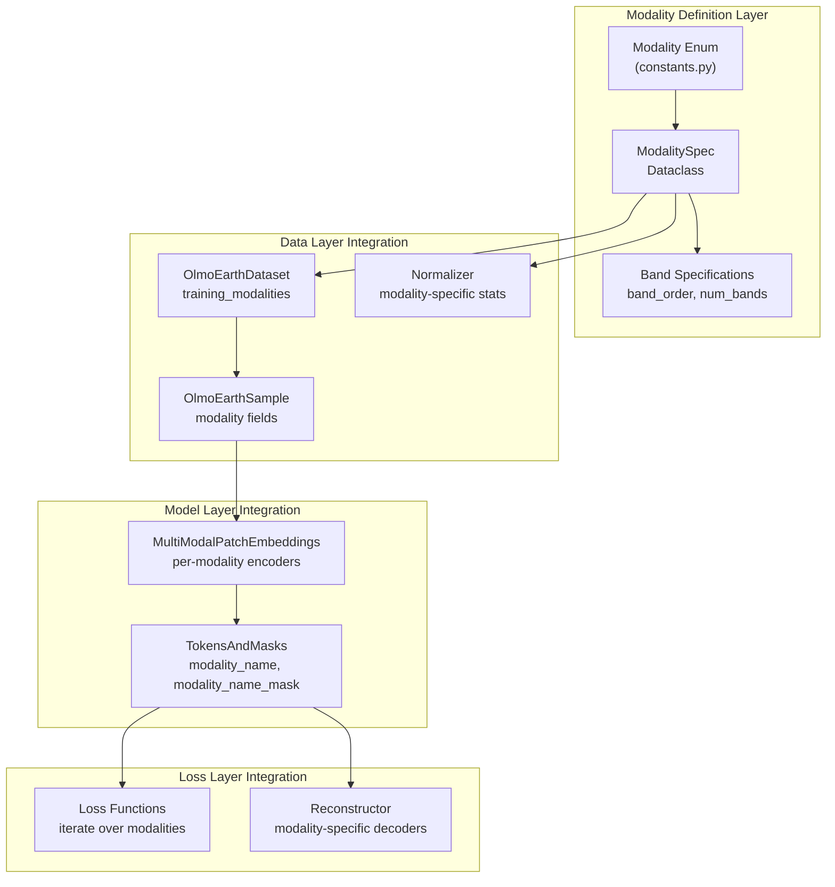
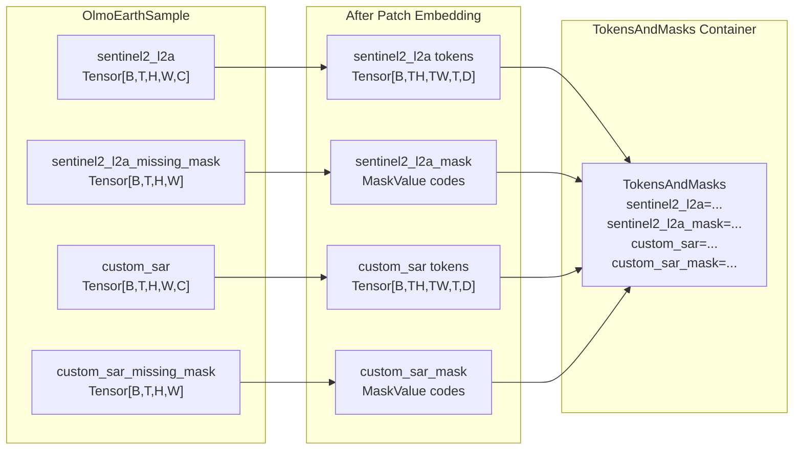

<!-- source: DeepWiki mcp.deepwiki.com · repo allenai/olmoearth_pretrain · page 9.1 Custom Modalities · fetched 2026-10-26 -->

# Custom Modalities

<details>
<summary>Relevant source files</summary>

The following files were used as context for generating this wiki page:

- [olmoearth_pretrain/dataset_creation/Dockerfile](olmoearth_pretrain/dataset_creation/Dockerfile)
- [olmoearth_pretrain/dataset_creation/internal_docs.md](olmoearth_pretrain/dataset_creation/internal_docs.md)
- [olmoearth_pretrain/dataset_creation/openstreetmap/osm_sampling.go](olmoearth_pretrain/dataset_creation/openstreetmap/osm_sampling.go)
- [olmoearth_pretrain/dataset_creation/openstreetmap/osm_tiles_by_category_to_lonlats.py](olmoearth_pretrain/dataset_creation/openstreetmap/osm_tiles_by_category_to_lonlats.py)
- [tests/unit/data/test_constants.py](tests/unit/data/test_constants.py)

</details>


## Purpose and Scope

This page explains how to add support for new satellite modalities or derived data products to the OlmoEarth pretraining system. A modality represents a specific type of Earth observation data (e.g., Sentinel-2, Sentinel-1, Landsat) with its own band structure, resolution, and characteristics.

This document covers the modality specification system, the steps to define a new modality, and integration points throughout the codebase. For information about the underlying data format, see [Dataset Format and H5PY Structure](). For modality-specific normalization strategies, see [Normalization Strategies]().

---

## Understanding the Modality System

### What is a Modality?

A modality in OlmoEarth represents a distinct type of Earth observation data source with specific characteristics:

- **Band Structure**: The ordered list of spectral bands (e.g., RGB, NIR, SWIR).
- **Resolution**: Spatial resolution of the imagery.
- **Data Type**: Whether continuous (e.g., reflectance) or discrete (e.g., land cover classes).
- **Missing Value Handling**: How to identify and handle missing/invalid data.

Each modality is treated as a separate input stream to the model, with its own patch embeddings and encoding pipeline.

### Modality Attributes

The modality specification system defines several key attributes for each modality:

| Attribute | Description | Example |
|-----------|-------------|---------|
| `name` | Identifier used throughout codebase | `"sentinel2_l2a"` |
| `band_order` | Ordered list of band names | `["B02", "B03", "B04", ...]` |
| `num_bands` | Total number of spectral bands | `13` |
| `resolution` | Spatial resolution in meters | `10` |
| `missing_value` | Sentinel value for missing data | `0` or `-9999` |
| `band_sets` | Logical groupings of bands | RGB, NIR-SWIR, Atmospheric |

Sources: [tests/unit/data/test_constants.py:6-57]()

---

## Modality Specification Architecture

### System Overview



**Modality Flow Through System**: Modalities are defined as specifications in constants, consumed by the dataset to load appropriate data, converted to tokens by patch embeddings, and processed by loss functions and reconstructors.

Sources: [tests/unit/data/test_constants.py:1-57](), [olmoearth_pretrain/data/constants.py:1-100]()

---

## Modality Specification Structure

### The Modality Enum

The `Modality` enum in `olmoearth_pretrain/data/constants.py` serves as the central registry for all supported modalities. Each enum member contains a `ModalitySpec` with complete metadata.

Example structure observed from tests:

```python
# From test_constants.py observations
Modality.SENTINEL2.band_order  # ["B02", "B03", "B04", "B08", ...]
Modality.SENTINEL2.num_bands   # 13
Modality.LANDSAT.band_order    # ["B8", "B1", "B2", ...]
Modality.LANDSAT.num_bands     # 11
```

### Band Order and Indices

Band order defines the stacking order of bands in the data tensors. This must match the order used during H5PY dataset creation:

| Modality | Band Order | Purpose |
|----------|------------|---------|
| SENTINEL2 | B02, B03, B04, B08, B05, B06, B07, B8A, B11, B12, B01, B09, B10 | Visible through atmospheric bands |
| LANDSAT | B8, B1, B2, B3, B4, B5, B6, B7, B9, B10, B11 | Panchromatic through thermal |

Sources: [tests/unit/data/test_constants.py:11-41]()

### Band Sets

Band sets group related bands for logical operations. The `bandsets_as_indices()` method returns indices for each group:

```python
# Example from Sentinel-2
Modality.SENTINEL2.bandsets_as_indices()
# Returns: [[0, 1, 2, 3],        # RGB + NIR
#           [4, 5, 6, 7, 8, 9],  # Red Edge + SWIR
#           [10, 11, 12]]        # Atmospheric bands
```

This grouping can be used for band-specific augmentations, normalization, or analysis.

Sources: [tests/unit/data/test_constants.py:50-56]()

---

## Adding a New Modality

### Step 1: Define Modality Specification

Create a new entry in the `Modality` enum with a complete `ModalitySpec` in `olmoearth_pretrain/data/constants.py`.

```python
# In olmoearth_pretrain/data/constants.py

CUSTOM_SAR = ModalitySpec(
    name="custom_sar",
    band_order=["VV", "VH", "VV_VH_ratio"],
    num_bands=3,
    resolution=10,  # meters
    missing_value=-9999,
    band_sets=[
        ["VV", "VH"],           # Co-pol and cross-pol
        ["VV_VH_ratio"]         # Derived band
    ],
)
```

**Key Considerations**:
- `name` must be unique and valid as a Python identifier.
- `band_order` must match the order in your H5PY files [tests/unit/data/test_constants.py:6-10]().
- `num_bands` must equal `len(band_order)` [tests/unit/data/test_constants.py:44-48]().
- `missing_value` should match what's used in your data preprocessing.

### Step 2: Prepare H5PY Data

Ensure your H5PY files contain the modality data with the correct structure. The `channels` dimension must match `num_bands` from your specification.

```
h5py_file/
├── custom_sar/          # Modality name
│   ├── dates/           # Timestamps
│   └── data/            # Shape: [time, height, width, channels]
```

### Step 3: Update Dataset Configuration

Modalities are specified in dataset configurations through the `training_modalities` list. The dataset will automatically load and validate modalities based on availability in H5PY files.

### Step 4: OpenStreetMap Sampling (Optional)

If your modality requires specific geographic sampling (e.g., urban vs. rural), you can use the OSM sampling tools. The Go-based `osm_sampling.go` script categorizes features (e.g., `railway`, `power_plant`, `airport`) to generate tile lists [olmoearth_pretrain/dataset_creation/openstreetmap/osm_sampling.go:65-260](). These can then be converted to longitude/latitude pairs using `osm_tiles_by_category_to_lonlats.py` [olmoearth_pretrain/dataset_creation/openstreetmap/osm_tiles_by_category_to_lonlats.py:11-41]().

---

## Integration Points

### TokensAndMasks Structure



**TokensAndMasks Convention**: Each modality becomes two fields in `TokensAndMasks`:
1. `{modality_name}`: The token embeddings.
2. `{modality_name}_mask`: The mask values indicating encoder/decoder/missing status.

### Loss Function Integration

Loss functions iterate over modalities present in `TokensAndMasks`. The mask values determine which tokens participate in loss computation:
- `MaskValue.DECODER.value`: Tokens predicted by decoder (used in loss).
- `MaskValue.ENCODER.value`: Context tokens (not used in loss).
- `MaskValue.MISSING.value`: Missing data (excluded from loss).

---

## Data Materialization

To ingest data for a new modality at scale, use the `rslearn` integration. A Dockerfile is provided for data ingestion environments [olmoearth_pretrain/dataset_creation/Dockerfile:1-14]().

Large-scale materialization for modalities like Sentinel-2 L2A is typically launched via Beaker:
```bash
python -m rslp.main common launch_data_materialization_jobs --image BEAKER_IMAGE_NAME --ds_path /weka/path/to/rslearn/dataset --command '["rslearn", "dataset", "materialize", ...]'
```
Sources: [olmoearth_pretrain/dataset_creation/internal_docs.md:10-18]()

---

## Testing Your Custom Modality

### Unit Tests

Create tests following the pattern in `tests/unit/data/test_constants.py`:

```python
def test_custom_modality_spec() -> None:
    """Test custom modality specification."""
    expected_band_order = ["VV", "VH", "VV_VH_ratio"]
    
    assert Modality.CUSTOM_SAR.band_order == expected_band_order
    assert Modality.CUSTOM_SAR.num_bands == 3
```
Sources: [tests/unit/data/test_constants.py:6-41]()

### Verification

1. **Band Order**: Ensure `Modality.band_order` matches the expected stack [tests/unit/data/test_constants.py:6-10]().
2. **Band Sets**: Ensure `bandsets_as_indices()` returns correct index groupings [tests/unit/data/test_constants.py:50-57]().

---

## Summary

Adding a custom modality involves:
1. **Defining** the `ModalitySpec` in `olmoearth_pretrain/data/constants.py`.
2. **Preparing** H5PY data files with matching structure.
3. **Configuring** the dataset to include the modality.
4. **Testing** integration through unit tests and verifying band order consistency.

Sources: [tests/unit/data/test_constants.py:1-57](), [olmoearth_pretrain/dataset_creation/internal_docs.md:1-28](), [olmoearth_pretrain/dataset_creation/openstreetmap/osm_sampling.go:1-260]()

---

