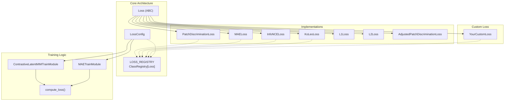
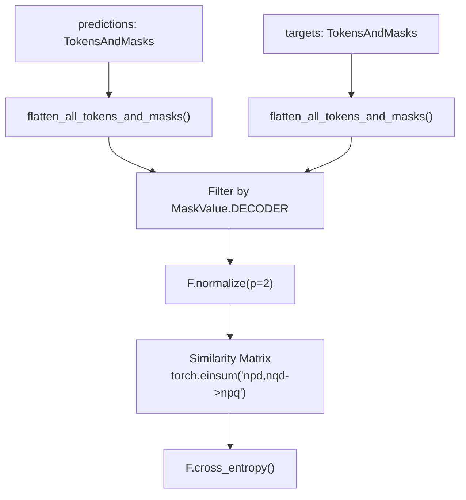

<!-- source: DeepWiki mcp.deepwiki.com · repo allenai/olmoearth_pretrain · page 9.2 Custom Loss Functions · fetched 2026-10-26 -->

# Custom Loss Functions

<details>
<summary>Relevant source files</summary>

The following files were used as context for generating this wiki page:

- [olmoearth_pretrain/nn/pooled_modality_predictor.py](olmoearth_pretrain/nn/pooled_modality_predictor.py)
- [olmoearth_pretrain/nn/st_model.py](olmoearth_pretrain/nn/st_model.py)
- [olmoearth_pretrain/nn/tokenization.py](olmoearth_pretrain/nn/tokenization.py)
- [olmoearth_pretrain/train/loss.py](olmoearth_pretrain/train/loss.py)
- [olmoearth_pretrain/train/train_module/train_module.py](olmoearth_pretrain/train/train_module/train_module.py)
- [scripts/official/ablations/base_high_entropy_dataset.py](scripts/official/ablations/base_high_entropy_dataset.py)
- [scripts/official/ablations/base_mae.py](scripts/official/ablations/base_mae.py)
- [scripts/official/ablations/base_random_masking.py](scripts/official/ablations/base_random_masking.py)
- [tests/integration/eval/test_geobench_dataset_with_model.py](tests/integration/eval/test_geobench_dataset_with_model.py)
- [tests/integration/nn/test_latent_mim.py](tests/integration/nn/test_latent_mim.py)
- [tests/unit/internal/test_experiment.py](tests/unit/internal/test_experiment.py)
- [tests/unit/train/test_loss.py](tests/unit/train/test_loss.py)
- [tests/unit/train/test_masking.py](tests/unit/train/test_masking.py)

</details>


## Purpose and Scope

This page provides a guide for creating and registering custom loss functions for specialized training objectives in OlmoEarth. For documentation of existing loss functions and their use cases, see [Loss Functions](#5.2). For a complete catalog with mathematical formulations, see [Loss Function Reference](#10.3).

Custom loss functions allow you to:
- Implement novel self-supervised learning objectives
- Add domain-specific constraints or regularizers
- Experiment with different contrastive learning formulations
- Combine multiple loss terms with custom weighting schemes

## Loss Function Architecture

The OlmoEarth loss system is built around an abstract base class and a registry pattern that enables flexible composition of loss functions.

### Core Architecture and Integration

The following diagram illustrates the relationship between the base `Loss` class, the registry, and how they are utilized within the training modules.

Title: Loss System Architecture

Sources: [olmoearth_pretrain/train/loss.py:25-46](), [olmoearth_pretrain/train/loss.py:855-873](), [olmoearth_pretrain/train/train_module/contrastive_latentmim.py:50-123](), [olmoearth_pretrain/train/train_module/mae.py:51-53]()

### The Loss Abstract Base Class

All loss functions inherit from the `Loss` abstract base class, which defines the required interface:

| Component | Type | Description |
|-----------|------|-------------|
| `name` | `str` | A short identifier for the loss (used in logging) |
| `compute()` | abstract method | Computes the loss given predictions and targets |

The `compute()` method signature is:
`def compute(self, predictions: Any, targets: Any, **kwargs: Any) -> Tensor` [olmoearth_pretrain/train/loss.py:31-33]().

This flexible interface allows different loss functions to accept different types of inputs:
- **Contrastive losses**: (e.g., `PatchDiscriminationLoss`) expect `TokensAndMasks` for both predictions and targets [olmoearth_pretrain/train/loss.py:218-221]().
- **Reconstruction losses**: (e.g., `MAELoss`) expect `TokensAndMasks` for predictions and `MaskedOlmoEarthSample` for targets [olmoearth_pretrain/train/loss.py:630-633]().
- **Regularizers**: (e.g., `KoLeoLoss`) may only use predictions, leaving targets unused [olmoearth_pretrain/train/loss.py:818]().

Sources: [olmoearth_pretrain/train/loss.py:25-45](), [olmoearth_pretrain/train/loss.py:188-195]()

## Implementing a Custom Loss Function

### Step 1: Define the Loss Class

Create a new class that inherits from `Loss` and implements the required interface. You must register it with the `LOSS_REGISTRY` to make it available via configuration.

```python
from olmoearth_pretrain.train.loss import Loss, LOSS_REGISTRY
from olmoearth_pretrain.nn.flexi_vit import TokensAndMasks
import torch
from torch import Tensor

@LOSS_REGISTRY.register("my_custom_loss")
class MyCustomLoss(Loss):
    name = "MyCustom"
    
    def __init__(self, hyperparam1: float = 1.0):
        self.hyperparam1 = hyperparam1
    
    def compute(self, predictions: TokensAndMasks, targets: TokensAndMasks, **kwargs) -> Tensor:
        # Implementation logic
        pass
```
Sources: [olmoearth_pretrain/train/loss.py:46-49](), [olmoearth_pretrain/train/loss.py:187-188]()

### Step 2: Implementation Patterns

#### Pattern 1: Token-Level Contrastive Loss
For losses that operate on individual patches across a batch or within a sample (like `PatchDiscriminationLoss`).

Title: Token-Level Contrastive Flow

Sources: [olmoearth_pretrain/train/loss.py:223-264](), [olmoearth_pretrain/train/loss.py:372-447]()

#### Pattern 2: Modality-Specific Loss
For losses that compute objectives independently for each modality (e.g., `ModalityPatchDiscriminationLossNew`).

Key steps:
1. Call `predictions.flatten_tokens_and_masks_per_modality()` to get lists of tensors per modality [olmoearth_pretrain/train/loss.py:313-316]().
2. Iterate through the modalities, filtering for `MaskValue.DECODER` tokens [olmoearth_pretrain/train/loss.py:320-325]().
3. Compute sub-losses and aggregate (sum or average) [olmoearth_pretrain/train/loss.py:365-369]().

Sources: [olmoearth_pretrain/train/loss.py:267-370]()

### Step 3: Handle Edge Cases
Important edge cases to consider:
- **No Decoded Tokens**: If a sample has no tokens masked for decoding, the loss should return a zero tensor or handle the empty case to avoid `NaN` [olmoearth_pretrain/train/loss.py:156-159]().
- **Batch Normalization**: Use `self._expand_and_reciprocate(count)` to properly average across batches with varying numbers of valid tokens [olmoearth_pretrain/train/loss.py:36-44](), [olmoearth_pretrain/train/loss.py:106-108]().

## Configuration and Integration

Custom losses are instantiated via `LossConfig` in the experiment script.

### Configuration Snippet
In an ablation script like `base_high_entropy_dataset.py`, the loss is configured within the `TrainModuleConfig`:

```python
loss_config=LossConfig(
    loss_config={
        "type": "modality_patch_discrimination_new",
        "tau": 0.1,
    }
)
```
Sources: [scripts/official/ablations/base_high_entropy_dataset.py:102-107]()

### Registry Mapping
The following table shows the mapping between configuration types and code entities:

| Config `type` | Code Entity (Class) | File Path |
| :--- | :--- | :--- |
| `patch_discrimination` | `PatchDiscriminationLoss` | [olmoearth_pretrain/train/loss.py:188]() |
| `modality_patch_discrimination_new` | `ModalityPatchDiscriminationLossNew` | [olmoearth_pretrain/train/loss.py:449]() |
| `mae` | `MAELoss` | [olmoearth_pretrain/train/loss.py:616]() |
| `InfoNCE` | `InfoNCELoss` | [olmoearth_pretrain/train/loss.py:724]() |
| `koleo` | `KoLeoLoss` | [olmoearth_pretrain/train/loss.py:762]() |

Sources: [olmoearth_pretrain/train/loss.py:187-762]()

## Testing Custom Losses

Loss functions should be verified using unit tests to ensure batch size invariance and correctness.

### Testing Invariance
The `test_patch_disc_loss_averaged_over_batch_size` function demonstrates how to verify that a loss value remains consistent regardless of batch size scaling.
Sources: [tests/unit/train/test_loss.py:126-164]()

### Testing Equivalence
When refactoring or creating optimized versions (e.g., `PatchDiscriminationLossNew`), tests should verify that the outputs are identical to the reference implementation.
Sources: [tests/unit/train/test_loss.py:77-98]()

### Integration Testing
Full integration tests (e.g., `test_latentmim_with_loss`) ensure that the loss function correctly receives `TokensAndMasks` from the `Predictor` and `target_encoder` and that gradients flow back to the `Encoder`.
Sources: [tests/integration/nn/test_latent_mim.py:138-149]()

---

