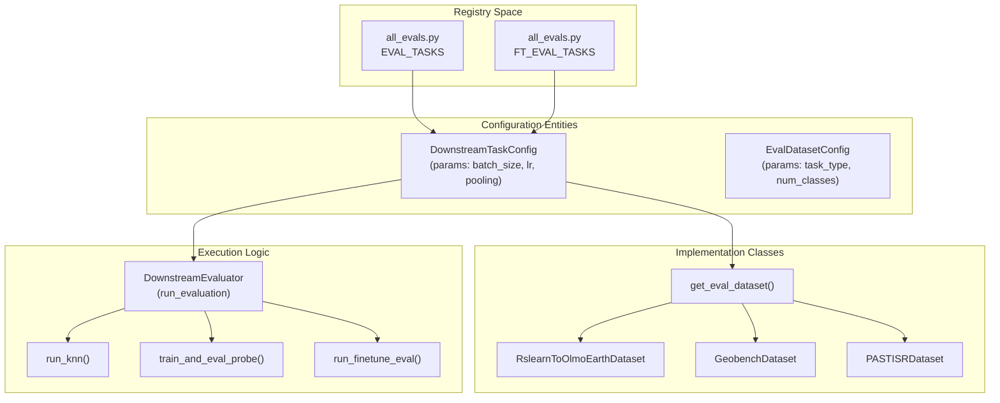
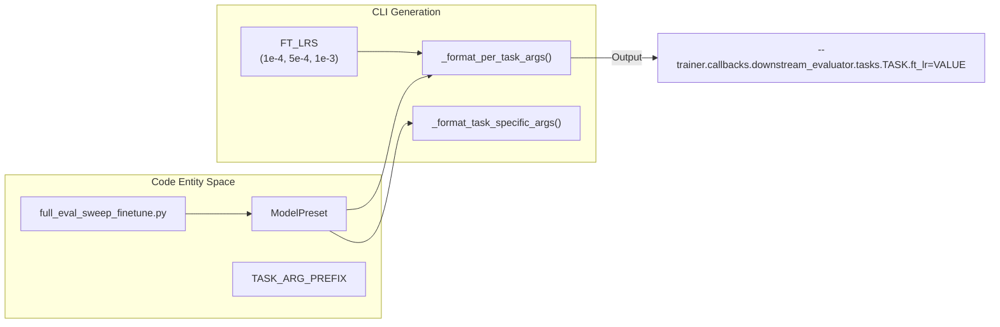

<!-- source: DeepWiki mcp.deepwiki.com · repo allenai/olmoearth_pretrain · page 9.3 Custom Evaluation Tasks · fetched 2026-10-26 -->

# Custom Evaluation Tasks

<details>
<summary>Relevant source files</summary>

The following files were used as context for generating this wiki page:

- [docs/Adding-Eval-Datasets.md](docs/Adding-Eval-Datasets.md)
- [olmoearth_pretrain/config.py](olmoearth_pretrain/config.py)
- [olmoearth_pretrain/evals/constants.py](olmoearth_pretrain/evals/constants.py)
- [olmoearth_pretrain/evals/datasets/__init__.py](olmoearth_pretrain/evals/datasets/__init__.py)
- [olmoearth_pretrain/evals/datasets/breizhcrops.py](olmoearth_pretrain/evals/datasets/breizhcrops.py)
- [olmoearth_pretrain/evals/datasets/configs.py](olmoearth_pretrain/evals/datasets/configs.py)
- [olmoearth_pretrain/evals/datasets/floods_dataset.py](olmoearth_pretrain/evals/datasets/floods_dataset.py)
- [olmoearth_pretrain/evals/datasets/geobench_dataset.py](olmoearth_pretrain/evals/datasets/geobench_dataset.py)
- [olmoearth_pretrain/evals/datasets/mados_dataset.py](olmoearth_pretrain/evals/datasets/mados_dataset.py)
- [olmoearth_pretrain/evals/datasets/normalize.py](olmoearth_pretrain/evals/datasets/normalize.py)
- [olmoearth_pretrain/evals/datasets/pastis_dataset.py](olmoearth_pretrain/evals/datasets/pastis_dataset.py)
- [olmoearth_pretrain/evals/datasets/pastis_processor.py](olmoearth_pretrain/evals/datasets/pastis_processor.py)
- [olmoearth_pretrain/evals/datasets/paths.py](olmoearth_pretrain/evals/datasets/paths.py)
- [olmoearth_pretrain/evals/datasets/rslearn_dataset.py](olmoearth_pretrain/evals/datasets/rslearn_dataset.py)
- [olmoearth_pretrain/internal/all_evals.py](olmoearth_pretrain/internal/all_evals.py)
- [olmoearth_pretrain/internal/full_eval_sweep_finetune.py](olmoearth_pretrain/internal/full_eval_sweep_finetune.py)
- [olmoearth_pretrain/train/callbacks/evaluator_callback.py](olmoearth_pretrain/train/callbacks/evaluator_callback.py)
- [scripts/tools/validate_segmentation_metrics.py](scripts/tools/validate_segmentation_metrics.py)
- [tests/unit/eval/__init__.py](tests/unit/eval/__init__.py)
- [tests/unit/test_config.py](tests/unit/test_config.py)

</details>


This page describes how to add new downstream evaluation tasks and benchmarks to the OlmoEarth pretraining framework. Custom tasks allow you to evaluate pretrained models on new datasets, domains, or problem types beyond the built-in benchmarks.

## Task Registry Architecture

The evaluation system uses a central registry to map task names to their configurations. These are primarily managed in `olmoearth_pretrain/internal/all_evals.py` and `olmoearth_pretrain/train/callbacks/evaluator_callback.py`.

*   **`EVAL_TASKS`**: The primary registry for standard evaluation tasks (KNN and Linear Probe) [olmoearth_pretrain/internal/all_evals.py:66-204]().
*   **`FT_EVAL_TASKS`**: A subset or specific registry for tasks intended for full finetuning [olmoearth_pretrain/internal/all_evals.py:207-208]().
*   **`DownstreamTaskConfig`**: The data class that defines the parameters for a specific evaluation run, including dataset name, batch sizes, learning rates, and normalization methods [olmoearth_pretrain/train/callbacks/evaluator_callback.py:66-115]().

### Data Flow for Custom Tasks

The following diagram bridges the Natural Language concepts to the specific Code Entities involved in task execution.

**Evaluation Task Execution Flow**

**Sources:** [olmoearth_pretrain/internal/all_evals.py:66-204](), [olmoearth_pretrain/train/callbacks/evaluator_callback.py:117-182](), [olmoearth_pretrain/evals/datasets/__init__.py:34-106]()

## Dataset Implementation Options

There are three main ways to implement a new evaluation dataset:

### 1. rslearn Integration (Recommended)
The most flexible way to add new Earth Observation datasets is via `rslearn`. The `RslearnToOlmoEarthDataset` class acts as a wrapper that converts `rslearn` multi-temporal data into the `OlmoEarthSample` format [olmoearth_pretrain/evals/datasets/rslearn_dataset.py:80-110]().

*   **Key Class**: `RslearnToOlmoEarthDataset` [olmoearth_pretrain/evals/datasets/rslearn_dataset.py:80]().
*   **Mechanism**: It takes an `rslearn` `ModelDataset`, reshapes tensors to `(H, W, T, C)`, and handles temporal alignment [olmoearth_pretrain/evals/datasets/rslearn_dataset.py:81-89]().
*   **Timestamps**: Automatically generates monthly timestamps using `get_timestamps` [olmoearth_pretrain/evals/datasets/rslearn_dataset.py:40-77]().

### 2. GeoBench Wrapper
If the dataset is part of the GeoBench suite, use the `GeobenchDataset` wrapper. It handles the mapping between GeoBench band names and OlmoEarth modalities [olmoearth_pretrain/evals/datasets/geobench_dataset.py:62-119]().

*   **Band Mapping**: Uses `_landsatolmoearth2geobench_name` to align Landsat-8 bands [olmoearth_pretrain/evals/datasets/geobench_dataset.py:34-54]().
*   **Normalization**: Imputes missing statistics using `impute_normalization_stats` [olmoearth_pretrain/evals/datasets/geobench_dataset.py:140-144]().

### 3. Custom PyTorch Dataset
For specialized datasets like `PASTIS-R` or `MADOS`, custom classes are implemented directly. These must return a tuple of `(MaskedOlmoEarthSample, torch.Tensor)` where the second element is the ground truth label [olmoearth_pretrain/evals/datasets/pastis_dataset.py:174-175]().

**Sources:** [olmoearth_pretrain/evals/datasets/rslearn_dataset.py:80-110](), [olmoearth_pretrain/evals/datasets/geobench_dataset.py:62-119](), [olmoearth_pretrain/evals/datasets/pastis_dataset.py:53-156]()

## Normalization and Band Statistics

Correct evaluation requires matching the normalization used during pretraining or calculating task-specific statistics.

### Normalization Methods (`NormMethod`)
The framework supports several normalization strategies defined in `olmoearth_pretrain/evals/datasets/normalize.py` [olmoearth_pretrain/evals/datasets/normalize.py:48-61]():

| Method | Logic |
| :--- | :--- |
| `STANDARDIZE` | `(x - mean) / std` [olmoearth_pretrain/evals/datasets/normalize.py:142-143]() |
| `NORM_NO_CLIP_2_STD` | Rescale based on 2 standard deviations without clipping [olmoearth_pretrain/evals/datasets/normalize.py:80]() |
| `NORM_YES_CLIP_MIN_MAX_INT` | Rescale using min/max, clip to `[0, 255]`, and quantize [olmoearth_pretrain/evals/datasets/normalize.py:59, 112-116]() |

### Imputing Missing Stats
When a dataset is missing specific bands (e.g., Sentinel-2 Band 10), `impute_normalization_stats` can copy statistics from a similar band [olmoearth_pretrain/evals/datasets/normalize.py:13-45]().

**Sources:** [olmoearth_pretrain/evals/datasets/normalize.py:13-150]()

## Task Configuration and Registration

To add a task, define a `DownstreamTaskConfig` and add it to `EVAL_TASKS` in `olmoearth_pretrain/internal/all_evals.py`.

### Example: Registering EuroSAT
```python
"m_eurosat": DownstreamTaskConfig(
    dataset="m-eurosat",
    embedding_batch_size=128,
    pooling_type=PoolingType.MEAN,
    norm_stats_from_pretrained=True,
    norm_method=NormMethod.NORM_NO_CLIP_2_STD,
    eval_interval=Duration.epochs(5),
    input_modalities=[Modality.SENTINEL2_L2A.name],
    eval_mode=EvalMode.KNN,
    primary_metric=EvalMetric.ACCURACY,
)
```
**Sources:** [olmoearth_pretrain/internal/all_evals.py:67-78]()

## Evaluation Sweep System

For custom tasks, you often need to sweep hyperparameters like learning rate (`ft_lr` or `probe_lr`). The script `olmoearth_pretrain/internal/full_eval_sweep_finetune.py` automates this process.

**Sweep Argument Generation**

**Sources:** [olmoearth_pretrain/internal/full_eval_sweep_finetune.py:49-88](), [olmoearth_pretrain/internal/full_eval_sweep_finetune.py:90-102]()

### Model Presets
The system uses `ModelPreset` to define model-specific overrides for normalization and batch sizes during sweeps [olmoearth_pretrain/internal/full_eval_sweep_finetune.py:90-102](). For example, `galileo` uses a batch size of 1 for certain tasks due to memory constraints [olmoearth_pretrain/internal/full_eval_sweep_finetune.py:159-168]().

**Sources:** [olmoearth_pretrain/internal/full_eval_sweep_finetune.py:103-186]()

## Summary Checklist for Adding a Task
1.  **Data Ingestion**: Use `rslearn` to prepare the dataset or implement a custom `Dataset` class in `olmoearth_pretrain/evals/datasets/`.
2.  **Registry Entry**: Add a `DownstreamTaskConfig` to `EVAL_TASKS` in `all_evals.py` [olmoearth_pretrain/internal/all_evals.py:66]().
3.  **Metrics**: Ensure the `primary_metric` (e.g., `ACCURACY`, `MIOU`, `MACRO_F1`) is supported in `EvalMetric` [olmoearth_pretrain/evals/metrics.py]().
4.  **Normalization**: Verify the `NormMethod` matches the target model's requirements [olmoearth_pretrain/evals/datasets/normalize.py:48]().
5.  **Validation**: Run a dry run using `python scripts/official/base.py dry_run` with task overrides to ensure the pipeline initializes correctly.

**Sources:** [olmoearth_pretrain/internal/all_evals.py:1-204](), [olmoearth_pretrain/train/callbacks/evaluator_callback.py:1-182](), [olmoearth_pretrain/evals/datasets/normalize.py:1-150]()

---

