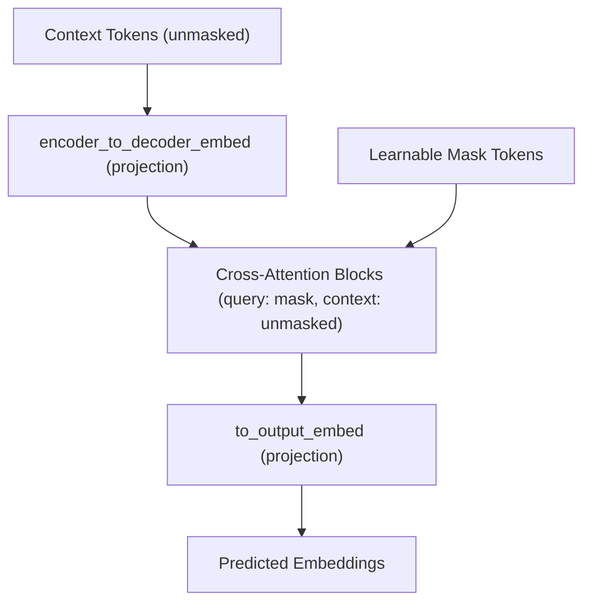
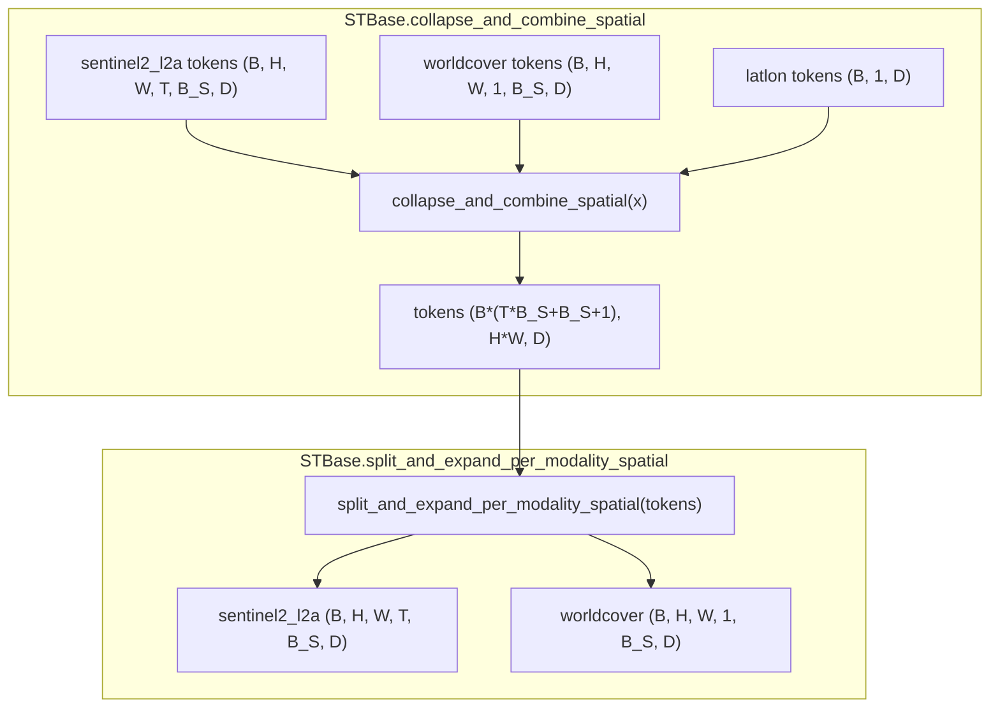
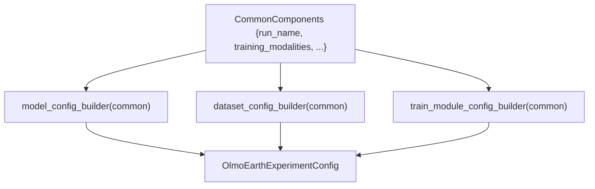

<!-- source: DeepWiki mcp.deepwiki.com · repo allenai/olmoearth_pretrain · page 9.4 Model Variants and Architecture Experiments · fetched 2026-10-26 -->

# Model Variants and Architecture Experiments

<details>
<summary>Relevant source files</summary>

The following files were used as context for generating this wiki page:

- [tests/unit/nn/test_st_model.py](tests/unit/nn/test_st_model.py)

</details>


This document describes the different model architecture variants supported in OlmoEarth and how to configure architecture experiments. It covers the core model components that can be varied (encoder, predictor, reconstructor), predefined model variants (LatentMIM, MAE, Contrastive), and experimental attention mechanisms like windowed and spatio-temporal attention.

## Architecture Variants Overview

The OlmoEarth pretraining framework supports three main model architecture variants that differ in their self-supervised learning objectives:

| Variant | Components | Primary Loss | Secondary Loss | Use Case |
|---------|-----------|--------------|----------------|----------|
| **LatentMIM** | Encoder + Predictor + Target Encoder | PatchDiscrimination | Optional InfoNCE, KoLeo | Standard latent-space masked image modeling |
| **MAE** | Encoder + Predictor + Reconstructor + Target Encoder | PatchDiscrimination + MAE | Optional InfoNCE, KoLeo | Combined latent and pixel-space reconstruction |
| **ContrastiveLatentMIM** | Encoder + Predictor + Target Encoder | PatchDiscrimination + InfoNCE | Optional KoLeo | Emphasizes contrastive learning |

All variants share the same basic encoder-predictor architecture but differ in their loss functions and optional components (reconstructor).

```mermaid
graph TB
    subgraph "LatentMIM (Base)"
        ENC1["Encoder (online)"]
        PRED1["Predictor"]
        TENC1["Target Encoder (EMA)"]
        LOSS1["PatchDiscrimination"]
        
        ENC1 --> PRED1
        PRED1 --> LOSS1
        TENC1 --> LOSS1
    end
    
    subgraph "MAE Variant"
        ENC2["Encoder (online)"]
        PRED2["Predictor"]
        RECON2["Reconstructor"]
        TENC2["Target Encoder (EMA)"]
        LOSS2A["PatchDiscrimination"]
        LOSS2B["MAE Loss"]
        
        ENC2 --> PRED2
        PRED2 --> RECON2
        PRED2 --> LOSS2A
        RECON2 --> LOSS2B
        TENC2 --> LOSS2A
    end
    
    subgraph "Contrastive Variant"
        ENC3["Encoder (online)"]
        PRED3["Predictor"]
        TENC3["Target Encoder (EMA)"]
        LOSS3A["PatchDiscrimination"]
        LOSS3B["InfoNCE"]
        
        ENC3 --> PRED3
        PRED3 --> LOSS3A
        PRED3 --> LOSS3B
        TENC3 --> LOSS3A
        TENC3 --> LOSS3B
    end
```



**Sources:** [tests/integration/nn/test_latent_mim.py:36-150](), [tests/integration/nn/test_mae.py:36-213](), [tests/integration/train/train_module/test_contrastive_latentmim.py:160-205]()

## Core Model Components

### Encoder Configuration

The encoder is the primary component that processes multi-modal input patches into latent representations. It is configured via `EncoderConfig`.

**Key Parameters:**

| Parameter | Type | Description | Typical Values |
|-----------|------|-------------|----------------|
| `supported_modality_names` | `list[str]` | Modalities to encode | `["sentinel2_l2a", "sentinel1", "worldcover"]` |
| `embedding_size` | `int` | Latent embedding dimension | 16 (Nano), 768 (Base), 1024 (Large) |
| `depth` | `int` | Number of transformer blocks | 2 (Nano), 12 (Base), 24 (Large) |
| `num_heads` | `int` | Number of attention heads | 2 (Nano), 12 (Base), 16 (Large) |
| `mlp_ratio` | `float` | FFN expansion ratio | 4.0 |
| `drop_path` | `float` | Stochastic depth rate | 0.0-0.3 |
| `max_patch_size` | `int` | Maximum patch size for embeddings | 8, 16 |
| `min_patch_size` | `int` | Minimum patch size | 1 |
| `max_sequence_length` | `int` | Maximum number of time steps | 12, 24 |


**Sources:** [tests/integration/train/train_module/test_latent_mim.py:44-53](), [tests/integration/nn/test_latent_mim.py:66-76](), [tests/unit/internal/test_experiment.py:51-60]()

### Predictor/Decoder Configuration

The predictor uses cross-attention to reconstruct masked regions from unmasked context tokens. It is configured via `PredictorConfig`.

**Key Parameters:**

| Parameter | Type | Description | Typical Values |
|-----------|------|-------------|----------------|
| `supported_modality_names` | `list[str]` | Modalities to predict | Same as encoder |
| `encoder_embedding_size` | `int` | Input dimension from encoder | Must match encoder `embedding_size` |
| `decoder_embedding_size` | `int` | Decoder latent dimension | 512-1024 |
| `depth` | `int` | Number of cross-attention blocks | 4-8 |
| `num_heads` | `int` | Number of attention heads | 8-16 |
| `mlp_ratio` | `float` | FFN expansion ratio | 4.0 |
| `max_sequence_length` | `int` | Maximum time steps | Must match encoder |
| `drop_path` | `float` | Stochastic depth rate | 0.0-0.1 |
| `output_embedding_size` | `int | None` | Output dimension (None = encoder size) | None or specific dim |



**Sources:** [tests/integration/train/train_module/test_latent_mim.py:56-66](), [tests/integration/nn/test_latent_mim.py:77-86](), [tests/unit/internal/test_experiment.py:61-69]()

## Spatio-Temporal Attention Experiments

The `STBase` class provides utilities for experimenting with different attention patterns by manipulating the token sequences before they enter transformer blocks. This allows for spatial-only, temporal-only, or windowed attention mechanisms.

### Attention Pattern Logic

| Method | Reshape Operation | Attention Focus |
|--------|-------------------|-----------------|
| `collapse_and_combine_spatial` | `(B, H, W, T, B_S, D) -> (B * T * B_S, H * W, D)` | Spatial attention within each timestep |
| `collapse_and_combine_temporal` | `(B, H, W, T, B_S, D) -> (B * H * W, T * B_S, D)` | Temporal attention for each pixel location |
| `collapse_and_combine_windowed` | Reshapes based on `windowed_attention_size` | Localized spatial/temporal windows |

### Data Flow for Multi-Modal Token Manipulation

The following diagram illustrates how tokens from multiple modalities (e.g., Sentinel-2 and WorldCover) are combined and split for specific attention patterns in `STBase`.



**Sources:** [tests/unit/nn/test_st_model.py:59-94](), [tests/unit/nn/test_st_model.py:100-134]()

## Model Variants

### LatentMIM (Base Variant)

The standard LatentMIM architecture uses encoder-predictor for latent-space masked image modeling with a target encoder for stable targets.

**Sources:** [tests/integration/train/train_module/test_latent_mim.py:69-77](), [tests/integration/train/train_module/test_latent_mim.py:92-114]()

### MAE Variant (with Reconstructor)

The MAE variant adds a reconstructor for pixel-space reconstruction, combining latent-space and pixel-space objectives.

**Loss Computation:**

The training module computes:
- `PatchDiscrimination` loss on latent predictions vs target encoder outputs
- `MAE` loss on pixel reconstructions vs original pixels
- Combined as: `loss = patch_disc_loss + mae_loss`

**Sources:** [tests/integration/train/train_module/test_latent_mim_mae.py:72-85](), [tests/integration/train/train_module/test_latent_mim_mae.py:105-128](), [tests/integration/nn/test_mae.py:126-176]()

### Contrastive Variant

The contrastive variant emphasizes contrastive learning by adding InfoNCE loss to the base LatentMIM architecture.

**Loss Computation:**

The training module computes:
- `PatchDiscrimination` loss
- `InfoNCE` contrastive loss between online and target encoder representations
- Combined as: `loss = patch_disc_loss + weight * infonce_loss`

**Sources:** [tests/integration/train/train_module/test_contrastive_latentmim.py:105-121](), [tests/integration/train/train_module/test_contrastive_latentmim.py:160-180]()

## Configuring Architecture Experiments

### Using Configuration Builders

The recommended approach for architecture experiments is to use configuration builder functions that construct configs from `CommonComponents`.



**Sources:** [tests/unit/internal/test_experiment.py:42-74](), [tests/unit/internal/test_experiment.py:162-181]()

### Using CLI Overrides

Architecture parameters can be overridden via command-line arguments when launching experiments:

```bash
# Override encoder depth and embedding size
python script.py train my_run my_cluster \
    --model.encoder_config.depth=16 \
    --model.encoder_config.embedding_size=1024
```

**Sources:** [tests/unit/internal/test_experiment.py:183-235]()

## Testing Architecture Variants

### Unit Testing Components

Test individual components with specific configurations, particularly for spatio-temporal variants using `STBase`:

```python
def test_collapse_and_split_temporal(st_base: STBase):
    # Setup tokens for S2, WorldCover, and LatLon
    # ...
    tokens, masks = st_base.collapse_and_combine_temporal(x)
    assert tokens.shape == (B * H * W, T * B_S + B_S + 1, D)
    
    # Verify reconstruction
    modality_tokens_dict = st_base.split_and_expand_per_modality_temporal(tokens, dims)
    assert (modality_tokens_dict["sentinel2_l2a"] == x["sentinel2_l2a"]).all()
```

**Sources:** [tests/unit/nn/test_st_model.py:96-134](), [tests/unit/nn/test_st_model.py:137-169]()

### Validation Checklist

When experimenting with new architectures, verify:

- [ ] **Forward pass completes** without errors for all modality combinations.
- [ ] **Output shapes match expectations** (B, H, W, T, B_S, D) or appropriate reductions.
- [ ] **Gradients flow correctly** to all trainable parameters.
- [ ] **Target encoder has no gradients** (verify `param.grad is None` for target encoder).
- [ ] **Attention masks are respected** (verify via `STBase.collapse_and_combine_full`).
- [ ] **Loss values are reasonable** (not NaN, Inf, or extreme values).

**Sources:** [tests/unit/nn/test_st_model.py:38-57](), [tests/integration/nn/test_latent_mim.py:151-178](), [tests/integration/train/train_module/helper.py:6-11]()

---

