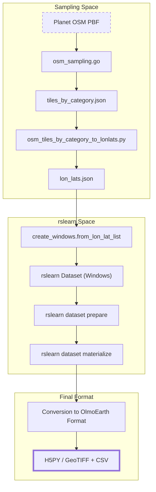
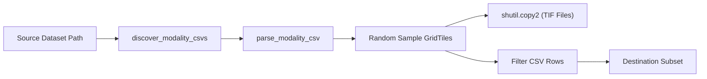

<!-- source: DeepWiki mcp.deepwiki.com · repo allenai/olmoearth_pretrain · page 9.5 Dataset Creation Pipeline · fetched 2026-10-26 -->

# Dataset Creation Pipeline

Relevant source files

The following files were used as context for generating this wiki page:

- [docs/Dataset-Creation.md](docs/Dataset-Creation.md)
- [docs/Pretraining-Dataset.md](docs/Pretraining-Dataset.md)
- [olmoearth_pretrain/dataset_creation/Dockerfile](olmoearth_pretrain/dataset_creation/Dockerfile)
- [olmoearth_pretrain/dataset_creation/internal_docs.md](olmoearth_pretrain/dataset_creation/internal_docs.md)
- [olmoearth_pretrain/dataset_creation/openstreetmap/osm_sampling.go](olmoearth_pretrain/dataset_creation/openstreetmap/osm_sampling.go)
- [olmoearth_pretrain/dataset_creation/openstreetmap/osm_tiles_by_category_to_lonlats.py](olmoearth_pretrain/dataset_creation/openstreetmap/osm_tiles_by_category_to_lonlats.py)
- [olmoearth_pretrain/dataset_creation/scripts/create_subset.py](olmoearth_pretrain/dataset_creation/scripts/create_subset.py)

The OlmoEarth pretraining dataset consists of approximately 285,288 samples of multi-modal satellite image time series and auxiliary raster data [docs/Pretraining-Dataset.md:3-7](). Each sample represents a 2560 x 2560 m grid cell in a UTM projection with a 360-day time range [docs/Pretraining-Dataset.md:4-5]().

## Overview of the Pipeline

The pipeline follows a three-step process to transform raw satellite sources into the H5PY-compatible format used for training:
1.  **Window Initialization**: Defining spatial and temporal boundaries for samples using OpenStreetMap (OSM) features or random sampling [docs/Dataset-Creation.md:8-12]().
2.  **Materialization**: Using the `rslearn` library to fetch, process, and store raw data from providers like Microsoft Planetary Computer (MPC) and AWS [docs/Dataset-Creation.md:81-82]().
3.  **Format Conversion**: Converting `rslearn` outputs into the final OlmoEarth structure consisting of modality-specific GeoTIFFs and summary CSVs [docs/Dataset-Creation.md:11-12]().

### Data Flow Diagram: Raw to Pretrained

This diagram maps the logical data flow to the specific scripts and tools responsible for each transition.

Title: Pretraining Dataset Generation Flow

Sources: [docs/Dataset-Creation.md:13-42](), [docs/Dataset-Creation.md:81-102](), [olmoearth_pretrain/dataset_creation/openstreetmap/osm_sampling.go:1-12]()

## Spatial and Temporal Sampling

### OpenStreetMap Feature Sampling
The dataset is primarily sampled based on ~120 categories of OSM map features [docs/Pretraining-Dataset.md:45-46](). The logic for this is implemented in `osm_sampling.go`, which enumerates UTM grid cells containing specific features (e.g., `railway`, `power_plant`, `airport_runway`) [olmoearth_pretrain/dataset_creation/openstreetmap/osm_sampling.go:67-250]().

*   **Logic**: The script scans a `planet-latest.osm.pbf` file and maps features to tiles of size 0.001 degrees [olmoearth_pretrain/dataset_creation/openstreetmap/osm_sampling.go:15-35]().
*   **Selection**: Up to 10,000 tiles per category are randomly sampled to ensure geographic and thematic diversity [docs/Pretraining-Dataset.md:47-48]().

### Temporal Window Selection
For each spatial tile, a 360-day window is assigned:
*   **CONUS (Continental US)**: 75% probability of centering the window around a random NAIP (National Agriculture Imagery Program) image from 2016-2024 [docs/Pretraining-Dataset.md:54-58]().
*   **Global/Other**: Uniformly sampled between January 2016 and December 2024 [docs/Pretraining-Dataset.md:59-60]().

Sources: [docs/Pretraining-Dataset.md:43-61](), [olmoearth_pretrain/dataset_creation/openstreetmap/osm_sampling.go:1-260]()

## Materialization with rslearn

The pipeline utilizes `rslearn` to handle the complexity of different data sources. Each modality is materialized using specific configuration files located in `data/rslearn_dataset_configs/` [docs/Dataset-Creation.md:88-91]().

| Modality Group | Source | Key Configs |
| :--- | :--- | :--- |
| **Optical/Radar** | MPC (Microsoft Planetary Computer) | `config_sentinel1.json`, `config_sentinel2_l2a.json` |
| **Auxiliary Rasters** | Local/Cloud GeoTIFFs | `config_worldcover.json`, `config_srtm.json`, `config_cdl.json` |
| **Climate** | Copernicus CDS | `config_era5_10.json` |
| **Landsat** | AWS (US-West-2) | `config_landsat.json` |

### Materialization Workflow
The `rslearn` commands follow a standard sequence for each modality:
1.  `prepare`: Queries the data provider (e.g., STAC API) to find available items for the windows [docs/Dataset-Creation.md:100]().
2.  `ingest`: Downloads and caches raw data locally if required [docs/Dataset-Creation.md:111]().
3.  `materialize`: Crops, resamples, and saves the data into the `rslearn` window structure [docs/Dataset-Creation.md:101]().

Sources: [docs/Dataset-Creation.md:81-131](), [olmoearth_pretrain/dataset_creation/internal_docs.md:10-18]()

## Dataset Structure and Conversion

The final dataset is organized into subfolders by modality, where each subfolder contains GeoTIFFs named by their UTM tile coordinate and resolution [docs/Pretraining-Dataset.md:80-116]().

### Resolution and Band Handling
Data is resampled to powers of 2 relative to 10 m/pixel [docs/Pretraining-Dataset.md:34-35]().
*   **Sentinel-2**: Split into 10m (B02-B04, B08), 20m (B05-B07, B8A, B11, B12), and 40m (B01, B09) files [docs/Pretraining-Dataset.md:141-146]().
*   **ERA5**: Stored as 1x1 images (2560 m/pixel) with 6 climate bands stacked per timestep [docs/Pretraining-Dataset.md:123-135]().

### Subset Creation
For development and testing, the `create_subset.py` script allows extracting a smaller portion of the full dataset while maintaining consistency across all modality CSVs and folders [olmoearth_pretrain/dataset_creation/scripts/create_subset.py:1-12]().

Title: Dataset Subset Logic

Sources: [olmoearth_pretrain/dataset_creation/scripts/create_subset.py:26-56](), [olmoearth_pretrain/dataset_creation/scripts/create_subset.py:59-143]()

## Infrastructure and Scaling

Due to the scale of the dataset (285K+ samples), materialization is typically performed on a Beaker cluster using high-concurrency settings [olmoearth_pretrain/dataset_creation/internal_docs.md:3-8]().

*   **Parallelization**: The `rslp.main` module is used to launch parallel materialization jobs across multiple hosts [olmoearth_pretrain/dataset_creation/internal_docs.md:16-18]().
*   **Egress Optimization**: Landsat 8/9 materialization is performed on AWS EC2 instances within the same region as the data (US-West-2) to avoid significant egress fees, then transferred to the main storage [docs/Dataset-Creation.md:133-137]().

Sources: [olmoearth_pretrain/dataset_creation/internal_docs.md:1-18](), [docs/Dataset-Creation.md:133-149]()

---

