# Page: Overview

# Overview

<details>
<summary>Relevant source files</summary>

The following files were used as context for generating this wiki page:

- [.github/workflows/lint.yaml](.github/workflows/lint.yaml)
- [.github/workflows/tests.yaml](.github/workflows/tests.yaml)
- [README.md](README.md)
- [olmoearth_pretrain/data/transform.py](olmoearth_pretrain/data/transform.py)
- [olmoearth_pretrain/internal/common.py](olmoearth_pretrain/internal/common.py)
- [olmoearth_pretrain/nn/flexi_vit.py](olmoearth_pretrain/nn/flexi_vit.py)
- [olmoearth_pretrain/nn/galileo.py](olmoearth_pretrain/nn/galileo.py)
- [olmoearth_pretrain/nn/latent_mim.py](olmoearth_pretrain/nn/latent_mim.py)
- [olmoearth_pretrain/nn/mae.py](olmoearth_pretrain/nn/mae.py)
- [olmoearth_pretrain/py.typed](olmoearth_pretrain/py.typed)
- [olmoearth_pretrain/train/masking.py](olmoearth_pretrain/train/masking.py)
- [pyproject.toml](pyproject.toml)
- [tests/integration/eval/test_geobench_dataset_with_model.py](tests/integration/eval/test_geobench_dataset_with_model.py)
- [tests/integration/nn/test_flexi_vit.py](tests/integration/nn/test_flexi_vit.py)
- [tests/integration/nn/test_latent_mim.py](tests/integration/nn/test_latent_mim.py)
- [tests/unit/internal/test_experiment.py](tests/unit/internal/test_experiment.py)
- [tests/unit/train/test_masking.py](tests/unit/train/test_masking.py)
- [uv.lock](uv.lock)

</details>


This document provides a high-level introduction to the OlmoEarth pretraining repository, its architecture, and how the major system components interact. OlmoEarth is a flexible, multi-modal, spatio-temporal family of foundation models for Earth observations that processes satellite imagery and derived geospatial data products through self-supervised pretraining.

**Scope**: This page covers the overall system architecture, key abstractions, and how data flows from raw satellite imagery through model training to downstream evaluation. For detailed information about specific subsystems, see:
- Key concepts and terminology: [Key Concepts and Terminology](#1.1)
- Repository organization: [Repository Structure](#1.2)

## Purpose and Key Features

The OlmoEarth pretraining system enables researchers to train foundation models on multi-modal Earth observation data. The system is designed for:

1.  **Multi-modal input processing**: Handles Sentinel-2, Sentinel-1, and Landsat satellite imagery plus derived map products like WorldCover, OpenStreetMap, SRTM DEM, and more [README.md:51-51]().
2.  **Self-supervised learning**: Implements masked autoencoding (MAE) and contrastive learning objectives [olmoearth_pretrain/nn/latent_mim.py:1-20]().
3.  **Flexible architecture**: Supports multiple model sizes (Nano, Tiny, Base, Large) with configurable depth and embedding dimensions [README.md:52-57]().
4.  **Scalable training**: Built on `olmo-core` with FSDP support for distributed training across multiple GPUs [pyproject.toml:71-71]().
5.  **Downstream evaluation**: Includes integrated evaluation on classification and segmentation benchmarks [README.md:88-93]().

**Sources**: [README.md:18-93](), [pyproject.toml:1-112]()

## Repository Structure

The codebase is organized into several key packages:

*   `olmoearth_pretrain/data/`: Dataset loading, normalization, and augmentation [olmoearth_pretrain/data/dataset.py:1-50]().
*   `olmoearth_pretrain/nn/`: Model architecture, including the FlexiVit encoder and predictor [olmoearth_pretrain/nn/flexi_vit.py:1-100]().
*   `olmoearth_pretrain/train/`: Training modules, masking strategies, and loss functions [olmoearth_pretrain/train/masking.py:1-50]().
*   `olmoearth_pretrain/evals/`: Evaluation datasets and task-specific logic [tests/integration/eval/test_geobench_dataset_with_model.py:1-15]().
*   `olmoearth_pretrain/internal/`: Experiment orchestration, configuration builders, and Beaker integration [olmoearth_pretrain/internal/common.py:1-50]().

**Sources**: [pyproject.toml:25-33](), [README.md:61-95]()

## System Architecture Overview

The following diagram shows the primary layers of the OlmoEarth system and their relationships:

### System Layer Architecture
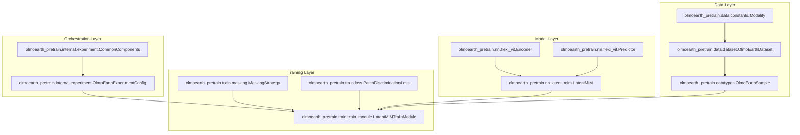
**Sources**: [olmoearth_pretrain/nn/flexi_vit.py:1-65](), [olmoearth_pretrain/train/masking.py:33-82](), [olmoearth_pretrain/internal/experiment.py:11-23]()

## Data Flow: From Raw Images to Masked Tokens

The data pipeline transforms raw satellite imagery stored in H5PY files into model-ready tensors with appropriate masking for self-supervised pretraining.

### Data Processing Pipeline

**Key classes and methods**:
*   `OlmoEarthDataset` loads samples from H5PY files [olmoearth_pretrain/data/dataset.py:9-10]().
*   `OlmoEarthSample` is the primary container for multi-modal tensors [olmoearth_pretrain/datatypes.py:18-18]().
*   `MaskingStrategy.apply_mask()` determines which tokens are assigned to the encoder, decoder, or ignored [olmoearth_pretrain/train/masking.py:72-82]().
*   `MaskedOlmoEarthSample` contains the data and the generated masks [olmoearth_pretrain/train/masking.py:10-11]().
*   `TokensAndMasks` represents the flattened tokenized representation used inside the transformer [olmoearth_pretrain/nn/flexi_vit.py:23-23]().

**Sources**: [olmoearth_pretrain/train/masking.py:1-110](), [olmoearth_pretrain/nn/flexi_vit.py:167-181]()

## Model Architecture: FlexiVit Encoder-Decoder

The OlmoEarth model uses a FlexiVit architecture. The `Encoder` processes visible tokens, while the `Predictor` (decoder) attempts to reconstruct masked tokens using cross-attention.

### FlexiVit Components
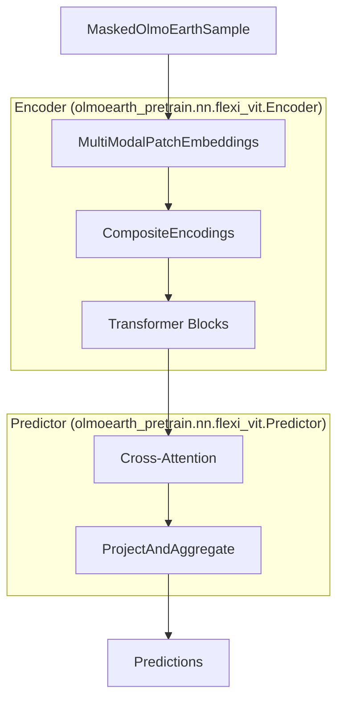
**Key configuration components**:
*   `Encoder` uses `MultiModalPatchEmbeddings` to handle different resolutions and modalities [olmoearth_pretrain/nn/flexi_vit.py:183-183]().
*   `CompositeEncodings` injects spatial, temporal (month), and channel-specific information [olmoearth_pretrain/nn/flexi_vit.py:26-30]().
*   `ProjectAndAggregate` handles the final projection or pooling of tokens [olmoearth_pretrain/nn/flexi_vit.py:65-65]().
*   `LatentMIM` wraps the encoder and predictor, often maintaining a `target_encoder` updated via EMA for stable training [tests/integration/nn/test_latent_mim.py:87-149]().

**Sources**: [olmoearth_pretrain/nn/flexi_vit.py:1-183](), [tests/integration/nn/test_latent_mim.py:66-87]()

## Training and Optimization

Training is orchestrated by the `LatentMIMTrainModule`, which manages the optimization loop, loss calculation, and distributed training setup.

*   **Masking**: Strategies like `RandomMaskingStrategy` or `SpaceMaskingStrategy` define how data is hidden from the model [olmoearth_pretrain/train/masking.py:15-18]().
*   **Loss Functions**: The primary objective is often `PatchDiscriminationLoss`, which compares predicted latent tokens against targets from a teacher/target encoder [olmoearth_pretrain/train/loss.py:12-12]().
*   **Optimization**: Uses `AdamWConfig` for weight decay and learning rate management [tests/unit/internal/test_experiment.py:130-130]().
*   **Infrastructure**: Integration with Beaker allows for scalable cluster execution [olmoearth_pretrain/internal/common.py:1-30]().

**Sources**: [olmoearth_pretrain/train/masking.py:10-20](), [tests/unit/internal/test_experiment.py:120-154](), [olmoearth_pretrain/internal/common.py:110-124]()

## Development and Testing

The repository maintains high code quality through rigorous testing and linting:
*   **Unit Tests**: Located in `tests/unit/`, covering masking, model components, and data loading [tests/unit/train/test_masking.py:1-10]().
*   **Integration Tests**: Located in `tests/integration/`, verifying end-to-end forward passes and evaluation datasets [tests/integration/nn/test_latent_mim.py:1-15]().
*   **CI/CD**: GitHub Actions run linting (Ruff) and tests on every pull request [ .github/workflows/lint.yaml:1-10](), [.github/workflows/tests.yaml:1-10]().
*   **Environment**: Managed via `uv` for reproducible dependency resolution [README.md:24-35]().

**Sources**: [README.md:95-111](), [pyproject.toml:113-121](), [.github/workflows/lint.yaml:1-40]()

---

# Page: Key Concepts and Terminology

# Key Concepts and Terminology

<details>
<summary>Relevant source files</summary>

The following files were used as context for generating this wiki page:

- [olmoearth_pretrain/data/transform.py](olmoearth_pretrain/data/transform.py)
- [olmoearth_pretrain/nn/flexi_vit.py](olmoearth_pretrain/nn/flexi_vit.py)
- [olmoearth_pretrain/nn/galileo.py](olmoearth_pretrain/nn/galileo.py)
- [olmoearth_pretrain/nn/latent_mim.py](olmoearth_pretrain/nn/latent_mim.py)
- [olmoearth_pretrain/nn/mae.py](olmoearth_pretrain/nn/mae.py)
- [olmoearth_pretrain/train/masking.py](olmoearth_pretrain/train/masking.py)
- [tests/integration/eval/test_geobench_dataset_with_model.py](tests/integration/eval/test_geobench_dataset_with_model.py)
- [tests/integration/nn/test_flexi_vit.py](tests/integration/nn/test_flexi_vit.py)
- [tests/integration/nn/test_latent_mim.py](tests/integration/nn/test_latent_mim.py)
- [tests/unit/data/test_constants.py](tests/unit/data/test_constants.py)
- [tests/unit/internal/test_experiment.py](tests/unit/internal/test_experiment.py)
- [tests/unit/train/test_masking.py](tests/unit/train/test_masking.py)

</details>


This page defines the core concepts and terminology used throughout the OlmoEarth pretraining system. Understanding these concepts is essential for working with the codebase, whether you're training models, performing inference, or extending functionality.

---

## Core Data Concepts

### Modalities

**Modalities** are distinct types of Earth observation data sources processed by OlmoEarth. Each modality represents a different sensor or derived data product with unique spectral, spatial, and temporal characteristics.

#### Modality Specification Diagram

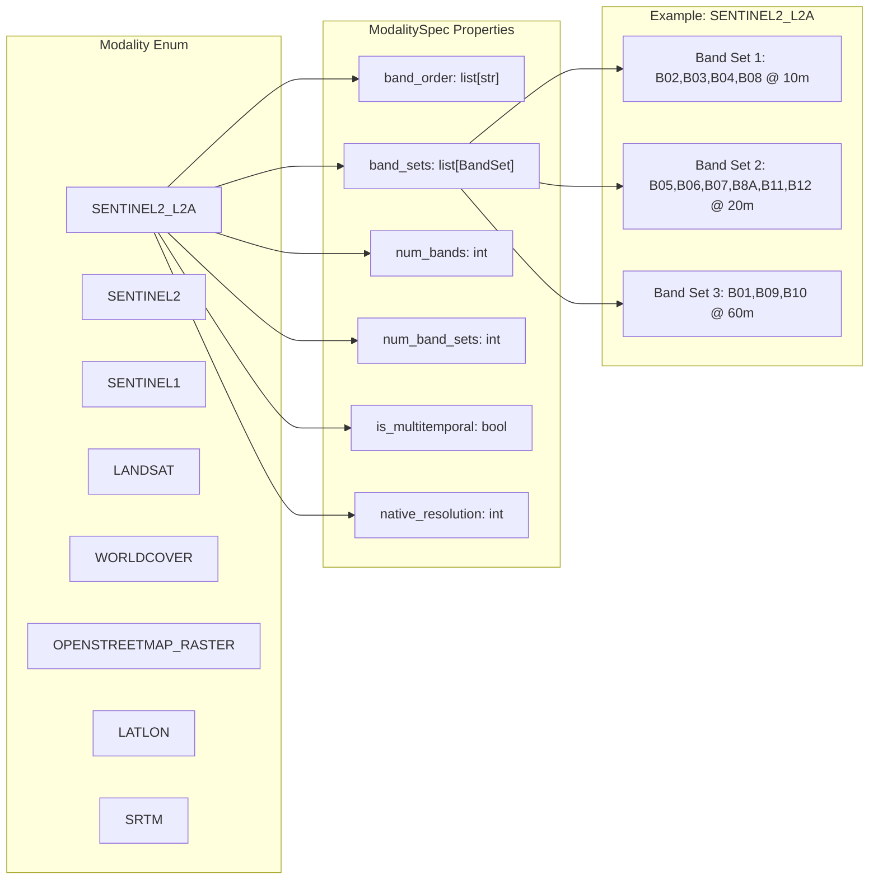

The `Modality` enum ([olmoearth_pretrain/data/constants.py:130-250]()) defines all supported data sources. Key modalities include:

| Modality | Description | Bands | Resolution | Temporal |
|----------|-------------|-------|------------|----------|
| `SENTINEL2_L2A` | Optical imagery from Sentinel-2 | 13 bands in 3 sets | 10m, 20m, 60m | Yes |
| `SENTINEL1` | SAR imagery from Sentinel-1 | 2 bands (VV, VH) | 10m | Yes |
| `LANDSAT` | Optical imagery from Landsat 8/9 | 11 bands in 3 sets | 30m, 15m, 100m | Yes |
| `WORLDCOVER` | ESA land cover classification | 1 band (10 classes) | 10m | No |
| `LATLON` | Geolocation information | 2 values (lat, lon) | N/A | No |

**Sources:** [olmoearth_pretrain/data/constants.py:130-250](), [tests/unit/data/test_constants.py:6-57]()

### Band Sets

A **Band Set** groups spectral bands that share the same native spatial resolution. This concept is critical because different bands of the same modality may be captured at different resolutions.

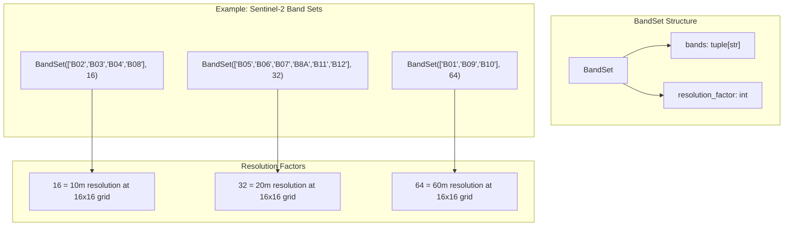

The `resolution_factor` indicates how many pixels at that resolution fit into the standard tile. For example, at 10m resolution, you have 256 pixels (16 × 16 = 256), so the factor is 16.

**Sources:** [olmoearth_pretrain/data/constants.py:30-60](), [tests/unit/data/test_constants.py:50-56]()

### Samples

An **OlmoEarthSample** is the fundamental data container that holds multi-modal, spatio-temporal Earth observation data for a single location.

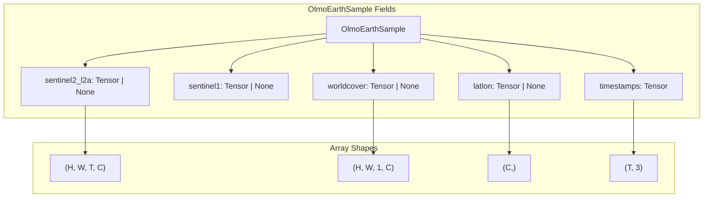

`OlmoEarthSample` is a `NamedTuple` ([olmoearth_pretrain/datatypes.py:112-185]()) where:
- Spatial modalities have shape `(H, W, T, C)` for multi-temporal or `(H, W, C)` for static.
- `timestamps` contains `[day, month, year]` for each timestep.

**Sources:** [olmoearth_pretrain/datatypes.py:112-185](), [olmoearth_pretrain/data/transform.py:16-113]()

---

## Spatial and Temporal Concepts

### Patches

**Patches** are square spatial subdivisions of the input data. The **patch size** determines how many pixels are grouped together before being embedded into a single token. In `FlexiVit`, this is dynamic, but restricted by `max_patch_size`.

**Sources:** [olmoearth_pretrain/nn/flexi_vit.py:557-600](), [tests/unit/train/test_masking.py:46-68]()

### Tokens

**Tokens** are the atomic units of information processed by the transformer model. The `TokensAndMasks` class stores these embeddings along with their associated masks.

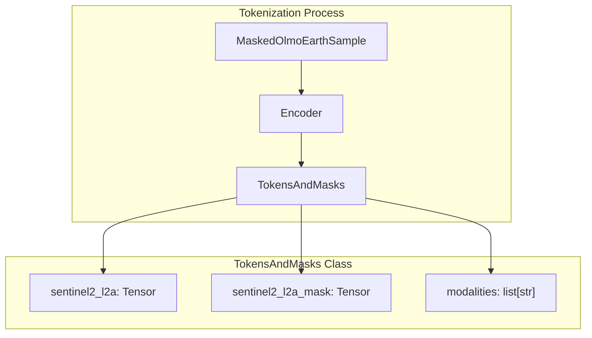

The `TokensAndMasks` representation ([olmoearth_pretrain/datatypes.py:20-110]()) is used to pass data between the `Encoder` and `Predictor`.

**Sources:** [olmoearth_pretrain/datatypes.py:20-110](), [olmoearth_pretrain/nn/flexi_vit.py:19-24]()

---

## Masking and Training Concepts

### Mask Values

**Mask Values** define the role of each token during training. The `MaskValue` enum ([olmoearth_pretrain/datatypes.py:13-17]()) has four states:

| Value | Name | Purpose |
|-------|------|---------|
| `0` | `ONLINE_ENCODER` | Token is visible and processed by online encoder |
| `1` | `DECODER` | Token is masked and reconstructed by decoder |
| `2` | `TARGET_ENCODER_ONLY` | Token visible only to target encoder (not online) |
| `99` | `MISSING` | Data unavailable due to clouds/gaps |

**Sources:** [olmoearth_pretrain/datatypes.py:13-17](), [olmoearth_pretrain/train/masking.py:15-19]()

### Masking Strategies

**Masking Strategies** determine which tokens receive which mask values. 

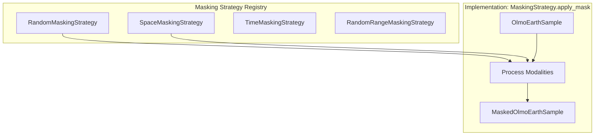

- **RandomMaskingStrategy**: Masks tokens independently ([olmoearth_pretrain/train/masking.py:318-350]()).
- **SpaceMaskingStrategy**: Masks entire spatial patches across all timesteps ([olmoearth_pretrain/train/masking.py:353-380]()).
- **TimeMaskingStrategy**: Masks entire timesteps across all spatial locations ([olmoearth_pretrain/train/masking.py:383-410]()).

**Sources:** [olmoearth_pretrain/train/masking.py:33-82](), [tests/unit/train/test_masking.py:10-20]()

---

## Model Architecture Concepts

### Latent MIM (Masked Image Modeling)

OlmoEarth uses a `LatentMIM` approach where the model predicts the latent representations of masked patches rather than raw pixels.

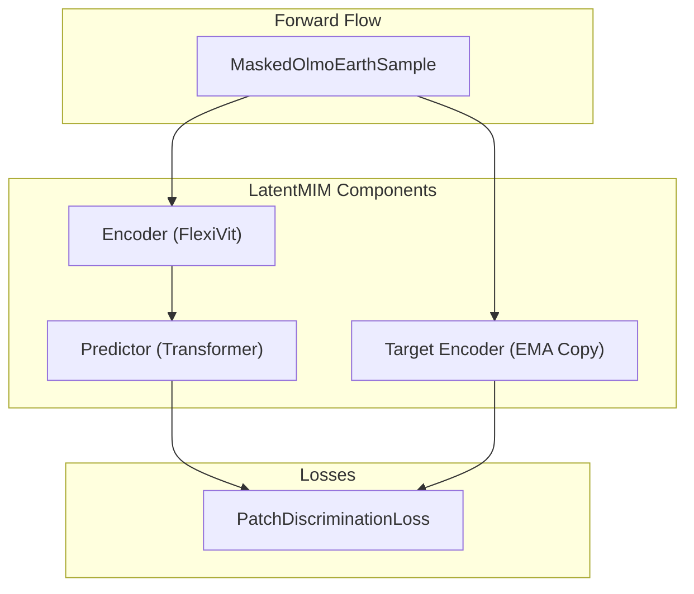

The `LatentMIM` class ([olmoearth_pretrain/nn/latent_mim.py:25-92]()) orchestrates the forward pass through the `Encoder` and `Predictor`, while the `target_encoder` (a `deepcopy` of the encoder) provides the targets for the `PatchDiscriminationLoss`.

**Sources:** [olmoearth_pretrain/nn/latent_mim.py:25-92](), [tests/integration/nn/test_latent_mim.py:66-87]()

### Embeddings and Encodings

**Embeddings** convert raw data and metadata into the transformer's latent space:

- **FlexiPatchEmbed**: Projects variable-sized patches into embeddings ([olmoearth_pretrain/nn/flexi_patch_embed.py:16-120]()).
- **CompositeEncodings**: Combines patch embeddings with positional, temporal (month), and channel (band set) encodings ([olmoearth_pretrain/nn/encodings.py:150-250]()).

**Sources:** [olmoearth_pretrain/nn/flexi_vit.py:25-37](), [olmoearth_pretrain/nn/encodings.py:10-30]()

---

## Data Handling Concepts

### Missing Values

The **MISSING_VALUE** constant (`-32768`) marks unavailable data. The masking system automatically identifies these and assigns `MaskValue.MISSING`.

**Sources:** [olmoearth_pretrain/data/constants.py:14-14](), [olmoearth_pretrain/train/masking.py:84-96]()

### Transforms and Augmentations

The `Transform` registry ([olmoearth_pretrain/data/transform.py:20-29]()) provides common augmentations:
- **FlipAndRotateSpace**: Randomly applies one of 8 orthogonal transformations ([olmoearth_pretrain/data/transform.py:42-113]()).
- **Mixup**: Blends two samples and their timestamps ([olmoearth_pretrain/data/transform.py:116-146]()).

**Sources:** [olmoearth_pretrain/data/transform.py:20-166]()

---

## Code Entity Reference

| Concept | Primary Class/Enum | File Path |
|---------|-------------------|-----------|
| Modality | `Modality` | [olmoearth_pretrain/data/constants.py:130-250]() |
| Sample | `OlmoEarthSample` | [olmoearth_pretrain/datatypes.py:112-185]() |
| Masked Sample | `MaskedOlmoEarthSample` | [olmoearth_pretrain/datatypes.py:188-250]() |
| Tokens | `TokensAndMasks` | [olmoearth_pretrain/datatypes.py:20-110]() |
| Latent MIM | `LatentMIM` | [olmoearth_pretrain/nn/latent_mim.py:25-92]() |
| Encoder | `Encoder` | [olmoearth_pretrain/nn/flexi_vit.py:557-600]() |
| Predictor | `Predictor` | [olmoearth_pretrain/nn/flexi_vit.py:850-900]() |
| Masking Strategy | `MaskingStrategy` | [olmoearth_pretrain/train/masking.py:33-82]() |

**Sources:** [olmoearth_pretrain/datatypes.py:1-250](), [olmoearth_pretrain/nn/flexi_vit.py:1-1000]()

---

# Page: Repository Structure

# Repository Structure

<details>
<summary>Relevant source files</summary>

The following files were used as context for generating this wiki page:

- [.github/workflows/lint.yaml](.github/workflows/lint.yaml)
- [.github/workflows/tests.yaml](.github/workflows/tests.yaml)
- [README.md](README.md)
- [docs/Evaluation.md](docs/Evaluation.md)
- [docs/Pretraining.md](docs/Pretraining.md)
- [olmoearth_pretrain/internal/common.py](olmoearth_pretrain/internal/common.py)
- [olmoearth_pretrain/internal/experiment.py](olmoearth_pretrain/internal/experiment.py)
- [olmoearth_pretrain/internal/utils.py](olmoearth_pretrain/internal/utils.py)
- [olmoearth_pretrain/py.typed](olmoearth_pretrain/py.typed)
- [pyproject.toml](pyproject.toml)
- [scripts/archived/20251027_finetune.sh](scripts/archived/20251027_finetune.sh)
- [uv.lock](uv.lock)

</details>


This document provides a comprehensive overview of how the OlmoEarth pretraining codebase is organized, including the main packages, module hierarchy, directory structure, and how different components are arranged within the repository.

---

## Repository Overview

The OlmoEarth pretraining repository is structured around two main Python packages: `olmoearth_pretrain` (the primary package containing all model, training, and evaluation code) and `helios` (a supporting package for dataset creation and processing). The codebase follows a modular architecture where functionality is organized into distinct layers: data pipeline, model architecture, training system, evaluation, and experiment orchestration.

**Sources:** [pyproject.toml:25-27]()

---

## Top-Level Directory Structure

```
olmoearth_pretrain/              # Main package directory
├── data/                        # Data specifications and constants
├── dataset/                     # Dataset loading and preprocessing
├── evals/                       # Evaluation systems and tasks
├── inference_benchmarking/      # Throughput and performance scripts
├── internal/                    # Internal utilities for experiment launching
├── nn/                          # Neural network models and components
├── train/                       # Training utilities and modules
└── model_loader.py              # Model loading from Hugging Face

helios/                          # Supporting package for dataset creation
├── ...                          # Dataset processing pipelines

scripts/                         # Training and evaluation scripts
├── official/                    # Official model configuration scripts (Base, Large, etc.)
├── archived/                    # Legacy or one-off experiment scripts
└── ...                          # Additional utility scripts

tests/                           # Test suite
├── unit/                        # Unit tests for core logic
└── tests_minimal_deps/          # Tests for inference with minimal dependencies

.github/                         # CI/CD workflows
└── workflows/
    ├── lint.yaml                # Linting pipeline (Ruff, MyPy)
    └── tests.yaml               # Test pipeline (Pytest)

pyproject.toml                   # Project configuration and dependencies
uv.lock                          # Dependency lock file
```

**Sources:** [pyproject.toml:25-27](), [README.md:95-111](), [.github/workflows/lint.yaml:1-40](), [.github/workflows/tests.yaml:1-63]()

---

## Package Structure Overview

### Package Declaration

The repository contains two main packages declared in the project configuration:

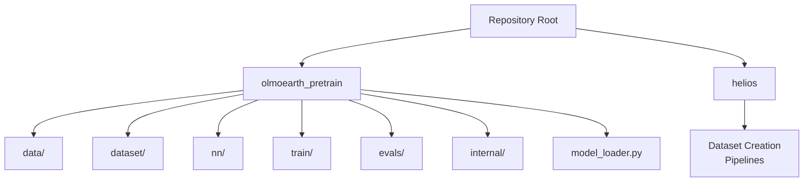

**Sources:** [pyproject.toml:25-27]()

---

## Core Module Organization

### Data and Dataset Modules

The data pipeline modules handle all aspects of loading, preprocessing, and managing satellite imagery data. The system distinguishes between core constants (modalities) and the actual loading logic.

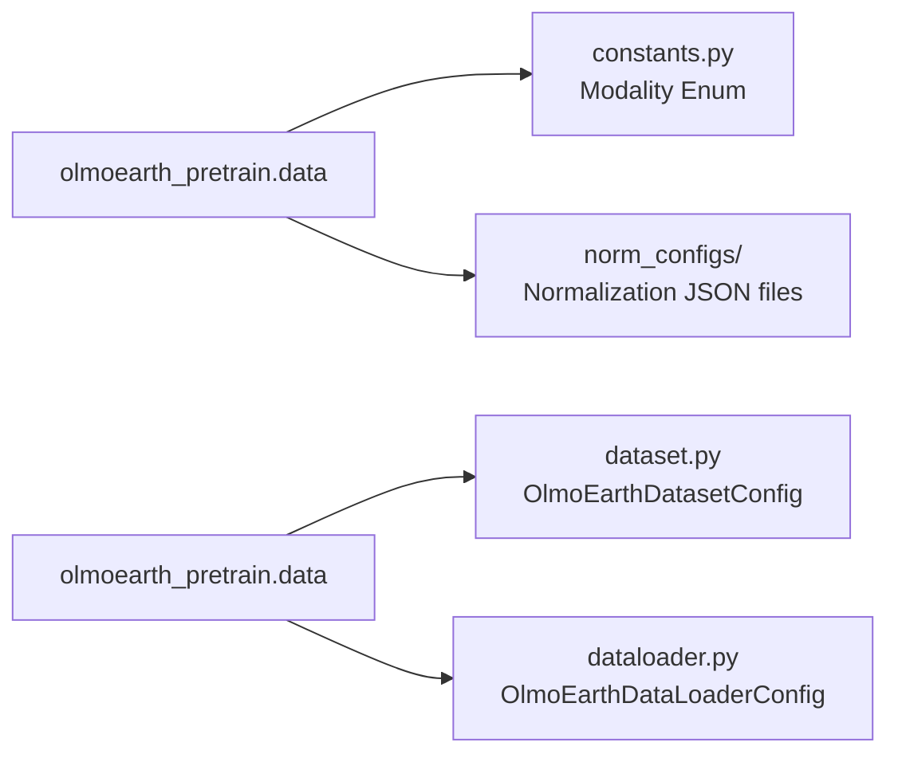

Key data components:
- **`Modality`** ([olmoearth_pretrain/data/constants.py](), referenced in [olmoearth_pretrain/internal/experiment.py:23]()): Enum defining supported satellite modalities like Sentinel-2, Sentinel-1, and Landsat.
- **`OlmoEarthDatasetConfig`** ([olmoearth_pretrain/data/dataset.py](), referenced in [olmoearth_pretrain/internal/experiment.py:25-27]()): Configuration for the H5PY-based dataset.
- **`OlmoEarthDataLoaderConfig`** ([olmoearth_pretrain/data/dataloader.py](), referenced in [olmoearth_pretrain/internal/experiment.py:24]()): Configuration for distributed data loading.

**Sources:** [olmoearth_pretrain/internal/experiment.py:23-27](), [olmoearth_pretrain/internal/common.py:18]()

---

### Model Architecture and Training Modules

The model architecture is primarily located in `nn/`, while training logic resides in `train/`.

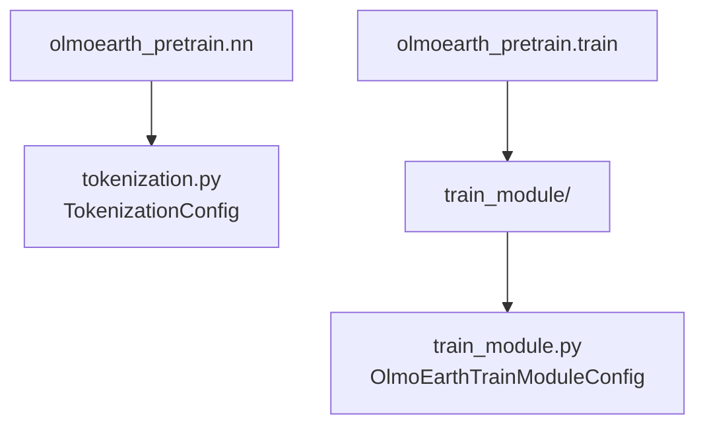

Key components:
- **`TokenizationConfig`** ([olmoearth_pretrain/nn/tokenization.py:36]()): Manages band groupings and tokenization strategies across different modalities.
- **`OlmoEarthTrainModuleConfig`** ([olmoearth_pretrain/train/train_module/train_module.py:37-39]()): Configures the training loop, loss functions, and model optimization steps.

**Sources:** [olmoearth_pretrain/internal/experiment.py:36-39]()

---

### Experiment Orchestration Modules

The `internal/` module provides the core infrastructure for configuring and launching experiments, particularly on Beaker clusters.

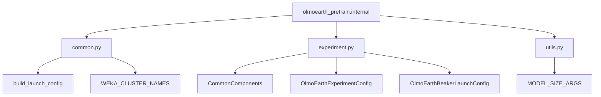

Key orchestration components:
- **`OlmoEarthBeakerLaunchConfig`** ([olmoearth_pretrain/internal/experiment.py:45-65]()): Extends standard Beaker configs to support specific hostnames and AI2 cluster constraints.
- **`CommonComponents`** ([olmoearth_pretrain/internal/experiment.py:75-109]()): A shared configuration class containing run names, save folders, and training modalities used across all experiment types.
- **`OlmoEarthExperimentConfig`** ([olmoearth_pretrain/internal/experiment.py:127-140]()): The top-level configuration object for a pretraining run, aggregating model, dataset, loader, and trainer configs.
- **`MODEL_SIZE_ARGS`** ([olmoearth_pretrain/internal/utils.py:48-193]()): A registry of architectural hyperparameters for standard model sizes (Nano, Tiny, Base, Large, Giga).
- **`build_launch_config`** ([olmoearth_pretrain/internal/common.py:110-209]()): Orchestrates the creation of Beaker jobs, including mounting Weka buckets and setting NCCL environment variables.

**Sources:** [olmoearth_pretrain/internal/experiment.py:44-140](), [olmoearth_pretrain/internal/common.py:110-209](), [olmoearth_pretrain/internal/utils.py:48-193]()

---

## Dependency and Environment Management

The repository uses `uv` for dependency management, categorized into several extras to allow for minimal inference-only installations.

| Extra | Purpose | Key Dependencies |
|-------|---------|------------------|
| Core (None) | Minimal Inference | `torch`, `numpy`, `huggingface_hub`, `einops` |
| `training` | Pretraining | `ai2-olmo-core`, `albumentations`, `wandb` |
| `beaker` | Cluster Launching | `beaker-py`, `docker`, `google-cloud-compute` |
| `eval` | Downstream Eval | `rslearn`, `scikit-learn`, `pytorch-lightning` |
| `dataset-creation` | Data Processing | `rslearn`, `rioxarray`, `rasterio` |

**Sources:** [pyproject.toml:11-145](), [README.md:22-44]()

---

## Infrastructure and Cluster Configuration

The system is designed to run seamlessly on AI2's Beaker infrastructure using Weka for high-performance storage.

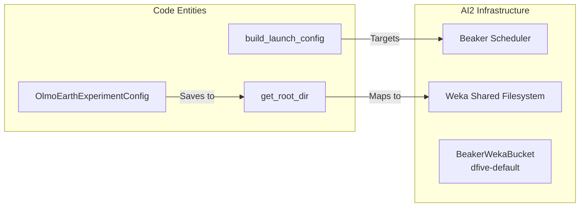

- **Weka Integration**: Clusters like `jupiter`, `saturn`, and `neptune` are recognized as Weka-enabled [olmoearth_pretrain/internal/common.py:35-43]().
- **Root Directories**: The `get_root_dir` function automatically routes experiment outputs to `/weka/dfive-default/olmoearth_pretrain` when running on supported clusters [olmoearth_pretrain/internal/common.py:58-77]().
- **NCCL Debugging**: Environment variables for NCCL tracing are managed via `set_nccl_debug_env_vars` to aid in troubleshooting distributed training [olmoearth_pretrain/internal/common.py:88-107]().

**Sources:** [olmoearth_pretrain/internal/common.py:30-107]()

---

## Development and CI/CD

The repository maintains high code quality through automated linting and testing.

- **Linting**: The `lint.yaml` workflow uses `uv` to run `pre-commit` hooks, which include Ruff for formatting and linting [ .github/workflows/lint.yaml:1-40]().
- **Testing**:
    - **Full Suite**: Runs all unit and integration tests with all extras [ .github/workflows/tests.yaml:12-41]().
    - **Minimal Deps**: Specifically verifies that model loading works with only base dependencies (no `olmo-core`) to ensure inference compatibility [ .github/workflows/tests.yaml:42-63]().

**Sources:** [.github/workflows/lint.yaml:1-40](), [.github/workflows/tests.yaml:1-63](), [README.md:95-111]()

---

# Page: Getting Started

# Getting Started

<details>
<summary>Relevant source files</summary>

The following files were used as context for generating this wiki page:

- [.github/workflows/lint.yaml](.github/workflows/lint.yaml)
- [.github/workflows/tests.yaml](.github/workflows/tests.yaml)
- [README.md](README.md)
- [olmoearth_pretrain/internal/common.py](olmoearth_pretrain/internal/common.py)
- [olmoearth_pretrain/model_loader.py](olmoearth_pretrain/model_loader.py)
- [olmoearth_pretrain/py.typed](olmoearth_pretrain/py.typed)
- [pyproject.toml](pyproject.toml)
- [uv.lock](uv.lock)

</details>


This page provides instructions for installing the OlmoEarth pretraining codebase, setting up the development environment, and running basic operations. For detailed guides on specific workflows, see [Inference Quickstart](#2.2) for loading pretrained models and computing embeddings, and [Training Quickstart](#2.3) for launching training runs.

## Purpose and Scope

This page covers:
- Installing Python dependencies using `uv` [README.md:24-35]()
- Configuring the development environment [README.md:31-33]()
- Verifying the installation with `pytest` [README.md:95-111]()
- Understanding the repository structure and key code entities [pyproject.toml:25-33]()
- Basic examples of model loading and training [olmoearth_pretrain/model_loader.py:57-75]()

For dataset creation and preprocessing, see the [Dataset Creation documentation](). For detailed model architecture information, see [Model Architecture](#4).

## Prerequisites

**Python Version**: The codebase requires Python 3.11, 3.12, or 3.13 [pyproject.toml:10](). Python 3.12 is recommended for best compatibility [README.md:24]().

**System Requirements**:
- **Linux**: Required for GPU training with CUDA 12.8 [pyproject.toml:56,66]().
- **macOS / Windows**: Supported for CPU-only inference and development [pyproject.toml:55,61]().
- **Git and Git LFS**: For cloning the repository and managing large model artifacts.
- **CUDA 12.8 compatible GPU**: Recommended for training performance.

**Sources**: [pyproject.toml:10,54-68](), [README.md:24]()

## Installation Flow

The following diagram shows the complete installation process:

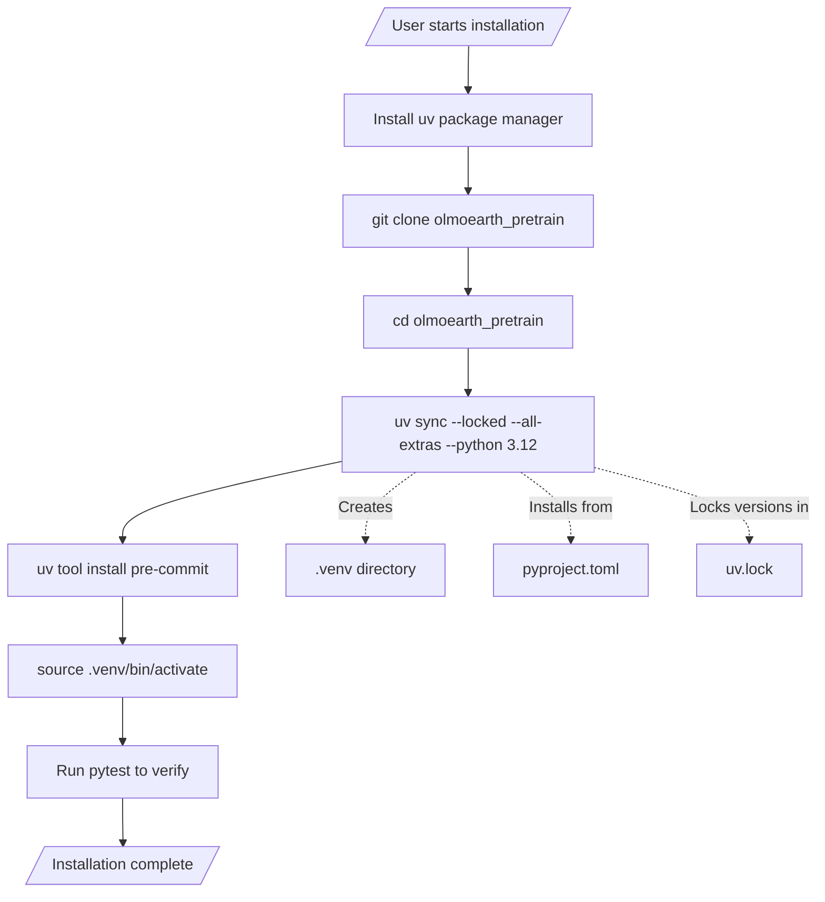

**Sources**: [README.md:22-36](), [pyproject.toml:1-152]()

## Step-by-Step Installation

### 1. Install uv Package Manager

Install the `uv` package manager, which provides fast Python package installation and management:

```bash
curl -LsSf https://astral.sh/uv/install.sh | sh
```

The `uv` tool is used throughout the codebase for dependency management and is required by the CI/CD pipeline [README.md:24](), [.github/workflows/lint.yaml:27-30]().

### 2. Clone the Repository

```bash
git clone git@github.com:allenai/olmoearth_pretrain.git
cd olmoearth_pretrain
```

**Sources**: [README.md:28-29]()

### 3. Install Dependencies

Install all dependencies including development, evaluation, and Beaker launch tools:

```bash
uv sync --locked --all-extras --python 3.12
```

For **inference-only** installations without training dependencies:
```bash
uv sync --locked
```

This command:
- Creates a virtual environment at `.venv/` [README.md:35]().
- Installs all dependency groups from `pyproject.toml` [pyproject.toml:69-145]().
- Uses the locked versions from `uv.lock` [uv.lock:1-20]().
- Installs PyTorch with CUDA 12.8 on Linux, CPU-only on other platforms [pyproject.toml:54-68]().

**Dependency Groups**:

| Group | Purpose | Key Packages |
|-------|---------|--------------|
| `main` | Core inference | `torch`, `numpy`, `huggingface_hub`, `einops` [pyproject.toml:11-18]() |
| `training` | Training logic | `ai2-olmo-core`, `albumentations`, `wandb` [pyproject.toml:70-85]() |
| `eval` | Evaluation tasks | `geobench`, `terratorch`, `pytorch-lightning`, `rslearn` [pyproject.toml:122-139]() |
| `beaker` | Cluster deployment | `beaker-py`, `docker` [pyproject.toml:86-95]() |
| `dataset-creation` | Data processing | `rslearn`, `rasterio`, `gcsfs`, `rioxarray` [pyproject.toml:96-112]() |

**Sources**: [README.md:24-42](), [pyproject.toml:11-145]()

### 4. Install Pre-commit Hooks (Development Only)

For contributors, install pre-commit hooks for code quality checks:

```bash
uv tool install pre-commit --with pre-commit-uv --force-reinstall
```

This enables automatic linting with `ruff` and other quality checks [README.md:32](), [.github/workflows/lint.yaml:35]().

### 5. Activate Virtual Environment

Activate the `uv`-managed virtual environment:

```bash
source .venv/bin/activate
```

Alternatively, prefix commands with `uv run`:

```bash
uv run python script.py
```

**Sources**: [README.md:35]()

## Verifying Installation

### Run Unit Tests

Verify the installation by running the test suite. You can choose different dependency configurations:

```bash
# Full test suite (requires all-no-flash extra)
uv run --extra all-no-flash pytest tests/

# Model loading tests with minimal deps (verifies inference-only path)
uv run --extra dev pytest tests_minimal_deps/
```

**Sources**: [README.md:95-111](), [.github/workflows/tests.yaml:34-63]()

### Load a Pretrained Model

Verify model loading functionality using `model_loader.py`:

```python
from olmoearth_pretrain.model_loader import ModelID, load_model_from_id

# Load OlmoEarth-v1-Nano model (smallest, fastest to download)
model = load_model_from_id(ModelID.OLMOEARTH_V1_NANO)
print(f"Model loaded successfully: {type(model)}")
```

This downloads the model configuration and weights from Hugging Face and initializes the model [olmoearth_pretrain/model_loader.py:57-75]().

**Available Model IDs**:
- `ModelID.OLMOEARTH_V1_NANO` - 1.4M encoder params
- `ModelID.OLMOEARTH_V1_TINY` - 6.2M encoder params
- `ModelID.OLMOEARTH_V1_BASE` - 89M encoder params
- `ModelID.OLMOEARTH_V1_LARGE` - 308M encoder params

**Sources**: [olmoearth_pretrain/model_loader.py:44-50](), [README.md:52-57]()

## Code Structure Overview

The following diagram maps high-level components to their implementation in the codebase:

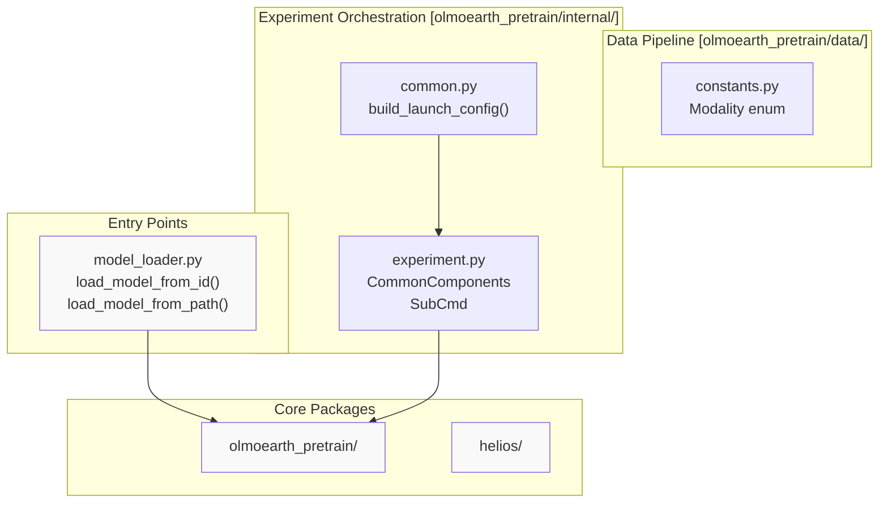

**Key Code Entities**:

| Component | Primary Classes/Functions | Purpose |
|-----------|---------------------------|---------|
| Model Loading | `load_model_from_id()`, `ModelID` | Initialize pretrained models from Hugging Face [olmoearth_pretrain/model_loader.py:57]() |
| Modalities | `Modality` enum | Definitions for Sentinel-2, Sentinel-1, etc. [olmoearth_pretrain/internal/common.py:18]() |
| Beaker Integration | `build_launch_config()` | Configures jobs for the Beaker cluster [olmoearth_pretrain/internal/common.py:110]() |
| Experiment Config | `CommonComponents`, `SubCmd` | Base structures for experiment orchestration [olmoearth_pretrain/internal/common.py:19-24]() |

**Sources**: [olmoearth_pretrain/model_loader.py:44-75](), [olmoearth_pretrain/internal/common.py:1-124](), [pyproject.toml:25-27]()

## Package Structure

The repository is organized into the following main packages:

```
olmoearth_pretrain/
├── data/              # Data loading and modality constants
├── dataset/           # Dataset creation utilities
├── evals/             # Evaluation tasks and metrics
├── internal/          # Experiment orchestration and Beaker integration
├── nn/                # Neural network modules (FlexiVit)
├── train/             # Training modules and losses
└── model_loader.py    # Pretrained model loading utilities

helios/                # Shared utilities

tests/                 # Unit and integration tests
tests_minimal_deps/    # Tests for inference-only compatibility
```

**Sources**: [pyproject.toml:25-33](), [README.md:104-111]()

## Quick Examples

### Example 1: Load a Pretrained Model

```python
import torch
from olmoearth_pretrain.model_loader import ModelID, load_model_from_id

# Load model weights from Hugging Face
model = load_model_from_id(ModelID.OLMOEARTH_V1_BASE)
model.eval()

# Verify architecture
print(model)
```

**Sources**: [olmoearth_pretrain/model_loader.py:57-75]()

### Example 2: List Supported Model Sizes

```python
from olmoearth_pretrain.model_loader import ModelID

for model_id in ModelID:
    print(f"Model: {model_id.value} -> HF Repo: {model_id.repo_id()}")
```

**Sources**: [olmoearth_pretrain/model_loader.py:44-54]()

## Next Steps

1. **For Inference**: See [Inference Quickstart](#2.2) for detailed instructions on computing embeddings for satellite imagery.
2. **For Training**: See [Training Quickstart](#2.3) for launching training runs and monitoring progress.
3. **For Cluster Use**: See [Experiment Orchestration](#7) for details on launching jobs on Beaker using `build_launch_config` [olmoearth_pretrain/internal/common.py:110]().

---

**Sources**: [README.md:1-115](), [pyproject.toml:1-152](), [olmoearth_pretrain/model_loader.py:1-140](), [olmoearth_pretrain/internal/common.py:1-174](), [.github/workflows/tests.yaml:1-63]()

---

# Page: Installation and Environment Setup

# Installation and Environment Setup

<details>
<summary>Relevant source files</summary>

The following files were used as context for generating this wiki page:

- [.github/workflows/lint.yaml](.github/workflows/lint.yaml)
- [.github/workflows/tests.yaml](.github/workflows/tests.yaml)
- [.pre-commit-config.yaml](.pre-commit-config.yaml)
- [README.md](README.md)
- [olmoearth_pretrain/internal/common.py](olmoearth_pretrain/internal/common.py)
- [olmoearth_pretrain/nn/encodings.py](olmoearth_pretrain/nn/encodings.py)
- [olmoearth_pretrain/py.typed](olmoearth_pretrain/py.typed)
- [pyproject.toml](pyproject.toml)
- [tests/unit/nn/test_flexi_vit.py](tests/unit/nn/test_flexi_vit.py)
- [uv.lock](uv.lock)

</details>


This page covers the installation of the OlmoEarth pretraining codebase, dependency management with `uv`, and environment configuration for both local development and cluster-based training.

## Prerequisites

The OlmoEarth pretraining repository requires:
- **Python 3.11 to 3.13** (Python 3.14+ is not supported due to PyTorch compatibility) [pyproject.toml:10-10]()
- **uv 0.9.5+** for dependency management [.github/workflows/lint.yaml:30-30]()
- **Git** with submodule support

**Python Version Specification**
The project enforces Python version constraints in `pyproject.toml` to ensure compatibility with PyTorch 2.7.1, which is the primary deep learning framework used throughout the codebase [pyproject.toml:10-10]().

Sources: [pyproject.toml:10-10](), [.github/workflows/lint.yaml:30-30]()

## Core Installation

### Installation Flow

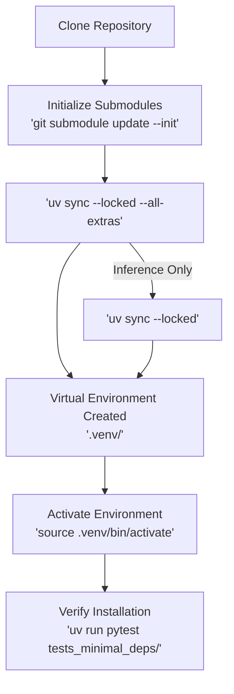

**Step-by-Step Installation**

1.  **Clone the repository:**
    ```bash
    git clone git@github.com:allenai/olmoearth_pretrain.git
    cd olmoearth_pretrain
    ``` [README.md:28-29]()

2.  **Install dependencies with uv:**
    For full development and training support:
    ```bash
    uv sync --locked --all-extras --python 3.12
    ``` [README.md:30-30]()
    
    For inference-only usage (minimal dependencies):
    ```bash
    uv sync --locked
    ``` [README.md:41-41]()

3.  **Activate the virtual environment:**
    ```bash
    source .venv/bin/activate
    ``` [README.md:35-35]()

Sources: [README.md:22-42](), [.github/workflows/tests.yaml:32-32]()

## Dependency Groups

The project organizes dependencies into several optional extras defined in `pyproject.toml`. These allow for modular installations based on the target task (e.g., training vs. evaluation).

### Dependency Group Structure

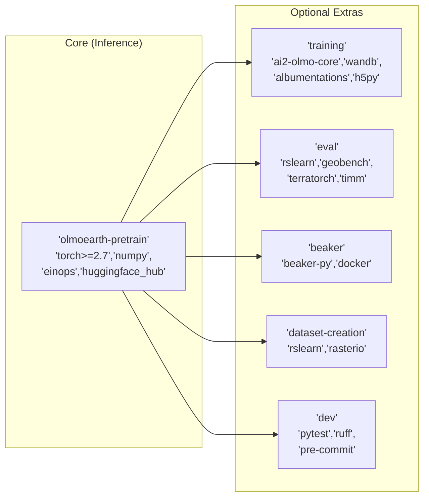

**Key Dependency Groups:**

| Extra | Purpose | Key Packages |
|-------|---------|--------------|
| `training` | Model pretraining and optimization | `ai2-olmo-core`, `wandb`, `albumentations`, `hdf5plugin` [pyproject.toml:70-85]() |
| `eval` | Downstream task evaluation | `rslearn`, `geobench`, `terratorch`, `timm`, `scikit-learn` [pyproject.toml:122-139]() |
| `dataset-creation` | Preparing raw data for training | `rslearn`, `rasterio`, `rioxarray`, `geobench` [pyproject.toml:96-112]() |
| `dev` | Development and CI tools | `pytest`, `ruff`, `mypy`, `pre-commit` [pyproject.toml:113-121]() |
| `all-no-flash` | All extras except `flash-attn` | Combines `training`, `beaker`, `dataset-creation`, `dev`, `eval` [pyproject.toml:143-145]() |

Sources: [pyproject.toml:11-18](), [pyproject.toml:70-145]()

## Platform-Specific Considerations

### PyTorch Installation Strategy

The project uses platform-specific PyTorch indices in `uv` to ensure correct builds (CUDA vs. CPU) are installed automatically based on the operating system [pyproject.toml:54-67]().

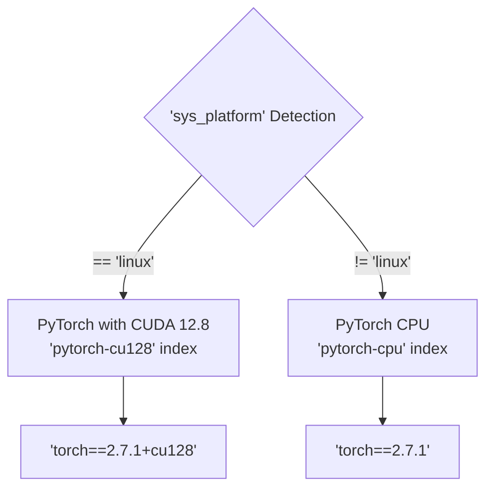

Sources: [pyproject.toml:54-67](), [uv.lock:54-56]()

### Flash Attention (CUDA Only)

Flash attention provides significant speedups but requires a CUDA environment. It is isolated in its own extra to prevent installation failures on non-GPU machines [pyproject.toml:140-142]().

```bash
# Install flash attention separately if CUDA is available
uv sync --extra flash-attn
```

Sources: [pyproject.toml:140-142](), [pyproject.toml:147-152]()

## Development Environment Setup

### Pre-commit Hooks

The project uses `pre-commit` to enforce code quality standards including linting, formatting, and type checking.

**Installation:**
```bash
uv tool install pre-commit --with pre-commit-uv --force-reinstall
pre-commit install
``` [README.md:32-32]()

**Pre-commit Hook Pipeline:**


**Tool Configurations:**
- **Ruff**: Configured for Google-style docstrings and automatic fixes [pyproject.toml:34-41]().
- **Mypy**: Enforces type hints and ignores missing imports for specific external libraries [.pre-commit-config.yaml:34-49]().
- **Interrogate**: Enforces a minimum of 80% docstring coverage for the `olmoearth_pretrain` package [.pre-commit-config.yaml:60-75]().

Sources: [.pre-commit-config.yaml:1-92](), [pyproject.toml:34-41]()

### Running Tests

The repository includes both a full test suite and minimal dependency tests to verify inference compatibility.

**Run all tests:**
```bash
uv run --extra all-no-flash pytest tests/
``` [README.md:101-101]()

**Run model loading tests (Minimal dependencies):**
```bash
# Verify loading works without training dependencies (no olmo-core)
uv run --extra dev pytest tests_minimal_deps/
``` [README.md:107-107]()

Sources: [README.md:95-111](), [.github/workflows/tests.yaml:12-63]()

## Beaker Cluster Environment Setup

When running on AI2's Beaker clusters, the environment is configured via `OlmoEarthBeakerLaunchConfig` [olmoearth_pretrain/internal/common.py:175-190]().

### Beaker Setup Sequence

```mermaid
graph TD
    START["Beaker Task Start"] --> IMAGE["Load 'OLMoCoreBeakerImage.stable_cu128'"]
    IMAGE --> WEKA["Mount Weka Bucket<br/>'/weka/dfive-default'"]
    WEKA --> ENV["Set 'GOOGLE_APPLICATION_CREDENTIALS'<br/>'/etc/gcp_credentials.json'"]
    ENV --> SECRETS["Inject 'WANDB_API_KEY'<br/>& 'BEAKER_TOKEN'"]
    SECRETS --> CMD["Execute 'cmd'"]
```

**Weka Mount Configuration:**
Beaker jobs automatically mount the Weka filesystem for shared access to datasets and checkpoints:
```python
DEFAULT_OLMOEARTH_PRETRAIN_WEKA_BUCKET = BeakerWekaBucket(
    "dfive-default", "/weka/dfive-default"
)
``` [olmoearth_pretrain/internal/common.py:30-32]()

**NCCL Debugging:**
For troubleshooting distributed training issues on clusters, the environment can be configured with detailed NCCL logging:
```python
nccl_settings = {
    "NCCL_DEBUG": "DETAIL",
    "TORCH_NCCL_TRACE_BUFFER_SIZE": "1000000000",
    "TORCH_NCCL_BLOCKING_WAIT": "1",
}
``` [olmoearth_pretrain/internal/common.py:96-100]()

Sources: [olmoearth_pretrain/internal/common.py:30-32](), [olmoearth_pretrain/internal/common.py:88-109](), [olmoearth_pretrain/internal/common.py:142-193]()

---

# Page: Inference Quickstart

# Inference Quickstart

<details>
<summary>Relevant source files</summary>

The following files were used as context for generating this wiki page:

- [olmoearth_pretrain/evals/datasets/utils.py](olmoearth_pretrain/evals/datasets/utils.py)
- [olmoearth_pretrain/evals/embeddings.py](olmoearth_pretrain/evals/embeddings.py)
- [olmoearth_pretrain/evals/eval_wrapper.py](olmoearth_pretrain/evals/eval_wrapper.py)
- [olmoearth_pretrain/model_loader.py](olmoearth_pretrain/model_loader.py)
- [olmoearth_pretrain/nn/pooling.py](olmoearth_pretrain/nn/pooling.py)
- [scripts/tools/cloud_run/Dockerfile](scripts/tools/cloud_run/Dockerfile)
- [scripts/tools/cloud_run/README.md](scripts/tools/cloud_run/README.md)
- [scripts/tools/cloud_run/deploy.sh](scripts/tools/cloud_run/deploy.sh)
- [scripts/tools/cloud_run/job.py](scripts/tools/cloud_run/job.py)
- [scripts/tools/gee/README.md](scripts/tools/gee/README.md)
- [scripts/tools/gee/gee_OlmoEarth_cropland_eval.js](scripts/tools/gee/gee_OlmoEarth_cropland_eval.js)
- [scripts/tools/gee/gee_create_OlmoEarth_cropland.js](scripts/tools/gee/gee_create_OlmoEarth_cropland.js)
- [scripts/tools/generate_embeddings.ipynb](scripts/tools/generate_embeddings.ipynb)

</details>


This page provides a technical guide for loading pretrained OlmoEarth models and computing embeddings from satellite imagery. The guide covers model initialization, data preparation, and the inference pipeline using both local scripts and cloud-based workflows.

## Overview

The inference workflow consists of three main stages:

1.  **Model Loading**: Initialize a pretrained model from Hugging Face or local storage using `ModelID` [olmoearth_pretrain/model_loader.py:44-50]() and `load_model_from_id()` [olmoearth_pretrain/model_loader.py:57-75]().
2.  **Data Preparation**: Load and normalize satellite imagery into the expected tensor format. This involves mapping Google Earth Engine (GEE) or raw GeoTIFF bands to OlmoEarth modalities [scripts/tools/cloud_run/job.py:26-48]().
3.  **Inference Execution**: Pass prepared data through the encoder to obtain embeddings, often followed by projection and aggregation [scripts/tools/cloud_run/job.py:186-188]().

## Model Loading Architecture

```mermaid
graph TB
    User["User Code"]
    ModelID["ModelID Enum<br/>olmoearth_pretrain/model_loader.py:44-50"]
    LoadFunc["load_model_from_id()<br/>olmoearth_pretrain/model_loader.py:57-75"]
    HFHub["hf_hub_download()<br/>Hugging Face Hub"]
    ConfigFile["config.json<br/>Model Configuration"]
    WeightsFile["weights.pth<br/>Model Weights"]
    BuildModel["model_config.build()<br/>olmoearth_pretrain/model_loader.py:132"]
    LoadState["model.load_state_dict()"]
    Model["torch.nn.Module<br/>FlexiVitBase / STBase"]
    
    User --> ModelID
    ModelID --> LoadFunc
    LoadFunc --> HFHub
    HFHub --> ConfigFile
    HFHub --> WeightsFile
    LoadFunc --> BuildModel
    ConfigFile --> BuildModel
    BuildModel --> Model
    LoadFunc --> LoadState
    WeightsFile --> LoadState
    LoadState --> Model
```

**Model Loading Flow**: The system resolves artifacts (config and weights) via `_resolve_artifact_path` [olmoearth_pretrain/model_loader.py:100-109](), instantiates the model from the JSON config, and loads the state dict.

Sources: [olmoearth_pretrain/model_loader.py:1-139]()

### Available Model Sizes

Pretrained variants are accessible via the `ModelID` [olmoearth_pretrain/model_loader.py:44-50]() enum:

| Model ID | Repo ID |
| :--- | :--- |
| `OLMOEARTH_V1_NANO` | `allenai/OlmoEarth-v1-Nano` |
| `OLMOEARTH_V1_TINY` | `allenai/OlmoEarth-v1-Tiny` |
| `OLMOEARTH_V1_BASE` | `allenai/OlmoEarth-v1-Base` |
| `OLMOEARTH_V1_LARGE` | `allenai/OlmoEarth-v1-Large` |

Sources: [olmoearth_pretrain/model_loader.py:44-54]()

## Data Preparation Pipeline

For inference, data must be normalized and wrapped in a `MaskedOlmoEarthSample` [olmoearth_pretrain/train/masking.py:18]().

```mermaid
graph TB
    GEE["GEE GeoTIFF<br/>scripts/tools/cloud_run/job.py:93"]
    Reader["_read_geotiff()<br/>scripts/tools/cloud_run/job.py:93"]
    Normalizer["Normalizer.normalize()<br/>olmoearth_pretrain/data/normalize.py"]
    
    subgraph "Modality Tensors"
        S2["sentinel2"]
        S1["sentinel1"]
        LS["landsat"]
        LL["latlon"]
    end
    
    Sample["MaskedOlmoEarthSample<br/>olmoearth_pretrain/train/masking.py"]
    
    GEE --> Reader
    Reader --> Normalizer
    Normalizer --> S2 & S1 & LS & LL
    S2 & S1 & LS & LL --> Sample
```

**Normalization Strategies**: The `Normalizer` [olmoearth_pretrain/data/normalize.py:16]() supports `COMPUTED` (per-sample) and `PREDEFINED` (fixed stats) strategies. For inference on GEE data, `COMPUTED` is typically used for imagery, while `PREDEFINED` is used for coordinate data like `latlon` [scripts/tools/cloud_run/job.py:63-87]().

Sources: [scripts/tools/cloud_run/job.py:67-127](), [olmoearth_pretrain/data/normalize.py:16]()

### Modality Band Mapping

The inference scripts define a mapping between GEE exported band names and OlmoEarth's internal `Modality` band orders [scripts/tools/cloud_run/job.py:26-48]():

*   **Sentinel-2**: Matches `Modality.SENTINEL2_L2A` (B2, B3, B4, B8, B5, B6, B7, B8A, B11, B12, B1, B9) [scripts/tools/cloud_run/job.py:31-44]().
*   **Sentinel-1**: Matches `Modality.SENTINEL1` (VV, VH) [scripts/tools/cloud_run/job.py:28]().
*   **Landsat**: Matches `Modality.LANDSAT` (B8, B1, B2, B3, B4, B5, B6, B7, B9, B10, B11) [scripts/tools/cloud_run/job.py:47]().

## Inference Execution

The standard inference loop processes pixels or patches and extracts projected embeddings.

```mermaid
graph TD
    Input["MaskedOlmoEarthSample"]
    Encoder["model.encoder<br/>olmoearth_pretrain/nn/flexi_vit.py"]
    
    subgraph "Forward Pass"
        Forward["model(sample, patch_size=1, fast_pass=True)"]
        Tokens["tokens_and_masks"]
    end
    
    Proj["project_and_aggregate()<br/>scripts/tools/cloud_run/job.py:187"]
    Embed["Embeddings (N, D)"]
    
    Input --> Forward
    Forward --> Tokens
    Tokens --> Proj
    Proj --> Embed
```

### Core Inference Logic
In `job.py`, the model is restricted to the encoder for efficiency [scripts/tools/cloud_run/job.py:59](). The `fast_pass=True` argument ensures only encoder features are returned [scripts/tools/cloud_run/job.py:186]().

Key output dimensions:
*   **Embedding Size**: Determined by the `project_and_aggregate` layer's output features [scripts/tools/cloud_run/job.py:60]().
*   **Aggregation**: For evaluation tasks, `pool_unmasked_tokens` [olmoearth_pretrain/nn/pooling.py:135]() is used to collapse spatial/temporal dimensions into a fixed-size vector based on `PoolingType` (MEAN or MAX) [olmoearth_pretrain/nn/pooling.py:17-21]().

Sources: [scripts/tools/cloud_run/job.py:164-189](), [olmoearth_pretrain/evals/embeddings.py:15-69](), [olmoearth_pretrain/nn/pooling.py:135-163]()

## Deployment Options

### 1. Google Colab / Jupyter
The `generate_embeddings.ipynb` notebook provides a "one-stop shop" for:
*   Exporting data from GEE to Google Cloud Storage (GCS) [scripts/tools/generate_embeddings.ipynb:18]().
*   Running OlmoEarth inference on the exported tiles [scripts/tools/generate_embeddings.ipynb:21]().

### 2. Google Cloud Run
For scalable inference, the repository includes a `Dockerfile` [scripts/tools/cloud_run/Dockerfile:1-36]() and a `deploy.sh` script [scripts/tools/cloud_run/deploy.sh:1-40]().
*   **Containerization**: The Dockerfile preloads the model to reduce startup latency [scripts/tools/cloud_run/Dockerfile:33]().
*   **Execution**: The `job.py` script serves as the entrypoint, downloading tiles from an `IN_BUCKET` and uploading embeddings to an `OUT_BUCKET` [scripts/tools/cloud_run/job.py:139-211]().

## Post-Inference: Cropland Mapping
Once embeddings are generated, they can be ingested back into Google Earth Engine using provided JavaScript utilities:
*   `gee_create_OlmoEarth_cropland.js`: Generates a cropland map from embeddings [scripts/tools/gee/README.md:7-9]().
*   `gee_OlmoEarth_cropland_eval.js`: Evaluates the map against datasets like CropHarvest or WorldCover [scripts/tools/gee/gee_OlmoEarth_cropland_eval.js:1-52]().

Sources: [scripts/tools/gee/README.md:1-14](), [scripts/tools/cloud_run/README.md:1-47]()

---

# Page: Training Quickstart

# Training Quickstart

<details>
<summary>Relevant source files</summary>

The following files were used as context for generating this wiki page:

- [docs/Evaluation.md](docs/Evaluation.md)
- [docs/Pretraining.md](docs/Pretraining.md)
- [olmoearth_pretrain/internal/experiment.py](olmoearth_pretrain/internal/experiment.py)
- [olmoearth_pretrain/internal/utils.py](olmoearth_pretrain/internal/utils.py)
- [olmoearth_pretrain/train/train_module/contrastive_latentmim.py](olmoearth_pretrain/train/train_module/contrastive_latentmim.py)
- [olmoearth_pretrain/train/train_module/galileo.py](olmoearth_pretrain/train/train_module/galileo.py)
- [olmoearth_pretrain/train/train_module/latent_mim.py](olmoearth_pretrain/train/train_module/latent_mim.py)
- [olmoearth_pretrain/train/train_module/mae.py](olmoearth_pretrain/train/train_module/mae.py)
- [olmoearth_pretrain/train/utils.py](olmoearth_pretrain/train/utils.py)
- [scripts/archived/20251027_finetune.sh](scripts/archived/20251027_finetune.sh)
- [scripts/official/script.py](scripts/official/script.py)
- [tests/unit/train/test_utils.py](tests/unit/train/test_utils.py)

</details>


This page provides a practical guide to launching your first training run with OlmoEarth. It covers the basic command structure, essential subcommands, and a minimal example to get training started. For detailed environment setup, see [Installation and Environment Setup](#2.1). For comprehensive training configuration options, see [Experiment Orchestration](#7).

---

## Command Structure

All training runs use the main entrypoint defined in `olmoearth_pretrain/internal/experiment.py` via the `main()` function [olmoearth_pretrain/internal/experiment.py:460-557](). Training scripts act as builder modules that configure components and pass them to this entrypoint.

### Basic Syntax

```bash
python scripts/official/<SCRIPT>.py <SUBCOMMAND> <RUN_NAME> <CLUSTER> [OVERRIDES...]
```

**Parameters:**
- `<SCRIPT>`: One of `nano.py`, `tiny.py`, `base.py`, or `large.py` from `scripts/official/` [docs/Pretraining.md:62-63]().
- `<SUBCOMMAND>`: Execution mode (e.g., `train`, `dry_run`, `launch`).
- `<RUN_NAME>`: Unique identifier for your run (used in checkpoints and W&B) [olmoearth_pretrain/internal/experiment.py:89]().
- `<CLUSTER>`: Target cluster (use `local` for local execution, or AI2 cluster names like `ai2/saturn`) [docs/Pretraining.md:62-63]().
- `[OVERRIDES...]`: Optional configuration overrides in dotted notation (e.g., `--trainer.max_duration.value=100`) [docs/Pretraining.md:88-89]().

### Multi-GPU Training

For distributed training on multiple GPUs, use `torchrun` [docs/Pretraining.md:65-68]():

```bash
torchrun --nproc_per_node=<NUM_GPUS> scripts/official/<SCRIPT>.py train <RUN_NAME> local [OVERRIDES...]
```

**Sources:** [olmoearth_pretrain/internal/experiment.py:460-557](), [docs/Pretraining.md:56-110]()

---

## Core Training Subcommands

The training system supports multiple subcommands defined in the `SubCmd` enum [olmoearth_pretrain/internal/experiment.py:280-294](). The most important for getting started are:

| Subcommand | Purpose | Environment Setup | Use Case |
|------------|---------|-------------------|----------|
| `dry_run` | Print configuration and exit | CLI environment | Validate configuration without running [olmoearth_pretrain/internal/experiment.py:283]() |
| `train` | Run distributed training | Training environment (torchrun) | Multi-GPU training [olmoearth_pretrain/internal/experiment.py:280]() |
| `train_single` | Run on single device | Training environment (no backend) | Single GPU/CPU debugging [olmoearth_pretrain/internal/experiment.py:281]() |
| `launch` | Submit to Beaker cluster | CLI environment | AI2 cluster submission [olmoearth_pretrain/internal/experiment.py:282]() |

### Command Flow Diagram: CLI to Execution

This diagram bridges the Natural Language CLI commands to the `Code Entity Space` of `experiment.py`.

```mermaid
graph TB
    CLI["Command Line Interface"]
    MAIN["main() in experiment.py"]
    SUBCMD["SubCmd enum"]
    PREP["prepare_environment()"]
    
    CLI -->|"parse args"| MAIN
    MAIN -->|"create SubCmd"| SUBCMD
    SUBCMD -->|"call"| PREP
    
    PREP -->|"dry_run/launch"| CLIENV["prepare_cli_environment()"]
    PREP -->|"train"| TRAINENV["prepare_training_environment()"]
    PREP -->|"train_single"| SINGLEENV["prepare_training_environment(backend=None)"]
    
    CLIENV --> RUN["SubCmd.run()"]
    TRAINENV --> RUN
    SINGLEENV --> RUN
    
    RUN -->|"dry_run"| DRYRUN["Print config & exit"]
    RUN -->|"train/train_single"| TRAIN["train(config)"]
    RUN -->|"launch"| LAUNCH["launch(config)"]
    
    TRAIN --> BUILD["Build components"]
    BUILD --> MODEL["model.build()"]
    BUILD --> DATASET["dataset.build()"]
    BUILD --> DATALOADER["data_loader.build()()"]
    BUILD --> TRAINMOD["train_module.build()"]
    BUILD --> TRAINER["trainer.build()"]
    
    TRAINER --> FIT["trainer.fit()"]
    
    LAUNCH --> BEAKER["Beaker job submission"]
```

**Sources:** [olmoearth_pretrain/internal/experiment.py:366-457](), [olmoearth_pretrain/internal/experiment.py:280-294]()

---

## Configuration Builder Pattern

Training configurations are assembled from builder functions that each return a specific configuration component. The system uses a `CommonComponents` object shared across all builders [olmoearth_pretrain/internal/experiment.py:75-94]().

### Configuration Assembly Flow

```mermaid
graph TB
    SCRIPT["Training Script (e.g., scripts/official/base.py)"]
    MAIN["main() function in experiment.py"]
    
    SCRIPT -->|"passes builders to"| MAIN
    
    MAIN --> COMMON["build_common_components()"]
    COMMON --> CC["CommonComponents"]
    
    CC --> MODEL["model_config_builder(common)"]
    CC --> DATASET["dataset_config_builder(common)"]
    CC --> DATALOADER["dataloader_config_builder(common)"]
    CC --> TRAINER["trainer_config_builder(common)"]
    CC --> TRAINMOD["train_module_config_builder(common)"]
    
    MODEL --> MODELCFG["LatentMIMConfig"]
    DATASET --> DATACFG["OlmoEarthDatasetConfig"]
    DATALOADER --> LOADCFG["OlmoEarthDataLoaderConfig"]
    TRAINER --> TRAINCFG["TrainerConfig"]
    TRAINMOD --> MODCFG["ContrastiveLatentMIMTrainModuleConfig"]
    
    MODELCFG --> EXP["OlmoEarthExperimentConfig"]
    DATACFG --> EXP
    LOADCFG --> EXP
    TRAINCFG --> EXP
    MODCFG --> EXP
    
    EXP --> OVERRIDE["config.merge(overrides)"]
    OVERRIDE --> FINAL["Final Configuration"]
    
    FINAL --> SUBCMD_RUN["SubCmd.run(config)"]
```

**Key Components:**

- **CommonComponents**: Shared configuration container holding `run_name`, `save_folder`, `training_modalities`, and `launch` config [olmoearth_pretrain/internal/experiment.py:75-94]().
- **Builder Functions**: Functions like `build_train_module_config` [scripts/official/script.py:97-132]() that return typed configuration objects.
- **OlmoEarthExperimentConfig**: Top-level container assembling all component configs [olmoearth_pretrain/internal/experiment.py:127-138]().
- **Override Mechanism**: CLI overrides are merged into the final configuration using `config.merge(overrides)` [olmoearth_pretrain/internal/experiment.py:200]().

**Sources:** [olmoearth_pretrain/internal/experiment.py:75-138](), [olmoearth_pretrain/internal/experiment.py:181-206](), [scripts/official/script.py:53-69]()

---

## Minimal Training Example

### Step 1: Validate Configuration

Start with a dry run to verify your configuration [docs/Pretraining.md:99-102]():

```bash
python scripts/official/nano.py dry_run my_first_run local
```

This prints the assembled configuration without executing training. Review the output for:
- Dataset path (`dataset.h5py_dir`) [scripts/official/script.py:166-169]()
- Batch size (`data_loader.global_batch_size`) [scripts/official/script.py:149]()
- Maximum duration (`trainer.max_duration`) [scripts/official/script.py:174]()
- Training modalities (`common.training_modalities`) [scripts/official/script.py:58-68]()

### Step 2: Single-Device Test

Run a quick test on a single GPU or CPU [docs/Pretraining.md:85-89]():

```bash
python scripts/official/nano.py train_single my_test_run local \
  --trainer.max_duration.value=10
```

This trains for 10 steps without distributed backend initialization. Useful for debugging data loading and model forward pass.

### Step 3: Multi-GPU Training

Launch distributed training on 4 GPUs [docs/Pretraining.md:92-96]():

```bash
torchrun --nproc_per_node=4 scripts/official/nano.py train my_training_run local \
  --trainer.max_duration.epochs=100
```

**Important Notes:**
- Checkpoints are saved to the path specified in `common.save_folder` [olmoearth_pretrain/internal/experiment.py:90]().
- External users must specify dataset path: `--dataset.h5py_dir=/path/to/h5data` [docs/Pretraining.md:143]().

**Sources:** [docs/Pretraining.md:84-110](), [olmoearth_pretrain/internal/experiment.py:75-94]()

---

## Configuration Override Examples

The CLI supports dotted-path overrides for any configuration field. Overrides are applied after builder functions execute [olmoearth_pretrain/internal/experiment.py:200]().

### Common Override Patterns

```bash
# Adjust batch size and microbatch size
torchrun --nproc_per_node=4 scripts/official/base.py train my_run local \
  --data_loader.global_batch_size=256 \
  --train_module.rank_microbatch_size=8

# Change learning rate and warmup
torchrun --nproc_per_node=4 scripts/official/base.py train my_run local \
  --train_module.optim_config.lr=0.0002 \
  --train_module.scheduler.warmup_steps=5000

# Modify training duration
torchrun --nproc_per_node=4 scripts/official/base.py train my_run local \
  --trainer.max_duration.epochs=50

# Disable W&B logging
torchrun --nproc_per_node=4 scripts/official/base.py train my_run local \
  --trainer.callbacks.wandb.enabled=False

# External users: specify dataset path
torchrun --nproc_per_node=4 scripts/official/base.py train my_run local \
  --dataset.h5py_dir=/path/to/h5py_data/1138828
```

### Common Components Overrides

Overrides prefixed with `common.` modify the `CommonComponents` object before other builder functions execute [olmoearth_pretrain/internal/experiment.py:198-200]():

```bash
# Change training modalities
python scripts/official/base.py train my_run local \
  --common.training_modalities='[SENTINEL2_L2A,SENTINEL1]'

# Change save folder
python scripts/official/base.py train my_run local \
  --common.save_folder=/custom/checkpoint/path
```

**Sources:** [olmoearth_pretrain/internal/experiment.py:198-200](), [docs/Pretraining.md:143]()

---

## Monitoring Training Progress

### Weights & Biases Integration

Training runs automatically log to W&B if enabled in the config [scripts/official/script.py:183-188](). The `OlmoEarthWandBCallback` handles metrics like:
- Training loss (`base_loss`, `contrastive_loss`) [olmoearth_pretrain/train/train_module/contrastive_latentmim.py:155-165]().
- Learning rate schedules.
- GPU memory usage (via `GPUMemoryMonitorCallback`) [scripts/official/script.py:17]().
- Throughput (tokens/second via `OlmoEarthSpeedMonitorCallback`) [scripts/official/script.py:37]().

### Checkpoint Saving

Checkpoints are saved to `common.save_folder` using the `CheckpointerCallback` [scripts/official/script.py:14, 182](). Intervals are configured in the trainer:
- **Permanent checkpoints**: Saved every `PERMANENT_SAVE_INTERVAL` (default: 5000) [scripts/official/script.py:180]().
- **Ephemeral checkpoints**: Saved every `EPHERMERAL_SAVE_INTERVAL` (default: 250) [scripts/official/script.py:181]().

Checkpoint directories contain:
- `model.pt`: Model state dict.
- `train_module.pt`: Optimizer and training state.
- `dataloader.pt`: Data loader state for resumption.
- `config.yaml`: Full experiment configuration (via `ConfigSaverCallback`) [scripts/official/script.py:15]().

**Sources:** [scripts/official/script.py:14-40, 172-188](), [olmoearth_pretrain/train/train_module/contrastive_latentmim.py:153-165]()

---

## Model Size Scripts

The repository provides pre-configured scripts for different model sizes in `scripts/official/`. These scripts use the `MODEL_SIZE_ARGS` dictionary to set architectural parameters [olmoearth_pretrain/internal/utils.py:48-193]().

| Script | Model Size | Embedding Size | Depth | Heads |
|--------|-----------|----------------|-------|-------|
| `nano.py` | Nano | 128 | 4 | 8 |
| `tiny.py` | Tiny | 192 | 12 | 3 |
| `base.py` | Base | 768 | 12 | 12 |
| `large.py` | Large | 1024 | 24 | 16 |

**Sources:** [olmoearth_pretrain/internal/utils.py:48-193](), [scripts/official/script.py:49-50]()

---

## Next Steps

1. **Monitor Progress**: Check W&B dashboard for loss curves and evaluation metrics [docs/Pretraining.md:189-201]().
2. **Adjust Hyperparameters**: Use overrides to tune learning rate, batch size, or masking strategy [docs/Pretraining.md:320-338]().
3. **Evaluate Checkpoints**: Use the evaluation suite to check downstream performance [docs/Evaluation.md:30-47]().
4. **Scale Up**: Move from Nano to larger models as you validate your setup [olmoearth_pretrain/internal/utils.py:48-193]().

**Sources:** [docs/Pretraining.md:1-26](), [docs/Evaluation.md:1-47]()

---

# Page: Data Pipeline

# Data Pipeline

<details>
<summary>Relevant source files</summary>

The following files were used as context for generating this wiki page:

- [olmoearth_pretrain/data/collate.py](olmoearth_pretrain/data/collate.py)
- [olmoearth_pretrain/data/dataloader.py](olmoearth_pretrain/data/dataloader.py)
- [olmoearth_pretrain/data/dataset.py](olmoearth_pretrain/data/dataset.py)
- [olmoearth_pretrain/data/visualize.py](olmoearth_pretrain/data/visualize.py)
- [olmoearth_pretrain/datatypes.py](olmoearth_pretrain/datatypes.py)
- [tests/integration/eval/test_geobench_dataset_with_model.py](tests/integration/eval/test_geobench_dataset_with_model.py)
- [tests/integration/nn/test_latent_mim.py](tests/integration/nn/test_latent_mim.py)
- [tests/unit/data/test_constants.py](tests/unit/data/test_constants.py)
- [tests/unit/internal/test_experiment.py](tests/unit/internal/test_experiment.py)
- [tests/unit/train/test_masking.py](tests/unit/train/test_masking.py)

</details>


## Purpose and Scope

This document provides a comprehensive guide to the data pipeline in the OlmoEarth pretraining system. The pipeline transforms raw satellite imagery from multiple sources (Sentinel-2, Sentinel-1, Landsat, WorldCover, etc.) into model-ready tensors suitable for self-supervised learning. The pipeline handles multi-modal data loading, normalization, augmentation, and masking to produce `OlmoEarthSample` and `MaskedOlmoEarthSample` objects consumed by the FlexiVit encoder.

This page focuses on the end-to-end data flow and the key components involved. For detailed information on specific aspects:
- Dataset storage format and H5PY structure: see [Dataset Format and H5PY Structure](#3.1)
- Detailed modality specifications and band orders: see [Modalities and Band Specifications](#3.2)
- Sample data structures and manipulation: see [OlmoEarthSample Data Structure](#3.3)
- Dataset loading implementation: see [Data Loading and Preprocessing](#3.4)
- Normalization methods: see [Normalization Strategies](#3.5)
- Augmentation techniques: see [Data Augmentation and Transforms](#3.6)

---

## End-to-End Data Flow

The following diagram illustrates the complete data pipeline from raw satellite imagery to model-ready token representations:

```mermaid
graph TB
    H5["H5PY Dataset Files<br/>'olmoearth_pretrain.dataset.convert_to_h5py'"] --> DATASET["OlmoEarthDataset<br/>'olmoearth_pretrain.data.dataset'"]
    
    DATASET --> SAMPLE["OlmoEarthSample<br/>'olmoearth_pretrain.datatypes'"]
    
    SAMPLE --> DL["OlmoEarthDataLoader<br/>'olmoearth_pretrain.data.dataloader'"]
    
    subgraph "Dataloader Workers"
        DL --> TRANS["Transform.apply<br/>'olmoearth_pretrain.data.transform'"]
        TRANS --> MASK["MaskingStrategy.apply_mask<br/>'olmoearth_pretrain.train.masking'"]
    end
    
    MASK --> COLLATE["collate_single_masked_batched<br/>'olmoearth_pretrain.data.collate'"]
    
    COLLATE --> MASKED_SAMPLE["MaskedOlmoEarthSample<br/>(Batched)"]
    
    MASKED_SAMPLE --> ENCODER["Encoder.forward<br/>'olmoearth_pretrain.nn.flexi_vit'"]
    
    ENCODER --> TOKENS["TokensAndMasks<br/>'olmoearth_pretrain.nn.tokenization'"]
```

**Sources:** [olmoearth_pretrain/data/dataloader.py:48-83](), [olmoearth_pretrain/data/collate.py:40-69](), [olmoearth_pretrain/datatypes.py:76-106]()

---

## Data Storage Architecture

The pipeline stores preprocessed satellite imagery in H5PY format. This allows for efficient compressed storage and random access to spatial patches.

### H5PY Directory Structure

```mermaid
graph TB
    ROOT["Dataset Root Directory"] --> S2["sentinel2_l2a/"]
    ROOT --> S1["sentinel1/"]
    ROOT --> WC["worldcover/"]
    ROOT --> META["metadata.json"]
    
    S2 --> S2H5["patch_001.h5<br/>Dataset: 'data'<br/>Shape: [H, W, T, B]"]
    S1 --> S1H5["patch_001.h5<br/>Dataset: 'data'<br/>Shape: [H, W, T, B]"]
```

The `OlmoEarthDataset` class reads these files using `h5py` and `hdf5plugin` for decompression [olmoearth_pretrain/data/dataset.py:12-15]().

**Sources:** [olmoearth_pretrain/data/dataset.py:12-33]()

---

## Modality System

The pipeline supports multiple satellite data modalities, defined in the `Modality` class. Each modality specifies its band order, resolution, and whether it varies over space or time.

### Modality Definitions

| Modality | Bands | Resolution Factor | Temporal |
|----------|-------|-------------------|----------|
| `SENTINEL2_L2A` | 13 | 1 | Yes |
| `SENTINEL1` | 2 | 1 | Yes |
| `WORLDCOVER` | 1 | 1 | No |
| `LATLON` | 2 | N/A | No |
| `ERA5_10` | Variable | N/A | Yes |

The `Modality` enum provides helper methods like `bandsets_as_indices()` to group bands for tokenization [tests/unit/data/test_constants.py:50-57]().

**Sources:** [olmoearth_pretrain/data/constants.py:3-57](), [olmoearth_pretrain/datatypes.py:84-106]()

---

## Sample Data Structures

The system uses two primary `NamedTuple` structures for data handling:

### OlmoEarthSample
This is the base container for multi-modal data. It holds tensors for imagery (e.g., `sentinel2_l2a`), metadata (`latlon`), and capturing times (`timestamps`) [olmoearth_pretrain/datatypes.py:76-106]().

### MaskedOlmoEarthSample
An extension of the base sample that includes mask tensors for each modality. These masks use the `MaskValue` enum to define the role of each spatial/temporal patch:
- `ONLINE_ENCODER (0)`: Visible to the online model.
- `TARGET_ENCODER_ONLY (1)`: Visible only to the EMA target model.
- `DECODER (2)`: Masked out; must be predicted.
- `MISSING (3)`: Data was missing in the source [olmoearth_pretrain/datatypes.py:23-35]().

**Sources:** [olmoearth_pretrain/datatypes.py:23-106](), [tests/unit/train/test_masking.py:8-20]()

---

## Data Loading and Collation

The `OlmoEarthDataLoader` manages the complexity of loading multi-modal data across distributed ranks.

### Loading Logic
1. **Subsetting**: The `subset_sample_default` function handles spatial cropping and ensures the number of timesteps fits within a `token_budget` [olmoearth_pretrain/data/dataset.py:123-155]().
2. **Missing Timesteps**: The loader identifies valid starting points in time sequences to avoid samples that are entirely missing data [olmoearth_pretrain/data/dataset.py:95-120]().
3. **Collation**: The `collate_single_masked_batched` or `collate_double_masked_batched` functions are used to apply transforms and masking to the entire batch simultaneously for efficiency [olmoearth_pretrain/data/collate.py:40-107]().

**Sources:** [olmoearth_pretrain/data/dataloader.py:48-83](), [olmoearth_pretrain/data/dataset.py:48-155](), [olmoearth_pretrain/data/collate.py:40-107]()

---

## Normalization and Augmentation

### Normalization
The `Normalizer` class supports standardizing data using `PREDEFINED` ranges or `COMPUTED` statistics [olmoearth_pretrain/data/dataset.py:32](). This ensures that different modalities (e.g., radar vs. optical) are on a similar scale before being processed by the transformer.

### Augmentation
Augmentations are applied in the dataloader via the `Transform` class [olmoearth_pretrain/data/dataloader.py:78](). Common operations include `flip_and_rotate` and spatial scaling, which are applied consistently across all modalities in a sample to maintain geographic alignment [tests/unit/internal/test_experiment.py:144]().

**Sources:** [olmoearth_pretrain/data/dataset.py:32](), [olmoearth_pretrain/data/dataloader.py:78-141](), [tests/unit/internal/test_experiment.py:144-154]()

---

## Masking Strategies

Masking is the core of the self-supervised objective. The `MaskingStrategy` determines which parts of the `OlmoEarthSample` are hidden.

| Strategy | Description |
|----------|-------------|
| `RandomMaskingStrategy` | Standard random patch masking across all modalities [tests/unit/train/test_masking.py:62](). |
| `SpaceMaskingStrategy` | Masks consistent spatial regions across all timesteps [tests/unit/train/test_masking.py:134](). |
| `TimeMaskingStrategy` | Masks entire timesteps [tests/unit/train/test_masking.py:19](). |
| `ModalityCrossRandomMaskingStrategy` | Independent masking patterns for different modalities [tests/unit/train/test_masking.py:13](). |

**Sources:** [tests/unit/train/test_masking.py:10-20](), [olmoearth_pretrain/data/dataloader.py:140-152]()

---

# Page: Dataset Format and H5PY Structure

# Dataset Format and H5PY Structure

<details>
<summary>Relevant source files</summary>

The following files were used as context for generating this wiki page:

- [olmoearth_pretrain/data/collate.py](olmoearth_pretrain/data/collate.py)
- [olmoearth_pretrain/data/constants.py](olmoearth_pretrain/data/constants.py)
- [olmoearth_pretrain/data/dataloader.py](olmoearth_pretrain/data/dataloader.py)
- [olmoearth_pretrain/data/dataset.py](olmoearth_pretrain/data/dataset.py)
- [olmoearth_pretrain/data/visualize.py](olmoearth_pretrain/data/visualize.py)
- [olmoearth_pretrain/datatypes.py](olmoearth_pretrain/datatypes.py)
- [scripts/vnext/new_masking/base_collapsed_bandsets_ndvi.py](scripts/vnext/new_masking/base_collapsed_bandsets_ndvi.py)
- [tests/conftest.py](tests/conftest.py)
- [tests/integration/data/test_dataloader.py](tests/integration/data/test_dataloader.py)
- [tests/integration/data/test_dataset.py](tests/integration/data/test_dataset.py)
- [tests/unit/data/test_constants.py](tests/unit/data/test_constants.py)
- [tests/unit/data/test_dataset.py](tests/unit/data/test_dataset.py)
- [tests/unit/data/test_visualize.py](tests/unit/data/test_visualize.py)
- [tests/unit/dataset/test_sample.py](tests/unit/dataset/test_sample.py)

</details>


## Purpose and Scope

This page documents the H5PY file format used to store preprocessed satellite imagery in the OlmoEarth pretraining pipeline. It covers the on-disk directory structure, internal H5PY file organization, metadata storage, and how raw satellite data is organized for efficient training. 

The system relies on `h5py` for data storage and `hdf5plugin` for decompression of specialized compression types [olmoearth_pretrain/data/dataset.py:12-15](). The core data container for this format is the `OlmoEarthSample` [olmoearth_pretrain/datatypes.py:76-106]().

---

## H5PY Format Overview

The OlmoEarth dataset uses H5PY (Hierarchical Data Format version 5) as its primary storage format for preprocessed satellite imagery. H5PY provides several advantages for large-scale geospatial data:

- **Compression**: Efficient storage of multi-temporal, multi-modal satellite data.
- **Random Access**: Fast retrieval of individual samples without loading entire datasets.
- **Hierarchical Organization**: Natural grouping of modalities, timesteps, and metadata.
- **Memory Mapping**: Ability to work with datasets larger than available RAM.
- **Self-Describing**: Metadata stored alongside data for reproducibility.

The conversion from raw GeoTIFF files to H5PY format is handled by the `ConvertToH5py` utility [olmoearth_pretrain/dataset/convert_to_h5py.py:1-50]().

Sources: [olmoearth_pretrain/data/dataset.py:12-15](), [olmoearth_pretrain/dataset/convert_to_h5py.py:1-50]()

---

## Dataset Directory Structure

```mermaid
graph TB
    ROOT["Dataset Root Directory"]
    
    ROOT --> TRAIN["train/"]
    ROOT --> VAL["val/"]
    ROOT --> TEST["test/"]
    ROOT --> META["metadata/"]
    
    TRAIN --> TRAINH5["*.h5<br/>(H5PY files)"]
    VAL --> VALH5["*.h5<br/>(H5PY files)"]
    TEST --> TESTH5["*.h5<br/>(H5PY files)"]
    
    META --> INDEX["index.json<br/>(Sample index mapping)"]
    META --> STATS["statistics.json<br/>(Normalization statistics)"]
    
    TRAINH5 --> SAMPLE1["sample_00000.h5"]
    
    style ROOT fill:none
    style TRAIN fill:none
    style VAL fill:none
    style TEST fill:none
    style META fill:none
```

**Dataset Directory Organization**

The `OlmoEarthDataset` class initializes by pointing to a directory containing these H5PY files [olmoearth_pretrain/data/dataset.py:265-275]().

| Directory | Purpose | Contents |
|-----------|---------|----------|
| `train/` | Training samples | H5PY files containing multi-modal satellite imagery |
| `val/` | Validation samples | H5PY files for validation |
| `metadata/` | Dataset metadata | Normalization statistics used by `Normalizer` [olmoearth_pretrain/data/normalize.py:14-25]() |

Sources: [olmoearth_pretrain/data/dataset.py:265-275](), [olmoearth_pretrain/data/normalize.py:14-25]()

---

## H5PY File Internal Structure

```mermaid
graph TB
    H5FILE["sample_00000.h5<br/>(H5PY File)"]
    
    H5FILE --> S2["sentinel2_l2a/<br/>(Group)"]
    H5FILE --> S1["sentinel1/<br/>(Group)"]
    H5FILE --> TS["timestamps<br/>(Dataset: T x 3)"]
    H5FILE --> LL["latlon<br/>(Dataset: 2)"]
    
    S2 --> S2_DATA["data<br/>(Dataset: H x W x T x C)"]
    S1 --> S1_DATA["data<br/>(Dataset: H x W x T x C)"]
    
    style H5FILE fill:none
    style S2 fill:none
    style S1 fill:none
```

**H5PY File Structure Components**

The `OlmoEarthDataset` loads data from these H5 groups and maps them to `OlmoEarthSample` fields [olmoearth_pretrain/data/dataset.py:465-510]().

| Component | Type | Shape | Description |
|-----------|------|-------|-------------|
| `modality/data` | Dataset | `(H, W, T, C)` | Image data with spatial H×W, temporal T, and spectral C [olmoearth_pretrain/data/dataset.py:470-480]() |
| `timestamps` | Dataset | `(T, 3)` | Day, Month, Year for each timestep [olmoearth_pretrain/datatypes.py:106-106]() |
| `latlon` | Dataset | `(2,)` | Latitude and Longitude of the sample center [olmoearth_pretrain/datatypes.py:105-105]() |

**Dimension Notation:**
- `H`, `W`: Height and Width. Note that different modalities have different base resolutions [olmoearth_pretrain/data/constants.py:108-126]().
- `T`: Number of timesteps.
- `C`: Number of channels/bands.

Sources: [olmoearth_pretrain/data/dataset.py:465-510](), [olmoearth_pretrain/datatypes.py:105-106](), [olmoearth_pretrain/data/constants.py:108-126]()

---

## Band Organization and Data Types

### Band Stacking Order

Bands within each modality are stacked in a specific order defined by `ModalitySpec` [olmoearth_pretrain/data/constants.py:108-126](). 

**Sentinel-2 L2A Band Order** (12 bands by default):
Defined via `BandSet` groupings [olmoearth_pretrain/data/constants.py:215-226]():
1. 10m: `B02, B03, B04, B08`
2. 20m: `B05, B06, B07, B8A, B11, B12`
3. 60m: `B01, B09`

The `band_order` property concatenates these into a single list [olmoearth_pretrain/data/constants.py:147-149]().

### Data Type Specifications

| Modality | Default Data Type | Resolution Factor |
|----------|-----------|-------------|
| Sentinel-2 L2A | `uint16` / `float32` | 16 (10m) [olmoearth_pretrain/data/constants.py:213-227]() |
| Sentinel-1 | `float32` | 16 (10m) [olmoearth_pretrain/data/constants.py:236-242]() |
| WorldCover | `uint8` | 16 (10m) [olmoearth_pretrain/data/constants.py:244-250]() |

Sources: [olmoearth_pretrain/data/constants.py:147-250]()

---

## Temporal Organization

### Multi-Timestep Structure

The dataset handles varying numbers of timesteps per modality. If a modality has fewer timesteps than the `max_sequence_length`, the `OlmoEarthDataset` fills the gaps with `MISSING_VALUE` (-99999) [olmoearth_pretrain/data/dataset.py:430-460]().

```mermaid
graph LR
    subgraph "Temporal Alignment"
        RAW_T["Raw Timesteps<br/>(e.g. T=3)"]
        FILL["_fill_missing_timesteps"]
        OUT_T["Standardized Tensor<br/>(T=MAX_SEQ_LEN)"]
    end
    
    RAW_T --> FILL
    FILL --> OUT_T
```

**Missing Value Handling:**
- `MISSING_VALUE` is defined as `-99999` [olmoearth_pretrain/data/constants.py:21-21]().
- During loading, `_fill_missing_timesteps` uses a boolean mask to place valid data at correct indices and fill the rest with the missing constant [olmoearth_pretrain/data/dataset.py:430-455]().

Sources: [olmoearth_pretrain/data/dataset.py:430-460](), [olmoearth_pretrain/data/constants.py:21-21]()

---

## Subsetting and Token Budgeting

During training, the `OlmoEarthDataLoader` samples a `patch_size` and a `sampled_hw_p` (height/width in patches) [olmoearth_pretrain/data/dataloader.py:55-83]().

The function `_get_max_t_within_token_budget` calculates how many timesteps can be included for a sample without exceeding the `max_tokens_per_instance` limit [olmoearth_pretrain/data/dataset.py:48-93]().

```mermaid
graph TD
    INPUT["OlmoEarthSample<br/>(Full Size)"]
    CALC["_get_max_t_within_token_budget"]
    CROP["subset_sample_default"]
    FINAL["Subsetted Sample"]
    
    INPUT --> CALC
    CALC --> CROP
    CROP --> FINAL
```

**Subsetting logic:**
1. Determine `max_t` based on token budget and spatial dimensions [olmoearth_pretrain/data/dataset.py:153-155]().
2. Find valid start timesteps that aren't all missing [olmoearth_pretrain/data/dataset.py:156-156]().
3. Perform a random spatial crop and temporal slice [olmoearth_pretrain/data/dataset.py:160-180]().

Sources: [olmoearth_pretrain/data/dataset.py:48-180](), [olmoearth_pretrain/data/dataloader.py:55-83]()

---

## Normalization and Statistics

The dataset uses a `Normalizer` which can operate in two modes: `PREDEFINED` or `COMPUTED` [olmoearth_pretrain/data/normalize.py:32-32]().

- **PREDEFINED**: Uses hardcoded constants (e.g., dividing by 10000 for Sentinel-2).
- **COMPUTED**: Loads `mean` and `std` from the `statistics.json` file in the `h5py_dir` [olmoearth_pretrain/data/dataset.py:325-335]().

Normalization is applied per-modality during the `__getitem__` call [olmoearth_pretrain/data/dataset.py:512-515]().

Sources: [olmoearth_pretrain/data/normalize.py:32-32](), [olmoearth_pretrain/data/dataset.py:325-335]()

---

# Page: Modalities and Band Specifications

# Modalities and Band Specifications

<details>
<summary>Relevant source files</summary>

The following files were used as context for generating this wiki page:

- [data/rslearn_dataset_configs/config_landsat.json](data/rslearn_dataset_configs/config_landsat.json)
- [data/rslearn_dataset_configs/config_naip.json](data/rslearn_dataset_configs/config_naip.json)
- [data/rslearn_dataset_configs/config_openstreetmap.json](data/rslearn_dataset_configs/config_openstreetmap.json)
- [data/rslearn_dataset_configs/config_sentinel1.json](data/rslearn_dataset_configs/config_sentinel1.json)
- [data/rslearn_dataset_configs/config_sentinel2.json](data/rslearn_dataset_configs/config_sentinel2.json)
- [data/rslearn_dataset_configs/config_worldcover.json](data/rslearn_dataset_configs/config_worldcover.json)
- [data/rslearn_dataset_configs/config_worldpop.json](data/rslearn_dataset_configs/config_worldpop.json)
- [tests/unit/data/test_constants.py](tests/unit/data/test_constants.py)

</details>


This page documents the satellite data modalities supported by OlmoEarth, their band specifications, and how they are defined in the codebase. Modalities represent different types of satellite sensors and derived data products, each with specific band configurations, spatial resolutions, and data characteristics.

For information about how modalities are loaded from H5PY files, see [3.1 Dataset Format and H5PY Structure](). For details on how modality data is normalized, see [3.5 Normalization Strategies]().

## Overview of Modalities

A **modality** in OlmoEarth represents a distinct type of satellite observation or derived data product. Each modality has:
- A unique identifier (e.g., `SENTINEL2`, `LANDSAT`, `WORLDCOVER`)
- A defined set of spectral bands or data channels
- Specific band ordering conventions
- Spatial resolution characteristics
- Missing value conventions

Modalities are defined in the `Modality` enum located in `olmoearth_pretrain/data/constants.py`, which serves as the central registry for all supported data types [olmoearth_pretrain/data/constants.py:3-4]().

**Sources:** [olmoearth_pretrain/data/constants.py](), [tests/unit/data/test_constants.py]()

## Modality Class Structure

The following diagram illustrates how modalities are organized in code and their key attributes:

**Modality Specification Architecture**
```mermaid
graph TB
    subgraph "Modality Enum Definition"
        MOD["Modality<br/>(Enum)"]
        S2["SENTINEL2<br/>ModalitySpec"]
        S1["SENTINEL1<br/>ModalitySpec"]
        LS["LANDSAT<br/>ModalitySpec"]
        WC["WORLDCOVER<br/>ModalitySpec"]
        LL["LATLON<br/>ModalitySpec"]
    end
    
    subgraph "ModalitySpec Attributes"
        BANDS["band_order: List[str]<br/>Band names in data order"]
        NUM["num_bands: int<br/>Total band count"]
        RES["resolution: Optional[float]<br/>Spatial resolution (m)"]
        SETS["band_sets: Optional[List[List[str]]]<br/>Logical band groupings"]
        MISS["missing_value: float<br/>Sentinel value for missing data"]
    end
    
    subgraph "Methods"
        INDICES["bandsets_as_indices()<br/>Convert band names to indices"]
        VALIDATE["validate()<br/>Check specification consistency"]
    end
    
    MOD --> S2
    MOD --> S1
    MOD --> LS
    MOD --> WC
    MOD --> LL
    
    S2 --> BANDS
    S2 --> NUM
    S2 --> RES
    S2 --> SETS
    S2 --> MISS
    
    S2 --> INDICES
    S2 --> VALIDATE
```

**Sources:** [olmoearth_pretrain/data/constants.py](), [tests/unit/data/test_constants.py:1-57]()

## Supported Modalities

### Sentinel-2 (SENTINEL2)

Sentinel-2 provides high-resolution optical imagery. The data includes 13 spectral bands covering visible, near-infrared, and shortwave infrared wavelengths. The implementation typically uses Level-1C or Level-2A data [data/rslearn_dataset_configs/config_sentinel2.json:42]().

**Band Order:**
The bands are ordered as follows in the data arrays [tests/unit/data/test_constants.py:11-25]():

| Index | Band Name | Description | Resolution |
|-------|-----------|-------------|------------|
| 0 | B02 | Blue | 10m |
| 1 | B03 | Green | 10m |
| 2 | B04 | Red | 10m |
| 3 | B08 | NIR | 10m |
| 4 | B05 | Red Edge 1 | 20m |
| 5 | B06 | Red Edge 2 | 20m |
| 6 | B07 | Red Edge 3 | 20m |
| 7 | B8A | NIR Narrow | 20m |
| 8 | B11 | SWIR 1 | 20m |
| 9 | B12 | SWIR 2 | 20m |
| 10 | B01 | Coastal Aerosol | 60m |
| 11 | B09 | Water Vapor | 60m |
| 12 | B10 | SWIR Cirrus | 60m |

**Band Sets:**
Sentinel-2 bands are logically grouped by resolution [tests/unit/data/test_constants.py:52-56]():
- **10m bands** (indices 0-3): High-resolution visible and NIR [data/rslearn_dataset_configs/config_sentinel2.json:7-12]()
- **20m bands** (indices 4-9): Red edge and SWIR bands [data/rslearn_dataset_configs/config_sentinel2.json:16-22]()
- **60m bands** (indices 10-12): Atmospheric correction bands [data/rslearn_dataset_configs/config_sentinel2.json:28-32]()

**Total Bands:** 13 [tests/unit/data/test_constants.py:46]()

**Sources:** [tests/unit/data/test_constants.py:11-56](), [data/rslearn_dataset_configs/config_sentinel2.json:3-36]()

### Landsat (LANDSAT)

Landsat provides multispectral imagery from the Landsat 8/9 missions. The data includes 11 spectral bands [tests/unit/data/test_constants.py:47]().

**Band Order:**
The bands are ordered as follows in the data arrays [tests/unit/data/test_constants.py:27-39]():

| Index | Band Name | Description | Resolution |
|-------|-----------|-------------|------------|
| 0 | B8 | Panchromatic | 15m |
| 1 | B1 | Coastal Aerosol | 30m |
| 2 | B2 | Blue | 30m |
| 3 | B3 | Green | 30m |
| 4 | B4 | Red | 30m |
| 5 | B5 | NIR | 30m |
| 6 | B6 | SWIR 1 | 30m |
| 7 | B7 | SWIR 2 | 30m |
| 8 | B9 | Cirrus | 30m |
| 9 | B10 | TIRS 1 | 100m |
| 10 | B11 | TIRS 2 | 100m |

**Total Bands:** 11 [tests/unit/data/test_constants.py:47]()

**Sources:** [tests/unit/data/test_constants.py:27-47](), [data/rslearn_dataset_configs/config_landsat.json:5-28]()

### Sentinel-1 (SENTINEL1)

Sentinel-1 provides Synthetic Aperture Radar (SAR) imagery. The data typically includes VV and VH polarization bands [data/rslearn_dataset_configs/config_sentinel1.json:7-10]().

**Key Characteristics:**
- **Polarizations**: VV and VH [data/rslearn_dataset_configs/config_sentinel1.json:27-32]()
- **Data Type**: float32 [data/rslearn_dataset_configs/config_sentinel1.json:11]()
- **No-data Value**: -32768 [data/rslearn_dataset_configs/config_sentinel1.json:12-15]()
- **Instrument Mode**: Interferometric Wide (IW) [data/rslearn_dataset_configs/config_sentinel1.json:24-25]()

**Sources:** [data/rslearn_dataset_configs/config_sentinel1.json:3-41]()

### WorldCover (WORLDCOVER)

WorldCover provides land cover classification maps derived from Sentinel imagery [data/rslearn_dataset_configs/config_worldcover.json:13]().

**Key Characteristics:**
- **Bands**: Single band (B1) [data/rslearn_dataset_configs/config_worldcover.json:6-8]()
- **Data Type**: uint8 [data/rslearn_dataset_configs/config_worldcover.json:9]()
- **Resampling**: Nearest neighbor (to preserve categorical classes) [data/rslearn_dataset_configs/config_worldcover.json:18]()

**Sources:** [data/rslearn_dataset_configs/config_worldcover.json:3-21]()

### Other Modalities

- **NAIP**: National Agriculture Imagery Program. Provides 4 bands (R, G, B, IR) at high resolution (typically 0.6m - 1m) in uint8 format [data/rslearn_dataset_configs/config_naip.json:4-13]().
- **WorldPop**: Global population distribution data. Single band (B1) float32 with nodata value -99999 [data/rslearn_dataset_configs/config_worldpop.json:4-13]().
- **OpenStreetMap (OSM)**: Vector-based geographic data. Configured with various categories (buildings, highways, rivers, etc.) converted to Point, LineString, or Polygon geometries [data/rslearn_dataset_configs/config_openstreetmap.json:3-248]().
- **Latitude-Longitude (LATLON)**: Encodes geographic coordinates as 2-channel features.

## Modality Naming Conventions

In the codebase, modalities are referenced using identifiers that map to `Modality` enum values. The `_freq` suffix in configuration files often refers to the most frequent/recent observation, while `_moXX` refers to monthly composites [data/rslearn_dataset_configs/config_sentinel2.json:3-53]().

| Modality Enum | Data Key Examples |
|---------------|-------------------|
| `SENTINEL2` | `sentinel2_freq`, `sentinel2_mo01` |
| `SENTINEL1` | `sentinel1_freq`, `sentinel1_mo01` |
| `LANDSAT` | `landsat_freq`, `landsat_mo01` |
| `WORLDCOVER` | `worldcover` |
| `NAIP` | `naip` |

**Sources:** [data/rslearn_dataset_configs/config_sentinel2.json](), [data/rslearn_dataset_configs/config_sentinel1.json](), [data/rslearn_dataset_configs/config_landsat.json]()

## Band Sets and Indexing

Band sets provide a way to logically group bands by resolution or functionality. The `bandsets_as_indices()` method converts band name lists into integer indices for efficient array slicing.

**Sentinel-2 Band Set Mapping**
```mermaid
graph LR
    subgraph "Sentinel-2 Band Sets"
        SET1["Band Set 1<br/>(10m resolution)<br/>Indices: [0,1,2,3]"]
        SET2["Band Set 2<br/>(20m resolution)<br/>Indices: [4,5,6,7,8,9]"]
        SET3["Band Set 3<br/>(60m resolution)<br/>Indices: [10,11,12]"]
    end
    
    subgraph "Array Operations"
        DATA["Data Array<br/>shape: (batch, 13, height, width)"]
        SLICE1["data[:, 0:4, :, :]<br/>Extract 10m bands"]
        SLICE2["data[:, 4:10, :, :]<br/>Extract 20m bands"]
        SLICE3["data[:, 10:13, :, :]<br/>Extract 60m bands"]
    end
    
    SET1 --> SLICE1
    SET2 --> SLICE2
    SET3 --> SLICE3
    
    DATA --> SLICE1
    DATA --> SLICE2
    DATA --> SLICE3
```

**Sources:** [tests/unit/data/test_constants.py:50-56](), [data/rslearn_dataset_configs/config_sentinel2.json:5-35]()

## Integration with Data Pipeline

The following diagram shows how modality specifications integrate with the broader data pipeline:

**Data Flow and Modality Association**
```mermaid
graph TB
    subgraph "Configuration"
        CONFIG["OlmoEarthDatasetConfig<br/>training_modalities: List[str]"]
        SELECTED["Selected Modalities<br/>e.g., ['sentinel2_l2a', 'landsat']"]
    end
    
    subgraph "Modality Registry"
        ENUM["Modality Enum<br/>Constants Definition"]
        SPECS["ModalitySpec Objects<br/>Band orders, resolutions, etc."]
    end
    
    subgraph "Dataset Loading"
        H5FILE["H5PY File<br/>Raw band data"]
        LOADER["OlmoEarthDataset<br/>__getitem__"]
        SAMPLE["OlmoEarthSample<br/>Per-modality tensors"]
    end
    
    subgraph "Sample Structure"
        S2DATA["sentinel2_l2a: Tensor<br/>shape: (T, H, W, 13)"]
        S2MASK["sentinel2_l2a_mask: Tensor<br/>Missing value indicators"]
        LSDATA["landsat: Tensor<br/>shape: (T, H, W, 11)"]
        LSMASK["landsat_mask: Tensor<br/>Missing value indicators"]
    end
    
    CONFIG --> SELECTED
    SELECTED --> ENUM
    ENUM --> SPECS
    SPECS --> LOADER
    H5FILE --> LOADER
    LOADER --> SAMPLE
    SAMPLE --> S2DATA
    SAMPLE --> S2MASK
    SAMPLE --> LSDATA
    SAMPLE --> LSMASK
```

**Sources:** [olmoearth_pretrain/data/constants.py](), [data/rslearn_dataset_configs/config_sentinel2.json](), [tests/unit/data/test_constants.py]()

## Usage in Model Architecture

Modalities flow through the model architecture as separate token streams. Each modality is processed by modality-specific patch embeddings (e.g., `FlexiPatchEmbed`) before being combined in the transformer encoder.

**Tokenization Space**
```mermaid
graph TB
    subgraph "Multi-Modal Input"
        INPUT["OlmoEarthSample"]
        S2["sentinel2_l2a<br/>(B, T, 13, H, W)"]
        LS["landsat<br/>(B, T, 11, H, W)"]
        LL["latlon<br/>(B, 2)"]
    end
    
    subgraph "Patch Embeddings"
        PE_S2["FlexiPatchEmbed<br/>sentinel2_l2a<br/>13 input channels"]
        PE_LS["FlexiPatchEmbed<br/>landsat<br/>11 input channels"]
        PE_LL["FlexiPatchEmbed<br/>latlon<br/>2 input channels"]
    end
    
    subgraph "Token Representation"
        TOK["TokensAndMasks<br/>Unified representation"]
        TOK_S2["sentinel2_l2a tokens"]
        TOK_LS["landsat tokens"]
        TOK_LL["latlon tokens"]
    end
    
    INPUT --> S2
    INPUT --> LS
    INPUT --> LL
    
    S2 --> PE_S2
    LS --> PE_LS
    LL --> PE_LL
    
    PE_S2 --> TOK_S2
    PE_LS --> TOK_LS
    PE_LL --> TOK_LL
    
    TOK_S2 --> TOK
    TOK_LS --> TOK
    TOK_LL --> TOK
```

**Sources:** [olmoearth_pretrain/data/constants.py](), [tests/unit/data/test_constants.py:44-48]()

---

# Page: OlmoEarthSample Data Structure

# OlmoEarthSample Data Structure

<details>
<summary>Relevant source files</summary>

The following files were used as context for generating this wiki page:

- [olmoearth_pretrain/data/collate.py](olmoearth_pretrain/data/collate.py)
- [olmoearth_pretrain/data/constants.py](olmoearth_pretrain/data/constants.py)
- [olmoearth_pretrain/data/dataloader.py](olmoearth_pretrain/data/dataloader.py)
- [olmoearth_pretrain/data/dataset.py](olmoearth_pretrain/data/dataset.py)
- [olmoearth_pretrain/data/visualize.py](olmoearth_pretrain/data/visualize.py)
- [olmoearth_pretrain/datatypes.py](olmoearth_pretrain/datatypes.py)
- [scripts/vnext/new_masking/base_collapsed_bandsets_ndvi.py](scripts/vnext/new_masking/base_collapsed_bandsets_ndvi.py)
- [tests/conftest.py](tests/conftest.py)
- [tests/integration/data/test_dataloader.py](tests/integration/data/test_dataloader.py)
- [tests/integration/data/test_dataset.py](tests/integration/data/test_dataset.py)
- [tests/integration/eval/test_geobench_dataset_with_model.py](tests/integration/eval/test_geobench_dataset_with_model.py)
- [tests/integration/nn/test_latent_mim.py](tests/integration/nn/test_latent_mim.py)
- [tests/unit/data/test_dataset.py](tests/unit/data/test_dataset.py)
- [tests/unit/data/test_visualize.py](tests/unit/data/test_visualize.py)
- [tests/unit/dataset/test_sample.py](tests/unit/dataset/test_sample.py)
- [tests/unit/internal/test_experiment.py](tests/unit/internal/test_experiment.py)
- [tests/unit/train/test_masking.py](tests/unit/train/test_masking.py)

</details>


## Purpose and Scope

This page documents the `OlmoEarthSample` data structure, the core container for multi-modal satellite imagery in the OlmoEarth pretraining system. It describes the structure's fields, dimensions, manipulation methods, and handling of missing data.

`OlmoEarthSample` serves as the primary data exchange format between the `OlmoEarthDataset` [olmoearth_pretrain/data/dataset.py:35]() and the model encoders.

---

## Overview

`OlmoEarthSample` is implemented as a `NamedTuple` [olmoearth_pretrain/datatypes.py:76]() designed to encapsulate multi-modal satellite imagery, temporal metadata, and location information. It handles:

- **Multi-modal data**: Satellite sources (Sentinel-2, Sentinel-1, Landsat, etc.) with varying resolutions.
- **Multi-temporal data**: Time series of observations with potentially irregular sampling.
- **Missing data**: Graceful handling of missing modalities or timesteps using a sentinel value.
- **Flexible shapes**: Support for different spatial resolutions and temporal lengths.

**Sources**: [olmoearth_pretrain/datatypes.py:76-106](), [olmoearth_pretrain/data/constants.py:108-126]()

---

## Data Structure and Fields

The structure uses optional fields for each supported modality. If a modality is not available for a specific geographic tile, the field remains `None` or is filled with a sentinel value during batch collation.

### Class Hierarchy and Relationships

The following diagram illustrates the relationship between the base sample container and its masked counterpart used during training.

**Diagram: Data Container Architecture**
```mermaid
classDiagram
    class OlmoEarthSample {
        +Optional~ArrayTensor~ sentinel2_l2a
        +Optional~ArrayTensor~ sentinel1
        +Optional~ArrayTensor~ worldcover
        +Optional~ArrayTensor~ openstreetmap_raster
        +Optional~ArrayTensor~ srtm
        +Optional~ArrayTensor~ latlon
        +Optional~ArrayTensor~ timestamps
        +list~str~ modalities
        +int batch_size
        +int height
        +int width
        +int time
        +as_dict(include_nones) dict
        +shape(attribute, mask) tuple
        +to_device(device) OlmoEarthSample
    }
    
    class MaskedOlmoEarthSample {
        +Optional~Tensor~ sentinel2_l2a_mask
        +Optional~Tensor~ sentinel1_mask
        +Optional~Tensor~ worldcover_mask
        +get_unmasked_modality_name(mask_name) str
        +unmask() MaskedOlmoEarthSample
    }
    
    OlmoEarthSample <|-- MaskedOlmoEarthSample : Inherits structure
```
**Sources**: [olmoearth_pretrain/datatypes.py:76-106](), [olmoearth_pretrain/train/masking.py:11-32]()

---

## Field Specifications

### Multi-temporal Spatial Modalities
These modalities vary across both space $(H, W)$ and time $(T)$.

| Field Name | Shape | Description |
|------------|-------|-------------|
| `sentinel2_l2a` | `(B, H, W, T, 12)` | Sentinel-2 L2A surface reflectance [olmoearth_pretrain/datatypes.py:85]() |
| `sentinel1` | `(B, H, W, T, 2)` | Sentinel-1 SAR backscatter (VV, VH) [olmoearth_pretrain/datatypes.py:86]() |
| `landsat` | `(B, H, W, T, C)` | Landsat surface reflectance [olmoearth_pretrain/datatypes.py:90]() |
| `naip_10` | `(B, H, W, T, 4)` | NAIP aerial imagery at 10m resolution [olmoearth_pretrain/datatypes.py:94]() |

### Static Spatial Modalities
These modalities vary across space but are treated as constant over the observation period.

| Field Name | Shape | Description |
|------------|-------|-------------|
| `worldcover` | `(B, H, W, 1, 1)` | ESA WorldCover land cover map [olmoearth_pretrain/datatypes.py:87]() |
| `openstreetmap_raster` | `(B, H, W, 1, 30)` | Rasterized OSM features [olmoearth_pretrain/datatypes.py:88]() |
| `srtm` | `(B, H, W, 1, 1)` | SRTM elevation data [olmoearth_pretrain/datatypes.py:89]() |

### Metadata Fields
| Field Name | Shape | Description |
|------------|-------|-------------|
| `latlon` | `(B, 2)` | Center coordinates `[lat, lon]` [olmoearth_pretrain/datatypes.py:105]() |
| `timestamps` | `(B, T, 3)` | Temporal metadata `[day, month, year]` [olmoearth_pretrain/datatypes.py:106]() |

**Sources**: [olmoearth_pretrain/datatypes.py:85-106](), [tests/integration/data/test_dataset.py:47-51]()

---

## Tensor Flow and Resolution

The system handles multiple resolutions by normalizing to a `resolution_factor`. A factor of 16 corresponds to 10m GSD (Sentinel-2 base) [olmoearth_pretrain/data/constants.py:27]().

**Diagram: Spatial Resolution Mapping**
```mermaid
graph TD
    subgraph "Natural Language Space"
        S2["Sentinel-2 (10m)"]
        OSM["OpenStreetMap (2.5m)"]
        NAIP["NAIP (1m)"]
    end

    subgraph "Code Entity Space (olmoearth_pretrain/data/constants.py)"
        RF16["Modality.SENTINEL2_L2A<br/>resolution_factor=16"]
        RF4["Modality.OPENSTREETMAP_RASTER<br/>resolution_factor=4"]
        RF1["Modality.NAIP<br/>resolution_factor=1"]
    end

    S2 --> RF16
    OSM --> RF4
    NAIP --> RF1

    RF16 --"IMAGE_TILE_SIZE"--> TS["256x256 pixels"]
    RF4 --"image_tile_size_factor=4"--> TS4["1024x1024 pixels"]
```
**Sources**: [olmoearth_pretrain/data/constants.py:11-27](), [olmoearth_pretrain/data/constants.py:108-126](), [olmoearth_pretrain/data/constants.py:164-170]()

---

## Handling Missing Data

`OlmoEarthSample` uses a specific sentinel value, `MISSING_VALUE = -99999` [olmoearth_pretrain/data/constants.py:21](), to handle missing observations.

### Modality Level
If a training modality is requested but missing from the H5PY source, `OlmoEarthDataset._fill_missing_modality` creates a tensor of the expected shape filled with `MISSING_VALUE` [olmoearth_pretrain/data/dataset.py:170-180]().

### Timestep Level
For multi-temporal data, missing timesteps are padded. `OlmoEarthDataset._fill_missing_timesteps` expands the temporal dimension to `max_sequence_length`, placing available data at their correct temporal indices and filling gaps with `MISSING_VALUE` [olmoearth_pretrain/data/dataset.py:122-154]().

**Sources**: [olmoearth_pretrain/data/dataset.py:122-180](), [olmoearth_pretrain/data/constants.py:21]()

---

## Subsetting and Token Budgeting

To maintain constant memory usage, samples are subsetted based on a `token_budget`.

### `subset_sample_default`
This function performs rectangular spatial and temporal cropping [olmoearth_pretrain/data/dataset.py:123-147]():
1. **Calculate `max_t`**: Determines the maximum number of timesteps allowed given the spatial dimensions (`sampled_hw_p`) and the token budget [olmoearth_pretrain/data/dataset.py:48-93]().
2. **Find Valid Start**: `get_valid_start_ts` identifies temporal indices where at least one modality has non-missing data [olmoearth_pretrain/data/dataset.py:95-121]().
3. **Crop**: Applies a random spatial crop and a random temporal window starting at a valid index [olmoearth_pretrain/data/dataset.py:158-180]().

**Sources**: [olmoearth_pretrain/data/dataset.py:48-180](), [tests/unit/dataset/test_sample.py:152-179]()

---

## Masking Representation

During training, `OlmoEarthSample` is converted into a `MaskedOlmoEarthSample`. Masks are stored as tensors with the same spatial/temporal dimensions as the data, but with a channel dimension equal to the number of `band_sets` [tests/unit/train/test_masking.py:101-106]().

### MaskValue Semantics
Masks use the `MaskValue` Enum [olmoearth_pretrain/datatypes.py:23-35]():
- `ONLINE_ENCODER (0)`: Token is visible to the training encoder.
- `TARGET_ENCODER_ONLY (1)`: Token is only visible to the EMA target encoder.
- `DECODER (2)`: Token is masked from encoders and must be predicted by the decoder.
- `MISSING (3)`: Token represents missing data and is ignored by loss functions.

**Sources**: [olmoearth_pretrain/datatypes.py:23-35](), [tests/unit/train/test_masking.py:25-40]()

---

## Key Manipulation Methods

| Method | Description |
|--------|-------------|
| `as_dict()` | Converts the NamedTuple to a dictionary, optionally filtering `None` values [olmoearth_pretrain/datatypes.py:108-114](). |
| `to_device()` | Moves all constituent tensors to a specified torch device (e.g., "cuda") [olmoearth_pretrain/datatypes.py:162-172](). |
| `distribute_tensors()` | Wraps tensors for PyTorch Distributed Tensor (DTensor) support [olmoearth_pretrain/datatypes.py:174-181](). |
| `unmask()` | Returns a copy of the sample where all `DECODER` mask values are reset to `ONLINE_ENCODER`, effectively "unveiling" the image [tests/unit/train/test_masking.py:25-40](). |

**Sources**: [olmoearth_pretrain/datatypes.py:108-181](), [tests/unit/train/test_masking.py:25-40]()

---

# Page: Data Loading and Preprocessing

# Data Loading and Preprocessing

<details>
<summary>Relevant source files</summary>

The following files were used as context for generating this wiki page:

- [olmoearth_pretrain/data/collate.py](olmoearth_pretrain/data/collate.py)
- [olmoearth_pretrain/data/dataloader.py](olmoearth_pretrain/data/dataloader.py)
- [olmoearth_pretrain/data/dataset.py](olmoearth_pretrain/data/dataset.py)
- [olmoearth_pretrain/data/visualize.py](olmoearth_pretrain/data/visualize.py)
- [olmoearth_pretrain/datatypes.py](olmoearth_pretrain/datatypes.py)
- [scripts/vnext/new_masking/__init__.py](scripts/vnext/new_masking/__init__.py)
- [scripts/vnext/new_masking/base.py](scripts/vnext/new_masking/base.py)
- [scripts/vnext/new_masking/base_collapsed_bandsets.py](scripts/vnext/new_masking/base_collapsed_bandsets.py)
- [scripts/vnext/new_masking/new_masking_script.py](scripts/vnext/new_masking/new_masking_script.py)
- [tests/unit/data/test_dataloader.py](tests/unit/data/test_dataloader.py)
- [tests/unit/data/test_normalizer.py](tests/unit/data/test_normalizer.py)
- [tests/unit/dataset/test_update_streaming_stats.py](tests/unit/dataset/test_update_streaming_stats.py)

</details>


This page documents how `OlmoEarthDataset` loads satellite imagery from H5PY files and preprocesses it for training. The dataset handles multi-modal, multi-temporal data with missing values, applies padding and subsetting operations, and produces batched `OlmoEarthSample` objects ready for model consumption.

**Scope**: This page covers the data loading pipeline from H5PY file access through sample preparation. For information about H5PY file structure, see [3.1 Dataset Format and H5PY Structure](). For normalization strategies, see [3.5 Normalization Strategies](). For augmentation transforms applied after loading, see [3.6 Data Augmentation and Transforms]().

## Overview of the Loading Pipeline

The data loading process follows a multi-stage pipeline that transforms stored H5PY data into model-ready tensors:

```mermaid
graph TB
    H5PY["H5PY Files<br/>(stored on disk)"]
    INIT["OlmoEarthDataset.prepare()<br/>Index available samples"]
    GETITEM["__getitem__(GetItemArgs)<br/>idx, patch_size, sampled_hw_p"]
    LOAD["Load raw data<br/>from H5PY groups"]
    CROP["_crop_timestamps_and_masks()<br/>Remove trailing missing data"]
    PAD["_pad_timestamps()<br/>Pad to max_sequence_length"]
    FILL["fill_sample_with_missing_values()<br/>Fill missing timesteps/modalities"]
    SUBSET["subset_sample_default()<br/>Apply token budget constraints"]
    COLLATE["collate_olmoearth_pretrain()<br/>Stack into batches"]
    BATCH["Batched OlmoEarthSample<br/>Ready for masking & model"]
    
    H5PY --> INIT
    INIT --> GETITEM
    GETITEM --> LOAD
    LOAD --> CROP
    CROP --> PAD
    PAD --> FILL
    FILL --> SUBSET
    SUBSET --> COLLATE
    COLLATE --> BATCH
```

**Data Flow Pipeline Stages**

Sources: [olmoearth_pretrain/data/dataset.py:423-446](), [olmoearth_pretrain/data/dataset.py:469-523]()

## Dataset Configuration and Initialization

The `OlmoEarthDataset` class is the primary interface for loading satellite data. It is initialized with parameters controlling which modalities to load, how to handle missing data, and normalization settings.

**Key Configuration Parameters**

| Parameter | Type | Purpose |
|-----------|------|---------|
| `h5py_dir` | `UPath` | Path to directory containing H5PY files [olmoearth_pretrain/data/dataset.py:199]() |
| `training_modalities` | `list[str]` | Modality names to include [olmoearth_pretrain/data/dataset.py:200]() |
| `dtype` | `np.dtype` | Data type for loaded arrays [olmoearth_pretrain/data/dataset.py:201]() |
| `normalize` | `bool` | Whether to apply normalization [olmoearth_pretrain/data/dataset.py:202]() |
| `max_sequence_length` | `int` | Maximum temporal dimension after padding [olmoearth_pretrain/data/dataset.py:204]() |
| `dataset_percentage` | `float` | Fraction of dataset to use [olmoearth_pretrain/data/dataset.py:205]() |

```mermaid
graph LR
    CONFIG["OlmoEarthDatasetConfig"]
    DATASET["OlmoEarthDataset"]
    PREPARE["prepare() method"]
    INDEX["sample_indices list"]
    H5FILES["*.h5 files"]
    
    CONFIG -->|"build()"| DATASET
    DATASET -->|"calls"| PREPARE
    PREPARE -->|"scans"| H5FILES
    PREPARE -->|"creates"| INDEX
    
    CONFIG -.->|"h5py_dir"| H5FILES
    CONFIG -.->|"training_modalities"| DATASET
    CONFIG -.->|"dataset_percentage"| INDEX
```

**Configuration to Dataset Initialization**

The `prepare()` method scans the H5PY directory to build an index of available samples [olmoearth_pretrain/data/dataset.py:244-310](). If `dataset_percentage` is less than 1.0, it randomly samples a subset of indices using the provided seed [olmoearth_pretrain/data/dataset.py:302-307]().

Sources: [olmoearth_pretrain/data/dataset.py:196-218](), [olmoearth_pretrain/data/dataset.py:244-310]()

## The GetItemArgs Contract

Dataset indexing uses `GetItemArgs` named tuple to specify what data to load and how to preprocess it:

```mermaid
graph TB
    ARGS["GetItemArgs"]
    IDX["idx: int<br/>Sample index"]
    PATCH["patch_size: int<br/>Spatial patch size"]
    HW["sampled_hw_p: int<br/>Spatial dimension in patches"]
    BUDGET["token_budget: Optional[int]<br/>Max tokens per instance"]
    
    ARGS --> IDX
    ARGS --> PATCH
    ARGS --> HW
    ARGS --> BUDGET
    
    IDX -.->|"selects"| SAMPLE["H5PY sample file"]
    PATCH -.->|"controls"| SPATIAL["Spatial subsetting"]
    HW -.->|"defines"| SPATIAL
    BUDGET -.->|"limits"| TEMPORAL["Temporal subsetting"]
```

**GetItemArgs Structure**

The `__getitem__` method accepts `GetItemArgs` and returns a tuple of `(patch_size: int, sample: OlmoEarthSample)` [olmoearth_pretrain/data/dataset.py:423-467]():

```python
args = GetItemArgs(
    idx=0,                    # Sample index
    patch_size=4,             # 4x4 pixel patches
    sampled_hw_p=64,          # 64x64 spatial dimensions in patches
    token_budget=10000        # Maximum tokens
)
patch_size, sample = dataset[args]
```

Sources: [olmoearth_pretrain/data/dataset.py:186-193](), [olmoearth_pretrain/data/dataset.py:423-467]()

## Loading Data from H5PY Files

The dataset loads data from H5PY files organized by modality. Each modality is stored as a separate dataset within the H5PY file structure.

```mermaid
graph TB
    H5FILE["sample_XXXX.h5<br/>H5PY file"]
    S2GROUP["sentinel2_l2a<br/>dataset"]
    S1GROUP["sentinel1<br/>dataset"]
    TIMESTAMPS["timestamps<br/>dataset"]
    
    LOAD["_load_sample_data()<br/>Read from H5PY groups"]
    DICT["sample_dict<br/>Raw numpy arrays"]
    MASKS["missing_timesteps_masks<br/>Per-modality boolean arrays"]
    
    H5FILE --> S2GROUP
    H5FILE --> S1GROUP
    H5FILE --> TIMESTAMPS
    
    S2GROUP --> LOAD
    S1GROUP --> LOAD
    TIMESTAMPS --> LOAD
    
    LOAD --> DICT
    LOAD --> MASKS
    
    DICT -.->|"sentinel2_l2a: (H,W,T,C)"| ARR1["numpy.ndarray"]
    DICT -.->|"timestamps: (T,3)"| ARR2["numpy.ndarray"]
    MASKS -.->|"sentinel2_l2a: bool[T]"| MASK1["True=present"]
```

**H5PY Loading Process**

Band ordering is critical during loading. Each modality defines band sets at different resolutions, and the dataset ensures bands are loaded in the order specified by the `ModalitySpec` [olmoearth_pretrain/data/dataset.py:469-523]().

Sources: [olmoearth_pretrain/data/dataset.py:469-523]()

## Handling Missing Data

The dataset must handle two types of missing data: missing timesteps (where a modality has no data for certain timestamps) and missing modalities (where an entire modality is absent from a sample).

### Missing Timesteps

Missing timesteps are tracked via boolean masks. The `_fill_missing_timesteps` method replaces missing timestep positions with `MISSING_VALUE` (defined as `-999999.0` [olmoearth_pretrain/data/constants.py:28]()):

```mermaid
graph TB
    INPUT["Data: (H,W,T_actual,C)<br/>Mask: bool[T_max]"]
    CHECK["Iterate through mask"]
    PRESENT["Timestep present?"]
    COPY["Copy data from actual index"]
    FILL["Fill with MISSING_VALUE"]
    OUTPUT["Output: (H,W,T_max,C)"]
    
    INPUT --> CHECK
    CHECK --> PRESENT
    PRESENT -->|"True"| COPY
    PRESENT -->|"False"| FILL
    COPY --> OUTPUT
    FILL --> OUTPUT
```

**Filling Missing Timesteps**

The filled data maintains spatial and channel dimensions but extends the temporal dimension to `max_sequence_length` [olmoearth_pretrain/data/dataset.py:545-585]().

Sources: [olmoearth_pretrain/data/dataset.py:545-585]()

### Missing Modalities

When an entire modality is missing from a sample, `_fill_missing_modality` creates a tensor of the expected shape filled entirely with `MISSING_VALUE` [olmoearth_pretrain/data/dataset.py:587-611]():

| Method | Purpose | Returns |
|--------|---------|---------|
| `_fill_missing_modality()` | Create placeholder for missing modality | Array filled with `MISSING_VALUE` |
| `get_expected_shape()` | Determine correct shape for modality | Tuple of dimensions [olmoearth_pretrain/datatypes.py:152]() |
| `fill_sample_with_missing_values()` | Fill all missing data | `(OlmoEarthSample, set[str])` [olmoearth_pretrain/data/dataset.py:613-670]() |

Sources: [olmoearth_pretrain/data/dataset.py:587-670](), [olmoearth_pretrain/datatypes.py:142-153]()

## Timestamp Management

Timestamps are managed through cropping and padding operations to ensure consistent temporal dimensions across samples.

### Cropping Timestamps

The `_crop_timestamps_and_masks` static method removes trailing timesteps where all modalities are missing [olmoearth_pretrain/data/dataset.py:672-698]():

```mermaid
graph LR
    TIMESTAMPS["timestamps: (T, 3)"]
    MASKS["missing_timesteps_masks<br/>dict[modality, bool[T]]"]
    
    COMPUTE["Compute last valid index<br/>max(last True across modalities)"]
    CROP["Crop both timestamps<br/>and all masks to index"]
    
    CROPPED_TS["cropped_timestamps: (T', 3)"]
    CROPPED_MASKS["cropped_masks<br/>dict[modality, bool[T']]"]
    
    TIMESTAMPS --> COMPUTE
    MASKS --> COMPUTE
    COMPUTE --> CROP
    CROP --> CROPPED_TS
    CROP --> CROPPED_MASKS
```

Sources: [olmoearth_pretrain/data/dataset.py:672-698]()

### Padding Timestamps

After cropping, `_pad_timestamps` extends timestamps to `max_sequence_length` with sentinel values [olmoearth_pretrain/data/dataset.py:699-733]():

```python
# Padding value for timestamps: [-1, -1, -1]
padded_timestamps = np.pad(
    timestamps,
    pad_width=((0, max_sequence_length - current_length), (0, 0)),
    mode="constant",
    constant_values=-1,
)
```

Sources: [olmoearth_pretrain/data/dataset.py:699-733]()

## Subsetting Operations

After loading and filling, samples often exceed token budgets and must be subset to fit memory constraints.

### Default Subsetting

The `subset_sample_default` function computes valid temporal ranges and randomly samples contiguous timesteps while applying spatial cropping [olmoearth_pretrain/data/dataset.py:123-147]():

```mermaid
graph TB
    SAMPLE["OlmoEarthSample"]
    COMPUTE["_get_max_t_within_token_budget()<br/>Find max allowable T"]
    VALID["get_valid_start_ts()<br/>Find valid temporal ranges"]
    SAMPLE_T["Randomly sample start_t"]
    SUBSET_T["Subset temporal dimension<br/>to max_t timesteps"]
    SUBSET_HW["Randomly crop spatial<br/>to sampled_hw_p"]
    OUTPUT["Subsetted OlmoEarthSample"]
    
    SAMPLE --> COMPUTE
    COMPUTE --> VALID
    VALID --> SAMPLE_T
    SAMPLE_T --> SUBSET_T
    SUBSET_T --> SUBSET_HW
    SUBSET_HW --> OUTPUT
```

The `get_valid_start_ts` method ensures that for any selected temporal window, at least one modality has valid (non-missing) data [olmoearth_pretrain/data/dataset.py:95-120]().

Sources: [olmoearth_pretrain/data/dataset.py:48-93](), [olmoearth_pretrain/data/dataset.py:95-120](), [olmoearth_pretrain/data/dataset.py:123-147]()

## Collation and Batching

The `collate_olmoearth_pretrain` function stacks individual samples into batches [olmoearth_pretrain/data/collate.py:15-37]():

```mermaid
graph TB
    SAMPLES["List of (patch_size, OlmoEarthSample)"]
    EXTRACT["Extract patch_size<br/>and samples"]
    STACK["stack_or_none()<br/>Stack modality tensors"]
    CONVERT["torch.from_numpy()"]
    BATCH["(patch_size, batched_sample)"]
    
    SAMPLES --> EXTRACT
    EXTRACT --> STACK
    STACK --> CONVERT
    CONVERT --> BATCH
```

**Collation Process**

The collation function handles samples with missing modalities by preserving the `MISSING_VALUE` indicator in stacked tensors [olmoearth_pretrain/data/collate.py:21-29]().

Sources: [olmoearth_pretrain/data/collate.py:15-37]()

## Integration with Dataloader-side Masking

The `OlmoEarthDataLoader` can apply masking strategies during the collation phase on the CPU, offloading these operations from the GPU [olmoearth_pretrain/data/dataloader.py:112-120]().

| Collator | Purpose | Output |
|----------|---------|--------|
| `collate_single_masked_batched` | Standard MAE-style masking | `(patch_size, MaskedOlmoEarthSample)` [olmoearth_pretrain/data/collate.py:40-69]() |
| `collate_double_masked_batched` | Dual-view contrastive masking | `(patch_size, sample_a, sample_b)` [olmoearth_pretrain/data/collate.py:72-107]() |

Sources: [olmoearth_pretrain/data/dataloader.py:48-83](), [olmoearth_pretrain/data/collate.py:40-107]()

---

# Page: Normalization Strategies

# Normalization Strategies

<details>
<summary>Relevant source files</summary>

The following files were used as context for generating this wiki page:

- [data/rslearn_dataset_configs/config_worldpop.json](data/rslearn_dataset_configs/config_worldpop.json)
- [tests/unit/data/test_normalizer.py](tests/unit/data/test_normalizer.py)
- [tests/unit/dataset/test_update_streaming_stats.py](tests/unit/dataset/test_update_streaming_stats.py)

</details>


## Purpose and Scope

This page documents the normalization strategies used throughout the OlmoEarth pretraining system for transforming raw satellite imagery pixel values into normalized representations suitable for model training and evaluation. The system provides two distinct normalization subsystems: one for pretraining data loading ([olmoearth_pretrain/data/normalize.py]()) and another for downstream evaluation tasks ([olmoearth_pretrain/evals/datasets/normalize.py]()).

The repository also includes utility functions for computing running statistics over large datasets without loading them entirely into memory, ensuring numerical stability and memory efficiency.

---

## Normalization System Overview

The OlmoEarth codebase implements normalization at two distinct stages of the machine learning pipeline, each with different requirements and implementations:

```mermaid
graph TB
    subgraph "Training Pipeline Space"
        RAW1["Raw H5PY Data<br/>(uint16)"]
        STRAT["Strategy Enum<br/>PREDEFINED | COMPUTED"]
        NORM1["Normalizer.normalize()"]
        TRAIN["Training Data<br/>(float64, normalized)"]
    end
    
    subgraph "Evaluation Pipeline Space"
        RAW2["Raw Evaluation Data<br/>(various dtypes)"]
        METHOD["NormMethod Enum<br/>STANDARDIZE, NORM_YES_CLIP, etc."]
        NORM2["normalize_bands()"]
        EVAL["Evaluation Data<br/>(float32, normalized)"]
    end
    
    subgraph "Statistics Computation Space"
        DATASET["OlmoEarthDataset"]
        STREAM["update_streaming_stats()"]
        STATS["mean, std, var"]
        IMPUTE["impute_normalization_stats()"]
    end
    
    RAW1 --> STRAT
    STRAT --> NORM1
    NORM1 --> TRAIN
    
    RAW2 --> METHOD
    METHOD --> NORM2
    NORM2 --> EVAL
    
    DATASET --> STREAM
    STREAM --> STATS
    STATS --> NORM1
    STATS --> IMPUTE
    IMPUTE --> NORM2
```

**Sources:** [tests/unit/data/test_normalizer.py:1-35](), [tests/unit/dataset/test_update_streaming_stats.py:1-42]()

| Pipeline Stage | Module | Primary Class/Function | Input dtype | Output dtype | Purpose |
|----------------|--------|------------------------|-------------|--------------|---------|
| Training | `olmoearth_pretrain.data.normalize` | `Normalizer` | `uint16` | `float64` | Normalize pretraining data with modality-specific strategies |
| Evaluation | `olmoearth_pretrain.evals.datasets.normalize` | `normalize_bands()` | Various | `float32` | Normalize evaluation data with task-specific methods |
| Statistics | `olmoearth_pretrain.data.utils` | `update_streaming_stats()` | Various | N/A | Compute running statistics for `COMPUTED` strategy |

---

## Training-Time Normalization

### Strategy Enum

The training pipeline uses a `Strategy` enum to select between predefined and computed normalization approaches:

```mermaid
graph LR
    MODALITY["Modality Enum<br/>(e.g., SENTINEL2_L2A)"]
    DATA["Raw Data<br/>(uint16, shape: H×W×C×T)"]
    
    NORMALIZER["Normalizer(strategy)"]
    
    subgraph "Strategy.PREDEFINED"
        PREDEF["Predefined Min/Max<br/>per modality"]
        MINMAX["min=0, max=10000"]
    end
    
    subgraph "Strategy.COMPUTED"
        COMPUTED["Dataset Statistics"]
        MEANSTD["mean, std per band"]
    end
    
    NORMALIZED["Normalized Data<br/>(float64, range: [0,1])"]
    
    MODALITY --> NORMALIZER
    DATA --> NORMALIZER
    
    NORMALIZER --> PREDEF
    NORMALIZER --> COMPUTED
    
    PREDEF --> MINMAX
    COMPUTED --> MEANSTD
    
    MINMAX --> NORMALIZED
    MEANSTD --> NORMALIZED
```

**Sources:** [tests/unit/data/test_normalizer.py:9-35]()

### Normalizer Class

The `Normalizer` class provides the primary interface for training-time normalization:

```python
# Usage pattern from tests
from olmoearth_pretrain.data.normalize import Normalizer, Strategy

# PREDEFINED strategy: uses modality-specific min/max values
normalizer = Normalizer(Strategy.PREDEFINED)
normalized_data = normalizer.normalize(modality, data)

# COMPUTED strategy: uses dataset-computed statistics
normalizer = Normalizer(Strategy.COMPUTED)
normalized_data = normalizer.normalize(modality, data)
```

**Key behaviors:**

| Strategy | Statistical Basis | Formula | Value Range | When to Use |
|----------|------------------|---------|-------------|-------------|
| `PREDEFINED` | Fixed min/max per modality | `(data - min) / (max - min)` | `[0, 1]` | Default for pretraining, consistent across runs |
| `COMPUTED` | Dataset-derived statistics | Uses computed mean/std | Depends on data | Custom datasets with non-standard value distributions |

**Sources:** [tests/unit/data/test_normalizer.py:9-35]()

### PREDEFINED Strategy Details

The `PREDEFINED` strategy uses hard-coded min/max values for each modality. For example, Sentinel-2 L2A data uses:

```python
# Typical PREDEFINED values for SENTINEL2_L2A
min_vals = np.array([0] * 12)    # All 12 bands start at 0
max_vals = np.array([10000] * 12) # All 12 bands max at 10000
normalized = (data - min_vals) / (max_vals - min_vals)
```

This ensures:
- Consistent normalization across different runs [tests/unit/data/test_normalizer.py:16-18]().
- Values are strictly in range `[0, 1]` [tests/unit/data/test_normalizer.py:22-23]().
- Output dtype is `float64` [tests/unit/data/test_normalizer.py:20]().

**Sources:** [tests/unit/data/test_normalizer.py:11-24]()

---

## Computing Statistics for Normalization

### Streaming Statistics Algorithm

The `update_streaming_stats` function in `olmoearth_pretrain.data.utils` enables memory-efficient computation of mean and variance across large datasets using a streaming approach:

```mermaid
graph TB
    INIT["Initialize<br/>count=0, mean=0, var=0"]
    
    subgraph "Batch Processing Loop"
        BATCH["Load Batch<br/>(H, W, C)"]
        UPDATE["update_streaming_stats()"]
        
        subgraph "Numerical Update Logic"
            N["Update count"]
            DELTA1["δ = batch - old_mean"]
            NEWMEAN["new_mean = old_mean + Σδ/new_count"]
            DELTA2["δ2 = batch - new_mean"]
            VAR["new_var = old_var + Σ(δ×δ2)"]
        end
        
        BATCH --> UPDATE
        UPDATE --> N
        N --> DELTA1
        DELTA1 --> NEWMEAN
        NEWMEAN --> DELTA2
        DELTA2 --> VAR
    end
    
    FINAL["Final Statistics<br/>mean, std = √(var/count)"]
    
    INIT --> BATCH
    VAR --> BATCH
    VAR --> FINAL
```

**Sources:** [tests/unit/dataset/test_update_streaming_stats.py:7](), [tests/unit/dataset/test_update_streaming_stats.py:32-34]()

### Usage Pattern

The function is designed to be called iteratively as data is loaded from the dataset:

```python
from olmoearth_pretrain.data.utils import update_streaming_stats

# Initialize streaming statistics
current_count = 0
current_mean = 0.0
current_var = 0.0

# Process dataset in batches
for batch in batches:
    current_count, current_mean, current_var = update_streaming_stats(
        current_count, current_mean, current_var, batch
    )

# Compute final standard deviation from variance
streaming_std = (current_var / current_count) ** 0.5
```

**Algorithm properties:**
- **Memory efficient:** Processes data in batches, never loads entire dataset [tests/unit/dataset/test_update_streaming_stats.py:31-34]().
- **Numerically stable:** Uses an online update method for mean and variance.
- **Exact:** Produces results that match batch computation within numerical precision [tests/unit/dataset/test_update_streaming_stats.py:40-41]().

**Sources:** [tests/unit/dataset/test_update_streaming_stats.py:12-42]()

---

## Data Source Specifics

Different data sources may require specific handling during the normalization or statistics computation phase. For example, WorldPop data typically includes a `nodata_val` of `-99999` which must be handled to avoid skewing statistics:

| Modality | Data Type | Nodata Value | Bands |
|----------|-----------|--------------|-------|
| WorldPop | `float32` | `-99999` | B1 |

**Sources:** [data/rslearn_dataset_configs/config_worldpop.json:4-13]()

---

## Summary

The OlmoEarth normalization system provides:

1.  **Training normalization** via the `Normalizer` class with `Strategy` enum, supporting both fixed modality-specific ranges and computed dataset statistics [tests/unit/data/test_normalizer.py:6]().
2.  **Streaming statistics** via `update_streaming_stats` for efficient processing of large-scale satellite datasets [tests/unit/dataset/test_update_streaming_stats.py:7]().
3.  **Numerical Precision:** All training-time normalization operations result in `float64` tensors to maintain precision during the transformation [tests/unit/data/test_normalizer.py:20]().

**Sources:** [tests/unit/data/test_normalizer.py:1-35](), [tests/unit/dataset/test_update_streaming_stats.py:1-42]()

---

# Page: Data Augmentation and Transforms

# Data Augmentation and Transforms

<details>
<summary>Relevant source files</summary>

The following files were used as context for generating this wiki page:

- [olmoearth_pretrain/data/constants.py](olmoearth_pretrain/data/constants.py)
- [olmoearth_pretrain/data/transform.py](olmoearth_pretrain/data/transform.py)
- [olmoearth_pretrain/nn/flexi_vit.py](olmoearth_pretrain/nn/flexi_vit.py)
- [olmoearth_pretrain/nn/galileo.py](olmoearth_pretrain/nn/galileo.py)
- [olmoearth_pretrain/nn/latent_mim.py](olmoearth_pretrain/nn/latent_mim.py)
- [olmoearth_pretrain/nn/mae.py](olmoearth_pretrain/nn/mae.py)
- [olmoearth_pretrain/train/masking.py](olmoearth_pretrain/train/masking.py)
- [scripts/vnext/new_masking/base_collapsed_bandsets_ndvi.py](scripts/vnext/new_masking/base_collapsed_bandsets_ndvi.py)
- [tests/conftest.py](tests/conftest.py)
- [tests/integration/data/test_dataloader.py](tests/integration/data/test_dataloader.py)
- [tests/integration/data/test_dataset.py](tests/integration/data/test_dataset.py)
- [tests/integration/nn/test_flexi_vit.py](tests/integration/nn/test_flexi_vit.py)
- [tests/unit/data/test_dataset.py](tests/unit/data/test_dataset.py)
- [tests/unit/data/test_visualize.py](tests/unit/data/test_visualize.py)
- [tests/unit/dataset/test_sample.py](tests/unit/dataset/test_sample.py)

</details>


## Purpose and Scope

This page documents the data augmentation and transformation techniques applied to satellite imagery samples during training in the OlmoEarth pretraining pipeline. These transforms prepare data for model consumption while fitting within computational constraints and improving model robustness.

For information about masking strategies applied after these transforms, see [Masking Strategies](#5.1). For details on data loading and preprocessing, see [Data Loading and Preprocessing](#3.4). For information about normalization, see [Normalization Strategies](#3.5).

## Overview

Data augmentation in OlmoEarth occurs primarily at the sample level during dataset loading and through a flexible transform registry. The transforms adapt high-resolution, multi-temporal satellite imagery to fit within the model's token budget while enhancing training diversity.

**Primary Augmentation Techniques:**

| Augmentation Type | Purpose | Applied When |
|-------------------|---------|--------------|
| Subsetting | Reduce sample size to fit token budget | Every sample load |
| CutMix | Mix spatial patches for regularization | Optional per sample |
| Flip and Rotate | 8-way spatial symmetry augmentation | Optional via `Transform` |
| Mixup | Linear interpolation of samples | Optional via `Transform` |

**Pipeline Position:**

```mermaid
graph LR
    LOAD["OlmoEarthDataset<br/>__getitem__"]
    FILL["fill_sample_with_missing_values"]
    SUBSET["subset_default or<br/>subset_cutmix"]
    TRANS["Transform.apply<br/>(Flip/Rotate/Mixup)"]
    COLLATE["collate_olmoearth_pretrain"]
    MASK["MaskingStrategy<br/>apply_mask"]
    ENCODER["FlexiVit Encoder"]
    
    LOAD --> FILL
    FILL --> SUBSET
    SUBSET --> TRANS
    TRANS --> COLLATE
    COLLATE --> MASK
    MASK --> ENCODER
    
    style SUBSET fill:#f9f9f9
    style TRANS fill:#f9f9f9
```

**Sources:** [tests/integration/data/test_dataset.py:115-244](), [tests/unit/dataset/test_sample.py:143-196](), [olmoearth_pretrain/data/transform.py:20-26]()

## Transform Registry and Classes

The system uses a `ClassRegistry` to manage various data transformations that can be applied to an `OlmoEarthSample` [olmoearth_pretrain/data/transform.py:20-34]().

### Flip and Rotate
The `FlipAndRotateSpace` transform randomly selects one of eight possible spatial transformations (rotations of 0, 90, 180, 270 degrees, and horizontal/vertical flips) [olmoearth_pretrain/data/transform.py:42-56](). It identifies space-varying modalities (using `ModalitySpec.is_spatial`) and applies the transform to the spatial dimensions [olmoearth_pretrain/data/transform.py:102-111]().

### Mixup
The `Mixup` transform implements the mixup augmentation strategy by linearly interpolating two samples [olmoearth_pretrain/data/transform.py:117-145](). It samples a lambda value from a `Beta` distribution and combines the current batch with a rotated version of itself [olmoearth_pretrain/data/transform.py:134-145]().

**Sources:** [olmoearth_pretrain/data/transform.py:41-113](), [olmoearth_pretrain/data/transform.py:116-146]()

## Subsetting Strategies

### Token Budget Management

The token budget is the hard constraint on the total number of tokens that can be processed per training instance. All subsetting decisions flow from this constraint.

**Token Calculation:**

```mermaid
graph TB
    INPUT["Input Sample<br/>(H, W, T, C)"]
    PARAMS["Parameters<br/>patch_size<br/>sampled_hw_p<br/>token_budget"]
    
    SPATIAL["Spatial Tokens<br/>(H/patch_size) * (W/patch_size)"]
    BANDSETS["Band Sets<br/>per modality"]
    
    CALC["tokens_per_timestep =<br/>spatial_tokens * num_band_sets"]
    
    MAXTIME["max_timesteps =<br/>floor(token_budget / tokens_per_timestep)"]
    
    OUTPUT["Subsetted Sample<br/>(H', W', T', C)"]
    
    INPUT --> SPATIAL
    PARAMS --> SPATIAL
    PARAMS --> CALC
    SPATIAL --> CALC
    BANDSETS --> CALC
    CALC --> MAXTIME
    MAXTIME --> OUTPUT
```

**Token Formula:**
```
tokens_per_timestep = (H / patch_size) * (W / patch_size) * num_band_sets
max_timesteps = floor(token_budget / tokens_per_timestep)
```

**Sources:** [tests/unit/dataset/test_sample.py:143-166](), [olmoearth_pretrain/data/dataset.py:17-19]()

### Spatial Subsetting

Spatial subsetting extracts a random crop of the full spatial extent to fit the token budget and provide spatial augmentation.

**Key Parameters:**

| Parameter | Description | Example Values |
|-----------|-------------|----------------|
| `sampled_hw_p` | Spatial size in patch units | 4, 6, 8, 12 |
| `patch_size` | Patch size for tokenization | 1, 2, 4, 8, 16 |

**Spatial Size Calculation:**
```
output_height_pixels = sampled_hw_p * patch_size
output_width_pixels = sampled_hw_p * patch_size
```

**Sources:** [tests/integration/data/test_dataset.py:232-237](), [tests/integration/data/test_dataloader.py:36-47]()

### Temporal Subsetting

Temporal subsetting selects a contiguous sequence of timesteps that fits within the token budget after accounting for spatial tokens.

```mermaid
graph LR
    FULL["Full Sequence<br/>T=12 timesteps"]
    BUDGET["Token Budget<br/>Allows T'=2"]
    MISSING["Missing Mask<br/>[T,F,T,T,F,...]"]
    
    VALID["Find Valid Positions<br/>With sufficient data"]
    SELECT["Random Start<br/>Position"]
    EXTRACT["Extract T' Timesteps"]
    
    FULL --> VALID
    BUDGET --> VALID
    MISSING --> VALID
    VALID --> SELECT
    SELECT --> EXTRACT
```

**Algorithm:**
The `get_valid_start_ts` function ensures that at least one modality has data at each selected timestep within the sequence [tests/unit/data/test_dataset.py:95-110]().

**Sources:** [tests/integration/data/test_dataset.py:217-244](), [tests/unit/data/test_dataset.py:81-111]()

## CutMix Augmentation

CutMix is a regularization technique implemented via `subset_sample_cutmix` that mixes spatial patches within a single sample to create augmented training instances [tests/unit/dataset/test_sample.py:203-212]().

### Overview

```mermaid
graph TB
    SAMPLE["Original Sample<br/>(H, W, T, C)"]
    
    subgraph "Multiple Regions"
        R1["Region 1<br/>(h1, w1)"]
        R2["Region 2<br/>(h2, w2)"]
        R3["Region 3<br/>(h3, w3)"]
    end
    
    MIX["Randomly Mix Patches<br/>Create composite"]
    
    OUTPUT["CutMix Sample<br/>(H', W', T', C)<br/>Same shape as subset_default"]
    
    SAMPLE --> R1
    SAMPLE --> R2
    SAMPLE --> R3
    
    R1 --> MIX
    R2 --> MIX
    R3 --> MIX
    
    MIX --> OUTPUT
```

**Key Properties:**
1. **Same Shape as Default**: Output has identical dimensions to `subset_sample_default` [tests/unit/dataset/test_sample.py:203-212]().
2. **Spatial Mixing Only**: Temporal sequence remains coherent (no mixing across time).
3. **Same Sample Source**: All patches come from different locations in the same sample.

**Sources:** [tests/unit/dataset/test_sample.py:168-196](), [tests/unit/dataset/test_sample.py:203-212]()

## Configuration and Integration

### Transform Configuration

Transforms are configured via `TransformConfig`, which allows specifying the transform type and its keyword arguments [olmoearth_pretrain/data/transform.py:149-166]().

```python
# Example configuration for Mixup
transform_config = TransformConfig(
    transform_type="mixup",
    transform_kwargs={"alpha": 1.3}
)
transform = transform_config.build()
```

**Sources:** [olmoearth_pretrain/data/transform.py:149-166]()

### DataLoader Configuration

Augmentation and subsetting parameters are specified in `OlmoEarthDataLoaderConfig` [tests/integration/data/test_dataloader.py:35-48]().

| Parameter | Type | Description |
|-----------|------|-------------|
| `token_budget` | `int` | Maximum tokens per instance |
| `min_patch_size` | `int` | Minimum patch size for tokenization |
| `max_patch_size` | `int` | Maximum patch size for tokenization |
| `sampled_hw_p_list` | `list[int]` | List of spatial sampling options (patch units) |

**Sources:** [tests/integration/data/test_dataloader.py:36-47](), [tests/integration/data/test_dataloader.py:83-97]()

## Handling Missing Data

Subsetting must respect missing data constraints. The `OlmoEarthDataset` uses `_fill_missing_timesteps` to pad temporal sequences with the `MISSING_VALUE` constant [tests/unit/data/test_dataset.py:141-154]().

### Missing Data Workflow

```mermaid
graph TB
    LOAD["Load Sample<br/>with missing_timesteps_masks"]
    
    CROP["_crop_timestamps_and_masks<br/>Remove trailing missing data"]
    
    PAD["_pad_timestamps<br/>Pad to max_sequence_length"]
    
    FILL["fill_sample_with_missing_values<br/>Fill with MISSING_VALUE constant"]
    
    VALID["_get_valid_start_ts<br/>Find positions with data"]
    
    SUBSET["Extract subset<br/>Only from valid positions"]
    
    LOAD --> CROP
    CROP --> PAD
    PAD --> FILL
    FILL --> VALID
    VALID --> SUBSET
```

**Sources:** [tests/integration/data/test_dataset.py:217-244](), [tests/unit/data/test_dataset.py:123-155](), [olmoearth_pretrain/data/constants.py:21]()

## Multi-Modality Considerations

### Consistent Spatial Cropping

The same spatial crop region is applied to all modalities to maintain spatial alignment. Modalities with different resolution factors (e.g., Sentinel-2 vs. WorldCover) are subsetted relative to their resolution [olmoearth_pretrain/data/constants.py:108-126]().

```mermaid
graph TB
    subgraph "Natural Language Space"
        S2_NAME["'sentinel2_l2a'"]
        S1_NAME["'sentinel1'"]
    end

    subgraph "Code Entity Space"
        MOD_SPEC["ModalitySpec"]
        SAMPLE["OlmoEarthSample"]
        TRANSFORM["FlipAndRotateSpace"]
    end

    S2_NAME -- "identified by" --> MOD_SPEC
    S1_NAME -- "identified by" --> MOD_SPEC
    MOD_SPEC -- "defines spatial properties for" --> SAMPLE
    TRANSFORM -- "applies logic based on" --> MOD_SPEC
    TRANSFORM -- "mutates" --> SAMPLE
```

**Sources:** [olmoearth_pretrain/data/transform.py:98-111](), [olmoearth_pretrain/data/constants.py:108-126](), [tests/unit/data/test_dataset.py:52-80]()

### Multi-Modal Transform Logic

The `FlipAndRotateSpace.apply` method iterates through all modalities in an `OlmoEarthSample` and applies the spatial transformation only if the modality is spatial [olmoearth_pretrain/data/transform.py:98-111]().

```mermaid
graph TB
    subgraph "Data Transformation Flow"
        BATCH["OlmoEarthSample"]
        LOOP["Iterate modalities"]
        CHECK["ModalitySpec.is_spatial?"]
        REARRANGE_IN["rearrange(b h w t c -> b t c h w)"]
        TRANS_OP["Apply random transformation"]
        REARRANGE_OUT["rearrange(b t c h w -> b h w t c)"]
        NEW_SAMPLE["New OlmoEarthSample"]
    end

    BATCH --> LOOP
    LOOP --> CHECK
    CHECK -- "Yes" --> REARRANGE_IN
    REARRANGE_IN --> TRANS_OP
    TRANS_OP --> REARRANGE_OUT
    REARRANGE_OUT --> NEW_SAMPLE
    CHECK -- "No" --> NEW_SAMPLE
```

**Sources:** [olmoearth_pretrain/data/transform.py:90-113](), [olmoearth_pretrain/data/constants.py:172-175]()

---

# Page: Model Architecture

# Model Architecture

<details>
<summary>Relevant source files</summary>

The following files were used as context for generating this wiki page:

- [olmoearth_pretrain/data/transform.py](olmoearth_pretrain/data/transform.py)
- [olmoearth_pretrain/nn/flexi_vit.py](olmoearth_pretrain/nn/flexi_vit.py)
- [olmoearth_pretrain/nn/galileo.py](olmoearth_pretrain/nn/galileo.py)
- [olmoearth_pretrain/nn/latent_mim.py](olmoearth_pretrain/nn/latent_mim.py)
- [olmoearth_pretrain/nn/mae.py](olmoearth_pretrain/nn/mae.py)
- [olmoearth_pretrain/train/masking.py](olmoearth_pretrain/train/masking.py)
- [tests/integration/eval/test_geobench_dataset_with_model.py](tests/integration/eval/test_geobench_dataset_with_model.py)
- [tests/integration/nn/test_flexi_vit.py](tests/integration/nn/test_flexi_vit.py)
- [tests/integration/nn/test_latent_mim.py](tests/integration/nn/test_latent_mim.py)
- [tests/integration/nn/test_mae.py](tests/integration/nn/test_mae.py)
- [tests/unit/internal/test_experiment.py](tests/unit/internal/test_experiment.py)
- [tests/unit/train/test_masking.py](tests/unit/train/test_masking.py)

</details>


## Purpose and Scope

This page provides a comprehensive overview of the OlmoEarth model architecture, a flexible vision transformer (FlexiVit) designed for self-supervised pretraining on multi-modal satellite imagery. The architecture supports masked image modeling with both latent-space and pixel-space reconstruction objectives.

This page covers the overall architecture design, component organization, and data flow through the model. For detailed information about specific components, see:
- **FlexiVit Encoder**: [FlexiVit Encoder](#4.1) for patch embeddings, composite encodings, and transformer blocks
- **Predictor and Decoder**: [Predictor and Decoder](#4.2) for cross-attention based masked token prediction
- **Target Encoder and EMA Updates**: [Target Encoder and EMA Updates](#4.3) for exponential moving average updates and contrastive learning
- **Reconstructor for MAE**: [Reconstructor for MAE](#4.4) for pixel-space reconstruction in MAE-style training
- **Model Size Configurations**: [Model Size Configurations](#4.5) for available model sizes and their hyperparameters
- **TokensAndMasks Representation**: [TokensAndMasks Representation](#4.6) for the internal representation format

For information about training objectives and loss functions, see [Loss Functions](#5.2). For evaluation approaches, see [Evaluation System](#6).

**Sources**: [olmoearth_pretrain/nn/flexi_vit.py:1-31](), [olmoearth_pretrain/nn/latent_mim.py:1-50]()

## Architecture Overview

The OlmoEarth model implements a masked image modeling (MIM) approach for self-supervised learning on multi-modal Earth observation data. The architecture consists of three primary pathways:

1. **Online Encoder**: Processes visible (unmasked) tokens through transformer blocks.
2. **Predictor/Decoder**: Reconstructs masked tokens using cross-attention over encoded context.
3. **Target Encoder**: Provides stable targets for contrastive learning via EMA-updated parameters.

### High-Level Architecture Diagram

```mermaid
graph TB
    subgraph InputProcessing["Input Processing"]
        MS["MaskedOlmoEarthSample<br/>(olmoearth_pretrain.datatypes)"]
        PATCH["MultiModalPatchEmbeddings<br/>(olmoearth_pretrain.nn.flexi_vit)"]
        ENC["CompositeEncodings<br/>(olmoearth_pretrain.nn.encodings)"]
    end
    
    subgraph OnlinePath["Online Encoder Path"]
        BLOCKS["N x Block<br/>(olmoearth_pretrain.nn.attention)"]
        NORM["LayerNorm"]
        PROJ["ProjectAndAggregate<br/>(olmoearth_pretrain.nn.flexi_vit)"]
    end
    
    subgraph DecoderPath["Predictor/Decoder Path"]
        E2D["encoder_to_decoder_embed<br/>(nn.Linear)"]
        MASK_TOK["mask_token<br/>(nn.Parameter)"]
        CROSS["Predictor Blocks<br/>(olmoearth_pretrain.nn.flexi_vit)"]
        OUT["to_output_embed<br/>(nn.Linear)"]
    end
    
    subgraph TargetPath["Target Encoder Path"]
        TGTPATCH["Target Patch Embeddings"]
        TGTBLOCKS["Target Blocks<br/>(EMA Updated)"]
        TGTNORM["Target LayerNorm"]
        TGTOUT["Target Output<br/>(no_grad)"]
    end
    
    subgraph ReconPath["Optional Reconstructor"]
        RECONMOD["FlexiPatchReconstruction<br/>(olmoearth_pretrain.nn.flexi_patch_embed)"]
        PIXEL["Pixel Space Output"]
    end
    
    MS --> PATCH
    PATCH --> ENC
    ENC --> BLOCKS
    BLOCKS --> NORM
    NORM --> PROJ
    
    PROJ --> E2D
    E2D --> MASK_TOK
    MASK_TOK --> CROSS
    CROSS --> OUT
    
    OUT --> RECONMOD
    RECONMOD --> PIXEL
    
    MS --> TGTPATCH
    TGTPATCH --> TGTBLOCKS
    TGTBLOCKS --> TGTNORM
    TGTNORM --> TGTOUT
```

**Sources**: [olmoearth_pretrain/nn/flexi_vit.py:362-541](), [olmoearth_pretrain/nn/flexi_vit.py:644-923](), [olmoearth_pretrain/nn/latent_mim.py:25-92]()

## Key Components

### LatentMIM Model

The `LatentMIM` class is the top-level model wrapper that orchestrates the encoder-decoder architecture. It manages three main components:

| Component | Type | Purpose |
|-----------|------|---------|
| `encoder` | `Encoder` | Processes visible tokens through self-attention |
| `decoder` | `Predictor` | Predicts masked tokens via cross-attention |
| `target_encoder` | `Encoder` | Provides stable targets (EMA updated) |
| `reconstructor` | `Reconstructor` (optional) | Maps to pixel space for MAE loss |

**Sources**: [olmoearth_pretrain/nn/latent_mim.py:25-53]()

### MultiModalPatchEmbeddings

The `MultiModalPatchEmbeddings` module handles conversion of raw satellite imagery into patch embeddings. It maintains separate `FlexiPatchEmbed` modules for each supported modality, enabling flexible patch sizes based on the modality's spatial resolution.

```mermaid
graph LR
    subgraph "MultiModalPatchEmbeddings (olmoearth_pretrain.nn.flexi_vit)"
        S2["sentinel2_l2a<br/>FlexiPatchEmbed"]
        S1["sentinel1<br/>FlexiPatchEmbed"]
        LC["landsat<br/>FlexiPatchEmbed"]
        WC["worldcover<br/>FlexiPatchEmbed"]
        LL["latlon<br/>nn.Linear"]
    end
    
    INPUT["MaskedOlmoEarthSample<br/>(B,H,W,T,C)"] --> S2
    INPUT --> S1
    INPUT --> LC
    INPUT --> WC
    INPUT --> LL
    
    S2 --> OUT["TokensAndMasks<br/>(B,P_H,P_W,T,B_S,D)"]
    S1 --> OUT
    LC --> OUT
    WC --> OUT
    LL --> OUT
```

Key design features:
- **Modality-specific embeddings**: Each modality has dedicated embedding modules based on its characteristics [olmoearth_pretrain/nn/flexi_vit.py:375-410]().
- **Flexible patch sizes**: Supports dynamic patch sizes (1, 2, 4, 8) at inference time via `FlexiPatchEmbed` [olmoearth_pretrain/nn/flexi_patch_embed.py:11-30]().
- **Band sets**: Groups related bands together (e.g., RGB, NIR, SWIR for Sentinel-2) [olmoearth_pretrain/data/constants.py:120-145]().

**Sources**: [olmoearth_pretrain/nn/flexi_vit.py:362-541]()

### Encoder

The `Encoder` class implements a standard vision transformer with multi-modal support. It combines positional, temporal (month), channel, and spatial embeddings into `CompositeEncodings` [olmoearth_pretrain/nn/flexi_vit.py:544-641]().

```mermaid
graph TB
    IN["Input Tokens<br/>(TokensAndMasks)"]
    
    subgraph Encodings["CompositeEncodings"]
        POS["pos_embed<br/>(Sinusoidal 2D)"]
        MONTH["month_embed<br/>(12-month cyclic)"]
        CHAN["channel_embed<br/>(Per band set)"]
        SPATIAL["spatial_embed<br/>(Resolution-aware)"]
    end
    
    subgraph Transformer["Transformer Blocks"]
        ATTN1["Block 1<br/>(olmoearth_pretrain.nn.attention)"]
        ATTN2["Block 2"]
        ATTN_N["Block N"]
    end
    
    POOL["ProjectAndAggregate<br/>(Optional)"]
    TOKENS_OUT["TokensAndMasks Output"]
    
    IN --> Encodings
    Encodings --> ATTN1
    ATTN1 --> ATTN2
    ATTN2 --> ATTN_N
    ATTN_N --> POOL
    POOL --> TOKENS_OUT
```

**Sources**: [olmoearth_pretrain/nn/flexi_vit.py:644-923]()

### Predictor (Decoder)

The `Predictor` module uses cross-attention to predict masked tokens from visible context. It uses a learnable `mask_token` [olmoearth_pretrain/nn/flexi_vit.py:946-947]() which is broadcast to all masked positions before attending to the encoder output.

**Sources**: [olmoearth_pretrain/nn/flexi_vit.py:926-1166]()

## Data Flow Through the Model

### Forward Pass Sequence

The `LatentMIM.forward` method orchestrates the flow [olmoearth_pretrain/nn/latent_mim.py:54-92]():
1. **Encoder**: Generates latent representations for visible tokens.
2. **Reconstructor**: (Optional) Maps latents back to pixel space.
3. **Decoder**: Reconstructs masked regions in latent space using cross-attention.

**Sources**: [olmoearth_pretrain/nn/latent_mim.py:54-92](), [tests/integration/nn/test_latent_mim.py:36-149]()

### Masking and Token Processing

The model uses a masking system defined by `MaskValue` [olmoearth_pretrain/datatypes.py:20-25]():

| Mask Value | Meaning | Processing |
|------------|---------|------------|
| `ONLINE_ENCODER` (1) | Visible to encoder | Processed by online encoder |
| `DECODER` (2) | Masked from encoder | Predicted by decoder |
| `MISSING` (3) | Data missing in source | Excluded from loss and attention |
| `TARGET_ENCODER_ONLY` (4) | Target only | Visible only to the target encoder |

**Sources**: [olmoearth_pretrain/train/masking.py:1-50](), [olmoearth_pretrain/datatypes.py:20-25]()

## Configuration Classes

The model architecture is defined through config dataclasses:

- **EncoderConfig**: Configures embedding size, depth, heads, and supported modalities [olmoearth_pretrain/nn/flexi_vit.py:1169-1216]().
- **PredictorConfig**: Configures the decoder depth and output embedding size [olmoearth_pretrain/nn/flexi_vit.py:1219-1262]().
- **LatentMIMConfig**: Top-level model configuration that builds the full system [olmoearth_pretrain/nn/latent_mim.py:127-170]().

## Model Variants

- **LatentMIM**: Standard variant for latent-space masked image modeling [olmoearth_pretrain/nn/latent_mim.py:25-92]().
- **MAE**: Masked Autoencoder variant adding pixel-space reconstruction [olmoearth_pretrain/nn/mae.py:24-60]().
- **Galileo**: Experimental variant with dual predictors [olmoearth_pretrain/nn/galileo.py:24-111]().

## TokensAndMasks Representation

The model uses a custom `TokensAndMasks` dataclass to represent multi-modal token sequences. It maintains spatial structure `(B, P_H, P_W, T, B_S, D)` until explicitly flattened for transformer blocks [olmoearth_pretrain/datatypes.py:28-150]().

**Sources**: [olmoearth_pretrain/nn/flexi_vit.py:59-283](), [olmoearth_pretrain/datatypes.py:28-150]()

---

# Page: FlexiVit Encoder

# FlexiVit Encoder

<details>
<summary>Relevant source files</summary>

The following files were used as context for generating this wiki page:

- [.cursor/rules/pr-review.mdc](.cursor/rules/pr-review.mdc)
- [olmoearth_pretrain/data/transform.py](olmoearth_pretrain/data/transform.py)
- [olmoearth_pretrain/nn/attention.py](olmoearth_pretrain/nn/attention.py)
- [olmoearth_pretrain/nn/flexi_patch_embed.py](olmoearth_pretrain/nn/flexi_patch_embed.py)
- [olmoearth_pretrain/nn/flexi_vit.py](olmoearth_pretrain/nn/flexi_vit.py)
- [olmoearth_pretrain/nn/galileo.py](olmoearth_pretrain/nn/galileo.py)
- [olmoearth_pretrain/nn/latent_mim.py](olmoearth_pretrain/nn/latent_mim.py)
- [olmoearth_pretrain/nn/mae.py](olmoearth_pretrain/nn/mae.py)
- [olmoearth_pretrain/nn/utils.py](olmoearth_pretrain/nn/utils.py)
- [olmoearth_pretrain/train/masking.py](olmoearth_pretrain/train/masking.py)
- [scripts/vnext/tokenization_ablations/base_all_bands_single_token.py](scripts/vnext/tokenization_ablations/base_all_bands_single_token.py)
- [scripts/vnext/tokenization_ablations/base_single_band_s2.py](scripts/vnext/tokenization_ablations/base_single_band_s2.py)
- [scripts/vnext/tokenization_ablations/base_spectral_grouping.py](scripts/vnext/tokenization_ablations/base_spectral_grouping.py)
- [tests/integration/nn/test_flexi_vit.py](tests/integration/nn/test_flexi_vit.py)
- [tests/integration/nn/test_tokenization.py](tests/integration/nn/test_tokenization.py)
- [tests/unit/nn/test_flexi_patch_embed.py](tests/unit/nn/test_flexi_patch_embed.py)
- [tests/unit/nn/test_tokenization.py](tests/unit/nn/test_tokenization.py)

</details>


## Purpose and Scope

The **FlexiVit Encoder** is the core encoding component of the OlmoEarth model architecture that transforms multi-modal satellite imagery into latent token representations. It processes inputs with varying spatial resolutions, temporal sequences, and modality types through a flexible patch embedding system and transformer architecture.

This page covers:
- Encoder architecture and components
- Multi-modal patch embedding and configurable tokenization
- Composite encoding system (positional, temporal, channel, spatial)
- Transformer block processing
- Configuration and usage patterns

For information about the decoder/predictor that processes encoded tokens, see [Predictor and Decoder](). For the target encoder used in self-supervised learning, see [Target Encoder and EMA Updates](). For the complete model that combines encoder and decoder, see [Model Architecture]().

---

## Architecture Overview

The FlexiVit Encoder implements a vision transformer architecture adapted for multi-modal, multi-temporal satellite imagery. It consists of five main stages that process input data into contextualized token embeddings.

**Diagram: FlexiVit Encoder Architecture**

```mermaid
graph TB
    subgraph InputStage["Input Stage"]
        IN["MaskedOlmoEarthSample<br/>Multi-modal tensors<br/>+ masks + timestamps"]
    end
    
    subgraph PatchEmbedStage["Patch Embedding Stage"]
        MPE["MultiModalPatchEmbeddings<br/>FlexiPatchEmbed per modality"]
        PATCHES["Patched tokens<br/>B x H/P x W/P x T x C x D"]
    end
    
    subgraph EncodingsStage["Composite Encodings Stage"]
        CE["CompositeEncodings"]
        POS["pos_embed<br/>2D sincos spatial"]
        MONTH["month_embed<br/>cyclic temporal"]
        CHAN["channel_embed<br/>per-modality bands"]
        SPATIAL["spatial_embed<br/>resolution-aware"]
    end
    
    subgraph TransformerStage["Transformer Stage"]
        BLOCKS["N x Block<br/>Self-Attention + FFN<br/>Residual + LayerNorm"]
    end
    
    subgraph OutputStage["Output Stage"]
        NORM["LayerNorm"]
        PROJ["ProjectAndAggregate<br/>(optional pooling)"]
        OUT["TokensAndMasks<br/>encoded representations"]
    end
    
    IN --> MPE
    MPE --> PATCHES
    PATCHES --> CE
    CE --> POS
    CE --> MONTH
    CE --> CHAN
    CE --> SPATIAL
    POS --> BLOCKS
    MONTH --> BLOCKS
    CHAN --> BLOCKS
    SPATIAL --> BLOCKS
    BLOCKS --> NORM
    NORM --> PROJ
    PROJ --> OUT
```

**Sources:** [olmoearth_pretrain/nn/flexi_vit.py:25](), [olmoearth_pretrain/nn/flexi_vit.py:202-212](), [olmoearth_pretrain/nn/flexi_vit.py:611-640]()

---

## Encoder Configuration

The encoder is configured through the `EncoderConfig` class, which defines architectural hyperparameters and tokenization strategies.

### Configuration Parameters

| Parameter | Type | Description |
|-----------|------|-------------|
| `supported_modality_names` | `list[str]` | List of modality names to process (e.g., "sentinel2_l2a", "sentinel1") |
| `embedding_size` | `int` | Dimensionality of token embeddings |
| `max_patch_size` | `int` | Maximum patch size for spatial downsampling |
| `num_heads` | `int` | Number of attention heads in transformer blocks |
| `depth` | `int` | Number of transformer blocks |
| `mlp_ratio` | `float` | Ratio of MLP hidden size to embedding size |
| `tokenization_config` | `TokenizationConfig` | Defines how bands are grouped into tokens |

**Example Configuration with Custom Tokenization:**

```python
# Grouping S2 bands into 5 spectral tokens instead of default 3
token_cfg = TokenizationConfig(
    overrides={
        "sentinel2_l2a": ModalityTokenization(
            band_groups=[
                ["B02", "B03", "B04"], # RGB
                ["B08", "B8A"],         # NIR
                ["B05", "B06", "B07"], # Red Edge
                ["B11", "B12"],         # SWIR
                ["B01", "B09"],         # Atmospheric
            ]
        )
    }
)

encoder_config = EncoderConfig(
    supported_modality_names=["sentinel2_l2a"],
    embedding_size=768,
    tokenization_config=token_cfg
)
```

**Sources:** [olmoearth_pretrain/nn/flexi_vit.py:535-565](), [scripts/vnext/tokenization_ablations/base_spectral_grouping.py:55-75](), [tests/integration/nn/test_tokenization.py:22-38]()

---

## Multi-Modal Patch Embedding

The `MultiModalPatchEmbeddings` class manages the initial projection of raw imagery into the latent space. It uses `FlexiPatchEmbed` for spatial modalities and linear projections for global modalities like `latlon`.

### FlexiPatchEmbed Mechanism

The `FlexiPatchEmbed` layer supports variable patch sizes by interpolating the weight buffer. It can use either `nn.Conv2d` or `nn.Linear` for the projection.

- **Linear Mode (`use_linear_patch_embed=True`)**: Reshapes patches and applies a matrix multiplication (GEMM). This is typically faster on modern hardware [olmoearth_pretrain/nn/flexi_patch_embed.py:74-81]().
- **Conv Mode (`use_linear_patch_embed=False`)**: Uses standard 2D convolution, required for backward compatibility with older checkpoints [olmoearth_pretrain/nn/flexi_patch_embed.py:82-89]().

**Diagram: Patch Embedding and Tokenization**

```mermaid
graph LR
    subgraph RawData["Raw Input Tensors"]
        S2["sentinel2_l2a<br/>B×H×W×T×13"]
        S1["sentinel1<br/>B×H×W×T×2"]
    end
    
    subgraph TokenLogic["TokenizationConfig"]
        GRP["ModalityTokenization<br/>band_groups"]
    end
    
    subgraph PatchLayers["FlexiPatchEmbed Layers"]
        PE_S2_1["PE_S2_Group1"]
        PE_S2_2["PE_S2_Group2"]
        PE_S1["PE_S1_Group1"]
    end
    
    S2 -- "split by band_groups" --> PE_S2_1
    S2 -- "split by band_groups" --> PE_S2_2
    S1 --> PE_S1
    GRP -.-> PE_S2_1
    
    subgraph LatentTokens["Latent Tokens (TokensAndMasks)"]
        PT_S2["B×H'×W'×T×N_groups×D"]
        PT_S1["B×H'×W'×T×1×D"]
    end
    
    PE_S2_1 --> PT_S2
    PE_S2_2 --> PT_S2
    PE_S1 --> PT_S1
```

**Sources:** [olmoearth_pretrain/nn/flexi_patch_embed.py:31-62](), [olmoearth_pretrain/nn/flexi_vit.py:202-230](), [tests/unit/nn/test_flexi_patch_embed.py:104-136]()

---

## Composite Encodings

The encoder adds multiple encodings to the latent tokens to provide spatial, temporal, and spectral context.

| Encoding Component | implementation | Purpose |
|--------------------|----------------|---------|
| **Positional** | `get_2d_sincos_pos_encoding_with_resolution` | Resolution-aware spatial position [olmoearth_pretrain/nn/flexi_vit.py:446-455]() |
| **Month** | `get_month_encoding_table` | Cyclic temporal information (0-11) [olmoearth_pretrain/nn/flexi_vit.py:480-484]() |
| **Channel** | `per_modality_channel_embeddings` | Identity of the specific band group [olmoearth_pretrain/nn/flexi_vit.py:417-425]() |
| **Spatial** | `get_2d_sincos_pos_encoding` | Absolute grid position [olmoearth_pretrain/nn/flexi_vit.py:465-470]() |

**Sources:** [olmoearth_pretrain/nn/flexi_vit.py:404-510](), [olmoearth_pretrain/nn/encodings.py:28-40]()

---

## Transformer Blocks

The encoder core consists of `depth` number of `Block` modules. These blocks apply multi-head self-attention across the flattened sequence of all tokens from all modalities.

- **Flattening**: Tokens from shape `(B, H', W', T, N, D)` are flattened into a single sequence `(B, S, D)` where `S` is the total number of unmasked tokens [olmoearth_pretrain/nn/flexi_vit.py:688-705]().
- **Attention**: The `Block` class (imported from `olmoearth_pretrain.nn.attention`) performs the self-attention operation [olmoearth_pretrain/nn/flexi_vit.py:25]().
- **Stochastic Depth**: `DropPath` is applied within blocks to regularize the model [olmoearth_pretrain/nn/flexi_vit.py:623-625]().

**Sources:** [olmoearth_pretrain/nn/flexi_vit.py:611-640](), [olmoearth_pretrain/nn/flexi_vit.py:680-720]()

---

## Masking and Data Flow

The encoder is designed to process only unmasked tokens for efficiency.

1. **Mask Resolution**: The `MaskingStrategy` determines which patches are `ONLINE_ENCODER`, `DECODER`, or `TARGET_ENCODER_ONLY` [olmoearth_pretrain/train/masking.py:141-151]().
2. **Filtering**: Inside `Encoder.forward`, tokens marked as masked (e.g., `MaskValue.DECODER`) are filtered out before entering the transformer blocks [olmoearth_pretrain/nn/flexi_vit.py:688-695]().
3. **Missing Data**: If a modality is entirely missing or has `MISSING_VALUE` at a specific location, those tokens are also excluded [olmoearth_pretrain/train/masking.py:98-109]().

**Sources:** [olmoearth_pretrain/nn/flexi_vit.py:642-740](), [olmoearth_pretrain/train/masking.py:33-82]()

---

## Key Implementation Details

### ProjectAndAggregate
The `ProjectAndAggregate` module is used at the end of the encoder to optionally pool tokens and apply a final linear projection. This is common for contrastive learning objectives where a single vector per sample is needed [olmoearth_pretrain/nn/flexi_vit.py:65-88]().

### Tokenization Ablations
The codebase includes scripts for various tokenization strategies, demonstrating the flexibility of the encoder:
- **Single Band**: Every band is its own token [scripts/vnext/tokenization_ablations/base_single_band_s2.py:51-66]().
- **Spectral Grouping**: Bands grouped by physical properties [scripts/vnext/tokenization_ablations/base_spectral_grouping.py:55-68]().
- **Single Token**: All bands collapsed into one token [scripts/vnext/tokenization_ablations/base_all_bands_single_token.py:51-68]().

**Sources:** [olmoearth_pretrain/nn/flexi_vit.py:65-181](), [tests/unit/nn/test_tokenization.py:15-63]()

---

# Page: Predictor and Decoder

# Predictor and Decoder

<details>
<summary>Relevant source files</summary>

The following files were used as context for generating this wiki page:

- [olmoearth_pretrain/data/transform.py](olmoearth_pretrain/data/transform.py)
- [olmoearth_pretrain/nn/flexi_vit.py](olmoearth_pretrain/nn/flexi_vit.py)
- [olmoearth_pretrain/nn/galileo.py](olmoearth_pretrain/nn/galileo.py)
- [olmoearth_pretrain/nn/latent_mim.py](olmoearth_pretrain/nn/latent_mim.py)
- [olmoearth_pretrain/nn/mae.py](olmoearth_pretrain/nn/mae.py)
- [olmoearth_pretrain/train/masking.py](olmoearth_pretrain/train/masking.py)
- [tests/integration/nn/test_flexi_vit.py](tests/integration/nn/test_flexi_vit.py)
- [tests/integration/nn/test_mae.py](tests/integration/nn/test_mae.py)

</details>


## Purpose and Scope

This page documents the **Predictor** (also referred to as the decoder in some contexts), a core component of the OlmoEarth model architecture that reconstructs masked regions in latent space using cross-attention. The Predictor processes encoder outputs to predict representations for masked tokens by attending to unmasked context tokens. This component is essential for self-supervised learning with masked modeling objectives.

For information about the encoder that produces the input to the Predictor, see [FlexiVit Encoder](#4.1). For the optional Reconstructor that maps predictions back to pixel space, see [Reconstructor for MAE](#4.4). For the complete model architecture that integrates these components, see [Model Architecture](#4).

---

## Architecture Overview

The Predictor implements a cross-attention-based decoder that operates in latent embedding space. Unlike traditional autoencoders that reconstruct pixels, the Predictor predicts latent representations that can be compared against target encoder outputs for contrastive learning objectives.

### System Components Diagram

```mermaid
graph TB
    subgraph "Encoder Output [TokensAndMasks]"
        ENC_OUT["Encoded Tokens<br/>(unmasked only)"]
    end
    
    subgraph "Predictor Components [Predictor Class]"
        E2D["encoder_to_decoder_embed<br/>Linear Projection"]
        MASK_TOK["mask_token<br/>Learnable Parameter<br/>(B, *, decoder_embedding_size)"]
        POS_ENC["Positional + Temporal<br/>Encodings"]
        CROSS_ATTN["Block List<br/>Query: masked positions<br/>Key/Value: unmasked tokens"]
        TO_OUT["to_output_embed<br/>Final Projection"]
    end
    
    subgraph "Output [TokensAndMasks]"
        PRED_OUT["Predictions for<br/>masked regions"]
    end
    
    ENC_OUT --> E2D
    E2D --> CROSS_ATTN
    MASK_TOK --> CROSS_ATTN
    POS_ENC --> CROSS_ATTN
    CROSS_ATTN --> TO_OUT
    TO_OUT --> PRED_OUT
```

**Sources:** [olmoearth_pretrain/nn/flexi_vit.py:25](), [olmoearth_pretrain/nn/flexi_vit.py:821-945](), [tests/integration/nn/test_mae.py:106-115]()

### Key Architectural Features

1. **Learnable Mask Tokens**: Instead of using zeros or fixed embeddings, the Predictor uses learned parameters (`self.mask_token`) to initialize masked positions [olmoearth_pretrain/nn/flexi_vit.py:858-858]().
2. **Cross-Attention Design**: Masked tokens (queries) attend to unmasked tokens (keys/values) from the encoder [olmoearth_pretrain/nn/flexi_vit.py:898-904]().
3. **Modality-Agnostic**: Works with any combination of supported modalities defined in the `supported_modalities` list [olmoearth_pretrain/nn/flexi_vit.py:823-823]().
4. **Configurable Embedding Dimensions**: Encoder and decoder can use different embedding sizes, handled by `encoder_to_decoder_embed` projection [olmoearth_pretrain/nn/flexi_vit.py:851-851]().
5. **Flexible Output**: Can project to a custom `output_embedding_size` or match the `decoder_embedding_size` [olmoearth_pretrain/nn/flexi_vit.py:870-870]().

**Sources:** [olmoearth_pretrain/nn/flexi_vit.py:821-945](), [tests/integration/nn/test_mae.py:106-125]()

---

## Configuration: PredictorConfig

The `PredictorConfig` class specifies all parameters for constructing a Predictor instance.

### Configuration Parameters

| Parameter | Type | Description | Default |
|-----------|------|-------------|---------|
| `supported_modalities` | `list[ModalitySpec]` | Modality specifications the predictor supports | Required |
| `encoder_embedding_size` | `int` | Dimensionality of encoder output tokens | Required |
| `decoder_embedding_size` | `int` | Internal embedding dimension for decoder | Required |
| `depth` | `int` | Number of transformer blocks | Required |
| `mlp_ratio` | `float` | Ratio of MLP hidden dim to embedding dim | Required |
| `num_heads` | `int` | Number of attention heads | Required |
| `max_sequence_length` | `int` | Maximum temporal sequence length | Required |
| `drop_path` | `float` | Stochastic depth drop probability | `0.0` |
| `output_embedding_size` | `int \| None` | Final output size; if None, uses `decoder_embedding_size` | `None` |

**Sources:** [olmoearth_pretrain/nn/flexi_vit.py:948-960]()

---

## Forward Pass Flow

The Predictor's `forward` method processes encoder outputs through a series of transformations to produce predictions for masked regions.

### Code Entity Data Flow

```mermaid
graph TB
    INPUT["Input:<br/>TokensAndMasks<br/>timestamps (B, T, 3)"]
    
    PROJ["Project encoder tokens<br/>via encoder_to_decoder_embed"]
    
    SPLIT["Split masked/unmasked<br/>using mask values"]
    
    INIT["Initialize masked positions<br/>with self.mask_token"]
    
    ADD_POS["Add Encodings:<br/>- 2D SinCos (spatial)<br/>- Month Embedding (temporal)<br/>- Channel Embedding (modality)"]
    
    BLOCKS["Transformer Blocks<br/>(Cross-Attention)"]
    
    NORM["LayerNorm"]
    
    OUT_PROJ["Project to output size<br/>via to_output_embed"]
    
    PACK["Pack into TokensAndMasks<br/>(MaskValue.DECODER)"]
    
    INPUT --> PROJ
    PROJ --> SPLIT
    SPLIT --> INIT
    INIT --> ADD_POS
    ADD_POS --> BLOCKS
    BLOCKS --> NORM
    NORM --> OUT_PROJ
    OUT_PROJ --> PACK
```

**Sources:** [olmoearth_pretrain/nn/flexi_vit.py:885-945](), [olmoearth_pretrain/nn/flexi_vit.py:843-883]()

### Input and Output Specification

The Predictor's `forward` method expects:
- `encoder_output`: A `TokensAndMasks` object [olmoearth_pretrain/nn/flexi_vit.py:887-887]().
- `timestamps`: Tensor of shape `(B, T, 3)` containing [day, month, year] [olmoearth_pretrain/nn/flexi_vit.py:888-888]().
- `patch_size`: Integer specifying the spatial patch size [olmoearth_pretrain/nn/flexi_vit.py:889-889]().

The Predictor outputs a `TokensAndMasks` object where masked positions are filled with predictions and marked with `MaskValue.DECODER` [olmoearth_pretrain/nn/flexi_vit.py:942-944]().

**Sources:** [olmoearth_pretrain/nn/flexi_vit.py:885-945](), [olmoearth_pretrain/datatypes.py:165-175]()

---

## Integration with Training System

The Predictor is a required component for both `LatentMIM` and `MAE` training modules.

### Latent MIM Flow

In the `LatentMIM` class, the predictor receives the output from the `encoder` and its predictions are used for the training objective.

```mermaid
graph LR
    SAMPLE["MaskedOlmoEarthSample"]
    ENC["Encoder"]
    PRED["Predictor"]
    TGT["Target Encoder<br/>(deepcopy of Encoder)"]
    LOSS["PatchDiscriminationLoss"]

    SAMPLE --> ENC
    ENC --> PRED
    SAMPLE --> TGT
    PRED --> LOSS
    TGT --> LOSS
```

**Sources:** [olmoearth_pretrain/nn/latent_mim.py:44-47](), [olmoearth_pretrain/nn/latent_mim.py:72-85](), [tests/integration/nn/test_mae.py:162-174]()

### Multi-Loss Training

The Predictor outputs can be used with multiple loss functions simultaneously:

| Loss Type | Purpose | Applied To |
|-----------|---------|------------|
| `PatchDiscriminationLoss` | Latent MIM objective | Predictor output vs target encoder output |
| `MAELoss` | Pixel reconstruction objective | Reconstructor output (which uses Predictor) vs original pixels |

**Sources:** [olmoearth_pretrain/nn/latent_mim.py:81-85](), [olmoearth_pretrain/nn/mae.py:53-58](), [tests/integration/nn/test_mae.py:159-162]()

---

## Predictor vs Reconstructor

The codebase distinguishes between predicting latents and reconstructing pixels:

### Predictor

- **Purpose**: Predict latent representations for masked regions [olmoearth_pretrain/nn/flexi_vit.py:821-821]().
- **Output Space**: Embedding/latent space [olmoearth_pretrain/nn/flexi_vit.py:870-870]().
- **Architecture**: Cross-attention transformer blocks [olmoearth_pretrain/nn/flexi_vit.py:867-867]().

### Reconstructor

- **Purpose**: Map latent predictions back to pixel space [olmoearth_pretrain/nn/flexi_vit.py:978-978]().
- **Output Space**: Original modality data space (e.g., RGB bands) [olmoearth_pretrain/nn/flexi_vit.py:1016-1018]().
- **Architecture**: Wraps a `decoder` (Predictor) and adds `FlexiPatchReconstruction` heads [olmoearth_pretrain/nn/flexi_vit.py:986-993]().

**Sources:** [olmoearth_pretrain/nn/flexi_vit.py:821-945](), [olmoearth_pretrain/nn/flexi_vit.py:978-1033](), [olmoearth_pretrain/nn/flexi_patch_embed.py:112-140]()

---

## TokensAndMasks Representation

The Predictor heavily relies on the `TokensAndMasks` data structure to track which tokens are visible versus predicted.

### Mask Value Semantics

The mask tensors use integer values defined in `MaskValue`:

| Value | Name | Meaning |
|-------|------|---------|
| `0` | `ONLINE_ENCODER` | Visible to the active encoder [olmoearth_pretrain/datatypes.py:27-27](). |
| `1` | `TARGET_ENCODER_ONLY` | Visible only to the target encoder [olmoearth_pretrain/datatypes.py:28-28](). |
| `2` | `DECODER` | Masked token to be predicted by the Predictor [olmoearth_pretrain/datatypes.py:29-29](). |
| `-1` | `MISSING` | Data not available in the source sample [olmoearth_pretrain/datatypes.py:30-30](). |

**Sources:** [olmoearth_pretrain/datatypes.py:25-31](), [olmoearth_pretrain/nn/flexi_vit.py:942-944]()

### Implementation Details

| Class/Method | Location | Purpose |
|--------------|----------|---------|
| `Predictor` | `olmoearth_pretrain/nn/flexi_vit.py:821` | Core prediction logic. |
| `ProjectAndAggregate` | `olmoearth_pretrain/nn/flexi_vit.py:65` | Handles token projection and pooling. |
| `unpack_encoder_output` | `olmoearth_pretrain/nn/utils.py` | Helper to separate encoder results. |

**Sources:** [olmoearth_pretrain/nn/flexi_vit.py:65-181](), [olmoearth_pretrain/nn/flexi_vit.py:821-945](), [olmoearth_pretrain/nn/utils.py:15-30]()

---

# Page: Target Encoder and EMA Updates

# Target Encoder and EMA Updates

<details>
<summary>Relevant source files</summary>

The following files were used as context for generating this wiki page:

- [olmoearth_pretrain/data/transform.py](olmoearth_pretrain/data/transform.py)
- [olmoearth_pretrain/nn/flexi_vit.py](olmoearth_pretrain/nn/flexi_vit.py)
- [olmoearth_pretrain/nn/galileo.py](olmoearth_pretrain/nn/galileo.py)
- [olmoearth_pretrain/nn/latent_mim.py](olmoearth_pretrain/nn/latent_mim.py)
- [olmoearth_pretrain/nn/mae.py](olmoearth_pretrain/nn/mae.py)
- [olmoearth_pretrain/train/masking.py](olmoearth_pretrain/train/masking.py)
- [tests/integration/eval/test_geobench_dataset_with_model.py](tests/integration/eval/test_geobench_dataset_with_model.py)
- [tests/integration/nn/test_flexi_vit.py](tests/integration/nn/test_flexi_vit.py)
- [tests/integration/nn/test_latent_mim.py](tests/integration/nn/test_latent_mim.py)
- [tests/integration/train/train_module/test_contrastive_latentmim.py](tests/integration/train/train_module/test_contrastive_latentmim.py)
- [tests/integration/train/train_module/test_latent_mim.py](tests/integration/train/train_module/test_latent_mim.py)
- [tests/integration/train/train_module/test_latent_mim_mae.py](tests/integration/train/train_module/test_latent_mim_mae.py)
- [tests/unit/internal/test_experiment.py](tests/unit/internal/test_experiment.py)
- [tests/unit/train/test_masking.py](tests/unit/train/test_masking.py)

</details>


## Overview

This document describes the **target encoder** component of the OlmoEarth model architecture and its **Exponential Moving Average (EMA)** update mechanism. The target encoder is a key component for self-supervised learning that provides stable, slowly-evolving representations used as targets for contrastive losses like Patch Discrimination.

The target encoder is implemented within the `LatentMIM` class as a `deepcopy` of the online encoder `[olmoearth_pretrain/nn/latent_mim.py:47-49]()`. During training, it is updated via a momentum-based approach rather than gradient descent.

**Sources:** [olmoearth_pretrain/nn/latent_mim.py:44-52](), [olmoearth_pretrain/train/train_module/latent_mim.py:20-24](), [olmoearth_pretrain/train/train_module/contrastive_latentmim.py:21-23]()

---

## Purpose and Role in Self-Supervised Learning

The target encoder serves as a **momentum-based teacher network** that provides stable targets for the online encoder to predict. This architecture is crucial for contrastive self-supervised learning methods:

- **Stable Targets**: The target encoder's parameters change slowly via EMA updates, providing consistent targets across training steps `[olmoearth_pretrain/train/train_module/train_module.py:497-524]()`.
- **No Gradient Flow**: The target encoder parameters have `requires_grad = False` `[olmoearth_pretrain/nn/latent_mim.py:48-49]()`. It never receives gradients directly, preventing collapse and instability.
- **Full Information Access**: Unlike the online encoder which sees masked data, the target encoder typically processes unmasked samples `[olmoearth_pretrain/train/train_module/contrastive_latentmim.py:302-306]()`. Additionally, band dropout is disabled on the target encoder so it always sees full spectral info `[olmoearth_pretrain/nn/latent_mim.py:51-52]()`.

**Sources:** [olmoearth_pretrain/nn/latent_mim.py:47-52](), [olmoearth_pretrain/train/train_module/contrastive_latentmim.py:299-310](), [tests/integration/nn/test_latent_mim.py:140-149]()

---

## Architecture and Relationship to Online Encoder

### Component Relationship

The following diagram illustrates the data flow between the `OlmoEarthSample` input, the `Encoder` (Online), and the `target_encoder` (Teacher).

**Model Entity Flow**
```mermaid
graph TB
    subgraph "Training Architecture"
        INPUT["MaskedOlmoEarthSample"]
        
        subgraph "Online Path (Gradients)"
            ONLINE_PATCH["Encoder<br/>MultiModalPatchEmbeddings"]
            ONLINE_BLOCKS["Encoder<br/>Transformer Block"]
            ONLINE_OUT["Encoder Output<br/>TokensAndMasks"]
            PREDICTOR["Predictor<br/>Cross-Attention"]
            DECODED["Decoded Output<br/>Predictions"]
        end
        
        subgraph "Target Path (No Gradients)"
            TARGET_PATCH["target_encoder<br/>MultiModalPatchEmbeddings"]
            TARGET_BLOCKS["target_encoder<br/>Transformer Block<br/>(EMA Updated)"]
            TARGET_OUT["target_encoder Output<br/>TokensAndMasks"]
        end
        
        LOSS["Loss Function<br/>PatchDiscriminationLoss"]
        EMA["EMA Update<br/>update_target_encoder()"]
    end
    
    INPUT --> ONLINE_PATCH
    INPUT --> TARGET_PATCH
    
    ONLINE_PATCH --> ONLINE_BLOCKS
    ONLINE_BLOCKS --> ONLINE_OUT
    ONLINE_OUT --> PREDICTOR
    PREDICTOR --> DECODED
    
    TARGET_PATCH --> TARGET_BLOCKS
    TARGET_BLOCKS --> TARGET_OUT
    
    DECODED --> LOSS
    TARGET_OUT --> LOSS
    
    ONLINE_BLOCKS -.EMA coefficient.-> EMA
    EMA -.momentum update.-> TARGET_BLOCKS
```
**Sources:** [olmoearth_pretrain/nn/latent_mim.py:25-52](), [olmoearth_pretrain/nn/flexi_vit.py:651-680](), [olmoearth_pretrain/train/train_module/contrastive_latentmim.py:280-310]()

### Key Characteristics

| Aspect | Online Encoder (`self.encoder`) | Target Encoder (`self.target_encoder`) |
|--------|---------------|----------------|
| **Architecture** | Full `Encoder` `[olmoearth_pretrain/nn/flexi_vit.py:461-480]()` | Identical architecture via `deepcopy` `[olmoearth_pretrain/nn/latent_mim.py:47]()` |
| **Parameter Updates** | Standard backpropagation via optimizer | EMA of online encoder parameters `[olmoearth_pretrain/train/train_module/train_module.py:497-524]()` |
| **Gradient Flow** | Receives gradients from loss functions | `requires_grad = False` `[olmoearth_pretrain/nn/latent_mim.py:49]()` |
| **Input** | Masked samples `[olmoearth_pretrain/train/train_module/contrastive_latentmim.py:280-285]()` | Unmasked samples (`batch.unmask()`) `[olmoearth_pretrain/train/train_module/contrastive_latentmim.py:302]()` |
| **Band Dropout** | Enabled (if configured) | Explicitly disabled `[olmoearth_pretrain/nn/latent_mim.py:52]()` |

**Sources:** [olmoearth_pretrain/nn/latent_mim.py:44-52](), [olmoearth_pretrain/train/train_module/train_module.py:497-524](), [tests/integration/nn/test_latent_mim.py:177-178]()

---

## EMA Update Mechanism

### Mathematical Formulation

The target encoder parameters are updated using exponential moving average with a linearly-scheduled momentum coefficient defined in `OlmoEarthTrainModule` `[olmoearth_pretrain/train/train_module/train_module.py:497-524]()`:

$$\text{ema\_coeff} = \text{start\_ema} + \frac{\text{step}}{\text{max\_steps}} \times (\text{end\_ema} - \text{start\_ema})$$

$$\theta_{\text{target}} \leftarrow \text{ema\_coeff} \times \theta_{\text{target}} + (1 - \text{ema\_coeff}) \times \theta_{\text{online}}$$

### Implementation Details

The update logic in `update_target_encoder` specifically handles `DTensor` for models using Fully Sharded Data Parallel (FSDP) `[olmoearth_pretrain/train/train_module/train_module.py:514-520]()`.

```python
# Logic from train_module.py
if isinstance(p.data, DTensor):
    p_local = p.data.to_local()
    tp_local = tp.data.to_local()
    tp_local.mul_(cur_ema_value).add_(
        p_local, alpha=(1 - cur_ema_value)
    )
```

**Sources:** [olmoearth_pretrain/train/train_module/train_module.py:497-524]()

---

## Configuration

### Train Module Configuration

EMA parameters are defined in the `LatentMIMTrainModuleConfig` or `ContrastiveLatentMIMTrainModuleConfig` `[olmoearth_pretrain/train/train_module/contrastive_latentmim.py:119]()`.

| Parameter | Type | Default | Description |
|-----------|------|---------|-------------|
| `ema_decay` | `tuple[float, float]` | `(0.996, 1.0)` | Start and end EMA coefficients. |
| `reinit_targets` | `bool` | `False` | If `True`, target encoder is randomly reinitialized rather than copied from the online encoder `[olmoearth_pretrain/train/train_module/contrastive_latentmim.py:167-172]()`. |

**Sources:** [olmoearth_pretrain/train/train_module/contrastive_latentmim.py:52-55](), [tests/integration/train/train_module/test_contrastive_latentmim.py:117-119]()

---

## Training Flow

### Forward Pass and Unmasking

In `ContrastiveLatentMIMTrainModule.model_forward`, the target encoder processes the input after it has been reverted to its original state using the `unmask()` method of `MaskedOlmoEarthSample` `[olmoearth_pretrain/train/train_module/contrastive_latentmim.py:302-306]()`.

**Data Flow: Masking to Loss**
```mermaid
graph LR
    subgraph "Input Processing"
        SAMPLE["OlmoEarthSample"]
        MASK_STRAT["MaskingStrategy<br/>apply_mask()"]
        MSAMPLE["MaskedOlmoEarthSample"]
    end

    subgraph "Forward Execution"
        MSAMPLE -- "Masked View" --> ONLINE["LatentMIM.encoder"]
        MSAMPLE -- "unmask()" --> TARGET["LatentMIM.target_encoder"]
    end

    subgraph "Objective"
        ONLINE -- "Predictor" --> PRED["Decoded Predictions"]
        TARGET --> T_REP["Target Representations"]
        PRED & T_REP --> LOSS["PatchDiscriminationLoss"]
    end
```
**Sources:** [olmoearth_pretrain/train/train_module/contrastive_latentmim.py:280-310](), [olmoearth_pretrain/train/masking.py:72-82](), [tests/unit/train/test_masking.py:25-40]()

### Integration in the Training Loop

The EMA update occurs at the start of every `train_batch` before any forward passes are executed `[olmoearth_pretrain/train/train_module/contrastive_latentmim.py:178-180]()`.

```python
# train_module/contrastive_latentmim.py
def train_batch(self, batch: tuple[int, OlmoEarthSample], dry_run: bool = False) -> None:
    if not dry_run:
        self.update_target_encoder() # Step 1: Update Teacher
    # ... following forward and backward passes
```

**Sources:** [olmoearth_pretrain/train/train_module/contrastive_latentmim.py:178-185](), [olmoearth_pretrain/train/train_module/train_module.py:497-524]()

---

## Distributed Training Considerations

When using FSDP, the `LatentMIM` model applies sharding to the `encoder`, `decoder`, and `target_encoder` separately via the `apply_fsdp` method `[olmoearth_pretrain/nn/latent_mim.py:94-114]()`.

- **Sharding**: The `target_encoder` is sharded just like the online encoder `[olmoearth_pretrain/nn/latent_mim.py:109]()`.
- **Forward Registration**: The `target_encoder.forward` method is explicitly registered for FSDP `[olmoearth_pretrain/nn/latent_mim.py:114]()`.
- **EMA on DTensors**: As mentioned in the update mechanism, the code iterates through parameters and uses `to_local()` to ensure EMA is applied correctly to the local shard on each GPU `[olmoearth_pretrain/train/train_module/train_module.py:514-520]()`.

**Sources:** [olmoearth_pretrain/nn/latent_mim.py:94-114](), [olmoearth_pretrain/train/train_module/train_module.py:514-524]()

---

# Page: Reconstructor for MAE

# Reconstructor for MAE

<details>
<summary>Relevant source files</summary>

The following files were used as context for generating this wiki page:

- [olmoearth_pretrain/nn/pooled_modality_predictor.py](olmoearth_pretrain/nn/pooled_modality_predictor.py)
- [olmoearth_pretrain/nn/st_model.py](olmoearth_pretrain/nn/st_model.py)
- [olmoearth_pretrain/nn/tokenization.py](olmoearth_pretrain/nn/tokenization.py)
- [olmoearth_pretrain/train/loss.py](olmoearth_pretrain/train/loss.py)
- [olmoearth_pretrain/train/train_module/train_module.py](olmoearth_pretrain/train/train_module/train_module.py)
- [scripts/official/ablations/base_high_entropy_dataset.py](scripts/official/ablations/base_high_entropy_dataset.py)
- [scripts/official/ablations/base_mae.py](scripts/official/ablations/base_mae.py)
- [scripts/official/ablations/base_random_masking.py](scripts/official/ablations/base_random_masking.py)
- [tests/integration/nn/test_mae.py](tests/integration/nn/test_mae.py)
- [tests/unit/train/test_loss.py](tests/unit/train/test_loss.py)

</details>


## Purpose and Scope

The **Reconstructor** is an optional component that maps latent-space predictions back to pixel space, enabling Masked Autoencoder (MAE) style reconstruction objectives. It transforms the output of the [Predictor and Decoder](#4.2) from learned embedding representations into reconstructed patches that match the original input dimensions.

This component is used when training with MAE loss (see [Loss Functions](#5.2)) in addition to or instead of latent-space contrastive losses. For general model architecture, see [Model Architecture](#4). For the complete MAE training approach, see [Training Modules](#5.3).

**Sources:** [tests/integration/nn/test_mae.py:9-13](), [tests/integration/nn/test_mae.py:126-132](), [olmoearth_pretrain/nn/mae.py:10-41]()

---

## Architecture Overview

The Reconstructor acts as a bridge between latent embeddings and pixel space, enabling pixel-level reconstruction objectives.

```mermaid
graph TB
    subgraph "Input"
        DECODED["TokensAndMasks<br/>(Decoder Output)<br/>Latent Embeddings"]
    end
    
    subgraph "Reconstructor Components"
        DECODER2["Secondary Predictor<br/>(Decoder)<br/>Cross-Attention Blocks"]
        PATCH_RECON["FlexiPatchReconstruction<br/>Per-Modality Unpatchify"]
    end
    
    subgraph "Output"
        PIXELS["Reconstructed Patches<br/>Original Pixel Space<br/>Shape: (B, H, W, T, C)"]
    end
    
    DECODED --> DECODER2
    DECODER2 --> PATCH_RECON
    PATCH_RECON --> PIXELS
    
    style DECODED fill:none
    style PATCH_RECON fill:none
    style PIXELS fill:none
```

**Reconstructor Data Flow**

The Reconstructor consists of two main components:

1. **Secondary Predictor**: A `Predictor` instance that processes latent embeddings through additional cross-attention blocks [olmoearth_pretrain/nn/flexi_vit.py:116-125]().
2. **FlexiPatchReconstruction**: Modality-specific unpatchification layers that convert embeddings back to pixel values [olmoearth_pretrain/nn/flexi_vit.py:126-130]().

**Sources:** [olmoearth_pretrain/nn/flexi_vit.py:9-12](), [tests/integration/nn/test_mae.py:126-131]()

---

## Configuration

The Reconstructor is configured via `ReconstructorConfig`, which specifies the modalities to reconstruct and the decoder architecture to use.

### ReconstructorConfig Structure

| Parameter | Type | Description |
|-----------|------|-------------|
| `supported_modality_names` | `list[str]` | Modalities to reconstruct (typically excludes non-spatial modalities like `latlon`) |
| `max_patch_size` | `int` | Maximum patch size for unpatchification |
| `decoder_config` | `PredictorConfig` | Configuration for the internal decoder |

### Example Configuration

```python
# From scripts/official/ablations/base_mae.py
reconstructor_config = ReconstructorConfig(
    decoder_config=decoder_config,
    supported_modality_names=common.training_modalities,
    max_patch_size=MAX_PATCH_SIZE,
)
```

**Sources:** [scripts/official/ablations/base_mae.py:129-133](), [tests/integration/nn/test_mae.py:126-130]()

---

## Integration with Model Architecture

The Reconstructor is an optional component in the `MAE` model architecture, enabled when MAE-style pixel reconstruction is desired alongside or instead of latent contrastive learning.

```mermaid
graph TB
    subgraph "MAE Model Space"
        ENCODER["Encoder"]
        DECODER["Predictor"]
        RECON["Reconstructor"]
    end
    
    subgraph "Forward Pass Entities"
        INPUT["MaskedOlmoEarthSample"]
        LATENT["Latent Tensors"]
        DECODED["TokensAndMasks (Decoded)"]
        RECONSTRUCTED["TokensAndMasks (Reconstructed)"]
    end
    
    subgraph "Loss Entities"
        MAE_LOSS["MAELoss"]
        PATCH_DISC["PatchDiscriminationLoss"]
    end
    
    INPUT --> ENCODER
    ENCODER --> LATENT
    LATENT --> DECODER
    DECODER --> DECODED
    DECODED --> RECON
    RECON --> RECONSTRUCTED
    
    RECONSTRUCTED --> MAE_LOSS
    DECODED --> PATCH_DISC
    
    style RECON fill:none
    style MAE_LOSS fill:none
    style RECONSTRUCTED fill:none
```

**MAE with Optional Reconstructor**

### Configuration in MAEConfig

```python
# From scripts/official/ablations/base_mae.py
model_config = MAEConfig(
    encoder_config=encoder_config, 
    reconstructor_config=reconstructor_config
)
```

When `reconstructor_config` is specified, it enables pixel-space reconstruction for `MAELoss`.

**Sources:** [scripts/official/ablations/base_mae.py:134-137](), [tests/integration/nn/test_mae.py:131-132]()

---

## Forward Pass Mechanics

The Reconstructor processes decoded latent embeddings and produces pixel-space reconstructions while preserving mask information.

### Input Format

The Reconstructor expects `TokensAndMasks` output from the predictor:

```python
# Shape examples from test_mae.py
# (B, H_patched, W_patched, T, num_band_sets, embedding_dim)
decoded = TokensAndMasks(
    sentinel2_l2a=torch.randn(B, H_p, W_p, T, S, D),
    sentinel2_l2a_mask=torch.ones(B, H_p, W_p, T, S) * MaskValue.DECODER.value,
    ...
)
```

### Output Format

The Reconstructor produces pixel-space reconstructions matching original input dimensions:

```python
# Shape examples from test_mae.py
# (B, H, W, T, C) where C is the number of bands
reconstructed = TokensAndMasks(
    sentinel2_l2a=torch.randn(B, H, W, T, C),
    sentinel2_l2a_mask=torch.ones(B, H, W, T, S) * MaskValue.DECODER.value,
    ...
)
```

### Mask Preservation

The Reconstructor preserves mask values from the input, ensuring that:
- Only masked tokens are reconstructed (mask value = `MaskValue.DECODER`) [tests/integration/nn/test_mae.py:64-65]()
- Unmasked tokens retain their original mask values (mask value = `MaskValue.ONLINE_ENCODER`) [tests/integration/nn/test_mae.py:57-60]()
- This enables selective loss computation on reconstructed regions via `MAELoss` [olmoearth_pretrain/train/loss.py:348-355]().

**Sources:** [tests/integration/nn/test_mae.py:137-156](), [olmoearth_pretrain/train/loss.py:348-360]()

---

## Usage in Training

The Reconstructor enables MAE loss computation in training modules by providing pixel-space predictions.

### Training Module Configuration

```python
# From scripts/official/ablations/base_mae.py
return MAETrainModuleConfig(
    optim_config=AdamWConfig(lr=0.0001, weight_decay=0.02, fused=False),
    rank_microbatch_size=32,
    masking_config=get_masking_config(),
    mae_loss_config=LossConfig(
        loss_config={"type": "mae", "loss_function": "SmoothL1Loss", "beta": 0.1}
    ),
    ...
)
```

### Loss Computation Flow

```mermaid
graph TB
    subgraph "Forward Pass"
        INPUT["MaskedOlmoEarthSample"]
        MODEL["MAE.forward()"]
        DECODED["TokensAndMasks (decoded)"]
        RECONSTRUCTED["TokensAndMasks (reconstructed)"]
    end
    
    subgraph "Loss Calculation"
        MAE["MAELoss.compute()"]
        PATCH["PatchDiscriminationLoss.compute()"]
        TOTAL["total_loss"]
    end
    
    INPUT --> MODEL
    MODEL --> DECODED
    MODEL --> RECONSTRUCTED
    
    RECONSTRUCTED --> MAE
    INPUT --> MAE
    
    DECODED --> PATCH
    
    MAE --> TOTAL
    PATCH --> TOTAL
    
    style RECONSTRUCTED fill:none
    style MAE fill:none
    style TOTAL fill:none
```

**Combined Loss Computation with Reconstructor**

### Example Training Batch

```python
# Logic from test_mae.py
mae = MAE(encoder, predictor, reconstructor)
latent, decoded, reconstructed = mae.forward(x, patch_size)

# Compute MAE loss on pixel reconstructions
loss_mae = MAELoss()
loss = loss_mae.compute(reconstructed, x)

# Compute latent contrastive loss (Patch Discrimination)
loss_mim = PatchDiscriminationLoss()
loss += loss_mim.compute(decoded, target_output)
```

**Sources:** [tests/integration/nn/test_mae.py:159-176](), [scripts/official/ablations/base_mae.py:144-161]()

---

## Shape Validation and Testing

The test suite validates that the Reconstructor correctly transforms embeddings back to pixel space while preserving shapes and masks.

### Shape Assertions from Tests

| Component | Input Shape | Output Shape |
|-----------|-------------|--------------|
| `sentinel2_l2a` | `(B, H_patched, W_patched, T, S, embed_dim)` | `(B, H, W, T, C)` |
| `sentinel2_l2a_mask` | `(B, H_patched, W_patched, T, S)` | `(B, H, W, T, S)` |
| `worldcover` | `(B, H_patched, W_patched, 1, 1, embed_dim)` | `(B, H, W, 1, 1)` |

Where:
- `H_patched = H // patch_size` [tests/integration/nn/test_mae.py:132]()
- `W_patched = W // patch_size` [tests/integration/nn/test_mae.py:132]()
- `C` = number of bands in the modality [tests/integration/nn/test_mae.py:52]()

### Mask Value Preservation

```python
# From test_mae.py assertions
assert (reconstructed.worldcover_mask == MaskValue.DECODER.value).all()
assert (reconstructed.sentinel2_l2a_mask == MaskValue.ONLINE_ENCODER.value).all()
```

The Reconstructor preserves the original mask values, indicating which regions were masked for reconstruction and which were visible to the encoder.

**Sources:** [tests/integration/nn/test_mae.py:137-156]()

---

## Gradient Flow Validation

The test suite verifies proper gradient flow through the Reconstructor during backpropagation.

### Gradient Assertions from Tests

```python
# From test_mae.py
if mae.reconstructor is not None:
    for name, param in mae.reconstructor.named_parameters():
        if not any(
            ignore_param in name
            for ignore_param in [
                "pos_embed",
                "month_embed",
            ]
        ):
            assert param.grad is not None, name
```

The Reconstructor's parameters receive gradients from the MAE loss, enabling end-to-end training of the pixel-space reconstruction pathway.

**Sources:** [tests/integration/nn/test_mae.py:202-212]()

---

## Modality Selection

The Reconstructor typically operates on a subset of modalities, excluding those that are not spatially organized or not suitable for pixel reconstruction.

### Common Modalities for Reconstruction

| Modality | Reconstructed? | Reason |
|----------|-----------|--------|
| `sentinel2_l2a` | Yes | Primary satellite imagery |
| `sentinel1` | Yes | SAR imagery |
| `worldcover` | Yes | Land cover classification |
| `latlon` | No | Coordinate information, not pixel data |

### Configuration Example

```python
# From scripts/official/ablations/base_mae.py
config.training_modalities = [
    Modality.SENTINEL2_L2A.name,
    Modality.SENTINEL1.name,
    Modality.LANDSAT.name,
    Modality.WORLDCOVER.name,
    ...
]
# These are passed to ReconstructorConfig
```

**Sources:** [scripts/official/ablations/base_mae.py:90-100](), [scripts/official/ablations/base_mae.py:129-133]()

---

## Key Implementation Details

### Coordinate with MAE Model

The `MAE` class in `olmoearth_pretrain.nn.mae` wraps the encoder, predictor, and reconstructor into a unified model for Masked Autoencoder training:

```python
# From test_mae.py
mae = MAE(encoder, predictor, reconstructor)
latent, decoded, reconstructed = mae.forward(x, patch_size)
```

The MAE model orchestrates the forward pass through all three components and returns outputs at each stage.

### Loss Computation Pattern

When using the Reconstructor, training typically combines two objectives:

1. **Pixel-space MAE Loss**: Computed via `MAELoss` between `reconstructed` output and original input [olmoearth_pretrain/train/loss.py:348-355]().
2. **Latent-space Contrastive Loss**: Computed via `PatchDiscriminationLoss` between `decoded` output and target encoder embeddings [olmoearth_pretrain/train/loss.py:188-203]().

This dual objective enables learning both pixel-level details and high-level semantic representations.

**Sources:** [tests/integration/nn/test_mae.py:131-176](), [olmoearth_pretrain/train/loss.py:188-203](), [olmoearth_pretrain/train/loss.py:348-355]()

---

# Page: Model Size Configurations

# Model Size Configurations

<details>
<summary>Relevant source files</summary>

The following files were used as context for generating this wiki page:

- [olmoearth_pretrain/model_loader.py](olmoearth_pretrain/model_loader.py)
- [olmoearth_pretrain/train/train_module/contrastive_latentmim.py](olmoearth_pretrain/train/train_module/contrastive_latentmim.py)
- [olmoearth_pretrain/train/train_module/galileo.py](olmoearth_pretrain/train/train_module/galileo.py)
- [olmoearth_pretrain/train/train_module/latent_mim.py](olmoearth_pretrain/train/train_module/latent_mim.py)
- [olmoearth_pretrain/train/train_module/mae.py](olmoearth_pretrain/train/train_module/mae.py)
- [olmoearth_pretrain/train/utils.py](olmoearth_pretrain/train/utils.py)
- [scripts/official/script.py](scripts/official/script.py)
- [tests/unit/train/test_utils.py](tests/unit/train/test_utils.py)

</details>


This document describes the available model size configurations in OlmoEarth, their hyperparameters, and how to use them in training and evaluation workflows. For information about the model architecture components that these configurations parameterize, see [FlexiVit Encoder](#4.1) and [Predictor and Decoder](#4.2).

## Purpose and Scope

Model size configurations define the architectural hyperparameters for OlmoEarth models at different scales. These configurations control the depth, width, and attention head counts for both the encoder and decoder components. This document covers:

- The `MODEL_SIZE_ARGS` registry containing all available configurations.
- Official release sizes (Nano, Tiny, Base, Large) and their specifications.
- Experimental configuration variants used in ablation studies.
- How to apply configurations in training scripts.
- Hardware requirements and parameter counts for each size.

## Model Size Registry

All model size configurations are defined in the `MODEL_SIZE_ARGS` dictionary in `olmoearth_pretrain/internal/utils.py`. This centralized registry allows training scripts to reference configurations by name rather than specifying hyperparameters individually.

### Natural Language Space to Code Entity Space

The following diagram maps high-level model size concepts to the specific code entities used to define and load them.

```mermaid
graph TD
    subgraph "Natural Language Concepts"
        NANO_CONCEPT["'Nano' Model Size"]
        BASE_CONCEPT["'Base' Model Size"]
        CONFIG_REGISTRY["Configuration Registry"]
    end

    subgraph "Code Entity Space (olmoearth_pretrain)"
        MODEL_ID["ModelID (Enum)<br/>olmoearth_pretrain/model_loader.py"]
        SIZE_ARGS["MODEL_SIZE_ARGS (Dict)<br/>olmoearth_pretrain/internal/utils.py"]
        LOADER["load_model_from_id()<br/>olmoearth_pretrain/model_loader.py"]
        CONFIG_CLASS["Config (Class)<br/>olmoearth_pretrain/config.py"]
    end

    NANO_CONCEPT -->|maps to| MODEL_ID
    BASE_CONCEPT -->|maps to| MODEL_ID
    CONFIG_REGISTRY -->|defined in| SIZE_ARGS
    
    MODEL_ID -->|used by| LOADER
    SIZE_ARGS -->|populates| CONFIG_CLASS
    LOADER -->|returns| TORCH_MODULE["torch.nn.Module"]
```

**Sources:** [olmoearth_pretrain/internal/utils.py:48-193](), [olmoearth_pretrain/model_loader.py:44-55](), [olmoearth_pretrain/model_loader.py:57-75]()

## Configuration Parameters

Each model size configuration specifies seven key hyperparameters that control the model architecture:

| Parameter | Description | Affects |
|-----------|-------------|---------|
| `encoder_depth` | Number of transformer blocks in encoder | Model capacity, computational cost |
| `encoder_embedding_size` | Hidden dimension of encoder | Memory usage, capacity |
| `encoder_num_heads` | Number of attention heads in encoder | Attention granularity |
| `decoder_depth` | Number of transformer blocks in decoder | Reconstruction quality |
| `decoder_embedding_size` | Hidden dimension of decoder | Memory usage |
| `decoder_num_heads` | Number of attention heads in decoder | Attention granularity |
| `mlp_ratio` | Ratio of MLP hidden size to embedding size | Always 4.0 for all configs |

**Sources:** [olmoearth_pretrain/internal/utils.py:48-193]()

## Official Release Configurations

The four officially released OlmoEarth model sizes are defined in the `ModelID` enum and correspond to specific pre-trained weights on Hugging Face.

| Model Size | Enum Value | Encoder Params | Decoder Params | Encoder Config | Typical Hardware |
|------------|------------|----------------|----------------|----------------|------------------|
| **Nano** | `OLMOEARTH_V1_NANO` | 1.4M | 800K | 4 layers, 128-dim | 4x GPUs (16GB+) |
| **Tiny** | `OLMOEARTH_V1_TINY` | 6.2M | 1.9M | 12 layers, 192-dim | 4-8x GPUs (24GB+) |
| **Base** | `OLMOEARTH_V1_BASE` | 89M | 30M | 12 layers, 768-dim | 8x GPUs (40GB+) |
| **Large** | `OLMOEARTH_V1_LARGE` | 308M | 53M | 24 layers, 1024-dim | 8x GPUs (80GB) |

**Note:** Base and Large use shallow decoders (4 layers) instead of matching encoder depth for computational efficiency.

**Sources:** [olmoearth_pretrain/model_loader.py:44-55](), [olmoearth_pretrain/internal/utils.py:48-193]()

## Applying Model Size Configurations

### In Training Scripts

Model size configurations are applied by retrieving them from `MODEL_SIZE_ARGS` and passing parameters to the encoder and decoder config builders.

```mermaid
graph LR
    subgraph "Training Config Flow"
        CC["CommonComponents<br/>olmoearth_pretrain/internal/experiment.py"]
        SIZE_DICT["MODEL_SIZE_ARGS Entry"]
        ENC_CFG["EncoderConfig"]
        PRED_CFG["PredictorConfig"]
        TM_CFG["ContrastiveLatentMIMTrainModuleConfig"]
    end
    
    CC -->|provides model_size key| SIZE_DICT
    SIZE_DICT -->|params| ENC_CFG
    SIZE_DICT -->|params| PRED_CFG
    ENC_CFG -->|part of| TM_CFG
    PRED_CFG -->|part of| TM_CFG
```

In the training system, the `ContrastiveLatentMIMTrainModuleConfig` uses these architectural settings to initialize the `LatentMIM` model.

**Sources:** [scripts/official/script.py:97-132](), [olmoearth_pretrain/train/train_module/contrastive_latentmim.py:36-64](), [olmoearth_pretrain/train/train_module/contrastive_latentmim.py:79-152]()

### Loading Pre-trained Models

To load a specific configuration with pre-trained weights, the `model_loader` provides utility functions:

```python
from olmoearth_pretrain.model_loader import load_model_from_id, ModelID

# Load the Nano model weights from Hugging Face
model = load_model_from_id(ModelID.OLMOEARTH_V1_NANO)
```

**Sources:** [olmoearth_pretrain/model_loader.py:57-75]()

## Complete Configuration Catalog

### Standard Configurations

These configurations match encoder and decoder depths:

| Config Key | Enc Depth | Enc Dim | Enc Heads | Dec Depth | Dec Dim | Dec Heads |
|------------|-----------|---------|-----------|-----------|---------|-----------|
| `nano` | 4 | 128 | 8 | 4 | 128 | 8 |
| `tiny` | 12 | 192 | 3 | 12 | 192 | 3 |
| `base` | 12 | 768 | 12 | 12 | 768 | 12 |
| `large` | 24 | 1024 | 16 | 24 | 1024 | 16 |

**Sources:** [olmoearth_pretrain/internal/utils.py:48-102]()

### Shallow Decoder Variants

These configurations use 4 decoder layers regardless of encoder depth, reducing computational cost. The officially released Base and Large models use these variants.

| Config Key | Enc Depth | Enc Dim | Enc Heads | Dec Depth | Dec Dim | Dec Heads |
|------------|-----------|---------|-----------|-----------|---------|-----------|
| `base_shallow_decoder` | 12 | 768 | 12 | 4 | 768 | 12 |
| `large_shallow_decoder` | 24 | 1024 | 16 | 4 | 1024 | 16 |

**Sources:** [olmoearth_pretrain/internal/utils.py:103-138]()

## Hardware Requirements and Recommendations

### Training Hardware Guidelines

| Model Size | Min GPUs | GPU Memory | Recommended Cluster |
|------------|----------|------------|---------------------|
| Nano | 4 | 16GB+ | Local/Small cluster |
| Tiny | 4-8 | 24GB+ | Small cluster |
| Base | 8 | 40GB+ | Medium cluster |
| Large | 8 | 80GB (A100/H100) | Large cluster |

**Notes:**
- Training uses `DataParallelConfig` with FSDP by default [scripts/official/script.py:127-131]().
- Microbatch sizes are configured via `rank_microbatch_size` (e.g., 32 for Nano/Tiny) [scripts/official/script.py:109]().
- Memory usage is monitored via `GPUMemoryMonitorCallback` [scripts/official/script.py:17]().

**Sources:** [scripts/official/script.py:127-131](), [scripts/official/script.py:109](), [olmoearth_pretrain/train/utils.py:74-102]()

### Inference Hardware

For inference and evaluation tasks:
- **Nano/Tiny:** Single GPU (16GB+)
- **Base:** Single GPU (40GB+) or distributed
- **Large:** Single GPU (80GB) recommended

**Sources:** [olmoearth_pretrain/model_loader.py:135-139]()

## Using Configurations in Custom Scripts

To create a custom training script with a different model size, the `build_train_module_config` function in `scripts/official/script.py` serves as the primary entry point for architectural setup.

1. **Select a configuration:** Retrieve parameters from `MODEL_SIZE_ARGS`.
2. **Apply to Training Module:** The `ContrastiveLatentMIMTrainModuleConfig` [olmoearth_pretrain/train/train_module/contrastive_latentmim.py:36]() accepts the model instance built from these hyperparameters.
3. **Configure Optimizer:** Set learning rates and weight decay based on model scale (e.g., `lr=0.0001` for Base) [scripts/official/script.py:108]().

**Sources:** [scripts/official/script.py:97-132](), [olmoearth_pretrain/train/train_module/contrastive_latentmim.py:36-64]()

## Relationship to Model Architecture Components

The configurations defined here directly parameterize the model architecture components. The `LatentMIM` model (or variants like `Galileo` or `MAE`) is built using these settings.

```mermaid
graph LR
    subgraph "Training Modules"
        C_L_MIM["ContrastiveLatentMIMTrainModule<br/>olmoearth_pretrain/train/train_module/contrastive_latentmim.py"]
        MAE_TM["MAETrainModule<br/>olmoearth_pretrain/train/train_module/mae.py"]
        GAL_TM["GalileoTrainModule<br/>olmoearth_pretrain/train/train_module/galileo.py"]
    end
    
    subgraph "Model Classes"
        LM_MODEL["LatentMIM<br/>olmoearth_pretrain/nn/latent_mim.py"]
        MAE_MODEL["MAE<br/>olmoearth_pretrain/nn/mae.py"]
        GAL_MODEL["Galileo<br/>olmoearth_pretrain/nn/galileo.py"]
    end
    
    C_L_MIM -->|wraps| LM_MODEL
    MAE_TM -->|wraps| MAE_MODEL
    GAL_TM -->|wraps| GAL_MODEL
```

**Sources:** [olmoearth_pretrain/train/train_module/contrastive_latentmim.py:79-152](), [olmoearth_pretrain/train/train_module/mae.py:73-161](), [olmoearth_pretrain/train/train_module/galileo.py:86-166]()

---

# Page: TokensAndMasks Representation

# TokensAndMasks Representation

<details>
<summary>Relevant source files</summary>

The following files were used as context for generating this wiki page:

- [olmoearth_pretrain/data/transform.py](olmoearth_pretrain/data/transform.py)
- [olmoearth_pretrain/nn/flexi_vit.py](olmoearth_pretrain/nn/flexi_vit.py)
- [olmoearth_pretrain/nn/galileo.py](olmoearth_pretrain/nn/galileo.py)
- [olmoearth_pretrain/nn/latent_mim.py](olmoearth_pretrain/nn/latent_mim.py)
- [olmoearth_pretrain/nn/mae.py](olmoearth_pretrain/nn/mae.py)
- [olmoearth_pretrain/train/masking.py](olmoearth_pretrain/train/masking.py)
- [scripts/vnext/tokenization_ablations/base_all_bands_single_token.py](scripts/vnext/tokenization_ablations/base_all_bands_single_token.py)
- [scripts/vnext/tokenization_ablations/base_single_band_s2.py](scripts/vnext/tokenization_ablations/base_single_band_s2.py)
- [scripts/vnext/tokenization_ablations/base_spectral_grouping.py](scripts/vnext/tokenization_ablations/base_spectral_grouping.py)
- [tests/integration/eval/test_geobench_dataset_with_model.py](tests/integration/eval/test_geobench_dataset_with_model.py)
- [tests/integration/nn/test_flexi_vit.py](tests/integration/nn/test_flexi_vit.py)
- [tests/integration/nn/test_latent_mim.py](tests/integration/nn/test_latent_mim.py)
- [tests/integration/nn/test_tokenization.py](tests/integration/nn/test_tokenization.py)
- [tests/unit/internal/test_experiment.py](tests/unit/internal/test_experiment.py)
- [tests/unit/nn/test_tokenization.py](tests/unit/nn/test_tokenization.py)
- [tests/unit/train/test_masking.py](tests/unit/train/test_masking.py)

</details>


This document describes the `TokensAndMasks` data structure, which is the core internal representation used throughout the FlexiVit model architecture. This structure encapsulates both the encoded token embeddings and their associated mask values that control which tokens are processed by different model components.

For information about how masks are initially created during data loading, see [Masking Strategies](#5.1). For details on the model architecture components that produce and consume `TokensAndMasks`, see [FlexiVit Encoder](#4.1) and [Predictor and Decoder](#4.2).

## Overview

`TokensAndMasks` is a container dataclass (re-exported in `olmoearth_pretrain.nn.flexi_vit` but implemented in `olmoearth_pretrain.datatypes`) that holds:
- **Token embeddings** for each modality (e.g., `sentinel2_l2a`, `latlon`, `worldcover`)
- **Mask tensors** for each modality that indicate token visibility and processing status

This representation serves as the interface between encoder, decoder, and loss computation, allowing different parts of the model to operate on different subsets of tokens based on mask values.

**Sources:** [olmoearth_pretrain/nn/flexi_vit.py:20-24](), [olmoearth_pretrain/nn/flexi_vit.py:61-63](), [tests/integration/nn/test_latent_mim.py:1-179]()

## Data Structure

```mermaid
classDiagram
    class TokensAndMasks {
        +Tensor sentinel2_l2a
        +Tensor sentinel2_l2a_mask
        +Tensor sentinel1
        +Tensor sentinel1_mask
        +Tensor worldcover
        +Tensor worldcover_mask
        +Tensor latlon
        +Tensor latlon_mask
        +get_masked_modality_name(modality_name)
        +as_dict(include_nones)
    }
    
    class MaskValue {
        <<enumeration>>
        ONLINE_ENCODER : 0
        TARGET_ENCODER_ONLY : 1
        DECODER : 2
        MISSING : 3
    }
    
    TokensAndMasks --> MaskValue : "uses values from"
    
    note for TokensAndMasks "Each modality has:\n- Data tensor with embeddings\n- Mask tensor indicating processing status"
    note for MaskValue "Mask values control which\ntokens are visible to which\nmodel components"
```

**Sources:** [olmoearth_pretrain/nn/flexi_vit.py:125-136](), [olmoearth_pretrain/train/masking.py:15-20](), [olmoearth_pretrain/train/masking.py:133-151]()

### Field Naming Convention

For each modality supported by the model, `TokensAndMasks` contains two fields:
- `{modality_name}`: The token embedding tensor
- `{modality_name}_mask`: The corresponding mask tensor

For example:
- `sentinel2_l2a` and `sentinel2_l2a_mask`
- `latlon` and `latlon_mask`
- `worldcover` and `worldcover_mask`

All fields are optional, allowing the structure to flexibly represent different subsets of modalities. The method `get_masked_modality_name` is used to programmatically find the mask field associated with a data field [olmoearth_pretrain/nn/flexi_vit.py:131-131]().

**Sources:** [olmoearth_pretrain/nn/flexi_vit.py:125-136](), [tests/integration/nn/test_latent_mim.py:88-120]()

## Tensor Shape Conventions

The shape of token tensors varies by modality type:

| Modality Type | Data Tensor Shape | Mask Tensor Shape |
|---------------|-------------------|-------------------|
| Spatial-Temporal (e.g., Sentinel-2) | `(B, H, W, T, num_band_sets, D)` | `(B, H, W, T, num_band_sets)` |
| Spatial-Only (e.g., WorldCover) | `(B, H, W, 1, num_band_sets, D)` | `(B, H, W, 1, num_band_sets)` |
| Location (e.g., LatLon) | `(B, num_band_sets, D)` | `(B, num_band_sets)` |

Where:
- `B`: Batch size
- `H, W`: Spatial height and width (in patches after encoder processing)
- `T`: Number of timesteps
- `num_band_sets`: Number of band groups for the modality
- `D`: Embedding dimension

**Sources:** [tests/integration/nn/test_latent_mim.py:91-137](), [tests/integration/nn/test_flexi_vit.py:102-123]()

### Key Shape Properties

1. **Patch-based spatial dimensions**: `H` and `W` are expressed in patch coordinates after encoder processing. For example, if the input is `16×16` pixels and `patch_size=4`, then `H=W=4` [tests/integration/nn/test_flexi_vit.py:80-109]().

2. **Band sets not bands**: The shape includes `num_band_sets` (number of band groups) rather than individual band counts. This reflects how the encoder groups bands for processing [olmoearth_pretrain/train/masking.py:121-121]().

3. **Mask excludes embedding dimension**: Mask tensors have the same shape as data tensors except they lack the final embedding dimension `D` [tests/integration/nn/test_latent_mim.py:105-111]().

**Sources:** [tests/integration/nn/test_latent_mim.py:91-120](), [olmoearth_pretrain/train/masking.py:111-170]()

## Mask Value Semantics

```mermaid
graph TB
    subgraph "Mask Values and Their Meanings"
        OE["MaskValue.ONLINE_ENCODER<br/>(value: 0)"]
        TEO["MaskValue.TARGET_ENCODER_ONLY<br/>(value: 1)"]
        DEC["MaskValue.DECODER<br/>(value: 2)"]
        MISS["MaskValue.MISSING<br/>(value: 3)"]
    end
    
    subgraph "Model Component Visibility"
        OE_VIS["Visible to:<br/>- Online Encoder<br/>- Target Encoder"]
        TEO_VIS["Visible to:<br/>- Target Encoder Only"]
        DEC_VIS["Visible to:<br/>- Decoder/Predictor<br/>Used for: Reconstruction target"]
        MISS_VIS["Ignored by all components<br/>(Missing data)"]
    end
    
    OE --> OE_VIS
    TEO --> TEO_VIS
    DEC --> DEC_VIS
    MISS --> MISS_VIS
    
    subgraph "Typical Usage Pattern"
        INPUT["Input Tokens"]
        MASK_OP["MaskingStrategy.apply_mask"]
        ENCODE["Encoder sees:<br/>tokens where mask = ONLINE_ENCODER"]
        DECODE["Decoder predicts:<br/>tokens where mask = DECODER"]
        
        INPUT --> MASK_OP
        MASK_OP --> ENCODE
        MASK_OP --> DECODE
    end
```

**Sources:** [olmoearth_pretrain/train/masking.py:15-20](), [olmoearth_pretrain/train/masking.py:133-151](), [tests/unit/train/test_masking.py:29-39]()

### Mask Value Assignments

The mask values control the flow of tokens through the model:

- **`ONLINE_ENCODER` (0)**: Tokens are visible to the online encoder and are processed normally. These are "unmasked" tokens that form the context.
- **`TARGET_ENCODER_ONLY` (1)**: Tokens are only processed by the target encoder, typically used in contrastive learning setups where the target encoder sees a different view than the online encoder [olmoearth_pretrain/train/masking.py:147-150]().
- **`DECODER` (2)**: Tokens are masked from the encoder but visible to the decoder. The decoder uses these to predict the masked regions using cross-attention to unmasked tokens [olmoearth_pretrain/train/masking.py:146-146]().
- **`MISSING` (3)**: Tokens that correspond to missing data (e.g., padded timesteps). These are ignored during loss computation and processing [olmoearth_pretrain/train/masking.py:106-106]().

**Sources:** [olmoearth_pretrain/train/masking.py:84-110](), [olmoearth_pretrain/train/masking.py:133-151](), [tests/unit/train/test_masking.py:25-40]()

## Data Flow Through Model

```mermaid
graph LR
    subgraph "Input Processing"
        SAM["OlmoEarthSample<br/>(raw data)"]
        MASKED["MaskedOlmoEarthSample<br/>(with MaskValue labels)"]
        SAM --> MASKED
    end
    
    subgraph "Encoder (LatentMIM.encoder)"
        PATCH["MultiModalPatchEmbeddings"]
        TRANS["Transformer Blocks"]
        ENCODED["TokensAndMasks<br/>(Latent embeddings)"]
        
        PATCH --> TRANS
        TRANS --> ENCODED
    end
    
    subgraph "Predictor (LatentMIM.decoder)"
        CROSS["Cross-Attention<br/>(Predict masked from context)"]
        DEC_OUT["TokensAndMasks<br/>(Latent predictions)"]
        
        CROSS --> DEC_OUT
    end
    
    subgraph "Target Encoder (LatentMIM.target_encoder)"
        TGT_ENC["EMA-updated Encoder"]
        TGT_OUT["TokensAndMasks<br/>(Ground truth latents)"]
        
        TGT_ENC --> TGT_OUT
    end
    
    subgraph "Loss Computation"
        LOSS["PatchDiscriminationLoss"]
        LOSS_VAL["Scalar Loss"]
        
        DEC_OUT --> LOSS
        TGT_OUT --> LOSS
        LOSS --> LOSS_VAL
    end
    
    MASKED --> PATCH
    MASKED --> TGT_ENC
    ENCODED --> CROSS
    
    style ENCODED fill:#f9f9f9
    style DEC_OUT fill:#f9f9f9
    style TGT_OUT fill:#f9f9f9
```

**Sources:** [olmoearth_pretrain/nn/latent_mim.py:25-92](), [tests/integration/nn/test_latent_mim.py:88-149]()

### Creation and Transformation Points

`TokensAndMasks` instances are created and modified at several points:

1. **MultiModalPatchEmbeddings**: Converts raw pixel/data patches into the initial `TokensAndMasks` dictionary [tests/integration/nn/test_flexi_vit.py:100-100]().
2. **ProjectAndAggregate**: A utility module that can apply linear projections to all tokens within a `TokensAndMasks` structure while preserving the mask fields [olmoearth_pretrain/nn/flexi_vit.py:65-181]().
3. **LatentMIM.forward**: Orchestrates the flow from encoder output to decoder predictions, returning multiple `TokensAndMasks` objects representing different stages of the latent representation [olmoearth_pretrain/nn/latent_mim.py:54-92]().

**Sources:** [olmoearth_pretrain/nn/flexi_vit.py:147-165](), [olmoearth_pretrain/nn/latent_mim.py:54-92](), [olmoearth_pretrain/nn/utils.py:11-12]()

## Tokenization and Band Sets

The internal representation is heavily influenced by the `TokenizationConfig`. Instead of treating every spectral band as a separate token, bands are grouped into "band sets".

- **Default Grouping**: Defined in `ModalitySpec`, typically grouping by resolution (e.g., Sentinel-2 10m bands vs 20m bands) [olmoearth_pretrain/nn/tokenization.py:15-24]().
- **Custom Grouping**: Configurable via `ModalityTokenization`. For example, grouping by spectral similarity (RGB, NIR, SWIR) or treating every single band as a unique token [scripts/vnext/tokenization_ablations/base_single_band_s2.py:50-73](), [scripts/vnext/tokenization_ablations/base_spectral_grouping.py:54-75]().

The `TokensAndMasks` structure uses the resulting `num_band_sets` as a primary dimension for its tensors [olmoearth_pretrain/train/masking.py:60-71]().

**Sources:** [olmoearth_pretrain/nn/tokenization.py:1-110](), [olmoearth_pretrain/train/masking.py:60-71](), [tests/unit/nn/test_tokenization.py:12-193]()

## Usage in Loss Computation

Loss functions utilize the mask values within `TokensAndMasks` to identify which tokens contribute to the objective.

### PatchDiscriminationLoss
This loss compares the decoder's predicted latent tokens (where mask is `DECODER`) against the target encoder's generated latents for the same locations.

```python
# Example logic in PatchDiscriminationLoss
# 1. Identify tokens where pred_mask == MaskValue.DECODER
# 2. Extract corresponding tokens from target_output
# 3. Compute similarity/contrastive loss
```

**Sources:** [tests/integration/nn/test_latent_mim.py:138-149](), [olmoearth_pretrain/nn/latent_mim.py:81-85]()

### Normalization and Aggregation
The `ProjectAndAggregate` class provides methods to pool tokens from a `TokensAndMasks` object. `pool_unmasked_tokens` is typically used to average only those tokens that are not masked (i.e., `ONLINE_ENCODER` tokens) for global contrastive objectives [olmoearth_pretrain/nn/flexi_vit.py:111-119]().

**Sources:** [olmoearth_pretrain/nn/flexi_vit.py:111-145](), [olmoearth_pretrain/nn/pooling.py:35-35]()

---

# Page: Training System

# Training System

<details>
<summary>Relevant source files</summary>

The following files were used as context for generating this wiki page:

- [olmoearth_pretrain/data/transform.py](olmoearth_pretrain/data/transform.py)
- [olmoearth_pretrain/nn/flexi_vit.py](olmoearth_pretrain/nn/flexi_vit.py)
- [olmoearth_pretrain/nn/galileo.py](olmoearth_pretrain/nn/galileo.py)
- [olmoearth_pretrain/nn/latent_mim.py](olmoearth_pretrain/nn/latent_mim.py)
- [olmoearth_pretrain/nn/mae.py](olmoearth_pretrain/nn/mae.py)
- [olmoearth_pretrain/train/masking.py](olmoearth_pretrain/train/masking.py)
- [olmoearth_pretrain/train/train_module/contrastive_latentmim.py](olmoearth_pretrain/train/train_module/contrastive_latentmim.py)
- [olmoearth_pretrain/train/train_module/galileo.py](olmoearth_pretrain/train/train_module/galileo.py)
- [olmoearth_pretrain/train/train_module/latent_mim.py](olmoearth_pretrain/train/train_module/latent_mim.py)
- [olmoearth_pretrain/train/train_module/mae.py](olmoearth_pretrain/train/train_module/mae.py)
- [olmoearth_pretrain/train/utils.py](olmoearth_pretrain/train/utils.py)
- [scripts/official/script.py](scripts/official/script.py)
- [tests/integration/eval/test_geobench_dataset_with_model.py](tests/integration/eval/test_geobench_dataset_with_model.py)
- [tests/integration/nn/test_flexi_vit.py](tests/integration/nn/test_flexi_vit.py)
- [tests/integration/nn/test_latent_mim.py](tests/integration/nn/test_latent_mim.py)
- [tests/unit/internal/test_experiment.py](tests/unit/internal/test_experiment.py)
- [tests/unit/train/test_masking.py](tests/unit/train/test_masking.py)
- [tests/unit/train/test_utils.py](tests/unit/train/test_utils.py)

</details>


## Purpose and Scope

This document covers the complete training system for OlmoEarth, including the training loop orchestration, loss computation, optimization, and distributed training infrastructure. The training system coordinates data loading, model forward/backward passes, gradient computation, and parameter updates to train the FlexiVit encoder-decoder architecture using self-supervised learning objectives.

For details on the model architecture being trained, see [Model Architecture](#4). For masking strategies applied to input data, see [Masking Strategies](#5.1). For individual loss function implementations, see [Loss Functions](#5.2). For distributed training configuration and FSDP setup, see [Distributed Training with FSDP](#5.5). For experiment configuration and launching, see [Experiment Orchestration](#7).

## Training System Overview

The training system implements a self-supervised learning pipeline where a model learns representations from unlabeled satellite imagery by predicting masked regions. The system supports contrastive learning (matching predictions to target encoder outputs) and reconstruction learning (predicting pixel values), with multiple auxiliary losses for regularization.

### Code to Natural Language Mapping: Training Flow
The following diagram associates the logical training steps with specific code entities used in the pretraining pipeline.

```mermaid
graph TB
    subgraph "Data & Masking (CPU/Dataloader)"
        BATCH["OlmoEarthSample<br/>(Raw Batch)"]
        MASKSTRAT["MaskingStrategy.apply_mask()<br/>olmoearth_pretrain/train/masking.py"]
        MSK_SAMPLE["MaskedOlmoEarthSample<br/>olmoearth_pretrain/datatypes.py"]
    end
    
    subgraph "Model Forward (GPU)"
        MIM["LatentMIM.forward()<br/>olmoearth_pretrain/nn/latent_mim.py"]
        ENC["Encoder<br/>olmoearth_pretrain/nn/flexi_vit.py"]
        DEC["Predictor<br/>olmoearth_pretrain/nn/flexi_vit.py"]
        TGT["target_encoder<br/>(EMA Copy of Encoder)"]
    end
    
    subgraph "Training Logic (Orchestration)"
        MOD["ContrastiveLatentMIMTrainModule<br/>olmoearth_pretrain/train/train_module/contrastive_latentmim.py"]
        SPLIT["split_masked_batch()<br/>olmoearth_pretrain/train/utils.py"]
    end

    BATCH --> MASKSTRAT
    MASKSTRAT --> MSK_SAMPLE
    MSK_SAMPLE --> SPLIT
    SPLIT --> MOD
    MOD --> MIM
    MIM --> ENC
    MIM --> DEC
    MOD --> TGT
```

**Sources:** [olmoearth_pretrain/train/train_module/contrastive_latentmim.py:178-279](), [olmoearth_pretrain/nn/latent_mim.py:54-92](), [olmoearth_pretrain/train/masking.py:72-83]()

## Training Module Architecture

The training system is organized around a hierarchy of training modules that handle the training loop, optimization, and distributed training.

```mermaid
graph TB
    subgraph "OlmoCore Base Classes"
        COREMOD["olmo_core.train.train_module.TrainModule<br/>Abstract Base"]
    end
    
    subgraph "OlmoEarth Training Modules"
        BASEMOD["OlmoEarthTrainModule<br/>olmoearth_pretrain/train/train_module/train_module.py"]
        CONTMOD["ContrastiveLatentMIMTrainModule<br/>olmoearth_pretrain/train/train_module/contrastive_latentmim.py"]
        GALMOD["GalileoTrainModule<br/>olmoearth_pretrain/train/train_module/galileo.py"]
    end
    
    subgraph "Configuration Classes"
        BASECFG["OlmoEarthTrainModuleConfig<br/>rank_microbatch_size<br/>optim_config"]
        CONTCFG["ContrastiveLatentMIMTrainModuleConfig<br/>loss_config<br/>masking_config<br/>ema_decay"]
    end
    
    COREMOD --> BASEMOD
    BASEMOD --> CONTMOD
    BASEMOD --> GALMOD
    
    BASECFG --> BASEMOD
    CONTCFG --> CONTMOD
```

**Sources:** [olmoearth_pretrain/train/train_module/train_module.py:43-125](), [olmoearth_pretrain/train/train_module/contrastive_latentmim.py:36-76](), [olmoearth_pretrain/train/train_module/galileo.py:86-139]()

### OlmoEarthTrainModule

`OlmoEarthTrainModule` is the base training module providing core training infrastructure including optimizer management, distributed training setup, gradient clipping, and checkpoint save/load.

| Component | Configuration Field | Description |
|-----------|-------------------|-------------|
| Optimizer | `optim_config: OptimConfig` | Optimizer configuration (typically AdamW) [scripts/official/script.py:108-108]() |
| Transform | `transform_config: TransformConfig` | Data augmentation configuration [olmoearth_pretrain/train/train_module/train_module.py:89-89]() |
| Batch Size | `rank_microbatch_size: int` | Micro-batch size per rank for gradient accumulation [olmoearth_pretrain/train/train_module/train_module.py:92-92]() |
| Autocast | `autocast_precision: DType \| None` | Mixed precision training dtype (bf16/fp16) [olmoearth_pretrain/train/train_module/train_module.py:98-98]() |
| Gradient Clipping | `max_grad_norm: float \| None` | Maximum gradient norm for clipping [olmoearth_pretrain/train/train_module/train_module.py:99-99]() |
| Learning Rate | `scheduler: Scheduler \| None` | Learning rate schedule [olmoearth_pretrain/train/train_module/train_module.py:100-100]() |
| Distributed | `dp_config: DataParallelConfig \| None` | FSDP or DDP configuration [olmoearth_pretrain/train/train_module/train_module.py:96-96]() |

**Sources:** [olmoearth_pretrain/train/train_module/train_module.py:126-496]()

### ContrastiveLatentMIMTrainModule

`ContrastiveLatentMIMTrainModule` implements self-supervised training with contrastive learning and masked image modeling objectives. It supports an `ema_decay` parameter (default `(0.996, 1.0)`) for updating the target encoder [olmoearth_pretrain/train/train_module/contrastive_latentmim.py:55-55]().

**Training Strategy:**
1. Apply masks to create views.
2. Forward pass through online encoder and decoder.
3. Forward pass through target encoder (no gradients) [olmoearth_pretrain/nn/latent_mim.py:48-49]().
4. Compute primary loss (typically `PatchDiscriminationLoss`) [olmoearth_pretrain/train/train_module/contrastive_latentmim.py:45-47]().
5. Update target encoder via EMA [olmoearth_pretrain/train/train_module/train_module.py:497-524]().

**Sources:** [olmoearth_pretrain/train/train_module/contrastive_latentmim.py:76-311]()

## Training Loop Execution

The training loop is orchestrated by the `train_batch()` method, which handles microbatching, gradient accumulation, and distributed training synchronization.

### Microbatching and Gradient Accumulation

Microbatching splits a batch into smaller chunks to fit within GPU memory. The `split_masked_batch` function divides a `MaskedOlmoEarthSample` batch into microbatches [olmoearth_pretrain/train/utils.py:13-27]().

**Gradient Accumulation Behavior:**
- For FSDP: `set_is_last_backward(is_last_mb)` controls synchronization [olmoearth_pretrain/train/train_module/train_module.py:402-404]().
- For DDP: `no_sync()` context prevents gradient synchronization until the last microbatch [olmoearth_pretrain/train/train_module/train_module.py:405-414]().

**Sources:** [olmoearth_pretrain/train/train_module/contrastive_latentmim.py:178-279](), [olmoearth_pretrain/train/utils.py:13-49](), [tests/unit/train/test_utils.py:12-68]()

## Forward Pass Components

The training forward pass involves multiple model components with specific roles.

### Code Entity Space: LatentMIM Forward
The following diagram shows how `LatentMIM` coordinates sub-modules during the training forward pass.

```mermaid
graph LR
    subgraph "LatentMIM.forward()"
        IN["MaskedOlmoEarthSample"]
        ENC["encoder: Encoder"]
        DEC["decoder: Predictor"]
        RECON["reconstructor: FlexiPatchReconstruction"]
    end
    
    subgraph "Outputs"
        LAT["latent: TokensAndMasks"]
        PRED["decoded: TokensAndMasks"]
        REC["reconstructed: TokensAndMasks"]
    end
    
    IN --> ENC
    ENC --> LAT
    LAT --> DEC
    LAT --> RECON
    DEC --> PRED
    RECON --> REC
```

**Sources:** [olmoearth_pretrain/nn/latent_mim.py:54-92](), [olmoearth_pretrain/nn/flexi_vit.py:72-181]()

## Target Encoder and EMA Updates

The target encoder provides stable learning targets through exponential moving average (EMA) updates.

### Update Implementation
The `update_target_encoder()` method in `OlmoEarthTrainModule` performs in-place EMA updates. It specifically handles `DTensor` for FSDP-sharded parameters by updating local shards [olmoearth_pretrain/train/train_module/train_module.py:512-516]().

**Sources:** [olmoearth_pretrain/train/train_module/train_module.py:497-524]()

## Loss Computation and Aggregation

Multiple losses can be combined during training. The primary objective is often `PatchDiscriminationLoss`, which compares decoded predictions to target encoder outputs [olmoearth_pretrain/train/loss.py:246-261]().

| Loss Component | Purpose |
|---------------|---------|
| `PatchDiscriminationLoss` | Main contrastive objective [olmoearth_pretrain/train/loss.py:246-261]() |
| `MAELoss` | Pixel reconstruction (optional) [olmoearth_pretrain/train/loss.py:433-455]() |
| `KoLeoLoss` | Uniformity regularization (optional) [olmoearth_pretrain/train/loss.py:504-533]() |
| `InfoNCELoss` | Instance-level contrastive (optional) [olmoearth_pretrain/train/loss.py:465-492]() |

**Sources:** [olmoearth_pretrain/train/loss.py:23-44](), [olmoearth_pretrain/train/train_module/contrastive_latentmim.py:155-171]()

## Optimization and Gradient Management

### Gradient Clipping
The system supports distributed gradient clipping. The `_clip_grad_norm()` method handles `DTensor` by reducing the norm across the data parallel group before clipping [olmoearth_pretrain/train/train_module/train_module.py:481-483]().

### Learning Rate Scheduling
Learning rates are updated after each optimizer step using a scheduler like `CosWithWarmup` [scripts/official/script.py:125-125](). The `optim_step()` method records the learning rate for each parameter group [olmoearth_pretrain/train/train_module/train_module.py:387-391]().

**Sources:** [olmoearth_pretrain/train/train_module/train_module.py:373-398](), [olmoearth_pretrain/train/train_module/train_module.py:464-495]()

## Distributed Training with FSDP

OlmoEarth leverages Fully Sharded Data Parallel (FSDP) for efficient large-scale training.

- **Mixed Precision:** Configurable via `MixedPrecisionPolicy` for parameters and reductions [olmoearth_pretrain/nn/latent_mim.py:102-105]().
- **Sharding:** Models like `LatentMIM` implement `apply_fsdp()` to shard the encoder, decoder, and target encoder individually before sharding the top-level module [olmoearth_pretrain/nn/latent_mim.py:94-113]().

For details, see [Distributed Training with FSDP](#5.5).

**Sources:** [olmoearth_pretrain/nn/latent_mim.py:94-115](), [olmoearth_pretrain/train/train_module/train_module.py:221-245]()

## Training Callbacks

Callbacks are used for monitoring and checkpointing.
- **W&B Logging:** `OlmoEarthWandBCallback` handles metric reporting [scripts/official/script.py:183-188]().
- **Speed Monitoring:** `OlmoEarthSpeedMonitorCallback` tracks throughput [scripts/official/script.py:215-215]().
- **Checkpointing:** `CheckpointerCallback` manages model saving [scripts/official/script.py:213-213]().

For details, see [Training Callbacks](#5.6).

**Sources:** [scripts/official/script.py:183-218]()

---

# Page: Masking Strategies

# Masking Strategies

<details>
<summary>Relevant source files</summary>

The following files were used as context for generating this wiki page:

- [olmoearth_pretrain/data/transform.py](olmoearth_pretrain/data/transform.py)
- [olmoearth_pretrain/nn/flexi_vit.py](olmoearth_pretrain/nn/flexi_vit.py)
- [olmoearth_pretrain/nn/galileo.py](olmoearth_pretrain/nn/galileo.py)
- [olmoearth_pretrain/nn/latent_mim.py](olmoearth_pretrain/nn/latent_mim.py)
- [olmoearth_pretrain/nn/mae.py](olmoearth_pretrain/nn/mae.py)
- [olmoearth_pretrain/train/masking.py](olmoearth_pretrain/train/masking.py)
- [tests/integration/eval/test_geobench_dataset_with_model.py](tests/integration/eval/test_geobench_dataset_with_model.py)
- [tests/integration/nn/test_flexi_vit.py](tests/integration/nn/test_flexi_vit.py)
- [tests/integration/nn/test_latent_mim.py](tests/integration/nn/test_latent_mim.py)
- [tests/unit/internal/test_experiment.py](tests/unit/internal/test_experiment.py)
- [tests/unit/train/test_masking.py](tests/unit/train/test_masking.py)

</details>


## Purpose and Scope

This page documents the masking strategies used in OlmoEarth pretraining. Masking is a core component of self-supervised learning where portions of the input data are hidden from the model, which must then learn to predict or reconstruct the masked content. This page covers the available masking strategies, their configuration parameters, and the data structures they produce.

For information about how masking integrates with the training loop, see [Training System](#5). For details on loss functions that operate on masked data, see [Loss Functions](#5.2).

## Masking Overview

Masking strategies determine which tokens are visible to different components of the model during training:

- **Online Encoder** sees unmasked tokens (`ONLINE_ENCODER`) and processes them to create context [olmoearth_pretrain/nn/flexi_vit.py:71-72]().
- **Predictor/Decoder** attempts to reconstruct masked tokens (`DECODER`) using cross-attention over encoder outputs [olmoearth_pretrain/nn/latent_mim.py:83-85]().
- **Target Encoder** processes all tokens (without gradients) to provide stable targets for contrastive learning [olmoearth_pretrain/nn/latent_mim.py:46-52]().

### High-Level Data Flow

```mermaid
graph LR
    Input["OlmoEarthSample<br/>Raw Data"] --> Strategy["MaskingStrategy<br/>apply_mask()"]
    Strategy --> Masked["MaskedOlmoEarthSample<br/>Data + Masks"]
    
    Masked --> Online["Online Encoder<br/>ONLINE_ENCODER tokens"]
    Masked --> Decoder["Predictor/Decoder<br/>DECODER tokens"]
    Masked --> Target["Target Encoder<br/>All non-missing tokens"]
    
    Online --> Context["Context Tokens"]
    Context --> Decoder
    Decoder --> Predictions["Predicted Tokens"]
    Target --> Targets["Target Representations"]
    
    Predictions --> Loss["Loss Computation"]
    Targets --> Loss
```

Sources: [olmoearth_pretrain/train/masking.py:33-82](), [olmoearth_pretrain/nn/latent_mim.py:54-92]()

## Mask Values

The `MaskValue` enum defines the semantic meaning of mask values assigned to each token. Each token in the input can have one of four mask values:

| Mask Value | Integer | Description |
|------------|---------|-------------|
| `ONLINE_ENCODER` | 0 | Token is visible to the online encoder; used to build context |
| `TARGET_ENCODER_ONLY` | 1 | Token is visible only to the target encoder; provides contrastive targets |
| `DECODER` | 2 | Token is masked and must be predicted by the decoder |
| `MISSING` | 3 | Token represents missing data (e.g., cloudy pixels, absent modality) |

### Masking Decision Logic

```mermaid
graph TB
    subgraph "Token Assignment"
        Token["Input Token"]
        Token --> Q1{"Is data<br/>missing?"}
        Q1 -->|Yes| Miss["MISSING (3)"]
        Q1 -->|No| Q2{"Masking<br/>decision"}
        Q2 -->|encode_ratio| Enc["ONLINE_ENCODER (0)"]
        Q2 -->|decode_ratio| Dec["DECODER (2)"]
        Q2 -->|remaining| Tgt["TARGET_ENCODER_ONLY (1)"]
    end
    
    subgraph "Model Visibility"
        Enc --> OnlineEnc["Encoder.forward()"]
        Dec --> Predictor["Predictor.forward()"]
        Tgt --> TargetEnc["TargetEncoder.forward()"]
        Miss --> Skip["Skipped in loss"]
    end
```

**Key Invariant:** For each sample, `encode_ratio + decode_ratio ≤ 1.0`. The remaining fraction `(1 - encode_ratio - decode_ratio)` is assigned to `TARGET_ENCODER_ONLY` [olmoearth_pretrain/train/masking.py:138-151]().

Sources: [olmoearth_pretrain/datatypes.py:22-26](), [olmoearth_pretrain/train/masking.py:111-170]()

## Masking Strategy Classes

All masking strategies inherit from the `MaskingStrategy` base class and implement `apply_mask()` [olmoearth_pretrain/train/masking.py:33-82]().

```mermaid
graph TB
    Base["MaskingStrategy<br/>olmoearth_pretrain.train.masking"]
    
    Base --> Random["RandomMaskingStrategy"]
    Base --> RandomRange["RandomRangeMaskingStrategy"]
    Base --> Space["SpaceMaskingStrategy"]
    Base --> Time["TimeMaskingStrategy"]
    Base --> CrossRandom["ModalityCrossRandomMaskingStrategy"]
    Base --> CrossSpace["ModalityCrossSpaceMaskingStrategy"]
```

Sources: [olmoearth_pretrain/train/masking.py:10-20]()

### RandomMaskingStrategy

Randomly assigns mask values to each patch independently. Each patch has a probability of `encode_ratio` of being `ONLINE_ENCODER`, `decode_ratio` of being `DECODER`, and the remainder of being `TARGET_ENCODER_ONLY`.

**Characteristics:**
- Each patch is masked independently.
- All pixels within a patch receive the same mask value [tests/unit/train/test_masking.py:69-76]().
- Suitable for learning local patch representations.

Sources: [tests/unit/train/test_masking.py:62-68](), [olmoearth_pretrain/train/masking.py:111-170]()

### RandomRangeMaskingStrategy

Similar to `RandomMaskingStrategy`, but the `encode_ratio` varies randomly per sample within a specified range `[min_encode_ratio, max_encode_ratio]` [tests/unit/train/test_masking.py:703-758]().

**Characteristics:**
- Each sample in a batch gets a different encode ratio.
- Useful for training models to handle varying amounts of context.

Sources: [tests/unit/train/test_masking.py:16](), [tests/unit/train/test_masking.py:703-758]()

### SpaceMaskingStrategy

Masks contiguous spatial regions. This encourages the model to learn spatially coherent representations and understand spatial relationships across larger areas.

**Characteristics:**
- Creates spatially contiguous masked regions.
- All timesteps at a given spatial location share the same mask [tests/unit/train/test_masking.py:116-157]().
- Patch-level consistency is maintained.

Sources: [tests/unit/train/test_masking.py:18](), [tests/unit/train/test_masking.py:134-140]()

### TimeMaskingStrategy

Masks contiguous temporal slices. At randomly selected timesteps, all spatial locations are masked together, forcing the model to interpolate missing timesteps [tests/unit/train/test_masking.py:159-220]().

**Characteristics:**
- Entire timesteps are masked uniformly across space.
- Ensures at least one modality is present at each timestep to avoid completely empty inputs.

Sources: [tests/unit/train/test_masking.py:19](), [tests/unit/train/test_masking.py:159-220]()

### ModalityCrossSpaceMaskingStrategy

Implements cross-modal masked modeling with spatial structure. For each spatial location, it randomly selects which modalities (band sets) are visible to the encoder versus decoder [tests/unit/train/test_masking.py:760-828]().

**Characteristics:**
- Promotes learning of relationships between different satellite sensors (e.g., Sentinel-1 vs Sentinel-2).
- Can prevent the encoder and decoder from seeing the same band sets if configured.

Sources: [tests/unit/train/test_masking.py:14](), [tests/unit/train/test_masking.py:760-828]()

## MaskedOlmoEarthSample

The `MaskedOlmoEarthSample` class is the primary container for data after masking. It includes the original data tensors plus corresponding `*_mask` tensors [olmoearth_pretrain/datatypes.py:16-19]().

### Data Structure Bridge

```mermaid
classDiagram
    class OlmoEarthSample {
        +Tensor sentinel2_l2a
        +Tensor sentinel1
        +Tensor timestamps
    }
    class MaskedOlmoEarthSample {
        +Tensor sentinel2_l2a_mask
        +Tensor sentinel1_mask
        +unmask()
    }
    OlmoEarthSample <|-- MaskedOlmoEarthSample
```

**Mask Shapes:**
Mask shapes match data shapes except in the channel dimension. For modalities with band sets, the mask has one value per band set [tests/unit/train/test_masking.py:101-106]().

- **Sentinel-2:** Data `(B, H, W, T, 12)`, Mask `(B, H, W, T, 3)` (for 3 band sets).
- **Lat/Lon:** Data `(B, 2)`, Mask `(B, 1)`.

Sources: [tests/unit/train/test_masking.py:32-36](), [tests/unit/train/test_masking.py:101-106]()

## Implementation Details

### Handling Missing Data
Masking strategies automatically detect `MISSING_VALUE` (-9999) in the input tensors. If any band in a band set is missing, the entire band set for that patch/timestep is marked with `MaskValue.MISSING` (3) [olmoearth_pretrain/train/masking.py:84-110]().

### Patch-Level Consistency
The `_create_random_mask` method ensures consistency by creating a mask at the patch resolution and then repeating it across the full image dimensions [olmoearth_pretrain/train/masking.py:120-170]().

```python
# Internal logic in _create_random_mask
if modality.is_spatial:
    patch_size = patch_size_at_16 * modality.image_tile_size_factor
    mask_shape[1] //= patch_size
    mask_shape[2] //= patch_size
    # ... create mask ...
    mask = repeat(mask, "b h w ... -> b (h hp) (w wp) ...", hp=patch_size, wp=patch_size)
```

Sources: [olmoearth_pretrain/train/masking.py:84-110](), [olmoearth_pretrain/train/masking.py:120-170]()

## Configuration Parameters

Masking is configured via `MaskingConfig` [tests/unit/internal/test_experiment.py:21]().

| Parameter | Type | Description |
|-----------|------|-------------|
| `strategy_config` | dict | Dictionary containing `type` and strategy-specific ratios |
| `encode_ratio` | float | Fraction of patches for the Online Encoder |
| `decode_ratio` | float | Fraction of patches for the Predictor/Decoder |

**Example Config:**
```python
masking_config = MaskingConfig(
    strategy_config={
        "type": "random",
        "encode_ratio": 0.1,
        "decode_ratio": 0.75,
    }
)
```

Sources: [tests/unit/internal/test_experiment.py:101-102](), [tests/unit/internal/test_experiment.py:131-137]()

## Summary Table: Masking Strategies

| Strategy | Spatial Structure | Temporal Structure | Cross-Modal | Typical Use |
|----------|------------------|-------------------|-------------|-------------|
| `Random` | Independent | Independent | No | Standard MAE/MIM |
| `Space` | Contiguous Blocks | Shared across T | No | Spatial context learning |
| `Time` | Full Frame | Contiguous Slices | No | Temporal interpolation |
| `CrossSpace`| Contiguous Blocks | Independent | Yes | Sensor fusion |

Sources: [tests/unit/train/test_masking.py:10-20](), [olmoearth_pretrain/train/masking.py:111-170]()

---

# Page: Loss Functions

# Loss Functions

<details>
<summary>Relevant source files</summary>

The following files were used as context for generating this wiki page:

- [olmoearth_pretrain/nn/pooled_modality_predictor.py](olmoearth_pretrain/nn/pooled_modality_predictor.py)
- [olmoearth_pretrain/nn/st_model.py](olmoearth_pretrain/nn/st_model.py)
- [olmoearth_pretrain/nn/tokenization.py](olmoearth_pretrain/nn/tokenization.py)
- [olmoearth_pretrain/train/loss.py](olmoearth_pretrain/train/loss.py)
- [olmoearth_pretrain/train/train_module/train_module.py](olmoearth_pretrain/train/train_module/train_module.py)
- [scripts/official/ablations/base_high_entropy_dataset.py](scripts/official/ablations/base_high_entropy_dataset.py)
- [scripts/official/ablations/base_mae.py](scripts/official/ablations/base_mae.py)
- [scripts/official/ablations/base_random_masking.py](scripts/official/ablations/base_random_masking.py)
- [tests/integration/eval/test_geobench_dataset_with_model.py](tests/integration/eval/test_geobench_dataset_with_model.py)
- [tests/integration/nn/test_latent_mim.py](tests/integration/nn/test_latent_mim.py)
- [tests/integration/nn/test_mae.py](tests/integration/nn/test_mae.py)
- [tests/unit/internal/test_experiment.py](tests/unit/internal/test_experiment.py)
- [tests/unit/train/test_loss.py](tests/unit/train/test_loss.py)
- [tests/unit/train/test_masking.py](tests/unit/train/test_masking.py)

</details>


This page documents the loss functions used during pretraining in the OlmoEarth system. Loss functions measure the quality of model predictions and provide gradients for optimization. The system supports multiple loss types including contrastive losses (for self-supervised learning), reconstruction losses (for masked auto-encoding), and regularization losses. For information about how losses are integrated into the training loop, see [Training Modules](5.3). For details on how tokens are masked before loss computation, see [Masking Strategies](5.1).

## Loss Function Architecture

All loss functions inherit from the abstract `Loss` base class and are registered in the `LOSS_REGISTRY` for dynamic instantiation. Losses operate primarily on `TokensAndMasks` objects, which contain both predicted and target token embeddings along with mask information indicating which tokens should contribute to the loss.

Title: Loss Function Class Hierarchy
```mermaid
graph TB
    subgraph "Loss Base Class"
        Loss["Loss (ABC)"]
        compute["compute(predictions, targets)"]
    end
    
    subgraph "Loss Registry"
        REGISTRY["LOSS_REGISTRY<br/>ClassRegistry[Loss]"]
    end
    
    subgraph "Contrastive Losses"
        PatchDisc["PatchDiscriminationLoss<br/>'patch_discrimination'"]
        PatchDiscNew["PatchDiscriminationLossNew<br/>'patch_discrimination_new'"]
        ModalityPatchDiscNew["ModalityPatchDiscriminationLossNew<br/>'modality_patch_discrimination_new'"]
        AdjustedPatchDisc["AdjustedPatchDiscriminationLoss<br/>'adjusted_patch_discrimination'"]
        AllDisc["AllDiscriminationLoss<br/>'all_discrimination'"]
        InfoNCE["InfoNCELoss<br/>'InfoNCE'"]
    end
    
    subgraph "Reconstruction Losses"
        MAE["MAELoss<br/>'mae'"]
        L1["L1Loss<br/>'l1'"]
        L2["L2Loss<br/>'l2'"]
        CrossEnt["CrossEntropyLoss<br/>'cross_entropy'"]
    end
    
    subgraph "Regularization"
        KoLeo["KoLeoLoss<br/>'KoLeo'"]
    end
    
    Loss --> compute
    Loss --> REGISTRY
    
    REGISTRY --> PatchDisc
    REGISTRY --> PatchDiscNew
    REGISTRY --> ModalityPatchDiscNew
    REGISTRY --> AdjustedPatchDisc
    REGISTRY --> AllDisc
    REGISTRY --> InfoNCE
    REGISTRY --> MAE
    REGISTRY --> L1
    REGISTRY --> L2
    REGISTRY --> CrossEnt
    REGISTRY --> KoLeo
```
Sources: [olmoearth_pretrain/train/loss.py:25-46](), [olmoearth_pretrain/train/loss.py:187-188](), [olmoearth_pretrain/train/loss.py:267-268]()

The `Loss` abstract base class defines the interface:

| Method | Signature | Purpose |
|--------|-----------|---------|
| `compute` | `(predictions: Any, targets: Any, **kwargs) → Tensor` | Computes loss value between predictions and targets |
| `_expand_and_reciprocate` | `(t: Tensor) → Tensor` | Helper for batch-size invariant averaging |

Sources: [olmoearth_pretrain/train/loss.py:30-44]()

## Contrastive Losses

Contrastive losses encourage the model to produce similar representations for semantically related patches while distinguishing them from unrelated patches.

### Patch Discrimination Loss

The patch discrimination loss performs contrastive learning by treating each masked patch as a positive pair with its target encoding and all other patches within the same sample as negatives.

Title: Patch Discrimination Data Flow
```mermaid
graph LR
    subgraph "Input: TokensAndMasks"
        preds["predictions<br/>(decoder outputs)"]
        targets["targets<br/>(target encoder outputs)"]
    end
    
    subgraph "olmoearth_pretrain.train.loss"
        flatten["flatten_all_tokens_and_masks()"]
        filter["Filter where<br/>mask == MaskValue.DECODER"]
        norm["F.normalize(p=2)"]
        einsum["torch.einsum('npd,nqd->npq')"]
        ce["F.cross_entropy()"]
    end
    
    preds --> flatten
    targets --> flatten
    flatten --> filter
    filter --> norm
    norm --> einsum
    einsum --> ce
```
Sources: [olmoearth_pretrain/train/loss.py:188-264](), [olmoearth_pretrain/train/loss.py:372-447]()

The original implementation (`PatchDiscriminationLoss`) masks out negatives from other samples in the batch when `mask_other_samples=True`, ensuring contrastive learning occurs only within each sample. This prevents the loss from being sensitive to batch composition.

**Configuration parameters:**

| Parameter | Type | Default | Description |
|-----------|------|---------|-------------|
| `tau` | float | 0.1 | Softmax temperature for scaling similarities |
| `pred2unit` | bool | False | Whether to standardize predictions using batch statistics |
| `mask_other_samples` | bool | True | Whether to mask negatives from other samples |

Sources: [olmoearth_pretrain/train/loss.py:197-204](), [olmoearth_pretrain/train/loss.py:382-386]()

The newer implementation (`PatchDiscriminationLossNew`) is more memory-efficient by processing each sample's tokens independently rather than creating a full similarity matrix for the entire batch.

Sources: [olmoearth_pretrain/train/loss.py:188-264]()

### Adjusted Patch Discrimination Loss

The adjusted patch discrimination loss applies Gaussian-based weighting to negative samples, focusing more on hard negatives (those with high similarity to the anchor).

The weight for each negative is computed as:
`weight = (1 / (σ * sqrt(2π))) * exp(-((sim - μ)² / (2σ²)))`

| Parameter | Type | Default | Description |
|-----------|------|---------|-------------|
| `mu` | float | 0.7 | Mean of Gaussian distribution (target similarity for hard negatives) |
| `sigma` | float | 1.0 | Standard deviation (controls focus sharpness) |

Sources: [olmoearth_pretrain/train/loss.py:450-560]()

### InfoNCE Loss

InfoNCE (Information Noise-Contrastive Estimation) is a contrastive loss that operates on instance-level embeddings rather than patch-level tokens. It encourages similar representations for augmented views of the same sample.

| Parameter | Type | Default | Description |
|-----------|------|---------|-------------|
| `tau` | float | 0.1 | Temperature for scaling logits |
| `weight` | float | 1.0 | Scaling factor for loss contribution |

Sources: [olmoearth_pretrain/train/loss.py:724-759]()

## Reconstruction Losses

Reconstruction losses measure the difference between model predictions and ground truth values in pixel or feature space.

### MAE Loss

The MAE (Masked Auto-Encoding) loss computes reconstruction error between predicted and original values for masked tokens. It operates on `TokensAndMasks` representations that have been decoded back to the original data space by the reconstructor.

Title: MAE Reconstruction Pipeline
```mermaid
graph TB
    subgraph "Input"
        pred["predictions: TokensAndMasks"]
        tgt["targets: MaskedOlmoEarthSample"]
    end
    
    subgraph "MAE Loss Implementation"
        flat["_flatten_spatiotemporal_data()"]
        filter["Filter by mask value<br/>DECODER or not MISSING"]
        loss_fn["Apply PyTorch Loss<br/>(MSELoss, L1Loss, etc.)"]
    end
    
    pred --> flat
    tgt --> flat
    flat --> filter
    filter --> loss_fn
```
Sources: [olmoearth_pretrain/train/loss.py:616-694]()

The MAE loss supports various underlying loss functions and masking strategies:

| Parameter | Type | Default | Description |
|-----------|------|---------|-------------|
| `loss_function` | str | "MSELoss" | PyTorch loss class name (MSELoss, L1Loss, etc.) |
| `only_decode` | bool | True | Only compute loss on DECODER masked tokens |
| `weight` | float | 1.0 | Scaling factor for loss contribution |

Sources: [olmoearth_pretrain/train/loss.py:623-633]()

## Regularization

### KoLeo Loss

The KoLeo regularizer is based on the Kozachenko-Leonenko differential entropy estimator and encourages uniform distribution of features within a batch, preventing representation collapse.

Title: KoLeo Regularization Logic
```mermaid
graph LR
    subgraph "Feature Space"
        enc["Encoder Output"]
    end
    
    subgraph "KoLeoLoss.compute()"
        l2norm["L2 normalize embeddings"]
        pairwise["Compute pairwise distances"]
        diagonal["Mask out self-similarity"]
        max_sim["Find nearest neighbor"]
        dist["Compute distances to NN"]
        log["-torch.log(d + eps).mean()"]
    end
    
    enc --> l2norm
    l2norm --> pairwise
    pairwise --> diagonal
    diagonal --> max_sim
    max_sim --> dist
    dist --> log
```
Sources: [olmoearth_pretrain/train/loss.py:762-852]()

The KoLeo loss operates in two modes:

| Mode | Description |
|------|-------------|
| `instance` | Computes regularization on pooled instance embeddings |
| `patch` | Computes regularization on individual patch embeddings |

Sources: [olmoearth_pretrain/train/loss.py:768-771]()

## Loss Computation Pipeline

The following diagram bridges the Natural Language concepts to the Code Entity Space by showing how the `ContrastiveLatentMIMTrainModule` interacts with loss classes.

Title: Training System Loss Integration
```mermaid
graph TB
    subgraph "Training Module Space"
        TM["OlmoEarthTrainModule<br/>olmoearth_pretrain.train.train_module"]
        CLTM["ContrastiveLatentMIMTrainModule<br/>(Orchestrates multi-view loss)"]
    end
    
    subgraph "Loss Space"
        PDL["PatchDiscriminationLoss<br/>(Primary SSL objective)"]
        ML["MAELoss<br/>(Pixel reconstruction)"]
        KL["KoLeoLoss<br/>(Entropy regularizer)"]
    end
    
    subgraph "Data Structures"
        TAM["TokensAndMasks<br/>(Predictions/Targets)"]
        MOES["MaskedOlmoEarthSample<br/>(Original Input)"]
    end
    
    CLTM -- "computes" --> PDL
    CLTM -- "computes" --> ML
    CLTM -- "computes" --> KL
    
    PDL -- "takes" --> TAM
    ML -- "takes" --> TAM
    ML -- "takes" --> MOES
```
Sources: [olmoearth_pretrain/train/train_module/contrastive_latentmim.py:178-310](), [olmoearth_pretrain/train/loss.py:17-20]()

### Mask Value Semantics

Losses use mask values defined in `MaskValue` to determine which tokens to include in loss computation:

| Mask Value | Numeric Value | Loss Behavior |
|------------|---------------|---------------|
| `DECODER` | 2 | Tokens included in loss computation (masked during encoding) |
| `ONLINE_ENCODER` | 1 | Visible to encoder, excluded from most losses |
| `MISSING` | -1 | Missing data, always excluded from loss |

Sources: [olmoearth_pretrain/train/masking.py:13-23](), [olmoearth_pretrain/train/loss.py:84-86]()

### Batch Size Invariance

The patch discrimination loss implements batch size invariance using reciprocal weighting to ensure samples with different numbers of tokens are weighted fairly.

Sources: [olmoearth_pretrain/train/loss.py:36-43](), [olmoearth_pretrain/train/loss.py:106-108]()

---

# Page: Training Modules

# Training Modules

<details>
<summary>Relevant source files</summary>

The following files were used as context for generating this wiki page:

- [olmoearth_pretrain/train/train_module/contrastive_latentmim.py](olmoearth_pretrain/train/train_module/contrastive_latentmim.py)
- [olmoearth_pretrain/train/train_module/galileo.py](olmoearth_pretrain/train/train_module/galileo.py)
- [olmoearth_pretrain/train/train_module/latent_mim.py](olmoearth_pretrain/train/train_module/latent_mim.py)
- [olmoearth_pretrain/train/train_module/mae.py](olmoearth_pretrain/train/train_module/mae.py)
- [olmoearth_pretrain/train/utils.py](olmoearth_pretrain/train/utils.py)
- [scripts/official/script.py](scripts/official/script.py)
- [tests/integration/nn/test_mae.py](tests/integration/nn/test_mae.py)
- [tests/integration/train/train_module/test_contrastive_latentmim.py](tests/integration/train/train_module/test_contrastive_latentmim.py)
- [tests/integration/train/train_module/test_latent_mim.py](tests/integration/train/train_module/test_latent_mim.py)
- [tests/integration/train/train_module/test_latent_mim_mae.py](tests/integration/train/train_module/test_latent_mim_mae.py)
- [tests/unit/train/test_utils.py](tests/unit/train/test_utils.py)

</details>


Training modules are responsible for orchestrating the complete training loop for a single batch. They coordinate between the model architecture, masking strategies, loss functions, and optimization components to implement the self-supervised learning objectives used in OlmoEarth pretraining.

For information about the masking strategies applied by training modules, see [Masking Strategies](#5.1). For details on the loss functions computed during training, see [Loss Functions](#5.2). For optimizer and scheduler configuration, see [Optimization and Scheduling](#5.4).

## Overview

Training modules extend the `TrainModule` interface from `olmo_core` and provide specialized implementations for self-supervised Earth observation pretraining. The training module hierarchy consists of:

- **`OlmoEarthTrainModule`**: Base class providing common functionality for distributed training, optimization, and metric logging. [olmoearth_pretrain/train/train_module/train_module.py:43-573]()
- **`LatentMIMTrainModule`**: Implements latent masked image modeling with a target encoder. [olmoearth_pretrain/train/train_module/latent_mim.py:74-122]()
- **`ContrastiveLatentMIMTrainModule`**: Extends LatentMIM with contrastive learning objectives (e.g., InfoNCE) and dual-view data augmentation. [olmoearth_pretrain/train/train_module/contrastive_latentmim.py:79-152]()
- **`MAETrainModule`**: Specifically designed for Masked Autoencoder objectives, supporting both pixel-space reconstruction and latent discrimination. [olmoearth_pretrain/train/train_module/mae.py:73-120]()
- **`GalileoTrainModule`**: An experimental module supporting dual-loss configurations and multi-view training. [olmoearth_pretrain/train/train_module/galileo.py:86-139]()

Each training module is configured via a corresponding `Config` class that specifies the model, optimizer, loss functions, masking strategy, and training hyperparameters.

**Sources:** [olmoearth_pretrain/train/train_module/train_module.py:43-124](), [olmoearth_pretrain/train/train_module/contrastive_latentmim.py:36-77](), [olmoearth_pretrain/train/train_module/latent_mim.py:33-72]()

## Training Module Architecture

```mermaid
graph TB
    subgraph "Configuration Layer"
        OTMC["OlmoEarthTrainModuleConfig"]
        LMTMC["LatentMIMTrainModuleConfig"]
        CLMTMC["ContrastiveLatentMIMTrainModuleConfig"]
        MAETMC["MAETrainModuleConfig"]
    end
    
    subgraph "Training Module Layer"
        OTM["OlmoEarthTrainModule"]
        LMTM["LatentMIMTrainModule"]
        CLMTM["ContrastiveLatentMIMTrainModule"]
        MAETM["MAETrainModule"]
    end
    
    subgraph "Components"
        MASK["MaskingConfig"]
        LOSS["LossConfig"]
        OPTIM["OptimConfig"]
        TRANS["TransformConfig"]
        SCHED["Scheduler"]
    end
    
    subgraph "Model Space"
        MODEL_LM["LatentMIM"]
        MODEL_MAE["MAE"]
        ENCODER["Encoder"]
        DECODER["Predictor"]
        RECONS["Reconstructor"]
    end
    
    OTMC --> OTM
    LMTMC --> LMTM
    CLMTMC --> CLMTM
    MAETMC --> MAETM
    
    LMTM --|extends| OTM
    CLMTM --|extends| OTM
    MAETM --|extends| OTM
    
    OTMC --> OPTIM
    OTMC --> TRANS
    OTMC --> SCHED
    
    LMTMC --> MASK
    LMTMC --> LOSS
    
    CLMTMC --> LOSS
    
    OTM --> MODEL_LM
    MAETM --> MODEL_MAE
    
    MODEL_LM --> ENCODER
    MODEL_LM --> DECODER
    
    MODEL_MAE --> ENCODER
    MODEL_MAE --> DECODER
    MODEL_MAE --> RECONS
```

**Sources:** [olmoearth_pretrain/train/train_module/train_module.py:43-124](), [olmoearth_pretrain/train/train_module/contrastive_latentmim.py:36-109](), [olmoearth_pretrain/train/train_module/mae.py:32-120]()

## Base Training Module (`OlmoEarthTrainModule`)

The `OlmoEarthTrainModule` class provides the foundation for all training modules in the codebase. It handles distributed training setup, optimizer management, gradient clipping, and metric logging.

### Key Responsibilities

| Responsibility | Description |
|---------------|-------------|
| **Distributed Training** | Configures FSDP or DDP based on `DataParallelConfig`. [olmoearth_pretrain/train/train_module/train_module.py:200-246]() |
| **Optimizer Management** | Builds and manages the optimizer from `OptimConfig`. [olmoearth_pretrain/train/train_module/train_module.py:255-265]() |
| **Gradient Handling** | Clips gradients and handles gradient accumulation across microbatches. [olmoearth_pretrain/train/train_module/train_module.py:464-495]() |
| **Learning Rate Scheduling** | Applies learning rate schedules via `Scheduler`. [olmoearth_pretrain/train/train_module/train_module.py:440-450]() |
| **Mixed Precision** | Enables autocast with configurable dtype. [olmoearth_pretrain/train/train_module/train_module.py:147-160]() |
| **State Management** | Handles checkpoint saving/loading with distributed state dict support. [olmoearth_pretrain/train/train_module/train_module.py:530-573]() |

### Core Methods

#### Target Encoder Updates

For models with a target encoder (EMA-based), the training module provides an update method. The EMA decay value linearly increases from `start_ema` to `end_ema` over the course of training. [olmoearth_pretrain/train/train_module/train_module.py:497-505]()

```python
def update_target_encoder(self) -> None:
    """Update target encoder parameters using EMA."""
    # ... logic to calculate current EMA value based on global step ...
    with torch.no_grad():
        for p, tp in zip(self.model.encoder.parameters(), self.model.target_encoder.parameters()):
            if isinstance(p.data, DTensor):
                # Handle FSDP sharded parameters
                p_local = p.data.to_local()
                tp_local = tp.data.to_local()
                tp_local.mul_(cur_ema_value).add_(p_local, alpha=(1 - cur_ema_value))
            else:
                tp.data.mul_(cur_ema_value).add_(p.data, alpha=(1 - cur_ema_value))
```

**Sources:** [olmoearth_pretrain/train/train_module/train_module.py:497-525]()

## LatentMIM Training Module

The `LatentMIMTrainModule` implements the core latent masked image modeling training procedure. It coordinates masking, encoder/decoder forward passes, target encoder computation, and loss calculation.

### Configuration

```python
@dataclass
class LatentMIMTrainModuleConfig(OlmoEarthTrainModuleConfig):
    loss_config: LossConfig  # Primary loss (e.g., PatchDiscrimination)
    masking_config: MaskingConfig  # Masking strategy
    token_exit_cfg: dict[str, int]  # Exit layer per modality
    ema_decay: tuple[float, float] = (0.996, 1.0)  # EMA range
    max_grad_norm: float = 1.0
    mae_loss_config: LossConfig | None = None  # Optional MAE loss
```

**Sources:** [olmoearth_pretrain/train/train_module/latent_mim.py:33-53]()

### Training Loop Flow

```mermaid
graph TB
    START["train_batch(batch_data)"] --> UPDATE_EMA["update_target_encoder()"]
    UPDATE_EMA --> SPLIT["split_masked_batch(batch_data, microbatch_size)"]
    
    subgraph "Microbatch Loop"
        MB_START["For each microbatch"] --> TRANS["transform.apply(microbatch)"]
        TRANS --> MASK["masking_strategy.apply_mask(microbatch)"]
        MASK --> FORWARD["model_forward(masked_batch)"]
        
        subgraph "model_forward()"
            ONLINE["model.encoder(masked_batch)"] --> DEC["model.decoder(latent)"]
            TARGET["model.target_encoder(unmasked_batch) [no_grad]"]
            LOSS_CALC["loss = base_loss(decoded, target_output)"]
            
            DEC --> LOSS_CALC
            TARGET --> LOSS_CALC
        end
        
        FORWARD --> BACKWARD["loss.backward()"]
    end
    
    BACKWARD --> OPTIM_STEP["optim_step()"]
    OPTIM_STEP --> RECORD["record_metrics()"]
```

**Sources:** [olmoearth_pretrain/train/train_module/latent_mim.py:164-211](), [olmoearth_pretrain/train/train_module/contrastive_latentmim.py:178-279]()

## ContrastiveLatentMIM Training Module

The `ContrastiveLatentMIMTrainModule` extends the basic LatentMIM approach with contrastive learning objectives. It is designed to work with batches containing two masked views (e.g., from `collate_double_masked_batched`). [olmoearth_pretrain/train/train_module/contrastive_latentmim.py:178-185]()

### Dual Augmentation Strategy

The contrastive training module creates two independently augmented and masked views of each input:

```mermaid
graph LR
    INPUT["MaskedOlmoEarthSample (View A + B)"] --> SPLIT["split_masked_batch()"]
    
    subgraph "Branch A"
        MB_A["View A"] --> FORWARD_A["model_forward()"]
        FORWARD_A --> LOSS_A["loss_a"]
        FORWARD_A --> POOLED_A["pooled_a"]
    end
    
    subgraph "Branch B"
        MB_B["View B"] --> FORWARD_B["model_forward()"]
        FORWARD_B --> LOSS_B["loss_b"]
        FORWARD_B --> POOLED_B["pooled_b"]
    end
    
    LOSS_A --> TOTAL["total_loss = (loss_a + loss_b)/2 + contrastive_loss"]
    LOSS_B --> TOTAL
    POOLED_A --> CONTRASTIVE["contrastive_loss(pooled_a, pooled_b)"]
    POOLED_B --> CONTRASTIVE
    CONTRASTIVE --> TOTAL
```

**Sources:** [olmoearth_pretrain/train/train_module/contrastive_latentmim.py:209-246](), [tests/integration/train/train_module/test_contrastive_latentmim.py:162-176]()

### Loss Computation

The contrastive training module supports multiple loss components:

| Loss Component | Purpose | Configuration |
|---------------|---------|---------------|
| **Primary Loss** | PatchDiscrimination between decoder predictions and target encoder | `loss_config`. [olmoearth_pretrain/train/train_module/contrastive_latentmim.py:45-47]() |
| **Contrastive Loss** | InfoNCE between pooled representations of two views | `contrastive_config`. [olmoearth_pretrain/train/train_module/contrastive_latentmim.py:57]() |
| **MAE Loss** | Reconstruction loss for pixel-space predictions | `mae_loss_config`. [olmoearth_pretrain/train/train_module/contrastive_latentmim.py:48]() |
| **Regularization** | KoLeo regularization on embeddings | `regularizer_config`. [olmoearth_pretrain/train/train_module/contrastive_latentmim.py:105]() |

**Sources:** [olmoearth_pretrain/train/train_module/contrastive_latentmim.py:155-176]()

## Usage Example: Official Pretraining Script

In the official pretraining setup, the `ContrastiveLatentMIMTrainModule` is configured to use a `modality_patch_discrimination_new` loss and an `InfoNCE` contrastive loss. [scripts/official/script.py:111-122]()

```python
def build_train_module_config(common: CommonComponents) -> ContrastiveLatentMIMTrainModuleConfig:
    return ContrastiveLatentMIMTrainModuleConfig(
        optim_config=AdamWConfig(lr=0.0001, weight_decay=0.02),
        rank_microbatch_size=32,
        masking_config=get_masking_config(common),
        loss_config=LossConfig(
            loss_config={"type": "modality_patch_discrimination_new", "tau": 0.1}
        ),
        contrastive_config=LossConfig(
            loss_config={"type": "InfoNCE", "weight": 0.1}
        ),
        token_exit_cfg={modality: 0 for modality in common.training_modalities},
        ema_decay=(1.0, 1.0), # Fixed EMA for some experiments
    )
```

**Sources:** [scripts/official/script.py:97-132]()

## Utility Functions

### Microbatch Splitting

The `split_masked_batch` function is critical for fitting large global batches into GPU memory. It slices a `MaskedOlmoEarthSample` along the batch dimension into smaller chunks. [olmoearth_pretrain/train/utils.py:13-27]()

```python
def split_masked_batch(batch: MaskedOlmoEarthSample, microbatch_size: int) -> list[MaskedOlmoEarthSample]:
    batch_size = batch.batch_size
    if batch_size <= microbatch_size:
        return [batch]
    # ... logic to split tensors across all fields (timestamps, sentinel2_l2a, etc.) ...
```

**Sources:** [olmoearth_pretrain/train/utils.py:13-49](), [tests/unit/train/test_utils.py:12-66]()

### Memory Monitoring

The training system includes utilities to monitor memory usage of the main process and its children (e.g., dataloader workers), logging RSS, PSS, and USS stats. [olmoearth_pretrain/train/utils.py:52-102]()

**Sources:** [olmoearth_pretrain/train/utils.py:52-102]()

---

# Page: Optimization and Scheduling

# Optimization and Scheduling

<details>
<summary>Relevant source files</summary>

The following files were used as context for generating this wiki page:

- [olmoearth_pretrain/train/train_module/contrastive_latentmim.py](olmoearth_pretrain/train/train_module/contrastive_latentmim.py)
- [olmoearth_pretrain/train/train_module/galileo.py](olmoearth_pretrain/train/train_module/galileo.py)
- [olmoearth_pretrain/train/train_module/latent_mim.py](olmoearth_pretrain/train/train_module/latent_mim.py)
- [olmoearth_pretrain/train/train_module/mae.py](olmoearth_pretrain/train/train_module/mae.py)
- [olmoearth_pretrain/train/utils.py](olmoearth_pretrain/train/utils.py)
- [scripts/official/script.py](scripts/official/script.py)
- [tests/unit/train/test_utils.py](tests/unit/train/test_utils.py)

</details>


## Purpose and Scope

This page documents the optimization and learning rate scheduling components of the OlmoEarth training system. It covers:

- **Optimizer configuration** (AdamW and other optimizers from `olmo_core`)
- **Learning rate schedulers** for warmup and decay
- **Gradient clipping** for training stability
- **Exponential Moving Average (EMA) updates** for the target encoder
- **Mixed precision training** with autocast
- **Microbatching and gradient accumulation** strategies

For information about the loss functions being optimized, see [Loss Functions](#5.2). For distributed training setup with FSDP, see [Distributed Training with FSDP](#5.5). For the overall training loop that invokes these optimization steps, see [Training Modules](#5.3).

Sources: [olmoearth_pretrain/train/train_module/train_module.py:1-573](), [olmoearth_pretrain/train/train_module/contrastive_latentmim.py:1-311]()

---

## Optimizer Configuration

The optimizer is configured through the `OptimConfig` class from `olmo_core.optim`. This configuration is part of the `OlmoEarthTrainModuleConfig` and is instantiated during training module initialization.

### Configuration Structure

```mermaid
graph TB
    subgraph "Code Entity Space"
        OlmoEarthTrainModuleConfig["OlmoEarthTrainModuleConfig"]
        OptimConfig["olmo_core.optim.OptimConfig"]
        Optimizer["torch.optim.Optimizer"]
        SkipStepOptimizer["olmo_core.optim.SkipStepOptimizer"]
        AdamWConfig["olmo_core.optim.AdamWConfig"]
    end

    OlmoEarthTrainModuleConfig -->|"contains"| OptimConfig
    OptimConfig -->|"build()"| Optimizer
    Optimizer -.->|"may be wrapped as"| SkipStepOptimizer
    
    AdamWConfig --|> OptimConfig
    
    AdamW["AdamW"]
    SGD["SGD"]
    
    Optimizer -.->|"typically"| AdamW
    Optimizer -.->|"or"| SGD
```

**Sources:** [olmoearth_pretrain/train/train_module/train_module.py:43-86](), [olmoearth_pretrain/train/train_module/train_module.py:251-256](), [scripts/official/script.py:108]()

### Optimizer Instantiation

The optimizer is built from the configuration in the `OlmoEarthTrainModule.__init__` method:

```python
# Line 253-255
self.optimizer: Optimizer = optim_config.build(
    self.model,
)
```

In typical pretraining scripts, `AdamWConfig` is used with a weight decay of 0.02 and fused kernels disabled [scripts/official/script.py:108]().

**Key Configuration Parameters:**

| Parameter | Type | Description |
|-----------|------|-------------|
| `optim_config` | `OptimConfig` | Complete optimizer configuration from `olmo_core` |
| `rank_microbatch_size` | `int` | Microbatch size per rank for gradient accumulation |
| `max_grad_norm` | `float \| None` | Maximum gradient norm for clipping (default: 1.0) |
| `scheduler` | `Scheduler \| None` | Optional learning rate scheduler |

**Sources:** [olmoearth_pretrain/train/train_module/train_module.py:62-81](), [olmoearth_pretrain/train/train_module/train_module.py:147-182](), [scripts/official/script.py:108-125]()

---

## Learning Rate Scheduling

Learning rate scheduling is implemented through the optional `Scheduler` parameter in the training module configuration. The scheduler is applied at each optimization step, before the optimizer step is executed.

### Scheduler Implementation

The scheduler is applied per parameter group within `OlmoEarthTrainModule.optim_step()`:

```python
# Lines 386-391
if self.scheduler is not None:
    for group_idx, group in enumerate(self.optimizer.param_groups):
        new_lr = self.scheduler.set_lr(group, self.trainer)
        self.trainer.record_metric(
            f"LR (group {group_idx})", new_lr, namespace="optim"
        )
```

**Common Scheduler Patterns:**

Pretraining typically uses `CosWithWarmup` (Cosine decay with linear warmup). For example, a common configuration uses 8,000 warmup steps [scripts/official/script.py:125]().

| Pattern | Class | Description |
|---------|-------|-------------|
| Linear Warmup | `CosWithWarmup` | Linearly increase LR from 0 to target over N steps [scripts/official/script.py:11]() |
| Cosine Decay | `CosWithWarmup` | Cosine annealing after the warmup phase |

**Sources:** [olmoearth_pretrain/train/train_module/train_module.py:386-391](), [scripts/official/script.py:125]()

---

## Gradient Clipping

Gradient clipping is a critical component for training stability. The system implements custom gradient clipping logic to handle distributed training scenarios, particularly with FSDP.

### Implementation Details

The `_clip_grad_norm()` method implements gradient clipping with distributed training support. It manually collects parameters and gradients to compute a total norm that accounts for `DTensor` sharding [olmoearth_pretrain/train/train_module/train_module.py:464-495]().

```python
# Lines 483-485
# Handle DTensor for distributed training
if isinstance(total_norm, DTensor):
    total_norm = total_norm.full_tensor()
```

**Key Features:**

1. **DTensor Handling**: For FSDP, gradients may be distributed tensors (`DTensor`). The code reduces them to get the true total norm across all ranks [olmoearth_pretrain/train/train_module/train_module.py:483-485]().
2. **Gradient Norm Logging**: The total norm is logged before clipping, providing visibility into gradient magnitudes [olmoearth_pretrain/train/train_module/train_module.py:494]().

**Sources:** [olmoearth_pretrain/train/train_module/train_module.py:464-495](), [olmoearth_pretrain/train/train_module/contrastive_latentmim.py:56]()

---

## EMA Updates for Target Encoder

In contrastive learning approaches like `ContrastiveLatentMIM`, a target encoder is used to provide stable targets. This target encoder is updated via Exponential Moving Average (EMA) of the online encoder's parameters.

### EMA Update Process

The `update_target_encoder()` method in `OlmoEarthTrainModule` performs the update:

```python
# Lines 515-524
for p, tp in zip(
    self.model.encoder.parameters(), self.model.target_encoder.parameters()
):
    if isinstance(p.data, DTensor):
        # Handle FSDP sharded parameters
        p_local = p.data.to_local()
        tp_local = tp.data.to_local()
        tp_local.mul_(cur_ema_value).add_(
            p_local, alpha=(1 - cur_ema_value)
        )
    else:
        # Fallback for regular tensors
        tp.data.mul_(cur_ema_value).add_(p.data, alpha=(1 - cur_ema_value))
```

**EMA Configuration:**

| Parameter | Type | Default | Description |
|-----------|------|---------|-------------|
| `ema_decay` | `tuple[float, float]` | `(0.996, 1.0)` | Start and end EMA decay values [olmoearth_pretrain/train/train_module/contrastive_latentmim.py:55]() |

The EMA coefficient linearly increases from `start_ema` to `end_ema` over the course of training. This allows for more rapid target adaptation early in training and increased stability later [olmoearth_pretrain/train/train_module/train_module.py:501-506]().

**Sources:** [olmoearth_pretrain/train/train_module/train_module.py:497-524](), [olmoearth_pretrain/train/train_module/contrastive_latentmim.py:55](), [olmoearth_pretrain/train/train_module/contrastive_latentmim.py:153]()

---

## Mixed Precision Training

Mixed precision training uses lower precision (typically `bfloat16`) for forward and backward passes to reduce memory usage and increase throughput.

### Autocast Context Manager

The system uses PyTorch's `autocast` context manager, controlled by the `autocast_precision` parameter [olmoearth_pretrain/train/train_module/train_module.py:416-428]().

```python
# Lines 416-428
@contextlib.contextmanager
def _model_forward_context(
    self, no_sync: bool = False
) -> Generator[None, None, None]:
    with contextlib.ExitStack() as stack:
        if self.autocast_precision is not None:
            stack.enter_context(
                torch.autocast(self.device.type, dtype=self.autocast_precision)
            )
        # ... sync logic ...
        yield
```

**Sources:** [olmoearth_pretrain/train/train_module/train_module.py:78](), [olmoearth_pretrain/train/train_module/train_module.py:416-428](), [scripts/official/script.py:129]()

---

## Microbatching and Gradient Accumulation

Microbatching allows training with larger effective batch sizes than can fit in GPU memory by splitting a batch into smaller microbatches and accumulating gradients.

### Microbatch Processing Flow

```mermaid
graph TB
    subgraph "Natural Language Space"
        Batch["Training Batch"]
        Accumulate["Gradient Accumulation"]
    end

    subgraph "Code Entity Space"
        TrainBatch["OlmoEarthTrainModule.train_batch()"]
        SplitBatch["olmoearth_pretrain.train.utils.split_masked_batch()"]
        MicrobatchContext["OlmoEarthTrainModule._train_microbatch_context()"]
        Backward["loss.backward()"]
        OptimStep["OlmoEarthTrainModule.optim_step()"]
    end

    Batch --> TrainBatch
    TrainBatch --> SplitBatch
    SplitBatch -->|"list[MaskedOlmoEarthSample]"| MicrobatchContext
    MicrobatchContext --> Backward
    Backward -->|"accumulate"| OptimStep
```

**Sources:** [olmoearth_pretrain/train/train_module/contrastive_latentmim.py:178-279](), [olmoearth_pretrain/train/utils.py:13-49]()

### Implementation Details

#### Batch Splitting
The `split_masked_batch` function divides a `MaskedOlmoEarthSample` into a list of smaller samples based on `rank_microbatch_size` [olmoearth_pretrain/train/utils.py:13-49]().

#### Training Loop with Microbatches
In `ContrastiveLatentMIMTrainModule.train_batch()`, each microbatch is processed within a context that manages gradient synchronization [olmoearth_pretrain/train/train_module/contrastive_latentmim.py:201-259]().

```python
# Lines 201-202
microbatches = split_masked_batch(batch, self.rank_microbatch_size)
num_microbatches = len(microbatches)
```

The system ensures that the `global_batch_size` is divisible by the product of `rank_microbatch_size` and the world size to maintain consistent gradient updates [olmoearth_pretrain/train/train_module/train_module.py:314-325]().

**Sources:** [olmoearth_pretrain/train/train_module/train_module.py:311-336](), [olmoearth_pretrain/train/train_module/contrastive_latentmim.py:201-259](), [olmoearth_pretrain/train/utils.py:13-49]()

---

# Page: Distributed Training with FSDP

# Distributed Training with FSDP

<details>
<summary>Relevant source files</summary>

The following files were used as context for generating this wiki page:

- [.github/workflows/lint.yaml](.github/workflows/lint.yaml)
- [.github/workflows/tests.yaml](.github/workflows/tests.yaml)
- [README.md](README.md)
- [olmoearth_pretrain/data/transform.py](olmoearth_pretrain/data/transform.py)
- [olmoearth_pretrain/internal/common.py](olmoearth_pretrain/internal/common.py)
- [olmoearth_pretrain/nn/flexi_vit.py](olmoearth_pretrain/nn/flexi_vit.py)
- [olmoearth_pretrain/nn/galileo.py](olmoearth_pretrain/nn/galileo.py)
- [olmoearth_pretrain/nn/latent_mim.py](olmoearth_pretrain/nn/latent_mim.py)
- [olmoearth_pretrain/nn/mae.py](olmoearth_pretrain/nn/mae.py)
- [olmoearth_pretrain/py.typed](olmoearth_pretrain/py.typed)
- [olmoearth_pretrain/train/masking.py](olmoearth_pretrain/train/masking.py)
- [pyproject.toml](pyproject.toml)
- [tests/integration/nn/test_flexi_vit.py](tests/integration/nn/test_flexi_vit.py)
- [uv.lock](uv.lock)

</details>


## Purpose and Scope

This page documents how OlmoEarth utilizes **Fully Sharded Data Parallel (FSDP)** for distributed training across multiple GPUs and nodes. FSDP is the primary data parallelism strategy used to train large OlmoEarth models efficiently by sharding model parameters, gradients, and optimizer states across devices.

For information about:
- Overall training workflow and masking strategies, see [5.1 Masking Strategies]() and [5.3 Training Modules]().
- Training module structure and optimization, see [5.4 Optimization and Scheduling]().
- Multi-node cluster deployment on Beaker, see [7.4 Beaker Cluster Integration]().

---

## FSDP Overview

**Fully Sharded Data Parallel (FSDP)** is PyTorch's native distributed training strategy that shards model parameters, gradients, and optimizer states across all available devices. Unlike standard Distributed Data Parallel (DDP) which replicates the full model on each device, FSDP significantly reduces memory usage per device, enabling training of larger models like OlmoEarth Base and Large.

### Key Benefits

| Feature | FSDP | DDP |
|---------|------|-----|
| Memory per device | Model size / N devices | Full model size |
| Supported model sizes | Very large (>1B params) | Limited by single GPU memory |
| Communication overhead | Moderate (all-gather/reduce-scatter) | Lower (all-reduce only) |
| Setup complexity | Moderate | Simple |

**Sources:** [olmoearth_pretrain/nn/latent_mim.py:94-115](), [README.md:52-57]()

---

## Configuration Structure

Distributed training is configured through the `DataParallelConfig` (aliased from `olmo_core`), which is integrated into the `OlmoEarthTrainModuleConfig`.

### Distributed Training Entity Map

This diagram maps high-level distributed concepts to specific code entities and their relationships.

```mermaid
graph TD
    subgraph "Code Entity Space"
        TM_CONFIG["OlmoEarthTrainModuleConfig"]
        DP_CONFIG["DataParallelConfig"]
        TM_CLASS["OlmoEarthTrainModule"]
        LM_CLASS["LatentMIM"]
        FSDP_WRAP["fully_shard"]
    end

    subgraph "System Component Space"
        STRATEGY["Parallelism Strategy (FSDP/DDP)"]
        PRECISION["Mixed Precision Policy"]
        SHARDING["Parameter Sharding"]
    end

    TM_CONFIG -- "contains" --> DP_CONFIG
    DP_CONFIG -- "defines" --> STRATEGY
    DP_CONFIG -- "defines" --> PRECISION
    TM_CLASS -- "calls" --> LM_CLASS
    LM_CLASS -- "implements" --> FSDP_WRAP
    FSDP_WRAP -- "executes" --> SHARDING
```

**Sources:** [olmoearth_pretrain/nn/latent_mim.py:128-170](), [olmoearth_pretrain/nn/latent_mim.py:11-15]()

---

## FSDP Application to Model

The application of FSDP occurs within the model's `apply_fsdp` method. In OlmoEarth, the `LatentMIM` class coordinates the sharding of its constituent parts (Encoder, Decoder, Target Encoder).

### LatentMIM FSDP Implementation

The `LatentMIM.apply_fsdp` method applies sharding recursively to sub-modules before sharding the top-level container.

```mermaid
sequenceDiagram
    participant TM as OlmoEarthTrainModule
    participant LM as LatentMIM
    participant ENC as Encoder
    participant DEC as Decoder
    participant TENC as TargetEncoder
    participant FSDP as torch.distributed.fsdp

    TM->>LM: apply_fsdp(dp_mesh, param_dtype, ...)
    LM->>ENC: apply_fsdp(**fsdp_config)
    LM->>DEC: apply_fsdp(**fsdp_config)
    LM->>TENC: apply_fsdp(**fsdp_config)
    Note over LM, TENC: Sub-modules are sharded first
    LM->>FSDP: fully_shard(self, **fsdp_config)
    LM->>FSDP: register_fsdp_forward_method(target_encoder, "forward")
```

**Key Steps:**
1. **Mixed Precision Policy**: Created using `MixedPrecisionPolicy` with `param_dtype` (e.g., `bfloat16`) and `reduce_dtype` (typically `float32`) [olmoearth_pretrain/nn/latent_mim.py:102-104]().
2. **Recursive Sharding**: Calls `apply_fsdp` on `self.encoder`, `self.decoder`, and `self.target_encoder` [olmoearth_pretrain/nn/latent_mim.py:107-109]().
3. **Top-level Shard**: The entire `LatentMIM` module is wrapped using `fully_shard` [olmoearth_pretrain/nn/latent_mim.py:113]().
4. **Forward Method Registration**: The target encoder's forward method is explicitly registered with FSDP to ensure correct synchronization during the EMA update process [olmoearth_pretrain/nn/latent_mim.py:114]().

**Sources:** [olmoearth_pretrain/nn/latent_mim.py:94-115](), [olmoearth_pretrain/nn/flexi_vit.py:11-11]()

---

## Mixed Precision Training

OlmoEarth leverages `bfloat16` for memory efficiency and throughput, while maintaining `float32` for critical reductions.

### Precision Strategy Flow

```mermaid
graph LR
    subgraph "Storage (Sharded)"
        PARAMS["Parameters: bfloat16"]
        TARGET_PARAMS["Target Params: bfloat16"]
    end
    
    subgraph "Computation"
        FWD["Forward Pass: bfloat16"]
        GRAD["Gradient Compute: bfloat16"]
    end
    
    subgraph "Communication"
        REDUCE["Reduce-Scatter: float32"]
    end

    PARAMS --> FWD
    FWD --> GRAD
    GRAD --> REDUCE
    REDUCE --> PARAMS
    PARAMS -. "EMA Update" .-> TARGET_PARAMS
```

- **`param_dtype`**: Typically `torch.bfloat16`. This reduces the memory footprint of model weights and activations [olmoearth_pretrain/nn/latent_mim.py:103]().
- **`reduce_dtype`**: Typically `torch.float32`. This ensures that gradient aggregations across GPUs do not suffer from underflow/overflow issues common in low-precision formats [olmoearth_pretrain/nn/latent_mim.py:98]().

**Sources:** [olmoearth_pretrain/nn/latent_mim.py:94-115](), [olmoearth_pretrain/nn/flexi_vit.py:8-10]()

---

## Throughput Optimization

Training Earth observation models involves high-dimensional spatial-temporal data. Several techniques are used to maximize GPU throughput.

### 1. Torch Compile
The `LatentMIM` model supports `torch.compile` to optimize kernels across the encoder and decoder blocks. This is applied after FSDP wrapping.
[olmoearth_pretrain/nn/latent_mim.py:116-125]()

### 2. NCCL Debugging
For cluster-scale training, NCCL environment variables are managed via the launch configuration to debug synchronization bottlenecks.
[olmoearth_pretrain/internal/common.py:88-108]()

### 3. Distributed Environment Variables
The system automatically propagates necessary environment variables for distributed coordination on Beaker clusters.
[olmoearth_pretrain/internal/common.py:142-174]()

| Variable | Description | Source |
|----------|-------------|--------|
| `NCCL_DEBUG` | Sets verbosity of NCCL logs | [internal/common.py:97]() |
| `TORCH_NCCL_BLOCKING_WAIT` | Forces synchronous error reporting | [internal/common.py:99]() |
| `GOOGLE_APPLICATION_CREDENTIALS` | For data access in distributed environments | [internal/common.py:143]() |

---

## Multi-GPU Data Flow

The data flow in a distributed setting ensures that each GPU processes a unique microbatch while maintaining global synchronization for the target encoder.

```mermaid
graph TD
    subgraph "Node 1 (GPU 0)"
        D0["Dataloader Rank 0"]
        M0["Model Rank 0"]
        L0["Loss 0"]
    end

    subgraph "Node 1 (GPU 1)"
        D1["Dataloader Rank 1"]
        M1["Model Rank 1"]
        L1["Loss 1"]
    end

    subgraph "FSDP Orchestration"
        AG["All-Gather (Params)"]
        RS["Reduce-Scatter (Grads)"]
    end

    D0 --> M0
    D1 --> M1
    M0 --> L0
    M1 --> L1
    
    L0 --> RS
    L1 --> RS
    RS --> M0
    RS --> M1
    M0 -- "Sync" --> AG
    M1 -- "Sync" --> AG
```

**Sources:** [olmoearth_pretrain/nn/latent_mim.py:54-92](), [olmoearth_pretrain/nn/flexi_vit.py:11-12]()

---

## Troubleshooting FSDP

### Common Failure Modes

1. **Initialization Order**: FSDP wrapping must occur before the optimizer is initialized. If the optimizer is created first, it will point to the un-sharded parameters, leading to incorrect updates or OOM.
2. **Device Mesh Mismatch**: Ensure the `dp_mesh` provided to `apply_fsdp` matches the physical GPU topology [olmoearth_pretrain/nn/latent_mim.py:105]().
3. **EMA Desync**: In `LatentMIM`, the `target_encoder` parameters are not updated via gradients but via EMA. FSDP requires the `target_encoder` forward method to be registered so it can correctly handle parameter gathering during the forward pass [olmoearth_pretrain/nn/latent_mim.py:114]().

**Sources:** [olmoearth_pretrain/nn/latent_mim.py:47-52](), [olmoearth_pretrain/nn/latent_mim.py:114-114]()

---

# Page: Evaluation System

# Evaluation System

<details>
<summary>Relevant source files</summary>

The following files were used as context for generating this wiki page:

- [olmoearth_pretrain/evals/finetune/evaluate.py](olmoearth_pretrain/evals/finetune/evaluate.py)
- [olmoearth_pretrain/evals/finetune/train.py](olmoearth_pretrain/evals/finetune/train.py)
- [olmoearth_pretrain/evals/knn.py](olmoearth_pretrain/evals/knn.py)
- [olmoearth_pretrain/evals/linear_probe.py](olmoearth_pretrain/evals/linear_probe.py)
- [olmoearth_pretrain/evals/metrics.py](olmoearth_pretrain/evals/metrics.py)
- [olmoearth_pretrain/internal/all_evals.py](olmoearth_pretrain/internal/all_evals.py)
- [olmoearth_pretrain/internal/constants.py](olmoearth_pretrain/internal/constants.py)
- [olmoearth_pretrain/internal/full_eval_sweep.py](olmoearth_pretrain/internal/full_eval_sweep.py)
- [olmoearth_pretrain/internal/full_eval_sweep_finetune.py](olmoearth_pretrain/internal/full_eval_sweep_finetune.py)
- [olmoearth_pretrain/train/callbacks/evaluator_callback.py](olmoearth_pretrain/train/callbacks/evaluator_callback.py)
- [scripts/tools/get_max_eval_metrics_from_wandb.py](scripts/tools/get_max_eval_metrics_from_wandb.py)
- [scripts/tools/validate_segmentation_metrics.py](scripts/tools/validate_segmentation_metrics.py)
- [tests/integration/eval/test_finetune.py](tests/integration/eval/test_finetune.py)
- [tests/integration/eval/test_probe.py](tests/integration/eval/test_probe.py)
- [tests/unit/eval/__init__.py](tests/unit/eval/__init__.py)
- [tests/unit/eval/test_metrics.py](tests/unit/eval/test_metrics.py)
- [tests/unit/internal/test_full_eval_sweep.py](tests/unit/internal/test_full_eval_sweep.py)

</details>


## Purpose and Scope

The Evaluation System provides infrastructure for measuring the quality of pretrained models on downstream tasks during and after training. It supports three evaluation modes: KNN classification (embedding-based), linear probing (frozen backbone with trainable head), and full model finetuning. The system is designed to run periodically during training via callbacks or standalone using evaluation sweep scripts.

This document covers the complete evaluation pipeline from task configuration to metric reporting. For information about the training system that invokes these evaluations, see [Training System](#5). For details on model architectures being evaluated, see [Model Architecture](#4).

## System Architecture

The evaluation system is implemented as a callback-based architecture that integrates with the training loop. The `DownstreamEvaluatorCallback` orchestrates multiple `DownstreamEvaluator` instances, each responsible for evaluating a single task.

```mermaid
graph TB
    subgraph "Training Loop"
        Trainer["Trainer<br/>(olmo_core)"]
    end
    
    subgraph "Callback System"
        DECallback["DownstreamEvaluatorCallback"]
        Evaluator1["DownstreamEvaluator<br/>(task_1)"]
        Evaluator2["DownstreamEvaluator<br/>(task_2)"]
        EvaluatorN["DownstreamEvaluator<br/>(task_n)"]
    end
    
    subgraph "Task Configuration"
        TaskConfig["DownstreamTaskConfig"]
        EvalMode["EvalMode<br/>(KNN, LINEAR_PROBE, FINETUNE)"]
        DatasetConfig["EvalDatasetConfig"]
    end
    
    subgraph "Execution Path"
        KNN["run_knn()"]
        LinearProbe["train_and_eval_probe()"]
        Finetune["run_finetune_eval()"]
    end
    
    subgraph "Data Pipeline"
        DataLoader["DataLoader"]
        GetEvalDataset["get_eval_dataset()"]
        GetEmbeddings["get_embeddings()"]
    end
    
    subgraph "Results"
        Metrics["val_score, test_score"]
        Bootstrap["bootstrap_stats"]
        WandB["W&B Logging"]
    end
    
    Trainer -->|"post_step() or pre_train()"| DECallback
    DECallback --> Evaluator1
    DECallback --> Evaluator2
    DECallback --> EvaluatorN
    
    Evaluator1 --> TaskConfig
    Evaluator2 --> TaskConfig
    TaskConfig --> EvalMode
    TaskConfig --> DatasetConfig
    
    Evaluator1 -->|"eval_mode=KNN"| KNN
    Evaluator1 -->|"eval_mode=LINEAR_PROBE"| LinearProbe
    Evaluator1 -->|"eval_mode=FINETUNE"| Finetune
    
    KNN --> GetEmbeddings
    LinearProbe --> GetEmbeddings
    Finetune --> DataLoader
    
    GetEvalDataset --> DataLoader
    DataLoader --> GetEmbeddings
    
    KNN --> Metrics
    LinearProbe --> Metrics
    Finetune --> Metrics
    
    Metrics --> Bootstrap
    Metrics --> WandB
```

**Sources:** [olmoearth_pretrain/train/callbacks/evaluator_callback.py:117-782](), [olmoearth_pretrain/train/callbacks/evaluator_callback.py:1-46]()

## Evaluation Modes

The system supports three evaluation modes defined in the `EvalMode` enum:

| Mode | Description | Use Case | Trainable Parameters |
|------|-------------|----------|---------------------|
| `KNN` | K-nearest neighbors on embeddings | Quick assessment, no training | None |
| `LINEAR_PROBE` | Train linear head on frozen features | Standard evaluation | Head only |
| `FINETUNE` | End-to-end finetuning | Maximum performance | All parameters |

```mermaid
graph LR
    subgraph "KNN Evaluation"
        KNN_Embed["Extract Embeddings"]
        KNN_Fit["Fit KNN Classifier"]
        KNN_Eval["Evaluate"]
        KNN_Embed --> KNN_Fit --> KNN_Eval
    end
    
    subgraph "Linear Probe"
        LP_Embed["Extract Embeddings"]
        LP_Train["Train Linear Head"]
        LP_Eval["Evaluate"]
        LP_Embed --> LP_Train --> LP_Eval
    end
    
    subgraph "Finetune"
        FT_Init["Initialize Head"]
        FT_Freeze["Freeze Backbone (20%)"]
        FT_Unfreeze["Unfreeze Backbone"]
        FT_Train["Train End-to-End"]
        FT_Eval["Evaluate"]
        FT_Init --> FT_Freeze --> FT_Unfreeze --> FT_Train --> FT_Eval
    end
```

The mode is selected either by explicitly setting `eval_mode` in the task configuration or automatically based on task type via `get_eval_mode()`.

**Sources:** [olmoearth_pretrain/train/callbacks/evaluator_callback.py:57-63](), [olmoearth_pretrain/evals/datasets/configs.py:29-30]()

## Downstream Evaluator Components

### DownstreamEvaluator Class

The `DownstreamEvaluator` class manages evaluation for a single task:

```mermaid
graph TB
    subgraph "DownstreamEvaluator"
        Init["__init__()<br/>evaluation_name, task, trainer"]
        GetLoader["_get_data_loader()<br/>split, batch_size, seed"]
        GetEmbed["_get_embeddings()<br/>data_loader, is_train"]
        ValEmbedProbe["_val_embed_probe()<br/>(KNN or Linear Probe)"]
        ValFinetune["_val_finetune()<br/>(Finetune)"]
        Val["val()<br/>Returns val_score, test_score, bootstrap_stats"]
    end
    
    Init --> GetLoader
    GetLoader --> GetEmbed
    GetEmbed --> ValEmbedProbe
    GetLoader --> ValFinetune
    ValEmbedProbe --> Val
    ValFinetune --> Val
```

Key methods:

- `_get_data_loader()`: Creates DataLoader for train/val/test splits with optional seeding for reproducibility.
- `_get_embeddings()`: Extracts embeddings using the encoder wrapped by `get_eval_wrapper()`.
- `_val_embed_probe()`: Executes KNN or linear probe evaluation paths.
- `_val_finetune()`: Executes full finetuning evaluation using `run_finetune_eval`.
- `val()`: Main entry point that routes to appropriate evaluation mode.

**Sources:** [olmoearth_pretrain/train/callbacks/evaluator_callback.py:120-432]()

### DownstreamTaskConfig

Configuration for a single evaluation task:

```python
@dataclass
class DownstreamTaskConfig:
    dataset: str  # Dataset identifier
    eval_mode: EvalMode | None = None
    
    # Common parameters
    num_workers: int = 8
    pooling_type: str = PoolingType.MEAN
    norm_stats_from_pretrained: bool = True
    patch_size: int = 4
    
    # LP / KNN
    embedding_batch_size: int = 128
    
    # LP
    probe_lr: float | None = None
    probe_batch_size: int = 32
    linear_probe_eval_interval: int = 50
    
    # FT
    ft_lr: float | None = None
    ft_batch_size: int = 32
    finetune_seed: int = 42
    
    # Training
    epochs: int = 50
    eval_interval: Duration = field(default_factory=lambda: Duration.epochs(1))
```

**Sources:** [olmoearth_pretrain/train/callbacks/evaluator_callback.py:66-115]()

## Evaluation Workflow

### KNN Evaluation Path

```mermaid
sequenceDiagram
    participant Evaluator as DownstreamEvaluator
    participant Loader as DataLoader
    participant Wrapper as get_eval_wrapper
    participant KNN as run_knn
    participant Result as Results
    
    Evaluator->>Loader: _get_data_loader("train")
    Evaluator->>Loader: _get_data_loader("valid")
    Evaluator->>Loader: _get_data_loader("test")
    
    Evaluator->>Wrapper: Get model wrapper
    Wrapper-->>Evaluator: Wrapped model
    
    Evaluator->>Evaluator: _get_embeddings(train_loader)
    Evaluator->>Evaluator: _get_embeddings(val_loader)
    Evaluator->>Evaluator: _get_embeddings(test_loader)
    
    Evaluator->>KNN: run_knn(embeddings, labels)
    KNN->>KNN: Fit KNN classifier
    KNN->>KNN: Evaluate on val/test
    KNN-->>Result: val_score, test_score, bootstrap_stats
    
    Result-->>Evaluator: Return results dict
```

**Sources:** [olmoearth_pretrain/train/callbacks/evaluator_callback.py:277-334](), [olmoearth_pretrain/evals/knn.py:40]()

### Linear Probe Path

The linear probe path trains a task-specific head (e.g., `ProbeType.LINEAR`) on top of frozen embeddings.

```mermaid
sequenceDiagram
    participant Evaluator as DownstreamEvaluator
    participant Probe as train_and_eval_probe
    participant Head as Linear Head
    participant Result as Results
    
    Evaluator->>Evaluator: Extract all embeddings
    Evaluator->>Probe: train_and_eval_probe(embeddings, labels)
    
    Probe->>Head: Initialize linear head
    
    loop Training Epochs
        Probe->>Head: Forward pass
        Probe->>Head: Compute loss
        Probe->>Head: Backward & optimize
    end
    
    Probe->>Probe: Evaluate on test set
    Probe-->>Result: val_score, test_score, bootstrap_stats
    
    Result-->>Evaluator: Return results dict
```

**Sources:** [olmoearth_pretrain/train/callbacks/evaluator_callback.py:277-334](), [olmoearth_pretrain/evals/linear_probe.py:41]()

### Finetune Path

The finetuning path uses a two-phase approach implemented in `run_finetune_eval`:

```mermaid
graph TB
    subgraph "Phase 1: Frozen Backbone (FREEZE_EPOCH_FRACTION)"
        FT1["Initialize BackboneWithHead"]
        FT2["Freeze backbone parameters"]
        FT3["Train head only"]
    end
    
    subgraph "Phase 2: Unfrozen Backbone"
        FT4["Unfreeze backbone"]
        FT5["Reduce LR by UNFREEZE_LR_FACTOR"]
        FT6["Train end-to-end"]
    end
    
    subgraph "Evaluation"
        FT7["Track best val metric"]
        FT8["Load best checkpoint"]
        FT9["Evaluate on test set"]
    end
    
    FT1 --> FT2 --> FT3 --> FT4 --> FT5 --> FT6
    FT3 -.->|"Validation"| FT7
    FT6 -.->|"Validation"| FT7
    FT7 --> FT8 --> FT9
```

Key implementation details:
- Uses `BackboneWithHead` wrapper that combines encoder with task-specific head.
- Backbone is frozen for the first portion of epochs (default `FREEZE_EPOCH_FRACTION` = 0.2).
- Uses `ReduceLROnPlateau` scheduler for optimization.
- Evaluates using `eval_cls` or `eval_seg` depending on `TaskType`.

**Sources:** [olmoearth_pretrain/evals/finetune/train.py:113-375](), [olmoearth_pretrain/evals/finetune/constants.py:26-32]()

## Task Configuration System

### Task Registries

Two dictionaries in `all_evals.py` define available tasks:

```python
# For KNN and Linear Probe evaluation
EVAL_TASKS = {
    "m_eurosat": DownstreamTaskConfig(...),
    "m_forestnet": DownstreamTaskConfig(...),
    "m_sa_crop_type": DownstreamTaskConfig(...),
    # ... more tasks
}

# For finetuning evaluation  
FT_EVAL_TASKS = {
    "m_eurosat": DownstreamTaskConfig(...),
    "m_bigearthnet": DownstreamTaskConfig(...),
    # ... more tasks
}
```

**Sources:** [olmoearth_pretrain/internal/all_evals.py:66-392]()

## Evaluation Sweeps

Evaluation sweeps run multiple evaluation configurations with different hyperparameters.

### Linear Probe / KNN Sweep

The `full_eval_sweep.py` script orchestrates hyperparameter sweeps across learning rates, normalization modes, and pooling types.

```python
LP_LRs = [1e-4, 5e-4, 1e-3, 5e-3, 1e-2, 5e-2, 1e-1, 5e-1]
Normalization_MODES = ["pre_trained", "dataset"]
pooling_types = [PoolingType.MEAN, PoolingType.MAX]
```

**Sources:** [olmoearth_pretrain/internal/full_eval_sweep.py:30-32]()

### Finetune Sweep

The `full_eval_sweep_finetune.py` script provides finetuning sweeps, utilizing `MODEL_PRESETS` to handle model-specific normalization logic.

```python
FT_LRS = [1e-4, 5e-4, 1e-3]

MODEL_PRESETS: dict[str, ModelPreset] = {
    "dino_v3": ModelPreset(per_task_overrides={"norm_method": "NormMethod.NORM_YES_CLIP_MIN_MAX_INT"}),
    "terramind": ModelPreset(supports_pretrained_normalizer=True),
    # ...
}
```

**Sources:** [olmoearth_pretrain/internal/full_eval_sweep_finetune.py:50-185]()

## Evaluation Metrics and Analysis

### Metric Classes

The system uses `EvalResult` to store metrics for both classification and segmentation tasks.

```python
@dataclass
class EvalResult:
    primary: float
    primary_metric: EvalMetric
    primary_metric_key: str
    metrics: dict[str, float]
```

Standard metrics include `ACCURACY`, `F1`, `MIOU`, and `MICRO_F1`. For segmentation, it also computes `OVERALL_ACC` and `MACRO_ACC`.

**Sources:** [olmoearth_pretrain/evals/metrics.py:13-160]()

### Analysis Tools

The script `get_max_eval_metrics_from_wandb.py` provides tools to aggregate and extract the best results from W&B sweeps, grouping by run prefix and identifying the maximum validation scores across different hyperparameter configurations.

**Sources:** [scripts/tools/get_max_eval_metrics_from_wandb.py:170-193]()

## Data Loading and Preprocessing

### Evaluation Dataset Loading

Data loaders for evaluation are created with deterministic seeding to ensure reproducibility.

```python
def _seed_worker(worker_id: int, base_seed: int) -> None:
    worker_seed = base_seed + worker_id
    random.seed(worker_seed)
    np.random.seed(worker_seed)
    torch.manual_seed(worker_seed)
```

**Sources:** [olmoearth_pretrain/train/callbacks/evaluator_callback.py:49-55]()

### Segmentation Post-processing

During segmentation evaluation (e.g., in `eval_seg`), the system handles spatial resolution mismatches between model outputs and ground truth labels using bilinear interpolation.

```python
if logits.shape[-2:] != label.shape[-2:]:
    logits = F.interpolate(
        logits.float(),
        size=label.shape[-2:],
        mode="bilinear",
        align_corners=True,
    )
```

**Sources:** [olmoearth_pretrain/evals/finetune/evaluate.py:81-87]()

---

# Page: Evaluation Overview and Task Types

# Evaluation Overview and Task Types

<details>
<summary>Relevant source files</summary>

The following files were used as context for generating this wiki page:

- [olmoearth_pretrain/evals/datasets/utils.py](olmoearth_pretrain/evals/datasets/utils.py)
- [olmoearth_pretrain/evals/embeddings.py](olmoearth_pretrain/evals/embeddings.py)
- [olmoearth_pretrain/evals/eval_wrapper.py](olmoearth_pretrain/evals/eval_wrapper.py)
- [olmoearth_pretrain/internal/all_evals.py](olmoearth_pretrain/internal/all_evals.py)
- [olmoearth_pretrain/internal/constants.py](olmoearth_pretrain/internal/constants.py)
- [olmoearth_pretrain/internal/full_eval_sweep_finetune.py](olmoearth_pretrain/internal/full_eval_sweep_finetune.py)
- [olmoearth_pretrain/nn/pooling.py](olmoearth_pretrain/nn/pooling.py)
- [olmoearth_pretrain/train/callbacks/evaluator_callback.py](olmoearth_pretrain/train/callbacks/evaluator_callback.py)
- [scripts/tools/validate_segmentation_metrics.py](scripts/tools/validate_segmentation_metrics.py)
- [tests/unit/eval/__init__.py](tests/unit/eval/__init__.py)
- [tests/unit/internal/test_full_eval_sweep.py](tests/unit/internal/test_full_eval_sweep.py)

</details>


This page provides a high-level technical overview of the evaluation system in OlmoEarth. It details the implementation of different evaluation modes (KNN, Linear Probe, Finetuning), the categorization of task types (Classification, Segmentation), and how these are orchestrated via the `DownstreamEvaluator`.

## Evaluation Modes

The OlmoEarth evaluation system supports three distinct evaluation modes, defined by the `EvalMode` enum in `olmoearth_pretrain/train/callbacks/evaluator_callback.py`. These modes represent a spectrum of adaptation from zero-shot embedding similarity to full model parameter updates.

**Evaluation Mode Implementation**

```mermaid
graph LR
    subgraph "EvalMode (StrEnum)"
        KNN["KNN<br/>'knn'"]
        LP["LINEAR_PROBE<br/>'linear_probe'"]
        FT["FINETUNE<br/>'finetune'"]
    end
    
    subgraph "Implementation Logic"
        KNN_Func["run_knn()"]
        LP_Func["train_and_eval_probe()"]
        FT_Func["run_finetune_eval()"]
    end

    KNN --> KNN_Func
    LP --> LP_Func
    FT --> FT_Func
```
**Sources:** [olmoearth_pretrain/train/callbacks/evaluator_callback.py:57-62](), [olmoearth_pretrain/train/callbacks/evaluator_callback.py:39-41]()

| Evaluation Mode | Description | Trainable Components | File Reference |
|----------------|-------------|---------------------|----------------|
| `EvalMode.KNN` | K-Nearest Neighbors on frozen embeddings | None (fully frozen) | [olmoearth_pretrain/evals/knn.py]() |
| `EvalMode.LINEAR_PROBE` | Training a linear head on frozen features | Head only (Linear/MLP) | [olmoearth_pretrain/evals/linear_probe.py]() |
| `EvalMode.FINETUNE` | End-to-end model training | Backbone + Head | [olmoearth_pretrain/evals/finetune.py]() |

## Task Types and Data Flow

Evaluation tasks are categorized into `TaskType.CLASSIFICATION` and `TaskType.SEGMENTATION`. The `EvalWrapper` classes bridge the gap between the raw model output and the specific requirements of these tasks by handling spatial and temporal pooling.

**Code Entity Space: Model to Task Mapping**

```mermaid
graph TD
    subgraph "Natural Language Space"
        Image["Satellite Imagery"]
        Task["Downstream Task"]
    end

    subgraph "Code Entity Space"
        Sample["MaskedOlmoEarthSample"]
        Model["FlexiVitBase / STBase"]
        Wrapper["OlmoEarthEvalWrapper"]
        Pooling["pool_unmasked_tokens"]
        Metrics["EvalMetric (ACC/MIOU/F1)"]
    end

    Image --> Sample
    Sample --> Model
    Model -->|"TokensAndMasks"| Wrapper
    Wrapper --> Pooling
    Pooling -->|"Embeddings"| Task
    Task --> Metrics
```
**Sources:** [olmoearth_pretrain/evals/eval_wrapper.py:104-148](), [olmoearth_pretrain/nn/pooling.py:135-162](), [olmoearth_pretrain/train/callbacks/evaluator_callback.py:42-43]()

### Classification Tasks
Classification tasks predict labels for an entire sample. The system supports both single-label (e.g., `m-eurosat`) and multi-label (e.g., `m-bigearthnet`) datasets.
- **Pooling:** Typically uses `PoolingType.MEAN` or `PoolingType.MAX` to collapse spatial and temporal dimensions into a single vector `(B, D)`.
- **Primary Metrics:** Defaults to `EvalMetric.ACCURACY` or `EvalMetric.MACRO_F1`.

### Segmentation Tasks
Segmentation tasks predict per-pixel labels.
- **Pooling:** Uses `spatial_pooling=True` in `pool_unmasked_tokens` to retain spatial dimensions, resulting in features of shape `(B, H, W, D)`.
- **Primary Metrics:** Defaults to `EvalMetric.MIOU`.
- **Implementation:** For `LINEAR_PROBE` and `FINETUNE`, the model outputs are unpatchified to match the input resolution.

**Sources:** [olmoearth_pretrain/nn/pooling.py:135-162](), [olmoearth_pretrain/internal/all_evals.py:67-101](), [olmoearth_pretrain/train/callbacks/evaluator_callback.py:108-114]()

## Task Configuration

Tasks are defined using the `DownstreamTaskConfig` class. This configuration dictates how the `DownstreamEvaluator` initializes data loaders and optimization loops.

**Configuration Hierarchy**

```mermaid
graph TD
    subgraph "DownstreamTaskConfig"
        DS["dataset: str"]
        Mode["eval_mode: EvalMode"]
        Pool["pooling_type: PoolingType"]
        Norm["norm_method: NormMethod"]
        Batch["embedding_batch_size: int"]
        LR["probe_lr / ft_lr: float"]
    end

    subgraph "Registry: all_evals.py"
        ET["EVAL_TASKS (KNN/LP)"]
        FTT["FT_EVAL_TASKS (FT)"]
    end

    ET -->|"Instantiates"| DownstreamTaskConfig
    FTT -->|"Instantiates"| DownstreamTaskConfig
```
**Sources:** [olmoearth_pretrain/train/callbacks/evaluator_callback.py:66-115](), [olmoearth_pretrain/internal/all_evals.py:66-392]()

### Normalization Strategies
The `norm_method` and `norm_stats_from_pretrained` fields are critical for evaluation performance.
- **`norm_stats_from_pretrained=True`**: Uses the mean/std values the model saw during pretraining.
- **`norm_stats_from_pretrained=False`**: Uses dataset-specific statistics (often required for tasks like `mados` or `m-forestnet`).
- **Methods:** Supported methods include `STANDARDIZE`, `NORM_NO_CLIP_2_STD`, and `NORM_YES_CLIP_MIN_MAX_INT`.

**Sources:** [olmoearth_pretrain/train/callbacks/evaluator_callback.py:98-100](), [olmoearth_pretrain/internal/all_evals.py:72-73](), [olmoearth_pretrain/internal/full_eval_sweep_finetune.py:104-110]()

## Implementation: DownstreamEvaluator

The `DownstreamEvaluator` is the central class that manages the lifecycle of an evaluation task within the `DownstreamEvaluatorCallback`.

### Key Functions
1. **`_get_embeddings()`**: Iterates through a `DataLoader` and uses an `EvalWrapper` to extract features. It handles device placement and mixed-precision `autocast`.
2. **`_val_embed_probe()`**: Orchestrates `KNN` and `LINEAR_PROBE`. It first extracts embeddings for train/val/test splits and then passes them to the respective solvers.
3. **`_val_finetune()`**: Orchestrates full model finetuning. It initializes a `run_finetune_eval` loop which handles the two-phase (frozen/unfrozen) training strategy.

**Sources:** [olmoearth_pretrain/evals/embeddings.py:15-69](), [olmoearth_pretrain/train/callbacks/evaluator_callback.py:277-334](), [olmoearth_pretrain/train/callbacks/evaluator_callback.py:346-415]()

### Evaluation Result Handling
Results are encapsulated in `EvalResult` objects, which include metrics and optional bootstrap statistics (mean, std, confidence intervals) for uncertainty estimation.

| Field | Description |
|-------|-------------|
| `val_score` | Primary metric on the validation set. |
| `test_score` | Primary metric on the test set. |
| `bootstrap_stats` | Dictionary of statistics if `n_bootstrap > 0`. |

**Sources:** [olmoearth_pretrain/train/callbacks/evaluator_callback.py:420-431](), [olmoearth_pretrain/evals/metrics.py:42]()

## Evaluation Sweeps

To find optimal hyperparameters (especially learning rates and pooling types), the repository provides sweep scripts:
- **`full_eval_sweep.py`**: Sweeps `LP_LRs` ([1e-4, 5e-4, 1e-3, 5e-3, 1e-2, 5e-2, 1e-1]) and `PoolingType` (MEAN/MAX) for Linear Probes.
- **`full_eval_sweep_finetune.py`**: Sweeps `FT_LRS` ([1e-4, 5e-4, 1e-3]) for full model finetuning.

**Sources:** [olmoearth_pretrain/internal/full_eval_sweep_finetune.py:49-53](), [tests/unit/internal/test_full_eval_sweep.py:11-21]()

---

# Page: KNN Evaluation

# KNN Evaluation

<details>
<summary>Relevant source files</summary>

The following files were used as context for generating this wiki page:

- [olmoearth_pretrain/evals/finetune/evaluate.py](olmoearth_pretrain/evals/finetune/evaluate.py)
- [olmoearth_pretrain/evals/finetune/train.py](olmoearth_pretrain/evals/finetune/train.py)
- [olmoearth_pretrain/evals/knn.py](olmoearth_pretrain/evals/knn.py)
- [olmoearth_pretrain/evals/linear_probe.py](olmoearth_pretrain/evals/linear_probe.py)
- [olmoearth_pretrain/evals/metrics.py](olmoearth_pretrain/evals/metrics.py)
- [olmoearth_pretrain/internal/full_eval_sweep.py](olmoearth_pretrain/internal/full_eval_sweep.py)
- [scripts/tools/get_max_eval_metrics_from_wandb.py](scripts/tools/get_max_eval_metrics_from_wandb.py)
- [tests/integration/eval/test_finetune.py](tests/integration/eval/test_finetune.py)
- [tests/integration/eval/test_probe.py](tests/integration/eval/test_probe.py)
- [tests/unit/eval/test_metrics.py](tests/unit/eval/test_metrics.py)

</details>


## Purpose and Scope

This document describes the K-Nearest Neighbors (KNN) evaluation mode in the OlmoEarth pretraining system. KNN evaluation is an **embedding-based** downstream task assessment method that measures the quality of learned representations by performing nearest-neighbor classification in the embedding space. This evaluation mode does not involve training any additional parameters beyond the pretrained encoder.

For information about training a linear classifier on top of frozen features, see [6.3 Linear Probing](). For full model finetuning with trainable backbones, see [6.4 Full Model Finetuning](). For a high-level overview of all evaluation approaches, see [6.1 Evaluation Overview and Task Types]().

## Overview

KNN evaluation assesses the quality of learned representations by:
1. Extracting fixed embeddings from a pretrained encoder for train, validation, and test sets [olmoearth_pretrain/evals/knn.py:24-32]().
2. Using k-nearest neighbors in embedding space to classify validation/test samples based on training set labels [olmoearth_pretrain/evals/knn.py:68-76]().
3. Computing classification metrics without any gradient updates or parameter training [olmoearth_pretrain/evals/knn.py:77-83]().

This approach is particularly useful for:
- **Fast evaluation**: No training loop required, only forward passes to extract embeddings.
- **Zero-parameter assessment**: Evaluates representation quality without additional learnable parameters.
- **Computational efficiency**: Suitable for frequent in-loop evaluations during pretraining.

Sources: [olmoearth_pretrain/evals/knn.py:1-21](), [olmoearth_pretrain/evals/metrics.py:13-24]()

## KNN Evaluation Pipeline

The following diagram shows the complete KNN evaluation pipeline from model to metrics, highlighting the relationship between the natural language concepts and the code entities.

### Natural Language to Code Entity Space: Data Flow

```mermaid
graph TB
    subgraph "Input Data (Natural Language)"
        TrainData["Training Set"]
        ValData["Validation Set"]
        TestData["Test Set"]
    end

    subgraph "Code Entities (olmoearth_pretrain/evals/knn.py)"
        TrainEmbed["train_embeddings<br/>(torch.Tensor)"]
        TrainLabels["train_labels<br/>(torch.Tensor)"]
        ValEmbed["val_embeddings<br/>(torch.Tensor)"]
        ValLabels["val_labels<br/>(torch.Tensor)"]
        TestEmbed["test_embeddings<br/>(torch.Tensor)"]
        TestLabels["test_labels<br/>(torch.Tensor)"]
    end

    subgraph "Processing Functions"
        RunKNN["run_knn()"]
        KNNForK["_run_knn_for_k()"]
        Metrics["classification_metrics()"]
    end

    TrainData --> TrainEmbed
    TrainData --> TrainLabels
    ValData --> ValEmbed
    ValData --> ValLabels
    TestData --> TestEmbed
    TestData --> TestLabels

    TrainEmbed --> RunKNN
    TrainLabels --> RunKNN
    ValEmbed --> RunKNN
    ValLabels --> RunKNN
    
    RunKNN --> KNNForK
    KNNForK --> Metrics
    Metrics --> Result["EvalTaskResult"]
```
Sources: [olmoearth_pretrain/evals/knn.py:24-63](), [olmoearth_pretrain/evals/knn.py:68-83](), [olmoearth_pretrain/evals/metrics.py:32-39]()

## Configuration

KNN evaluation behavior is driven by the `EvalDatasetConfig` and specific parameters passed to the execution function.

| Parameter | Type | Description | File Reference |
|-----------|------|-------------|----------------|
| `k` | `int` | Number of nearest neighbors (default 20) | [olmoearth_pretrain/evals/knn.py:33]() |
| `is_multilabel` | `bool` | Whether the task is multi-label (e.g. BigEarthNet) | [olmoearth_pretrain/evals/knn.py:67]() |
| `skip_idx` | `bool` | Skip the first neighbor (used when evaluating on training set) | [olmoearth_pretrain/evals/knn.py:34]() |
| `n_bootstrap` | `int` | Samples for uncertainty estimation | [olmoearth_pretrain/evals/knn.py:35]() |
| `primary_metric` | `EvalMetric` | Metric used for ranking (Accuracy, F1, etc.) | [olmoearth_pretrain/evals/knn.py:37]() |

Sources: [olmoearth_pretrain/evals/knn.py:24-39](), [olmoearth_pretrain/evals/metrics.py:13-24]()

## Implementation Details

### Multi-Label vs. Single-Label Logic

The system branches its logic based on whether the dataset is multi-label (like BigEarthNet) or single-label (like EuroSAT).

- **Single-Label**: Performs a single KNN pass to predict the class index [olmoearth_pretrain/evals/knn.py:68-76]().
- **Multi-Label**: Iterates through each class, treating it as a binary classification problem. It stacks these binary predictions to form the final multi-label prediction tensor [olmoearth_pretrain/evals/knn.py:135-164]().

### Internal KNN Execution

The core logic resides in `_run_knn_for_k`. While the high-level code calls this, the implementation typically relies on efficient similarity search.

```mermaid
graph LR
    subgraph "Search Logic (_run_knn_for_k)"
        Input["Query Embedding"]
        Ref["Reference Embeddings<br/>(Train Set)"]
        Sim["Similarity Computation<br/>(Cosine/L2)"]
        TopK["Top-K Selection"]
        Vote["Majority Vote /<br/>Label Weighted"]
        Pred["Prediction"]
    end

    Input --> Sim
    Ref --> Sim
    Sim --> TopK
    TopK --> Vote
    Vote --> Pred
```
Sources: [olmoearth_pretrain/evals/knn.py:68-76](), [olmoearth_pretrain/evals/knn.py:137-146]()

## Standalone Evaluation and Sweeps

KNN evaluation can be run as part of a larger evaluation sweep using `full_eval_sweep.py`. This script orchestrates runs across different checkpoints and hyperparameter configurations.

### Hyperparameter Sweeps
The sweep system allows testing different data processing strategies that affect KNN performance:
- **Normalization Modes**: `pre_trained` vs `dataset` [olmoearth_pretrain/internal/full_eval_sweep.py:31]().
- **Pooling Types**: `MEAN` vs `MAX` pooling of spatial tokens [olmoearth_pretrain/internal/full_eval_sweep.py:32]().

### Command Example
```bash
python -m olmoearth_pretrain.internal.full_eval_sweep \
    --checkpoint_path=/path/to/checkpoints/step450000 \
    --module_path=scripts/latent_mim_all_data.py
```
Sources: [olmoearth_pretrain/internal/full_eval_sweep.py:1-4](), [olmoearth_pretrain/internal/full_eval_sweep.py:104-111]()

## Metrics and Results

The evaluation returns an `EvalTaskResult` which encapsulates the performance across different splits.

### EvalTaskResult Structure
- `val_result`: An `EvalResult` containing metrics for the validation set [olmoearth_pretrain/evals/metrics.py:35]().
- `test_result`: An `EvalResult` containing metrics for the test set [olmoearth_pretrain/evals/metrics.py:36]().
- `bootstrap_stats`: Statistics (mean, std) if bootstrapping was enabled [olmoearth_pretrain/evals/metrics.py:37]().

### Supported Metrics
The `classification_metrics` function computes several standard scores:
- **Accuracy**: For single-label tasks [olmoearth_pretrain/evals/metrics.py:16]().
- **F1 Score**: Micro and Macro F1 for multi-label tasks [olmoearth_pretrain/evals/metrics.py:17-19]().

Sources: [olmoearth_pretrain/evals/metrics.py:31-42](), [olmoearth_pretrain/evals/knn.py:77-83](), [olmoearth_pretrain/evals/knn.py:165-171]()

## Comparison with Linear Probing

| Feature | KNN Evaluation | Linear Probing |
|---------|----------------|----------------|
| **File** | `olmoearth_pretrain/evals/knn.py` | `olmoearth_pretrain/evals/linear_probe.py` |
| **Training** | None (Lazy) | AdamW Optimizer [olmoearth_pretrain/evals/linear_probe.py:182]() |
| **Complexity** | $O(N)$ at inference | $O(1)$ at inference (after training) |
| **Parameters** | 0 | `in_dim` $\times$ `num_classes` [olmoearth_pretrain/evals/linear_probe.py:113]() |
| **Use Case** | Feature clustering quality | Feature linear separability |

Sources: [olmoearth_pretrain/evals/knn.py:24-39](), [olmoearth_pretrain/evals/linear_probe.py:124-144]()

---

# Page: Linear Probing

# Linear Probing

<details>
<summary>Relevant source files</summary>

The following files were used as context for generating this wiki page:

- [olmoearth_pretrain/evals/finetune/evaluate.py](olmoearth_pretrain/evals/finetune/evaluate.py)
- [olmoearth_pretrain/evals/finetune/train.py](olmoearth_pretrain/evals/finetune/train.py)
- [olmoearth_pretrain/evals/knn.py](olmoearth_pretrain/evals/knn.py)
- [olmoearth_pretrain/evals/linear_probe.py](olmoearth_pretrain/evals/linear_probe.py)
- [olmoearth_pretrain/evals/metrics.py](olmoearth_pretrain/evals/metrics.py)
- [olmoearth_pretrain/internal/constants.py](olmoearth_pretrain/internal/constants.py)
- [olmoearth_pretrain/internal/full_eval_sweep.py](olmoearth_pretrain/internal/full_eval_sweep.py)
- [scripts/tools/get_max_eval_metrics_from_wandb.py](scripts/tools/get_max_eval_metrics_from_wandb.py)
- [tests/integration/eval/test_finetune.py](tests/integration/eval/test_finetune.py)
- [tests/integration/eval/test_probe.py](tests/integration/eval/test_probe.py)
- [tests/unit/eval/test_metrics.py](tests/unit/eval/test_metrics.py)
- [tests/unit/internal/test_full_eval_sweep.py](tests/unit/internal/test_full_eval_sweep.py)

</details>


Linear probing is an evaluation method that trains a lightweight linear classifier on top of frozen pretrained model features to assess representation quality. This approach provides a middle ground between KNN evaluation (which requires no training) and full finetuning (which updates all parameters), allowing rapid assessment of downstream task performance while maintaining computational efficiency.

For information about embedding-based evaluation without training, see [6.2 KNN Evaluation](). For information about end-to-end finetuning with trainable backbones, see [6.4 Full Model Finetuning](). For an overview of all evaluation approaches, see [6.1 Evaluation Overview and Task Types]().

## Overview

Linear probing extracts embeddings from a frozen pretrained encoder, then trains a simple linear classifier (or an attention-pooling head) to predict task labels. The frozen backbone ensures that evaluation measures the quality of learned representations rather than the model's ability to adapt to new tasks. This method is particularly useful for:

- **Rapid evaluation** during pretraining via callbacks.
- **Hyperparameter sweeps** to find optimal learning rates and pooling strategies.
- **Comparing models** with consistent evaluation protocols.
- **Segmentation tasks** where pixel-level predictions are required.

Sources: [olmoearth_pretrain/evals/linear_probe.py:1-31](), [olmoearth_pretrain/internal/full_eval_sweep.py:1-33]()

## Evaluation Pipeline

The linear probing pipeline consists of three phases: embedding extraction, classifier training, and evaluation.

### Data Flow and Architecture

The following diagram bridges the conceptual evaluation steps with the specific code entities responsible for execution.

```mermaid
graph TB
    subgraph "Phase 1: Feature Extraction"
        DL["DataLoader<br/>(TensorDataset)"]
        MODEL["Pretrained Model<br/>(Frozen)"]
        WRAP["EvalWrapper"]
        GE["get_embeddings()"]
        
        DL --> GE
        MODEL --> WRAP
        WRAP --> GE
    end
    
    subgraph "Phase 2: Probe Training"
        LP["train_and_eval_probe()"]
        HEAD["LinearProbe<br/>or AttnPoolLinearProbe"]
        OPT["AdamW<br/>adjust_learning_rate()"]
        LOSS["CrossEntropyLoss<br/>or MultiLabelSoftMarginLoss"]
        
        GE --> LP
        LP --> HEAD
        HEAD --> LOSS
        LOSS --> OPT
        OPT --> HEAD
    end
    
    subgraph "Phase 3: Metric Calculation"
        CM["classification_metrics()"]
        SM["segmentation_metrics()"]
        ER["EvalResult"]
        ETR["EvalTaskResult"]
        
        HEAD --> CM
        HEAD --> SM
        CM --> ER
        SM --> ER
        ER --> ETR
    end
```

**Diagram: Linear Probing System Architecture**

Sources: [olmoearth_pretrain/evals/linear_probe.py:124-152](), [olmoearth_pretrain/evals/metrics.py:31-43](), [olmoearth_pretrain/evals/utils.py:1-30]()

## Implementation Details

### Probe Architectures

The repository provides two main classes for linear probing in `olmoearth_pretrain/evals/linear_probe.py`:

1.  **`LinearProbe`**: A standard linear layer `nn.Linear(in_dim, out_dim)` used for classification tasks. It optionally includes a `nn.BatchNorm1d` layer [olmoearth_pretrain/evals/linear_probe.py:107-121]().
2.  **`AttnPoolLinearProbe`**: An advanced probe for segmentation tasks that uses learnable query tokens to perform attention pooling over spatial feature tokens [olmoearth_pretrain/evals/linear_probe.py:41-104]().

### Training Logic

The core training loop is implemented in `train_and_eval_probe`. It handles:
- **Task Detection**: Automatically configures the output dimension based on `TaskType.CLASSIFICATION` or `TaskType.SEGMENTATION` [olmoearth_pretrain/evals/linear_probe.py:161-190]().
- **Segmentation Rearrangement**: For segmentation, it maps patch-level embeddings to pixel-level logits using `rearrange` and `F.interpolate` to match ground truth resolutions [olmoearth_pretrain/evals/linear_probe.py:255-274]().
- **Optimization**: Uses `AdamW` with a cosine decay schedule via `adjust_learning_rate` [olmoearth_pretrain/evals/linear_probe.py:228-232]().

Sources: [olmoearth_pretrain/evals/linear_probe.py:41-232](), [olmoearth_pretrain/evals/utils.py:1-30]()

## Hyperparameter Sweeps

To find the optimal linear probe performance, the system supports extensive sweeps over learning rates, normalization modes, and pooling types.

### Sweep Parameters

The sweep logic in `olmoearth_pretrain/internal/full_eval_sweep.py` defines standard ranges for Earth observation tasks:
- **Learning Rates (`LP_LRs`)**: `[1e-4, 5e-4, 1e-3, 5e-3, 1e-2, 5e-2, 1e-1, 5e-1]` [olmoearth_pretrain/internal/full_eval_sweep.py:30]().
- **Normalization Modes**: `["pre_trained", "dataset"]` [olmoearth_pretrain/internal/full_eval_sweep.py:31]().
- **Pooling Types**: `[PoolingType.MEAN, PoolingType.MAX]` [olmoearth_pretrain/internal/full_eval_sweep.py:32]().

### Model-Specific Overrides

Different baseline models require specific normalization methods to perform correctly during linear probing:

| Function | Model/Source | Normalization Method |
| :--- | :--- | :--- |
| `get_dino_v3_args` | DinoV3 | `NormMethod.NORM_YES_CLIP_MIN_MAX_INT` |
| `get_croma_args` | Croma | `NormMethod.NORM_YES_CLIP_2_STD` |
| `get_panopticon_args` | Panopticon | `NormMethod.STANDARDIZE` |
| `get_tessera_args` | Tessera | `NormMethod.NO_NORM` (if using pretrained) |

Sources: [olmoearth_pretrain/internal/full_eval_sweep.py:135-194](), [olmoearth_pretrain/internal/full_eval_sweep.py:30-33]()

## Metrics and Evaluation

The evaluation system uses a unified `EvalResult` container to handle various metrics across different task types.

### Classification Metrics
For classification, the system computes Accuracy and F1 scores using `sklearn.metrics` [olmoearth_pretrain/evals/metrics.py:10-11]().
- **Single-label**: Defaults to `EvalMetric.ACCURACY` [olmoearth_pretrain/evals/metrics.py:110]().
- **Multi-label**: Defaults to `EvalMetric.F1` [olmoearth_pretrain/evals/metrics.py:110]().

### Segmentation Metrics
For segmentation, the system builds a confusion matrix using `torch.bincount` to calculate [olmoearth_pretrain/evals/metrics.py:163-203]():
- **mIoU** (Primary metric) [olmoearth_pretrain/evals/metrics.py:148]().
- **Overall Accuracy**.
- **Macro F1**.
- **Per-class F1**.

### Result Hierarchy

```mermaid
classDiagram
    class EvalTaskResult {
        +val_result: EvalResult
        +test_result: EvalResult
        +bootstrap_stats: dict
        +eval_time: float
    }
    class EvalResult {
        +primary: float
        +primary_metric: EvalMetric
        +metrics: dict~str, float~
    }
    class EvalMetric {
        <<enumeration>>
        ACCURACY
        F1
        MIOU
        MACRO_F1
    }
    EvalTaskResult *-- EvalResult
    EvalResult *-- EvalMetric
```

**Diagram: Evaluation Result Code Entities**

Sources: [olmoearth_pretrain/evals/metrics.py:13-55](), [olmoearth_pretrain/evals/metrics.py:124-160]()

## Best Practices

1.  **Learning Rate Sweeps**: Always sweep the learning rate when evaluating a new checkpoint, as the optimal LR for a linear probe can vary significantly between pretraining stages [olmoearth_pretrain/internal/full_eval_sweep.py:1-15]().
2.  **Early Stopping**: Use `select_best_by_primary_metric=True` to ensure the final test results are reported from the epoch with the highest validation performance [olmoearth_pretrain/evals/linear_probe.py:138]().
3.  **Normalization Consistency**: Ensure the `norm_method` matches the expected input distribution of the pretrained model. Using `norm_stats_from_pretrained=True` is generally recommended for models trained with specific internal normalization [olmoearth_pretrain/internal/full_eval_sweep.py:89-95]().
4.  **Segmentation Ignore Labels**: Use `SEGMENTATION_IGNORE_LABEL = -1` to mask out invalid pixels (e.g., padding or nodata) from both loss and metric calculations [olmoearth_pretrain/evals/metrics.py:28]().

Sources: [olmoearth_pretrain/evals/linear_probe.py:138-144](), [olmoearth_pretrain/internal/full_eval_sweep.py:122-132](), [olmoearth_pretrain/evals/metrics.py:26-28]()

---

# Page: Full Model Finetuning

# Full Model Finetuning

<details>
<summary>Relevant source files</summary>

The following files were used as context for generating this wiki page:

- [data/rslearn_dataset_configs/config_sentinel2_l2a.json](data/rslearn_dataset_configs/config_sentinel2_l2a.json)
- [olmoearth_pretrain/evals/finetune/__init__.py](olmoearth_pretrain/evals/finetune/__init__.py)
- [olmoearth_pretrain/evals/finetune/checkpoint.py](olmoearth_pretrain/evals/finetune/checkpoint.py)
- [olmoearth_pretrain/evals/finetune/model.py](olmoearth_pretrain/evals/finetune/model.py)
- [olmoearth_pretrain/internal/all_evals.py](olmoearth_pretrain/internal/all_evals.py)
- [olmoearth_pretrain/internal/full_eval_sweep_finetune.py](olmoearth_pretrain/internal/full_eval_sweep_finetune.py)
- [olmoearth_pretrain/train/callbacks/evaluator_callback.py](olmoearth_pretrain/train/callbacks/evaluator_callback.py)
- [scripts/tools/validate_segmentation_metrics.py](scripts/tools/validate_segmentation_metrics.py)
- [tests/integration/eval/test_finetune_checkpoint.py](tests/integration/eval/test_finetune_checkpoint.py)
- [tests/unit/eval/__init__.py](tests/unit/eval/__init__.py)

</details>


## Purpose and Scope

This document describes the full model finetuning evaluation mode in OlmoEarth, where both the pretrained backbone and a task-specific head are trained end-to-end on downstream tasks. Unlike KNN evaluation ([6.2]()) which uses frozen embeddings, or linear probing ([6.3]()) which trains only a linear head on frozen features, finetuning allows the entire model to adapt to the target task. This approach typically yields the highest performance but requires more compute and careful hyperparameter tuning.

For general evaluation concepts and task types, see [Evaluation Overview](). For running evaluation sweeps across multiple hyperparameters, see [Running Evaluation Sweeps]().

---

## Finetuning Architecture

### BackboneWithHead Module

The finetuning system wraps the pretrained encoder in a `BackboneWithHead` module that combines the backbone model with a dynamically-initialized task-specific head.

```mermaid
graph TB
    subgraph BackboneWithHead["BackboneWithHead (olmoearth_pretrain.evals.finetune.model.BackboneWithHead)"]
        BACKBONE["backbone<br/>(nn.Module)"]
        WRAPPER["wrapper<br/>(olmoearth_pretrain.evals.eval_wrapper.EvalWrapper)"]
        HEAD["_head<br/>(nn.Linear)<br/>task-specific"]
    end
    
    INPUT["MaskedOlmoEarthSample<br/>+ labels"]
    
    INPUT --> WRAPPER
    WRAPPER --> |"embeddings"| HEAD
    HEAD --> OUTPUT["logits<br/>(classification or segmentation)"]
    
    BACKBONE -.->|"wrapped by"| WRAPPER
    
    INIT["_init_head()<br/>called on first forward"]
    INIT -.->|"initializes"| HEAD
    
    style BackboneWithHead fill:#f9f9f9
```

**Architecture Diagram: BackboneWithHead combines pretrained encoder with task-specific head**

The head dimension is determined dynamically on the first forward pass based on the embedding dimension produced by the wrapper. This logic is handled in `_init_head` [olmoearth_pretrain/evals/finetune/model.py:45-54]():

- **Classification tasks**: Linear layer mapping `emb_dim → num_classes`.
- **Segmentation tasks**: Linear layer mapping `emb_dim → (num_classes × patch_size²)`, with rearrangement to pixel space.

Sources: [olmoearth_pretrain/evals/finetune/model.py:15-69]()

### Two-Phase Training Strategy

Finetuning typically uses a two-phase approach to stabilize training and prevent catastrophic forgetting of pretrained representations. The logic is orchestrated by `run_finetune_eval` [olmoearth_pretrain/evals/finetune/train.py:3]() (imported as `run_finetune_eval` in [olmoearth_pretrain/evals/finetune/__init__.py:3]()).

```mermaid
graph LR
    subgraph Phase1["Phase 1: Frozen Backbone<br/>(initial epochs)"]
        FREEZE["set_backbone_trainable(False)"]
        TRAIN_HEAD1["Train head only"]
    end
    
    subgraph Phase2["Phase 2: Unfrozen Backbone<br/>(remaining epochs)"]
        UNFREEZE["set_backbone_trainable(True)"]
        TRAIN_ALL["Train backbone + head"]
    end
    
    START["Epoch 0"] --> Phase1
    Phase1 --> |"Threshold reached"| Phase2
    Phase2 --> END["Training complete"]
    
    BEST["Best checkpoint<br/>tracked via validation metric"]
    
    Phase1 -.->|"validation"| BEST
    Phase2 -.->|"validation"| BEST
```

**Training Flow Diagram: Two-phase finetuning with frozen then unfrozen backbone**

The utility `set_backbone_trainable` [olmoearth_pretrain/evals/finetune/model.py:89-93]() toggles `requires_grad` for all backbone parameters.

Sources: [olmoearth_pretrain/evals/finetune/model.py:89-93](), [olmoearth_pretrain/evals/finetune/train.py:3]()

---

## Training Process

### Checkpoint Management

Finetuning uses a specialized checkpointing system for atomicity and resume capability. The `save_training_checkpoint` function [olmoearth_pretrain/evals/finetune/checkpoint.py:15-54]() writes to a temporary file before moving it to the final destination to ensure POSIX atomicity.

| Field | Description |
|-----------|-------------|
| `epoch` | Current training epoch |
| `model_state` | State dict of the `BackboneWithHead` |
| `optimizer_state` | State of the optimizer |
| `scheduler_state` | State of the learning rate scheduler |
| `best_state` | Best model state found so far |
| `best_val_metric` | Value of the primary metric for `best_state` |
| `backbone_unfrozen` | Boolean flag indicating the current phase |

Sources: [olmoearth_pretrain/evals/finetune/checkpoint.py:30-38](), [tests/integration/eval/test_finetune_checkpoint.py:39-57]()

### Model State Snapshots

To avoid corruption of the main training loop's model during evaluation callbacks, the system uses `snapshot_state_dict` [olmoearth_pretrain/evals/finetune/model.py:84-86]() to clone parameters onto the CPU.

Sources: [olmoearth_pretrain/evals/finetune/model.py:84-86]()

---

## Configuration

### Task Configuration for Finetuning

Finetuning tasks are configured via `DownstreamTaskConfig` [olmoearth_pretrain/train/callbacks/evaluator_callback.py:66-115]() with `eval_mode=EvalMode.FINETUNE`.

| Parameter | Description | Code Reference |
|-----------|-------------|----------------|
| `ft_lr` | Learning rate for finetuning | [olmoearth_pretrain/train/callbacks/evaluator_callback.py:84]() |
| `ft_batch_size` | Batch size for finetuning | [olmoearth_pretrain/train/callbacks/evaluator_callback.py:85]() |
| `finetune_seed` | Seed for reproducibility | [olmoearth_pretrain/train/callbacks/evaluator_callback.py:86]() |
| `epochs` | Total number of epochs | [olmoearth_pretrain/train/callbacks/evaluator_callback.py:88]() |

Sources: [olmoearth_pretrain/train/callbacks/evaluator_callback.py:66-115]()

### Finetuning Task Registry

The `FT_EVAL_TASKS` dictionary [olmoearth_pretrain/internal/all_evals.py:284]() (referenced in [olmoearth_pretrain/internal/full_eval_sweep_finetune.py:43]()) defines standard finetuning configurations.

| Task Name | Dataset | Task Type | Primary Metric |
|-----------|---------|-----------|----------------|
| `m_eurosat` | m-eurosat | Classification | Accuracy |
| `m_so2sat` | m-so2sat | Classification | Accuracy |
| `pastis_sentinel2` | pastis | Segmentation | mIoU |
| `mados` | mados | Classification | Micro F1 |

Sources: [olmoearth_pretrain/internal/all_evals.py:66-210](), [olmoearth_pretrain/internal/full_eval_sweep_finetune.py:53]()

---

## Running Finetuning Sweeps

### Sweep Orchestration

The script `olmoearth_pretrain/internal/full_eval_sweep_finetune.py` is the primary entry point for launching large-scale finetuning experiments. It supports sweeping over learning rates defined in `FT_LRS` [olmoearth_pretrain/internal/full_eval_sweep_finetune.py:50](): `[1e-4, 5e-4, 1e-3]`.

### Model Presets

The sweep script uses `MODEL_PRESETS` [olmoearth_pretrain/internal/full_eval_sweep_finetune.py:103-181]() to define model-specific normalization methods and patch sizes.

```python
# Example: Galileo preset
"galileo": ModelPreset(
    per_task_overrides={"norm_method": "NormMethod.NORM_NO_CLIP_2_STD"},
    task_specific_overrides={
        "m_sa_crop_type": {"ft_batch_size": 1},
        "pastis_sentinel2": {"ft_batch_size": 2},
    },
    launch_script_key="galileo",
    supports_pretrained_normalizer=True,
),
```

Sources: [olmoearth_pretrain/internal/full_eval_sweep_finetune.py:159-168]()

### Argument Formatting

The script dynamically generates command-line overrides for the trainer using helper functions:
- `_format_per_task_args`: Repeats an override for every task in the sweep [olmoearth_pretrain/internal/full_eval_sweep_finetune.py:56-65]().
- `_format_task_specific_args`: Applies overrides to specific tasks [olmoearth_pretrain/internal/full_eval_sweep_finetune.py:68-79]().

Sources: [olmoearth_pretrain/internal/full_eval_sweep_finetune.py:56-79]()

---

## Validation and Testing

### Integration Testing

Finetuning checkpointing is verified via integration tests in `tests/integration/eval/test_finetune_checkpoint.py`. This test ensures that:
1. Checkpoints can be saved and loaded [tests/integration/eval/test_finetune_checkpoint.py:40-52]().
2. The `epoch` and `backbone_unfrozen` states are correctly restored [tests/integration/eval/test_finetune_checkpoint.py:54-55]().

Sources: [tests/integration/eval/test_finetune_checkpoint.py:29-57]()

### Metric Validation

The script `scripts/tools/validate_segmentation_metrics.py` provides a utility to validate both Linear Probing (LP) and Finetuning (FT) on datasets like `pastis` and `m-eurosat` using a tiny model configuration [scripts/tools/validate_segmentation_metrics.py:170-205]().

Sources: [scripts/tools/validate_segmentation_metrics.py:170-205]()

---

# Page: Evaluation Task Configurations

# Evaluation Task Configurations

<details>
<summary>Relevant source files</summary>

The following files were used as context for generating this wiki page:

- [data/rslearn_dataset_configs/config_sentinel2_l2a.json](data/rslearn_dataset_configs/config_sentinel2_l2a.json)
- [olmoearth_pretrain/evals/datasets/__init__.py](olmoearth_pretrain/evals/datasets/__init__.py)
- [olmoearth_pretrain/evals/datasets/breizhcrops.py](olmoearth_pretrain/evals/datasets/breizhcrops.py)
- [olmoearth_pretrain/evals/datasets/floods_dataset.py](olmoearth_pretrain/evals/datasets/floods_dataset.py)
- [olmoearth_pretrain/evals/datasets/geobench_dataset.py](olmoearth_pretrain/evals/datasets/geobench_dataset.py)
- [olmoearth_pretrain/evals/datasets/mados_dataset.py](olmoearth_pretrain/evals/datasets/mados_dataset.py)
- [olmoearth_pretrain/evals/datasets/normalize.py](olmoearth_pretrain/evals/datasets/normalize.py)
- [olmoearth_pretrain/evals/datasets/pastis_dataset.py](olmoearth_pretrain/evals/datasets/pastis_dataset.py)
- [olmoearth_pretrain/evals/datasets/rslearn_dataset.py](olmoearth_pretrain/evals/datasets/rslearn_dataset.py)
- [tests/unit/eval/datasets/test_normalize.py](tests/unit/eval/datasets/test_normalize.py)

</details>


## Purpose and Scope

This page documents the configuration system for downstream evaluation tasks in OlmoEarth. It covers the structure of task configurations, available evaluation tasks, task-specific parameters, and model-specific presets for normalization and other settings. The system is designed to handle diverse datasets including GeoBench, BreizhCrops, PASTIS-R, and custom `rslearn` datasets.

For information about the evaluation modes (KNN, Linear Probe, Finetuning), see [6.1](), [6.2](), [6.3](), and [6.4](). For running hyperparameter sweeps across tasks, see [6.6]().

---

## Task Configuration Structure

Evaluation tasks are configured using the `DownstreamTaskConfig` dataclass, which centralizes all task-specific parameters including dataset selection, evaluation mode, batch sizes, learning rates, normalization methods, and more.

### DownstreamTaskConfig Parameters

The `DownstreamTaskConfig` class defines the following configuration parameters:

| Parameter | Type | Default | Description |
|-----------|------|---------|-------------|
| `dataset` | `str` | *required* | Dataset identifier (e.g., "m-eurosat", "pastis", "sen1floods11", "breizhcrops") |
| `eval_mode` | `EvalMode` | `None` | Evaluation mode: `KNN`, `LINEAR_PROBE`, or `FINETUNE` |
| `num_workers` | `int` | `8` | Number of DataLoader workers |
| `pooling_type` | `str` | `MEAN` | Spatial pooling method: `MEAN`, `MAX`, or `CLS` |
| `norm_stats_from_pretrained` | `bool` | `True` | Whether to use pretrained normalization statistics |
| `norm_method` | `NormMethod` | `NORM_NO_CLIP` | Normalization method (see [Normalization Methods](#normalization-methods)) |
| `input_modalities` | `list[str]` | `[]` | Input modalities (e.g., `["SENTINEL1", "SENTINEL2_L2A"]`) |
| `input_layers` | `list[str]` | `[]` | Input layers for rslearn datasets |
| `embedding_batch_size` | `int` | `128` | Batch size for embedding extraction (KNN/Linear Probe) |
| `probe_lr` | `float` | `None` | Learning rate for linear probe training |
| `probe_batch_size` | `int` | `32` | Batch size for linear probe training |
| `ft_lr` | `float` | `None` | Learning rate for finetuning |
| `ft_batch_size` | `int` | `32` | Batch size for finetuning |
| `epochs` | `int` | `50` | Number of training epochs |
| `partition` | `str` | `TRAIN1X` | Dataset partition to use (e.g., `default`, `0.01x_train`) |

Sources: [olmoearth_pretrain/train/callbacks/evaluator_callback.py:60-93](), [olmoearth_pretrain/evals/datasets/__init__.py:22-32]()

---

## Natural Language to Code Entity Mapping

The following diagram bridges the high-level task concepts to the specific implementation classes and registry functions used in the codebase.

### Evaluation Registry Mapping
Title: "Evaluation Registry and Dataset Loading Flow"
```mermaid
graph TD
    subgraph "Natural Language Space"
        Task["Downstream Task"]
        DatasetName["Dataset Name (e.g. 'mados')"]
        Split["Data Split (train/val/test)"]
    end

    subgraph "Code Entity Space"
        Registry["get_eval_dataset()"]
        MADOS["MADOSDataset"]
        GEO["GeobenchDataset"]
        PASTIS["PASTISRDataset"]
        RSLEARN["RslearnToOlmoEarthDataset"]
        BREIZH["BreizhCropsDataset"]
        FLOODS["Sen1Floods11Dataset"]
    end

    Task --> Registry
    DatasetName --> Registry
    Registry -->|eval_dataset=='mados'| MADOS
    Registry -->|eval_dataset.startswith('m-')| GEO
    Registry -->|eval_dataset.startswith('pastis')| PASTIS
    Registry -->|eval_dataset=='breizhcrops'| BREIZH
    Registry -->|eval_dataset=='sen1floods11'| FLOODS
    Registry -->|else| RSLEARN
```
Sources: [olmoearth_pretrain/evals/datasets/__init__.py:34-106](), [olmoearth_pretrain/evals/datasets/rslearn_dataset.py:80-110]()

### Dataset Normalization Logic
Title: "Normalization Method to Implementation Mapping"
```mermaid
graph LR
    subgraph "Natural Language Space"
        NormType["Normalization Strategy"]
        StatsSource["Statistics Source"]
    end

    subgraph "Code Entity Space"
        Enum["NormMethod (Enum)"]
        ApplyNorm["normalize_bands()"]
        PretrainStats["Normalizer(Strategy.COMPUTED)"]
        DatasetStats["_get_norm_stats()"]
    end

    NormType --> Enum
    Enum --> ApplyNorm
    StatsSource -->|norm_stats_from_pretrained=True| PretrainStats
    StatsSource -->|norm_stats_from_pretrained=False| DatasetStats
```
Sources: [olmoearth_pretrain/evals/datasets/normalize.py:48-61](), [olmoearth_pretrain/evals/datasets/normalize.py:121-149](), [olmoearth_pretrain/evals/datasets/breizhcrops.py:149-152]()

---

## Normalization Methods

The `NormMethod` enum defines strategies for normalizing satellite imagery. The choice of method significantly impacts model performance, especially when using frozen backbones.

### Available Normalization Methods

| Method | Description | Implementation |
|--------|-------------|----------------|
| `NO_NORM` | No normalization applied | Returns image as-is |
| `STANDARDIZE` | Z-score: `(x - mean) / std` | Standard statistical normalization |
| `NORM_NO_CLIP_2_STD` | Normalize to `[mean-2*std, mean+2*std]` | Default OlmoEarth pretraining style |
| `NORM_YES_CLIP_2_STD` | 2-std normalization clipped to `[0, 1]` | Ensures bounded input range |
| `NORM_YES_CLIP_MIN_MAX_INT` | Min-max then 8-bit quantization | Used for DINOv3-style baselines |

Sources: [olmoearth_pretrain/evals/datasets/normalize.py:48-61](), [olmoearth_pretrain/evals/datasets/normalize.py:121-149]()

---

## Dataset-Specific Configurations

### 1. BreizhCrops (Crop Type Mapping)
BreizhCrops uses Sentinel-2 L1C data. It supports monthly averaging and requires specific band mapping from OlmoEarth internal names to BreizhCrops names (e.g., "02 - Blue" to "B2").

*   **File**: `olmoearth_pretrain/evals/datasets/breizhcrops.py`
*   **Key Params**: `monthly_average: bool`, `norm_method: str`
*   **Stats**: Hardcoded `BAND_STATS` [olmoearth_pretrain/evals/datasets/breizhcrops.py:35-49]() merged with min/max stats [olmoearth_pretrain/evals/datasets/breizhcrops.py:122-139]().

### 2. GeoBench (Multi-Task Benchmarking)
GeoBench datasets (prefixed with `m-`) include classification and segmentation tasks. They support both Sentinel-2 and Landsat-8.

*   **File**: `olmoearth_pretrain/evals/datasets/geobench_dataset.py`
*   **Logic**: Maps GeoBench `Stats` objects to OlmoEarth normalization arrays [olmoearth_pretrain/evals/datasets/geobench_dataset.py:163-179]().
*   **Band Imputation**: Automatically handles missing bands via `impute_normalization_stats` [olmoearth_pretrain/evals/datasets/geobench_dataset.py:140-144]().

### 3. PASTIS-R (Multi-Modal)
PASTIS-R supports both Sentinel-1 (SAR) and Sentinel-2 (Optical) modalities.

*   **File**: `olmoearth_pretrain/evals/datasets/pastis_dataset.py`
*   **Input Modalities**: `["sentinel1", "sentinel2_l2a"]` [olmoearth_pretrain/evals/datasets/pastis_dataset.py:56-56]().
*   **SAR Normalization**: Uses `S1_BAND_STATS` with `vv` and `vh` means/stds [olmoearth_pretrain/evals/datasets/pastis_dataset.py:47-50]().

### 4. RSLearn Datasets (Custom Ingestion)
The `RslearnToOlmoEarthDataset` allows using any dataset ingested via the `rslearn` pipeline.

*   **File**: `olmoearth_pretrain/evals/datasets/rslearn_dataset.py`
*   **Configuration**: Requires a JSON configuration file (e.g., `data/rslearn_dataset_configs/config_sentinel2_l2a.json`) [data/rslearn_dataset_configs/config_sentinel2_l2a.json:1-50]().
*   **Temporal Logic**: Generates monthly timestamps for time-series tasks [olmoearth_pretrain/evals/datasets/rslearn_dataset.py:40-77]().

---

## Configuring Tasks via CLI Overrides

Task configurations can be customized via command-line overrides. This is the primary mechanism for hyperparameter tuning.

### Override Pattern
```bash
--trainer.callbacks.downstream_evaluator.tasks.<task_name>.<parameter>=<value>
```

### Examples
| Goal | CLI Override |
|------|--------------|
| **LR for Linear Probe** | `--trainer.callbacks.downstream_evaluator.tasks.mados.probe_lr=0.005` |
| **Batch Size for FT** | `--trainer.callbacks.downstream_evaluator.tasks.pastis_sentinel2.ft_batch_size=16` |
| **Disable Pretrained Norm** | `--trainer.callbacks.downstream_evaluator.tasks.m_eurosat.norm_stats_from_pretrained=False` |
| **Change Pooling** | `--trainer.callbacks.downstream_evaluator.tasks.sen1floods11.pooling_type=max` |

Sources: [olmoearth_pretrain/internal/full_eval_sweep_finetune.py:32-55](), [olmoearth_pretrain/train/callbacks/evaluator_callback.py:60-93]()

---

## Summary of Registries

Evaluation tasks are organized into two registries in `all_evals.py`:

1.  **`EVAL_TASKS`**: Configured for KNN and Linear Probing. Focuses on frozen feature extraction [olmoearth_pretrain/internal/all_evals.py:67-304]().
2.  **`FT_EVAL_TASKS`**: Configured for full model finetuning. Includes higher batch sizes and task-specific learning rates [olmoearth_pretrain/internal/all_evals.py:306-392]().

The registry selection is controlled by the `FINETUNE` environment variable [olmoearth_pretrain/internal/all_evals.py:395-437]().

Sources: `olmoearth_pretrain/evals/datasets/__init__.py`, `olmoearth_pretrain/evals/datasets/normalize.py`, `olmoearth_pretrain/train/callbacks/evaluator_callback.py`, `olmoearth_pretrain/internal/all_evals.py`.

---

# Page: Running Evaluation Sweeps

# Running Evaluation Sweeps

<details>
<summary>Relevant source files</summary>

The following files were used as context for generating this wiki page:

- [olmoearth_pretrain/internal/all_evals.py](olmoearth_pretrain/internal/all_evals.py)
- [olmoearth_pretrain/internal/constants.py](olmoearth_pretrain/internal/constants.py)
- [olmoearth_pretrain/internal/full_eval_sweep_finetune.py](olmoearth_pretrain/internal/full_eval_sweep_finetune.py)
- [olmoearth_pretrain/train/callbacks/evaluator_callback.py](olmoearth_pretrain/train/callbacks/evaluator_callback.py)
- [scripts/tools/validate_segmentation_metrics.py](scripts/tools/validate_segmentation_metrics.py)
- [tests/unit/eval/__init__.py](tests/unit/eval/__init__.py)
- [tests/unit/internal/test_full_eval_sweep.py](tests/unit/internal/test_full_eval_sweep.py)

</details>


This page describes how to run hyperparameter sweeps for evaluating pretrained models on downstream tasks. Evaluation sweeps systematically test different combinations of learning rates, normalization methods, and pooling strategies to find optimal configurations for each task.

For information about individual evaluation modes, see [KNN Evaluation](6.2), [Linear Probing](6.3), and [Full Model Finetuning](6.4). For details on available evaluation tasks, see [Evaluation Task Configurations](6.5).

## Overview

The codebase provides two specialized scripts for running evaluation sweeps:

1.  **`full_eval_sweep.py`** - Sweeps for KNN and linear probe evaluation (embedding-based methods).
2.  **`full_eval_sweep_finetune.py`** - Sweeps for full model finetuning.

Both scripts automate the process of launching multiple evaluation runs with different hyperparameter combinations, either locally or on Beaker clusters.

```mermaid
graph TB
    subgraph "Sweep Scripts"
        FES["full_eval_sweep.py<br/>KNN & Linear Probe"]
        FESFT["full_eval_sweep_finetune.py<br/>Finetuning"]
    end
    
    subgraph "Configuration"
        TASKS["EVAL_TASKS<br/>all_evals.py:67-304"]
        FTTASKS["FT_EVAL_TASKS<br/>all_evals.py:306-392"]
        PRESETS["MODEL_PRESETS<br/>full_eval_sweep_finetune.py:103-186"]
    end
    
    subgraph "Hyperparameter Grid"
        LRS["LP_LRs<br/>[1e-4, 5e-4, 1e-3, 5e-3, 1e-2, 5e-2, 1e-1, 5e-1]"]
        FTLRS["FT_LRS<br/>[1e-4, 5e-4, 1e-3]"]
        NORM["Normalization Modes<br/>dataset / pre_trained"]
        POOL["pooling_types<br/>MEAN / MAX"]
    end
    
    subgraph "Execution"
        LAUNCH["all_evals.py<br/>EVAL_LAUNCH_PATH"]
        BEAKER["Beaker Cluster<br/>or Local torchrun"]
        EVAL["DownstreamEvaluator<br/>evaluator_callback.py:117"]
    end
    
    FES --> TASKS
    FESFT --> FTTASKS
    FESFT --> PRESETS
    
    FES --> LAUNCH
    FESFT --> LAUNCH
    LAUNCH --> BEAKER
    BEAKER --> EVAL
    
    TASKS -.defines.-> EVAL
    FTTASKS -.defines.-> EVAL
```

**Diagram: Evaluation Sweep Architecture**

Sources: [olmoearth_pretrain/internal/all_evals.py:67-392](), [olmoearth_pretrain/internal/full_eval_sweep_finetune.py:103-186](), [olmoearth_pretrain/train/callbacks/evaluator_callback.py:117-129]()

## KNN and Linear Probe Sweeps

The `full_eval_sweep.py` script generates and runs sweeps for embedding-based evaluation methods (KNN and linear probe). It sweeps over learning rates, normalization methods, and pooling types.

### Basic Usage

```bash
# Run sweep for an OlmoEarth checkpoint
python -m olmoearth_pretrain.internal.full_eval_sweep \
    --cluster=ai2/jupiter \
    --checkpoint_path=/weka/dfive-default/helios/checkpoints/user/run_name/step450000 \
    --module_path=scripts/official/base.py

# Run defaults only (no sweep)
python -m olmoearth_pretrain.internal.full_eval_sweep \
    --cluster=ai2/jupiter \
    --checkpoint_path=/path/to/checkpoint \
    --module_path=scripts/official/base.py \
    --defaults_only
```

Sources: [olmoearth_pretrain/internal/full_eval_sweep_finetune.py:1-31]()

### Hyperparameter Grid

The script sweeps over the following dimensions defined in `olmoearth_pretrain/internal/full_eval_sweep.py`:

| Parameter | Values | Description |
| :--- | :--- | :--- |
| Learning Rate (`LP_LRs`) | `[1e-4, 5e-4, 1e-3, 5e-3, 1e-2, 5e-2, 1e-1, 5e-1]` | For linear probe training. |
| Normalization (`Normalization_MODES`) | `["dataset", "pre_trained"]` | Use dataset statistics or pretrained normalizer. |
| Pooling Type (`pooling_types`) | `["MEAN", "MAX"]` | Spatial pooling method for embeddings. |

Sources: [tests/unit/internal/test_full_eval_sweep.py:11-21](), [tests/unit/internal/test_full_eval_sweep.py:100-131]()

## Finetune Sweeps

The `full_eval_sweep_finetune.py` script runs sweeps specifically for full model finetuning. It uses a targeted learning rate grid and model-specific presets.

### Basic Usage

```bash
# Run finetune sweep for an OlmoEarth checkpoint
python olmoearth_pretrain/internal/full_eval_sweep_finetune.py \
    --checkpoint_path=/weka/dfive-default/helios/checkpoints/user/run/step667200 \
    --project_name=2025_finetune_sweep \
    --module_path=scripts/official/base.py \
    --cluster=ai2/jupiter
```

Sources: [olmoearth_pretrain/internal/full_eval_sweep_finetune.py:13-19]()

### Finetune Learning Rate Grid

Finetuning uses a restricted learning rate range:
*   `FT_LRS = [1e-4, 5e-4, 1e-3]` [olmoearth_pretrain/internal/full_eval_sweep_finetune.py:50]()
*   With `--defaults_only`, only `1e-4` is used [olmoearth_pretrain/internal/full_eval_sweep_finetune.py:26]().

### Model Presets

`ModelPreset` [olmoearth_pretrain/internal/full_eval_sweep_finetune.py:90-100]() objects define model-specific configurations for normalization and task-specific batch sizes:

```python
MODEL_PRESETS: dict[str, ModelPreset] = {
    "galileo": ModelPreset(
        per_task_overrides={"norm_method": "NormMethod.NORM_NO_CLIP_2_STD"},
        task_specific_overrides={
            "m_sa_crop_type": {"ft_batch_size": 1},
            "pastis_sentinel2": {"ft_batch_size": 2},
            "m_cashew_plant": {"ft_batch_size": 4},
        },
        launch_script_key="galileo",
        supports_pretrained_normalizer=True,
    ),
    "terramind": ModelPreset(
        per_task_overrides={"norm_method": "NormMethod.STANDARDIZE"},
        launch_script_key="terramind",
        supports_pretrained_normalizer=True,
    ),
}
```

Sources: [olmoearth_pretrain/internal/full_eval_sweep_finetune.py:147-168]()

## Task Registry

Both sweep scripts use centralized task registries in `olmoearth_pretrain/internal/all_evals.py` that define default parameters for each downstream task.

```mermaid
graph TB
    subgraph "all_evals.py"
        EVALTASKS["EVAL_TASKS<br/>all_evals.py:66-304"]
        FTEVALTASKS["FT_EVAL_TASKS<br/>all_evals.py:306-392"]
    end
    
    subgraph "Code Entities"
        DTC["DownstreamTaskConfig<br/>evaluator_callback.py:66"]
        MODAL["Modality<br/>constants.py:19"]
        POOL["PoolingType<br/>pooling.py:27"]
    end
    
    EVALTASKS -- "contains" --> DTC
    FTEVALTASKS -- "contains" --> DTC
    DTC -- "uses" --> MODAL
    DTC -- "uses" --> POOL
```

**Diagram: Task Registry and Code Dependencies**

Sources: [olmoearth_pretrain/internal/all_evals.py:66-392](), [olmoearth_pretrain/train/callbacks/evaluator_callback.py:66-115]()

### Task Configuration Fields (`DownstreamTaskConfig`)

Key fields used during sweeps:
*   `dataset`: The name of the evaluation dataset [olmoearth_pretrain/train/callbacks/evaluator_callback.py:69]().
*   `eval_mode`: `EvalMode.KNN`, `EvalMode.LINEAR_PROBE`, or `EvalMode.FINETUNE` [olmoearth_pretrain/train/callbacks/evaluator_callback.py:92]().
*   `pooling_type`: Spatial pooling method (e.g., `PoolingType.MEAN`) [olmoearth_pretrain/train/callbacks/evaluator_callback.py:71]().
*   `norm_stats_from_pretrained`: Boolean determining if pretraining stats are used for normalization [olmoearth_pretrain/train/callbacks/evaluator_callback.py:72]().
*   `primary_metric`: The metric used for validation (e.g., `EvalMetric.ACCURACY`, `EvalMetric.MIOU`) [olmoearth_pretrain/train/callbacks/evaluator_callback.py:112]().

Sources: [olmoearth_pretrain/train/callbacks/evaluator_callback.py:66-115](), [olmoearth_pretrain/internal/all_evals.py:67-78]()

## Command Building and Execution

The scripts generate command strings that invoke `all_evals.py` with specific overrides.

### Integration with `all_evals.py`

`all_evals.py` acts as the entry point for the evaluation process. It performs the following steps:
1.  **Load User Module**: Uses `load_user_module` to dynamically load the training script (e.g., `base.py`) provided via `TRAIN_SCRIPT_PATH` [olmoearth_pretrain/internal/all_evals.py:40-63]().
2.  **Determine Task Registry**: Selects `FT_EVAL_TASKS` if the `FINETUNE` environment variable is set, otherwise uses `EVAL_TASKS` [olmoearth_pretrain/internal/all_evals.py:428]().
3.  **Configure Evaluator**: Sets up the `DownstreamEvaluatorCallbackConfig` with the chosen tasks and sets `eval_on_startup=True` to trigger evaluation immediately [olmoearth_pretrain/internal/all_evals.py:427-432]().

Sources: [olmoearth_pretrain/internal/all_evals.py:40-63](), [olmoearth_pretrain/internal/all_evals.py:427-432]()

### Normalization Decision Logic

The finetune sweep script has specific logic for choosing between pretrained and dataset normalization:

```mermaid
graph TD
    START["Launch Finetune Sweep"]
    PRESET{"ModelPreset<br/>supports_pretrained_normalizer?"}
    FLAG{"--use_dataset_normalizer<br/>set?"}
    
    PRETRAIN["Set norm_stats_from_pretrained=True<br/>Set norm_method=NormMethod.NO_NORM"]
    DATASET["Set norm_stats_from_pretrained=False<br/>Use norm_method from ModelPreset"]
    
    START --> PRESET
    PRESET -- "Yes" --> FLAG
    PRESET -- "No" --> DATASET
    FLAG -- "No" --> PRETRAIN
    FLAG -- "Yes" --> DATASET
```

**Diagram: Normalization Selection Flow**

Sources: [olmoearth_pretrain/internal/full_eval_sweep_finetune.py:90-100](), [olmoearth_pretrain/internal/full_eval_sweep_finetune.py:330-343]()

## Advanced Usage and Metrics

### Validation of Metrics

For validating the evaluation pipeline itself, the script `scripts/tools/validate_segmentation_metrics.py` can be used. It runs a minimal set of tasks (`pastis_lp`, `pastis_ft`, `m-eurosat`) using a tiny model checkpoint to ensure metrics like mIoU and Accuracy are computed correctly across modes [scripts/tools/validate_segmentation_metrics.py:170-201]().

### Bootstrap Analysis

The `DownstreamEvaluator` supports uncertainty estimation via bootstrapping. By setting `n_bootstrap` (e.g., via `--trainer.callbacks.downstream_evaluator.n_bootstrap=100`), the evaluator will compute bootstrap statistics for the primary metrics [olmoearth_pretrain/train/callbacks/evaluator_callback.py:127-141]().

Sources: [olmoearth_pretrain/train/callbacks/evaluator_callback.py:127-141](), [scripts/tools/validate_segmentation_metrics.py:170-201]()

---

# Page: Evaluation Metrics and Analysis

# Evaluation Metrics and Analysis

<details>
<summary>Relevant source files</summary>

The following files were used as context for generating this wiki page:

- [olmoearth_pretrain/evals/finetune/evaluate.py](olmoearth_pretrain/evals/finetune/evaluate.py)
- [olmoearth_pretrain/evals/finetune/train.py](olmoearth_pretrain/evals/finetune/train.py)
- [olmoearth_pretrain/evals/knn.py](olmoearth_pretrain/evals/knn.py)
- [olmoearth_pretrain/evals/linear_probe.py](olmoearth_pretrain/evals/linear_probe.py)
- [olmoearth_pretrain/evals/metrics.py](olmoearth_pretrain/evals/metrics.py)
- [olmoearth_pretrain/internal/full_eval_sweep.py](olmoearth_pretrain/internal/full_eval_sweep.py)
- [scripts/tools/get_max_eval_metrics_from_wandb.py](scripts/tools/get_max_eval_metrics_from_wandb.py)
- [tests/integration/eval/test_finetune.py](tests/integration/eval/test_finetune.py)
- [tests/integration/eval/test_probe.py](tests/integration/eval/test_probe.py)
- [tests/unit/eval/test_metrics.py](tests/unit/eval/test_metrics.py)

</details>


This page explains the metrics reported during downstream task evaluation, how they are computed and logged, and how to extract and analyze results from Weights & Biases (W&B). For information on configuring and running evaluations, see [Evaluation Task Configurations](#6.5) and [Running Evaluation Sweeps](#6.6).

## Overview

The OlmoEarth evaluation system reports task-specific metrics during training and provides tools for analyzing results across hyperparameter sweeps. All metrics are logged to W&B and can be extracted programmatically for analysis. The system supports optional bootstrap uncertainty estimation for embedding-based methods (KNN and Linear Probing).

## Metric Types by Task Type

### Classification Tasks

Classification tasks report metrics via `classification_metrics` [olmoearth_pretrain/evals/metrics.py:218-256](), typically focusing on **accuracy** (single-label) or **F1-score** (multi-label).

*   **Single-Label Classification**: Uses accuracy as the primary metric [olmoearth_pretrain/evals/metrics.py:110]().
*   **Multi-Label Classification**: Uses F1-score as the primary metric [olmoearth_pretrain/evals/metrics.py:110]().

The `EvalResult` class handles the selection of the primary metric and stores a superset of all computed metrics [olmoearth_pretrain/evals/metrics.py:42-55]().

### Segmentation Tasks

Segmentation tasks report **mean Intersection over Union (mIoU)** as the primary metric [olmoearth_pretrain/evals/metrics.py:148](). Other reported metrics include `overall_acc`, `macro_acc`, `macro_f1`, and `micro_f1` [olmoearth_pretrain/evals/metrics.py:137-143]().

The mIoU computation utilizes a confusion matrix [olmoearth_pretrain/evals/metrics.py:163-203]() and correctly handles ignore labels (value `-1`) defined by `SEGMENTATION_IGNORE_LABEL` [olmoearth_pretrain/evals/metrics.py:28]().

```mermaid
graph TD
    subgraph "Natural Language Space"
        Task["Downstream Task"]
        Metric["Primary Metric"]
    end

    subgraph "Code Entity Space"
        Config["EvalDatasetConfig"]
        MetricsFn["segmentation_metrics"]
        Result["EvalResult"]
        ConfMat["_build_confusion_matrix"]
    end

    Task -- "Defines" --> Config
    Config -- "Triggers" --> MetricsFn
    MetricsFn -- "Uses" --> ConfMat
    ConfMat -- "Produces" --> Result
    Result -- "Exposes" --> Metric

    style Task stroke-dasharray: 5 5
    style Metric stroke-dasharray: 5 5
```

**Sources:**
- [olmoearth_pretrain/evals/metrics.py:28-203]()
- [olmoearth_pretrain/evals/metrics.py:218-256]()

## Validation and Test Scores

Each evaluation task returns an `EvalTaskResult` container [olmoearth_pretrain/evals/metrics.py:32-39]():

| Field | Description | Type |
|-------|-------------|------|
| `val_result` | Validation set performance | `EvalResult` |
| `test_result` | Test set performance | `EvalResult` |
| `bootstrap_stats` | Uncertainty estimates | `dict[str, Any]` |
| `eval_time` | Runtime for evaluation | `float` |

For finetuning, the `run_finetune_eval` function manages the training loop and performs evaluation on both sets [olmoearth_pretrain/evals/finetune/train.py:113-132](). For linear probing, `train_and_eval_probe` handles the process [olmoearth_pretrain/evals/linear_probe.py:124-144]().

**Sources:**
- [olmoearth_pretrain/evals/metrics.py:32-39]()
- [olmoearth_pretrain/evals/finetune/train.py:113-132]()
- [olmoearth_pretrain/evals/linear_probe.py:124-144]()

## Bootstrap Statistics

Bootstrap resampling provides uncertainty estimates for KNN and linear probe evaluations. This is achieved by sampling predictions and labels with replacement to compute distribution statistics.

### Configuration and Implementation

Bootstrap is triggered by the `n_bootstrap` parameter in evaluation functions:
*   **KNN**: `_bootstrap_knn_test` [olmoearth_pretrain/evals/knn.py:107-118]()
*   **Linear Probe**: `_bootstrap_probe_test` [olmoearth_pretrain/evals/linear_probe.py:145-152]() (implied by usage)

The statistics typically include the mean and standard deviation of the primary metric across bootstrap samples [olmoearth_pretrain/evals/knn.py:236-250]().

**Sources:**
- [olmoearth_pretrain/evals/knn.py:107-250]()
- [olmoearth_pretrain/evals/linear_probe.py:139-140]()

## W&B Logging and Analysis

### W&B Integration

Evaluation results are logged to Weights & Biases via the `OlmoEarthWandBCallback` [olmoearth_pretrain/evals/finetune/train.py:47-51](). For finetuning, validation metrics are logged per epoch [olmoearth_pretrain/evals/finetune/train.py:265-275]().

### Analysis Tools

The repository includes a specialized script `get_max_eval_metrics_from_wandb.py` to aggregate results from large sweeps [scripts/tools/get_max_eval_metrics_from_wandb.py:1-12]().

#### Run Grouping Logic

The script groups runs by stripping hyperparameter suffixes from the run name using `get_run_group_name` [scripts/tools/get_max_eval_metrics_from_wandb.py:33-53](). It can also group by baseline model name and size [scripts/tools/get_max_eval_metrics_from_wandb.py:119-151]().

```mermaid
graph LR
    subgraph "W&B Run Space"
        RunA["'exp_step300k_lr0.001'"]
        RunB["'exp_step300k_lr0.01'"]
    end

    subgraph "Logic Space"
        GroupFn["get_run_group_name"]
        Aggregator["get_max_metrics_grouped"]
    end

    subgraph "Output Space"
        CSV["Final CSV Summary"]
    end

    RunA --> GroupFn
    RunB --> GroupFn
    GroupFn --> Aggregator
    Aggregator -- "Finds Max Val" --> CSV

    style RunA font-family:monospace
    style RunB font-family:monospace
    style GroupFn font-family:monospace
    style Aggregator font-family:monospace
```

#### Metric Selection

The script iterates through grouped runs and identifies the run with the maximum value for each validation metric [scripts/tools/get_max_eval_metrics_from_wandb.py:180-210](). It can also retrieve the corresponding test metrics for those best validation runs [scripts/tools/get_max_eval_metrics_from_wandb.py:154-156]().

**Sources:**
- [scripts/tools/get_max_eval_metrics_from_wandb.py:33-210]()
- [olmoearth_pretrain/evals/finetune/train.py:47-51]()

## Sweep Parameter Analysis

The `full_eval_sweep.py` script defines the search space for evaluation parameters, including:
*   **Learning Rates**: `LP_LRs = [1e-4, 5e-4, 1e-3, 5e-3, 1e-2, 5e-2, 1e-1, 5e-1]` [olmoearth_pretrain/internal/full_eval_sweep.py:30]()
*   **Normalization Modes**: `pre_trained` or `dataset` [olmoearth_pretrain/internal/full_eval_sweep.py:31]()
*   **Pooling Types**: `MEAN` or `MAX` [olmoearth_pretrain/internal/full_eval_sweep.py:32]()

The script generates command-line arguments to override these parameters across all evaluation tasks [olmoearth_pretrain/internal/full_eval_sweep.py:37-95]().

**Sources:**
- [olmoearth_pretrain/internal/full_eval_sweep.py:30-95]()

---

# Page: Adding New Evaluation Datasets

# Adding New Evaluation Datasets

<details>
<summary>Relevant source files</summary>

The following files were used as context for generating this wiki page:

- [docs/Adding-Eval-Datasets.md](docs/Adding-Eval-Datasets.md)
- [olmoearth_pretrain/config.py](olmoearth_pretrain/config.py)
- [olmoearth_pretrain/evals/constants.py](olmoearth_pretrain/evals/constants.py)
- [olmoearth_pretrain/evals/datasets/__init__.py](olmoearth_pretrain/evals/datasets/__init__.py)
- [olmoearth_pretrain/evals/datasets/breizhcrops.py](olmoearth_pretrain/evals/datasets/breizhcrops.py)
- [olmoearth_pretrain/evals/datasets/configs.py](olmoearth_pretrain/evals/datasets/configs.py)
- [olmoearth_pretrain/evals/datasets/floods_dataset.py](olmoearth_pretrain/evals/datasets/floods_dataset.py)
- [olmoearth_pretrain/evals/datasets/geobench_dataset.py](olmoearth_pretrain/evals/datasets/geobench_dataset.py)
- [olmoearth_pretrain/evals/datasets/mados_dataset.py](olmoearth_pretrain/evals/datasets/mados_dataset.py)
- [olmoearth_pretrain/evals/datasets/normalize.py](olmoearth_pretrain/evals/datasets/normalize.py)
- [olmoearth_pretrain/evals/datasets/pastis_dataset.py](olmoearth_pretrain/evals/datasets/pastis_dataset.py)
- [olmoearth_pretrain/evals/datasets/pastis_processor.py](olmoearth_pretrain/evals/datasets/pastis_processor.py)
- [olmoearth_pretrain/evals/datasets/paths.py](olmoearth_pretrain/evals/datasets/paths.py)
- [olmoearth_pretrain/evals/datasets/rslearn_dataset.py](olmoearth_pretrain/evals/datasets/rslearn_dataset.py)
- [olmoearth_pretrain/internal/all_evals.py](olmoearth_pretrain/internal/all_evals.py)
- [olmoearth_pretrain/internal/full_eval_sweep_finetune.py](olmoearth_pretrain/internal/full_eval_sweep_finetune.py)
- [olmoearth_pretrain/train/callbacks/evaluator_callback.py](olmoearth_pretrain/train/callbacks/evaluator_callback.py)
- [scripts/tools/validate_segmentation_metrics.py](scripts/tools/validate_segmentation_metrics.py)
- [tests/unit/eval/__init__.py](tests/unit/eval/__init__.py)
- [tests/unit/test_config.py](tests/unit/test_config.py)

</details>


This guide outlines the process for integrating new evaluation datasets into the OlmoEarth pretraining framework. The system supports a variety of data formats, including legacy specialized datasets (GeoBench, MADOS, PASTIS) and modern `rslearn` datasets managed via a central registry.

## Overview of the Evaluation Data Flow

The evaluation system is designed to be extensible, allowing users to plug in new datasets that can be used for K-Nearest Neighbors (KNN) evaluation, Linear Probing (LP), or Full Model Finetuning (FT).

### High-Level Data Ingestion

```mermaid
graph TD
    subgraph "Natural Language Space"
        User["Researcher wants to add 'MySatelliteDataset'"]
    end

    subgraph "Code Entity Space"
        RS["rslearn Dataset / Registry"]
        REG["olmoearth_pretrain.evals.studio_ingest.registry"]
        ED["olmoearth_pretrain.evals.datasets.get_eval_dataset"]
        DT["olmoearth_pretrain.train.callbacks.evaluator_callback.DownstreamTaskConfig"]
        AE["olmoearth_pretrain.internal.all_evals.EVAL_TASKS"]
    end

    User -->|1. Register| RS
    RS -->|2. Ingest| REG
    REG -->|3. Instantiate| ED
    ED -->|4. Configure| DT
    DT -->|5. Wire into Loop| AE
```

**Sources:** [olmoearth_pretrain/evals/datasets/__init__.py:34-44](), [olmoearth_pretrain/train/callbacks/evaluator_callback.py:66-115](), [olmoearth_pretrain/internal/all_evals.py:66-78]()

---

## 1. Dataset Registration and Ingestion

New datasets should ideally be formatted as `rslearn` datasets. Once a dataset is available in `rslearn` format, it is integrated via the `rslearn_dataset.py` bridge.

### The `rslearn` Bridge
The `RslearnToOlmoEarthDataset` class [olmoearth_pretrain/evals/datasets/rslearn_dataset.py:80-90]() acts as a wrapper that converts `rslearn` outputs into `MaskedOlmoEarthSample` objects.

| Component | Role |
| :--- | :--- |
| `get_dataset_entry` | Fetches metadata from the registry [olmoearth_pretrain/evals/datasets/__init__.py:99-100](). |
| `from_registry_entry` | Factory function to build the dataset instance [olmoearth_pretrain/evals/datasets/rslearn_dataset.py:174-183](). |
| `get_timestamps` | Generates monthly temporal metadata required by the model [olmoearth_pretrain/evals/datasets/rslearn_dataset.py:40-54](). |

**Sources:** [olmoearth_pretrain/evals/datasets/rslearn_dataset.py:40-110](), [olmoearth_pretrain/evals/datasets/__init__.py:99-106]()

---

## 2. Normalization and Statistics

Correct normalization is critical for evaluation. The framework supports two primary strategies:
1.  **Pretrained Stats:** Using the global mean/std from the pretraining dataset [olmoearth_pretrain/evals/datasets/rslearn_dataset.py:165-166]().
2.  **Dataset-Specific Stats:** Using stats computed specifically for the downstream task.

### Computing Band Stats
If `norm_stats_from_pretrained` is set to `False`, the dataset must provide its own statistics (mean, std, min, max). These are often stored in a JSON file or passed via `ds_norm_stats` [olmoearth_pretrain/evals/datasets/rslearn_dataset.py:103-106]().

The `normalize_bands` function [olmoearth_pretrain/evals/datasets/normalize.py:121-131]() supports multiple methods:
- `NORM_NO_CLIP_2_STD`: Default method, matches pretraining [olmoearth_pretrain/evals/datasets/normalize.py:127-129]().
- `STANDARDIZE`: Simple `(x - mean) / std` [olmoearth_pretrain/evals/datasets/normalize.py:142-143]().
- `NORM_YES_CLIP_MIN_MAX_INT`: Min-max scaling followed by 8-bit quantization [olmoearth_pretrain/evals/datasets/normalize.py:82-85]().

**Sources:** [olmoearth_pretrain/evals/datasets/normalize.py:48-61](), [olmoearth_pretrain/evals/datasets/rslearn_dataset.py:128-136]()

---

## 3. Wiring up New Tasks

To make a new dataset available in the evaluation loop, it must be added to the registry and then configured as a `DownstreamTaskConfig`.

### System Configuration Diagram

```mermaid
graph LR
    subgraph "Registry Definition"
        REG["registry.py"]
    end

    subgraph "Dataset Logic"
        DS_INIT["datasets/__init__.py"]
        RS_DS["rslearn_dataset.py"]
    end

    subgraph "Task Wiring"
        AE_CONFIG["all_evals.py"]
        CB["evaluator_callback.py"]
    end

    REG -->|Entry| DS_INIT
    DS_INIT -->|Instantiates| RS_DS
    AE_CONFIG -->|Defines Task| CB
    CB -->|Calls| DS_INIT
```

### Steps to Add a Task:
1.  **Define the Task Config:** Add an entry to `EVAL_TASKS` in `olmoearth_pretrain/internal/all_evals.py`.
2.  **Specify Modalities:** Ensure the `input_modalities` match those defined in `Modality` (e.g., `SENTINEL2_L2A`) [olmoearth_pretrain/internal/all_evals.py:75]().
3.  **Set Metrics:** Choose a `primary_metric` (e.g., `ACCURACY`, `MACRO_F1`, `MIOU`) [olmoearth_pretrain/internal/all_evals.py:77]().

**Sources:** [olmoearth_pretrain/internal/all_evals.py:66-101](), [olmoearth_pretrain/train/callbacks/evaluator_callback.py:66-92]()

---

## 4. Implementation Details for Specialized Datasets

If the dataset does not fit the `rslearn` pattern, it can be implemented as a standalone `torch.utils.data.Dataset`. Existing examples include:

### Legacy Dataset Implementations
| Dataset | File | Key Characteristic |
| :--- | :--- | :--- |
| **GeoBench** | `geobench_dataset.py` | Handles Landsat/S2 multi-band imputation [olmoearth_pretrain/evals/datasets/geobench_dataset.py:140-144](). |
| **MADOS** | `mados_dataset.py` | Requires custom `.pt` preprocessing and band interpolation [olmoearth_pretrain/evals/datasets/mados_dataset.py:142-146](). |
| **PASTIS-R** | `pastis_dataset.py` | Multi-modal (S1 + S2) temporal sequences [olmoearth_pretrain/evals/datasets/pastis_dataset.py:53-69](). |
| **Sen1Floods11** | `floods_dataset.py` | Tile-based segmentation with S1/S2 pairs [olmoearth_pretrain/evals/datasets/floods_dataset.py:153-158](). |

**Sources:** [olmoearth_pretrain/evals/datasets/geobench_dataset.py:62-90](), [olmoearth_pretrain/evals/datasets/mados_dataset.py:103-115](), [olmoearth_pretrain/evals/datasets/pastis_dataset.py:53-80](), [olmoearth_pretrain/evals/datasets/floods_dataset.py:177-192]()

---

## 5. Running Evaluation Sweeps

Once the dataset is wired into `all_evals.py`, you can run a full evaluation sweep using the `full_eval_sweep_finetune.py` script.

### Key Functions for Sweeps
- `_format_per_task_args`: Repeats configuration overrides for every task in the sweep [olmoearth_pretrain/internal/full_eval_sweep_finetune.py:56-65]().
- `MODEL_PRESETS`: Defines model-specific normalization methods that should be applied during evaluation [olmoearth_pretrain/internal/full_eval_sweep_finetune.py:103-110]().

**Sources:** [olmoearth_pretrain/internal/full_eval_sweep_finetune.py:49-65](), [olmoearth_pretrain/internal/full_eval_sweep_finetune.py:103-150]()

---

# Page: Experiment Orchestration

# Experiment Orchestration

<details>
<summary>Relevant source files</summary>

The following files were used as context for generating this wiki page:

- [.github/workflows/lint.yaml](.github/workflows/lint.yaml)
- [.github/workflows/tests.yaml](.github/workflows/tests.yaml)
- [README.md](README.md)
- [docs/Evaluation.md](docs/Evaluation.md)
- [docs/Pretraining.md](docs/Pretraining.md)
- [olmoearth_pretrain/internal/common.py](olmoearth_pretrain/internal/common.py)
- [olmoearth_pretrain/internal/experiment.py](olmoearth_pretrain/internal/experiment.py)
- [olmoearth_pretrain/internal/utils.py](olmoearth_pretrain/internal/utils.py)
- [olmoearth_pretrain/py.typed](olmoearth_pretrain/py.typed)
- [pyproject.toml](pyproject.toml)
- [scripts/archived/20251027_finetune.sh](scripts/archived/20251027_finetune.sh)
- [uv.lock](uv.lock)

</details>


## Purpose and Scope

This page provides a comprehensive guide to the experiment orchestration system in OlmoEarth, which handles configuring and running experiments from local development to cluster deployment. The system uses a builder-based configuration pattern combined with command-line overrides to enable flexible experiment management across different execution environments.

This page covers the high-level architecture and core components of the orchestration system. For specific topics:
- Configuration building details: see [Configuration System](#7.1)
- Available subcommands and their usage: see [SubCommands Reference](#7.2)
- Creating custom training scripts: see [Training Scripts](#7.3)
- Beaker cluster deployment: see [Beaker Cluster Integration](#7.4)
- Experiment tracking with W&B: see [Weights & Biases Integration](#7.5)
- Command-line override patterns: see [CLI Overrides and Advanced Configuration](#7.6)

For information about the training process itself, see [Training System](#5). For evaluation workflows, see [Evaluation System](#6).

## System Architecture

### Overall Execution Flow

The experiment orchestration system follows a pipeline from command-line input through configuration assembly to execution:

```mermaid
graph TB
    CLI["Command Line Input<br/>python script.py &lt;subcmd&gt; &lt;name&gt; &lt;cluster&gt; [overrides]"]
    PARSE["main() in experiment.py<br/>Parse arguments"]
    BUILD_COMMON["CommonComponents Builder<br/>build_common_components()"]
    COMMON["CommonComponents<br/>run_name, save_folder,<br/>training_modalities, launch"]
    
    SPLIT["split_common_overrides()<br/>Separate common.* overrides"]
    MERGE_COMMON["CommonComponents.merge()<br/>Apply common overrides"]
    
    BUILDERS["Configuration Builders"]
    MODEL_BUILDER["model_config_builder()"]
    DATASET_BUILDER["dataset_config_builder()"]
    DATALOADER_BUILDER["dataloader_config_builder()"]
    TRAINER_BUILDER["trainer_config_builder()"]
    TRAINMOD_BUILDER["train_module_config_builder()"]
    
    ASSEMBLE["build_config()<br/>Assemble configurations"]
    EXP_CONFIG["OlmoEarthExperimentConfig<br/>Complete configuration"]
    
    MERGE_OVERRIDES["OlmoEarthExperimentConfig.merge()<br/>Apply component overrides"]
    
    SUBCMD_ROUTE["SubCmd.run()<br/>Route to execution path"]
    
    TRAIN_PATH["train()<br/>Distributed Training"]
    LAUNCH_PATH["launch()<br/>Beaker Submission"]
    EVAL_PATH["evaluate()<br/>Evaluation Only"]
    DRYRUN_PATH["dry_run()<br/>Print Config"]
    
    CLI --> PARSE
    PARSE --> BUILD_COMMON
    BUILD_COMMON --> COMMON
    
    PARSE --> SPLIT
    SPLIT --> MERGE_COMMON
    COMMON --> MERGE_COMMON
    MERGE_COMMON --> BUILDERS
    
    BUILDERS --> MODEL_BUILDER
    BUILDERS --> DATASET_BUILDER
    BUILDERS --> DATALOADER_BUILDER
    BUILDERS --> TRAINER_BUILDER
    BUILDERS --> TRAINMOD_BUILDER
    
    MODEL_BUILDER --> ASSEMBLE
    DATASET_BUILDER --> ASSEMBLE
    DATALOADER_BUILDER --> ASSEMBLE
    TRAINER_BUILDER --> ASSEMBLE
    TRAINMOD_BUILDER --> ASSEMBLE
    MERGE_COMMON --> ASSEMBLE
    
    ASSEMBLE --> EXP_CONFIG
    
    SPLIT --> MERGE_OVERRIDES
    EXP_CONFIG --> MERGE_OVERRIDES
    
    MERGE_OVERRIDES --> SUBCMD_ROUTE
    
    SUBCMD_ROUTE --> TRAIN_PATH
    SUBCMD_ROUTE --> LAUNCH_PATH
    SUBCMD_ROUTE --> EVAL_PATH
    SUBCMD_ROUTE --> DRYRUN_PATH
```

**Sources:** [olmoearth_pretrain/internal/experiment.py:460-556](), [olmoearth_pretrain/internal/experiment.py:181-220]()

### Core Configuration Classes

The system uses several key configuration classes to organize experiment parameters:

```mermaid
graph TB
    subgraph "Configuration Hierarchy"
        COMMON["CommonComponents<br/>run_name: str<br/>save_folder: str<br/>training_modalities: list[str]<br/>launch: OlmoEarthBeakerLaunchConfig | None"]
        
        EXP_CONFIG["OlmoEarthExperimentConfig"]
        
        MODEL["model: Config<br/>(LatentMIMConfig)"]
        DATASET["dataset: Config<br/>(OlmoEarthDatasetConfig)"]
        DATALOADER["data_loader: OlmoEarthDataLoaderConfig"]
        TRAINMOD["train_module: OlmoEarthTrainModuleConfig"]
        TRAINER["trainer: TrainerConfig"]
        LAUNCH["launch: OlmoEarthBeakerLaunchConfig | None"]
        
        EXP_CONFIG --> MODEL
        EXP_CONFIG --> DATASET
        EXP_CONFIG --> DATALOADER
        EXP_CONFIG --> TRAINMOD
        EXP_CONFIG --> TRAINER
        EXP_CONFIG --> LAUNCH
        
        COMMON -.."provides shared values".-> MODEL
        COMMON -.."provides shared values".-> DATASET
        COMMON -.."provides shared values".-> DATALOADER
        COMMON -.."provides shared values".-> TRAINMOD
        COMMON -.."provides shared values".-> TRAINER
        COMMON -.."provides launch config".-> LAUNCH
    end
    
    subgraph "Builder Functions"
        COMMON_BUILDER["build_common_components()"]
        MODEL_BUILDER["model_config_builder()"]
        DATASET_BUILDER["dataset_config_builder()"]
        DATALOADER_BUILDER["dataloader_config_builder()"]
        TRAINMOD_BUILDER["train_module_config_builder()"]
        TRAINER_BUILDER["trainer_config_builder()"]
    end
    
    COMMON_BUILDER --> COMMON
    MODEL_BUILDER --> MODEL
    DATASET_BUILDER --> DATASET
    DATALOADER_BUILDER --> DATALOADER
    TRAINMOD_BUILDER --> TRAINMOD
    TRAINER_BUILDER --> TRAINER
```

**Sources:** [olmoearth_pretrain/internal/experiment.py:74-109](), [olmoearth_pretrain/internal/experiment.py:127-140]()

## Core Components

### CommonComponents

The `CommonComponents` class encapsulates configuration items shared across all experiment components:

| Field | Type | Description |
|-------|------|-------------|
| `run_name` | `str` | Unique identifier for the experiment run |
| `save_folder` | `str` | Directory path for saving checkpoints and outputs |
| `training_modalities` | `list[str]` | List of modality names to use in training (e.g., `["SENTINEL2_L2A", "SENTINEL1"]`) |
| `launch` | `OlmoEarthBeakerLaunchConfig \| None` | Configuration for Beaker cluster submission (None for local runs) |
| `nccl_debug` | `bool` | Enable detailed NCCL debugging output |

The `CommonComponents` object is built by `build_common_components()` in each training script and passed to all configuration builder functions, ensuring consistent settings across components.

**Sources:** [olmoearth_pretrain/internal/experiment.py:74-109](), [olmoearth_pretrain/internal/common.py:212-267]()

### OlmoEarthExperimentConfig

The `OlmoEarthExperimentConfig` class is the top-level configuration that assembles all component configurations:

```python
@dataclass
class OlmoEarthExperimentConfig(Config):
    run_name: str
    model: Config
    dataset: Config
    data_loader: OlmoEarthDataLoaderConfig
    train_module: OlmoEarthTrainModuleConfig
    trainer: TrainerConfig
    launch: OlmoEarthBeakerLaunchConfig | None = None
    visualize: OlmoEarthVisualizeConfig | None = None
    init_seed: int = 12536
```

This configuration is built by `build_config()`, which calls all the builder functions and merges CLI overrides.

**Sources:** [olmoearth_pretrain/internal/experiment.py:127-140](), [olmoearth_pretrain/internal/experiment.py:181-220]()

### SubCmd Enum

The `SubCmd` enum defines all available subcommands for experiment execution:

```mermaid
graph LR
    subgraph "SubCmd Execution Paths"
        LAUNCH["launch<br/>Submit to Beaker"]
        TRAIN["train<br/>Run distributed training"]
        TRAIN_SINGLE["train_single<br/>Single device training"]
        EVALUATE["evaluate<br/>Run evaluation only"]
        LAUNCH_EVAL["launch_evaluate<br/>Submit evaluation to Beaker"]
        PREP["prep<br/>Prepare dataset"]
        LAUNCH_PREP["launch_prep<br/>Submit prep to Beaker"]
        DRYRUN["dry_run<br/>Validate config"]
        DRYRUN_EVAL["dry_run_evaluate<br/>Validate eval config"]
        VISUALIZE["visualize<br/>Visualize samples"]
        BENCHMARK["benchmark<br/>Throughput testing"]
        LAUNCH_BENCH["launch_benchmark<br/>Submit benchmark to Beaker"]
    end
    
    LAUNCH --> PREPARE_ENV_CLI["prepare_cli_environment()"]
    TRAIN --> PREPARE_ENV_TRAIN["prepare_training_environment()"]
    TRAIN_SINGLE --> PREPARE_ENV_SINGLE["prepare_training_environment(backend=None)"]
    EVALUATE --> PREPARE_ENV_TRAIN
```

Each subcommand implements two key methods:
- `prepare_environment()`: Sets up the execution environment (CLI vs training)
- `run()`: Executes the appropriate action for the subcommand

**Sources:** [olmoearth_pretrain/internal/experiment.py:382-473]()

### Configuration Builder Pattern

The system uses a builder pattern where each component provides a builder function that takes `CommonComponents` as input:

```mermaid
graph TB
    COMMON["CommonComponents<br/>Shared configuration"]
    
    subgraph "Builder Functions Interface"
        MODEL_SIG["model_config_builder<br/>(common: CommonComponents)<br/>-> Config"]
        DATASET_SIG["dataset_config_builder<br/>(common: CommonComponents)<br/>-> OlmoEarthDatasetConfig"]
        DATALOADER_SIG["dataloader_config_builder<br/>(common: CommonComponents)<br/>-> OlmoEarthDataLoaderConfig"]
        TRAINMOD_SIG["train_module_config_builder<br/>(common: CommonComponents)<br/>-> OlmoEarthTrainModuleConfig"]
        TRAINER_SIG["trainer_config_builder<br/>(common: CommonComponents)<br/>-> TrainerConfig"]
    end
    
    COMMON --> MODEL_SIG
    COMMON --> DATASET_SIG
    COMMON --> DATALOADER_SIG
    COMMON --> TRAINMOD_SIG
    COMMON --> TRAINER_SIG
```

**Sources:** [olmoearth_pretrain/internal/experiment.py:181-220](), [scripts/official/base.py:28-55]()

## Training Script Structure

Training scripts follow a standard structure with builder functions and a main entry point. Standard scripts like `scripts/official/base.py` define the specific model architecture while importing common data and trainer builders from a shared `script.py`.

### Standard Script Template

```python
from script import (
    build_common_components,
    build_dataloader_config,
    build_dataset_config,
    build_train_module_config,
    build_trainer_config,
    build_visualize_config,
)
from olmoearth_pretrain.internal.experiment import CommonComponents, main

def build_model_config(common: CommonComponents) -> LatentMIMConfig:
    # Model architecture definition
    ...

if __name__ == "__main__":
    main(
        common_components_builder=build_common_components,
        model_config_builder=build_model_config,
        ...
    )
```

**Sources:** [scripts/official/base.py:1-67]()

### Builder Function Responsibilities

| Builder Function | Responsibility | Key Configuration Items |
|-----------------|----------------|------------------------|
| `build_common_components()` | Initialize shared settings | `run_name`, `save_folder`, `training_modalities`, `launch` config |
| `build_model_config()` | Define model architecture | Encoder/decoder configs, embedding sizes, depths, heads |
| `build_dataset_config()` | Specify data sources | H5PY directory paths, modality lists, normalization |
| `build_dataloader_config()` | Configure data loading | Batch sizes, workers, token budgets, patch sizes |
| `build_train_module_config()` | Set training parameters | Optimizer, scheduler, masking, losses, FSDP config |
| `build_trainer_config()` | Configure training loop | Duration, callbacks, checkpointing, evaluation tasks |

**Sources:** [scripts/official/script.py:55-247]()

## Execution Paths

### Local Training Execution

For local training with `torchrun`:

```mermaid
sequenceDiagram
    participant User
    participant Torchrun
    participant Script as "Training Script"
    participant Main as "main() in experiment.py"
    participant SubCmd as "SubCmd.train"
    participant Train as "train() function"
    participant Prepare as "prepare_training_environment()"
    
    User->>Torchrun: torchrun --nproc_per_node=8<br/>script.py train run_name local
    Torchrun->>Script: Launch with distributed backend
    Script->>Main: Call main() with builders
    Main->>Main: Parse arguments and Build Config
    Main->>SubCmd: SubCmd.train.prepare_environment()
    SubCmd->>Prepare: Initialize distributed backend
    Main->>SubCmd: SubCmd.train.run(config)
    SubCmd->>Train: train(config)
    Train->>Train: trainer.fit()
```

**Sources:** [olmoearth_pretrain/internal/experiment.py:278-302](), [olmoearth_pretrain/internal/experiment.py:401-420](), [olmoearth_pretrain/internal/experiment.py:443-447]()

### Beaker Cluster Submission

For cluster submission with the `launch` subcommand, the system builds a `BeakerLaunchConfig` that clones the repo and sets up the environment on the remote node.

```mermaid
sequenceDiagram
    participant User
    participant Main as "main() in experiment.py"
    participant Launch as "launch() function"
    participant Beaker as "Beaker API"
    
    User->>Main: python script.py launch run_name ai2/saturn
    Main->>Launch: SubCmd.launch.run(config)
    Launch->>Beaker: Submit experiment spec
```

**Sources:** [olmoearth_pretrain/internal/experiment.py:348-355](), [olmoearth_pretrain/internal/common.py:110-209]()

## Configuration Override System

### Override Resolution Order

The configuration system applies overrides in a specific sequence:
1. `split_common_overrides()` separates `--common.*` flags.
2. `CommonComponents.merge()` applies common overrides.
3. Builder functions are called with updated `CommonComponents`.
4. `OlmoEarthExperimentConfig.merge()` applies final component-level overrides.

**Sources:** [olmoearth_pretrain/internal/experiment.py:168-178](), [olmoearth_pretrain/internal/experiment.py:196-220]()

### Override Syntax

Overrides use dotted notation to target specific configuration fields, such as `--model.encoder_config.depth=24` or `--data_loader.global_batch_size=512`.

**Sources:** [olmoearth_pretrain/internal/experiment.py:168-178]()

## Cluster and Environment Configuration

### Launch Configuration for Beaker

The `OlmoEarthBeakerLaunchConfig` manages cluster submission, including mounting Weka buckets and setting environment secrets like `BEAKER_TOKEN` and `WANDB_API_KEY`.

**Sources:** [olmoearth_pretrain/internal/experiment.py:45-65](), [olmoearth_pretrain/internal/common.py:110-209]()

### Root Directory Resolution

The system determines the save folder based on the cluster name using `get_root_dir()`. Weka clusters (e.g., jupiter, saturn) use `/weka/dfive-default/olmoearth_pretrain`, while local runs use `./local_output`.

**Sources:** [olmoearth_pretrain/internal/common.py:58-77]()

## Integration with Training and Evaluation

### Training Execution
The `train()` function initializes the model, dataset, and trainer. It applies `seed_all()` and configures callbacks like `WandBCallback` and `ConfigSaverCallback` before calling `trainer.fit()`.

**Sources:** [olmoearth_pretrain/internal/experiment.py:278-302]()

### Evaluation Execution
The `evaluate()` function uses `MockOlmoEarthDataLoader` and `MockLatentMIMTrainModule` to trigger evaluation callbacks without running actual training iterations.

**Sources:** [olmoearth_pretrain/internal/experiment.py:305-323](), [olmoearth_pretrain/internal/utils.py:196-275]()

---

# Page: Configuration System

# Configuration System

<details>
<summary>Relevant source files</summary>

The following files were used as context for generating this wiki page:

- [docs/Adding-Eval-Datasets.md](docs/Adding-Eval-Datasets.md)
- [docs/Evaluation.md](docs/Evaluation.md)
- [docs/Pretraining.md](docs/Pretraining.md)
- [olmoearth_pretrain/config.py](olmoearth_pretrain/config.py)
- [olmoearth_pretrain/evals/constants.py](olmoearth_pretrain/evals/constants.py)
- [olmoearth_pretrain/evals/datasets/configs.py](olmoearth_pretrain/evals/datasets/configs.py)
- [olmoearth_pretrain/evals/datasets/pastis_processor.py](olmoearth_pretrain/evals/datasets/pastis_processor.py)
- [olmoearth_pretrain/evals/datasets/paths.py](olmoearth_pretrain/evals/datasets/paths.py)
- [olmoearth_pretrain/internal/experiment.py](olmoearth_pretrain/internal/experiment.py)
- [olmoearth_pretrain/internal/utils.py](olmoearth_pretrain/internal/utils.py)
- [scripts/archived/20251027_finetune.sh](scripts/archived/20251027_finetune.sh)
- [tests/unit/test_config.py](tests/unit/test_config.py)

</details>


This page documents the configuration system used in OlmoEarth pretraining experiments. The system uses a builder pattern with override capabilities to construct experiment configurations from modular components.

## Overview

The configuration system separates experiment configuration into two phases:

1.  **Configuration Construction**: Builder functions create configuration objects from `CommonComponents`.
2.  **Configuration Merging**: CLI overrides are applied to the constructed configuration using a dot-notation system.

This architecture allows for reusable configuration templates (like model size presets) while supporting flexible customization via command-line arguments.

**Sources:** [olmoearth_pretrain/internal/experiment.py:1-207](), [olmoearth_pretrain/config.py:1-17]()

## Configuration Architecture

The system is built around three key concepts:
*   **CommonComponents**: Shared settings (run name, modalities, launch info) used by all builder functions.
*   **Builder Functions**: Callables that construct specific subsystem configurations (e.g., `model_config_builder`).
*   **Configuration Classes**: Dataclasses that define experiment parameters, inheriting from a base `Config` class.

### Configuration Flow Diagram
The following diagram illustrates how CLI arguments are transformed into a final merged configuration.

```mermaid
graph TB
    CLI["CLI Arguments<br/>(script, cmd, run_name, cluster, overrides)"]
    
    CommonBuilder["build_common_components()"]
    CommonComponents["CommonComponents<br/>run_name, save_folder,<br/>training_modalities, launch"]
    
    CommonOverrides["Common Overrides<br/>(--common.*)"]
    NonCommonOverrides["Non-Common Overrides<br/>(--model.*, --trainer.*, etc.)"]
    
    ModelBuilder["model_config_builder(common)"]
    DatasetBuilder["dataset_config_builder(common)"]
    DataLoaderBuilder["dataloader_config_builder(common)"]
    TrainerBuilder["trainer_config_builder(common)"]
    TrainModuleBuilder["train_module_config_builder(common)"]
    
    ModelConfig["Model Config<br/>(LatentMIMConfig)"]
    DatasetConfig["Dataset Config<br/>(OlmoEarthDatasetConfig)"]
    DataLoaderConfig["DataLoader Config<br/>(OlmoEarthDataLoaderConfig)"]
    TrainerConfig["Trainer Config<br/>(TrainerConfig)"]
    TrainModuleConfig["Train Module Config<br/>(OlmoEarthTrainModuleConfig)"]
    
    ExperimentConfig["OlmoEarthExperimentConfig<br/>(Assembled)"]
    
    MergedConfig["Final Config<br/>(After Override Merge)"]
    
    CLI --> CommonBuilder
    CommonBuilder --> CommonComponents
    
    CLI --> CommonOverrides
    CLI --> NonCommonOverrides
    
    CommonOverrides --> CommonComponents
    
    CommonComponents --> ModelBuilder
    CommonComponents --> DatasetBuilder
    CommonComponents --> DataLoaderBuilder
    CommonComponents --> TrainerBuilder
    CommonComponents --> TrainModuleBuilder
    
    ModelBuilder --> ModelConfig
    DatasetBuilder --> DatasetConfig
    DataLoaderBuilder --> DataLoaderConfig
    TrainerBuilder --> TrainerConfig
    TrainModuleBuilder --> TrainModuleConfig
    
    ModelConfig --> ExperimentConfig
    DatasetConfig --> ExperimentConfig
    DataLoaderConfig --> ExperimentConfig
    TrainerConfig --> ExperimentConfig
    TrainModuleConfig --> ExperimentConfig
    
    ExperimentConfig --> MergedConfig
    NonCommonOverrides --> MergedConfig
```

**Sources:** [olmoearth_pretrain/internal/experiment.py:181-207](), [olmoearth_pretrain/internal/experiment.py:75-108]()

## CommonComponents

`CommonComponents` is a configuration class that stores settings shared across all experiment components. It is constructed first and passed to all builder functions.

### Fields

| Field | Type | Description |
| :--- | :--- | :--- |
| `run_name` | `str` | Unique identifier for this experiment run [olmoearth_pretrain/internal/experiment.py:89]() |
| `save_folder` | `str` | Path to save checkpoints and logs [olmoearth_pretrain/internal/experiment.py:90]() |
| `training_modalities` | `list[str]` | List of modality names to train on [olmoearth_pretrain/internal/experiment.py:91]() |
| `launch` | `OlmoEarthBeakerLaunchConfig \| None` | Optional Beaker launch configuration [olmoearth_pretrain/internal/experiment.py:92]() |
| `tokenization_config` | `TokenizationConfig \| None` | Custom tokenization for band groupings [olmoearth_pretrain/internal/experiment.py:94]() |

### Validation
The `validate()` method ensures that `training_modalities` only contains valid names from the `Modality` registry [olmoearth_pretrain/internal/experiment.py:96-105]().

**Sources:** [olmoearth_pretrain/internal/experiment.py:75-108]()

## Model Size Presets

The system provides standard architectural presets for the FlexiVit backbone. These are stored in `MODEL_SIZE_ARGS` and are used within builder functions to populate `EncoderConfig` and `PredictorConfig`.

| Size | Encoder Depth | Embedding Size | Heads | MLP Ratio |
| :--- | :--- | :--- | :--- | :--- |
| **Nano** | 4 | 128 | 8 | 4.0 |
| **Tiny** | 12 | 192 | 3 | 4.0 |
| **Base** | 12 | 768 | 12 | 4.0 |
| **Large** | 24 | 1024 | 16 | 4.0 |
| **Giga** | 40 | 1536 | 24 | 4.0 |

**Sources:** [olmoearth_pretrain/internal/utils.py:48-193]()

## Override System

The override system allows command-line arguments to modify configuration values without changing code. Overrides use dotted notation to specify nested configuration fields.

### Common vs. Non-Common Overrides
The `split_common_overrides` function separates overrides into two categories:
1.  **Common Overrides**: Prefixed with `common.`. These are merged into `CommonComponents` *before* the builders are called [olmoearth_pretrain/internal/experiment.py:170-178]().
2.  **Standard Overrides**: These are merged into the final `OlmoEarthExperimentConfig` *after* it has been assembled [olmoearth_pretrain/internal/experiment.py:205]().

### Configuration Class Implementation
The `Config` class provides cross-compatibility for environments with and without `olmo-core`:
*   **With `olmo-core`**: Inherits from `olmo_core.config.Config`, supporting full OmegaConf merging and CLI dotlist overrides [olmoearth_pretrain/config.py:30-36]().
*   **Standalone**: Uses `_StandaloneConfig` for minimal inference-only support, resolving classes via a `_CLASS_` field in serialized dictionaries [olmoearth_pretrain/config.py:65-168]().

**Sources:** [olmoearth_pretrain/config.py:1-170](), [olmoearth_pretrain/internal/experiment.py:168-178]()

## Evaluation Task Configuration

Downstream evaluations are configured using `DownstreamTaskConfig` (found in training scripts) and mapped to `EvalDatasetConfig`.

```mermaid
graph LR
    subgraph "Natural Language / CLI Space"
        TaskName["'m-eurosat'"]
        Mode["'knn'"]
    end

    subgraph "Code Entity Space"
        TaskRegistry["DATASET_TO_CONFIG"]
        TaskType["TaskType.CLASSIFICATION"]
        EvalConfig["EvalDatasetConfig"]
        ModalityEnum["Modality.SENTINEL2_L2A"]
    end

    TaskName --> TaskRegistry
    TaskRegistry --> EvalConfig
    EvalConfig --> TaskType
    EvalConfig --> ModalityEnum
```

| Config Field | Description |
| :--- | :--- |
| `task_type` | `CLASSIFICATION` or `SEGMENTATION` [olmoearth_pretrain/evals/datasets/configs.py:26]() |
| `imputes` | List of band pairs for missing data imputation [olmoearth_pretrain/evals/datasets/configs.py:27]() |
| `supported_modalities` | List of `Modality` names available for the task [olmoearth_pretrain/evals/datasets/configs.py:30]() |
| `height_width` | Input/Output dimensions (required for segmentation) [olmoearth_pretrain/evals/datasets/configs.py:33]() |

**Sources:** [olmoearth_pretrain/evals/datasets/configs.py:22-49](), [olmoearth_pretrain/evals/datasets/configs.py:51-184]()

## Beaker Launch Configuration

For AI2 internal researchers, `OlmoEarthBeakerLaunchConfig` extends the standard `BeakerLaunchConfig` to support targeting specific hostnames.

```mermaid
graph TD
    subgraph "Beaker Orchestration"
        LaunchConfig["OlmoEarthBeakerLaunchConfig"]
        ExpSpec["ExperimentSpec"]
        TaskConstraints["Constraints"]
    end

    LaunchConfig -- "build_experiment_spec()" --> ExpSpec
    ExpSpec -- "contains" --> TaskConstraints
    LaunchConfig -- "hostnames: list[str]" --> TaskConstraints
```

The `build_experiment_spec` method overrides the default cluster constraint with a hostname constraint if a list of hostnames is provided [olmoearth_pretrain/internal/experiment.py:53-65]().

**Sources:** [olmoearth_pretrain/internal/experiment.py:44-65]()

---

# Page: SubCommands Reference

# SubCommands Reference

<details>
<summary>Relevant source files</summary>

The following files were used as context for generating this wiki page:

- [docs/Evaluation.md](docs/Evaluation.md)
- [docs/Pretraining.md](docs/Pretraining.md)
- [olmoearth_pretrain/internal/experiment.py](olmoearth_pretrain/internal/experiment.py)
- [olmoearth_pretrain/internal/utils.py](olmoearth_pretrain/internal/utils.py)
- [olmoearth_pretrain/train/train_module/contrastive_latentmim.py](olmoearth_pretrain/train/train_module/contrastive_latentmim.py)
- [olmoearth_pretrain/train/train_module/galileo.py](olmoearth_pretrain/train/train_module/galileo.py)
- [olmoearth_pretrain/train/train_module/latent_mim.py](olmoearth_pretrain/train/train_module/latent_mim.py)
- [olmoearth_pretrain/train/train_module/mae.py](olmoearth_pretrain/train/train_module/mae.py)
- [olmoearth_pretrain/train/utils.py](olmoearth_pretrain/train/utils.py)
- [scripts/archived/20251027_finetune.sh](scripts/archived/20251027_finetune.sh)
- [scripts/official/script.py](scripts/official/script.py)
- [tests/unit/train/test_utils.py](tests/unit/train/test_utils.py)

</details>


This document provides a complete reference for all subcommands available in the OlmoEarth pretraining experiment system. These subcommands control how experiments are executed, from local training to cluster deployment to evaluation-only runs.

For information about the configuration system that these subcommands operate on, see **7.1 Configuration System**. For details on training scripts that invoke these subcommands, see **7.3 Training Scripts**. For Beaker cluster integration, see **7.4 Beaker Cluster Integration**.

## Overview

The experiment system uses a subcommand-based CLI pattern where a single script can be invoked with different subcommands to perform different operations. All subcommands are defined in the `SubCmd` enum and share a common configuration building process but execute different code paths.

**Command Syntax:**
```bash
python scripts/<script>.py <SUBCOMMAND> <RUN_NAME> <CLUSTER> [OVERRIDES...]
```

**For multi-GPU training:**
```bash
torchrun [OPTIONS] scripts/<script>.py <SUBCOMMAND> <RUN_NAME> <CLUSTER> [OVERRIDES...]
```

Sources: [olmoearth_pretrain/internal/experiment.py:364-375](), [docs/Pretraining.md:54-68]()

## SubCommand Enum Definition

The `SubCmd` enum defines all available subcommands with associated execution logic. The class includes methods for environment preparation and execution routing.

| SubCommand | Purpose | Environment Setup | Implementation Method |
|------------|---------|-------------------|-----------------------|
| `train` | Run distributed training | `prepare_training_environment()` | `train(config)` |
| `train_single` | Run single-device training | `prepare_training_environment(backend=None)` | `train(config)` |
| `launch` | Submit training job to Beaker | `prepare_cli_environment()` | `launch(config)` |
| `evaluate` | Run evaluation on checkpoints | `prepare_training_environment()` | `evaluate(config)` |
| `launch_evaluate` | Submit evaluation to Beaker | `prepare_cli_environment()` | `launch(config)` |
| `dry_run` | Validate training config | `prepare_cli_environment()` | `print(config)` |
| `dry_run_evaluate` | Validate evaluation config | `prepare_cli_environment()` | `print(config)` |
| `prep` | Prepare dataset for training | `prepare_cli_environment()` | `prep(config)` |
| `launch_prep` | Submit prep job to Beaker | `prepare_cli_environment()` | `launch_prep(config)` |
| `visualize` | Generate dataset visualizations | `prepare_cli_environment()` | `visualize(config)` |
| `benchmark` | Run throughput benchmarking | `prepare_cli_environment()` | `benchmark(config)` |
| `launch_benchmark` | Submit benchmark to Beaker | `prepare_cli_environment()` | `launch_benchmark(config)` |

Sources: [olmoearth_pretrain/internal/experiment.py:280-294](), [olmoearth_pretrain/internal/experiment.py:385-457]()

## SubCommand Execution Flow

The diagram below illustrates how the CLI input is routed through the configuration builders to the final execution logic.

### CLI to Code Entity Mapping
Title: CLI Command Routing and Execution Flow
```mermaid
graph TB
    CLI["CLI Input<br/>(SubCmd, RunName, Cluster)"]
    MAIN["main()<br/>experiment.py:460"]
    
    subgraph ConfigBuilding ["Configuration Phase"]
        BUILD_CONFIG["build_config()<br/>experiment.py:181"]
        BUILD_EVAL["build_evaluate_config()<br/>experiment.py:209"]
        BUILD_BENCH["build_benchmark_config()<br/>experiment.py:232"]
    end

    subgraph ExecutionPhase ["Execution Phase"]
        TRAIN_EXEC["train()<br/>experiment.py:262"]
        EVAL_EXEC["evaluate()<br/>experiment.py:289"]
        LAUNCH_EXEC["launch()<br/>experiment.py:332"]
        VIS_EXEC["visualize()<br/>experiment.py:310"]
        PREP_EXEC["prep()<br/>experiment.py:342"]
    end

    CLI --> MAIN
    MAIN --> BUILD_CONFIG
    MAIN --> BUILD_EVAL
    MAIN --> BUILD_BENCH

    BUILD_CONFIG -->|SubCmd.train| TRAIN_EXEC
    BUILD_CONFIG -->|SubCmd.visualize| VIS_EXEC
    BUILD_CONFIG -->|SubCmd.prep| PREP_EXEC
    BUILD_EVAL -->|SubCmd.evaluate| EVAL_EXEC
    BUILD_CONFIG -->|SubCmd.launch| LAUNCH_EXEC
```
Sources: [olmoearth_pretrain/internal/experiment.py:460-556](), [olmoearth_pretrain/internal/experiment.py:181-247]()

## Training Subcommands

### train

Executes distributed training. This subcommand initializes the full training environment including FSDP (if configured), builds the model, dataset, and dataloader, and runs the training loop.

**Execution Steps:**
1. Calls `prepare_training_environment()` to initialize the distributed backend.
2. Seeds RNG with `config.init_seed`.
3. Builds components: `model`, `train_module`, `dataset`, `data_loader`, and `trainer`.
4. Adds standard callbacks: `ConfigSaverCallback`, `WandBCallback`.
5. Executes `trainer.fit()`.
6. Calls `teardown_training_environment()`.

Sources: [olmoearth_pretrain/internal/experiment.py:262-286](), [olmoearth_pretrain/internal/experiment.py:386-387]()

### train_single

Executes training on a single device. It is functionally identical to `train` but forces `dp_config` to `None` to disable distributed logic.

**Environment:** Calls `prepare_training_environment(backend=None)` to skip distributed initialization.

Sources: [olmoearth_pretrain/internal/experiment.py:401-402](), [olmoearth_pretrain/internal/experiment.py:437-447]()

### launch

Submits a training job to the Beaker cluster. It does not run training locally but uses the `OlmoEarthBeakerLaunchConfig` to build and submit an `ExperimentSpec`.

Sources: [olmoearth_pretrain/internal/experiment.py:332-339](), [olmoearth_pretrain/internal/experiment.py:420-421]()

## Evaluation Subcommands

### evaluate

Runs evaluation tasks defined in the trainer configuration. To satisfy the `Trainer` requirements without running full training, it uses "Mock" components.

**Implementation Details:**
- **Model:** Real model built from `config.model`.
- **Dataloader:** `MockOlmoEarthDataLoader` which returns an empty iterator.
- **Train Module:** `MockLatentMIMTrainModule` which provides no-op train and eval steps.
- **Trigger:** `trainer.fit()` is called, which immediately transitions to running the evaluation callbacks (e.g., `DownstreamEvaluatorCallback`).

Sources: [olmoearth_pretrain/internal/experiment.py:289-307](), [olmoearth_pretrain/internal/utils.py:196-276]()

### dry_run_evaluate

Prints the `OlmoEarthEvaluateConfig` to the console for inspection. This is critical for verifying that model load paths and evaluation task registries are correctly configured before launching.

Sources: [olmoearth_pretrain/internal/experiment.py:422-423](), [docs/Evaluation.md:99-107]()

## Dataset and Utility Subcommands

### visualize

Generates PNG visualizations of samples from the dataset. It uses the `visualize_sample` utility to render multi-modal data into a viewable format.

**Configuration (`OlmoEarthVisualizeConfig`):**
- `output_dir`: Path to save images.
- `num_samples`: Number of random samples to process.
- `global_step`: If provided, fast-forwards the dataloader to a specific state before visualizing.

Sources: [olmoearth_pretrain/internal/experiment.py:111-118](), [olmoearth_pretrain/internal/experiment.py:310-329]()

### prep

Used to initialize the dataset state, such as generating shuffle indices. It builds the `OlmoEarthDataset` and `OlmoEarthDataLoader` and calls `data_loader.reshuffle()`.

Sources: [olmoearth_pretrain/internal/experiment.py:342-350]()

### benchmark

Measures the throughput of the model (tokens/sec or samples/sec). It uses a `ThroughputBenchmarkRunner` to execute timed passes of the model's forward and backward steps.

Sources: [olmoearth_pretrain/internal/experiment.py:250-253](), [olmoearth_pretrain/internal/experiment.py:452-453]()

## Internal Logic: Environment and Configuration

The system uses a two-stage process: first building the configuration object, then preparing the environment based on the subcommand type.

### Environment Preparation Logic
Title: SubCommand Environment Requirements
```mermaid
graph TD
    SUBCMD{"SubCmd Type"}
    
    subgraph Environments
        CLI_ENV["prepare_cli_environment()<br/>experiment.py:390"]
        TRAIN_ENV["prepare_training_environment()<br/>experiment.py:386"]
        SINGLE_ENV["prepare_training_environment(backend=None)<br/>experiment.py:401"]
    end

    SUBCMD -->|launch / dry_run / prep / visualize| CLI_ENV
    SUBCMD -->|train / evaluate| TRAIN_ENV
    SUBCMD -->|train_single| SINGLE_ENV

    CLI_ENV --> LOG["Logging & CLI Setup"]
    TRAIN_ENV --> DIST["Distributed Init (NCCL/FSDP)"]
    SINGLE_ENV --> DEV["Local Device Setup"]
```
Sources: [olmoearth_pretrain/internal/experiment.py:385-404]()

### Configuration Builders

The `main` entrypoint routes to specific builder functions based on the subcommand:

1.  **`build_config`**: Used for `train`, `launch`, `dry_run`, `prep`, and `visualize`. It assembles the full `OlmoEarthExperimentConfig` including model, dataset, and trainer.
2.  **`build_evaluate_config`**: Used for `evaluate` and `launch_evaluate`. It focuses on the model and evaluation callbacks within the trainer.
3.  **`build_benchmark_config`**: Used for benchmarking subcommands.

Sources: [olmoearth_pretrain/internal/experiment.py:181-247](), [olmoearth_pretrain/internal/experiment.py:516-554]()

## Summary of SubCommand Classes

| Class | Purpose | Key Fields |
|-------|---------|------------|
| `OlmoEarthExperimentConfig` | Main pretraining config | `model`, `dataset`, `data_loader`, `trainer` |
| `OlmoEarthEvaluateConfig` | Evaluation config | `model`, `trainer`, `train_module` (optional) |
| `BenchmarkExperimentConfig` | Throughput config | `benchmark`, `model` |
| `OlmoEarthBeakerLaunchConfig` | Beaker submission config | `hostnames`, `num_gpus`, `cluster` |

Sources: [olmoearth_pretrain/internal/experiment.py:127-166](), [olmoearth_pretrain/internal/experiment.py:45-51]()

---

# Page: Training Scripts

# Training Scripts

<details>
<summary>Relevant source files</summary>

The following files were used as context for generating this wiki page:

- [.gitignore](.gitignore)
- [olmoearth_pretrain/train/train_module/contrastive_latentmim.py](olmoearth_pretrain/train/train_module/contrastive_latentmim.py)
- [olmoearth_pretrain/train/train_module/galileo.py](olmoearth_pretrain/train/train_module/galileo.py)
- [olmoearth_pretrain/train/train_module/latent_mim.py](olmoearth_pretrain/train/train_module/latent_mim.py)
- [olmoearth_pretrain/train/train_module/mae.py](olmoearth_pretrain/train/train_module/mae.py)
- [olmoearth_pretrain/train/utils.py](olmoearth_pretrain/train/utils.py)
- [scripts/official/script.py](scripts/official/script.py)
- [tests/unit/train/test_utils.py](tests/unit/train/test_utils.py)

</details>


This page documents how to create and customize training scripts for OlmoEarth pretraining. Training scripts define the configuration builders that assemble all components needed for an experiment, utilizing the `olmo-core` framework for orchestration.

## Purpose and Scope

Training scripts serve as entry points for experiments. Each script:
- Defines builder functions that construct configuration objects for all system components [scripts/official/script.py:53-248]().
- Calls the `main()` function from `experiment.py` which handles CLI parsing, subcommand routing, and execution [olmoearth_pretrain/internal/experiment.py:460-557]().
- Provides a centralized location to define hyperparameters like learning rates, masking ratios, and model dimensions [scripts/official/script.py:108-132]().

## Script Architecture

The training scripts bridge high-level experiment intent with low-level code entities by providing builders for specific configuration classes.

### Natural Language to Code Entity Mapping

| Concept | Code Entity (Class/Function) | Role |
| :--- | :--- | :--- |
| **Experiment Entry** | `main()` | Orchestrates CLI parsing and builder execution [olmoearth_pretrain/internal/experiment.py:460]() |
| **Shared Context** | `CommonComponents` | Holds run names, save paths, and modality lists [olmoearth_pretrain/internal/experiment.py:73]() |
| **Data Flow** | `OlmoEarthDataLoaderConfig` | Configures batch sizes and worker counts [olmoearth_pretrain/data/dataloader.py]() |
| **Optimization** | `ContrastiveLatentMIMTrainModuleConfig` | Defines the training objective and optimizer [olmoearth_pretrain/train/train_module/contrastive_latentmim.py:36]() |
| **Monitoring** | `OlmoEarthWandBCallback` | Configures Weights & Biases logging [olmoearth_pretrain/train/callbacks/wandb.py]() |

### System Data Flow

```mermaid
graph TB
    CLI["CLI Invocation<br/>python script.py train run_name cluster"]
    
    subgraph "Training Script (e.g., base.py)"
        BUILD_COMMON["build_common_components()<br/>→ CommonComponents"]
        BUILD_MODEL["build_model_config()<br/>→ LatentMIMConfig"]
        BUILD_DATASET["build_dataset_config()<br/>→ OlmoEarthDatasetConfig"]
        BUILD_DATALOADER["build_dataloader_config()<br/>→ OlmoEarthDataLoaderConfig"]
        BUILD_TRAINER["build_trainer_config()<br/>→ TrainerConfig"]
        BUILD_TRAINMOD["build_train_module_config()<br/>→ ContrastiveLatentMIMTrainModuleConfig"]
        MAIN["main()<br/>experiment.py"]
    end
    
    subgraph "Experiment System (experiment.py)"
        PARSE["Parse CLI Arguments<br/>SubCmd, run_name, cluster, overrides"]
        PREPARE["prepare_environment()<br/>SubCmd.prepare_environment()"]
        ASSEMBLE["build_config()<br/>Merge builder outputs"]
        ROUTE["SubCmd.run()<br/>Route to execution"]
    end
    
    subgraph "Execution Paths"
        TRAIN["train()<br/>Run distributed training"]
        LAUNCH["launch()<br/>Submit to Beaker"]
        DRYRUN["dry_run()<br/>Print config"]
        EVAL["evaluate()<br/>Run evaluation"]
    end
    
    CLI --> MAIN
    MAIN --> BUILD_COMMON
    MAIN --> BUILD_MODEL
    MAIN --> BUILD_DATASET
    MAIN --> BUILD_DATALOADER
    MAIN --> BUILD_TRAINER
    MAIN --> BUILD_TRAINMOD
    
    MAIN --> PARSE
    PARSE --> PREPARE
    PREPARE --> ASSEMBLE
    
    BUILD_COMMON --> ASSEMBLE
    BUILD_MODEL --> ASSEMBLE
    BUILD_DATASET --> ASSEMBLE
    BUILD_DATALOADER --> ASSEMBLE
    BUILD_TRAINER --> ASSEMBLE
    BUILD_TRAINMOD --> ASSEMBLE
    
    ASSEMBLE --> ROUTE
    ROUTE --> TRAIN
    ROUTE --> LAUNCH
    ROUTE --> DRYRUN
    ROUTE --> EVAL
```
**Sources:** [olmoearth_pretrain/internal/experiment.py:460-557](), [scripts/official/script.py:53-248]()

## Builder Function Pattern

All training scripts follow a consistent builder pattern where each component is constructed by a dedicated builder function.

### Required Builder Functions

| Builder Function | Return Type | Purpose |
|:---|:---|:---|
| `build_common_components()` | `CommonComponents` | Shared configuration (run_name, save_folder) [scripts/official/script.py:53]() |
| `build_model_config()` | `LatentMIMConfig` | Architecture (encoder/predictor specs) [scripts/official/base.py:28]() |
| `build_dataset_config()` | `OlmoEarthDatasetConfig` | Data source paths and modalities [scripts/official/script.py:164]() |
| `build_dataloader_config()` | `OlmoEarthDataLoaderConfig` | Batching, token budget, and worker config [scripts/official/script.py:135]() |
| `build_trainer_config()` | `TrainerConfig` | Training loop duration and callbacks [scripts/official/script.py:172]() |
| `build_train_module_config()` | `OlmoEarthTrainModuleConfig` | Optimizer, losses, and masking [scripts/official/script.py:97]() |

**Sources:** [scripts/official/script.py:53-248](), [olmoearth_pretrain/internal/experiment.py:165-207]()

## Training Module Configurations

The repository supports several training modules, each requiring a specific configuration builder. The most common is the `ContrastiveLatentMIMTrainModule`.

### Contrastive Latent MIM Configuration
This module implements self-supervised learning with a target encoder updated via Exponential Moving Average (EMA) [olmoearth_pretrain/train/train_module/contrastive_latentmim.py:126]().

```python
def build_train_module_config(common: CommonComponents) -> ContrastiveLatentMIMTrainModuleConfig:
    return ContrastiveLatentMIMTrainModuleConfig(
        optim_config=AdamWConfig(lr=0.0001, weight_decay=0.02),
        rank_microbatch_size=32,
        masking_config=get_masking_config(common),
        loss_config=LossConfig(loss_config={"type": "modality_patch_discrimination_new", "tau": 0.1}),
        contrastive_config=LossConfig(loss_config={"type": "InfoNCE", "weight": 0.1}),
        ema_decay=(1.0, 1.0), # Target encoder update rate
        dp_config=DataParallelConfig(name=DataParallelType.fsdp, param_dtype=DType.bfloat16),
    )
```
**Sources:** [scripts/official/script.py:97-132](), [olmoearth_pretrain/train/train_module/contrastive_latentmim.py:36-76]()

### Masked Autoencoder (MAE) Configuration
For MAE-style reconstruction tasks, the `MAETrainModule` is used [olmoearth_pretrain/train/train_module/mae.py:73]().

```python
def build_train_module_config(common: CommonComponents) -> MAETrainModuleConfig:
    return MAETrainModuleConfig(
        mae_loss_config=LossConfig(loss_config={"type": "mae", "loss_function": "SmoothL1Loss"}),
        masking_config=MaskingConfig(strategy_config={"type": "random"}),
        token_exit_cfg={modality: 0 for modality in common.training_modalities},
    )
```
**Sources:** [olmoearth_pretrain/train/train_module/mae.py:32-70]()

## Dataloader and Masking

A critical optimization in OlmoEarth is performing masking in the dataloader workers (CPU) rather than the training module (GPU) to maximize throughput [scripts/official/script.py:140-142]().

```mermaid
graph LR
    subgraph "Dataloader Workers (CPU)"
        DS["OlmoEarthDataset"] --> TRANS["Transforms"]
        TRANS --> MASK["MaskingStrategy.mask()"]
    end
    
    subgraph "Train Module (GPU)"
        BATCH["MaskedOlmoEarthSample"] --> SPLIT["split_masked_batch()"]
        SPLIT --> MODEL["Forward Pass"]
        MODEL --> LOSS["Loss Computation"]
    end
    
    MASK -- "Batch of Tensors" --> BATCH
```

The `split_masked_batch` utility is used to divide large batches into micro-batches for gradient accumulation [olmoearth_pretrain/train/utils.py:13-49]().

**Sources:** [olmoearth_pretrain/train/utils.py:13-49](), [scripts/official/script.py:135-161]()

## Shared Component Builders

To avoid redundancy, model-specific scripts (like `base.py`) often import shared builders from a central `script.py`.

### Shared Configuration Hierarchy

| File | Content |
| :--- | :--- |
| `scripts/official/script.py` | Default builders for Dataset, Dataloader, Trainer, and TrainModule [scripts/official/script.py:1-248]() |
| `scripts/official/base.py` | Specific `build_model_config()` for the "Base" architecture [scripts/official/base.py:28-56]() |
| `olmoearth_pretrain/internal/common.py` | `build_common_components_default()` implementation [scripts/official/script.py:57]() |

**Sources:** [scripts/official/script.py:1-248](), [scripts/official/base.py:1-68]()

## Example: Creating a Custom Script

To create a new experiment script:

1.  **Copy a template**: Start with `scripts/official/base.py`.
2.  **Modify Architecture**: Adjust `EncoderConfig` and `PredictorConfig` in `build_model_config()`.
3.  **Customize Losses**: Edit `build_train_module_config()` to change loss types (e.g., swapping `InfoNCE` for `PatchDiscrimination`).
4.  **Add Evaluation Tasks**: Update `EVAL_TASKS` in `build_trainer_config()` to include new downstream datasets [scripts/official/script.py:190-200]().

### Custom Model Builder Example
```python
def build_model_config(common: CommonComponents) -> LatentMIMConfig:
    # Use predefined sizes or manual overrides
    from olmoearth_pretrain.internal.utils import MODEL_SIZE_ARGS
    model_size = MODEL_SIZE_ARGS["base"]
    
    encoder_config = EncoderConfig(
        embedding_size=model_size["encoder_embedding_size"],
        depth=12,
        num_heads=12,
        supported_modality_names=common.training_modalities,
        max_patch_size=8,
    )
    # ... build predictor and return LatentMIMConfig
```
**Sources:** [scripts/official/base.py:28-56](), [olmoearth_pretrain/internal/utils.py:48-193]()

## Memory and Performance Monitoring

Training scripts include callbacks for monitoring system health:
- `GPUMemoryMonitorCallback`: Tracks GPU memory usage during training [scripts/official/script.py:17]().
- `OlmoEarthSpeedMonitorCallback`: Tracks training throughput (samples/sec) [scripts/official/script.py:37]().
- `GarbageCollectorCallback`: Periodically clears Python GC to prevent memory fragmentation [scripts/official/script.py:189]().

**Sources:** [scripts/official/script.py:12-40](), [olmoearth_pretrain/train/callbacks/__init__.py]()

---

# Page: Beaker Cluster Integration

# Beaker Cluster Integration

<details>
<summary>Relevant source files</summary>

The following files were used as context for generating this wiki page:

- [.github/workflows/lint.yaml](.github/workflows/lint.yaml)
- [.github/workflows/tests.yaml](.github/workflows/tests.yaml)
- [README.md](README.md)
- [docs/Evaluation.md](docs/Evaluation.md)
- [docs/Pretraining.md](docs/Pretraining.md)
- [olmoearth_pretrain/internal/common.py](olmoearth_pretrain/internal/common.py)
- [olmoearth_pretrain/internal/experiment.py](olmoearth_pretrain/internal/experiment.py)
- [olmoearth_pretrain/internal/utils.py](olmoearth_pretrain/internal/utils.py)
- [olmoearth_pretrain/py.typed](olmoearth_pretrain/py.typed)
- [pyproject.toml](pyproject.toml)
- [scripts/archived/20251027_finetune.sh](scripts/archived/20251027_finetune.sh)
- [uv.lock](uv.lock)

</details>


This page explains how to launch OlmoEarth pretraining and evaluation experiments on AI2's Beaker cluster infrastructure. It covers Beaker-specific configuration, cluster selection, environment setup, secrets management, and the job submission workflow.

For general training launch commands and local execution, see [Training Scripts](#7.3). For experiment configuration and overrides, see [Configuration System](#7.1).

---

## Overview of Beaker Integration

Beaker is AI2's internal cluster management system for running distributed training jobs. The OlmoEarth repository integrates with Beaker through the `olmo-core` library, extending its launch configuration to support:

- **Cluster targeting**: Submit jobs to specific AI2 clusters (Saturn, Jupiter, etc.) via `OlmoEarthBeakerLaunchConfig` [olmoearth_pretrain/internal/experiment.py:45-51]().
- **Weka storage**: Mount shared filesystems for datasets and checkpoints using `BeakerWekaBucket` [olmoearth_pretrain/internal/common.py:30-32]().
- **Secrets management**: Inject credentials for W&B, GitHub, GCP, and Beaker [olmoearth_pretrain/internal/common.py:191-198]().
- **Environment provisioning**: Automated setup of Python environments via `uv` in the `setup_steps` [olmoearth_pretrain/internal/common.py:185-208]().
- **Docker containerization**: Run jobs in standardized PyTorch containers such as `OLMoCoreBeakerImage.stable_cu128` [olmoearth_pretrain/internal/common.py:183-183]().

The integration is primarily implemented in two modules:
- `olmoearth_pretrain/internal/experiment.py` - Core launch logic and configuration [olmoearth_pretrain/internal/experiment.py:1-457]().
- `olmoearth_pretrain/internal/common.py` - Cluster-specific defaults and builders [olmoearth_pretrain/internal/common.py:1-268]().

**Sources:** [olmoearth_pretrain/internal/experiment.py:1-457](), [olmoearth_pretrain/internal/common.py:1-268]()

---

## Beaker Launch Flow

The diagram below illustrates the flow from a user CLI command to a running Beaker job, highlighting the relationship between `experiment.py` and `common.py`.

```mermaid
graph TB
    User["User executes:<br/>python script.py launch run_name cluster"]
    
    SubCmd["SubCmd.launch<br/>(experiment.py:372)"]
    
    BuildCommon["build_common_components()<br/>(common.py:212-268)"]
    
    BuildLaunch["build_launch_config()<br/>(common.py:110-210)"]
    
    LaunchConfig["OlmoEarthBeakerLaunchConfig<br/>(experiment.py:44-64)"]
    
    BuildSpec["build_experiment_spec()<br/>(experiment.py:52-64)"]
    
    BeakerAPI["BeakerLaunchConfig.launch()<br/>(olmo-core)"]
    
    BeakerJob["Beaker Job Submitted<br/>with torchrun entrypoint"]
    
    User --> SubCmd
    SubCmd --> BuildCommon
    BuildCommon --> BuildLaunch
    BuildLaunch --> LaunchConfig
    LaunchConfig --> BuildSpec
    BuildSpec --> BeakerAPI
    BeakerAPI --> BeakerJob
```

**Sources:** [olmoearth_pretrain/internal/experiment.py:366-457](), [olmoearth_pretrain/internal/common.py:110-268]()

---

## OlmoEarthBeakerLaunchConfig

The `OlmoEarthBeakerLaunchConfig` class extends `olmo-core`'s `BeakerLaunchConfig` with hostname targeting support, allowing jobs to be pinned to specific machines.

### Class Definition

```python
@dataclass
class OlmoEarthBeakerLaunchConfig(BeakerLaunchConfig):
    """Extend BeakerLaunchConfig with hostnames option."""
    
    hostnames: list[str] | None = None
    
    def build_experiment_spec(
        self, torchrun: bool = True, entrypoint: str | None = None
    ) -> ExperimentSpec:
        # Overrides cluster constraint with hostname if provided
```
[olmoearth_pretrain/internal/experiment.py:45-66]()

### Key Configuration Fields

The configuration inherits all fields from `BeakerLaunchConfig` and adds/configures:

| Field | Type | Description |
|-------|------|-------------|
| `hostnames` | `list[str] \| None` | Specific Beaker host names to target (overrides cluster constraint) [olmoearth_pretrain/internal/experiment.py:51-51](). |
| `name` | `str` | Job name (auto-appended with UUID) [olmoearth_pretrain/internal/common.py:176-176](). |
| `clusters` | `list[str]` | Target cluster names (e.g., `["ai2/saturn"]`) [olmoearth_pretrain/internal/common.py:181-181](). |
| `weka_buckets` | `list[BeakerWekaBucket]` | Weka storage mounts [olmoearth_pretrain/internal/common.py:182-182](). |
| `num_nodes` | `int` | Number of nodes for distributed training [olmoearth_pretrain/internal/common.py:184-184](). |
| `num_gpus` | `int` | GPUs per node [olmoearth_pretrain/internal/common.py:185-185](). |
| `beaker_image` | `str` | Docker image to use [olmoearth_pretrain/internal/common.py:183-183](). |
| `priority` | `BeakerPriority` | Job priority (low/normal/high/urgent) [olmoearth_pretrain/internal/common.py:189-189](). |
| `env_vars` | `list[BeakerEnvVar]` | Environment variables [olmoearth_pretrain/internal/common.py:190-190](). |
| `env_secrets` | `list[BeakerEnvSecret]` | Secret environment variables [olmoearth_pretrain/internal/common.py:191-198](). |

**Sources:** [olmoearth_pretrain/internal/experiment.py:44-70](), [olmoearth_pretrain/internal/common.py:110-210]()

---

## Supported Clusters and Storage

### Cluster Logic

The system distinguishes between clusters that support Weka (AI2's high-performance storage) and those that do not (e.g., Augusta).

```mermaid
graph LR
    subgraph "Weka_Clusters"
        Jupiter["jupiter"]
        Saturn["saturn"]
        Neptune["neptune"]
        Ceres["ceres"]
        Triton["triton"]
        Titan["titan"]
        Rhea["rhea"]
    end
    
    subgraph "Non_Weka_Clusters"
        Augusta["augusta"]
    end
    
    Weka["Weka_Bucket:<br/>dfive-default<br/>/weka/dfive-default"]
    
    Jupiter -.-> Weka
    Saturn -.-> Weka
    Neptune -.-> Weka
    Ceres -.-> Weka
    Triton -.-> Weka
    Titan -.-> Weka
    Rhea -.-> Weka
```

### Cluster List

The following clusters support Weka storage mounts [olmoearth_pretrain/internal/common.py:35-43]():

```python
WEKA_CLUSTER_NAMES = [
    "jupiter", "saturn", "neptune", "ceres",
    "triton", "titan", "rhea"
]
```

**Augusta Cluster**: Does not support Weka mounts. When targeting Augusta, `weka_buckets` is set to an empty list [olmoearth_pretrain/internal/common.py:133-138]().

### Weka Bucket Configuration

```python
DEFAULT_OLMOEARTH_PRETRAIN_WEKA_BUCKET = BeakerWekaBucket(
    "dfive-default",           # Bucket name
    "/weka/dfive-default"      # Mount path
)
```
[olmoearth_pretrain/internal/common.py:30-32]()

The Weka bucket is mounted at `/weka/dfive-default` and typically contains:
- Pretraining datasets: `/weka/dfive-default/helios/dataset/` [docs/Pretraining.md:113-113]().
- Checkpoints: `/weka/dfive-default/helios/checkpoints/` [docs/Evaluation.md:68-71]().

**Sources:** [olmoearth_pretrain/internal/common.py:27-43](), [olmoearth_pretrain/internal/common.py:127-138]()

---

## Environment Setup and Secrets

### Secrets Configuration

Beaker jobs require specific secrets to be configured in the user's Beaker account to handle authentication for tracking and data access.

```mermaid
graph TD
    BeakerJob["Beaker_Job_Container"]
    
    subgraph "Required_Secrets"
        BeakerToken["BEAKER_TOKEN<br/>(secret: {user}_BEAKER_TOKEN)"]
        WandbKey["WANDB_API_KEY<br/>(secret: {user}_WANDB_API_KEY)"]
        GithubToken["GITHUB_TOKEN<br/>(secret: {user}_GITHUB_TOKEN)"]
        WandbEntity["WANDB_ENTITY<br/>(secret: {user}_WANDB_ENTITY)"]
    end
    
    BeakerToken --> BeakerJob
    WandbKey --> BeakerJob
    GithubToken --> BeakerJob
    WandbEntity --> BeakerJob
```

The secrets are injected as `BeakerEnvSecret` objects [olmoearth_pretrain/internal/common.py:191-198]():

```python
env_secrets=[
    BeakerEnvSecret(name="BEAKER_TOKEN", secret=f"{beaker_user}_BEAKER_TOKEN"),
    BeakerEnvSecret(name="WANDB_API_KEY", secret=f"{beaker_user}_WANDB_API_KEY"),
    BeakerEnvSecret(name="GITHUB_TOKEN", secret=f"{beaker_user}_GITHUB_TOKEN"),
    BeakerEnvSecret(name="WANDB_ENTITY", secret=f"{beaker_user}_WANDB_ENTITY"),
]
```

**Sources:** [olmoearth_pretrain/internal/common.py:177-198]()

### Environment Variables

Additional environment variables are propagated to the container [olmoearth_pretrain/internal/common.py:142-174]():

| Variable | Source | Purpose |
|----------|--------|---------|
| `GOOGLE_APPLICATION_CREDENTIALS` | Fixed path | GCP authentication [olmoearth_pretrain/internal/common.py:143-145](). |
| `NCCL_DEBUG` | Override | NCCL debugging level [olmoearth_pretrain/internal/common.py:97-97](). |
| `TRAIN_SCRIPT_PATH` | Host Env | Custom training script path [olmoearth_pretrain/internal/common.py:151-154](). |
| `CHECKPOINT_DIR` | Host Env | Base directory for checkpoints [olmoearth_pretrain/internal/common.py:156-159](). |

NCCL debugging can be enabled via the `--common.nccl_debug=True` override [olmoearth_pretrain/internal/common.py:80-85]().

**Sources:** [olmoearth_pretrain/internal/common.py:80-108](), [olmoearth_pretrain/internal/common.py:142-174]()

---

## Setup Steps Sequence

The Beaker job executes a series of shell commands to provision the environment from a clean state.

```mermaid
sequenceDiagram
    participant Container as Beaker Container
    participant GitHub as GitHub Repo
    participant UV as UV Manager
    participant Venv as Python Venv
    
    Container->>Container: Write GCP credentials
    Container->>Container: Install gh CLI
    Container->>GitHub: gh repo clone $REPO_URL
    Container->>GitHub: git checkout $GIT_REF
    Container->>Container: pip install uv
    Container->>UV: uv sync --locked --all-groups
    Container->>Venv: source activate venv
    Container->>UV: uv pip install breizhcrops==0.0.4.1
    Container->>Container: Verify torch & CUDA
```

### Setup Steps Implementation

The setup sequence is defined in `build_launch_config()` [olmoearth_pretrain/internal/common.py:185-208]():

```python
setup_steps=[
    # GCP Credentials
    'echo "$GCP_CREDENTIALS" > $GOOGLE_APPLICATION_CREDENTIALS',
    # Clone Repo
    "conda install gh --channel conda-forge",
    "gh repo clone $REPO_URL .",
    'git checkout "$GIT_REF"',
    # Install UV & Sync
    "pip install uv",
    "uv sync --locked --all-groups",
    # Activate and verify
    'source "$(dirname $(uv run python -c "import sys; print(sys.executable)"))/activate"',
    "uv pip install breizhcrops==0.0.4.1",
    "uv run python -c 'import torch; print(torch.__version__)'",
]
```

**Sources:** [olmoearth_pretrain/internal/common.py:185-208]()

---

## Docker Image Configuration

Beaker jobs use the stable `olmo-core` image configured for CUDA 12.8 [olmoearth_pretrain/internal/common.py:183-183]():

```python
beaker_image=f"petew/{OLMoCoreBeakerImage.stable_cu128}"
```

The image provides:
- **PyTorch 2.7.1** with CUDA 12.8 [README.md:44-44]().
- **UV** compatibility for fast dependency resolution.
- **Conda** for auxiliary tool installation (like `gh`).

**Sources:** [olmoearth_pretrain/internal/common.py:183-183](), [README.md:44-44]()

---

## Launching Experiments on Beaker

### Basic Launch Command

To submit a training job to Beaker, use the `launch` subcommand [docs/Pretraining.md:104-109]():

```bash
python scripts/official/base.py launch my_run_name ai2/saturn \
  --launch.num_gpus=8 \
  --trainer.max_duration.value=300
```

### Multi-Cluster Targeting

The `clusters` argument can accept a list [olmoearth_pretrain/internal/common.py:125-126]():

```bash
python scripts/official/base.py launch base_run "['ai2/saturn', 'ai2/jupiter']"
```

### Hostname Targeting

To target specific hosts within a cluster using `OlmoEarthBeakerLaunchConfig` [olmoearth_pretrain/internal/experiment.py:51-64]():

```bash
python scripts/official/base.py launch base_run ai2/saturn \
  --launch.hostnames="['host1', 'host2']"
```

**Sources:** [olmoearth_pretrain/internal/experiment.py:51-64](), [olmoearth_pretrain/internal/common.py:110-210](), [docs/Pretraining.md:104-109]()

---

## Save Directory Configuration

The `save_folder` path is determined by the cluster type to ensure results are stored on the appropriate shared filesystem [olmoearth_pretrain/internal/common.py:58-77]():

```python
def get_root_dir(cluster: str) -> str:
    if any(weka_cluster_name in cluster for weka_cluster_name in WEKA_CLUSTER_NAMES):
        # Weka-enabled clusters
        root_dir = f"/weka/{DEFAULT_OLMOEARTH_PRETRAIN_WEKA_BUCKET.bucket}/{PROJECT_NAME}"
    elif "augusta" in cluster:
        # Augusta (No Weka)
        root_dir = f"/unused/{PROJECT_NAME}"
    elif LOCAL_CLUSTER_NAME in cluster:
        root_dir = "./local_output"
    return root_dir
```

The final folder follows the pattern: `{root_dir}/checkpoints/{beaker_user}/{run_name}` [olmoearth_pretrain/internal/common.py:262-264]().

**Sources:** [olmoearth_pretrain/internal/common.py:58-77](), [olmoearth_pretrain/internal/common.py:262-264]()

---

## Evaluation Launches

Evaluation sweeps use the `launch_evaluate` subcommand via the `full_eval_sweep.py` script [docs/Evaluation.md:31-46]().

```bash
python -m olmoearth_pretrain.internal.full_eval_sweep \
  --cluster=ai2/ceres \
  --checkpoint_path=/weka/path/to/checkpoint \
  --module_path=scripts/official/base.py
```

This triggers `OlmoEarthEvaluateConfig` logic which submits a job to Beaker with the `evaluate` entrypoint [olmoearth_pretrain/internal/experiment.py:148-157]().

**Sources:** [docs/Evaluation.md:31-46](), [olmoearth_pretrain/internal/experiment.py:148-157]()

---

# Page: Weights & Biases Integration

# Weights & Biases Integration

<details>
<summary>Relevant source files</summary>

The following files were used as context for generating this wiki page:

- [olmoearth_pretrain/internal/constants.py](olmoearth_pretrain/internal/constants.py)
- [tests/unit/internal/test_full_eval_sweep.py](tests/unit/internal/test_full_eval_sweep.py)

</details>


## Purpose and Scope

This page documents the integration of Weights & Biases (W&B) for experiment tracking and metrics logging in the OlmoEarth pretraining system. It covers callback configuration, authentication setup, metrics logging during training and evaluation, and retrieving results from the W&B API.

For information about configuring the overall experiment system, see [Configuration System](). For details on evaluation metrics and tasks, see [Evaluation Metrics and Analysis]().

---

## Overview

The OlmoEarth pretraining system uses W&B for comprehensive experiment tracking, including:
- Training configuration and hyperparameters
- Training and evaluation metrics over time
- Model checkpoints and artifacts
- Downstream evaluation results (KNN, linear probe, finetuning)
- Hardware utilization and performance statistics

The integration is built around the `OlmoEarthWandBCallback` class, which extends the `WandBCallback` from `olmo-core` with OlmoEarth-specific functionality.

**Key Integration Points:**

```mermaid
graph TB
    subgraph "Experiment Configuration"
        CONFIG["OlmoEarthExperimentConfig"]
        TRAINER["TrainerConfig"]
        WANDB_CB["OlmoEarthWandBCallback"]
    end
    
    subgraph "Training Execution"
        TRAIN["train()<br/>experiment.py:262"]
        FIT["trainer.fit()"]
        CALLBACKS["Trainer Callbacks"]
    end
    
    subgraph "W&B Cloud"
        PROJECT["W&B Project"]
        RUNS["Run Logs"]
        METRICS["Metrics History"]
    end
    
    subgraph "Metrics Sources"
        TRAIN_METRICS["Training Loss"]
        EVAL_METRICS["Evaluation Metrics"]
        SPEED["Speed Monitor"]
        GPU["GPU Monitor"]
    end
    
    CONFIG --> TRAINER
    TRAINER --> WANDB_CB
    WANDB_CB --> CALLBACKS
    
    TRAIN --> FIT
    FIT --> CALLBACKS
    
    CALLBACKS --> PROJECT
    
    TRAIN_METRICS --> CALLBACKS
    EVAL_METRICS --> CALLBACKS
    SPEED --> CALLBACKS
    GPU --> CALLBACKS
    
    PROJECT --> RUNS
    RUNS --> METRICS
    
    style WANDB_CB fill:#f9f9f9
    style PROJECT fill:#f9f9f9
```

**Sources:** [olmoearth_pretrain/internal/experiment.py:262-307](), [scripts/official/script.py:146-248]()

---

## Authentication and Environment Setup

### W&B API Key

Before running any training or evaluation, you must authenticate with W&B by setting the `WANDB_API_KEY` environment variable:

```bash
export WANDB_API_KEY="your_wandb_api_key_here"
```

The system also defines internal constants for the default W&B entity:
- `WANDB_ENTITY = "eai-ai2"` [olmoearth_pretrain/internal/constants.py:4-4]()

### Disabling W&B Logging

To disable W&B logging entirely (useful for debugging or when W&B is unavailable), add the following override to your training command:

```bash
--trainer.callbacks.wandb.enabled=False
```

**Sources:** [olmoearth_pretrain/internal/constants.py:1-7]()

---

## W&B Callback Configuration

### Callback Registration

The W&B callback is registered in the trainer configuration builder. Here's how it's configured in the official training scripts:

```python
# From build_trainer_config()
wandb_callback = OlmoEarthWandBCallback(
    name=common.run_name,
    project=WANDB_PROJECT,
    entity=WANDB_ENTITY, # From internal.constants
    enabled=True,
)

trainer_config = (
    TrainerConfig(...)
    .with_callback("wandb", wandb_callback)
    .with_callback("config_saver", ConfigSaverCallback())
    # ... other callbacks
)
```

**Key Configuration Parameters:**

| Parameter | Type | Description | Example |
|-----------|------|-------------|---------|
| `name` | `str` | Run name displayed in W&B | `"base_lr0.0001_wd0.02"` |
| `project` | `str` | W&B project name | `"olmoearth_pretrain_knn_and_lp_evals"` |
| `entity` | `str` | W&B username or team | `"eai-ai2"` |
| `enabled` | `bool` | Enable/disable W&B logging | `True` |

**Sources:** [scripts/official/script.py:146-162](), [olmoearth_pretrain/internal/constants.py:3-4]()

### Configuration Dictionary Synchronization

The experiment configuration is automatically synchronized with W&B. During training setup, the config dictionary is assigned to both the W&B callback and the config saver callback:

```python
# From train() function in experiment.py
config_dict = config.as_config_dict()
cast(WandBCallback, trainer.callbacks["wandb"]).config = config_dict
cast(ConfigSaverCallback, trainer.callbacks["config_saver"]).config = config_dict
trainer.fit()
```

This ensures that all hyperparameters, model architecture details, and training settings are logged to W&B and can be used for filtering and comparing runs.

**Sources:** [olmoearth_pretrain/internal/experiment.py:282-286](), [olmoearth_pretrain/internal/experiment.py:303-307]()

---

## Metrics Logging

### Training Metrics

Training metrics are automatically logged by the W&B callback at intervals specified by `metrics_collect_interval` in the `TrainerConfig`. Common training metrics logged include:
- Loss values (primary loss, auxiliary losses)
- Learning rate
- Gradient norms
- Training throughput (samples/second, tokens/second)

### Evaluation Metrics

Evaluation metrics from downstream tasks are logged with the `eval/` prefix. The format depends on the evaluation mode:

**KNN and Linear Probe Metrics:**
- `eval/{task_name}` - Validation metric (e.g., accuracy, mIoU)
- `eval/test/{task_name}` - Test metric (if `run_on_test=True`)

**Finetuning Metrics:**
- `eval/{task_name}` - Validation metric at each evaluation interval
- `eval/test/{task_name}` - Final test metric

Example metric names:
- `eval/m-eurosat` - EuroSAT classification accuracy
- `eval/mados` - MADOS segmentation mIoU
- `eval/test/pastis` - PASTIS test set mIoU

**Sources:** [scripts/tools/get_max_eval_metrics_from_wandb.py:149-158](), [scripts/official/script.py:165-205]()

### Metrics Flow Diagram

```mermaid
graph TB
    subgraph "Training Loop"
        BATCH["Process Batch"]
        LOSS["Compute Loss"]
        BACKWARD["Backward Pass"]
    end
    
    subgraph "Callbacks"
        SPEED_CB["OlmoEarthSpeedMonitorCallback"]
        GPU_CB["GPUMemoryMonitorCallback"]
        EVAL_CB["DownstreamEvaluatorCallback"]
        WANDB_CB["WandBCallback"]
    end
    
    subgraph "W&B Logging"
        TRAIN_LOG["Training Metrics<br/>loss, lr, grad_norm"]
        PERF_LOG["Performance Metrics<br/>throughput, memory"]
        EVAL_LOG["Evaluation Metrics<br/>eval/{task_name}"]
    end
    
    BATCH --> LOSS
    LOSS --> BACKWARD
    BACKWARD --> SPEED_CB
    BACKWARD --> GPU_CB
    
    SPEED_CB --> WANDB_CB
    GPU_CB --> WANDB_CB
    LOSS --> WANDB_CB
    
    EVAL_CB --> EVAL_LOG
    EVAL_LOG --> WANDB_CB
    
    WANDB_CB --> TRAIN_LOG
    WANDB_CB --> PERF_LOG
    
    style WANDB_CB fill:#f9f9f9
```

**Sources:** [scripts/official/script.py:206-237](), [olmoearth_pretrain/internal/experiment.py:280-286]()

---

## W&B Project Organization

### Project Naming Conventions

Training runs are typically organized into W&B projects based on the experiment phase or purpose. The internal constants define default projects for evaluation:

| Project Type | Constant/Name | Example |
|--------------|------------------|---------|
| Pretraining | Phase Description | `"2025_10_02_phase2"` |
| Evaluation | `EVAL_WANDB_PROJECT` | `"olmoearth_pretrain_knn_and_lp_evals"` |

**Sources:** [olmoearth_pretrain/internal/constants.py:3-3]()

### Run Naming Patterns

Run names typically encode key hyperparameters for easy identification. The `full_eval_sweep` utility automates the generation of these combinations for hyperparameter sweeps.

**Evaluation Sweeps:**
The `loop_through_params` function generates combinations of:
- Learning Rates (`LP_LRs`) [olmoearth_pretrain/internal/full_eval_sweep.py:12-12]()
- Normalization Modes (`Normalization_MODES`) [olmoearth_pretrain/internal/full_eval_sweep.py:13-13]()
- Pooling Types (`pooling_types`) [olmoearth_pretrain/internal/full_eval_sweep.py:20-20]()

**Sources:** [olmoearth_pretrain/internal/full_eval_sweep.py:100-159](), [tests/unit/internal/test_full_eval_sweep.py:100-159]()

---

## Retrieving Metrics from W&B

### Using the W&B API

The repository includes a script for retrieving and aggregating metrics from W&B runs: `scripts/tools/get_max_eval_metrics_from_wandb.py`.

**Basic Usage:**

```bash
# Get max metrics across all runs with a specific prefix
python scripts/tools/get_max_eval_metrics_from_wandb.py \
  --project_name olmoearth_pretrain_knn_and_lp_evals \
  --run_prefix nano_lr0.001_wd0.002_step370000
```

### Metric Aggregation Logic

The script groups runs and computes maximum metrics with the following logic:

```mermaid
graph TB
    API["W&B API Client"]
    FILTER["Filter Runs<br/>by prefix"]
    GROUP["Group by<br/>run_prefix_before_step"]
    
    subgraph "Per-Group Processing"
        SELECT["Select Max<br/>Validation Metric"]
        VALIDATE["Validate Test<br/>Metric Exists"]
        EXTRACT["Extract Test<br/>Metric Value"]
    end
    
    OUTPUT_VAL["Max Validation<br/>Metrics CSV"]
    OUTPUT_TEST["Max Test<br/>Metrics CSV"]
    OUTPUT_JSON["Best Settings<br/>JSON"]
    
    API --> FILTER
    FILTER --> GROUP
    GROUP --> SELECT
    SELECT --> VALIDATE
    VALIDATE --> EXTRACT
    
    SELECT --> OUTPUT_VAL
    EXTRACT --> OUTPUT_TEST
    VALIDATE --> OUTPUT_JSON
    
    style SELECT fill:#f9f9f9
```

**Key Features:**

1. **Grouping:** Runs are grouped by prefix before `_step` or by baseline model name and size if `--group_baseline_model_and_size` is used. [scripts/tools/get_max_eval_metrics_from_wandb.py:91-124]()

2. **Validation-Based Selection:** For each metric, the script finds the run with the highest validation score. [scripts/tools/get_max_eval_metrics_from_wandb.py:131-224]()

3. **Metric Extraction:** It identifies relevant metrics using patterns like `eval/` and `eval/test/`. [scripts/tools/get_max_eval_metrics_from_wandb.py:149-158]()

**Sources:** [scripts/tools/get_max_eval_metrics_from_wandb.py:31-224]()

---

## Integration with Evaluation Sweeps

The evaluation system uses W&B to track extensive hyperparameter sweeps.

### Parameter Combinations
The `build_commands` function in `full_eval_sweep.py` constructs CLI arguments for W&B logging based on the task registry. It uses helper functions like `create_linear_probe_arg` to target specific W&B-logged metrics.

```python
# From internal/full_eval_sweep.py
def create_linear_probe_arg(task_name: str, arg_name: str) -> str:
    return f"--trainer.callbacks.downstream_evaluator.tasks.{task_name}.{arg_name}={{arg}}"
```

**Sources:** [olmoearth_pretrain/internal/full_eval_sweep.py:15-21](), [tests/unit/internal/test_full_eval_sweep.py:74-98]()

### Model-Specific Argument Generation
The system generates model-specific normalization arguments for W&B tracking of baselines:
- `get_dino_v3_args()` [olmoearth_pretrain/internal/full_eval_sweep.py:163-173]()
- `get_panopticon_args()` [olmoearth_pretrain/internal/full_eval_sweep.py:176-184]()
- `get_galileo_args()` [olmoearth_pretrain/internal/full_eval_sweep.py:187-200]()

**Sources:** [olmoearth_pretrain/internal/full_eval_sweep.py:160-200](), [tests/unit/internal/test_full_eval_sweep.py:160-200]()

---

## Code Entity Reference

### Key Classes and Functions

| Entity | Location | Purpose |
|--------|----------|---------|
| `OlmoEarthWandBCallback` | `olmoearth_pretrain.train.callbacks` | Custom W&B callback for pretraining |
| `EVAL_WANDB_PROJECT` | `olmoearth_pretrain/internal/constants.py:3` | Default project for evaluations |
| `WANDB_ENTITY` | `olmoearth_pretrain/internal/constants.py:4` | Default AI2 team entity |
| `loop_through_params` | `olmoearth_pretrain/internal/full_eval_sweep.py:100` | Generates sweep combinations |
| `get_run_groups` | `scripts/tools/get_max_eval_metrics_from_wandb.py:38` | Grouping logic for W&B runs |

**Sources:** [olmoearth_pretrain/internal/constants.py:1-7](), [olmoearth_pretrain/internal/full_eval_sweep.py:1-200](), [scripts/tools/get_max_eval_metrics_from_wandb.py:1-530]()

---

# Page: CLI Overrides and Advanced Configuration

# CLI Overrides and Advanced Configuration

<details>
<summary>Relevant source files</summary>

The following files were used as context for generating this wiki page:

- [docs/Evaluation.md](docs/Evaluation.md)
- [docs/Pretraining.md](docs/Pretraining.md)
- [olmoearth_pretrain/internal/experiment.py](olmoearth_pretrain/internal/experiment.py)
- [olmoearth_pretrain/internal/utils.py](olmoearth_pretrain/internal/utils.py)
- [olmoearth_pretrain/train/train_module/contrastive_latentmim.py](olmoearth_pretrain/train/train_module/contrastive_latentmim.py)
- [olmoearth_pretrain/train/train_module/galileo.py](olmoearth_pretrain/train/train_module/galileo.py)
- [olmoearth_pretrain/train/train_module/latent_mim.py](olmoearth_pretrain/train/train_module/latent_mim.py)
- [olmoearth_pretrain/train/train_module/mae.py](olmoearth_pretrain/train/train_module/mae.py)
- [olmoearth_pretrain/train/utils.py](olmoearth_pretrain/train/utils.py)
- [scripts/archived/20251027_finetune.sh](scripts/archived/20251027_finetune.sh)
- [scripts/official/script.py](scripts/official/script.py)
- [tests/unit/train/test_utils.py](tests/unit/train/test_utils.py)

</details>


This document explains how to use command-line overrides to customize experiment configurations without modifying Python code. For general information about launching experiments, see [Experiment Orchestration](#7). For details on configuration builders and the config system architecture, see [Configuration System](#7.1).

## Purpose and Scope

Command-line overrides allow you to modify any configuration parameter when launching training or evaluation runs. This is essential for:
- Running hyperparameter sweeps without code changes.
- Adapting configurations to different hardware setups (e.g., adjusting `rank_microbatch_size`).
- Quick experimentation during development.
- Submitting jobs with slight variations to cluster environments.

The override system uses dotted notation to navigate nested configuration objects and applies changes at runtime before the experiment begins.

## Override System Architecture

The override system follows a merge-based pattern where user-provided CLI arguments are merged into configuration objects built by the training scripts.

### Configuration Data Flow

```mermaid
graph TB
    subgraph "Natural Language Space"
    CLI_INPUT["CLI Arguments<br/>'--common.nccl_debug=True'<br/>'--model.depth=12'"]
    end

    subgraph "Code Entity Space"
    SPLIT["split_common_overrides()"]
    COMMON_OV["Common Overrides<br/>(List[str])"]
    REGULAR_OV["Regular Overrides<br/>(List[str])"]
    
    BUILDERS["Configuration Builders<br/>(e.g. build_model_config)"]
    BASE_CONFIG["Base Configurations<br/>(OlmoEarthExperimentConfig)"]
    
    COMMON_COMP["CommonComponents"]
    MERGE1["CommonComponents.merge()"]
    MERGE2["Config.merge()"]
    
    FINAL["Final Configuration<br/>(OlmoEarthExperimentConfig)"]
    end
    
    CLI_INPUT --> SPLIT
    SPLIT --> COMMON_OV
    SPLIT --> REGULAR_OV
    
    COMMON_OV --> MERGE1
    COMMON_COMP --> MERGE1
    MERGE1 --> BUILDERS
    
    BUILDERS --> BASE_CONFIG
    BASE_CONFIG --> MERGE2
    REGULAR_OV --> MERGE2
    MERGE2 --> FINAL
```
**Sources:** [olmoearth_pretrain/internal/experiment.py:168-178](), [olmoearth_pretrain/internal/experiment.py:181-206]()

The configuration merging process occurs in two phases:
1. **Common overrides** (prefixed with `common.`) are stripped of the prefix and applied first to the `CommonComponents` object [olmoearth_pretrain/internal/experiment.py:170-174]().
2. **Regular overrides** are applied to the final assembled configuration after all builder functions execute [olmoearth_pretrain/internal/experiment.py:204-205]().

### Configuration Building Sequence

```mermaid
sequenceDiagram
    participant User
    participant experiment as experiment.py:main
    participant split as split_common_overrides
    participant Common as CommonComponents
    participant Builders as script.py:Builders
    participant FinalConfig as OlmoEarthExperimentConfig
    
    User->>experiment: python script.py train run_name cluster --common.nccl_debug=True --model.depth=12
    experiment->>split: ["--common.nccl_debug=True", "--model.depth=12"]
    split-->>experiment: common_overrides=["nccl_debug=True"], overrides=["model.depth=12"]
    
    experiment->>Common: build + merge(common_overrides)
    Common-->>experiment: Updated CommonComponents
    
    experiment->>Builders: Pass CommonComponents to builders
    Note over Builders: build_model_config(common), etc.
    Builders-->>experiment: ModelConfig, DatasetConfig, etc.
    
    experiment->>FinalConfig: Assemble into OlmoEarthExperimentConfig
    FinalConfig->>FinalConfig: merge(overrides)
    FinalConfig-->>experiment: Final config with all overrides applied
```
**Sources:** [olmoearth_pretrain/internal/experiment.py:181-206](), [olmoearth_pretrain/internal/experiment.py:75-94]()

## Override Syntax

### Basic Dotted Notation

Use dot notation to navigate nested configuration objects:
`--top_level_field.nested_field.value=123`

| Override Pattern | Configuration Target | Type |
|-----------------|---------------------|------|
| `--dataset.h5py_dir=/path/to/data` | `OlmoEarthDatasetConfig.h5py_dir` | string |
| `--data_loader.global_batch_size=512` | `OlmoEarthDataLoaderConfig.global_batch_size` | int |
| `--train_module.optim_config.lr=0.0001` | `AdamWConfig.lr` | float |
| `--trainer.max_duration.epochs=100` | `Duration.epochs` | int |
| `--train_module.token_exit_cfg.sentinel2_l2a=4` | `token_exit_cfg` (Dict) | int |

**Sources:** [olmoearth_pretrain/internal/experiment.py:204-205](), [docs/Pretraining.md:85-89](), [scripts/official/script.py:123]()

### List Overrides

Lists require escaped brackets to prevent shell interpretation or double quotes:

```bash
# Correct - escaped brackets
--common.training_modalities=\[sentinel2_l2a,sentinel1\]

# Also correct - quoted
--common.training_modalities='[sentinel2_l2a,sentinel1]'
```

**Common list override examples:**
- **Modalities:** `--common.training_modalities=\[sentinel2_l2a,sentinel1,landsat\]` [olmoearth_pretrain/internal/experiment.py:91]()
- **Masking:** `--train_module.masking_config.strategy_config.only_decode_modalities=\[worldcover,srtm\]` [scripts/official/script.py:84-91]()

### Boolean Overrides

Boolean values can be specified as `True`, `true`, `1`, `False`, `false`, or `0`.
Example: `--trainer.callbacks.wandb.enabled=False` [scripts/official/script.py:187]()

## Common Overrides vs Regular Overrides

### Common Overrides
Prefixed with `common.` and applied to the `CommonComponents` object. This is critical because builder functions (like `build_dataset_config`) often depend on fields in `CommonComponents` (like `training_modalities`) to initialize other parts of the config [olmoearth_pretrain/internal/experiment.py:203]().

| Override | Type | Purpose |
|----------|------|---------|
| `--common.run_name` | string | Override run name [olmoearth_pretrain/internal/experiment.py:89]() |
| `--common.save_folder` | string | Override checkpoint save location [olmoearth_pretrain/internal/experiment.py:90]() |
| `--common.training_modalities` | list[str] | Override modalities used in training [olmoearth_pretrain/internal/experiment.py:91]() |
| `--common.nccl_debug` | bool | Enable NCCL debugging [olmoearth_pretrain/internal/experiment.py:93]() |

**Sources:** [olmoearth_pretrain/internal/experiment.py:75-94](), [olmoearth_pretrain/internal/experiment.py:198-201]()

### Regular Overrides
Applied to the fully assembled `OlmoEarthExperimentConfig`.
Example: `--trainer.max_duration.epochs=300` [docs/Pretraining.md:107]()

## Finding Available Override Parameters

### Using Dry Run Mode
The `dry_run` subcommand prints the complete configuration without executing training. This is the best way to see the full path of any parameter you wish to override.
```bash
python scripts/official/base.py dry_run test_config local
```
**Sources:** [olmoearth_pretrain/internal/experiment.py:288](), [docs/Pretraining.md:99-102]()

### Key Configuration Classes

| Configuration Class | File Location | Purpose |
|-------------------|---------------|---------|
| `OlmoEarthExperimentConfig` | [olmoearth_pretrain/internal/experiment.py:127-139]() | Main pretrain experiment config |
| `CommonComponents` | [olmoearth_pretrain/internal/experiment.py:75-94]() | Shared settings across builders |
| `OlmoEarthDatasetConfig` | [olmoearth_pretrain/data/dataset.py:166-170]() | H5PY directory and modalities |
| `OlmoEarthDataLoaderConfig` | [olmoearth_pretrain/data/dataloader.py:137-161]() | Batch size, workers, token budget |
| `ContrastiveLatentMIMTrainModuleConfig` | [olmoearth_pretrain/train/train_module/contrastive_latentmim.py:36-58]() | Loss, masking, EMA, and optimizer |

## Common Override Patterns

### Training Throughput and Memory
- **Batch Size:** `--data_loader.global_batch_size=1024` [scripts/official/script.py:149]()
- **Microbatch Size:** `--train_module.rank_microbatch_size=16` (to avoid OOM) [scripts/official/script.py:109]()
- **Workers:** `--data_loader.num_workers=16` [scripts/official/script.py:148]()

### Masking and Loss
- **Masking Ratio:** `--train_module.masking_config.strategy_config.encode_ratio=0.75` [scripts/official/script.py:81]()
- **Contrastive Weight:** `--train_module.contrastive_config.loss_config.weight=0.5` [scripts/official/script.py:120]()
- **EMA Decay:** `--train_module.ema_decay=\[0.99,1.0\]` [scripts/official/script.py:126]()

### Model Architecture (FlexiVit)
The model configuration often uses helper dictionaries like `MODEL_SIZE_ARGS` in `olmoearth_pretrain/internal/utils.py`. You can override individual parameters:
- **Depth:** `--model.encoder_config.depth=24` [olmoearth_pretrain/internal/utils.py:89]()
- **Embedding Size:** `--model.encoder_config.embedding_size=1024` [olmoearth_pretrain/internal/utils.py:87]()

## Troubleshooting

### Precedence Rules
1. **Last override wins:** If `--model.depth=12 --model.depth=24` is provided, depth will be 24.
2. **CLI beats defaults:** Overrides applied in `main()` overwrite values set in `script.py` builders [olmoearth_pretrain/internal/experiment.py:204-205]().
3. **Common precedes Builders:** `common.` overrides are applied before builders are called, ensuring builders see the updated common values [olmoearth_pretrain/internal/experiment.py:200-202]().

### Common Errors
- **`KeyError`:** Occurs if the dotted path does not exist in the configuration tree. Use `dry_run` to verify paths.
- **Type Errors:** Occurs if you provide a string to an integer field. The `merge` function performs type validation.
- **Missing `common.` prefix:** If you override `training_modalities` without the `common.` prefix, the builder functions will still use the old defaults, and the override will only be applied to the final config (which might be too late if the builder used the list to initialize other components).

**Sources:** [olmoearth_pretrain/internal/experiment.py:181-206](), [olmoearth_pretrain/internal/utils.py:13-43]()

---

# Page: Development Guide

# Development Guide

<details>
<summary>Relevant source files</summary>

The following files were used as context for generating this wiki page:

- [.github/workflows/lint.yaml](.github/workflows/lint.yaml)
- [.github/workflows/tests.yaml](.github/workflows/tests.yaml)
- [.gitignore](.gitignore)
- [.pre-commit-config.yaml](.pre-commit-config.yaml)
- [README.md](README.md)
- [olmoearth_pretrain/internal/common.py](olmoearth_pretrain/internal/common.py)
- [olmoearth_pretrain/nn/encodings.py](olmoearth_pretrain/nn/encodings.py)
- [olmoearth_pretrain/py.typed](olmoearth_pretrain/py.typed)
- [pyproject.toml](pyproject.toml)
- [tests/unit/nn/test_flexi_vit.py](tests/unit/nn/test_flexi_vit.py)
- [uv.lock](uv.lock)

</details>


This page provides an overview of development practices, tools, and workflows for contributing to the OlmoEarth pretraining repository. It covers environment setup, code quality standards, testing, and the CI/CD pipeline. For detailed information on specific topics, see:
- Testing infrastructure and running tests: [Testing Infrastructure](#8.1)
- Debugging tools and local development scripts: [Debug Scripts and Tools](#8.2)
- Continuous integration workflows: [CI/CD Pipeline](#8.3)
- Code formatting and linting standards: [Code Style and Linting](#8.4)

## Development Environment Setup

The OlmoEarth repository uses **uv** as its package and dependency manager, replacing traditional tools like pip and conda. All dependencies are specified in [pyproject.toml:1-142]() and locked in [uv.lock:1-end]().

### Installing uv and Dependencies

```bash
# Install uv
curl -LsSf https://astral.sh/uv/install.sh | sh

# Clone the repository
git clone git@github.com:allenai/olmoearth_pretrain.git
cd olmoearth_pretrain

# Sync all dependencies (including training, eval, beaker groups)
uv sync --locked --all-extras --python 3.12

# Install pre-commit hooks
uv tool install pre-commit --with pre-commit-uv --force-reinstall

# Activate the virtual environment
source .venv/bin/activate
```

The `uv sync` command creates a virtual environment in `.venv/` and installs all dependencies from the lock file. The project recommends Python 3.12 [README.md:24-35]().

### Dependency Groups

The project organizes dependencies into optional groups defined in [pyproject.toml:69-145]():

| Group | Purpose | Key Packages |
|-------|---------|--------------|
| **training** | Model training & distributed | `ai2-olmo-core`, `torch`, `wandb` |
| **eval** | Evaluation benchmarks | `geobench`, `claymodel`, `rslearn`, `timm` |
| **beaker** | Cluster deployment | `beaker-py`, `docker`, `google-cloud-compute` |
| **dataset-creation** | Data preprocessing | `rslearn`, `rasterio`, `rioxarray` |
| **dev** | Development tools | `pytest`, `ruff`, `pre-commit`, `interrogate` |
| **flash-attn** | Hardware acceleration | `flash-attn` |
| **all-no-flash** | Full suite (minus flash) | Combines training, beaker, eval, etc. |

**Sources:** [pyproject.toml:69-145](), [README.md:24-44]()

## Development Workflow Overview

```mermaid
graph TB
    subgraph "Local Development"
        CODE["Edit Code"]
        PRECOMMIT["Pre-commit Hooks<br/>(ruff, mypy, bandit)"]
        LOCALTEST["Local Testing<br/>pytest -n auto"]
        CODE --> PRECOMMIT
        PRECOMMIT --> LOCALTEST
    end
    
    subgraph "Version Control"
        COMMIT["git commit"]
        PUSH["git push"]
        PR["Create Pull Request"]
        LOCALTEST --> COMMIT
        COMMIT --> PUSH
        PUSH --> PR
    end
    
    subgraph "CI/CD Pipeline"
        LINT_CI["Lint Workflow<br/>.github/workflows/lint.yaml"]
        TEST_CI["Test Workflow<br/>.github/workflows/tests.yaml"]
        PR --> LINT_CI
        PR --> TEST_CI
    end
    
    subgraph "Quality Checks"
        RUFF["Ruff Linting"]
        MYPY["Type Checking"]
        BANDIT["Security Scan"]
        INTERROGATE["Docstring Coverage"]
        PYTEST["Unit & Integration Tests"]
        
        LINT_CI --> RUFF
        LINT_CI --> MYPY
        LINT_CI --> BANDIT
        LINT_CI --> INTERROGATE
        TEST_CI --> PYTEST
    end
    
    MERGE["Merge to main"]
    RUFF --> MERGE
    MYPY --> MERGE
    BANDIT --> MERGE
    INTERROGATE --> MERGE
    PYTEST --> MERGE
```

**Sources:** [.pre-commit-config.yaml:1-92](), [.github/workflows/lint.yaml:1-40](), [.github/workflows/tests.yaml:1-63]()

## Code Quality Tools

### Pre-commit Hooks

Pre-commit hooks run automatically before each commit to enforce code quality standards. Configuration is in [.pre-commit-config.yaml:1-92]().

```bash
# Run hooks manually on all files
pre-commit run --all-files
```

Key hooks from [.pre-commit-config.yaml:9-91]():

- **Ruff** (lines 76-81): Fast Python linter and formatter. Configured to use Google convention and auto-sort imports [pyproject.toml:34-41]().
- **mypy** (lines 34-49): Static type checker. Enforces untyped definitions checks.
- **Bandit** (lines 50-57): Security vulnerability scanner.
- **Interrogate** (lines 58-75): Docstring coverage checker. Requires ≥80% coverage in `olmoearth_pretrain/`.
- **Hadolint** (lines 82-91): Dockerfile linter.

**Sources:** [.pre-commit-config.yaml:1-92](), [pyproject.toml:34-42]()

## Testing Infrastructure

The repository uses `pytest` for testing. A critical part of the infrastructure is verifying model loading with both full and minimal dependencies.

### Quick Test Commands

```bash
# Full test suite (requires training dependencies)
uv run --extra all-no-flash pytest tests/

# Model loading tests with minimal dependencies (no olmo-core)
uv run --extra dev pytest tests_minimal_deps/
```

The test suite is split into:
1. `tests/`: Standard unit and integration tests [pyproject.toml:43-46]().
2. `tests_minimal_deps/`: Verification that inference and model loading work without the heavy `olmo-core` training library [README.md:95-111]().

**Sources:** [README.md:95-111](), [.github/workflows/tests.yaml:1-63](), [pyproject.toml:43-49]()

## CI/CD Pipeline

The repository uses GitHub Actions for continuous integration.

### Lint Workflow
**File:** [.github/workflows/lint.yaml:1-40]()
Runs on every pull request. It syncs the `dev` extra and executes `pre-commit run --all-files`.

### Test Workflow
**File:** [.github/workflows/tests.yaml:1-63]()
Runs on push and pull requests to `main`. It performs two distinct jobs:
1. **Full Dependencies**: Installs `all-extras` and runs the complete `tests/` suite.
2. **Inference-Only**: Installs only `dev` (minimal) dependencies and runs `tests_minimal_deps/` to ensure library portability.

**Sources:** [.github/workflows/lint.yaml:1-40](), [.github/workflows/tests.yaml:1-63]()

## Debugging and Cluster Orchestration

### Environment Variables
The codebase uses environment variables to propagate configurations to Beaker cluster experiments.

| Variable | Purpose | Source |
|----------|---------|--------|
| `TRAIN_SCRIPT_PATH` | Path to the training script to execute | [olmoearth_pretrain/internal/common.py:151-154]() |
| `CHECKPOINT_DIR` | Directory for loading/saving checkpoints | [olmoearth_pretrain/internal/common.py:156-159]() |
| `FINETUNE` | Flag for finetuning mode | [olmoearth_pretrain/internal/common.py:165-168]() |
| `NCCL_DEBUG` | Distributed communication debugging | [olmoearth_pretrain/internal/common.py:96-100]() |

### Cluster Configuration
The `get_root_dir` function handles pathing for different environments:
- **Weka Clusters** (`jupiter`, `saturn`, etc.): Uses `/weka/dfive-default/olmoearth_pretrain` [olmoearth_pretrain/internal/common.py:63-66]().
- **Augusta**: Uses `/unused/olmoearth_pretrain` [olmoearth_pretrain/internal/common.py:67-72]().
- **Local**: Uses `./local_output` [olmoearth_pretrain/internal/common.py:73-74]().

### NCCL Debugging
For troubleshooting multi-GPU hangs, the system can enable detailed NCCL logging via `set_nccl_debug_env_vars`, which sets `NCCL_DEBUG=DETAIL` and `TORCH_NCCL_BLOCKING_WAIT=1` [olmoearth_pretrain/internal/common.py:88-108]().

**Sources:** [olmoearth_pretrain/internal/common.py:1-174]()

## Project Architecture

```mermaid
graph TD
    subgraph "Source Packages"
        SRC["olmoearth_pretrain"]
        HELIOS["helios"]
    end

    subgraph "Core Logic"
        NN["olmoearth_pretrain.nn<br/>(FlexiVitBase, Encoder)"]
        DATA["olmoearth_pretrain.data<br/>(Modality, OlmoEarthDataset)"]
        TRAIN["olmoearth_pretrain.train<br/>(Masking, Losses)"]
    end

    subgraph "Orchestration"
        INTERNAL["olmoearth_pretrain.internal<br/>(CommonComponents, SubCmd)"]
        BEAKER["olmoearth_pretrain.internal.common<br/>(build_launch_config)"]
    end

    subgraph "Tooling"
        UV["uv.lock / pyproject.toml"]
        PRE["pre-commit hooks"]
    end

    SRC --> NN
    SRC --> DATA
    SRC --> TRAIN
    SRC --> INTERNAL
    INTERNAL --> BEAKER
```

**Sources:** [pyproject.toml:25-27](), [olmoearth_pretrain/internal/common.py:19-24](), [tests/unit/nn/test_flexi_vit.py:9-23]()

---

# Page: Testing Infrastructure

# Testing Infrastructure

<details>
<summary>Relevant source files</summary>

The following files were used as context for generating this wiki page:

- [olmoearth_pretrain/data/constants.py](olmoearth_pretrain/data/constants.py)
- [olmoearth_pretrain/evals/finetune/__init__.py](olmoearth_pretrain/evals/finetune/__init__.py)
- [olmoearth_pretrain/evals/finetune/checkpoint.py](olmoearth_pretrain/evals/finetune/checkpoint.py)
- [olmoearth_pretrain/evals/finetune/model.py](olmoearth_pretrain/evals/finetune/model.py)
- [scripts/vnext/new_masking/base_collapsed_bandsets_ndvi.py](scripts/vnext/new_masking/base_collapsed_bandsets_ndvi.py)
- [tests/conftest.py](tests/conftest.py)
- [tests/integration/data/test_dataloader.py](tests/integration/data/test_dataloader.py)
- [tests/integration/data/test_dataset.py](tests/integration/data/test_dataset.py)
- [tests/integration/eval/test_finetune_checkpoint.py](tests/integration/eval/test_finetune_checkpoint.py)
- [tests/integration/train/train_module/test_contrastive_latentmim.py](tests/integration/train/train_module/test_contrastive_latentmim.py)
- [tests/integration/train/train_module/test_latent_mim.py](tests/integration/train/train_module/test_latent_mim.py)
- [tests/integration/train/train_module/test_latent_mim_mae.py](tests/integration/train/train_module/test_latent_mim_mae.py)
- [tests/unit/data/test_dataset.py](tests/unit/data/test_dataset.py)
- [tests/unit/data/test_visualize.py](tests/unit/data/test_visualize.py)
- [tests/unit/dataset/test_sample.py](tests/unit/dataset/test_sample.py)

</details>


This page documents the testing infrastructure for the OlmoEarth pretraining codebase, including test organization, shared fixtures, testing patterns, and how to run and write tests. For information about CI/CD workflows and continuous integration, see [CI/CD Pipeline](8.3). For debugging tools and scripts, see [Debug Scripts and Tools](8.2).

## Overview and Scope

The OlmoEarth testing infrastructure is organized using `pytest` and includes both unit tests (isolated component testing) and integration tests (end-to-end workflows). Tests are located in the `tests/` directory and are structured to match the main codebase organization. The infrastructure emphasizes:

- **Reproducibility**: Automatic random seed setting for deterministic tests.
- **Efficiency**: Session-scoped fixtures for expensive operations like H5PY dataset creation.
- **Reusability**: Shared fixtures in `conftest.py` for common test data.
- **Coverage**: Tests spanning data pipeline, model architecture, training, and evaluation.

---

## Test Directory Structure

The test suite is organized into unit and integration tests, mirroring the main codebase structure:

**Test Categories**:

| Category | Location | Purpose |
|----------|----------|---------|
| Unit Tests | `tests/unit/` | Test individual components in isolation |
| Integration Tests | `tests/integration/` | Test end-to-end workflows and component interactions |
| Shared Fixtures | `tests/conftest.py` | Reusable pytest fixtures available to all tests |

**Sources**: [tests/conftest.py:1-490](), [tests/integration/data/test_dataset.py:1-20]()

---

## Core Testing Fixtures

### Fixture Hierarchy

The following diagram illustrates the relationship between key fixtures used across the test suite.

Title: Fixture Dependency Graph
```mermaid
graph TB
    AUTO["set_random_seeds<br/>(autouse=True)"]
    
    PREP_SAMPLES["prepare_samples_and_supported_modalities<br/>(Scope: session)"]
    
    H5PY_BASE["setup_h5py_dir<br/>(1 sample)"]
    H5PY_20["setup_h5py_dir_20_samples<br/>(20 samples)"]
    H5PY_100["setup_h5py_dir_100_samples<br/>(100 samples)"]
    
    SAMPLES_MISSING["samples_with_missing_modalities"]
    SAMPLES_NO_MISSING["samples_without_missing_modalities"]
    
    SUPPORTED_MOD["supported_modalities"]
    
    PREP_SAMPLES --> H5PY_BASE
    PREP_SAMPLES --> H5PY_20
    PREP_SAMPLES --> H5PY_100
    
    AUTO -.->|"Sets seeds for"| SAMPLES_MISSING
    AUTO -.->|"Sets seeds for"| SAMPLES_NO_MISSING
    
    SUPPORTED_MOD --> SAMPLES_MISSING
```
**Sources**: [tests/conftest.py:40-49](), [tests/conftest.py:86-114](), [tests/conftest.py:342-408]()

### Automatic Random Seed Setting

The `set_random_seeds` fixture is automatically applied to all tests via `autouse=True`, ensuring reproducible test results:

[tests/conftest.py:40-49]()

This fixture sets seeds for:
- NumPy random number generator.
- PyTorch random state.
- Python's `random` module.
- PyTorch deterministic algorithms and CUDNN backends.

**Sources**: [tests/conftest.py:40-49]()

### Session-Scoped H5PY Datasets

Three session-scoped fixtures provide H5PY test datasets with varying sizes to balance test speed and coverage. These fixtures use the `prepare_samples_func` to create realistic multi-modal satellite imagery datasets containing Sentinel-2 L2A, Sentinel-1, WorldCover, and OpenStreetMap raster data [tests/conftest.py:95-164]().

| Fixture | Samples | Use Case |
|---------|---------|----------|
| `setup_h5py_dir` | 1 | Basic functionality tests |
| `setup_h5py_dir_20_samples` | 20 | Dataset filtering and sampling tests |
| `setup_h5py_dir_100_samples` | 100 | Dataloader and distributed training tests |

**Sources**: [tests/conftest.py:86-227](), [tests/conftest.py:229-288]()

---

## Test Categories

### Data Pipeline Tests

#### Dataset Tests

**Unit Tests** ([tests/unit/data/test_dataset.py]()):
- `test_collate_olmoearth_pretrain`: Batch collation with missing modalities [tests/unit/data/test_dataset.py:24-49]().
- `test_fill_missing_timesteps`: Filling missing temporal data using `MISSING_VALUE` [tests/unit/data/test_dataset.py:122-154]().
- `test_fill_missing_modality`: Handling entirely missing modalities by creating zero-filled tensors with `MISSING_VALUE` [tests/unit/data/test_dataset.py:155-180]().
- `test_get_valid_start_ts_with_cropped_timesteps`: Logic for finding valid temporal windows [tests/unit/data/test_dataset.py:95-110]().

**Integration Tests** ([tests/integration/data/test_dataset.py]()):
- `test_helios_dataset`: Full dataset loading and retrieval using `GetItemArgs` [tests/integration/data/test_dataset.py:20-52]().
- `test_load_sample_correct_band_order`: Verification that data is loaded according to `ModalitySpec.bandsets_as_indices()` [tests/integration/data/test_dataset.py:57-114]().

**Sources**: [tests/unit/data/test_dataset.py:24-180](), [tests/integration/data/test_dataset.py:20-114]()

#### DataLoader Tests

Integration tests for the `OlmoEarthDataLoader` class verify batching, shuffling, and state restoration:

[tests/integration/data/test_dataloader.py:20-61]()

Key tests:
- `test_helios_dataloader`: Basic dataloader functionality and state dict loading [tests/integration/data/test_dataloader.py:20-61]().
- `test_helios_dataloader_dataset_percentage`: Dataset filtering with dataloader [tests/integration/data/test_dataloader.py:63-108]().
- `test_dataset_percentage_consistent_across_epochs`: Reproducibility across epochs [tests/integration/data/test_dataloader.py:165-212]().

**Sources**: [tests/integration/data/test_dataloader.py:1-212]()

### Training Module Tests

Training module tests use a `MockTrainer` class to simulate the training environment without requiring a full distributed setup. This allows testing the `train_batch` logic, including loss computation and metric recording.

Title: Training Module Integration Flow
```mermaid
graph TB
    BATCH["Collated Batch<br/>(OlmoEarthSample)"]
    CONFIG["TrainModuleConfig<br/>(LatentMIM or Contrastive)"]
    MODEL["LatentMIM Model"]
    MOCK["MockTrainer<br/>(record_metric)"]
    
    MODULE["TrainModule<br/>(train_batch)"]
    
    CONFIG -->|"build()"| MODULE
    MODEL --> MODULE
    MOCK -->|"_attach_trainer()"| MODULE
    
    BATCH --> MODULE
    MODULE -->|"Forward/Backward"| LOSS["Loss Value"]
    LOSS -->|"record_metric()"| MOCK
```

**Key Test Files**:

1. **LatentMIM Training** ([tests/integration/train/train_module/test_latent_mim.py]()):
   - `test_train_batch_without_missing_modalities`: Happy path training [tests/integration/train/train_module/test_latent_mim.py:154-180]().
   - `test_train_batch_with_missing_modalities`: Training with incomplete data [tests/integration/train/train_module/test_latent_mim.py:182-208]().

2. **LatentMIM + MAE Training** ([tests/integration/train/train_module/test_latent_mim_mae.py]()):
   - Tests combined patch discrimination and MAE losses using `ReconstructorConfig` [tests/integration/train/train_module/test_latent_mim_mae.py:73-91]().

3. **Contrastive LatentMIM Training** ([tests/integration/train/train_module/test_contrastive_latentmim.py]()):
   - Tests `InfoNCE` contrastive loss and `collate_double_masked_batched` [tests/integration/train/train_module/test_contrastive_latentmim.py:162-190]().

**Sources**: [tests/integration/train/train_module/test_latent_mim.py:127-180](), [tests/integration/train/train_module/test_latent_mim_mae.py:168-194](), [tests/integration/train/train_module/test_contrastive_latentmim.py:162-190]()

### Evaluation and Checkpointing Tests

Tests for finetuning checkpoints ensure that the model state, optimizer state, and training metadata (like `best_val_metric` and `backbone_unfrozen`) are preserved correctly:

[tests/integration/eval/test_finetune_checkpoint.py:29-57]()

This uses `save_training_checkpoint` and `load_training_checkpoint` defined in the finetune module [olmoearth_pretrain/evals/finetune/checkpoint.py:15-75]().

**Sources**: [tests/integration/eval/test_finetune_checkpoint.py:29-57](), [olmoearth_pretrain/evals/finetune/checkpoint.py:15-75]()

---

## Writing New Tests

### Common Testing Patterns

#### Pattern: Testing with Mock Data

Create simple test data inline for focused unit tests, often using `OlmoEarthSample` containers:

[tests/unit/dataset/test_sample.py:152-179]()

#### Pattern: Testing with Shared Fixtures

Use session-scoped fixtures for expensive setup, such as creating H5PY directories:

[tests/unit/data/test_visualize.py:13-39]()

#### Pattern: Mock Training Environment

Use the `MockTrainer` pattern for training module tests to verify metric recording without launching a full trainer:

[tests/integration/train/train_module/test_latent_mim.py:127-152]()

### Summary of Coverage

| Component | Coverage |
|-----------|----------|
| **Data Pipeline** | Dataset loading, collation, missing data handling [tests/unit/data/test_dataset.py](). |
| **Visualization** | Sample visualization utility [tests/unit/data/test_visualize.py](). |
| **Training Modules** | Latent MIM, MAE, and Contrastive objectives [tests/integration/train/train_module/](). |
| **Checkpoints** | Atomic saving and loading of finetuning states [olmoearth_pretrain/evals/finetune/checkpoint.py](). |

**Sources**: [tests/unit/data/test_dataset.py:1-180](), [tests/unit/data/test_visualize.py:1-39](), [tests/integration/train/train_module/test_latent_mim.py:1-208](), [olmoearth_pretrain/evals/finetune/checkpoint.py:1-75]()

---

# Page: Debug Scripts and Tools

# Debug Scripts and Tools

<details>
<summary>Relevant source files</summary>

The following files were used as context for generating this wiki page:

- [.gitignore](.gitignore)
- [scripts/tools/20251111_flops.py](scripts/tools/20251111_flops.py)

</details>


## Purpose and Scope

This page documents the debugging utilities, scripts, and development tools available in the OlmoEarth pretraining codebase. These tools help developers test individual components, diagnose issues, and iterate quickly during development without running full training jobs. 

For information about the full training system, see [Training System](). For testing infrastructure and unit tests, see [Testing Infrastructure](). For cluster deployment and production runs, see [Beaker Cluster Integration]().

---

## Overview of Debug Tools

The OlmoEarth repository provides several categories of debugging tools:

| Category | Tools | Primary Use Case |
|----------|-------|-----------------|
| **Configuration Validation** | `dry_run` subcommand | Validate experiment configuration without executing |
| **Performance Testing** | `benchmark` subcommand | Measure throughput and identify bottlenecks |
| **Local Development** | `train_single` subcommand | Single-device training without distributed setup |
| **FLOPs Analysis** | `scripts/tools/20251111_flops.py` | Compute model parameters and floating point operations |
| **Output Inspection** | `local_output/` directory | Examine checkpoints and logs locally |
| **Batch Debugging** | `split_batch` utility | Test gradient accumulation logic |

---

## Model Complexity and FLOPs Analysis

The repository includes a dedicated tool for calculating model parameters and floating-point operations (FLOPs) across various architectures and evaluation tasks.

### FLOPs Calculation Script
The script `scripts/tools/20251111_flops.py` uses the `thop` library to profile models. It defines a `count_params` function to distinguish between total and trainable parameters [scripts/tools/20251111_flops.py:29-33]().

### Task-Averaged FLOPs
The tool constructs synthetic evaluation samples representing 13 different downstream tasks (e.g., BigEarthNet, So2Sat, EuroSAT, PASTIS) to compute a representative average of computational cost [scripts/tools/20251111_flops.py:48-85]().

**Model to Task Mapping for Profiling:**
```mermaid
graph TD
    "construct_eval_samples()" --> "shapes_list[T, H, W, multiplier]"
    "shapes_list" --> "MaskedOlmoEarthSample"
    "MaskedOlmoEarthSample" --> "profile(model, inputs)"
    "profile" --> "flops_per_model()"
    
    subgraph "Supported_Models"
        "Encoder(Nano/Tiny/Base/Large)"
        "Terramind"
        "PrithviV2"
        "DINOv3"
        "AnySat"
    end
```
**Sources**: [scripts/tools/20251111_flops.py:48-103](), [scripts/tools/20251111_flops.py:123-203]()

---

## Dry Run Mode

The `dry_run` subcommand validates experiment configurations without executing any training or evaluation. This is useful for:

- Testing configuration merges and overrides
- Validating that all required parameters are set
- Checking model instantiation without GPU allocation
- Debugging configuration builder functions

### Workflow

```mermaid
graph LR
    "CLI_Command[dry_run]" --> "PARSE[Parse_Arguments]"
    "PARSE" --> "BUILD[Build_Config]"
    "BUILD" --> "VALIDATE[Validate_Config]"
    "VALIDATE" --> "PRINT[Print_to_stdout]"
    "PRINT" --> "EXIT[Exit_0]"
```

---

## Benchmark Mode

The `benchmark` subcommand measures training throughput and helps identify performance bottlenecks.

### Measured Metrics

| Metric | Description |
|--------|-------------|
| **Samples/Second** | Training throughput |
| **Tokens/Second** | Token processing rate |
| **GPU Utilization** | CUDA device usage |
| **Memory Usage** | Peak GPU memory consumption |

---

## Single Device Training Mode

The `train_single` subcommand enables training on a single GPU without distributed training setup, which simplifies debugging by removing FSDP complexity and providing clearer stack traces.

### Comparison: train vs train_single

```mermaid
graph TB
    subgraph "Distributed_Execution"
        "torchrun" --> "FSDP_Wrapper"
        "FSDP_Wrapper" --> "Gradient_Sync"
    end
    
    subgraph "Local_Execution"
        "train_single" --> "Unwrapped_Model"
        "Unwrapped_Model" --> "Simple_Backward"
    end
```

---

## Unit Testing Utilities

### split_batch Function

The `split_batch` utility helps test gradient accumulation logic by splitting batches into microbatches.

**Location**: [olmoearth_pretrain/train/utils.py]()

```mermaid
graph LR
    "OlmoEarthSample[batch_size=10]" --> "split_batch(microbatch_size=2)"
    "split_batch" --> "MB1[Size_2]"
    "split_batch" --> "MB2[Size_2]"
    "split_batch" --> "MB3[Size_2]"
    "split_batch" --> "MB4[Size_2]"
    "split_batch" --> "MB5[Size_2]"
```
**Sources**: [olmoearth_pretrain/train/utils.py](), [scripts/tools/20251111_flops.py:71-80]() (demonstrating sample structure).

---

## Local Output Directory

The repository uses specific directories for debugging artifacts that are excluded from version control to prevent cluttering the repository.

### Ignored Directories
From [.gitignore:181-183]():

| Directory | Purpose |
|-----------|---------|
| `local_output/` | Checkpoints, logs, debug files |
| `test_vis/` | Visualization outputs |
| `wandb/` | W&B local cache and logs |

### Recommended Practices
1. **Use for temporary outputs**: Don't commit `local_output/` contents.
2. **Organize by run name**: Create subdirectories for each debug run.
3. **Checkpoint inspection**: Use Python REPL to load and inspect checkpoints.

**Sources**: [.gitignore:1-184]()

---

## Troubleshooting Common Issues

### Issue: Configuration Validation Errors
**Symptoms**: Errors during config parsing or building.
**Debug Approach**: Run `dry_run` to isolate config issues and verify override syntax.

### Issue: Model Shape Mismatches
**Symptoms**: Runtime errors about tensor shape incompatibility.
**Debug Approach**: Use `scripts/tools/20251111_flops.py` logic to instantiate models with specific `MaskedOlmoEarthSample` shapes to verify `Encoder` depth and embedding sizes [scripts/tools/20251111_flops.py:124-167]().

### Issue: Slow Training
**Symptoms**: Low samples/second throughput.
**Debug Approach**: 
1. Run `benchmark` to identify bottleneck.
2. Use `suppress_stdout` context manager if logging is overwhelming the console [scripts/tools/20251111_flops.py:36-45]().

---

## Summary of Debug Workflow

```mermaid
graph TB
    "Start" --> "1_dry_run[Validate_Config]"
    "1_dry_run" --> "2_train_single[Test_Locally]"
    "2_train_single" --> "3_flops_script[Analyze_Complexity]"
    "3_flops_script" --> "4_benchmark[Measure_Performance]"
    "4_benchmark" --> "5_train[Full_Distributed_Run]"
    
    "1_dry_run" -.->|Error| "Fix_Config"
    "2_train_single" -.->|Error| "Fix_Code"
```

**Key Takeaways**:
- Use `scripts/tools/20251111_flops.py` to verify model size and complexity [scripts/tools/20251111_flops.py:1-208]().
- Use `train_single` for debugging without distributed complexity.
- Use `local_output/` for temporary debug artifacts as defined in `.gitignore` [/.gitignore:181-183]().

---

# Page: CI/CD Pipeline

# CI/CD Pipeline

<details>
<summary>Relevant source files</summary>

The following files were used as context for generating this wiki page:

- [.cursor/rules/check-beaker-job-status.mdc](.cursor/rules/check-beaker-job-status.mdc)
- [.cursor/rules/daily-experiment-report.mdc](.cursor/rules/daily-experiment-report.mdc)
- [.cursor/rules/debug-beaker-experiments.mdc](.cursor/rules/debug-beaker-experiments.mdc)
- [.cursor/rules/experiments.mdc](.cursor/rules/experiments.mdc)
- [.cursor/rules/general.mdc](.cursor/rules/general.mdc)
- [.cursor/worktrees.json](.cursor/worktrees.json)
- [.github/experiment-report-users.json](.github/experiment-report-users.json)
- [.github/workflows/daily-experiment-report.yaml](.github/workflows/daily-experiment-report.yaml)
- [.github/workflows/lint.yaml](.github/workflows/lint.yaml)
- [.github/workflows/tests.yaml](.github/workflows/tests.yaml)
- [.pre-commit-config.yaml](.pre-commit-config.yaml)
- [README.md](README.md)
- [docs/EXPERIMENT_REPORTS.md](docs/EXPERIMENT_REPORTS.md)
- [olmoearth_pretrain/internal/common.py](olmoearth_pretrain/internal/common.py)
- [olmoearth_pretrain/nn/encodings.py](olmoearth_pretrain/nn/encodings.py)
- [olmoearth_pretrain/py.typed](olmoearth_pretrain/py.typed)
- [pyproject.toml](pyproject.toml)
- [tests/unit/nn/test_flexi_vit.py](tests/unit/nn/test_flexi_vit.py)
- [uv.lock](uv.lock)

</details>


This document describes the continuous integration and continuous deployment (CI/CD) infrastructure for the OlmoEarth pretraining repository. The CI/CD pipeline ensures code quality through automated linting, type checking, security scanning, and testing on every pull request and push to the main branch.

For information about local development workflows and debugging, see [8.2 Debug Scripts and Tools](). For code style guidelines and manual linting commands, see [8.4 Code Style and Linting]().

## Overview

The CI/CD pipeline consists of three primary components:

1.  **GitHub Actions workflows** that run on pull requests and pushes.
2.  **Pre-commit hooks** for local validation before committing.
3.  **Automated dependency management** using `uv`.

All CI/CD workflows use the same tooling and configuration as local development, ensuring consistency between local and remote environments.

## GitHub Actions Workflows

### Lint Workflow

The lint workflow performs comprehensive code quality checks including type checking, security scanning, code formatting, and documentation coverage verification.

**Workflow Diagram: Lint Pipeline**

```mermaid
graph TB
    PR["Pull Request to main"] --> Trigger["Trigger lint.yaml"]
    Trigger --> Checkout["actions/checkout@v4"]
    Checkout --> SetupPython["actions/setup-python@v5<br/>Read version from pyproject.toml"]
    SetupPython --> InstallUV["astral-sh/setup-uv@v6<br/>version: 0.9.5"]
    InstallUV --> SyncDeps["uv sync --extra dev --no-install-project"]
    SyncDeps --> InstallPreCommit["uv tool install pre-commit --with pre-commit-uv"]
    InstallPreCommit --> RunPreCommit["pre-commit run --all-files"]
    
    RunPreCommit --> CheckYAML["check-yaml"]
    RunPreCommit --> CheckJSON["check-json"]
    RunPreCommit --> Ruff["ruff (lint + format)"]
    RunPreCommit --> MyPy["mypy (type checking)"]
    RunPreCommit --> Bandit["bandit (security)"]
    RunPreCommit --> Interrogate["interrogate (docstring coverage)"]
    RunPreCommit --> Hadolint["hadolint (Dockerfile linting)"]
    
    CheckYAML --> Complete["Workflow Complete"]
    CheckJSON --> Complete
    Ruff --> Complete
    MyPy --> Complete
    Bandit --> Complete
    Interrogate --> Complete
    Hadolint --> Complete
```

**Sources:** [.github/workflows/lint.yaml:1-40]()

**Configuration Details:**

| Aspect | Configuration |
|--------|--------------|
| Trigger Events | Pull requests to `main` branch |
| Concurrency | Cancel in-progress runs for same PR |
| Runner | `ubuntu-latest` |
| Python Version | Read from `pyproject.toml` |
| UV Version | `0.9.5` |

**Key Steps:**

1.  **Checkout**: Uses `actions/checkout@v4` with LFS disabled [[.github/workflows/lint.yaml:17-19]]().
2.  **Python Setup**: Reads Python version from [pyproject.toml:10]() (`requires-python = ">=3.11, <3.14"`) [[.github/workflows/lint.yaml:21-24]]().
3.  **Install UV**: Installs `uv` package manager version `0.9.5` [[.github/workflows/lint.yaml:26-30]]().
4.  **Install Dependencies**: Runs `uv sync --extra dev --no-install-project` to install development dependencies [[.github/workflows/lint.yaml:34]]().
5.  **Install Pre-commit**: Uses `uv tool install pre-commit --with pre-commit-uv` [[.github/workflows/lint.yaml:35]]().
6.  **Run Pre-commit**: Executes `pre-commit run --all-files` to run all configured hooks [[.github/workflows/lint.yaml:39]]().

**Sources:** [.github/workflows/lint.yaml:1-40](), [pyproject.toml:10]()

### Test Workflow

The test workflow runs the test suite across multiple configurations to ensure compatibility and functionality.

**Workflow Diagram: Test Pipeline Strategy**

```mermaid
graph TB
    subgraph "CI Environment"
        Event["Push/PR to main"] --> Trigger["Trigger tests.yaml"]
        Trigger --> Checkout["actions/checkout@v4"]
        Checkout --> SetupPython["actions/setup-python@v5"]
        SetupPython --> InstallUV["astral-sh/setup-uv@v6"]
    end

    subgraph "Job: Test (Full Deps)"
        InstallUV --> SyncFull["uv sync --locked --all-extras"]
        SyncFull --> PytestFull["uv run pytest -n auto tests/"]
        PytestFull --> PytestLoaderFull["uv run pytest -v tests_minimal_deps/"]
    end

    subgraph "Job: Test (Inference Only)"
        InstallUV --> PytestInf["uv run --extra dev pytest -v tests_minimal_deps/"]
    end

    PytestLoaderFull --> Success["All Tests Pass"]
    PytestInf --> Success
```

**Sources:** [.github/workflows/tests.yaml:1-63]()

**Configuration Details:**

| Aspect | Configuration |
|--------|--------------|
| Trigger Events | Push to `main`, Pull requests to `main` |
| Runner | `ubuntu-latest` |
| Parallelization | `pytest -n auto` (auto-detects CPU count) |

**Key Jobs:**

1.  **Test (full dependencies)**:
    *   Installs all extras (training, beaker, eval, etc.) via `uv sync --locked --all-extras` [[.github/workflows/tests.yaml:32]]().
    *   Runs the standard test suite in `tests/` using `pytest-xdist` [[.github/workflows/tests.yaml:36]]().
    *   Runs model loader tests in `tests_minimal_deps/` with `olmo-core` present [[.github/workflows/tests.yaml:40]]().
2.  **Test (inference-only dependencies)**:
    *   Verifies that model loading works without training dependencies like `olmo-core` [[.github/workflows/tests.yaml:59-62]]().
    *   Runs `uv run --extra dev pytest -v tests_minimal_deps/` [[.github/workflows/tests.yaml:62]]().

**Sources:** [.github/workflows/tests.yaml:12-63](), [README.md:97-110]()

## Pre-commit Hooks Configuration

Pre-commit hooks run locally before each commit to catch issues early. The same hooks are executed in the GitHub Actions lint workflow.

**Sources:** [.pre-commit-config.yaml:1-93]()

### Hook Categories

**1. Basic File Checks** (`pre-commit-hooks`)
These hooks from `https://github.com/pre-commit/pre-commit-hooks` perform fundamental file validation [[.pre-commit-config.yaml:8-33]]():
*   `check-yaml`, `check-json`, `check-toml`: Syntax validation.
*   `end-of-file-fixer`, `trailing-whitespace`: Formatting.
*   `check-added-large-files`: Blocks files >2000KB (excludes `wheels/`) [[.pre-commit-config.yaml:21-23]]().

**2. Type Checking** (`mypy`)
Enforces strict type checking [[.pre-commit-config.yaml:34-49]]():
*   `--disallow-untyped-defs`: Requires type annotations for all functions.
*   Excludes: Protobuf files (`*_pb2_*.py`) and `scripts/`.

**3. Security Scanning** (`bandit`)
Scans for security vulnerabilities with specific ignores for scientific computing [[.pre-commit-config.yaml:50-57]]():
*   `B101`: Ignores `assert` statement ban.
*   `B614`: Ignores `torch` unsafe load warnings.

**4. Documentation Coverage** (`interrogate`)
Enforces docstring standards via `uv run interrogate` [[.pre-commit-config.yaml:63]]():
*   `--fail-under=80`: Requires at least 80% docstring coverage [[.pre-commit-config.yaml:74]]().
*   Target: `olmoearth_pretrain` package [[.pre-commit-config.yaml:71]]().

**5. Code Formatting** (`ruff`)
Runs `ruff` for linting and `ruff-format` for layout [[.pre-commit-config.yaml:76-82]](). Configuration in `pyproject.toml` uses Google convention for docstrings [[pyproject.toml:41]]() and selects `D` (Docstrings), `I` (Imports), and `UP` (Upgrade) rules [[pyproject.toml:38]]().

**6. Dockerfile Linting** (`hadolint`)
Runs `hadolint` to validate Dockerfiles, ignoring `DL3008` (pinned apt packages) [[.pre-commit-config.yaml:82-92]]().

## Development Tools Configuration

### Pytest Configuration
Test configuration in `pyproject.toml` defines the search path and import mode [[pyproject.toml:43-49]]().
The `dev` extra includes `pytest-xdist` for parallel execution [[pyproject.toml:119]]().

### Package Configuration
The project uses `uv` for dependency management with platform-specific PyTorch indices [[pyproject.toml:54-67]]():
*   **Linux**: Uses `pytorch-cu128` (CUDA 12.8) [[pyproject.toml:56,65]]().
*   **Other**: Uses `pytorch-cpu` [[pyproject.toml:55,60]]().

### Dependency Groups
Dependencies are segmented into optional extras [[pyproject.toml:69-145]]():
*   `training`: Core pretraining dependencies including `ai2-olmo-core` [[pyproject.toml:70-71]]().
*   `eval`: Evaluation framework dependencies [[pyproject.toml:122-139]]().
*   `dataset-creation`: Tools for data ingestion (`rslearn`, `rasterio`) [[pyproject.toml:96-112]]().
*   `all-no-flash`: Combines all extras except `flash-attn` [[pyproject.toml:143-145]]().

## CI/CD and Beaker Integration

The Beaker launch infrastructure in `olmoearth_pretrain/internal/common.py` mirrors the CI/CD setup to ensure experiments run in a consistent environment.

**Code Entity Space: Beaker Launch Environment**

```mermaid
graph LR
    subgraph "olmoearth_pretrain/internal/common.py"
        LC["build_launch_config()"] --> Env["env_vars"]
        LC --> Sec["env_secrets"]
    end

    subgraph "Execution Environment (Beaker Task)"
        Env --> NCCL["NCCL_DEBUG (set_nccl_debug_env_vars)"]
        Env --> GAC["GOOGLE_APPLICATION_CREDENTIALS"]
        Sec --> BT["BEAKER_TOKEN"]
        Sec --> WANDB["WANDB_API_KEY"]
    end

    subgraph "Setup Steps (Bash)"
        InstallUV["pip install uv"] --> Sync["uv sync --locked --all-groups"]
        Sync --> Run["uv run python <script>"]
    end
```

**Sources:** [olmoearth_pretrain/internal/common.py:110-209]()

**Key Setup Steps:**
*   The launch config specifies `petew/OLMoCoreBeakerImage.stable_cu128` as the base image [[olmoearth_pretrain/internal/common.py:183]]().
*   It clones the repository and performs `uv sync --locked --all-groups` to replicate the environment exactly as specified in the lockfile [[olmoearth_pretrain/internal/common.py:202]]().

**Sources:** [olmoearth_pretrain/internal/common.py:110-209](), [pyproject.toml:69-145]()

---

# Page: Code Style and Linting

# Code Style and Linting

<details>
<summary>Relevant source files</summary>

The following files were used as context for generating this wiki page:

- [.github/workflows/lint.yaml](.github/workflows/lint.yaml)
- [.github/workflows/tests.yaml](.github/workflows/tests.yaml)
- [.pre-commit-config.yaml](.pre-commit-config.yaml)
- [README.md](README.md)
- [olmoearth_pretrain/internal/common.py](olmoearth_pretrain/internal/common.py)
- [olmoearth_pretrain/nn/encodings.py](olmoearth_pretrain/nn/encodings.py)
- [olmoearth_pretrain/py.typed](olmoearth_pretrain/py.typed)
- [pyproject.toml](pyproject.toml)
- [tests/unit/nn/test_flexi_vit.py](tests/unit/nn/test_flexi_vit.py)
- [uv.lock](uv.lock)

</details>


This page documents the code quality tooling used in the OlmoEarth pretraining repository, including formatters, linters, type checkers, security scanners, and documentation coverage tools. These tools ensure consistent code style, catch potential bugs early, and maintain high code quality standards across the codebase.

For information about testing infrastructure, see [Testing Infrastructure](#8.1). For CI/CD pipeline details beyond linting, see [CI/CD Pipeline](#8.3).

---

## Overview of Tooling

The repository uses a comprehensive suite of code quality tools integrated through pre-commit hooks and GitHub Actions:

| Tool | Purpose | Configuration |
|------|---------|---------------|
| **Ruff** | Fast Python linter and formatter | `pyproject.toml` |
| **mypy** | Static type checker | `.pre-commit-config.yaml` |
| **bandit** | Security vulnerability scanner | `.pre-commit-config.yaml` |
| **interrogate** | Docstring coverage checker | `.pre-commit-config.yaml` |
| **hadolint** | Dockerfile linter | `.pre-commit-config.yaml` |
| **pre-commit** | Git hook framework | `.pre-commit-config.yaml` |

**Sources:** [pyproject.toml:34-49](), [.pre-commit-config.yaml:1-93]()

---

## Ruff Configuration

Ruff serves as both the primary linter and code formatter, replacing multiple traditional tools (Black, isort, flake8, etc.) with a single fast Rust-based implementation.

### Ruff Settings

```mermaid
graph TB
    subgraph "Ruff Configuration"
        TOML["pyproject.toml<br/>[tool.ruff]"]
        FIX["fix = true<br/>Auto-fix enabled"]
        LINT["[tool.ruff.lint]<br/>extend-select"]
        
        TOML --> FIX
        TOML --> LINT
        
        LINT --> D["D: pydocstyle<br/>Docstring checks"]
        LINT --> I["I: isort<br/>Import sorting"]
        LINT --> UP["UP: pyupgrade<br/>Syntax modernization"]
        
        CONV["[tool.ruff.lint.pydocstyle]<br/>convention = 'google'"]
        LINT --> CONV
    end
    
    subgraph "Pre-commit Integration"
        PREHOOK[".pre-commit-config.yaml"]
        RUFFHOOK["ruff hook"]
        FORMATHOOK["ruff-format hook"]
        
        PREHOOK --> RUFFHOOK
        PREHOOK --> FORMATHOOK
        
        RUFFHOOK --> ARGS["args: [--fix]"]
    end
```

**Ruff Lint Rules Enabled:**
- **D (pydocstyle):** Enforces Google-style docstring conventions
- **I (isort):** Automatically sorts and organizes imports
- **UP (pyupgrade):** Modernizes Python syntax for newer versions

The `fix = true` setting enables automatic fixing of linting issues where possible.

**Sources:** [pyproject.toml:34-49](), [.pre-commit-config.yaml:77-82]()

### Google-Style Docstrings

All functions, classes, and modules must follow Google-style docstring conventions:

```python
def build_launch_config(
    *,
    name: str,
    cmd: list[str],
    clusters: list[str] | str,
    task_name: str = "train",
    workspace: str = WORKSPACE,
    budget: str = BUDGET,
    nccl_debug: bool = False,
) -> OlmoEarthBeakerLaunchConfig:
    """Build a launch config for an OlmoEarth Pretrain experiment.

    THis will be the default setup, any changes that are temporary should be overriden
    on the commandline
    """
```

**Sources:** [olmoearth_pretrain/internal/common.py:110-124](), [pyproject.toml:48-49]()

---

## Type Checking with mypy

Static type checking is enforced using mypy with strict settings to catch type errors before runtime.

### mypy Configuration

```mermaid
graph LR
    subgraph "mypy Settings"
        MYPY["mypy hook"]
        
        ARGS["Arguments"]
        MYPY --> ARGS
        
        ARGS --> INSTALL["--install-types"]
        ARGS --> IGNORE["--ignore-missing-imports"]
        ARGS --> UNTYPED["--disallow-untyped-defs"]
        ARGS --> NONINTER["--non-interactive"]
        ARGS --> NONAMESPACE["--no-namespace-packages"]
        
        DEPS["Additional Dependencies"]
        MYPY --> DEPS
        
        DEPS --> PYDANTIC["pydantic>=2.7.1,<3"]
        DEPS --> PROTOBUF["types-protobuf"]
        DEPS --> PIP["pip"]
    end
    
    EXCLUDE["Exclude Patterns"]
    MYPY --> EXCLUDE
    EXCLUDE --> PROTO["*_pb2_*.py"]
    EXCLUDE --> SCRIPTS["scripts/"]
```

**Key mypy flags:**
- `--disallow-untyped-defs`: All function signatures must have type annotations
- `--ignore-missing-imports`: Allows third-party libraries without type stubs
- `--non-interactive`: Prevents interactive prompts during CI runs
- `--no-namespace-packages`: Disables namespace package support

**Sources:** [.pre-commit-config.yaml:35-50]()

### Type Annotation Examples

Functions must include complete type annotations for parameters and return values. The `py.typed` file [olmoearth_pretrain/py.typed:1]() indicates that the package supports type checking.

```python
def get_1d_sincos_pos_encoding(pos: torch.Tensor, encoding_dim: int) -> torch.Tensor:
    """Get 1D sin cos position encoding for a given set of positions.

    Args:
        pos: a list of positions to be encoded: size (L,) this can be a time or space dimension
        encoding_dim: output dimension for each position
    Returns:
        encoding: position encoding for the given positions: size (L, D)
    """
```

**Sources:** [olmoearth_pretrain/nn/encodings.py:16-24](), [olmoearth_pretrain/py.typed:1]()

---

## Security Scanning with bandit

Bandit scans Python code for common security vulnerabilities and unsafe patterns.

### bandit Configuration

The repository uses bandit version 1.8.6+ with specific exclusions:

```mermaid
graph TB
    subgraph "bandit Configuration"
        BANDIT["bandit hook<br/>rev: 1.8.6"]
        
        EXCLUDE["Exclude Patterns"]
        BANDIT --> EXCLUDE
        EXCLUDE --> TESTS["tests/ directory"]
        
        ARGS["Arguments"]
        BANDIT --> ARGS
        
        ARGS --> SKIP["Skip Rules"]
        SKIP --> B101["B101: assert_used<br/>Allows assert statements"]
        SKIP --> B311["B311: random<br/>Allows standard RNG"]
        SKIP --> B614["B614: torch.load<br/>Allows PyTorch loading"]
    end
    
    subgraph "Security Markers in Code"
        NOSEC["# nosec comments"]
        USAGE["Used for legitimate cases"]
        
        NOSEC --> TOKENS["BEAKER_TOKEN"]
        NOSEC --> WANDB["WANDB_API_KEY"]
        NOSEC --> GITHUB["GITHUB_TOKEN"]
        NOSEC --> GCP["GCP_CREDENTIALS"]
    end
```

**Suppressed Rules:**
- **B101:** Allows `assert` statements (common in tests)
- **B311:** Allows standard random number generators (non-cryptographic use cases)
- **B614:** Allows `torch.load()` for model loading

**Legitimate Security Suppressions:**

The codebase uses `# nosec` comments to mark intentional security patterns that are safe in context:

```python
env_secrets=[
    BeakerEnvSecret(name="BEAKER_TOKEN", secret=f"{beaker_user}_BEAKER_TOKEN"),
    BeakerEnvSecret(
        name="WANDB_API_KEY", secret=f"{beaker_user}_WANDB_API_KEY"
    ),  # nosec
    BeakerEnvSecret(name="GITHUB_TOKEN", secret=f"{beaker_user}_GITHUB_TOKEN"),  # nosec
    BeakerEnvSecret(name="GCP_CREDENTIALS", secret="HELIOS_GCP_CREDENTIALS"),  # nosec
]
```

**Sources:** [.pre-commit-config.yaml:51-58](), [olmoearth_pretrain/internal/common.py:191-198]()

---

## Documentation Coverage with interrogate

Interrogate ensures minimum docstring coverage across the codebase.

### interrogate Configuration

```mermaid
graph TB
    subgraph "interrogate Settings"
        INTER["interrogate hook"]
        
        TARGET["Target Directory"]
        INTER --> TARGET
        TARGET --> OLMO["olmoearth_pretrain/"]
        
        ARGS["Arguments"]
        INTER --> ARGS
        
        ARGS --> IGNORE_INIT_METHOD["--ignore-init-method"]
        ARGS --> IGNORE_INIT_MODULE["--ignore-init-module"]
        ARGS --> PEDANTIC["-p<br/>Pedantic mode"]
        ARGS --> VERBOSE["-vv<br/>Very verbose"]
        ARGS --> THRESHOLD["--fail-under=80<br/>80% coverage required"]
        
        EXCLUDE["Exclusions"]
        INTER --> EXCLUDE
        EXCLUDE --> EVALS["olmoearth_pretrain/evals/models/*"]
    end
```

**interrogate Requirements:**
- Minimum 80% docstring coverage across the codebase
- Excludes `__init__` methods and modules (often self-documenting)
- Excludes third-party evaluation models
- Pedantic mode enabled for stricter checks

**Sources:** [.pre-commit-config.yaml:60-76]()

---

## Pre-commit Hook System

Pre-commit hooks run automatically before each commit, ensuring code quality checks happen locally before pushing to remote.

### Pre-commit Hook Workflow

```mermaid
graph TB
    subgraph "Developer Workflow"
        EDIT["Developer edits code"]
        STAGE["git add files"]
        COMMIT["git commit"]
        
        EDIT --> STAGE
        STAGE --> COMMIT
    end
    
    subgraph "Pre-commit Execution"
        COMMIT --> TRIGGER["Pre-commit triggered"]
        
        TRIGGER --> CHECK1["Check YAML"]
        TRIGGER --> CHECK2["Check JSON"]
        TRIGGER --> CHECK3["Fix line endings"]
        TRIGGER --> CHECK4["Fix trailing whitespace"]
        
        TRIGGER --> RUFF["Run Ruff linter"]
        TRIGGER --> FORMAT["Run Ruff formatter"]
        TRIGGER --> MYPY["Run mypy"]
        TRIGGER --> BANDIT["Run bandit"]
        TRIGGER --> INTERROGATE["Run interrogate"]
        TRIGGER --> HADOLINT["Lint Dockerfiles"]
        
        CHECK1 --> PASS{All pass?}
        CHECK2 --> PASS
        CHECK3 --> PASS
        CHECK4 --> PASS
        RUFF --> PASS
        FORMAT --> PASS
        MYPY --> PASS
        BANDIT --> PASS
        INTERROGATE --> PASS
        HADOLINT --> PASS
        
        PASS -->|Yes| SUCCESS["Commit succeeds"]
        PASS -->|No| FAIL["Commit blocked<br/>Fix issues"]
    end
```

**Standard Pre-commit Hooks:**

The repository uses several built-in pre-commit hooks from `pre-commit/pre-commit-hooks`:

| Hook | Purpose |
|------|---------|
| `check-yaml` | Validates YAML syntax |
| `check-json` | Validates JSON syntax and formats it |
| `check-toml` | Validates TOML syntax |
| `end-of-file-fixer` | Ensures files end with newline |
| `trailing-whitespace` | Removes trailing whitespace |
| `mixed-line-ending` | Enforces consistent line endings |
| `requirements-txt-fixer` | Sorts requirements files |
| `check-case-conflict` | Prevents case-sensitivity issues |
| `check-added-large-files` | Blocks files >2MB (configurable) |
| `check-merge-conflict` | Detects unresolved merge conflicts |
| `detect-aws-credentials` | Prevents AWS credential leaks |
| `detect-private-key` | Prevents private key leaks |

**Sources:** [.pre-commit-config.yaml:8-33]()

### Installing Pre-commit Hooks

```bash
# Install uv and pre-commit
uv sync --only-group dev
uv tool install pre-commit --with pre-commit-uv --force-reinstall

# Install git hooks
pre-commit install

# Run manually on all files
pre-commit run --all-files
```

**Sources:** [README.md:31-33](), [.github/workflows/lint.yaml:32-39]()

---

## CI/CD Linting Pipeline

The GitHub Actions workflow enforces linting in continuous integration, preventing non-compliant code from being merged.

### Lint Workflow Architecture

```mermaid
graph TB
    subgraph "GitHub Actions Workflow"
        TRIGGER["Trigger: Pull Request<br/>to main branch"]
        
        TRIGGER --> SETUP["Setup Environment"]
        
        SETUP --> CHECKOUT["Checkout code<br/>actions/checkout@v4"]
        CHECKOUT --> PYTHON["Setup Python<br/>actions/setup-python@v5"]
        PYTHON --> UV["Install uv 0.9.5<br/>astral-sh/setup-uv@v6"]
        
        UV --> DEPS["Install Dependencies"]
        DEPS --> SYNC["uv sync --extra dev --no-install-project"]
        SYNC --> TOOL["uv tool install pre-commit"]
        
        TOOL --> RUN["Run All Linters"]
        RUN --> EXEC["pre-commit run --all-files"]
        
        EXEC --> RESULT{Pass?}
        RESULT -->|Yes| SUCCESS["✓ PR can merge"]
        RESULT -->|No| FAIL["✗ PR blocked"]
    end
    
    subgraph "Concurrency Control"
        CONC["Concurrency Group"]
        CONC --> GROUP["workflow-ref"]
        CONC --> CANCEL["cancel-in-progress: true"]
    end
```

**Workflow Configuration:**

The lint workflow runs on every pull request to `main`:

```yaml
name: Lint (type checking, security, code quality, ruff)

on:
  pull_request:
    branches:
      - "main"

concurrency:
  group: ${{ github.workflow }}-${{ github.ref }}
  cancel-in-progress: true
```

Key features:
- **Concurrency control:** Cancels previous runs when new commits are pushed
- **Dev dependencies only:** Uses `--extra dev --no-install-project` for faster installation
- **Force reinstall:** Ensures latest pre-commit with `--force-reinstall`

**Sources:** [.github/workflows/lint.yaml:1-40]()

---

## Dockerfile Linting

Docker images are linted using hadolint to ensure best practices in container builds.

### hadolint Configuration

```mermaid
graph LR
    subgraph "hadolint Hook"
        HADOLINT["hadolint-docker hook<br/>rev: v2.7.0"]
        
        CONFIG["Configuration"]
        HADOLINT --> CONFIG
        
        CONFIG --> IMAGE["language: docker_image"]
        CONFIG --> ENTRY["entry: ghcr.io/hadolint/hadolint"]
        CONFIG --> TYPES["types: ['dockerfile']"]
        CONFIG --> ARGS["args: ['--ignore', 'DL3008']"]
    end
    
    subgraph "Ignored Rules"
        DL3008["DL3008: Pin apt versions"]
        REASON["Reason: Not critical for<br/>development images"]
    end
```

**hadolint runs as a Docker container:**
- Uses official `ghcr.io/hadolint/hadolint` image
- Only runs on files detected as Dockerfiles
- Ignores `DL3008` (apt version pinning) for flexibility

**Sources:** [.pre-commit-config.yaml:83-92]()

---

## Configuration File Reference

### pyproject.toml

The `pyproject.toml` file contains project metadata and Ruff configuration:

```toml
[tool.ruff]
fix = true

[tool.ruff.lint]
extend-select = ["D", "I", "UP"]

[tool.ruff.lint.pydocstyle]
convention = "google"
```

**Key sections:**
- `[project]`: Package metadata, dependencies, Python version requirements
- `[tool.ruff]`: Ruff linter configuration
- `[tool.pytest.ini_options]`: Test configuration (see [Testing Infrastructure](#8.1))
- `[tool.uv.sources]`: Custom package sources (PyTorch, Clay model, GeoBench)

**Sources:** [pyproject.toml:1-152]()

### .pre-commit-config.yaml

Defines all pre-commit hooks and their configurations. The file is organized into repositories:

| Repository | Hooks | Purpose |
|------------|-------|---------|
| `pre-commit/pre-commit-hooks` | Multiple | Standard file checks |
| `pre-commit/mirrors-mypy` | `mypy` | Type checking |
| `PyCQA/bandit` | `bandit` | Security scanning |
| `local` | `interrogate` | Documentation coverage |
| `astral-sh/ruff-pre-commit` | `ruff`, `ruff-format` | Linting and formatting |
| `hadolint/hadolint` | `hadolint-docker` | Dockerfile linting |

**Sources:** [.pre-commit-config.yaml:1-93]()

---

## Running Linters Locally

### Quick Commands

```bash
# Run all pre-commit hooks on staged files
pre-commit run

# Run all hooks on entire codebase
pre-commit run --all-files

# Run specific hook
pre-commit run ruff --all-files
pre-commit run mypy --all-files
pre-commit run interrogate --all-files

# Run Ruff directly (faster for iteration)
uv run ruff check .
uv run ruff format .

# Run mypy directly
uv run mypy olmoearth_pretrain/

# Run interrogate directly
uv run interrogate olmoearth_pretrain/ --fail-under=80
```

### Development Workflow

```mermaid
graph TB
    subgraph "Local Development Loop"
        WRITE["Write/modify code"]
        
        WRITE --> QUICK["Quick check:<br/>uv run ruff check ."]
        QUICK --> FIX{Issues?}
        
        FIX -->|Yes| AUTO["uv run ruff check --fix ."]
        AUTO --> WRITE
        
        FIX -->|No| COMMIT["git add & commit"]
        COMMIT --> PREHOOK["Pre-commit runs all hooks"]
        
        PREHOOK --> PASS{Pass?}
        PASS -->|No| WRITE
        PASS -->|Yes| PUSH["git push"]
        
        PUSH --> CI["CI runs linters"]
        CI --> MERGE["PR can be merged"]
    end
```

**Best Practices:**
1. Run `ruff check .` frequently during development for fast feedback
2. Use `ruff check --fix .` to auto-fix simple issues
3. Let pre-commit hooks catch issues before pushing
4. If pre-commit fails, fix issues and `git add` the fixes before committing again
5. CI will run the same checks as pre-commit, so passing locally means passing in CI

**Sources:** [.pre-commit-config.yaml:77-82](), [.github/workflows/lint.yaml:32-39]()

---

## Code Style Examples

### Module-Level Docstrings

Every Python module should start with a docstring:

```python
"""A collection of functions for creating position encodings for the OlmoEarth Pretrain model.

These functions are based on the following repository:
https://github.com/bair-climate-initiative/scale-mae/blob/main/mae/util/pos_embed.py

They cover the following:
- 2D sinusoidal position encoding (for spatial data)
- 1D sinusoidal position encoding (for temporal data)
- Month encoding (for temporal data)
"""
```

**Sources:** [olmoearth_pretrain/nn/encodings.py:1-10]()

### Class Docstrings

Classes should document their purpose and key attributes:

```python
class TestCompositeEncodings:
    """Unit tests for the CompositeEncodings class."""

    @pytest.fixture
    def composite_encodings(
        self,
    ) -> CompositeEncodings:
        """Create composite encoder fixture for testing."""
        composite_encodings = CompositeEncodings(
            embedding_size=16,
            supported_modalities=[
                Modality.SENTINEL2_L2A,
                Modality.LATLON,
                Modality.WORLDCOVER,
            ],
            max_sequence_length=12,
            random_channel_embeddings=True,
        )
        return composite_encodings
```

**Sources:** [tests/unit/nn/test_flexi_vit.py:28-46]()

### Function Docstrings

Functions must document parameters, return values, and any exceptions raised:

```python
def get_1d_sincos_pos_encoding(pos: torch.Tensor, encoding_dim: int) -> torch.Tensor:
    """Get 1D sin cos position encoding for a given set of positions.

    Args:
        pos: a list of positions to be encoded: size (L,) this can be a time or space dimension
        encoding_dim: output dimension for each position
    Returns:
        encoding: position encoding for the given positions: size (L, D)
    """
```

**Sources:** [olmoearth_pretrain/nn/encodings.py:16-24]()

---

## Troubleshooting Common Issues

### mypy Type Errors

**Issue:** `error: Function is missing a type annotation`

**Solution:** Add type hints to all function signatures:
```python
# Bad
def process_data(data):
    return data

# Good
from torch import Tensor
def process_data(data: Tensor) -> Tensor:
    return data
```

### Ruff Import Sorting

**Issue:** Imports are in wrong order after editing

**Solution:** Run `uv run ruff check --fix .` to auto-fix import order

### interrogate Failures

**Issue:** Docstring coverage below 80%

**Solution:** Add docstrings to classes/functions without them. Use `interrogate olmoearth_pretrain/ -vv` to see which items are missing docstrings.

### Pre-commit Hook Failures

**Issue:** Pre-commit blocks commit

**Solution:**
1. Read the error messages to understand what failed
2. Run the specific failing hook: `pre-commit run <hook-name> --all-files`
3. Fix issues and stage the fixes: `git add .`
4. Try committing again

**Sources:** [.pre-commit-config.yaml:60-76](), [pyproject.toml:34-49]()

---

## Summary

The OlmoEarth repository maintains code quality through:

1. **Ruff** for fast linting and formatting with Google-style docstrings
2. **mypy** for static type checking with strict settings
3. **bandit** for security vulnerability scanning
4. **interrogate** for 80% minimum docstring coverage
5. **hadolint** for Dockerfile best practices
6. **Pre-commit hooks** for local enforcement before commits
7. **GitHub Actions** for CI enforcement on pull requests

All tools are configured in `pyproject.toml` and `.pre-commit-config.yaml`, with CI workflow defined in `.github/workflows/lint.yaml`. Developers should install pre-commit hooks locally and run linters frequently during development to catch issues early.

**Sources:** [pyproject.toml:34-49](), [.pre-commit-config.yaml:1-93](), [.github/workflows/lint.yaml:1-40]()

---

# Page: Advanced Topics

# Advanced Topics

<details>
<summary>Relevant source files</summary>

The following files were used as context for generating this wiki page:

- [olmoearth_pretrain/data/transform.py](olmoearth_pretrain/data/transform.py)
- [olmoearth_pretrain/nn/flexi_vit.py](olmoearth_pretrain/nn/flexi_vit.py)
- [olmoearth_pretrain/nn/galileo.py](olmoearth_pretrain/nn/galileo.py)
- [olmoearth_pretrain/nn/latent_mim.py](olmoearth_pretrain/nn/latent_mim.py)
- [olmoearth_pretrain/nn/mae.py](olmoearth_pretrain/nn/mae.py)
- [olmoearth_pretrain/train/masking.py](olmoearth_pretrain/train/masking.py)
- [scripts/vnext/tokenization_ablations/base_all_bands_single_token.py](scripts/vnext/tokenization_ablations/base_all_bands_single_token.py)
- [scripts/vnext/tokenization_ablations/base_single_band_s2.py](scripts/vnext/tokenization_ablations/base_single_band_s2.py)
- [scripts/vnext/tokenization_ablations/base_spectral_grouping.py](scripts/vnext/tokenization_ablations/base_spectral_grouping.py)
- [tests/integration/nn/test_flexi_vit.py](tests/integration/nn/test_flexi_vit.py)
- [tests/integration/nn/test_mae.py](tests/integration/nn/test_mae.py)
- [tests/integration/nn/test_tokenization.py](tests/integration/nn/test_tokenization.py)
- [tests/unit/nn/test_tokenization.py](tests/unit/nn/test_tokenization.py)

</details>


This page covers advanced usage patterns for extending and customizing the OlmoEarth pretraining framework. Topics include adding support for new satellite data modalities, implementing custom loss functions, defining new evaluation tasks, and experimenting with architectural variants like custom tokenization. These techniques are intended for researchers and developers who need to adapt the framework for specialized research objectives or new data sources.

For basic training and evaluation workflows, see [Getting Started](#2). For standard configuration patterns, see [Experiment Orchestration](#7). For contributing code improvements, see [Development Guide](#8).

---

## Extension Architecture Overview

The OlmoEarth framework is designed with multiple extension points that allow customization without modifying core components. The primary extension mechanisms operate through:

1.  **Modality Registration**: Adding new data sources via the `Modality` enum and corresponding dataset loaders.
2.  **Loss Function Registry**: Registering custom loss functions that integrate with the training loop.
3.  **Task Registry**: Defining new evaluation tasks with dataset-specific configurations.
4.  **Model Component Interfaces**: Implementing custom encoder/decoder architectures (e.g., `Encoder`, `Predictor`, `Reconstructor`) that conform to expected interfaces.

### Extension Points Architecture

```mermaid
graph TB
    subgraph "Core Framework"
        MOD_ENUM["Modality Enum<br/>olmoearth_pretrain/data/constants.py"]
        DATASET["OlmoEarthDataset<br/>olmoearth_pretrain/data/dataset.py"]
        LOSS_BASE["Loss Functions<br/>olmoearth_pretrain/train/loss.py"]
        TASK_REG["Task Registries<br/>olmoearth_pretrain/eval/tasks.py"]
        MODEL_BASE["Model Components<br/>olmoearth_pretrain/nn/flexi_vit.py"]
    end
    
    subgraph "Custom Extensions"
        CUSTOM_MOD["Custom Modality<br/>+ Band Specifications<br/>+ Normalization Stats"]
        CUSTOM_LOSS["Custom Loss Function<br/>+ compute() Method<br/>+ Registration"]
        CUSTOM_TASK["Custom Eval Task<br/>+ Dataset Config<br/>+ Metrics"]
        CUSTOM_ARCH["Custom Architecture<br/>+ TokenizationConfig<br/>+ Attention Pattern"]
    end
    
    CUSTOM_MOD --> MOD_ENUM
    CUSTOM_MOD --> DATASET
    CUSTOM_LOSS --> LOSS_BASE
    CUSTOM_TASK --> TASK_REG
    CUSTOM_ARCH --> MODEL_BASE
    
    MOD_ENUM --> DATASET
    LOSS_BASE --> TRAIN["Training Module<br/>LatentMIM / MAE"]
    TASK_REG --> EVAL["Evaluation System"]
    MODEL_BASE --> TRAIN
```

**Sources**: [olmoearth_pretrain/data/constants.py:1-50](), [olmoearth_pretrain/nn/flexi_vit.py:1-100](), [olmoearth_pretrain/train/loss.py:1-50](), [olmoearth_pretrain/nn/latent_mim.py:25-92]()

---

## Custom Modalities

Adding a new modality requires defining its specifications, integrating it into the data loading pipeline, and providing normalization statistics. For a detailed guide, see [Custom Modalities](#9.1).

### Modality Definition Process

```mermaid
graph LR
    DEFINE["Define Modality<br/>Add to Modality enum"] --> BANDS["Specify Band Order<br/>BAND_ORDERS dict"]
    BANDS --> MISSING["Define Missing Values<br/>MISSING_VALUES dict"]
    MISSING --> TOKENS["Configure Tokenization<br/>TokenizationConfig"]
    TOKENS --> PATCH["Configure Patch Embed<br/>FlexiPatchEmbed"]
    PATCH --> DATASET["Update Dataset Config<br/>training_modalities"]
```

**Sources**: [olmoearth_pretrain/data/constants.py:14-30](), [olmoearth_pretrain/nn/tokenization.py:6-43]()

### Key Implementation Concepts

*   **Band Groups**: You can customize how bands are grouped into tokens using `ModalityTokenization`. For example, you can treat each band as a separate token or group them by spectral similarity [olmoearth_pretrain/nn/tokenization.py:26-43]().
*   **Missing Data**: The `MaskingStrategy` uses `MISSING_VALUE` to identify invalid pixels and update the `MaskValue` accordingly [olmoearth_pretrain/train/masking.py:84-110]().
*   **Resolution Awareness**: `FlexiPatchEmbed` supports multi-resolution data by adjusting patch sizes based on the `image_tile_size_factor` of the modality [olmoearth_pretrain/nn/flexi_vit.py:31-34]().

---

## Custom Loss Functions

The training system supports multiple loss functions that can be combined. For a detailed guide on creating and registering them, see [Custom Loss Functions](#9.2).

### Loss Function Interface

Custom losses should implement a `compute` method that accepts predictions and targets.

| Loss Class | File | Purpose |
| :--- | :--- | :--- |
| `MAELoss` | [olmoearth_pretrain/train/loss.py]() | Pixel-level reconstruction error |
| `PatchDiscriminationLoss` | [olmoearth_pretrain/train/loss.py]() | Latent-level discrimination (MIM) |
| `InfoNCELoss` | [olmoearth_pretrain/train/loss.py]() | Contrastive representation learning |
| `KoLeoLoss` | [olmoearth_pretrain/train/loss.py]() | Regularization for embedding uniformity |

**Sources**: [olmoearth_pretrain/train/loss.py:1-200](), [tests/integration/nn/test_mae.py:158-175]()

---

## Custom Evaluation Tasks

The evaluation system allows adding new downstream benchmarks. For a detailed guide, see [Custom Evaluation Tasks](#9.3).

Tasks are registered and configured to run against pretrained checkpoints. Common task types include:
*   **KNN Classification**: Evaluating frozen features using nearest neighbors.
*   **Linear Probing**: Training a linear head on frozen backbone features.
*   **Finetuning**: End-to-end training with a task-specific decoder.

---

## Model Variants and Architecture Experiments

The framework supports architectural experiments, particularly regarding how data is tokenized and processed. For details, see [Model Variants and Architecture Experiments](#9.4).

### Tokenization Ablations
A common area of experimentation is the `TokenizationConfig`, which allows overriding how bands are mapped to tokens for specific modalities [olmoearth_pretrain/nn/tokenization.py:45-75]().

| Experiment | Configuration | Hypothesis |
| :--- | :--- | :--- |
| **Single Band** | Each band = 1 token | Better fine-grained spectral features [scripts/vnext/tokenization_ablations/base_single_band_s2.py:1-13]() |
| **Spectral Grouping** | Group by similarity (RGB, NIR, etc.) | Better semantic alignment with physics [scripts/vnext/tokenization_ablations/base_spectral_grouping.py:1-17]() |
| **All-in-One** | All bands = 1 token | Capture holistic spectral signatures [scripts/vnext/tokenization_ablations/base_all_bands_single_token.py:1-13]() |

**Sources**: [olmoearth_pretrain/nn/tokenization.py:12-75](), [tests/unit/nn/test_tokenization.py:12-193]()

---

## Dataset Creation Pipeline

The pretraining dataset is created from raw satellite imagery using `rslearn`. For an end-to-end guide, see [Dataset Creation Pipeline](#9.5).

This pipeline involves:
1.  **Sampling**: Selecting locations (e.g., using OpenStreetMap) and time ranges.
2.  **Window Creation**: Defining spatial/temporal windows for data extraction.
3.  **Ingestion**: Fetching data from providers (Sentinel Hub, Planetary Computer).
4.  **H5PY Conversion**: Packing processed tensors into the optimized H5PY format used by the `OlmoEarthDataset` [olmoearth_pretrain/data/dataset.py]().

---

## Summary of Advanced Components

```mermaid
classDiagram
    class LatentMIM {
        +encoder: Encoder
        +decoder: Predictor
        +target_encoder: Encoder
        +reconstructor: Reconstructor
        +forward(x, patch_size)
    }
    class MAE {
        +encoder: Encoder
        +decoder: Predictor
        +reconstructor: Reconstructor
        +forward(x, patch_size)
    }
    class TokenizationConfig {
        +overrides: dict
        +get_bandset_indices(modality_name)
    }
    class MaskingStrategy {
        +tokenization_config: TokenizationConfig
        +apply_mask(batch, patch_size)
    }
    
    LatentMIM *-- TokenizationConfig
    MAE *-- TokenizationConfig
    MaskingStrategy o-- TokenizationConfig
```

**Sources**: [olmoearth_pretrain/nn/latent_mim.py:25-92](), [olmoearth_pretrain/nn/mae.py:24-60](), [olmoearth_pretrain/nn/tokenization.py:45-75](), [olmoearth_pretrain/train/masking.py:33-82]()

---

# Page: Custom Modalities

# Custom Modalities

<details>
<summary>Relevant source files</summary>

The following files were used as context for generating this wiki page:

- [olmoearth_pretrain/dataset_creation/Dockerfile](olmoearth_pretrain/dataset_creation/Dockerfile)
- [olmoearth_pretrain/dataset_creation/internal_docs.md](olmoearth_pretrain/dataset_creation/internal_docs.md)
- [olmoearth_pretrain/dataset_creation/openstreetmap/osm_sampling.go](olmoearth_pretrain/dataset_creation/openstreetmap/osm_sampling.go)
- [olmoearth_pretrain/dataset_creation/openstreetmap/osm_tiles_by_category_to_lonlats.py](olmoearth_pretrain/dataset_creation/openstreetmap/osm_tiles_by_category_to_lonlats.py)
- [tests/unit/data/test_constants.py](tests/unit/data/test_constants.py)

</details>


## Purpose and Scope

This page explains how to add support for new satellite modalities or derived data products to the OlmoEarth pretraining system. A modality represents a specific type of Earth observation data (e.g., Sentinel-2, Sentinel-1, Landsat) with its own band structure, resolution, and characteristics.

This document covers the modality specification system, the steps to define a new modality, and integration points throughout the codebase. For information about the underlying data format, see [Dataset Format and H5PY Structure](). For modality-specific normalization strategies, see [Normalization Strategies]().

---

## Understanding the Modality System

### What is a Modality?

A modality in OlmoEarth represents a distinct type of Earth observation data source with specific characteristics:

- **Band Structure**: The ordered list of spectral bands (e.g., RGB, NIR, SWIR).
- **Resolution**: Spatial resolution of the imagery.
- **Data Type**: Whether continuous (e.g., reflectance) or discrete (e.g., land cover classes).
- **Missing Value Handling**: How to identify and handle missing/invalid data.

Each modality is treated as a separate input stream to the model, with its own patch embeddings and encoding pipeline.

### Modality Attributes

The modality specification system defines several key attributes for each modality:

| Attribute | Description | Example |
|-----------|-------------|---------|
| `name` | Identifier used throughout codebase | `"sentinel2_l2a"` |
| `band_order` | Ordered list of band names | `["B02", "B03", "B04", ...]` |
| `num_bands` | Total number of spectral bands | `13` |
| `resolution` | Spatial resolution in meters | `10` |
| `missing_value` | Sentinel value for missing data | `0` or `-9999` |
| `band_sets` | Logical groupings of bands | RGB, NIR-SWIR, Atmospheric |

Sources: [tests/unit/data/test_constants.py:6-57]()

---

## Modality Specification Architecture

### System Overview

```mermaid
graph TB
    subgraph "Modality Definition Layer"
        ENUM["Modality Enum<br/>(constants.py)"]
        SPEC["ModalitySpec<br/>Dataclass"]
        BANDS["Band Specifications<br/>band_order, num_bands"]
    end
    
    subgraph "Data Layer Integration"
        DATASET["OlmoEarthDataset<br/>training_modalities"]
        SAMPLE["OlmoEarthSample<br/>modality fields"]
        NORM["Normalizer<br/>modality-specific stats"]
    end
    
    subgraph "Model Layer Integration"
        PATCH["MultiModalPatchEmbeddings<br/>per-modality encoders"]
        TOKENS["TokensAndMasks<br/>modality_name, modality_name_mask"]
    end
    
    subgraph "Loss Layer Integration"
        LOSS["Loss Functions<br/>iterate over modalities"]
        RECON["Reconstructor<br/>modality-specific decoders"]
    end
    
    ENUM --> SPEC
    SPEC --> BANDS
    
    SPEC --> DATASET
    DATASET --> SAMPLE
    SPEC --> NORM
    
    SAMPLE --> PATCH
    PATCH --> TOKENS
    
    TOKENS --> LOSS
    TOKENS --> RECON
```

**Modality Flow Through System**: Modalities are defined as specifications in constants, consumed by the dataset to load appropriate data, converted to tokens by patch embeddings, and processed by loss functions and reconstructors.

Sources: [tests/unit/data/test_constants.py:1-57](), [olmoearth_pretrain/data/constants.py:1-100]()

---

## Modality Specification Structure

### The Modality Enum

The `Modality` enum in `olmoearth_pretrain/data/constants.py` serves as the central registry for all supported modalities. Each enum member contains a `ModalitySpec` with complete metadata.

Example structure observed from tests:

```python
# From test_constants.py observations
Modality.SENTINEL2.band_order  # ["B02", "B03", "B04", "B08", ...]
Modality.SENTINEL2.num_bands   # 13
Modality.LANDSAT.band_order    # ["B8", "B1", "B2", ...]
Modality.LANDSAT.num_bands     # 11
```

### Band Order and Indices

Band order defines the stacking order of bands in the data tensors. This must match the order used during H5PY dataset creation:

| Modality | Band Order | Purpose |
|----------|------------|---------|
| SENTINEL2 | B02, B03, B04, B08, B05, B06, B07, B8A, B11, B12, B01, B09, B10 | Visible through atmospheric bands |
| LANDSAT | B8, B1, B2, B3, B4, B5, B6, B7, B9, B10, B11 | Panchromatic through thermal |

Sources: [tests/unit/data/test_constants.py:11-41]()

### Band Sets

Band sets group related bands for logical operations. The `bandsets_as_indices()` method returns indices for each group:

```python
# Example from Sentinel-2
Modality.SENTINEL2.bandsets_as_indices()
# Returns: [[0, 1, 2, 3],        # RGB + NIR
#           [4, 5, 6, 7, 8, 9],  # Red Edge + SWIR
#           [10, 11, 12]]        # Atmospheric bands
```

This grouping can be used for band-specific augmentations, normalization, or analysis.

Sources: [tests/unit/data/test_constants.py:50-56]()

---

## Adding a New Modality

### Step 1: Define Modality Specification

Create a new entry in the `Modality` enum with a complete `ModalitySpec` in `olmoearth_pretrain/data/constants.py`.

```python
# In olmoearth_pretrain/data/constants.py

CUSTOM_SAR = ModalitySpec(
    name="custom_sar",
    band_order=["VV", "VH", "VV_VH_ratio"],
    num_bands=3,
    resolution=10,  # meters
    missing_value=-9999,
    band_sets=[
        ["VV", "VH"],           # Co-pol and cross-pol
        ["VV_VH_ratio"]         # Derived band
    ],
)
```

**Key Considerations**:
- `name` must be unique and valid as a Python identifier.
- `band_order` must match the order in your H5PY files [tests/unit/data/test_constants.py:6-10]().
- `num_bands` must equal `len(band_order)` [tests/unit/data/test_constants.py:44-48]().
- `missing_value` should match what's used in your data preprocessing.

### Step 2: Prepare H5PY Data

Ensure your H5PY files contain the modality data with the correct structure. The `channels` dimension must match `num_bands` from your specification.

```
h5py_file/
├── custom_sar/          # Modality name
│   ├── dates/           # Timestamps
│   └── data/            # Shape: [time, height, width, channels]
```

### Step 3: Update Dataset Configuration

Modalities are specified in dataset configurations through the `training_modalities` list. The dataset will automatically load and validate modalities based on availability in H5PY files.

### Step 4: OpenStreetMap Sampling (Optional)

If your modality requires specific geographic sampling (e.g., urban vs. rural), you can use the OSM sampling tools. The Go-based `osm_sampling.go` script categorizes features (e.g., `railway`, `power_plant`, `airport`) to generate tile lists [olmoearth_pretrain/dataset_creation/openstreetmap/osm_sampling.go:65-260](). These can then be converted to longitude/latitude pairs using `osm_tiles_by_category_to_lonlats.py` [olmoearth_pretrain/dataset_creation/openstreetmap/osm_tiles_by_category_to_lonlats.py:11-41]().

---

## Integration Points

### TokensAndMasks Structure

```mermaid
graph LR
    subgraph "OlmoEarthSample"
        S2["sentinel2_l2a<br/>Tensor[B,T,H,W,C]"]
        S2M["sentinel2_l2a_missing_mask<br/>Tensor[B,T,H,W]"]
        CUSTOM["custom_sar<br/>Tensor[B,T,H,W,C]"]
        CUSTOMM["custom_sar_missing_mask<br/>Tensor[B,T,H,W]"]
    end
    
    subgraph "After Patch Embedding"
        S2TOK["sentinel2_l2a tokens<br/>Tensor[B,TH,TW,T,D]"]
        S2MASK["sentinel2_l2a_mask<br/>MaskValue codes"]
        CTOK["custom_sar tokens<br/>Tensor[B,TH,TW,T,D]"]
        CMASK["custom_sar_mask<br/>MaskValue codes"]
    end
    
    subgraph "TokensAndMasks Container"
        TAM["TokensAndMasks<br/>sentinel2_l2a=...<br/>sentinel2_l2a_mask=...<br/>custom_sar=...<br/>custom_sar_mask=..."]
    end
    
    S2 --> S2TOK
    S2M --> S2MASK
    CUSTOM --> CTOK
    CUSTOMM --> CMASK
    
    S2TOK --> TAM
    S2MASK --> TAM
    CTOK --> TAM
    CMASK --> TAM
```

**TokensAndMasks Convention**: Each modality becomes two fields in `TokensAndMasks`:
1. `{modality_name}`: The token embeddings.
2. `{modality_name}_mask`: The mask values indicating encoder/decoder/missing status.

### Loss Function Integration

Loss functions iterate over modalities present in `TokensAndMasks`. The mask values determine which tokens participate in loss computation:
- `MaskValue.DECODER.value`: Tokens predicted by decoder (used in loss).
- `MaskValue.ENCODER.value`: Context tokens (not used in loss).
- `MaskValue.MISSING.value`: Missing data (excluded from loss).

---

## Data Materialization

To ingest data for a new modality at scale, use the `rslearn` integration. A Dockerfile is provided for data ingestion environments [olmoearth_pretrain/dataset_creation/Dockerfile:1-14]().

Large-scale materialization for modalities like Sentinel-2 L2A is typically launched via Beaker:
```bash
python -m rslp.main common launch_data_materialization_jobs --image BEAKER_IMAGE_NAME --ds_path /weka/path/to/rslearn/dataset --command '["rslearn", "dataset", "materialize", ...]'
```
Sources: [olmoearth_pretrain/dataset_creation/internal_docs.md:10-18]()

---

## Testing Your Custom Modality

### Unit Tests

Create tests following the pattern in `tests/unit/data/test_constants.py`:

```python
def test_custom_modality_spec() -> None:
    """Test custom modality specification."""
    expected_band_order = ["VV", "VH", "VV_VH_ratio"]
    
    assert Modality.CUSTOM_SAR.band_order == expected_band_order
    assert Modality.CUSTOM_SAR.num_bands == 3
```
Sources: [tests/unit/data/test_constants.py:6-41]()

### Verification

1. **Band Order**: Ensure `Modality.band_order` matches the expected stack [tests/unit/data/test_constants.py:6-10]().
2. **Band Sets**: Ensure `bandsets_as_indices()` returns correct index groupings [tests/unit/data/test_constants.py:50-57]().

---

## Summary

Adding a custom modality involves:
1. **Defining** the `ModalitySpec` in `olmoearth_pretrain/data/constants.py`.
2. **Preparing** H5PY data files with matching structure.
3. **Configuring** the dataset to include the modality.
4. **Testing** integration through unit tests and verifying band order consistency.

Sources: [tests/unit/data/test_constants.py:1-57](), [olmoearth_pretrain/dataset_creation/internal_docs.md:1-28](), [olmoearth_pretrain/dataset_creation/openstreetmap/osm_sampling.go:1-260]()

---

# Page: Custom Loss Functions

# Custom Loss Functions

<details>
<summary>Relevant source files</summary>

The following files were used as context for generating this wiki page:

- [olmoearth_pretrain/nn/pooled_modality_predictor.py](olmoearth_pretrain/nn/pooled_modality_predictor.py)
- [olmoearth_pretrain/nn/st_model.py](olmoearth_pretrain/nn/st_model.py)
- [olmoearth_pretrain/nn/tokenization.py](olmoearth_pretrain/nn/tokenization.py)
- [olmoearth_pretrain/train/loss.py](olmoearth_pretrain/train/loss.py)
- [olmoearth_pretrain/train/train_module/train_module.py](olmoearth_pretrain/train/train_module/train_module.py)
- [scripts/official/ablations/base_high_entropy_dataset.py](scripts/official/ablations/base_high_entropy_dataset.py)
- [scripts/official/ablations/base_mae.py](scripts/official/ablations/base_mae.py)
- [scripts/official/ablations/base_random_masking.py](scripts/official/ablations/base_random_masking.py)
- [tests/integration/eval/test_geobench_dataset_with_model.py](tests/integration/eval/test_geobench_dataset_with_model.py)
- [tests/integration/nn/test_latent_mim.py](tests/integration/nn/test_latent_mim.py)
- [tests/unit/internal/test_experiment.py](tests/unit/internal/test_experiment.py)
- [tests/unit/train/test_loss.py](tests/unit/train/test_loss.py)
- [tests/unit/train/test_masking.py](tests/unit/train/test_masking.py)

</details>


## Purpose and Scope

This page provides a guide for creating and registering custom loss functions for specialized training objectives in OlmoEarth. For documentation of existing loss functions and their use cases, see [Loss Functions](#5.2). For a complete catalog with mathematical formulations, see [Loss Function Reference](#10.3).

Custom loss functions allow you to:
- Implement novel self-supervised learning objectives
- Add domain-specific constraints or regularizers
- Experiment with different contrastive learning formulations
- Combine multiple loss terms with custom weighting schemes

## Loss Function Architecture

The OlmoEarth loss system is built around an abstract base class and a registry pattern that enables flexible composition of loss functions.

### Core Architecture and Integration

The following diagram illustrates the relationship between the base `Loss` class, the registry, and how they are utilized within the training modules.

Title: Loss System Architecture
```mermaid
graph TB
    subgraph "Core Architecture"
        ABC["Loss (ABC)"]
        REG["LOSS_REGISTRY<br/>ClassRegistry[Loss]"]
        CONFIG["LossConfig"]
    end
    
    subgraph "Implementations"
        PATCH["PatchDiscriminationLoss"]
        MAE["MAELoss"]
        INFO["InfoNCELoss"]
        KOLEO["KoLeoLoss"]
        L1["L1Loss"]
        L2["L2Loss"]
        ADJ_PATCH["AdjustedPatchDiscriminationLoss"]
    end
    
    subgraph "Custom Loss"
        CUSTOM["YourCustomLoss"]
    end
    
    ABC --> PATCH
    ABC --> MAE
    ABC --> INFO
    ABC --> KOLEO
    ABC --> L1
    ABC --> L2
    ABC --> ADJ_PATCH
    ABC --> CUSTOM
    
    PATCH -.-> REG
    MAE -.-> REG
    INFO -.-> REG
    KOLEO -.-> REG
    CUSTOM -.-> REG
    
    CONFIG -.-> REG
    
    subgraph "Training Logic"
        MIM_MOD["ContrastiveLatentMIMTrainModule"]
        MAE_MOD["MAETrainModule"]
        COMPUTE["compute_loss()"]
    end
    
    CONFIG --> MIM_MOD
    CONFIG --> MAE_MOD
    MIM_MOD --> COMPUTE
    MAE_MOD --> COMPUTE
```
Sources: [olmoearth_pretrain/train/loss.py:25-46](), [olmoearth_pretrain/train/loss.py:855-873](), [olmoearth_pretrain/train/train_module/contrastive_latentmim.py:50-123](), [olmoearth_pretrain/train/train_module/mae.py:51-53]()

### The Loss Abstract Base Class

All loss functions inherit from the `Loss` abstract base class, which defines the required interface:

| Component | Type | Description |
|-----------|------|-------------|
| `name` | `str` | A short identifier for the loss (used in logging) |
| `compute()` | abstract method | Computes the loss given predictions and targets |

The `compute()` method signature is:
`def compute(self, predictions: Any, targets: Any, **kwargs: Any) -> Tensor` [olmoearth_pretrain/train/loss.py:31-33]().

This flexible interface allows different loss functions to accept different types of inputs:
- **Contrastive losses**: (e.g., `PatchDiscriminationLoss`) expect `TokensAndMasks` for both predictions and targets [olmoearth_pretrain/train/loss.py:218-221]().
- **Reconstruction losses**: (e.g., `MAELoss`) expect `TokensAndMasks` for predictions and `MaskedOlmoEarthSample` for targets [olmoearth_pretrain/train/loss.py:630-633]().
- **Regularizers**: (e.g., `KoLeoLoss`) may only use predictions, leaving targets unused [olmoearth_pretrain/train/loss.py:818]().

Sources: [olmoearth_pretrain/train/loss.py:25-45](), [olmoearth_pretrain/train/loss.py:188-195]()

## Implementing a Custom Loss Function

### Step 1: Define the Loss Class

Create a new class that inherits from `Loss` and implements the required interface. You must register it with the `LOSS_REGISTRY` to make it available via configuration.

```python
from olmoearth_pretrain.train.loss import Loss, LOSS_REGISTRY
from olmoearth_pretrain.nn.flexi_vit import TokensAndMasks
import torch
from torch import Tensor

@LOSS_REGISTRY.register("my_custom_loss")
class MyCustomLoss(Loss):
    name = "MyCustom"
    
    def __init__(self, hyperparam1: float = 1.0):
        self.hyperparam1 = hyperparam1
    
    def compute(self, predictions: TokensAndMasks, targets: TokensAndMasks, **kwargs) -> Tensor:
        # Implementation logic
        pass
```
Sources: [olmoearth_pretrain/train/loss.py:46-49](), [olmoearth_pretrain/train/loss.py:187-188]()

### Step 2: Implementation Patterns

#### Pattern 1: Token-Level Contrastive Loss
For losses that operate on individual patches across a batch or within a sample (like `PatchDiscriminationLoss`).

Title: Token-Level Contrastive Flow
```mermaid
graph TD
    PRED["predictions: TokensAndMasks"]
    TGT["targets: TokensAndMasks"]
    
    FLAT_P["flatten_all_tokens_and_masks()"]
    FLAT_T["flatten_all_tokens_and_masks()"]
    
    FILTER["Filter by MaskValue.DECODER"]
    NORM["F.normalize(p=2)"]
    SIM["Similarity Matrix<br/>torch.einsum('npd,nqd->npq')"]
    CE["F.cross_entropy()"]
    
    PRED --> FLAT_P
    TGT --> FLAT_T
    FLAT_P --> FILTER
    FLAT_T --> FILTER
    FILTER --> NORM
    NORM --> SIM
    SIM --> CE
```
Sources: [olmoearth_pretrain/train/loss.py:223-264](), [olmoearth_pretrain/train/loss.py:372-447]()

#### Pattern 2: Modality-Specific Loss
For losses that compute objectives independently for each modality (e.g., `ModalityPatchDiscriminationLossNew`).

Key steps:
1. Call `predictions.flatten_tokens_and_masks_per_modality()` to get lists of tensors per modality [olmoearth_pretrain/train/loss.py:313-316]().
2. Iterate through the modalities, filtering for `MaskValue.DECODER` tokens [olmoearth_pretrain/train/loss.py:320-325]().
3. Compute sub-losses and aggregate (sum or average) [olmoearth_pretrain/train/loss.py:365-369]().

Sources: [olmoearth_pretrain/train/loss.py:267-370]()

### Step 3: Handle Edge Cases
Important edge cases to consider:
- **No Decoded Tokens**: If a sample has no tokens masked for decoding, the loss should return a zero tensor or handle the empty case to avoid `NaN` [olmoearth_pretrain/train/loss.py:156-159]().
- **Batch Normalization**: Use `self._expand_and_reciprocate(count)` to properly average across batches with varying numbers of valid tokens [olmoearth_pretrain/train/loss.py:36-44](), [olmoearth_pretrain/train/loss.py:106-108]().

## Configuration and Integration

Custom losses are instantiated via `LossConfig` in the experiment script.

### Configuration Snippet
In an ablation script like `base_high_entropy_dataset.py`, the loss is configured within the `TrainModuleConfig`:

```python
loss_config=LossConfig(
    loss_config={
        "type": "modality_patch_discrimination_new",
        "tau": 0.1,
    }
)
```
Sources: [scripts/official/ablations/base_high_entropy_dataset.py:102-107]()

### Registry Mapping
The following table shows the mapping between configuration types and code entities:

| Config `type` | Code Entity (Class) | File Path |
| :--- | :--- | :--- |
| `patch_discrimination` | `PatchDiscriminationLoss` | [olmoearth_pretrain/train/loss.py:188]() |
| `modality_patch_discrimination_new` | `ModalityPatchDiscriminationLossNew` | [olmoearth_pretrain/train/loss.py:449]() |
| `mae` | `MAELoss` | [olmoearth_pretrain/train/loss.py:616]() |
| `InfoNCE` | `InfoNCELoss` | [olmoearth_pretrain/train/loss.py:724]() |
| `koleo` | `KoLeoLoss` | [olmoearth_pretrain/train/loss.py:762]() |

Sources: [olmoearth_pretrain/train/loss.py:187-762]()

## Testing Custom Losses

Loss functions should be verified using unit tests to ensure batch size invariance and correctness.

### Testing Invariance
The `test_patch_disc_loss_averaged_over_batch_size` function demonstrates how to verify that a loss value remains consistent regardless of batch size scaling.
Sources: [tests/unit/train/test_loss.py:126-164]()

### Testing Equivalence
When refactoring or creating optimized versions (e.g., `PatchDiscriminationLossNew`), tests should verify that the outputs are identical to the reference implementation.
Sources: [tests/unit/train/test_loss.py:77-98]()

### Integration Testing
Full integration tests (e.g., `test_latentmim_with_loss`) ensure that the loss function correctly receives `TokensAndMasks` from the `Predictor` and `target_encoder` and that gradients flow back to the `Encoder`.
Sources: [tests/integration/nn/test_latent_mim.py:138-149]()

---

# Page: Custom Evaluation Tasks

# Custom Evaluation Tasks

<details>
<summary>Relevant source files</summary>

The following files were used as context for generating this wiki page:

- [docs/Adding-Eval-Datasets.md](docs/Adding-Eval-Datasets.md)
- [olmoearth_pretrain/config.py](olmoearth_pretrain/config.py)
- [olmoearth_pretrain/evals/constants.py](olmoearth_pretrain/evals/constants.py)
- [olmoearth_pretrain/evals/datasets/__init__.py](olmoearth_pretrain/evals/datasets/__init__.py)
- [olmoearth_pretrain/evals/datasets/breizhcrops.py](olmoearth_pretrain/evals/datasets/breizhcrops.py)
- [olmoearth_pretrain/evals/datasets/configs.py](olmoearth_pretrain/evals/datasets/configs.py)
- [olmoearth_pretrain/evals/datasets/floods_dataset.py](olmoearth_pretrain/evals/datasets/floods_dataset.py)
- [olmoearth_pretrain/evals/datasets/geobench_dataset.py](olmoearth_pretrain/evals/datasets/geobench_dataset.py)
- [olmoearth_pretrain/evals/datasets/mados_dataset.py](olmoearth_pretrain/evals/datasets/mados_dataset.py)
- [olmoearth_pretrain/evals/datasets/normalize.py](olmoearth_pretrain/evals/datasets/normalize.py)
- [olmoearth_pretrain/evals/datasets/pastis_dataset.py](olmoearth_pretrain/evals/datasets/pastis_dataset.py)
- [olmoearth_pretrain/evals/datasets/pastis_processor.py](olmoearth_pretrain/evals/datasets/pastis_processor.py)
- [olmoearth_pretrain/evals/datasets/paths.py](olmoearth_pretrain/evals/datasets/paths.py)
- [olmoearth_pretrain/evals/datasets/rslearn_dataset.py](olmoearth_pretrain/evals/datasets/rslearn_dataset.py)
- [olmoearth_pretrain/internal/all_evals.py](olmoearth_pretrain/internal/all_evals.py)
- [olmoearth_pretrain/internal/full_eval_sweep_finetune.py](olmoearth_pretrain/internal/full_eval_sweep_finetune.py)
- [olmoearth_pretrain/train/callbacks/evaluator_callback.py](olmoearth_pretrain/train/callbacks/evaluator_callback.py)
- [scripts/tools/validate_segmentation_metrics.py](scripts/tools/validate_segmentation_metrics.py)
- [tests/unit/eval/__init__.py](tests/unit/eval/__init__.py)
- [tests/unit/test_config.py](tests/unit/test_config.py)

</details>


This page describes how to add new downstream evaluation tasks and benchmarks to the OlmoEarth pretraining framework. Custom tasks allow you to evaluate pretrained models on new datasets, domains, or problem types beyond the built-in benchmarks.

## Task Registry Architecture

The evaluation system uses a central registry to map task names to their configurations. These are primarily managed in `olmoearth_pretrain/internal/all_evals.py` and `olmoearth_pretrain/train/callbacks/evaluator_callback.py`.

*   **`EVAL_TASKS`**: The primary registry for standard evaluation tasks (KNN and Linear Probe) [olmoearth_pretrain/internal/all_evals.py:66-204]().
*   **`FT_EVAL_TASKS`**: A subset or specific registry for tasks intended for full finetuning [olmoearth_pretrain/internal/all_evals.py:207-208]().
*   **`DownstreamTaskConfig`**: The data class that defines the parameters for a specific evaluation run, including dataset name, batch sizes, learning rates, and normalization methods [olmoearth_pretrain/train/callbacks/evaluator_callback.py:66-115]().

### Data Flow for Custom Tasks

The following diagram bridges the Natural Language concepts to the specific Code Entities involved in task execution.

**Evaluation Task Execution Flow**
```mermaid
graph TD
    subgraph "Registry Space"
        REG["all_evals.py<br/>EVAL_TASKS"]
        FT_REG["all_evals.py<br/>FT_EVAL_TASKS"]
    end

    subgraph "Configuration Entities"
        DTC["DownstreamTaskConfig<br/>(params: batch_size, lr, pooling)"]
        EDC["EvalDatasetConfig<br/>(params: task_type, num_classes)"]
    end

    subgraph "Implementation Classes"
        GDS["get_eval_dataset()"]
        RS_DS["RslearnToOlmoEarthDataset"]
        GB_DS["GeobenchDataset"]
        PASTIS["PASTISRDataset"]
    end

    subgraph "Execution Logic"
        DEC["DownstreamEvaluator<br/>(run_evaluation)"]
        KNN["run_knn()"]
        LP["train_and_eval_probe()"]
        FT["run_finetune_eval()"]
    end

    REG --> DTC
    FT_REG --> DTC
    DTC --> GDS
    GDS --> RS_DS
    GDS --> GB_DS
    GDS --> PASTIS
    
    DTC --> DEC
    DEC --> KNN
    DEC --> LP
    DEC --> FT
```
**Sources:** [olmoearth_pretrain/internal/all_evals.py:66-204](), [olmoearth_pretrain/train/callbacks/evaluator_callback.py:117-182](), [olmoearth_pretrain/evals/datasets/__init__.py:34-106]()

## Dataset Implementation Options

There are three main ways to implement a new evaluation dataset:

### 1. rslearn Integration (Recommended)
The most flexible way to add new Earth Observation datasets is via `rslearn`. The `RslearnToOlmoEarthDataset` class acts as a wrapper that converts `rslearn` multi-temporal data into the `OlmoEarthSample` format [olmoearth_pretrain/evals/datasets/rslearn_dataset.py:80-110]().

*   **Key Class**: `RslearnToOlmoEarthDataset` [olmoearth_pretrain/evals/datasets/rslearn_dataset.py:80]().
*   **Mechanism**: It takes an `rslearn` `ModelDataset`, reshapes tensors to `(H, W, T, C)`, and handles temporal alignment [olmoearth_pretrain/evals/datasets/rslearn_dataset.py:81-89]().
*   **Timestamps**: Automatically generates monthly timestamps using `get_timestamps` [olmoearth_pretrain/evals/datasets/rslearn_dataset.py:40-77]().

### 2. GeoBench Wrapper
If the dataset is part of the GeoBench suite, use the `GeobenchDataset` wrapper. It handles the mapping between GeoBench band names and OlmoEarth modalities [olmoearth_pretrain/evals/datasets/geobench_dataset.py:62-119]().

*   **Band Mapping**: Uses `_landsatolmoearth2geobench_name` to align Landsat-8 bands [olmoearth_pretrain/evals/datasets/geobench_dataset.py:34-54]().
*   **Normalization**: Imputes missing statistics using `impute_normalization_stats` [olmoearth_pretrain/evals/datasets/geobench_dataset.py:140-144]().

### 3. Custom PyTorch Dataset
For specialized datasets like `PASTIS-R` or `MADOS`, custom classes are implemented directly. These must return a tuple of `(MaskedOlmoEarthSample, torch.Tensor)` where the second element is the ground truth label [olmoearth_pretrain/evals/datasets/pastis_dataset.py:174-175]().

**Sources:** [olmoearth_pretrain/evals/datasets/rslearn_dataset.py:80-110](), [olmoearth_pretrain/evals/datasets/geobench_dataset.py:62-119](), [olmoearth_pretrain/evals/datasets/pastis_dataset.py:53-156]()

## Normalization and Band Statistics

Correct evaluation requires matching the normalization used during pretraining or calculating task-specific statistics.

### Normalization Methods (`NormMethod`)
The framework supports several normalization strategies defined in `olmoearth_pretrain/evals/datasets/normalize.py` [olmoearth_pretrain/evals/datasets/normalize.py:48-61]():

| Method | Logic |
| :--- | :--- |
| `STANDARDIZE` | `(x - mean) / std` [olmoearth_pretrain/evals/datasets/normalize.py:142-143]() |
| `NORM_NO_CLIP_2_STD` | Rescale based on 2 standard deviations without clipping [olmoearth_pretrain/evals/datasets/normalize.py:80]() |
| `NORM_YES_CLIP_MIN_MAX_INT` | Rescale using min/max, clip to `[0, 255]`, and quantize [olmoearth_pretrain/evals/datasets/normalize.py:59, 112-116]() |

### Imputing Missing Stats
When a dataset is missing specific bands (e.g., Sentinel-2 Band 10), `impute_normalization_stats` can copy statistics from a similar band [olmoearth_pretrain/evals/datasets/normalize.py:13-45]().

**Sources:** [olmoearth_pretrain/evals/datasets/normalize.py:13-150]()

## Task Configuration and Registration

To add a task, define a `DownstreamTaskConfig` and add it to `EVAL_TASKS` in `olmoearth_pretrain/internal/all_evals.py`.

### Example: Registering EuroSAT
```python
"m_eurosat": DownstreamTaskConfig(
    dataset="m-eurosat",
    embedding_batch_size=128,
    pooling_type=PoolingType.MEAN,
    norm_stats_from_pretrained=True,
    norm_method=NormMethod.NORM_NO_CLIP_2_STD,
    eval_interval=Duration.epochs(5),
    input_modalities=[Modality.SENTINEL2_L2A.name],
    eval_mode=EvalMode.KNN,
    primary_metric=EvalMetric.ACCURACY,
)
```
**Sources:** [olmoearth_pretrain/internal/all_evals.py:67-78]()

## Evaluation Sweep System

For custom tasks, you often need to sweep hyperparameters like learning rate (`ft_lr` or `probe_lr`). The script `olmoearth_pretrain/internal/full_eval_sweep_finetune.py` automates this process.

**Sweep Argument Generation**
```mermaid
graph LR
    subgraph "Code Entity Space"
        FES["full_eval_sweep_finetune.py"]
        MP["ModelPreset"]
        TAS["TASK_ARG_PREFIX"]
    end

    subgraph "CLI Generation"
        FT_LRS["FT_LRS<br/>(1e-4, 5e-4, 1e-3)"]
        FPTA["_format_per_task_args()"]
        FTSA["_format_task_specific_args()"]
    end

    FES --> MP
    MP --> FPTA
    MP --> FTSA
    FT_LRS --> FPTA
    FPTA -->|Output| CLI["--trainer.callbacks.downstream_evaluator.tasks.TASK.ft_lr=VALUE"]
```
**Sources:** [olmoearth_pretrain/internal/full_eval_sweep_finetune.py:49-88](), [olmoearth_pretrain/internal/full_eval_sweep_finetune.py:90-102]()

### Model Presets
The system uses `ModelPreset` to define model-specific overrides for normalization and batch sizes during sweeps [olmoearth_pretrain/internal/full_eval_sweep_finetune.py:90-102](). For example, `galileo` uses a batch size of 1 for certain tasks due to memory constraints [olmoearth_pretrain/internal/full_eval_sweep_finetune.py:159-168]().

**Sources:** [olmoearth_pretrain/internal/full_eval_sweep_finetune.py:103-186]()

## Summary Checklist for Adding a Task
1.  **Data Ingestion**: Use `rslearn` to prepare the dataset or implement a custom `Dataset` class in `olmoearth_pretrain/evals/datasets/`.
2.  **Registry Entry**: Add a `DownstreamTaskConfig` to `EVAL_TASKS` in `all_evals.py` [olmoearth_pretrain/internal/all_evals.py:66]().
3.  **Metrics**: Ensure the `primary_metric` (e.g., `ACCURACY`, `MIOU`, `MACRO_F1`) is supported in `EvalMetric` [olmoearth_pretrain/evals/metrics.py]().
4.  **Normalization**: Verify the `NormMethod` matches the target model's requirements [olmoearth_pretrain/evals/datasets/normalize.py:48]().
5.  **Validation**: Run a dry run using `python scripts/official/base.py dry_run` with task overrides to ensure the pipeline initializes correctly.

**Sources:** [olmoearth_pretrain/internal/all_evals.py:1-204](), [olmoearth_pretrain/train/callbacks/evaluator_callback.py:1-182](), [olmoearth_pretrain/evals/datasets/normalize.py:1-150]()

---

# Page: Model Variants and Architecture Experiments

# Model Variants and Architecture Experiments

<details>
<summary>Relevant source files</summary>

The following files were used as context for generating this wiki page:

- [tests/unit/nn/test_st_model.py](tests/unit/nn/test_st_model.py)

</details>


This document describes the different model architecture variants supported in OlmoEarth and how to configure architecture experiments. It covers the core model components that can be varied (encoder, predictor, reconstructor), predefined model variants (LatentMIM, MAE, Contrastive), and experimental attention mechanisms like windowed and spatio-temporal attention.

## Architecture Variants Overview

The OlmoEarth pretraining framework supports three main model architecture variants that differ in their self-supervised learning objectives:

| Variant | Components | Primary Loss | Secondary Loss | Use Case |
|---------|-----------|--------------|----------------|----------|
| **LatentMIM** | Encoder + Predictor + Target Encoder | PatchDiscrimination | Optional InfoNCE, KoLeo | Standard latent-space masked image modeling |
| **MAE** | Encoder + Predictor + Reconstructor + Target Encoder | PatchDiscrimination + MAE | Optional InfoNCE, KoLeo | Combined latent and pixel-space reconstruction |
| **ContrastiveLatentMIM** | Encoder + Predictor + Target Encoder | PatchDiscrimination + InfoNCE | Optional KoLeo | Emphasizes contrastive learning |

All variants share the same basic encoder-predictor architecture but differ in their loss functions and optional components (reconstructor).

```mermaid
graph TB
    subgraph "LatentMIM (Base)"
        ENC1["Encoder (online)"]
        PRED1["Predictor"]
        TENC1["Target Encoder (EMA)"]
        LOSS1["PatchDiscrimination"]
        
        ENC1 --> PRED1
        PRED1 --> LOSS1
        TENC1 --> LOSS1
    end
    
    subgraph "MAE Variant"
        ENC2["Encoder (online)"]
        PRED2["Predictor"]
        RECON2["Reconstructor"]
        TENC2["Target Encoder (EMA)"]
        LOSS2A["PatchDiscrimination"]
        LOSS2B["MAE Loss"]
        
        ENC2 --> PRED2
        PRED2 --> RECON2
        PRED2 --> LOSS2A
        RECON2 --> LOSS2B
        TENC2 --> LOSS2A
    end
    
    subgraph "Contrastive Variant"
        ENC3["Encoder (online)"]
        PRED3["Predictor"]
        TENC3["Target Encoder (EMA)"]
        LOSS3A["PatchDiscrimination"]
        LOSS3B["InfoNCE"]
        
        ENC3 --> PRED3
        PRED3 --> LOSS3A
        PRED3 --> LOSS3B
        TENC3 --> LOSS3A
        TENC3 --> LOSS3B
    end
```

**Sources:** [tests/integration/nn/test_latent_mim.py:36-150](), [tests/integration/nn/test_mae.py:36-213](), [tests/integration/train/train_module/test_contrastive_latentmim.py:160-205]()

## Core Model Components

### Encoder Configuration

The encoder is the primary component that processes multi-modal input patches into latent representations. It is configured via `EncoderConfig`.

**Key Parameters:**

| Parameter | Type | Description | Typical Values |
|-----------|------|-------------|----------------|
| `supported_modality_names` | `list[str]` | Modalities to encode | `["sentinel2_l2a", "sentinel1", "worldcover"]` |
| `embedding_size` | `int` | Latent embedding dimension | 16 (Nano), 768 (Base), 1024 (Large) |
| `depth` | `int` | Number of transformer blocks | 2 (Nano), 12 (Base), 24 (Large) |
| `num_heads` | `int` | Number of attention heads | 2 (Nano), 12 (Base), 16 (Large) |
| `mlp_ratio` | `float` | FFN expansion ratio | 4.0 |
| `drop_path` | `float` | Stochastic depth rate | 0.0-0.3 |
| `max_patch_size` | `int` | Maximum patch size for embeddings | 8, 16 |
| `min_patch_size` | `int` | Minimum patch size | 1 |
| `max_sequence_length` | `int` | Maximum number of time steps | 12, 24 |

```mermaid
graph LR
    INPUT["MaskedOlmoEarthSample"]
    PATCH["MultiModalPatchEmbeddings"]
    COMP["CompositeEncodings (pos + temporal + channel)"]
    BLOCKS["N x TransformerBlock"]
    NORM["LayerNorm"]
    PROJ["ProjectAndAggregate"]
    OUTPUT["TokensAndMasks"]
    
    INPUT --> PATCH
    PATCH --> COMP
    COMP --> BLOCKS
    BLOCKS --> NORM
    NORM --> PROJ
    PROJ --> OUTPUT
```

**Sources:** [tests/integration/train/train_module/test_latent_mim.py:44-53](), [tests/integration/nn/test_latent_mim.py:66-76](), [tests/unit/internal/test_experiment.py:51-60]()

### Predictor/Decoder Configuration

The predictor uses cross-attention to reconstruct masked regions from unmasked context tokens. It is configured via `PredictorConfig`.

**Key Parameters:**

| Parameter | Type | Description | Typical Values |
|-----------|------|-------------|----------------|
| `supported_modality_names` | `list[str]` | Modalities to predict | Same as encoder |
| `encoder_embedding_size` | `int` | Input dimension from encoder | Must match encoder `embedding_size` |
| `decoder_embedding_size` | `int` | Decoder latent dimension | 512-1024 |
| `depth` | `int` | Number of cross-attention blocks | 4-8 |
| `num_heads` | `int` | Number of attention heads | 8-16 |
| `mlp_ratio` | `float` | FFN expansion ratio | 4.0 |
| `max_sequence_length` | `int` | Maximum time steps | Must match encoder |
| `drop_path` | `float` | Stochastic depth rate | 0.0-0.1 |
| `output_embedding_size` | `int | None` | Output dimension (None = encoder size) | None or specific dim |

```mermaid
graph TB
    CONTEXT["Context Tokens (unmasked)"]
    MASK_TOK["Learnable Mask Tokens"]
    E2D["encoder_to_decoder_embed (projection)"]
    CROSS["Cross-Attention Blocks (query: mask, context: unmasked)"]
    OUT["to_output_embed (projection)"]
    PRED["Predicted Embeddings"]
    
    CONTEXT --> E2D
    E2D --> CROSS
    MASK_TOK --> CROSS
    CROSS --> OUT
    OUT --> PRED
```

**Sources:** [tests/integration/train/train_module/test_latent_mim.py:56-66](), [tests/integration/nn/test_latent_mim.py:77-86](), [tests/unit/internal/test_experiment.py:61-69]()

## Spatio-Temporal Attention Experiments

The `STBase` class provides utilities for experimenting with different attention patterns by manipulating the token sequences before they enter transformer blocks. This allows for spatial-only, temporal-only, or windowed attention mechanisms.

### Attention Pattern Logic

| Method | Reshape Operation | Attention Focus |
|--------|-------------------|-----------------|
| `collapse_and_combine_spatial` | `(B, H, W, T, B_S, D) -> (B * T * B_S, H * W, D)` | Spatial attention within each timestep |
| `collapse_and_combine_temporal` | `(B, H, W, T, B_S, D) -> (B * H * W, T * B_S, D)` | Temporal attention for each pixel location |
| `collapse_and_combine_windowed` | Reshapes based on `windowed_attention_size` | Localized spatial/temporal windows |

### Data Flow for Multi-Modal Token Manipulation

The following diagram illustrates how tokens from multiple modalities (e.g., Sentinel-2 and WorldCover) are combined and split for specific attention patterns in `STBase`.

```mermaid
graph TD
    S2["sentinel2_l2a tokens (B, H, W, T, B_S, D)"]
    WC["worldcover tokens (B, H, W, 1, B_S, D)"]
    LL["latlon tokens (B, 1, D)"]
    
    subgraph "STBase.collapse_and_combine_spatial"
        COMBINE["collapse_and_combine_spatial(x)"]
        S2 --> COMBINE
        WC --> COMBINE
        LL --> COMBINE
        OUT_S["tokens (B*(T*B_S+B_S+1), H*W, D)"]
        COMBINE --> OUT_S
    end

    subgraph "STBase.split_and_expand_per_modality_spatial"
        SPLIT["split_and_expand_per_modality_spatial(tokens)"]
        OUT_S --> SPLIT
        S2_RES["sentinel2_l2a (B, H, W, T, B_S, D)"]
        WC_RES["worldcover (B, H, W, 1, B_S, D)"]
        SPLIT --> S2_RES
        SPLIT --> WC_RES
    end
```

**Sources:** [tests/unit/nn/test_st_model.py:59-94](), [tests/unit/nn/test_st_model.py:100-134]()

## Model Variants

### LatentMIM (Base Variant)

The standard LatentMIM architecture uses encoder-predictor for latent-space masked image modeling with a target encoder for stable targets.

**Sources:** [tests/integration/train/train_module/test_latent_mim.py:69-77](), [tests/integration/train/train_module/test_latent_mim.py:92-114]()

### MAE Variant (with Reconstructor)

The MAE variant adds a reconstructor for pixel-space reconstruction, combining latent-space and pixel-space objectives.

**Loss Computation:**

The training module computes:
- `PatchDiscrimination` loss on latent predictions vs target encoder outputs
- `MAE` loss on pixel reconstructions vs original pixels
- Combined as: `loss = patch_disc_loss + mae_loss`

**Sources:** [tests/integration/train/train_module/test_latent_mim_mae.py:72-85](), [tests/integration/train/train_module/test_latent_mim_mae.py:105-128](), [tests/integration/nn/test_mae.py:126-176]()

### Contrastive Variant

The contrastive variant emphasizes contrastive learning by adding InfoNCE loss to the base LatentMIM architecture.

**Loss Computation:**

The training module computes:
- `PatchDiscrimination` loss
- `InfoNCE` contrastive loss between online and target encoder representations
- Combined as: `loss = patch_disc_loss + weight * infonce_loss`

**Sources:** [tests/integration/train/train_module/test_contrastive_latentmim.py:105-121](), [tests/integration/train/train_module/test_contrastive_latentmim.py:160-180]()

## Configuring Architecture Experiments

### Using Configuration Builders

The recommended approach for architecture experiments is to use configuration builder functions that construct configs from `CommonComponents`.

```mermaid
graph TB
    COMMON["CommonComponents {run_name, training_modalities, ...}"]
    
    BUILDER1["model_config_builder(common)"]
    BUILDER2["dataset_config_builder(common)"]
    BUILDER3["train_module_config_builder(common)"]
    
    CONFIG["OlmoEarthExperimentConfig"]
    
    COMMON --> BUILDER1
    COMMON --> BUILDER2
    COMMON --> BUILDER3
    
    BUILDER1 --> CONFIG
    BUILDER2 --> CONFIG
    BUILDER3 --> CONFIG
```

**Sources:** [tests/unit/internal/test_experiment.py:42-74](), [tests/unit/internal/test_experiment.py:162-181]()

### Using CLI Overrides

Architecture parameters can be overridden via command-line arguments when launching experiments:

```bash
# Override encoder depth and embedding size
python script.py train my_run my_cluster \
    --model.encoder_config.depth=16 \
    --model.encoder_config.embedding_size=1024
```

**Sources:** [tests/unit/internal/test_experiment.py:183-235]()

## Testing Architecture Variants

### Unit Testing Components

Test individual components with specific configurations, particularly for spatio-temporal variants using `STBase`:

```python
def test_collapse_and_split_temporal(st_base: STBase):
    # Setup tokens for S2, WorldCover, and LatLon
    # ...
    tokens, masks = st_base.collapse_and_combine_temporal(x)
    assert tokens.shape == (B * H * W, T * B_S + B_S + 1, D)
    
    # Verify reconstruction
    modality_tokens_dict = st_base.split_and_expand_per_modality_temporal(tokens, dims)
    assert (modality_tokens_dict["sentinel2_l2a"] == x["sentinel2_l2a"]).all()
```

**Sources:** [tests/unit/nn/test_st_model.py:96-134](), [tests/unit/nn/test_st_model.py:137-169]()

### Validation Checklist

When experimenting with new architectures, verify:

- [ ] **Forward pass completes** without errors for all modality combinations.
- [ ] **Output shapes match expectations** (B, H, W, T, B_S, D) or appropriate reductions.
- [ ] **Gradients flow correctly** to all trainable parameters.
- [ ] **Target encoder has no gradients** (verify `param.grad is None` for target encoder).
- [ ] **Attention masks are respected** (verify via `STBase.collapse_and_combine_full`).
- [ ] **Loss values are reasonable** (not NaN, Inf, or extreme values).

**Sources:** [tests/unit/nn/test_st_model.py:38-57](), [tests/integration/nn/test_latent_mim.py:151-178](), [tests/integration/train/train_module/helper.py:6-11]()

---

# Page: Dataset Creation Pipeline

# Dataset Creation Pipeline

<details>
<summary>Relevant source files</summary>

The following files were used as context for generating this wiki page:

- [docs/Dataset-Creation.md](docs/Dataset-Creation.md)
- [docs/Pretraining-Dataset.md](docs/Pretraining-Dataset.md)
- [olmoearth_pretrain/dataset_creation/Dockerfile](olmoearth_pretrain/dataset_creation/Dockerfile)
- [olmoearth_pretrain/dataset_creation/internal_docs.md](olmoearth_pretrain/dataset_creation/internal_docs.md)
- [olmoearth_pretrain/dataset_creation/openstreetmap/osm_sampling.go](olmoearth_pretrain/dataset_creation/openstreetmap/osm_sampling.go)
- [olmoearth_pretrain/dataset_creation/openstreetmap/osm_tiles_by_category_to_lonlats.py](olmoearth_pretrain/dataset_creation/openstreetmap/osm_tiles_by_category_to_lonlats.py)
- [olmoearth_pretrain/dataset_creation/scripts/create_subset.py](olmoearth_pretrain/dataset_creation/scripts/create_subset.py)

</details>


The OlmoEarth pretraining dataset consists of approximately 285,288 samples of multi-modal satellite image time series and auxiliary raster data [docs/Pretraining-Dataset.md:3-7](). Each sample represents a 2560 x 2560 m grid cell in a UTM projection with a 360-day time range [docs/Pretraining-Dataset.md:4-5]().

## Overview of the Pipeline

The pipeline follows a three-step process to transform raw satellite sources into the H5PY-compatible format used for training:
1.  **Window Initialization**: Defining spatial and temporal boundaries for samples using OpenStreetMap (OSM) features or random sampling [docs/Dataset-Creation.md:8-12]().
2.  **Materialization**: Using the `rslearn` library to fetch, process, and store raw data from providers like Microsoft Planetary Computer (MPC) and AWS [docs/Dataset-Creation.md:81-82]().
3.  **Format Conversion**: Converting `rslearn` outputs into the final OlmoEarth structure consisting of modality-specific GeoTIFFs and summary CSVs [docs/Dataset-Creation.md:11-12]().

### Data Flow Diagram: Raw to Pretrained

This diagram maps the logical data flow to the specific scripts and tools responsible for each transition.

Title: Pretraining Dataset Generation Flow
```mermaid
graph TD
    subgraph "Sampling Space"
        OSM["Planet OSM PBF"] --> GO_SAMPLER["osm_sampling.go"]
        GO_SAMPLER --> TILE_JSON["tiles_by_category.json"]
        TILE_JSON --> PY_LONLAT["osm_tiles_by_category_to_lonlats.py"]
        PY_LONLAT --> LONLAT_JSON["lon_lats.json"]
    end

    subgraph "rslearn Space"
        LONLAT_JSON --> WIN_GEN["create_windows.from_lon_lat_list"]
        WIN_GEN --> RS_DS["rslearn Dataset (Windows)"]
        RS_DS --> RS_PREP["rslearn dataset prepare"]
        RS_PREP --> RS_MAT["rslearn dataset materialize"]
    end

    subgraph "Final Format"
        RS_MAT --> CONV["Conversion to OlmoEarth Format"]
        CONV --> H5PY["H5PY / GeoTIFF + CSV"]
    end

    style OSM stroke-dasharray: 5 5
    style H5PY stroke-width:4px
```
Sources: [docs/Dataset-Creation.md:13-42](), [docs/Dataset-Creation.md:81-102](), [olmoearth_pretrain/dataset_creation/openstreetmap/osm_sampling.go:1-12]()

## Spatial and Temporal Sampling

### OpenStreetMap Feature Sampling
The dataset is primarily sampled based on ~120 categories of OSM map features [docs/Pretraining-Dataset.md:45-46](). The logic for this is implemented in `osm_sampling.go`, which enumerates UTM grid cells containing specific features (e.g., `railway`, `power_plant`, `airport_runway`) [olmoearth_pretrain/dataset_creation/openstreetmap/osm_sampling.go:67-250]().

*   **Logic**: The script scans a `planet-latest.osm.pbf` file and maps features to tiles of size 0.001 degrees [olmoearth_pretrain/dataset_creation/openstreetmap/osm_sampling.go:15-35]().
*   **Selection**: Up to 10,000 tiles per category are randomly sampled to ensure geographic and thematic diversity [docs/Pretraining-Dataset.md:47-48]().

### Temporal Window Selection
For each spatial tile, a 360-day window is assigned:
*   **CONUS (Continental US)**: 75% probability of centering the window around a random NAIP (National Agriculture Imagery Program) image from 2016-2024 [docs/Pretraining-Dataset.md:54-58]().
*   **Global/Other**: Uniformly sampled between January 2016 and December 2024 [docs/Pretraining-Dataset.md:59-60]().

Sources: [docs/Pretraining-Dataset.md:43-61](), [olmoearth_pretrain/dataset_creation/openstreetmap/osm_sampling.go:1-260]()

## Materialization with rslearn

The pipeline utilizes `rslearn` to handle the complexity of different data sources. Each modality is materialized using specific configuration files located in `data/rslearn_dataset_configs/` [docs/Dataset-Creation.md:88-91]().

| Modality Group | Source | Key Configs |
| :--- | :--- | :--- |
| **Optical/Radar** | MPC (Microsoft Planetary Computer) | `config_sentinel1.json`, `config_sentinel2_l2a.json` |
| **Auxiliary Rasters** | Local/Cloud GeoTIFFs | `config_worldcover.json`, `config_srtm.json`, `config_cdl.json` |
| **Climate** | Copernicus CDS | `config_era5_10.json` |
| **Landsat** | AWS (US-West-2) | `config_landsat.json` |

### Materialization Workflow
The `rslearn` commands follow a standard sequence for each modality:
1.  `prepare`: Queries the data provider (e.g., STAC API) to find available items for the windows [docs/Dataset-Creation.md:100]().
2.  `ingest`: Downloads and caches raw data locally if required [docs/Dataset-Creation.md:111]().
3.  `materialize`: Crops, resamples, and saves the data into the `rslearn` window structure [docs/Dataset-Creation.md:101]().

Sources: [docs/Dataset-Creation.md:81-131](), [olmoearth_pretrain/dataset_creation/internal_docs.md:10-18]()

## Dataset Structure and Conversion

The final dataset is organized into subfolders by modality, where each subfolder contains GeoTIFFs named by their UTM tile coordinate and resolution [docs/Pretraining-Dataset.md:80-116]().

### Resolution and Band Handling
Data is resampled to powers of 2 relative to 10 m/pixel [docs/Pretraining-Dataset.md:34-35]().
*   **Sentinel-2**: Split into 10m (B02-B04, B08), 20m (B05-B07, B8A, B11, B12), and 40m (B01, B09) files [docs/Pretraining-Dataset.md:141-146]().
*   **ERA5**: Stored as 1x1 images (2560 m/pixel) with 6 climate bands stacked per timestep [docs/Pretraining-Dataset.md:123-135]().

### Subset Creation
For development and testing, the `create_subset.py` script allows extracting a smaller portion of the full dataset while maintaining consistency across all modality CSVs and folders [olmoearth_pretrain/dataset_creation/scripts/create_subset.py:1-12]().

Title: Dataset Subset Logic
```mermaid
graph LR
    SRC["Source Dataset Path"] --> DISCOVER["discover_modality_csvs"]
    DISCOVER --> PARSE["parse_modality_csv"]
    PARSE --> SELECT["Random Sample GridTiles"]
    SELECT --> COPY["shutil.copy2 (TIF Files)"]
    SELECT --> FILTER["Filter CSV Rows"]
    FILTER --> DST["Destination Subset"]
```
Sources: [olmoearth_pretrain/dataset_creation/scripts/create_subset.py:26-56](), [olmoearth_pretrain/dataset_creation/scripts/create_subset.py:59-143]()

## Infrastructure and Scaling

Due to the scale of the dataset (285K+ samples), materialization is typically performed on a Beaker cluster using high-concurrency settings [olmoearth_pretrain/dataset_creation/internal_docs.md:3-8]().

*   **Parallelization**: The `rslp.main` module is used to launch parallel materialization jobs across multiple hosts [olmoearth_pretrain/dataset_creation/internal_docs.md:16-18]().
*   **Egress Optimization**: Landsat 8/9 materialization is performed on AWS EC2 instances within the same region as the data (US-West-2) to avoid significant egress fees, then transferred to the main storage [docs/Dataset-Creation.md:133-137]().

Sources: [olmoearth_pretrain/dataset_creation/internal_docs.md:1-18](), [docs/Dataset-Creation.md:133-149]()

---

# Page: Reference

# Reference

<details>
<summary>Relevant source files</summary>

The following files were used as context for generating this wiki page:

- [docs/Adding-Eval-Datasets.md](docs/Adding-Eval-Datasets.md)
- [olmoearth_pretrain/config.py](olmoearth_pretrain/config.py)
- [olmoearth_pretrain/evals/constants.py](olmoearth_pretrain/evals/constants.py)
- [olmoearth_pretrain/evals/datasets/configs.py](olmoearth_pretrain/evals/datasets/configs.py)
- [olmoearth_pretrain/evals/datasets/pastis_processor.py](olmoearth_pretrain/evals/datasets/pastis_processor.py)
- [olmoearth_pretrain/evals/datasets/paths.py](olmoearth_pretrain/evals/datasets/paths.py)
- [olmoearth_pretrain/nn/pooled_modality_predictor.py](olmoearth_pretrain/nn/pooled_modality_predictor.py)
- [olmoearth_pretrain/nn/st_model.py](olmoearth_pretrain/nn/st_model.py)
- [olmoearth_pretrain/nn/tokenization.py](olmoearth_pretrain/nn/tokenization.py)
- [olmoearth_pretrain/train/loss.py](olmoearth_pretrain/train/loss.py)
- [olmoearth_pretrain/train/train_module/train_module.py](olmoearth_pretrain/train/train_module/train_module.py)
- [scripts/official/ablations/base_high_entropy_dataset.py](scripts/official/ablations/base_high_entropy_dataset.py)
- [scripts/official/ablations/base_mae.py](scripts/official/ablations/base_mae.py)
- [scripts/official/ablations/base_random_masking.py](scripts/official/ablations/base_random_masking.py)
- [tests/unit/data/test_constants.py](tests/unit/data/test_constants.py)
- [tests/unit/test_config.py](tests/unit/test_config.py)
- [tests/unit/train/test_loss.py](tests/unit/train/test_loss.py)

</details>


This page provides quick-reference material for developers working with the OlmoEarth pretraining codebase. It includes lookup tables, constant values, code entity mappings, and cross-references to detailed documentation.

**Scope**: This page covers core constants, enumerations, model configurations, and code entity hierarchies. For complete configuration schemas, see [Configuration Schema Reference](#10.1). For detailed modality specifications with band orders and resolutions, see [Modality Specifications](#10.2). For mathematical formulations of loss functions, see [Loss Function Reference](#10.3). For evaluation dataset details, see [Evaluation Datasets](#10.4).

## System Entity to Code Mapping

The following diagram maps high-level system concepts to their concrete implementations in the codebase:

```mermaid
graph TB
    subgraph "Data Entities"
        MOD["Modality Enum"]
        SAMPLE["OlmoEarthSample"]
        MSAMPLE["MaskedOlmoEarthSample"]
        DATASET["OlmoEarthDataset"]
        DL["OlmoEarthDataLoader"]
    end
    
    subgraph "Model Entities"
        ENCODER["Encoder"]
        PREDICTOR["PredictorBase"]
        MAE["MAE"]
        LMIM["LatentMIM"]
        TAM["TokensAndMasks"]
    end
    
    subgraph "Training Entities"
        TRAINMOD["OlmoEarthTrainModule"]
        CTRLMIM["ContrastiveLatentMIMTrainModule"]
        MAETM["MAETrainModule"]
        LOSSFN["Loss Registry"]
    end
    
    subgraph "Config Entities"
        EXPCONFIG["CommonComponents"]
        MODELCFG["LatentMIMConfig / MAEConfig"]
        DATACFG["OlmoEarthDatasetConfig"]
        TRAINCFG["OlmoEarthTrainModuleConfig"]
    end
    
    MOD --> SAMPLE
    SAMPLE --> MSAMPLE
    MSAMPLE --> ENCODER
    DATASET --> SAMPLE
    DL --> DATASET
    
    ENCODER --> TAM
    TAM --> PREDICTOR
    MAE --> ENCODER
    LMIM --> ENCODER
    
    MSAMPLE --> TRAINMOD
    TRAINMOD --> CTRLMIM
    TRAINMOD --> MAETM
    LOSSFN --> TRAINMOD
    
    MODELCFG --> ENCODER
    DATACFG --> DATASET
    TRAINCFG --> TRAINMOD
    EXPCONFIG --> MODELCFG
    EXPCONFIG --> DATACFG
    EXPCONFIG --> TRAINCFG
```

**Sources**: [olmoearth_pretrain/nn/flexi_vit.py:1-100](), [olmoearth_pretrain/train/train_module/train_module.py:79-162](), [olmoearth_pretrain/internal/experiment.py:29-34]()

## Model Size Configurations

OlmoEarth configurations use standardized model sizes defined in `MODEL_SIZE_ARGS`. These arguments specify embedding sizes, depths, and head counts for both encoders and decoders.

| Model Size Key | Encoder Embedding | Encoder Depth | Encoder Heads | Decoder Embedding | Decoder Depth |
|----------------|-------------------|---------------|---------------|-------------------|---------------|
| `nano` | 192 | 6 | 3 | 192 | 4 |
| `tiny` | 384 | 12 | 6 | 192 | 4 |
| `base_shallow_decoder` | 768 | 12 | 12 | 512 | 4 |
| `large` | 1024 | 24 | 16 | 512 | 8 |

**Configuration Location**: `olmoearth_pretrain.internal.utils.MODEL_SIZE_ARGS`

**Sources**: [scripts/official/ablations/base_high_entropy_dataset.py:35-35](), [scripts/official/ablations/base_mae.py:107-107]()

## Core Modalities

The system supports a wide array of Earth Observation modalities. These are defined in the `Modality` registry.

| Modality Name | Typical Usage | Sources |
|---------------|---------------|---------|
| `SENTINEL2_L2A` | Multispectral Optical | [scripts/official/ablations/base_high_entropy_dataset.py:66-66]() |
| `SENTINEL1` | SAR (Radar) | [scripts/official/ablations/base_high_entropy_dataset.py:67-67]() |
| `LANDSAT` | Multispectral Optical | [scripts/official/ablations/base_high_entropy_dataset.py:68-68]() |
| `WORLDCOVER` | Land Cover Mask | [scripts/official/ablations/base_high_entropy_dataset.py:69-69]() |
| `SRTM` | Elevation (DEM) | [scripts/official/ablations/base_high_entropy_dataset.py:70-70]() |
| `OPENSTREETMAP_RASTER` | Infrastructure/Roads | [scripts/official/ablations/base_high_entropy_dataset.py:71-71]() |
| `WRI_CANOPY_HEIGHT_MAP` | Vegetation Height | [scripts/official/ablations/base_high_entropy_dataset.py:72-72]() |
| `CDL` | Cropland Data Layer | [scripts/official/ablations/base_high_entropy_dataset.py:73-73]() |

**Sources**: [olmoearth_pretrain/data/constants.py:15-23](), [olmoearth_pretrain/nn/tokenization.py:28-28]()

## Key Enumerations

### MaskValue

The `MaskValue` enum defines the semantics of mask tensors. These values guide the model on which tokens to process in the encoder versus the decoder.

| Name | Value | Purpose |
|------|-------|---------|
| `ENCODER` | `1.0` | Token processed by the online encoder |
| `DECODER` | `2.0` | Token masked from encoder, to be predicted by decoder |
| `MISSING` | `3.0` | Data not available for this timestep/modality |

**Code Location**: [olmoearth_pretrain/datatypes.py:20-20](), [olmoearth_pretrain/train/masking.py:21-21]()

### AttentionMode

For spatial-temporal models (`STBase`), different attention mechanisms can be applied:

| Mode | Value | Description |
|------|-------|-------------|
| `FULL` | `0` | Global attention across all tokens |
| `SPATIAL` | `1` | Attention within spatial patches only |
| `TEMPORAL` | `2` | Attention across timesteps for the same spatial location |
| `WINDOWED` | `3` | Localized spatial-temporal window attention |

**Code Location**: [olmoearth_pretrain/nn/st_model.py:37-43]()

## Configuration Class Hierarchy

The configuration system is built on `olmo_core.config.Config`. It supports a "standalone" mode for inference without heavy dependencies.

```mermaid
graph TD
    subgraph "Root Config"
        CC["CommonComponents"]
    end
    
    subgraph "Training Module"
        TM["OlmoEarthTrainModuleConfig"]
        OC["AdamWConfig"]
        SC["Scheduler (CosWithWarmup)"]
    end
    
    subgraph "Model Config"
        MC["LatentMIMConfig / MAEConfig"]
        EC["EncoderConfig"]
        PC["PredictorConfig"]
        RC["ReconstructorConfig"]
    end
    
    subgraph "Data Pipeline"
        DLC["OlmoEarthDataLoaderConfig"]
        DSC["OlmoEarthDatasetConfig"]
        TC["TokenizationConfig"]
    end
    
    CC --> TM
    CC --> MC
    CC --> DLC
    CC --> DSC
    
    TM --> OC
    TM --> SC
    MC --> EC
    MC --> PC
    MC --> RC
    DLC --> TC
```

**Sources**: [olmoearth_pretrain/config.py:64-121](), [olmoearth_pretrain/train/train_module/train_module.py:79-141]()

## Loss Function Reference

Losses are managed via a `ClassRegistry` and can be combined in the training modules.

| Registry Key | Class | Description |
|--------------|-------|-------------|
| `patch_discrimination` | `PatchDiscriminationLoss` | Contrastive loss for patch-level representations |
| `modality_patch_discrimination_new` | `ModalityPatchDiscriminationLossNew` | Modality-aware patch contrastive loss |
| `InfoNCE` | `InfoNCELoss` | Standard noise-contrastive estimation |
| `mae` | `L1Loss / L2Loss` | Pixel-level reconstruction error |
| `koleo` | `KoLeoLoss` | Regularization to prevent representation collapse |

**Sources**: [olmoearth_pretrain/train/loss.py:46-49](), [olmoearth_pretrain/train/loss.py:187-193](), [tests/unit/train/test_loss.py:8-20]()

## Evaluation Dataset Catalog

The `DATASET_TO_CONFIG` lookup table provides metadata for supported downstream evaluation tasks.

| Dataset Name | Task Type | Modalities | Classes |
|--------------|-----------|------------|---------|
| `m-eurosat` | Classification | Sentinel-2 | 10 |
| `m-bigearthnet` | Classification | Sentinel-2 | 43 |
| `m-so2sat` | Classification | Sentinel-2 | 17 |
| `mados` | Segmentation | Sentinel-2 | 15 |
| `sen1floods11` | Segmentation | Sentinel-1 | 2 |
| `pastis` | Segmentation | S2, S1 | 19 |
| `nandi` | Classification | S2, S1, Landsat | 6 |

**Sources**: [olmoearth_pretrain/evals/datasets/configs.py:51-184]()

## Common Code Paths

### Loss Computation Flow
The `compute` method is the primary entry point for all loss functions, taking `Predictions` and `Targets` as `TokensAndMasks` objects.

```mermaid
sequenceDiagram
    participant TM as TrainModule
    participant Loss as Loss Class
    participant TAM as TokensAndMasks
    
    TM->>TAM: flatten_all_tokens_and_masks()
    TAM-->>TM: Flat Tensors & Masks
    TM->>Loss: compute(preds, targets)
    Loss->>Loss: Filter by MaskValue.DECODER
    Loss->>Loss: Normalize & Contrast
    Loss-->>TM: Scalar Loss Tensor
```

**Sources**: [olmoearth_pretrain/train/loss.py:25-33](), [olmoearth_pretrain/train/loss.py:81-109]()

---

For detailed configuration schemas with all available fields and their types, see [Configuration Schema Reference](#10.1).

For complete band orders and resolution specifications for all modalities, see [Modality Specifications](#10.2).

For mathematical formulations and usage examples of loss functions, see [Loss Function Reference](#10.3).

For descriptions of evaluation datasets including metrics and access information, see [Evaluation Datasets](#10.4).

---

# Page: Configuration Schema Reference

# Configuration Schema Reference

<details>
<summary>Relevant source files</summary>

The following files were used as context for generating this wiki page:

- [docs/Adding-Eval-Datasets.md](docs/Adding-Eval-Datasets.md)
- [docs/Evaluation.md](docs/Evaluation.md)
- [docs/Pretraining.md](docs/Pretraining.md)
- [olmoearth_pretrain/config.py](olmoearth_pretrain/config.py)
- [olmoearth_pretrain/evals/constants.py](olmoearth_pretrain/evals/constants.py)
- [olmoearth_pretrain/evals/datasets/configs.py](olmoearth_pretrain/evals/datasets/configs.py)
- [olmoearth_pretrain/evals/datasets/pastis_processor.py](olmoearth_pretrain/evals/datasets/pastis_processor.py)
- [olmoearth_pretrain/evals/datasets/paths.py](olmoearth_pretrain/evals/datasets/paths.py)
- [olmoearth_pretrain/internal/experiment.py](olmoearth_pretrain/internal/experiment.py)
- [olmoearth_pretrain/internal/utils.py](olmoearth_pretrain/internal/utils.py)
- [olmoearth_pretrain/train/train_module/contrastive_latentmim.py](olmoearth_pretrain/train/train_module/contrastive_latentmim.py)
- [olmoearth_pretrain/train/train_module/galileo.py](olmoearth_pretrain/train/train_module/galileo.py)
- [olmoearth_pretrain/train/train_module/latent_mim.py](olmoearth_pretrain/train/train_module/latent_mim.py)
- [olmoearth_pretrain/train/train_module/mae.py](olmoearth_pretrain/train/train_module/mae.py)
- [olmoearth_pretrain/train/utils.py](olmoearth_pretrain/train/utils.py)
- [scripts/archived/20251027_finetune.sh](scripts/archived/20251027_finetune.sh)
- [scripts/official/script.py](scripts/official/script.py)
- [tests/unit/test_config.py](tests/unit/test_config.py)
- [tests/unit/train/test_utils.py](tests/unit/train/test_utils.py)

</details>


This page provides a complete reference of all configuration classes, their fields, types, and default values used in the OlmoEarth pretraining system. These configurations control every aspect of model architecture, data loading, training, and evaluation.

The system is built to be flexible: it uses `olmo-core` for full training features (validation, CLI overrides, merging) but includes a fallback `_StandaloneConfig` to allow model loading and inference in environments where `olmo-core` is not installed. [olmoearth_pretrain/config.py:30-76]()

## Configuration System Overview

The OlmoEarth configuration system uses a builder pattern with dataclass-based configurations. When `olmo-core` is available, these inherit from `olmo_core.config.Config`. All configurations support:

- **Type validation** at construction time.
- **Serialization** to/from JSON via `as_dict()` and `from_dict()`. [olmoearth_pretrain/config.py:124-180]()
- **CLI overrides** using dotted notation (e.g., `--model.depth=12`). [olmoearth_pretrain/internal/experiment.py:168-206]()
- **Merging** of multiple configuration sources via `.merge()`. [olmoearth_pretrain/internal/experiment.py:200-200]()

Sources: [olmoearth_pretrain/config.py:1-180](), [olmoearth_pretrain/internal/experiment.py:1-210]()

## Configuration Hierarchy

The following diagram shows how configuration classes are organized and their relationships:

Title: Configuration Class Relationships
```mermaid
graph TB
    subgraph "Top-Level Configs"
        ExpCfg["OlmoEarthExperimentConfig"]
        EvalCfg["OlmoEarthEvaluateConfig"]
        BenchCfg["BenchmarkExperimentConfig"]
    end
    
    subgraph "Shared Components"
        Common["CommonComponents"]
        Launch["OlmoEarthBeakerLaunchConfig"]
        Viz["OlmoEarthVisualizeConfig"]
    end
    
    subgraph "Model Configs"
        ModelCfg["LatentMIMConfig"]
        EncCfg["FlexiVit / EncoderConfig"]
        DecCfg["PredictorConfig"]
    end
    
    subgraph "Data Configs"
        DatasetCfg["OlmoEarthDatasetConfig"]
        LoaderCfg["OlmoEarthDataLoaderConfig"]
    end
    
    subgraph "Training Configs"
        TrainModCfg["ContrastiveLatentMIMTrainModuleConfig"]
        TrainerCfg["TrainerConfig"]
        MaskCfg["MaskingConfig"]
        LossCfg["LossConfig"]
        OptimCfg["AdamWConfig"]
        SchedCfg["CosWithWarmup"]
        DPCfg["DataParallelConfig"]
    end
    
    subgraph "Callback Configs"
        WandbCb["OlmoEarthWandBCallback"]
        EvalCb["DownstreamEvaluatorCallbackConfig"]
        TaskCfg["DownstreamTaskConfig"]
        CkptCb["CheckpointerConfig"]
    end
    
    ExpCfg --> ModelCfg
    ExpCfg --> DatasetCfg
    ExpCfg --> LoaderCfg
    ExpCfg --> TrainModCfg
    ExpCfg --> TrainerCfg
    ExpCfg --> Launch
    ExpCfg --> Viz
    
    EvalCfg --> ModelCfg
    EvalCfg --> TrainerCfg
    EvalCfg --> Launch
    
    BenchCfg --> Launch
    
    Common --> Launch
    
    ModelCfg --> EncCfg
    ModelCfg --> DecCfg
    
    TrainModCfg --> OptimCfg
    TrainModCfg --> SchedCfg
    TrainModCfg --> MaskCfg
    TrainModCfg --> LossCfg
    TrainModCfg --> DPCfg
    
    TrainerCfg --> WandbCb
    TrainerCfg --> EvalCb
    TrainerCfg --> CkptCb
    
    EvalCb --> TaskCfg
```

Sources: [olmoearth_pretrain/internal/experiment.py:43-167](), [scripts/official/script.py:72-248]()

## Top-Level Experiment Configurations

### OlmoEarthExperimentConfig

Primary configuration for pretraining experiments. This is the root configuration object passed to the training system. [olmoearth_pretrain/internal/experiment.py:127-140]()

| Field | Type | Default | Description |
|-------|------|---------|-------------|
| `run_name` | `str` | **required** | Unique identifier for the experiment run |
| `model` | `Config` | **required** | Model architecture configuration |
| `dataset` | `Config` | **required** | Dataset configuration (typically `OlmoEarthDatasetConfig`) |
| `data_loader` | `OlmoEarthDataLoaderConfig` | **required** | DataLoader configuration for batching and workers |
| `train_module` | `OlmoEarthTrainModuleConfig` | **required** | Training module with optimizer, loss, and masking |
| `trainer` | `TrainerConfig` | **required** | Trainer configuration with callbacks and duration |
| `launch` | `OlmoEarthBeakerLaunchConfig \| None` | `None` | Beaker cluster launch configuration |
| `visualize` | `OlmoEarthVisualizeConfig \| None` | `None` | Dataset visualization configuration |
| `init_seed` | `int` | `12536` | Random seed for initialization |

Sources: [olmoearth_pretrain/internal/experiment.py:127-140]()

### OlmoEarthEvaluateConfig

Configuration for evaluation-only runs (no training). [olmoearth_pretrain/internal/experiment.py:148-157]()

| Field | Type | Default | Description |
|-------|------|---------|-------------|
| `run_name` | `str` | **required** | Unique identifier for the evaluation run |
| `model` | `Config` | **required** | Model architecture configuration |
| `trainer` | `TrainerConfig` | **required** | Trainer configuration (evaluation callbacks only) |
| `launch` | `OlmoEarthBeakerLaunchConfig \| None` | `None` | Beaker cluster launch configuration |
| `train_module` | `OlmoEarthTrainModuleConfig \| None` | `None` | Optional training module for specific eval logic |
| `init_seed` | `int` | `12536` | Random seed for initialization |

Sources: [olmoearth_pretrain/internal/experiment.py:148-157]()

### CommonComponents

Shared configuration components used by builder functions to maintain consistency across training, dataloading, and masking. [olmoearth_pretrain/internal/experiment.py:75-95]()

| Field | Type | Default | Description |
|-------|------|---------|-------------|
| `run_name` | `str` | **required** | Experiment run name |
| `save_folder` | `str` | **required** | Path where checkpoints and outputs are saved |
| `training_modalities` | `list[str]` | **required** | List of modality names to train on |
| `launch` | `OlmoEarthBeakerLaunchConfig \| None` | `None` | Beaker launch configuration |
| `nccl_debug` | `bool` | `False` | Enable NCCL debugging for distributed training |
| `tokenization_config` | `TokenizationConfig \| None` | `None` | Custom tokenization for band groupings |

**Validation Rules:**
- `training_modalities` must be a list of valid names from `Modality.names()`. [olmoearth_pretrain/internal/experiment.py:98-105]()

Sources: [olmoearth_pretrain/internal/experiment.py:75-109]()

### OlmoEarthBeakerLaunchConfig

Extended `BeakerLaunchConfig` with additional hostname targeting support for AI2 researchers. [olmoearth_pretrain/internal/experiment.py:45-66]()

| Field | Type | Default | Description |
|-------|------|---------|-------------|
| `hostnames` | `list[str] \| None` | `None` | Specific Beaker hosts to target for job execution |
| *(inherits fields)* | | | `name`, `budget`, `workspace`, `clusters`, `num_gpus`, etc. |

Sources: [olmoearth_pretrain/internal/experiment.py:45-66]()

## Model Configuration Classes

### Model Size Presets

The codebase provides standard architectural configurations via `MODEL_SIZE_ARGS` in `olmoearth_pretrain/internal/utils.py`. [olmoearth_pretrain/internal/utils.py:48-193]()

| Size | `encoder_depth` | `encoder_embedding_size` | `num_heads` | `decoder_depth` |
|------|-----------------|--------------------------|-------------|-----------------|
| **Nano** | 4 | 128 | 8 | 4 |
| **Tiny** | 12 | 192 | 3 | 12 |
| **Base** | 12 | 768 | 12 | 12 |
| **Large** | 24 | 1024 | 16 | 24 |
| **Giga** | 40 | 1536 | 24 | 40 |

Sources: [olmoearth_pretrain/internal/utils.py:48-102]()

## Data Configuration Classes

### OlmoEarthDatasetConfig

Configuration for the H5PY-based dataset loading. [olmoearth_pretrain/data/dataset.py]()

| Field | Type | Default | Description |
|-------|------|---------|-------------|
| `h5py_dir` | `str` | **required** | Path to H5PY dataset directory |
| `training_modalities` | `list[str]` | **required** | List of modalities to load |

Sources: [scripts/official/script.py:164-170]()

### OlmoEarthDataLoaderConfig

Controls batching, worker distribution, and patch sampling. [olmoearth_pretrain/data/dataloader.py]()

| Field | Type | Default | Description |
|-------|------|---------|-------------|
| `num_workers` | `int` | **required** | Number of dataloader worker processes |
| `global_batch_size` | `int` | **required** | Total batch size across all GPUs |
| `token_budget` | `int` | **required** | Max tokens per batch (FlexiVit feature) |
| `sampled_hw_p_list` | `list[int]` | **required** | List of spatial patch counts to sample from |
| `min_patch_size` | `int` | **required** | Minimum patch size (e.g., 1) |
| `max_patch_size` | `int` | **required** | Maximum patch size (e.g., 8) |
| `num_masked_views` | `int` | `1` | Number of masked views (2 for contrastive training) |
| `masking_config` | `MaskingConfig` | **required** | Masking strategy applied in workers |

Sources: [scripts/official/script.py:135-162]()

## Training Configuration Classes

### ContrastiveLatentMIMTrainModuleConfig

Configuration for the `ContrastiveLatentMIMTrainModule`, which manages the reconstruction and contrastive objectives. [olmoearth_pretrain/train/train_module/contrastive_latentmim.py:36-59]()

| Field | Type | Default | Description |
|-------|------|---------|-------------|
| `optim_config` | `OptimConfig` | `AdamWConfig` | Optimizer configuration (AdamW) |
| `rank_microbatch_size` | `int` | **required** | Batch size per GPU rank |
| `loss_config` | `LossConfig` | `patch_discrimination` | Primary reconstruction loss configuration |
| `contrastive_config` | `LossConfig \| None` | `None` | Contrastive loss configuration (e.g., InfoNCE) |
| `masking_config` | `MaskingConfig` | `random` | Masking strategy for metrics/reference |
| `token_exit_cfg` | `dict[str, int]` | `all: 0` | Early exit layer index per modality |
| `ema_decay` | `tuple[float, float]` | `(0.996, 1.0)` | Target encoder EMA decay (start, end) |
| `max_grad_norm` | `float` | `1.0` | Gradient clipping threshold |
| `dp_config` | `DataParallelConfig` | **required** | FSDP/DDP configuration |

Sources: [olmoearth_pretrain/train/train_module/contrastive_latentmim.py:36-59](), [scripts/official/script.py:97-133]()

### MaskingConfig

Configuration for token masking strategies. [olmoearth_pretrain/train/masking.py]()

| Field | Type | Default | Description |
|-------|------|---------|-------------|
| `strategy_config` | `dict` | **required** | Parameters for the masking strategy |
| `tokenization_config` | `TokenizationConfig \| None` | `None` | Consistent band groupings |

**Modality Cross Random Strategy Fields:** [scripts/official/script.py:78-92]()
- `type`: `"modality_cross_random"`
- `encode_ratio`: Ratio of tokens visible to encoder (e.g., 0.5)
- `decode_ratio`: Ratio of tokens to be reconstructed (e.g., 0.5)
- `only_decode_modalities`: List of modalities that are targets only (e.g., `WorldCover`, `SRTM`).

Sources: [scripts/official/script.py:72-94]()

## Configuration Builder Pattern

The system uses a set of builder functions to assemble the final `OlmoEarthExperimentConfig`. This allows for programmatic defaults and cluster-specific logic.

Title: Config Builder Data Flow
```mermaid
graph LR
    subgraph "Input Space"
        CLI["CLI Overrides<br/>(overrides: list[str])"]
        Cmd["SubCmd<br/>(train, launch, dry_run)"]
    end

    subgraph "Builder Space"
        CB["build_common_components"]
        MB["build_model_config"]
        DB["build_dataset_config"]
        LB["build_dataloader_config"]
        TMB["build_train_module_config"]
        TB["build_trainer_config"]
    end

    CLI --> CB
    CB --> MB
    CB --> DB
    CB --> LB
    CB --> TMB
    CB --> TB

    MB & DB & LB & TMB & TB --> BuildFn["build_config()"]
    BuildFn --> Final["OlmoEarthExperimentConfig"]
```

Sources: [olmoearth_pretrain/internal/experiment.py:181-224](), [scripts/official/script.py:53-248]()

## Evaluation Task Configurations

Downstream evaluations are configured via `DownstreamTaskConfig`, typically registered in a trainer's callbacks. [olmoearth_pretrain/train/callbacks/evaluator_callback.py]()

| Field | Type | Default | Description |
|-------|------|---------|-------------|
| `dataset` | `str` | **required** | Dataset identifier (e.g., `"m-eurosat"`) |
| `embedding_batch_size` | `int` | **required** | Batch size for feature extraction |
| `pooling_type` | `PoolingType` | `MEAN` | How to pool tokens (`MEAN`, `MAX`, `CLS`) |
| `norm_stats_from_pretrained`| `bool` | `True` | Use pretraining stats for normalization |
| `eval_interval` | `Duration` | **required** | How often to run evaluation |

Sources: [scripts/official/script.py:190-218]()

## Modality Reference for Configs

When configuring `training_modalities` or `token_exit_cfg`, the following names are used as keys.

| Modality Name | Source Code Symbol |
|---------------|-------------------|
| `sentinel2_l2a` | `Modality.SENTINEL2_L2A` |
| `sentinel1` | `Modality.SENTINEL1` |
| `landsat` | `Modality.LANDSAT` |
| `worldcover` | `Modality.WORLDCOVER` |
| `srtm` | `Modality.SRTM` |
| `openstreetmap_raster` | `Modality.OPENSTREETMAP_RASTER` |
| `wri_canopy_height_map` | `Modality.WRI_CANOPY_HEIGHT_MAP` |
| `cdl` | `Modality.CDL` |
| `worldcereal` | `Modality.WORLDCEREAL` |

Sources: [olmoearth_pretrain/data/constants.py:23-23](), [scripts/official/script.py:58-68]()

---

# Page: Modality Specifications

# Modality Specifications

<details>
<summary>Relevant source files</summary>

The following files were used as context for generating this wiki page:

- [data/rslearn_dataset_configs/config_landsat.json](data/rslearn_dataset_configs/config_landsat.json)
- [data/rslearn_dataset_configs/config_naip.json](data/rslearn_dataset_configs/config_naip.json)
- [data/rslearn_dataset_configs/config_openstreetmap.json](data/rslearn_dataset_configs/config_openstreetmap.json)
- [data/rslearn_dataset_configs/config_sentinel1.json](data/rslearn_dataset_configs/config_sentinel1.json)
- [data/rslearn_dataset_configs/config_sentinel2.json](data/rslearn_dataset_configs/config_sentinel2.json)
- [data/rslearn_dataset_configs/config_worldcover.json](data/rslearn_dataset_configs/config_worldcover.json)
- [data/rslearn_dataset_configs/config_worldpop.json](data/rslearn_dataset_configs/config_worldpop.json)
- [tests/unit/data/test_constants.py](tests/unit/data/test_constants.py)

</details>


This document provides a comprehensive reference for all satellite data modalities supported by the OlmoEarth pretraining system. It specifies band orders, resolutions, data types, and configuration details for each modality.

For information about how modalities are loaded and processed during training, see [Data Loading and Preprocessing](). For normalization strategies applied to modalities, see [Normalization Strategies]().

## Purpose and Scope

This reference page documents the technical specifications of each satellite imagery modality supported by the OlmoEarth system. Each modality represents a different satellite sensor or derived data product, with specific:

- **Band orders**: The sequence in which spectral bands are stacked
- **Band sets**: Groupings of bands by native resolution
- **Data types**: Storage format (uint16, float32, etc.)
- **Resolution specifications**: Spatial resolution and zoom offsets
- **Missing value conventions**: How absent data is encoded

This page serves as a lookup reference for developers working with satellite data, configuring datasets, or adding new modalities.

## Modality System Architecture

The modality system in OlmoEarth is defined through the `Modality` enum and associated specifications, providing a standardized interface for multi-modal satellite data.

```mermaid
graph TB
    subgraph "Modality Definition"
        ENUM["Modality Enum<br/>(constants.py)"]
        SPEC["ModalitySpec<br/>band_order, num_bands<br/>missing_value_key"]
    end
    
    subgraph "Band Set Configuration"
        BANDSETS["Band Sets<br/>Grouped by Resolution"]
        ZOOMOFFSET["Zoom Offsets<br/>-2: 60m, -1: 20m, 0: 10m"]
        INDICES["bandsets_as_indices()<br/>Index Mappings"]
    end
    
    subgraph "Dataset Configuration"
        RSLEARN["RSLearn Configs<br/>(rslearn_dataset_configs/)"]
        H5PY["H5PY Files<br/>Preprocessed Data"]
    end
    
    subgraph "Data Loading"
        DATASET["OlmoEarthDataset<br/>training_modalities"]
        SAMPLE["OlmoEarthSample<br/>Modality Tensors"]
    end
    
    ENUM --> SPEC
    SPEC --> BANDSETS
    BANDSETS --> ZOOMOFFSET
    BANDSETS --> INDICES
    
    ENUM --> RSLEARN
    RSLEARN --> H5PY
    H5PY --> DATASET
    
    SPEC --> DATASET
    DATASET --> SAMPLE
```

**Modality System Architecture**: This diagram shows how modality specifications flow from definition to data loading. The `Modality` enum defines available modalities with their `ModalitySpec`, which includes band orders and missing value conventions. Band sets group bands by resolution with zoom offsets. RSLearn configurations define how data is fetched and stored in H5PY files, which are then loaded by `OlmoEarthDataset` using modality specifications to create `OlmoEarthSample` objects.

Sources: [olmoearth_pretrain/data/constants.py](), [tests/unit/data/test_constants.py:1-57](), [data/rslearn_dataset_configs/config_sentinel2.json:1-579]()

## Core Modality Classes

```mermaid
classDiagram
    class Modality {
        <<enum>>
        +SENTINEL2
        +SENTINEL1
        +LANDSAT
        +WORLDCOVER
        +DYNAMIC_WORLD
        +ERA5
        +DEM
        +NAIP
        +OPENSTREETMAP
        +WORLDPOP
        +name: str
        +band_order: List[str]
        +num_bands: int
        +missing_value_key: str
        +bandsets_as_indices() List[List[int]]
    }
    
    class ModalitySpec {
        +band_order: List[str]
        +missing_value_key: str
        +bandsets_as_indices() List[List[int]]
        +num_bands: int
    }
    
    class OlmoEarthDatasetConfig {
        +training_modalities: List[Modality]
        +normalize: bool
        +normalization_strat: NormalizationStrat
    }
    
    class OlmoEarthSample {
        +sentinel2: Optional[Tensor]
        +sentinel1: Optional[Tensor]
        +landsat: Optional[Tensor]
        +worldcover: Optional[Tensor]
        +dynamic_world: Optional[Tensor]
        +era5: Optional[Tensor]
        +dem: Optional[Tensor]
        +naip: Optional[Tensor]
        +openstreetmap: Optional[Tensor]
        +worldpop: Optional[Tensor]
    }
    
    Modality --> ModalitySpec : has
    OlmoEarthDatasetConfig --> Modality : uses
    OlmoEarthSample --> Modality : contains data for
```

**Modality Class Relationships**: The `Modality` enum provides named constants for each supported modality, each associated with a `ModalitySpec` that defines technical parameters. `OlmoEarthDatasetConfig` specifies which modalities to load during training, and `OlmoEarthSample` contains the actual tensor data for each modality.

Sources: [olmoearth_pretrain/data/constants.py](), [tests/unit/data/test_constants.py:1-57]()

## Sentinel-2

Sentinel-2 provides atmospherically corrected multispectral imagery with 13 spectral bands covering visible, near-infrared, and shortwave infrared wavelengths.

### Band Specifications

| Band | Name | Wavelength (nm) | Resolution | Band Set | Index |
|------|------|----------------|------------|----------|-------|
| B02 | Blue | 490 | 10m | 1 | 0 |
| B03 | Green | 560 | 10m | 1 | 1 |
| B04 | Red | 665 | 10m | 1 | 2 |
| B08 | NIR | 842 | 10m | 1 | 3 |
| B05 | Red Edge 1 | 705 | 20m | 2 | 4 |
| B06 | Red Edge 2 | 740 | 20m | 2 | 5 |
| B07 | Red Edge 3 | 783 | 20m | 2 | 6 |
| B8A | NIR Narrow | 865 | 20m | 2 | 7 |
| B11 | SWIR 1 | 1610 | 20m | 2 | 8 |
| B12 | SWIR 2 | 2190 | 20m | 2 | 9 |
| B01 | Coastal Aerosol | 443 | 60m | 3 | 10 |
| B09 | Water Vapor | 945 | 60m | 3 | 11 |
| B10 | Cirrus | 1375 | 60m | 3 | 12 |

### Technical Specifications

- **Total Bands**: 13
- **Data Type**: `uint16`
- **Band Order** (as stacked): `["B02", "B03", "B04", "B08", "B05", "B06", "B07", "B8A", "B11", "B12", "B01", "B09", "B10"]`
- **Modality Key**: `Modality.SENTINEL2` or string `"sentinel2"`
- **Missing Value Key**: `"sentinel2_mask"`

### Band Set Structure

Sentinel-2 bands are organized into three sets based on native resolution:

```mermaid
graph LR
    subgraph "Band Set 1: 10m Resolution"
        B1["zoom_offset: 0<br/>Bands: B02, B03, B04, B08<br/>Indices: [0, 1, 2, 3]"]
    end
    
    subgraph "Band Set 2: 20m Resolution"
        B2["zoom_offset: -1<br/>Bands: B05, B06, B07, B8A, B11, B12<br/>Indices: [4, 5, 6, 7, 8, 9]"]
    end
    
    subgraph "Band Set 3: 60m Resolution"
        B3["zoom_offset: -2<br/>Bands: B01, B09, B10<br/>Indices: [10, 11, 12]"]
    end
    
    RESAMPLED["All bands resampled to common resolution<br/>during preprocessing"]
    
    B1 --> RESAMPLED
    B2 --> RESAMPLED
    B3 --> RESAMPLED
```

**Sentinel-2 Band Set Structure**: Bands are grouped by native resolution with corresponding zoom offsets. During preprocessing, all bands are resampled to a common resolution for uniform processing.

Sources: [tests/unit/data/test_constants.py:11-41](), [data/rslearn_dataset_configs/config_sentinel2.json:2-48]()

### Temporal Configuration

Sentinel-2 can be configured with multiple timesteps using monthly offset configurations:

| Config Name | Time Offset | Duration | Example Use Case |
|-------------|-------------|----------|------------------|
| `sentinel2_freq` | Variable | N/A | High-frequency sampling |
| `sentinel2_mo01` | -180d | 30d | 6 months before target |
| `sentinel2_mo02` | -150d | 30d | 5 months before target |
| `sentinel2_mo03` | -120d | 30d | 4 months before target |
| `sentinel2_mo04` | -90d | 30d | 3 months before target |
| `sentinel2_mo05` | -60d | 30d | 2 months before target |
| `sentinel2_mo06` | -30d | 30d | 1 month before target |
| `sentinel2_mo07` | 0d | 30d | Target month |
| `sentinel2_mo08` | +30d | 30d | 1 month after target |
| `sentinel2_mo09` | +60d | 30d | 2 months after target |
| `sentinel2_mo10` | +90d | 30d | 3 months after target |
| `sentinel2_mo11` | +120d | 30d | 4 months after target |
| `sentinel2_mo12` | +150d | 30d | 5 months after target |

Sources: [data/rslearn_dataset_configs/config_sentinel2.json:49-576]()

## Landsat

Landsat imagery combines data from Landsat 8 (OLI/TIRS) and Landsat 9, providing continuous Earth observation with 11 spectral bands.

### Band Specifications

| Band | Name | Wavelength (nm) | Resolution | Index |
|------|------|----------------|------------|-------|
| B8 | Panchromatic | 503-676 | 15m | 0 |
| B1 | Coastal Aerosol | 435-451 | 30m | 1 |
| B2 | Blue | 452-512 | 30m | 2 |
| B3 | Green | 533-590 | 30m | 3 |
| B4 | Red | 636-673 | 30m | 4 |
| B5 | NIR | 851-879 | 30m | 5 |
| B6 | SWIR 1 | 1566-1651 | 30m | 6 |
| B7 | SWIR 2 | 2107-2294 | 30m | 7 |
| B9 | Cirrus | 1363-1384 | 30m | 8 |
| B10 | TIR 1 | 10600-11190 | 100m | 9 |
| B11 | TIR 2 | 11500-12510 | 100m | 10 |

### Technical Specifications

- **Total Bands**: 11
- **Data Type**: `uint16`
- **Band Order** (as stacked): `["B8", "B1", "B2", "B3", "B4", "B5", "B6", "B7", "B9", "B10", "B11"]`
- **Modality Key**: `Modality.LANDSAT` or string `"landsat"`
- **Missing Value Key**: `"landsat_mask"`

Sources: [tests/unit/data/test_constants.py:27-41]()

### Temporal Configuration

Landsat can be configured with multiple timesteps using monthly offset configurations:

| Config Name | Time Offset | Duration | Example Use Case |
|-------------|-------------|----------|------------------|
| `landsat_freq` | Variable | N/A | High-frequency sampling |
| `landsat_mo01` | -180d | 30d | 6 months before target |
| `landsat_mo02` | -150d | 30d | 5 months before target |
| `landsat_mo03` | -120d | 30d | 4 months before target |
| `landsat_mo04` | -90d | 30d | 3 months before target |
| `landsat_mo05` | -60d | 30d | 2 months before target |
| `landsat_mo06` | -30d | 30d | 1 month before target |
| `landsat_mo07` | 0d | 30d | Target month |
| `landsat_mo08` | +30d | 30d | 1 month after target |
| `landsat_mo09` | +60d | 30d | 2 months after target |
| `landsat_mo10` | +90d | 30d | 3 months after target |
| `landsat_mo11` | +120d | 30d | 4 months after target |
| `landsat_mo12` | +150d | 30d | 5 months after target |

Sources: [data/rslearn_dataset_configs/config_landsat.json:43-576]()

## Other Supported Modalities

The system also supports additional modalities for specialized applications:

### Sentinel-1 SAR

Synthetic Aperture Radar data providing all-weather, day-night imaging capability.

- **Modality Key**: `Modality.SENTINEL1` or string `"sentinel1"`
- **Polarizations**: VV, VH
- **Data Type**: `float32`
- **Missing Value Key**: `"sentinel1_mask"`

### Temporal Configuration

Sentinel-1 can be configured with multiple timesteps using monthly offset configurations:

| Config Name | Time Offset | Duration | Example Use Case |
|-------------|-------------|----------|------------------|
| `sentinel1_freq` | Variable | N/A | High-frequency sampling |
| `sentinel1_mo01` | -180d | 30d | 6 months before target |
| `sentinel1_mo02` | -150d | 30d | 5 months before target |
| `sentinel1_mo03` | -120d | 30d | 4 months before target |
| `sentinel1_mo04` | -90d | 30d | 3 months before target |
| `sentinel1_mo05` | -60d | 30d | 2 months before target |
| `sentinel1_mo06` | -30d | 30d | 1 month before target |
| `sentinel1_mo07` | 0d | 30d | Target month |
| `sentinel1_mo08` | +30d | 30d | 1 month after target |
| `sentinel1_mo09` | +60d | 30d | 2 months after target |
| `sentinel1_mo10` | +90d | 30d | 3 months after target |
| `sentinel1_mo11` | +120d | 30d | 4 months after target |
| `sentinel1_mo12` | +150d | 30d | 5 months after target |

Sources: [data/rslearn_dataset_configs/config_sentinel1.json:1-576]()

### WorldCover

ESA WorldCover land cover classification map.

- **Modality Key**: `Modality.WORLDCOVER` or string `"worldcover"`
- **Classes**: 11 land cover classes
- **Resolution**: 10m
- **Data Type**: `uint8`
- **Missing Value Key**: `"worldcover_mask"`

Sources: [data/rslearn_dataset_configs/config_worldcover.json:1-22]()

### Dynamic World

Near-real-time land use/land cover data from Google.

- **Modality Key**: `Modality.DYNAMIC_WORLD` or string `"dynamic_world"`
- **Classes**: 9 land cover classes
- **Temporal Resolution**: Daily
- **Missing Value Key**: `"dynamic_world_mask"`

Sources: [olmoearth_pretrain/data/constants.py]()

### ERA5 Climate Data

ERA5 reanalysis climate variables.

- **Modality Key**: `Modality.ERA5` or string `"era5"`
- **Variables**: Temperature, precipitation, wind, etc.
- **Temporal Resolution**: Hourly
- **Missing Value Key**: `"era5_mask"`

Sources: [olmoearth_pretrain/data/constants.py]()

### Digital Elevation Model (DEM)

Terrain elevation data.

- **Modality Key**: `Modality.DEM` or string `"dem"`
- **Data Type**: `float32`
- **Resolution**: 30m (SRTM)
- **Missing Value Key**: `"dem_mask"`

Sources: [olmoearth_pretrain/data/constants.py]()

### NAIP

National Agriculture Imagery Program (NAIP) aerial imagery.

- **Modality Key**: `Modality.NAIP` or string `"naip"`
- **Bands**: Red, Green, Blue, Near-Infrared (IR)
- **Data Type**: `uint8`
- **Missing Value Key**: `"naip_mask"`

Sources: [data/rslearn_dataset_configs/config_naip.json:1-33]()

### OpenStreetMap

Vector data representing various geographic features from OpenStreetMap.

- **Modality Key**: `Modality.OPENSTREETMAP` or string `"openstreetmap"`
- **Categories**: Building, highway, river, power_plant, etc.
- **Data Type**: Varies by feature (e.g., Polygon, LineString, Point)
- **Missing Value Key**: `"openstreetmap_mask"`

Sources: [data/rslearn_dataset_configs/config_openstreetmap.json:1-256]()

### WorldPop

High-resolution population density maps.

- **Modality Key**: `Modality.WORLDPOP` or string `"worldpop"`
- **Bands**: 1 (population density)
- **Data Type**: `float32`
- **Missing Value Key**: `"worldpop_mask"`

Sources: [data/rslearn_dataset_configs/config_worldpop.json:1-33]()

## Band Set Indexing

The `bandsets_as_indices()` method converts band set groupings into index lists for efficient data access:

```mermaid
graph TB
    subgraph "Band Order Definition"
        BO["band_order =<br/>['B02', 'B03', 'B04', 'B08',<br/>'B05', 'B06', 'B07', 'B8A', 'B11', 'B12',<br/>'B01', 'B09', 'B10']"]
    end
    
    subgraph "Band Set Configuration"
        BS1["Band Set 1<br/>['B02', 'B03', 'B04', 'B08']"]
        BS2["Band Set 2<br/>['B05', 'B06', 'B07', 'B8A', 'B11', 'B12']"]
        BS3["Band Set 3<br/>['B01', 'B09', 'B10']"]
    end
    
    subgraph "Index Mapping"
        IDX["bandsets_as_indices()"]
        I1["[0, 1, 2, 3]"]
        I2["[4, 5, 6, 7, 8, 9]"]
        I3["[10, 11, 12]"]
    end
    
    BO --> BS1
    BO --> BS2
    BO --> BS3
    
    BS1 --> IDX
    BS2 --> IDX
    BS3 --> IDX
    
    IDX --> I1
    IDX --> I2
    IDX --> I3
```

**Band Set Index Mapping**: The `bandsets_as_indices()` method maps band names to their indices in the stacked tensor, enabling efficient slicing and processing of band sets.

**Example Usage:**

```python
# Get band set indices for Sentinel-2
indices = Modality.SENTINEL2.bandsets_as_indices()
# Returns: [[0, 1, 2, 3], [4, 5, 6, 7, 8, 9], [10, 11, 12]]

# Access high-resolution bands (10m) from a tensor
tensor_10m = sentinel2_data[:, :, indices[0], :, :]

# Access medium-resolution bands (20m)
tensor_20m = sentinel2_data[:, :, indices[1], :, :]

# Access low-resolution bands (60m)
tensor_60m = sentinel2_data[:, :, indices[2], :, :]
```

Sources: [tests/unit/data/test_constants.py:50-57]()

## Missing Value Handling

Each modality has an associated mask key that indicates the presence or absence of valid data:

```mermaid
graph TB
    subgraph "Data Loading"
        SAMPLE["OlmoEarthSample"]
        DATA["Modality Data Tensor<br/>e.g., sentinel2"]
        MASK["Modality Mask Tensor<br/>e.g., sentinel2_mask"]
    end
    
    subgraph "Mask Semantics"
        VALID["True = Valid Data<br/>False = Missing/Invalid"]
        SHAPES["Mask Shape:<br/>(batch, time, height, width)"]
    end
    
    subgraph "Usage"
        FILL["Fill Missing with Zeros"]
        IGNORE["Exclude from Loss"]
        TOKEN["Mask Token Creation"]
    end
    
    SAMPLE --> DATA
    SAMPLE --> MASK
    
    MASK --> VALID
    MASK --> SHAPES
    
    VALID --> FILL
    VALID --> IGNORE
    VALID --> TOKEN
```

**Missing Value Mask System**: Each modality tensor is accompanied by a boolean mask indicating valid data locations. Missing regions are typically filled with zeros and excluded from loss computation via masking.

### Mask Key Convention

The missing value key follows the pattern: `"{modality_name}_mask"`

| Modality | Data Key | Mask Key |
|----------|----------|----------|
| Sentinel-2 | `sentinel2` | `sentinel2_mask` |
| Sentinel-1 | `sentinel1` | `sentinel1_mask` |
| Landsat | `landsat` | `landsat_mask` |
| WorldCover | `worldcover` | `worldcover_mask` |
| Dynamic World | `dynamic_world` | `dynamic_world_mask` |
| ERA5 | `era5` | `era5_mask` |
| DEM | `dem` | `dem_mask` |
| NAIP | `naip` | `naip_mask` |
| OpenStreetMap | `openstreetmap` | `openstreetmap_mask` |
| WorldPop | `worldpop` | `worldpop_mask` |

Sources: [olmoearth_pretrain/data/constants.py]()

## Working with Modalities in Code

### Accessing Modality Specifications

```python
from olmoearth_pretrain.data.constants import Modality

# Get Sentinel-2 specifications
s2_spec = Modality.SENTINEL2
print(f"Bands: {s2_spec.band_order}")
print(f"Total bands: {s2_spec.num_bands}")
print(f"Mask key: {s2_spec.missing_value_key}")

# Get band set indices
band_sets = s2_spec.bandsets_as_indices()
print(f"High-res bands: {band_sets[0]}")
```

### Configuring Dataset Modalities

```python
from olmoearth_pretrain.data.dataset import OlmoEarthDatasetConfig
from olmoearth_pretrain.data.constants import Modality

# Configure dataset with specific modalities
config = OlmoEarthDatasetConfig(
    training_modalities=[
        Modality.SENTINEL2,
        Modality.SENTINEL1,
        Modality.DEM
    ],
    normalize=True
)
```

### Accessing Modality Data from Samples

```python
# Load data from sample
sample = dataset[0]

# Access modality tensors
sentinel2_data = sample.sentinel2  # Shape: (T, C, H, W)
sentinel2_mask = sample.sentinel2_mask  # Shape: (T, H, W)

# Check if modality is present
if sample.sentinel2 is not None:
    # Process Sentinel-2 data
    pass
```

Sources: [olmoearth_pretrain/data/constants.py](), [tests/unit/data/test_constants.py:1-57]()

## Zoom Offset System

The zoom offset system manages multi-resolution bands within a single modality:

| Zoom Offset | Resolution Multiplier | Example (Base=10m) |
|-------------|----------------------|-------------------|
| 0 | 1× | 10m |
| -1 | 2× | 20m |
| -2 | 4× | 60m |

During preprocessing, bands are resampled to a common target resolution based on these zoom offsets. The system uses bilinear interpolation for upsampling lower-resolution bands to match the highest resolution in the modality.

```mermaid
graph LR
    subgraph "Native Resolutions"
        R10["10m Bands<br/>offset=0"]
        R20["20m Bands<br/>offset=-1"]
        R60["60m Bands<br/>offset=-2"]
    end
    
    subgraph "Resampling"
        RESAMPLE["Bilinear Interpolation"]
    end
    
    subgraph "Output"
        UNIFORM["Uniform Resolution<br/>All at 10m"]
    end
    
    R10 --> RESAMPLE
    R20 --> RESAMPLE
    R60 --> RESAMPLE
    
    RESAMPLE --> UNIFORM
```

**Zoom Offset Resampling**: During preprocessing, bands with negative zoom offsets are upsampled to match the highest resolution (offset=0) using bilinear interpolation.

Sources: [data/rslearn_dataset_configs/config_sentinel2.json:23-34]()

---

This reference guide provides the foundation for understanding how satellite modalities are structured and accessed in the OlmoEarth system. For implementation details on data loading and normalization, consult the related data pipeline documentation.

---

# Page: Loss Function Reference

# Loss Function Reference

<details>
<summary>Relevant source files</summary>

The following files were used as context for generating this wiki page:

- [olmoearth_pretrain/nn/pooled_modality_predictor.py](olmoearth_pretrain/nn/pooled_modality_predictor.py)
- [olmoearth_pretrain/nn/st_model.py](olmoearth_pretrain/nn/st_model.py)
- [olmoearth_pretrain/nn/tokenization.py](olmoearth_pretrain/nn/tokenization.py)
- [olmoearth_pretrain/train/loss.py](olmoearth_pretrain/train/loss.py)
- [olmoearth_pretrain/train/train_module/train_module.py](olmoearth_pretrain/train/train_module/train_module.py)
- [scripts/official/ablations/base_high_entropy_dataset.py](scripts/official/ablations/base_high_entropy_dataset.py)
- [scripts/official/ablations/base_mae.py](scripts/official/ablations/base_mae.py)
- [scripts/official/ablations/base_random_masking.py](scripts/official/ablations/base_random_masking.py)
- [tests/integration/eval/test_geobench_dataset_with_model.py](tests/integration/eval/test_geobench_dataset_with_model.py)
- [tests/integration/nn/test_latent_mim.py](tests/integration/nn/test_latent_mim.py)
- [tests/integration/nn/test_mae.py](tests/integration/nn/test_mae.py)
- [tests/unit/internal/test_experiment.py](tests/unit/internal/test_experiment.py)
- [tests/unit/train/test_loss.py](tests/unit/train/test_loss.py)
- [tests/unit/train/test_masking.py](tests/unit/train/test_masking.py)

</details>


This page provides a comprehensive catalog of all loss functions available in the OlmoEarth pretraining system, including their mathematical formulations, configuration parameters, and usage patterns.

For information about how losses are integrated into the training loop, see [Training System](). For details on how to configure training runs that use these losses, see [Training Modules]().

## Overview

The OlmoEarth codebase implements multiple loss functions for self-supervised learning on multi-modal satellite imagery. All loss functions inherit from the `Loss` abstract base class and are registered in `LOSS_REGISTRY` for configuration-based instantiation. Loss functions operate on `TokensAndMasks` representations produced by the model's encoder and decoder [olmoearth_pretrain/train/loss.py:25-46]().

The primary losses fall into four categories:
- **Patch Discrimination Losses**: Contrastive losses for self-supervised learning.
- **Reconstruction Losses**: Pixel-space reconstruction objectives (MAE, L1, L2).
- **Contrastive Losses**: Instance-level contrastive learning (InfoNCE).
- **Regularization Losses**: Feature distribution regularizers (KoLeo).

Sources: [olmoearth_pretrain/train/loss.py:1-873]()

## Loss Function Architecture

### Class Hierarchy

```mermaid
graph TB
    Loss["Loss<br/>(olmoearth_pretrain.train.loss.Loss)"]
    Config["LossConfig<br/>(olmoearth_pretrain.train.loss.LossConfig)"]
    Registry["LOSS_REGISTRY<br/>(ClassRegistry)"]
    
    Loss --> AllDisc["AllDiscriminationLoss<br/>'all_discrimination'"]
    Loss --> ModalityAllDisc["ModalityAllDiscriminationLoss<br/>'modality_all_discrimination'"]
    Loss --> PatchDisc["PatchDiscriminationLoss<br/>'patch_discrimination'"]
    Loss --> PatchDiscNew["PatchDiscriminationLossNew<br/>'patch_discrimination_new'"]
    Loss --> ModalityPatchDiscNew["ModalityPatchDiscriminationLossNew<br/>'modality_patch_discrimination_new'"]
    Loss --> AdjustedPatchDisc["AdjustedPatchDiscriminationLoss<br/>'adjusted_patch_discrimination'"]
    Loss --> L1["L1Loss<br/>'l1'"]
    Loss --> L2["L2Loss<br/>'l2'"]
    Loss --> MAE["MAELoss<br/>'mae'"]
    Loss --> CrossEntropy["CrossEntropyLoss<br/>'cross_entropy'"]
    Loss --> InfoNCE["InfoNCELoss<br/>'InfoNCE'"]
    Loss --> KoLeo["KoLeoLoss<br/>'KoLeo'"]
    
    Config --> Registry
    Registry --> Loss
```

**Diagram: Loss Function Class Hierarchy**

All loss functions implement the `compute` method which takes predictions and targets as arguments [olmoearth_pretrain/train/loss.py:30-33](). Each loss is registered with a string identifier used in configuration files.

Sources: [olmoearth_pretrain/train/loss.py:25-46](), [olmoearth_pretrain/train/loss.py:855-873]()

### Base Loss Class

The abstract `Loss` class defines the interface for all loss functions:

| Method | Description |
|--------|-------------|
| `compute(predictions, targets, **kwargs)` | Abstract method that computes the loss value [olmoearth_pretrain/train/loss.py:30-33]() |
| `_expand_and_reciprocate(t)` | Utility for batch averaging with variable token counts [olmoearth_pretrain/train/loss.py:36-43]() |

The `compute` method signature varies by loss type:
- **Token-level losses** (patch discrimination, MAE): Accept `TokensAndMasks` for both predictions and targets [olmoearth_pretrain/train/loss.py:188-193]().
- **Instance-level losses** (InfoNCE): Accept `torch.Tensor` embeddings [olmoearth_pretrain/train/loss.py:724-730]().
- **Regularization losses** (KoLeo): May accept only predictions [olmoearth_pretrain/train/loss.py:762-770]().

Sources: [olmoearth_pretrain/train/loss.py:25-43]()

### Loss Registry and Configuration

The `LOSS_REGISTRY` is a `ClassRegistry` that maps string identifiers to loss classes [olmoearth_pretrain/train/loss.py:46](). This enables configuration-based loss instantiation:

```python
# Example configuration from script
loss_config = LossConfig(
    loss_config={
        "type": "modality_patch_discrimination_new",
        "tau": 0.1,
    }
)
```

The `LossConfig` dataclass handles building loss instances from configuration dictionaries [olmoearth_pretrain/train/loss.py:855-873]().

Sources: [olmoearth_pretrain/train/loss.py:46](), [olmoearth_pretrain/train/loss.py:855-873](), [scripts/official/ablations/base_high_entropy_dataset.py:102-107]()

## Patch Discrimination Losses

Patch discrimination losses are the primary self-supervised learning objectives in OlmoEarth. They learn representations by contrasting masked patch predictions against target encoder outputs.

### PatchDiscriminationLossNew

**Registry key**: `patch_discrimination_new`

Lower-memory implementation of patch discrimination that processes each sample in the batch sequentially to avoid large similarity matrices [olmoearth_pretrain/train/loss.py:188-265]().

| Parameter | Type | Default | Description |
|-----------|------|---------|-------------|
| `tau` | float | 0.1 | Softmax temperature for contrastive learning |
| `pred2unit` | bool | False | Whether to standardize predictions using batch statistics |
| `weight` | float | 1.0 | Weight to apply to this loss |

**Implementation details**:
- Extracts only tokens marked as `MaskValue.DECODER` from predictions and targets [olmoearth_pretrain/train/loss.py:214-215]().
- Processes each sample independently to avoid OOM with large batches [olmoearth_pretrain/train/loss.py:212]().
- Handles samples with variable numbers of masked tokens via `_expand_and_reciprocate` [olmoearth_pretrain/train/loss.py:261]().

Sources: [olmoearth_pretrain/train/loss.py:188-265]()

### ModalityPatchDiscriminationLossNew

**Registry key**: `modality_patch_discrimination_new`

Per-modality variant that computes patch discrimination loss separately for each modality and sums them [olmoearth_pretrain/train/loss.py:267-370]().

| Parameter | Type | Default | Description |
|-----------|------|---------|-------------|
| `tau` | float | 0.1 | Softmax temperature |
| `pred2unit` | bool | False | Standardize predictions |
| `weight` | float | 1.0 | Global loss weight |
| `modality_weights` | dict\[str, float\] \| None | None | Per-modality weights |

**Use case**: When training on multiple modalities with different characteristics, this allows separate loss computation per modality with optional per-modality weighting [olmoearth_pretrain/train/loss.py:270-281]().

Sources: [olmoearth_pretrain/train/loss.py:267-370]()

### AdjustedPatchDiscriminationLoss

**Registry key**: `adjusted_patch_discrimination`

Applies Gaussian-based weighting to hard negative samples [olmoearth_pretrain/train/loss.py:450-561]().

| Parameter | Type | Default | Description |
|-----------|------|---------|-------------|
| `tau` | float | 0.1 | Softmax temperature |
| `mu` | float | 0.7 | Mean of Gaussian distribution for weighting |
| `sigma` | float | 1.0 | Standard deviation of Gaussian distribution |

Higher `mu` and lower `sigma` focus more on hard negatives (similar non-matching patches) [tests/unit/train/test_loss.py:66-74]().

Sources: [olmoearth_pretrain/train/loss.py:450-561](), [tests/unit/train/test_loss.py:49-74]()

## Reconstruction Losses

Reconstruction losses operate on pixel-space predictions, typically from a `Reconstructor` module [olmoearth_pretrain/nn/mae.py:126-131]().

### MAELoss

**Registry key**: `mae`

Masked Auto-Encoder loss for pixel-space reconstruction [olmoearth_pretrain/train/loss.py:616-695]().

| Parameter | Type | Default | Description |
|-----------|------|---------|-------------|
| `loss_function` | str | "MSELoss" | PyTorch loss class name |
| `only_decode` | bool | True | Only compute loss on DECODER masked tokens |
| `weight` | float | 1.0 | Weight to apply to this loss |

**Processing pipeline**:
1. Flatten spatiotemporal data: `[B, H, W, T, C]` → `[B, H×W×T×C]` [olmoearth_pretrain/train/loss.py:668-669]().
2. Apply mask to only compute loss on relevant tokens (usually `MaskValue.DECODER`) [olmoearth_pretrain/train/loss.py:672-675]().
3. Normalize by number of non-zero elements in the mask [olmoearth_pretrain/train/loss.py:688]().

Sources: [olmoearth_pretrain/train/loss.py:616-695](), [tests/integration/nn/test_mae.py:159-160]()

### L1Loss / L2Loss

**Registry keys**: `l1`, `l2`

Mean Absolute Error (L1) or Mean Squared Error (L2) on latent representations [olmoearth_pretrain/train/loss.py:563-614]().

**Use case**: Used when training directly on latent representations without a reconstructor. Typically used with token-level predictions from a decoder [tests/unit/train/test_loss.py:166-211]().

Sources: [olmoearth_pretrain/train/loss.py:563-614](), [tests/unit/train/test_loss.py:166-211]()

## Contrastive and Regularization Losses

### InfoNCELoss

**Registry key**: `InfoNCE`

Instance-level contrastive loss that operates on pooled embeddings rather than token-level representations [olmoearth_pretrain/train/loss.py:724-760]().

| Parameter | Type | Default | Description |
|-----------|------|---------|-------------|
| `tau` | float | 0.1 | Temperature for softmax |
| `weight` | float | 1.0 | Weight to apply to this loss |

**Usage pattern**: Applied to pooled encoder outputs to enforce instance-level consistency across augmentations [olmoearth_pretrain/train/train_module/contrastive_latentmim.py:108-113]().

Sources: [olmoearth_pretrain/train/loss.py:724-760](), [scripts/official/ablations/base_high_entropy_dataset.py:108-113]()

### KoLeoLoss

**Registry key**: `KoLeo`

Kozachenko-Leonenko differential entropy regularizer that encourages uniform distribution of features within a batch [olmoearth_pretrain/train/loss.py:762-853]().

| Parameter | Type | Default | Description |
|-----------|------|---------|-------------|
| `weight` | float | 0.1 | Weight to apply to regularization |
| `mode` | str | "instance" | "instance" or "patch" - level at which to compute neighbors |

**Mode differences**:
- `instance`: Computes nearest neighbors among pooled instance-level embeddings [olmoearth_pretrain/train/loss.py:816-820]().
- `patch`: Computes nearest neighbors among all patch-level tokens marked as `ONLINE_ENCODER` [olmoearth_pretrain/train/loss.py:797-814]().

Sources: [olmoearth_pretrain/train/loss.py:762-853]()

## Loss Computation Flow

```mermaid
graph TB
    Sample["MaskedOlmoEarthSample<br/>(olmoearth_pretrain.train.masking.MaskedOlmoEarthSample)"]
    
    Encoder["Encoder.forward()"]
    Decoder["Predictor.forward()"]
    TargetEncoder["Target Encoder.forward()"]
    Reconstructor["Reconstructor.forward()"]
    
    OnlineTokens["TokensAndMasks<br/>(Online Encoder Output)"]
    DecodedTokens["TokensAndMasks<br/>(Predictor Output)"]
    TargetTokens["TokensAndMasks<br/>(Target Encoder Output)"]
    ReconTokens["TokensAndMasks<br/>(Pixel Space)"]
    
    PatchDisc["PatchDiscriminationLoss<br/>(olmoearth_pretrain.train.loss.PatchDiscriminationLossNew)"]
    MAELoss["MAELoss<br/>(olmoearth_pretrain.train.loss.MAELoss)"]
    
    TotalLoss["total_loss<br/>(Weighted Sum)"]
    
    Sample --> Encoder
    Sample --> TargetEncoder
    
    Encoder --> OnlineTokens
    OnlineTokens --> Decoder
    Decoder --> DecodedTokens
    DecodedTokens --> Reconstructor
    Reconstructor --> ReconTokens
    
    TargetEncoder --> TargetTokens
    
    DecodedTokens --> PatchDisc
    TargetTokens --> PatchDisc
    PatchDisc --> TotalLoss
    
    ReconTokens --> MAELoss
    Sample --> MAELoss
    MAELoss --> TotalLoss
```

**Diagram: Loss Computation Flow in Training**

This diagram shows how different loss functions operate on different outputs of the model:
- **Patch discrimination**: Latent tokens from predictor vs. target encoder [tests/integration/nn/test_latent_mim.py:138-149]().
- **MAE**: Reconstructed pixels vs. original masked data [tests/integration/nn/test_mae.py:159-160]().

Sources: [tests/integration/nn/test_latent_mim.py:138-149](), [tests/integration/nn/test_mae.py:159-160](), [olmoearth_pretrain/train/train_module/contrastive_latentmim.py:280-310]()

## Token Masking and Loss Computation

Loss functions use the `MaskValue` enum to determine which tokens to include in computation [olmoearth_pretrain/train/masking.py:13-30]():

| MaskValue | Value | Purpose |
|-----------|-------|---------|
| `ONLINE_ENCODER` | 0 | Unmasked tokens processed by online encoder. |
| `TARGET_ENCODER` | 1 | Tokens processed by target encoder (usually unmasked view). |
| `DECODER` | 2 | Masked tokens to be predicted by the decoder/predictor. |
| `MISSING` | -1 | Missing data that should be ignored by all losses. |

**Example filtering**:
```python
# Extract only decoder tokens for patch discrimination in loss.py
pred = all_preds[all_masks == MaskValue.DECODER.value]
target = all_targets[all_masks == MaskValue.DECODER.value]
```

Sources: [olmoearth_pretrain/train/masking.py:13-30](), [olmoearth_pretrain/train/loss.py:214-215]()

## Testing and Validation

Unit tests for loss functions verify numerical correctness and implementation equivalence:

| Test | File Location | Purpose |
|------|--------------|---------|
| `test_patch_disc_loss` | [tests/unit/train/test_loss.py:26-46]() | Basic patch discrimination sanity check. |
| `test_if_old_and_new_loss_are_the_same` | [tests/unit/train/test_loss.py:77-97]() | Verifies memory-efficient implementation matches original. |
| `test_patch_disc_loss_averaged_over_batch_size` | [tests/unit/train/test_loss.py:126-163]() | Ensures loss is properly normalized by batch size. |
| `test_l1_loss` | [tests/unit/train/test_loss.py:166-186]() | Verifies L1 reconstruction on latent tokens. |

Sources: [tests/unit/train/test_loss.py:1-241]()

---

# Page: Evaluation Datasets

# Evaluation Datasets

<details>
<summary>Relevant source files</summary>

The following files were used as context for generating this wiki page:

- [olmoearth_pretrain/evals/datasets/__init__.py](olmoearth_pretrain/evals/datasets/__init__.py)
- [olmoearth_pretrain/evals/datasets/breizhcrops.py](olmoearth_pretrain/evals/datasets/breizhcrops.py)
- [olmoearth_pretrain/evals/datasets/floods_dataset.py](olmoearth_pretrain/evals/datasets/floods_dataset.py)
- [olmoearth_pretrain/evals/datasets/geobench_dataset.py](olmoearth_pretrain/evals/datasets/geobench_dataset.py)
- [olmoearth_pretrain/evals/datasets/mados_dataset.py](olmoearth_pretrain/evals/datasets/mados_dataset.py)
- [olmoearth_pretrain/evals/datasets/normalize.py](olmoearth_pretrain/evals/datasets/normalize.py)
- [olmoearth_pretrain/evals/datasets/pastis_dataset.py](olmoearth_pretrain/evals/datasets/pastis_dataset.py)
- [olmoearth_pretrain/evals/datasets/rslearn_dataset.py](olmoearth_pretrain/evals/datasets/rslearn_dataset.py)
- [olmoearth_pretrain/internal/all_evals.py](olmoearth_pretrain/internal/all_evals.py)
- [olmoearth_pretrain/internal/full_eval_sweep_finetune.py](olmoearth_pretrain/internal/full_eval_sweep_finetune.py)
- [olmoearth_pretrain/train/callbacks/evaluator_callback.py](olmoearth_pretrain/train/callbacks/evaluator_callback.py)
- [scripts/tools/validate_segmentation_metrics.py](scripts/tools/validate_segmentation_metrics.py)
- [tests/unit/eval/__init__.py](tests/unit/eval/__init__.py)
- [tests/unit/eval/datasets/test_normalize.py](tests/unit/eval/datasets/test_normalize.py)

</details>


This page catalogs the evaluation datasets supported by the OlmoEarth pretraining system. It documents dataset properties, implementation details, normalization requirements, and how datasets are registered for evaluation tasks.

---

## Overview

Evaluation datasets in OlmoEarth serve as downstream tasks for assessing the quality of learned representations. These datasets span various Earth observation applications including land cover classification, crop type mapping, and environmental monitoring. The system supports a wide range of datasets through a unified interface, including GeoBench, PASTIS, and custom `rslearn` datasets.

The evaluation system supports three primary modes:
1.  **KNN**: Embedding-based classification using nearest neighbors [olmoearth_pretrain/train/callbacks/evaluator_callback.py:60]().
2.  **Linear Probe**: Training a linear head on frozen backbone features [olmoearth_pretrain/train/callbacks/evaluator_callback.py:61]().
3.  **Finetune**: End-to-end training with a trainable backbone [olmoearth_pretrain/train/callbacks/evaluator_callback.py:62]().

Sources: [olmoearth_pretrain/train/callbacks/evaluator_callback.py:57-63]()

---

## Dataset Registry and Task Configuration

The evaluation system uses a centralized registry to define task parameters. This is managed via `DownstreamTaskConfig` which encapsulates dataset identity, normalization strategy, and training hyperparameters.

### Task Configuration Schema

The `DownstreamTaskConfig` class defines how a task should be executed:

| Field | Type | Description |
| :--- | :--- | :--- |
| `dataset` | `str` | Key used to look up the dataset implementation. |
| `input_modalities` | `list[str]` | List of satellite modalities (e.g., `["sentinel2_l2a"]`). |
| `norm_method` | `NormMethod` | Strategy for pixel normalization. |
| `norm_stats_from_pretrained` | `bool` | If True, uses statistics from the pretraining phase. |
| `eval_mode` | `EvalMode` | `knn`, `linear_probe`, or `finetune`. |
| `pooling_type` | `PoolingType` | How to aggregate patch tokens (e.g., `MEAN`, `MAX`). |

Sources: [olmoearth_pretrain/train/callbacks/evaluator_callback.py:66-115](), [olmoearth_pretrain/internal/all_evals.py:66-203]()

### Registry Implementation

Tasks are registered in `olmoearth_pretrain/internal/all_evals.py`. For example, EuroSAT is configured for KNN evaluation using Sentinel-2 data:

```python
"m_eurosat": DownstreamTaskConfig(
    dataset="m-eurosat",
    embedding_batch_size=128,
    pooling_type=PoolingType.MEAN,
    norm_stats_from_pretrained=True,
    norm_method=NormMethod.NORM_NO_CLIP_2_STD,
    input_modalities=[Modality.SENTINEL2_L2A.name],
    eval_mode=EvalMode.KNN,
    primary_metric=EvalMetric.ACCURACY,
)
```

Sources: [olmoearth_pretrain/internal/all_evals.py:67-78]()

---

## Supported Datasets

The system provides specialized `Dataset` classes for different data sources, all yielding `MaskedOlmoEarthSample` objects to maintain compatibility with the model's `forward` pass.

### GeoBench (m-*)
Datasets prefixed with `m-` (e.g., `m-eurosat`, `m-so2sat`) are sourced from the GeoBench benchmark. The `GeobenchDataset` class handles the conversion from GeoBench's internal format to the `OlmoEarthSample` structure.
*   **Implementation**: `GeobenchDataset` [olmoearth_pretrain/evals/datasets/geobench_dataset.py:62]()
*   **Bands**: Maps GeoBench band names to OlmoEarth standard names (e.g., mapping Landsat B1 to "01 - Coastal aerosol") [olmoearth_pretrain/evals/datasets/geobench_dataset.py:34-59]().

### PASTIS-R
A multi-modal, multi-temporal dataset for panoptic segmentation, providing synchronized Sentinel-1 and Sentinel-2 data.
*   **Implementation**: `PASTISRDataset` [olmoearth_pretrain/evals/datasets/pastis_dataset.py:53]()
*   **Modalities**: Supports `SENTINEL1` and `SENTINEL2_L2A` [olmoearth_pretrain/evals/datasets/pastis_dataset.py:56]().
*   **Normalization**: Uses pre-calculated statistics for S1 (dB scale) and S2 [olmoearth_pretrain/evals/datasets/pastis_dataset.py:31-50]().

### MADOS
A dataset for marine debris and ocean surface object detection/segmentation.
*   **Implementation**: `MADOSDataset` [olmoearth_pretrain/evals/datasets/mados_dataset.py:103]()
*   **Processing**: Interpolates missing Sentinel-2 bands (B6, B9, B10) to match the standard 13-band stack [olmoearth_pretrain/evals/datasets/mados_dataset.py:142-145]().

### BreizhCrops
A time-series dataset for crop type mapping in Brittany, France.
*   **Implementation**: `BreizhCropsDataset` [olmoearth_pretrain/evals/datasets/breizhcrops.py:52]()
*   **Temporal**: Supports monthly averaging of the time series [olmoearth_pretrain/evals/datasets/breizhcrops.py:177-178]().

### rslearn Datasets
The `RslearnToOlmoEarthDataset` class acts as a bridge for any dataset ingested via the `rslearn` library. It converts `rslearn` model datasets into the temporal format required by OlmoEarth.
*   **Implementation**: `RslearnToOlmoEarthDataset` [olmoearth_pretrain/evals/datasets/rslearn_dataset.py:80]()
*   **Temporal Logic**: Generates monthly timestamps (day, month, year) for the input sequence [olmoearth_pretrain/evals/datasets/rslearn_dataset.py:40-77]().

Sources: [olmoearth_pretrain/evals/datasets/__init__.py:34-106](), [olmoearth_pretrain/evals/datasets/rslearn_dataset.py:80-173]()

---

## Data Flow: From Registry to Model

The following diagram illustrates how a dataset name in a config file is resolved to a concrete Python class and eventually transformed into a model-ready batch.

```mermaid
graph TD
    subgraph "Registry Space"
        CONFIG["DownstreamTaskConfig<br/>(dataset='m-eurosat')"]
        REGISTRY["get_eval_dataset()<br/>(olmoearth_pretrain/evals/datasets/__init__.py)"]
    end

    subgraph "Dataset Entity Space"
        GEO["GeobenchDataset<br/>(olmoearth_pretrain/evals/datasets/geobench_dataset.py)"]
        PASTIS["PASTISRDataset<br/>(olmoearth_pretrain/evals/datasets/pastis_dataset.py)"]
        RSLEARN["RslearnToOlmoEarthDataset<br/>(olmoearth_pretrain/evals/datasets/rslearn_dataset.py)"]
    end

    subgraph "Transformation"
        SAMPLE["OlmoEarthSample<br/>(olmoearth_pretrain/data/dataset.py)"]
        NORM["normalize_bands()<br/>(olmoearth_pretrain/evals/datasets/normalize.py)"]
        COLLATE["eval_collate_fn_variable_time<br/>(olmoearth_pretrain/evals/datasets/utils.py)"]
    end

    CONFIG --> REGISTRY
    REGISTRY -- "if 'm-'" --> GEO
    REGISTRY -- "if 'pastis'" --> PASTIS
    REGISTRY -- "else" --> RSLEARN

    GEO --> SAMPLE
    PASTIS --> SAMPLE
    RSLEARN --> SAMPLE

    SAMPLE --> NORM
    NORM --> COLLATE
    COLLATE -- "Batch" --> MODEL["Model Forward"]
```

**Diagram: Dataset Resolution and Transformation Flow**

Sources: [olmoearth_pretrain/evals/datasets/__init__.py:34-106](), [olmoearth_pretrain/train/callbacks/evaluator_callback.py:231-250]()

---

## Normalization Strategies

Evaluation datasets use the `normalize_bands` function to transform raw reflectance or backscatter values into a standardized range.

### Normalization Methods (`NormMethod`)

| Method | Implementation Detail |
| :--- | :--- |
| `STANDARDIZE` | `(image - means) / stds` [olmoearth_pretrain/evals/datasets/normalize.py:143]() |
| `NORM_NO_CLIP_2_STD` | Rescales based on `[mean - 2*std, mean + 2*std]` without clipping [olmoearth_pretrain/evals/datasets/normalize.py:80]() |
| `NORM_YES_CLIP_MIN_MAX_INT` | Rescales based on `[min, max]` and quantizes to 8-bit [olmoearth_pretrain/evals/datasets/normalize.py:107-118]() |

### Normalization Logic Flow

The system bridges "Natural Language Space" (e.g., "Standardize this image") to "Code Entity Space" through the `NormMethod` enum and `normalize_bands` logic.

```mermaid
graph LR
    subgraph "Code Entity Space"
        ENUM["NormMethod Enum<br/>(olmoearth_pretrain/evals/datasets/normalize.py)"]
        BOUNDS["_get_normalization_bounds()<br/>(olmoearth_pretrain/evals/datasets/normalize.py)"]
        APPLY["_apply_clip_and_quantize()<br/>(olmoearth_pretrain/evals/datasets/normalize.py)"]
        FUNC["normalize_bands()<br/>(olmoearth_pretrain/evals/datasets/normalize.py)"]
    end

    subgraph "Input Parameters"
        IMG["image: np.ndarray"]
        STATS["means, stds, mins, maxs"]
    end

    IMG --> FUNC
    STATS --> FUNC
    ENUM --> FUNC
    FUNC --> BOUNDS
    BOUNDS --> APPLY
    APPLY -- "Normalized Image" --> OUTPUT["Output Tensor"]
```

**Diagram: Normalization Execution Logic**

Sources: [olmoearth_pretrain/evals/datasets/normalize.py:48-150]()

---

## Evaluation Sweeps

To find optimal hyperparameters for downstream tasks, the repository includes scripts for launching exhaustive sweeps.

### Finetune Sweeps
The `full_eval_sweep_finetune.py` script automates launching jobs across multiple tasks with varying learning rates (e.g., `[1e-4, 5e-4, 1e-3]`). It uses `ModelPreset` objects to ensure the correct normalization method is applied for different model architectures (e.g., `dino_v3` vs `croma`).

*   **Presets**: Defines specific `NormMethod` and batch sizes per model [olmoearth_pretrain/internal/full_eval_sweep_finetune.py:103-200]().
*   **Task Filtering**: Allows running a subset of tasks using the `--trainer.callbacks.downstream_evaluator.tasks_to_run` flag [olmoearth_pretrain/internal/full_eval_sweep_finetune.py:21-23]().

Sources: [olmoearth_pretrain/internal/full_eval_sweep_finetune.py:1-53](), [olmoearth_pretrain/internal/full_eval_sweep_finetune.py:103-200]()

---

# Page: Glossary

# Glossary

<details>
<summary>Relevant source files</summary>

The following files were used as context for generating this wiki page:

- [.github/workflows/lint.yaml](.github/workflows/lint.yaml)
- [.github/workflows/tests.yaml](.github/workflows/tests.yaml)
- [README.md](README.md)
- [olmoearth_pretrain/data/transform.py](olmoearth_pretrain/data/transform.py)
- [olmoearth_pretrain/internal/all_evals.py](olmoearth_pretrain/internal/all_evals.py)
- [olmoearth_pretrain/internal/common.py](olmoearth_pretrain/internal/common.py)
- [olmoearth_pretrain/internal/full_eval_sweep_finetune.py](olmoearth_pretrain/internal/full_eval_sweep_finetune.py)
- [olmoearth_pretrain/nn/flexi_vit.py](olmoearth_pretrain/nn/flexi_vit.py)
- [olmoearth_pretrain/nn/galileo.py](olmoearth_pretrain/nn/galileo.py)
- [olmoearth_pretrain/nn/latent_mim.py](olmoearth_pretrain/nn/latent_mim.py)
- [olmoearth_pretrain/nn/mae.py](olmoearth_pretrain/nn/mae.py)
- [olmoearth_pretrain/py.typed](olmoearth_pretrain/py.typed)
- [olmoearth_pretrain/train/callbacks/evaluator_callback.py](olmoearth_pretrain/train/callbacks/evaluator_callback.py)
- [olmoearth_pretrain/train/masking.py](olmoearth_pretrain/train/masking.py)
- [pyproject.toml](pyproject.toml)
- [scripts/tools/validate_segmentation_metrics.py](scripts/tools/validate_segmentation_metrics.py)
- [tests/integration/eval/test_geobench_dataset_with_model.py](tests/integration/eval/test_geobench_dataset_with_model.py)
- [tests/integration/nn/test_flexi_vit.py](tests/integration/nn/test_flexi_vit.py)
- [tests/integration/nn/test_latent_mim.py](tests/integration/nn/test_latent_mim.py)
- [tests/unit/data/test_constants.py](tests/unit/data/test_constants.py)
- [tests/unit/eval/__init__.py](tests/unit/eval/__init__.py)
- [tests/unit/internal/test_experiment.py](tests/unit/internal/test_experiment.py)
- [tests/unit/train/test_masking.py](tests/unit/train/test_masking.py)
- [uv.lock](uv.lock)

</details>


This page provides definitions and technical details for codebase-specific terms, jargon, and abbreviations used in the OlmoEarth pretraining framework.

## Core Concepts & Data Structures

### OlmoEarthSample
The primary data container used to pass multi-modal satellite data through the pipeline. It is a named tuple (or dataclass-like structure) that holds tensors for different modalities (Sentinel-2, Sentinel-1, Landsat, etc.) along with metadata like timestamps and geolocation.
*   **Implementation**: Defined in `olmoearth_pretrain.datatypes.OlmoEarthSample` [olmoearth_pretrain/train/masking.py:18-19]().
*   **Data Flow**: Loaded by the `OlmoEarthDataset`, augmented by transforms, and then passed to a `MaskingStrategy`.

### MaskedOlmoEarthSample
An extension of `OlmoEarthSample` that includes mask tensors for each modality. These masks indicate which patches are visible to the encoder, which are targets for reconstruction, and which are missing from the source data.
*   **Implementation**: Defined in `olmoearth_pretrain.datatypes.MaskedOlmoEarthSample` [olmoearth_pretrain/train/masking.py:16-17]().
*   **Key Method**: `unmask()` reverts all mask values to a default state (typically 0 or `ONLINE_ENCODER`) [tests/unit/train/test_masking.py:25-40]().

### TokensAndMasks
The internal representation of data after it has been processed by the `MultiModalPatchEmbed` layer but before/during transformer blocks. It maintains the association between latent tokens and their corresponding mask values.
*   **Implementation**: Defined in `olmoearth_pretrain.datatypes.TokensAndMasks` [olmoearth_pretrain/nn/flexi_vit.py:23-24]().
*   **Role**: Used by the `FlexiVitEncoder` to ensure that only unmasked tokens are processed in specific attention blocks or pooling operations [olmoearth_pretrain/nn/flexi_vit.py:112-114]().

### Modality & BandSet
*   **Modality**: A specific source of Earth observation data (e.g., `SENTINEL2_L2A`, `LANDSAT`). Each modality has a fixed number of bands and a `tile_size_factor` relative to a base resolution [olmoearth_pretrain/data/constants.py:8-19]().
*   **BandSet**: A logical grouping of bands within a modality that are processed together (e.g., RGB bands). Masking is often performed at the BandSet level rather than the individual band level [olmoearth_pretrain/train/masking.py:27-30]().

---

## Masking Terminology

The system uses specific float/integer values within mask tensors to control the flow of data through the `FlexiVit` architecture.

| Term | `MaskValue` Enum | Description |
| :--- | :--- | :--- |
| **Online Encoder** | `ONLINE_ENCODER` | Tokens that are visible to the "student" model and receive gradients [olmoearth_pretrain/train/masking.py:144-145](). |
| **Target Encoder** | `TARGET_ENCODER_ONLY` | Tokens processed only by the EMA "teacher" model to generate targets [olmoearth_pretrain/train/masking.py:148-150](). |
| **Decoder** | `DECODER` | Tokens that are masked out in the encoder but must be reconstructed by the decoder [olmoearth_pretrain/train/masking.py:146-147](). |
| **Missing** | `MISSING` | Indicates data was unavailable in the original H5PY source (e.g., a cloudy timestep or missing modality) [olmoearth_pretrain/train/masking.py:106-106](). |

### Natural Language to Code Entity Space: Masking Flow
The diagram below shows how a `MaskingStrategy` transforms raw data into the masked format required by the `TrainModule`.

```mermaid
graph TD
    subgraph "Natural Language Space"
        RawData["Raw Satellite Imagery"]
        Strategy["Masking Strategy (e.g. Random, Space)"]
    end

    subgraph "Code Entity Space"
        OES["OlmoEarthSample"]
        MS["MaskingStrategy.apply_mask()"]
        MOES["MaskedOlmoEarthSample"]
        MV["MaskValue (Enum)"]
    end

    RawData --> OES
    Strategy --> MS
    OES --> MS
    MS --> MOES
    MV -.->|"Defines values in"| MOES
```
**Sources**: [olmoearth_pretrain/train/masking.py:10-22](), [tests/unit/train/test_masking.py:62-68]()

---

## Evaluation Concepts

### KNN Evaluation
A non-parametric evaluation method where embeddings are extracted from a frozen backbone and a K-Nearest Neighbors classifier is used to predict labels.
*   **Implementation**: `run_knn` [olmoearth_pretrain/train/callbacks/evaluator_callback.py:40-40]().
*   **Use Case**: Common for classification tasks like EuroSAT (`m_eurosat`) [olmoearth_pretrain/internal/all_evals.py:67-78]().

### Linear Probe (LP)
Training a single linear layer on top of frozen backbone embeddings.
*   **Implementation**: `train_and_eval_probe` using `ProbeType.LINEAR` [olmoearth_pretrain/train/callbacks/evaluator_callback.py:41-41]().
*   **Tasks**: Used for segmentation tasks like South Africa Crop Type (`m_sa_crop_type`) [olmoearth_pretrain/internal/all_evals.py:124-137]().

### Fine-tuning (FT)
End-to-end training where the backbone weights are updated alongside the task-specific head.
*   **Implementation**: `run_finetune_eval` [olmoearth_pretrain/train/callbacks/evaluator_callback.py:39-39]().
*   **Sweep Utility**: `full_eval_sweep_finetune.py` automates hyperparameter sweeps (e.g., learning rates) for fine-tuning [olmoearth_pretrain/internal/full_eval_sweep_finetune.py:1-31]().

---

## Infrastructure & Orchestration

### Beaker
The AI2 cluster infrastructure used for running large-scale experiments.
*   **Weka**: The distributed file system used for storing datasets and checkpoints (e.g., `/weka/dfive-default`) [olmoearth_pretrain/internal/common.py:30-32]().
*   **Jupiter/Saturn**: Specific cluster names within the Beaker environment [olmoearth_pretrain/internal/common.py:35-43]().

### SubCommands
The CLI interface for interacting with the repository.
*   **`train`**: Launches a pretraining run.
*   **`evaluate`**: Runs the evaluation suite on a checkpoint.
*   **`launch`**: Submits a job to Beaker [olmoearth_pretrain/internal/experiment.py:45-45]().

### Natural Language to Code Entity Space: Experiment Execution
This diagram maps the process of launching a training job from a local command to a Beaker cluster.

```mermaid
graph LR
    subgraph "Natural Language Space"
        UserCmd["CLI Command (python script.py train ...)"]
        Config["Experiment Configuration"]
        Cluster["Beaker Cluster (Jupiter)"]
    end

    subgraph "Code Entity Space"
        MAIN["olmoearth_pretrain.internal.experiment.main"]
        LC["OlmoEarthBeakerLaunchConfig"]
        CC["CommonComponents"]
        BLC["build_launch_config()"]
    end

    UserCmd --> MAIN
    Config --> CC
    CC --> BLC
    BLC --> LC
    LC --> Cluster
```
**Sources**: [olmoearth_pretrain/internal/experiment.py:19-25](), [olmoearth_pretrain/internal/common.py:110-124]()

---

## Technical Abbreviations

*   **EMA**: Exponential Moving Average. Refers to the `TargetEncoder` weights which are a slowly moving average of the `OnlineEncoder` weights [olmoearth_pretrain/nn/flexi_vit.py:20-24]().
*   **GSD**: Ground Sample Distance. The physical distance on the ground represented by one pixel (e.g., 10m for Sentinel-2) [olmoearth_pretrain/nn/flexi_vit.py:15-16]().
*   **MIM**: Masked Image Modeling. The core self-supervised objective used for pretraining [olmoearth_pretrain/nn/latent_mim.py]().
*   **FSDP**: Fully Sharded Data Parallel. The PyTorch distributed training strategy used to scale large models across multiple GPUs [olmoearth_pretrain/nn/flexi_vit.py:11-11]().

**Sources**: [olmoearth_pretrain/nn/flexi_vit.py:1-40](), [olmoearth_pretrain/train/masking.py:1-30](), [olmoearth_pretrain/internal/all_evals.py:1-40](), [olmoearth_pretrain/internal/common.py:1-50]()