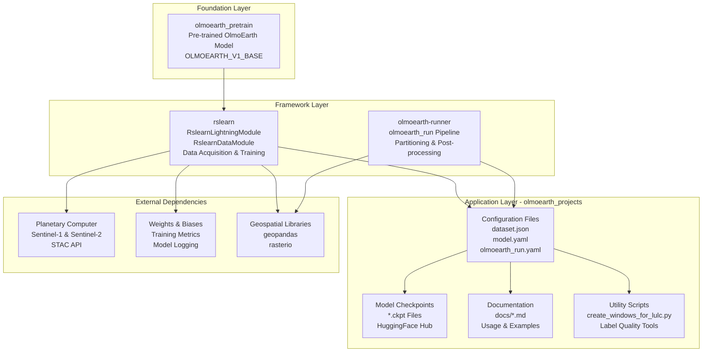
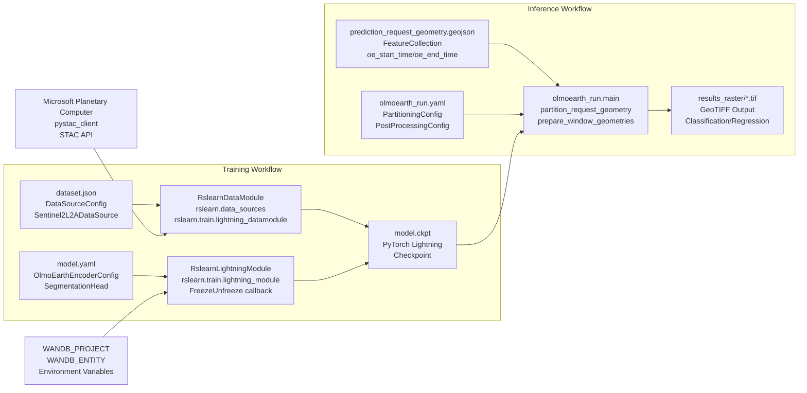
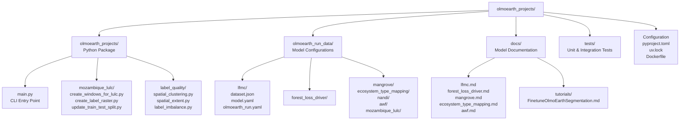
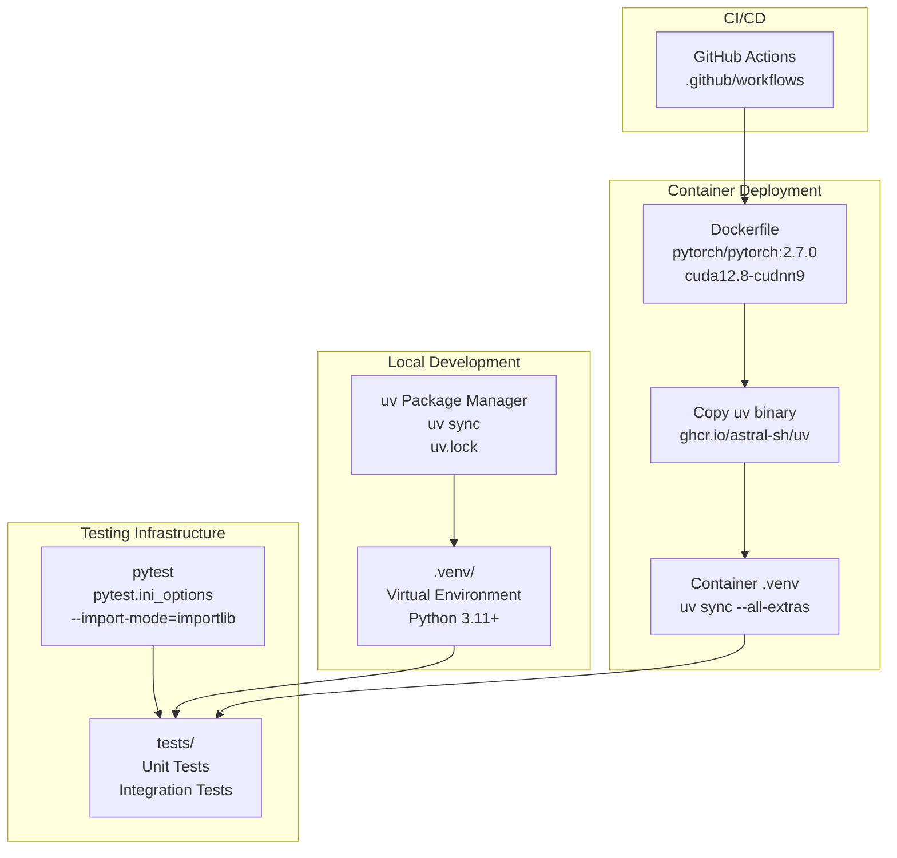
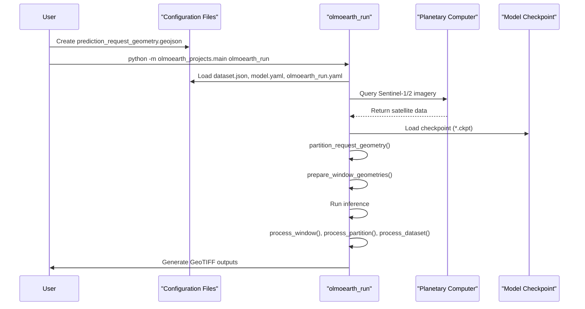
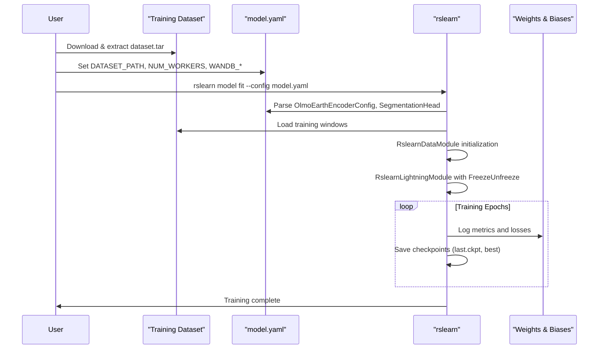

<!-- source: DeepWiki mcp.deepwiki.com · repo allenai/olmoearth_projects · page 1 Overview · fetched 2026-10-26 -->

# Overview

Relevant source files

The following files were used as context for generating this wiki page:

- [Dockerfile](Dockerfile)
- [LICENSE](LICENSE)
- [README.md](README.md)
- [pyproject.toml](pyproject.toml)
- [uv.lock](uv.lock)

## Purpose and Scope

The `olmoearth_projects` repository contains configuration files, trained model checkpoints, and supporting code for fine-tuned remote sensing models built on the OlmoEarth foundation model. This repository serves as the deployment and application layer for OlmoEarth-based models, providing everything needed to apply pre-trained models to new geographic regions or to reproduce the fine-tuning process for existing models.

This wiki documents the technical infrastructure for applying and fine-tuning OlmoEarth models. For information about the OlmoEarth foundation model architecture and pre-training process, see the [olmoearth_pretrain repository](https://github.com/allenai/olmoearth_pretrain/). For details on the underlying data processing and training framework, see the [rslearn repository](https://github.com/allenai/rslearn/).

**Sources:** [README.md:1-35](), [pyproject.toml:1-11]()

## System Architecture

The `olmoearth_projects` system is built on three primary components that work together to enable model deployment and fine-tuning:

**Sources:** [README.md:25-34](), [pyproject.toml:12-21]()

## Available Fine-tuned Models

This repository provides seven fine-tuned OlmoEarth models for different remote sensing applications:

| Model | Task | Classes/Output | Accuracy | Configuration Path |
|-------|------|----------------|----------|-------------------|
| LFMC | Regression | Live Fuel Moisture Content (%) | Per-pixel MSE | `olmoearth_run_data/lfmc/` |
| Forest Loss Driver | Classification | 10 deforestation causes | 76.1% | `olmoearth_run_data/forest_loss_driver/` |
| Mangrove Extent | Segmentation | 3 classes (mangrove/water/other) | 97.6% | `olmoearth_run_data/mangrove/` |
| Ecosystem Type Mapping | Segmentation | 60 ecosystem types | 64.8% | `olmoearth_run_data/ecosystem_type_mapping/` |
| Nandi Crop Classification | Segmentation | 10 crop/land types | 87.3% | `olmoearth_run_data/nandi/` |
| AWF Land Cover | Segmentation | 9 land cover types | 89.5% | `olmoearth_run_data/awf/` |
| Mozambique LULC | Segmentation | 7 LULC + 7 crop types | Varies by region | `olmoearth_run_data/mozambique_lulc/` |

Each model directory contains three essential configuration files:
- `dataset.json`: Specifies satellite data sources and acquisition parameters
- `model.yaml`: Defines model architecture and training hyperparameters  
- `olmoearth_run.yaml`: Controls inference partitioning and post-processing

**Sources:** [README.md:8-15](), Diagram 3 from high-level architecture

## Component Relationships

The following diagram shows how code entities from different components interact during the model lifecycle:

**Sources:** [README.md:62-104](), [README.md:156-185](), [pyproject.toml:12-21]()

## Repository Structure

**Sources:** [README.md:1-190](), [pyproject.toml:45-46]()

## Key Technologies and Dependencies

The system relies on the following core dependencies, as defined in [pyproject.toml:12-21]():

| Dependency | Version | Purpose |
|------------|---------|---------|
| `rslearn[extra]` | ≥0.0.18 | Framework for satellite data acquisition, model training, and fine-tuning |
| `olmoearth-runner` | ≥0.1.10 | High-level inference pipeline with partitioning and post-processing |
| `olmoearth_pretrain` | Latest | OlmoEarth foundation model architecture and pre-trained weights |
| `geopandas` | ≥1.1.1 | Geospatial data manipulation and coordinate transformations |
| `wandb` | ≥0.21 | Experiment tracking and metric logging |
| `PyYAML` | ≥6 | Configuration file parsing |
| `python-dotenv` | ≥1.0 | Environment variable management |

Python 3.11+ is required as specified in [pyproject.toml:10](). The system uses `uv` for fast, deterministic dependency resolution with locked versions in [uv.lock:1-3]().

**Sources:** [pyproject.toml:10-21](), [README.md:36-47]()

## Development and Deployment Infrastructure

The repository supports both local development and containerized deployment:

The [Dockerfile:1-19]() uses PyTorch 2.7.0 with CUDA 12.8 support and installs dependencies via `uv` for reproducible builds. Testing is configured in [pyproject.toml:60-66]() to use the `importlib` import mode.

**Sources:** [Dockerfile:1-19](), [pyproject.toml:60-66](), [README.md:36-47]()

## Usage Workflows

The repository supports two primary workflows:

### Inference Workflow

**Sources:** [README.md:49-140]()

### Training Workflow

**Sources:** [README.md:142-186]()

## License

The repository is licensed under the [OlmoEarth Artifact License](LICENSE), which permits use, reproduction, modification, and distribution with specific restrictions on military/defense applications and extractive activities. See [LICENSE:1-128]() for complete terms.

**Sources:** [LICENSE:1-128](), [README.md:187-189]()

---

