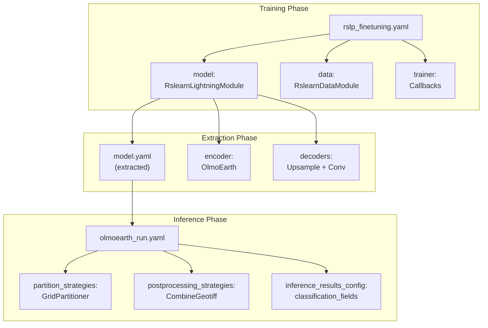
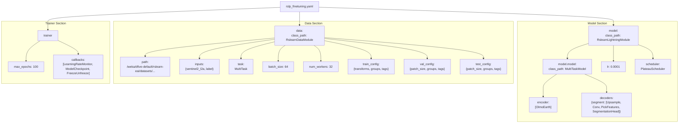
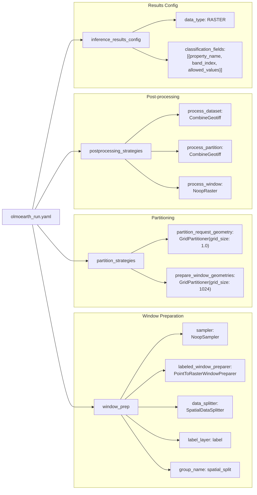
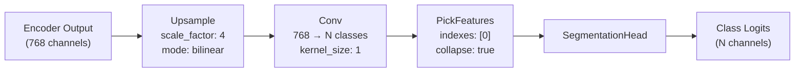

<!-- source: DeepWiki mcp.deepwiki.com · repo allenai/olmoearth_projects · page 10 Reference · fetched 2026-10-26 -->

# Reference

<details>
<summary>Relevant source files</summary>

The following files were used as context for generating this wiki page:

- [olmoearth_run_data/awf/olmoearth_run.yaml](olmoearth_run_data/awf/olmoearth_run.yaml)
- [olmoearth_run_data/mozambique_lulc/rslp_finetuning.yaml](olmoearth_run_data/mozambique_lulc/rslp_finetuning.yaml)
- [olmoearth_run_data/mozambique_lulc/rslp_finetuning_croptype.yaml](olmoearth_run_data/mozambique_lulc/rslp_finetuning_croptype.yaml)
- [olmoearth_run_data/mozambique_lulc/rslp_finetuning_croptype_in_season_novmar.yaml](olmoearth_run_data/mozambique_lulc/rslp_finetuning_croptype_in_season_novmar.yaml)
- [olmoearth_run_data/mozambique_lulc/rslp_finetuning_in_season_novmar.yaml](olmoearth_run_data/mozambique_lulc/rslp_finetuning_in_season_novmar.yaml)
- [olmoearth_run_data/nandi/olmoearth_run.yaml](olmoearth_run_data/nandi/olmoearth_run.yaml)

</details>


## Purpose and Scope

This section provides technical reference documentation for the olmoearth_projects repository. It documents the configuration file schemas, rslearn framework components, and utility scripts used throughout the codebase. This reference is intended for developers and advanced users who need to understand the technical details of system configuration and implementation.

For step-by-step guides on using these configurations, see [Getting Started](#2). For conceptual overviews of the training and inference workflows, see [System Architecture](#3) and [Model Training](#5). For information about specific models and their parameters, see [Available Models](#6).

## Configuration File Overview

The olmoearth_projects system uses three primary YAML configuration file types that work together to define model training and inference pipelines:

| Configuration File | Purpose | Primary Use Case | Key Sections |
|-------------------|---------|------------------|--------------|
| `rslp_finetuning.yaml` | Defines model architecture, training hyperparameters, and data loading configuration | Model training with PyTorch Lightning | `model`, `data`, `trainer` |
| `model.yaml` | Simplified model definition extracted from training config | Inference with trained checkpoints | `encoder`, `decoders`, `tasks` |
| `olmoearth_run.yaml` | Configures inference pipeline including partitioning and post-processing | Large-area inference deployment | `partition_strategies`, `postprocessing_strategies`, `inference_results_config` |

All configuration files use a consistent `class_path` and `init_args` pattern for instantiating Python classes, enabling declarative configuration of complex object hierarchies.

### Configuration File Relationship Diagram



**Sources:** [olmoearth_run_data/mozambique_lulc/rslp_finetuning.yaml:1-268](), [olmoearth_run_data/nandi/olmoearth_run.yaml:1-92]()

## Class Path Pattern

All configuration files use a consistent pattern for specifying Python classes and their initialization arguments:

```yaml
component_name:
  class_path: full.module.path.ClassName
  init_args:
    parameter1: value1
    parameter2: value2
```

This pattern enables:
- **Declarative instantiation**: Classes are created automatically from configuration
- **Type flexibility**: Any Python class can be specified via its import path
- **Composability**: Complex objects can be nested as init_args for other objects
- **Validation**: The rslearn framework validates class paths and arguments at load time

### Key Component Type Diagram

```mermaid
graph TB
    subgraph "Model Components"
        LIGHTNING["RslearnLightningModule<br/>rslearn.train.lightning_module"]
        MULTITASK["MultiTaskModel<br/>rslearn.models.multitask"]
        OLMOEARTH["OlmoEarth<br/>rslearn.models.olmoearth_pretrain.model"]
        UPSAMPLE["Upsample<br/>rslearn.models.upsample"]
        CONV["Conv<br/>rslearn.models.conv"]
        SEGHEAD["SegmentationHead<br/>rslearn.train.tasks.segmentation"]
    end
    
    subgraph "Data Components"
        DATAMODULE["RslearnDataModule<br/>rslearn.train.data_module"]
        MULTITASK_TASK["MultiTask<br/>rslearn.train.tasks.multi_task"]
        SEG_TASK["SegmentationTask<br/>rslearn.train.tasks.segmentation"]
        SEG_METRIC["SegmentationMetric<br/>rslearn.train.tasks.segmentation"]
    end
    
    subgraph "Transform Components"
        NORMALIZE["OlmoEarthNormalize<br/>rslearn.models.olmoearth_pretrain.norm"]
        PAD["Pad<br/>rslearn.train.transforms.pad"]
        CROP["Crop<br/>rslearn.train.transforms.crop"]
        FLIP["Flip<br/>rslearn.train.transforms.flip"]
    end
    
    subgraph "Scheduler Components"
        PLATEAU["PlateauScheduler<br/>rslearn.train.scheduler"]
    end
    
    subgraph "Callback Components"
        CHECKPOINT["ModelCheckpoint<br/>lightning.pytorch.callbacks"]
        LR_MONITOR["LearningRateMonitor<br/>lightning.pytorch.callbacks"]
        FREEZE_UNFREEZE["FreezeUnfreeze<br/>rslearn.train.callbacks.freeze_unfreeze"]
    end
    
    subgraph "Inference Components"
        GRID_PART["GridPartitioner<br/>olmoearth_run.runner.tools.partitioners.grid_partitioner"]
        COMBINE_GEOTIFF["CombineGeotiff<br/>olmoearth_run.runner.tools.postprocessors.combine_geotiff"]
        NOOP_RASTER["NoopRaster<br/>olmoearth_run.runner.tools.postprocessors.noop_raster"]
        SPATIAL_SPLITTER["SpatialDataSplitter<br/>olmoearth_run.runner.tools.data_splitters.spatial_data_splitter"]
    end
    
    LIGHTNING --> MULTITASK
    MULTITASK --> OLMOEARTH
    MULTITASK --> UPSAMPLE
    MULTITASK --> CONV
    MULTITASK --> SEGHEAD
    
    DATAMODULE --> MULTITASK_TASK
    MULTITASK_TASK --> SEG_TASK
    SEG_TASK --> SEG_METRIC
```



**Sources:** [olmoearth_run_data/mozambique_lulc/rslp_finetuning.yaml:1-50](), [olmoearth_run_data/mozambique_lulc/rslp_finetuning.yaml:50-248](), [olmoearth_run_data/nandi/olmoearth_run.yaml:22-52]()

## Training Configuration Structure

The `rslp_finetuning.yaml` file has a three-part structure that mirrors PyTorch Lightning's architecture:

### Training Configuration Hierarchy



**Sources:** [olmoearth_run_data/mozambique_lulc/rslp_finetuning.yaml:1-268]()

## Inference Configuration Structure

The `olmoearth_run.yaml` file configures the inference pipeline with four main sections:

### Inference Configuration Components



**Sources:** [olmoearth_run_data/nandi/olmoearth_run.yaml:1-92](), [olmoearth_run_data/awf/olmoearth_run.yaml:1-89]()

## Common Configuration Patterns

### Module Selectors

Module selectors are list paths used to navigate nested module hierarchies, particularly for callbacks like `FreezeUnfreeze`:

```yaml
callbacks:
  - class_path: rslearn.train.callbacks.freeze_unfreeze.FreezeUnfreeze
    init_args:
      module_selector: ["model", "encoder", 0]  # Navigate to model.encoder[0]
      unfreeze_at_epoch: 20
      unfreeze_lr_factor: 10
```

The selector `["model", "encoder", 0]` resolves to:
1. `RslearnLightningModule.model` (the `MultiTaskModel`)
2. `.encoder` (the list of encoder modules)
3. `[0]` (the first encoder, the `OlmoEarth` module)

**Sources:** [olmoearth_run_data/mozambique_lulc/rslp_finetuning.yaml:261-265]()

### Input Mapping

Input mapping connects data inputs to task targets:

```yaml
task:
  class_path: rslearn.train.tasks.multi_task.MultiTask
  init_args:
    tasks:
      segment:
        class_path: rslearn.train.tasks.segmentation.SegmentationTask
    input_mapping:
      segment:
        label: "targets"  # Maps data input "label" to task target "targets"
```

**Sources:** [olmoearth_run_data/mozambique_lulc/rslp_finetuning.yaml:207-209]()

### Band Name Specification

Band names must be specified consistently across data loading and normalization:

```yaml
inputs:
  sentinel2_l2a:
    bands: ["B02", "B03", "B04", "B08", "B05", "B06", "B07", "B8A", "B11", "B12", "B01", "B09"]

transforms:
  - class_path: rslearn.models.olmoearth_pretrain.norm.OlmoEarthNormalize
    init_args:
      band_names:
        sentinel2_l2a: ["B02", "B03", "B04", "B08", "B05", "B06", "B07", "B8A", "B11", "B12", "B01", "B09"]
```

The band order must match between data loading and normalization to ensure correct preprocessing.

**Sources:** [olmoearth_run_data/mozambique_lulc/rslp_finetuning.yaml:55-59](), [olmoearth_run_data/mozambique_lulc/rslp_finetuning.yaml:214-217]()

### Transform Chains

Transforms are applied sequentially as a pipeline. For training, a common pattern is:

```yaml
train_config:
  transforms:
    - class_path: rslearn.train.transforms.pad.Pad
      init_args:
        size: 31
        mode: "center"
    - class_path: rslearn.train.transforms.crop.Crop
      init_args:
        crop_size: 16
    - class_path: rslearn.train.transforms.flip.Flip
    - class_path: rslearn.models.olmoearth_pretrain.norm.OlmoEarthNormalize
```

This creates 16×16 patches with data augmentation (random crops and flips) and normalization.

**Sources:** [olmoearth_run_data/mozambique_lulc/rslp_finetuning.yaml:218-235]()

### Classification Field Definitions

Classification results are defined with value-to-label mappings and colors:

```yaml
inference_results_config:
  data_type: RASTER
  classification_fields:
    - property_name: segment
      band_index: 1
      allowed_values:
        - value: 0
          label: coffee
          color: [124, 67, 18]
        - value: 1
          label: grassland
          color: [169, 214, 146]
```

Each allowed value maps an integer class index to a human-readable label and RGB color for visualization.

**Sources:** [olmoearth_run_data/nandi/olmoearth_run.yaml:54-89]()

## Decoder Architecture Pattern

Most segmentation models use a standard decoder architecture:



This pattern:
1. **Upsamples** from encoder resolution (patch_size=4) to original resolution
2. **Reduces channels** from 768 to number of classes with 1×1 convolution
3. **Picks first timestep** if multiple timesteps are present
4. **Wraps in SegmentationHead** for proper loss computation

**Sources:** [olmoearth_run_data/mozambique_lulc/rslp_finetuning.yaml:17-38]()

## Metric Configuration Pattern

Per-class metrics are configured using `SegmentationMetric` wrappers around torchmetrics:

```yaml
other_metrics:
  water_precision:
    class_path: rslearn.train.tasks.segmentation.SegmentationMetric
    init_args:
      metric:
        class_path: torchmetrics.classification.MulticlassPrecision
        init_args:
          num_classes: 8
          average: null
      class_idx: 1
  water_recall:
    class_path: rslearn.train.tasks.segmentation.SegmentationMetric
    init_args:
      metric:
        class_path: torchmetrics.classification.MulticlassRecall
        init_args:
          num_classes: 8
          average: null
      class_idx: 1
```

The `class_idx` parameter extracts metrics for a specific class from the multi-class metric output.

**Sources:** [olmoearth_run_data/mozambique_lulc/rslp_finetuning.yaml:81-98]()

## Checkpoint Path Configuration

Model checkpoints are loaded via the `checkpoint_path` parameter:

```yaml
encoder:
  - class_path: rslearn.models.olmoearth_pretrain.model.OlmoEarth
    init_args:
      checkpoint_path: /weka/dfive-default/helios/checkpoints/joer/phase2.0_base_lr0.0001_wd0.02/step667200
      selector:
        - encoder
      patch_size: 4
      random_initialization: false
      autocast_dtype: bfloat16
```

Key parameters:
- `checkpoint_path`: Full path to checkpoint directory
- `selector`: List path to extract specific module (e.g., `["encoder"]` extracts just the encoder weights)
- `random_initialization`: If `true`, ignores checkpoint and initializes randomly
- `autocast_dtype`: Dtype for automatic mixed precision (typically `bfloat16` for better numerical stability)

**Sources:** [olmoearth_run_data/mozambique_lulc/rslp_finetuning.yaml:8-16]()

## Temporal Layer Configuration

Multi-temporal models specify multiple layers:

```yaml
inputs:
  sentinel2_l2a:
    data_type: "raster"
    layers: ["sentinel2", "sentinel2.1", "sentinel2.2", "sentinel2.3", "sentinel2.4"]
    bands: ["B02", "B03", "B04", "B08", "B05", "B06", "B07", "B8A", "B11", "B12", "B01", "B09"]
    load_all_layers: true
```

This loads 5 timesteps of Sentinel-2 imagery (60 total channels: 5 timesteps × 12 bands). The layers must correspond to time periods defined in the dataset's `dataset.json`.

**Sources:** [olmoearth_run_data/mozambique_lulc/rslp_finetuning_in_season_novmar.yaml:54-61]()

## Data Splitting Configuration

Spatial data splitting prevents spatial autocorrelation in train/val/test splits:

```yaml
data_splitter:
  class_path: olmoearth_run.runner.tools.data_splitters.spatial_data_splitter.SpatialDataSplitter
  init_args:
    train_prop: 0.75
    val_prop: 0.25
    test_prop: 0.0
    grid_size: 128  # in pixels
```

The `grid_size` parameter determines the spatial resolution of splitting. Larger grid sizes create coarser spatial separation between splits.

**Sources:** [olmoearth_run_data/nandi/olmoearth_run.yaml:11-17]()

## Further Reference Documentation

For detailed documentation of specific components:

- **Configuration schemas**: See [Configuration Schema Reference](#10.1) for complete field definitions and validation rules
- **rslearn components**: See [rslearn Components](#10.2) for class signatures and behavior
- **Utility scripts**: See [Utility Scripts Reference](#10.3) for command-line tools and their options

---

