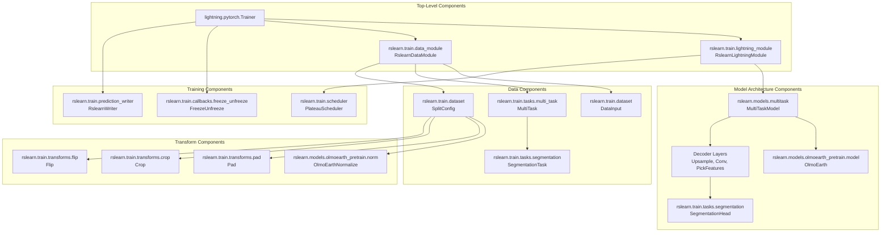
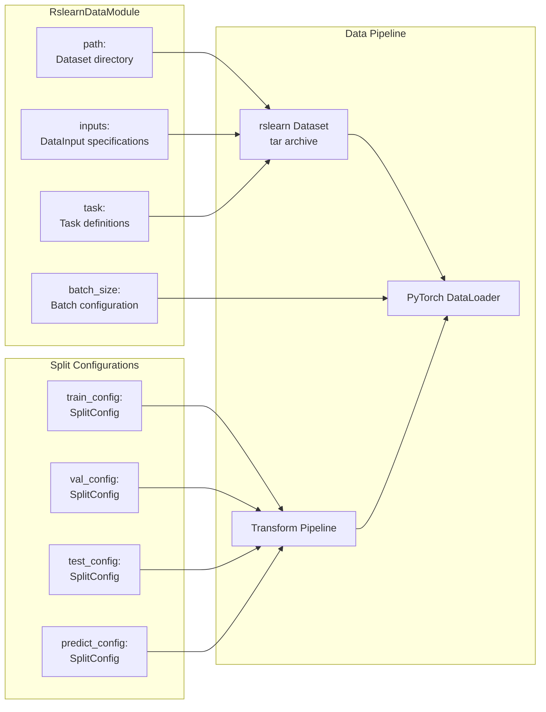
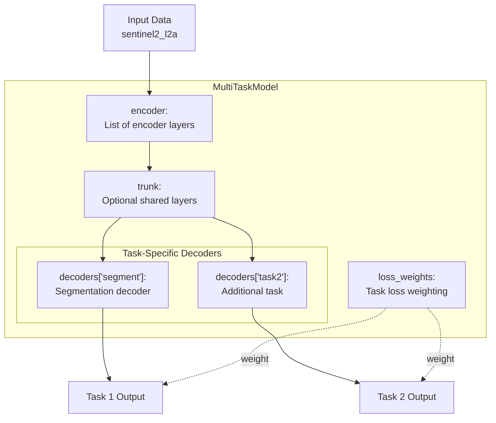
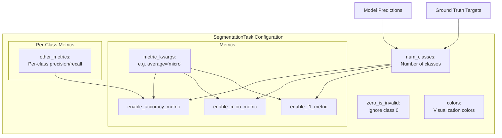
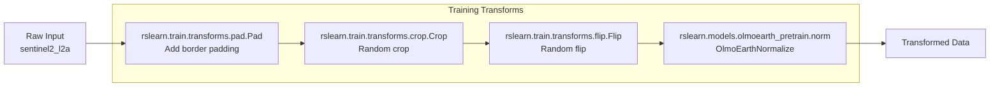

<!-- source: DeepWiki mcp.deepwiki.com · repo allenai/olmoearth_projects · page 10.2 rslearn Components · fetched 2026-10-26 -->

# rslearn Components

<details>
<summary>Relevant source files</summary>

The following files were used as context for generating this wiki page:

- [olmoearth_run_data/mangrove/dataset.json](olmoearth_run_data/mangrove/dataset.json)
- [olmoearth_run_data/mangrove/model.yaml](olmoearth_run_data/mangrove/model.yaml)
- [olmoearth_run_data/mangrove/olmoearth_run.yaml](olmoearth_run_data/mangrove/olmoearth_run.yaml)
- [olmoearth_run_data/mozambique_lulc/rslp_finetuning.yaml](olmoearth_run_data/mozambique_lulc/rslp_finetuning.yaml)
- [olmoearth_run_data/mozambique_lulc/rslp_finetuning_croptype.yaml](olmoearth_run_data/mozambique_lulc/rslp_finetuning_croptype.yaml)
- [olmoearth_run_data/mozambique_lulc/rslp_finetuning_croptype_in_season_novmar.yaml](olmoearth_run_data/mozambique_lulc/rslp_finetuning_croptype_in_season_novmar.yaml)
- [olmoearth_run_data/mozambique_lulc/rslp_finetuning_in_season_novmar.yaml](olmoearth_run_data/mozambique_lulc/rslp_finetuning_in_season_novmar.yaml)

</details>


This document provides technical reference documentation for the `rslearn` framework components used throughout the olmoearth_projects repository. The rslearn framework is a PyTorch Lightning-based training and inference system that provides standardized interfaces for model definition, data loading, training, and evaluation.

For configuration file schemas using these components, see [Configuration Schema Reference](#10.1). For information about the training process that orchestrates these components, see [Model Training](#5).

## Component Architecture Overview

The rslearn framework follows a modular architecture where components are composed via YAML configuration files using PyTorch Lightning's class path instantiation system.



**Sources:** [olmoearth_run_data/mozambique_lulc/rslp_finetuning.yaml:1-268](), [olmoearth_run_data/mangrove/model.yaml:1-394]()

## RslearnLightningModule

The `rslearn.train.lightning_module.RslearnLightningModule` is the top-level training module that wraps the model architecture and training logic. It extends PyTorch Lightning's `LightningModule` to provide standardized training, validation, and testing loops.

### Configuration Structure

```yaml
model:
  class_path: rslearn.train.lightning_module.RslearnLightningModule
  init_args:
    model: <MultiTaskModel or other model>
    lr: <learning_rate>
    scheduler: <scheduler_config>
    optimizer: <optimizer_config>
```

### Key Parameters

| Parameter | Type | Description |
|-----------|------|-------------|
| `model` | Model | The neural network model (typically `MultiTaskModel`) |
| `lr` | float | Base learning rate (e.g., 0.0001) |
| `scheduler` | dict | Learning rate scheduler configuration |
| `optimizer` | dict | Optimizer configuration (default: AdamW) |
| `plateau` | bool | Whether to use plateau-based scheduling |
| `visualize_dir` | str | Directory for visualization outputs |
| `print_parameters` | bool | Whether to print parameter counts |

**Sources:** [olmoearth_run_data/mozambique_lulc/rslp_finetuning.yaml:1-6](), [olmoearth_run_data/mangrove/model.yaml:3-40]()

## RslearnDataModule

The `rslearn.train.data_module.RslearnDataModule` manages data loading, transformations, and batch generation for training and inference. It provides a unified interface for accessing rslearn datasets.



### Configuration Parameters

| Parameter | Type | Description |
|-----------|------|-------------|
| `path` | str | Path to rslearn dataset directory or tar file |
| `inputs` | dict | Dictionary of `DataInput` specifications for each input source |
| `task` | Task | Task configuration (e.g., `MultiTask`, `SegmentationTask`) |
| `batch_size` | int | Number of samples per batch (e.g., 64, 128) |
| `num_workers` | int | Number of data loading workers |
| `default_config` | SplitConfig | Default configuration for all splits |
| `train_config` | SplitConfig | Training-specific configuration |
| `val_config` | SplitConfig | Validation-specific configuration |
| `test_config` | SplitConfig | Test-specific configuration |
| `predict_config` | SplitConfig | Inference-specific configuration |

**Sources:** [olmoearth_run_data/mozambique_lulc/rslp_finetuning.yaml:50-248](), [olmoearth_run_data/mangrove/model.yaml:41-340]()

### DataInput Specification

The `rslearn.train.dataset.DataInput` class defines how to load individual data sources.

```yaml
sentinel2_l2a:
  data_type: "raster"
  layers: ["sentinel2"]
  bands: ["B02", "B03", "B04", "B08", "B05", "B06", "B07", "B8A", "B11", "B12", "B01", "B09"]
  passthrough: true
  dtype: FLOAT32
  load_all_item_groups: true
  load_all_layers: true
```

| Field | Type | Description |
|-------|------|-------------|
| `data_type` | str | Type of data: "raster" or "vector" |
| `layers` | list[str] | Layer names to load from dataset |
| `bands` | list[str] | Specific bands to extract |
| `passthrough` | bool | Whether to pass through to model unchanged |
| `is_target` | bool | Whether this is a target/label |
| `dtype` | str | Data type: FLOAT32, INT32, etc. |
| `load_all_layers` | bool | Load all temporal layers |
| `load_all_item_groups` | bool | Load all spatial groups |

**Sources:** [olmoearth_run_data/mozambique_lulc/rslp_finetuning.yaml:54-68](), [olmoearth_run_data/mangrove/model.yaml:44-83]()

### SplitConfig

The `rslearn.train.dataset.SplitConfig` class configures data loading for specific splits (train/val/test).

```yaml
train_config:
  groups: ["gaza", "manica", "zambezia"]
  tags:
    split: "train"
  transforms:
    - class_path: rslearn.train.transforms.pad.Pad
      init_args:
        size: 31
        mode: "center"
    - class_path: rslearn.train.transforms.crop.Crop
      init_args:
        crop_size: 16
```

| Field | Type | Description |
|-------|------|-------------|
| `groups` | list[str] | Dataset groups to include (e.g., provinces) |
| `names` | list[str] | Specific sample names to include |
| `tags` | dict | Tag filters (e.g., `split: "train"`) |
| `num_samples` | int | Limit number of samples |
| `transforms` | list | Transformation pipeline |
| `patch_size` | int | Patch size for inference |
| `overlap_ratio` | float | Overlap ratio for sliding window inference |

**Sources:** [olmoearth_run_data/mozambique_lulc/rslp_finetuning.yaml:218-248](), [olmoearth_run_data/mangrove/model.yaml:287-316]()

## Model Components

### MultiTaskModel

The `rslearn.models.multitask.MultiTaskModel` enables training multiple tasks simultaneously with shared encoders and task-specific decoders.



**Configuration:**

```yaml
model:
  class_path: rslearn.models.multitask.MultiTaskModel
  init_args:
    encoder:
      - class_path: rslearn.models.olmoearth_pretrain.model.OlmoEarth
        init_args:
          checkpoint_path: /path/to/checkpoint
          patch_size: 4
    decoders:
      segment:
        - class_path: rslearn.models.upsample.Upsample
        - class_path: rslearn.models.conv.Conv
        - class_path: rslearn.train.tasks.segmentation.SegmentationHead
    lazy_decode: false
    loss_weights: null
```

**Sources:** [olmoearth_run_data/mozambique_lulc/rslp_finetuning.yaml:4-41](), [olmoearth_run_data/mangrove/model.yaml:6-27]()

### OlmoEarth Encoder

The `rslearn.models.olmoearth_pretrain.model.OlmoEarth` is the pre-trained foundation model encoder.

| Parameter | Type | Description |
|-----------|------|-------------|
| `checkpoint_path` | str | Path to pre-trained checkpoint |
| `model_id` | str | Model identifier (e.g., "OLMOEARTH_V1_BASE") |
| `selector` | list[str] | Component to extract (e.g., ["encoder"]) |
| `patch_size` | int | Patch size for vision transformer (2 or 4) |
| `random_initialization` | bool | Use random weights instead of checkpoint |
| `embedding_size` | int | Embedding dimension (null for default) |
| `autocast_dtype` | str | Automatic mixed precision dtype (e.g., "bfloat16") |

**Sources:** [olmoearth_run_data/mozambique_lulc/rslp_finetuning.yaml:8-16](), [olmoearth_run_data/mangrove/model.yaml:10-13]()

### Decoder Layers

#### Upsample

The `rslearn.models.upsample.Upsample` layer increases spatial resolution.

```yaml
- class_path: rslearn.models.upsample.Upsample
  init_args:
    scale_factor: 4
    mode: bilinear
```

#### Conv

The `rslearn.models.conv.Conv` layer applies convolution operations.

```yaml
- class_path: rslearn.models.conv.Conv
  init_args:
    in_channels: 768
    out_channels: 8
    kernel_size: 1
    padding: same
    stride: 1
    activation:
      class_path: torch.nn.Identity
```

#### PickFeatures

The `rslearn.models.pick_features.PickFeatures` selects specific feature dimensions.

```yaml
- class_path: rslearn.models.pick_features.PickFeatures
  init_args:
    indexes: [0]
    collapse: true
```

**Sources:** [olmoearth_run_data/mozambique_lulc/rslp_finetuning.yaml:19-37]()

#### SegmentationPoolingDecoder

The `rslearn.models.pooling_decoder.SegmentationPoolingDecoder` uses pooling operations for segmentation.

```yaml
- class_path: rslearn.models.pooling_decoder.SegmentationPoolingDecoder
  init_args:
    in_channels: 768
    out_channels: 4
    num_conv_layers: 0
    num_fc_layers: 0
    conv_channels: 128
    fc_channels: 512
    image_key: "sentinel2_l2a"
```

**Sources:** [olmoearth_run_data/mangrove/model.yaml:16-24]()

## Task Components

### MultiTask

The `rslearn.train.tasks.multi_task.MultiTask` manages multiple task definitions and loss computation.

```yaml
task:
  class_path: rslearn.train.tasks.multi_task.MultiTask
  init_args:
    tasks:
      segment:
        class_path: rslearn.train.tasks.segmentation.SegmentationTask
    input_mapping:
      segment:
        label: "targets"
```

**Sources:** [olmoearth_run_data/mozambique_lulc/rslp_finetuning.yaml:69-209]()

### SegmentationTask

The `rslearn.train.tasks.segmentation.SegmentationTask` defines semantic segmentation training and evaluation.



**Key Parameters:**

| Parameter | Type | Description |
|-----------|------|-------------|
| `num_classes` | int | Number of classification classes |
| `zero_is_invalid` | bool | Treat class 0 as invalid/ignore |
| `colors` | list[list[int]] | RGB colors for each class |
| `enable_accuracy_metric` | bool | Compute overall accuracy |
| `enable_miou_metric` | bool | Compute mean IoU |
| `enable_f1_metric` | bool | Compute F1 score |
| `metric_kwargs` | dict | Kwargs for metrics (e.g., `average: "micro"`) |
| `other_metrics` | dict | Additional per-class metrics |
| `image_bands` | list[int] | Bands to use for visualization |

**Sources:** [olmoearth_run_data/mozambique_lulc/rslp_finetuning.yaml:73-206](), [olmoearth_run_data/mangrove/model.yaml:88-243]()

### SegmentationHead

The `rslearn.train.tasks.segmentation.SegmentationHead` is the final layer that produces class logits.

```yaml
- class_path: rslearn.train.tasks.segmentation.SegmentationHead
```

This component is typically the last layer in the decoder pipeline and converts feature maps to per-pixel class predictions.

**Sources:** [olmoearth_run_data/mozambique_lulc/rslp_finetuning.yaml:38](), [olmoearth_run_data/mangrove/model.yaml:25]()

### SegmentationMetric

The `rslearn.train.tasks.segmentation.SegmentationMetric` wraps torchmetrics for per-class evaluation.

```yaml
water_precision:
  class_path: rslearn.train.tasks.segmentation.SegmentationMetric
  init_args:
    metric:
      class_path: torchmetrics.classification.MulticlassPrecision
      init_args:
        num_classes: 8
        average: null
    class_idx: 1
```

| Parameter | Type | Description |
|-----------|------|-------------|
| `metric` | torchmetrics.Metric | Underlying torchmetrics metric |
| `class_idx` | int | Class index to evaluate |
| `pass_probabilities` | bool | Pass probabilities instead of predictions |

**Sources:** [olmoearth_run_data/mozambique_lulc/rslp_finetuning.yaml:81-98](), [olmoearth_run_data/mangrove/model.yaml:149-178]()

## Transform Components

Transform components modify input data during training and inference. They are applied in sequence as defined in the `transforms` list.



### Pad

The `rslearn.train.transforms.pad.Pad` adds border padding to images.

```yaml
- class_path: rslearn.train.transforms.pad.Pad
  init_args:
    size: 31
    mode: "center"
    image_selectors: ["sentinel2_l2a", "target/segment/classes", "target/segment/valid"]
```

| Parameter | Type | Description |
|-----------|------|-------------|
| `size` | int | Padding size in pixels |
| `mode` | str | Padding mode: "center", "edge", etc. |
| `image_selectors` | list[str] | Images to apply padding to |
| `box_selectors` | list[str] | Bounding boxes to adjust |

**Sources:** [olmoearth_run_data/mozambique_lulc/rslp_finetuning.yaml:220-224](), [olmoearth_run_data/mangrove/model.yaml:261-269]()

### Crop

The `rslearn.train.transforms.crop.Crop` performs random or center cropping.

```yaml
- class_path: rslearn.train.transforms.crop.Crop
  init_args:
    crop_size: 16
    image_selectors: ["sentinel2_l2a", "target/segment/classes", "target/segment/valid"]
```

| Parameter | Type | Description |
|-----------|------|-------------|
| `crop_size` | int | Size of cropped region |
| `image_selectors` | list[str] | Images to crop |

**Sources:** [olmoearth_run_data/mozambique_lulc/rslp_finetuning.yaml:225-228]()

### Flip

The `rslearn.train.transforms.flip.Flip` performs random horizontal/vertical flipping.

```yaml
- class_path: rslearn.train.transforms.flip.Flip
  init_args:
    image_selectors: ["sentinel2_l2a", "target/segment/classes", "target/segment/valid"]
```

**Sources:** [olmoearth_run_data/mozambique_lulc/rslp_finetuning.yaml:229-231]()

### OlmoEarthNormalize

The `rslearn.models.olmoearth_pretrain.norm.OlmoEarthNormalize` normalizes satellite imagery to match OlmoEarth pre-training statistics.

```yaml
- class_path: rslearn.models.olmoearth_pretrain.norm.OlmoEarthNormalize
  init_args:
    band_names:
      sentinel2_l2a: ["B02", "B03", "B04", "B08", "B05", "B06", "B07", "B8A", "B11", "B12", "B01", "B09"]
    std_multiplier: 2.0
```

| Parameter | Type | Description |
|-----------|------|-------------|
| `band_names` | dict | Mapping of input keys to band name lists |
| `std_multiplier` | float | Standard deviation multiplier (default: 2.0) |

This transform applies per-band normalization using statistics from OlmoEarth pre-training. It is essential for proper model performance.

**Sources:** [olmoearth_run_data/mozambique_lulc/rslp_finetuning.yaml:214-217](), [olmoearth_run_data/mangrove/model.yaml:270-286]()

## Callback Components

Callbacks extend training behavior with additional functionality executed at specific points in the training loop.

### FreezeUnfreeze

The `rslearn.train.callbacks.freeze_unfreeze.FreezeUnfreeze` callback implements progressive unfreezing for transfer learning.

```yaml
- class_path: rslearn.train.callbacks.freeze_unfreeze.FreezeUnfreeze
  init_args:
    module_selector: ["model", "encoder", 0]
    unfreeze_at_epoch: 20
    unfreeze_lr_factor: 10
```

| Parameter | Type | Description |
|-----------|------|-------------|
| `module_selector` | list[str] | Path to module to freeze/unfreeze |
| `unfreeze_at_epoch` | int | Epoch at which to unfreeze |
| `unfreeze_lr_factor` | float | Learning rate multiplier after unfreezing |

**Behavior:**
1. Initially freezes the encoder (typically pre-trained OlmoEarth)
2. Trains only decoder layers and task heads
3. At `unfreeze_at_epoch`, unfreezes encoder
4. Multiplies encoder learning rate by `unfreeze_lr_factor`

**Sources:** [olmoearth_run_data/mozambique_lulc/rslp_finetuning.yaml:261-265](), [olmoearth_run_data/mangrove/model.yaml:379-386]()

### RslearnWriter

The `rslearn.train.prediction_writer.RslearnWriter` saves inference predictions back to the dataset format.

```yaml
- class_path: rslearn.train.prediction_writer.RslearnWriter
  init_args:
    path: ${DATASET_PATH}
    output_layer: ${PREDICTION_OUTPUT_LAYER}
    selector: ["mangrove_classification"]
    merger: null
```

| Parameter | Type | Description |
|-----------|------|-------------|
| `path` | str | Dataset path for output |
| `output_layer` | str | Layer name for predictions |
| `selector` | list[str] | Task outputs to write |
| `merger` | object | Optional merger for combining predictions |

**Sources:** [olmoearth_run_data/mangrove/model.yaml:356-361]()

### Standard Lightning Callbacks

The system also uses standard PyTorch Lightning callbacks:

#### ModelCheckpoint

```yaml
- class_path: lightning.pytorch.callbacks.ModelCheckpoint
  init_args:
    save_top_k: 1
    save_last: true
    monitor: val_segment/accuracy
    mode: max
```

Saves best and last checkpoints based on validation metrics.

#### LearningRateMonitor

```yaml
- class_path: lightning.pytorch.callbacks.LearningRateMonitor
  init_args:
    logging_interval: "epoch"
```

Logs learning rate changes to tracking systems (e.g., Weights & Biases).

**Sources:** [olmoearth_run_data/mozambique_lulc/rslp_finetuning.yaml:250-265](), [olmoearth_run_data/mangrove/model.yaml:362-377]()

## Scheduler Components

### PlateauScheduler

The `rslearn.train.scheduler.PlateauScheduler` reduces learning rate when validation metrics plateau.

```yaml
scheduler:
  class_path: rslearn.train.scheduler.PlateauScheduler
  init_args:
    factor: 0.2
    patience: 2
    min_lr: 0
    cooldown: 10
```

| Parameter | Type | Description |
|-----------|------|-------------|
| `factor` | float | Learning rate reduction factor (new_lr = lr * factor) |
| `patience` | int | Number of epochs with no improvement before reduction |
| `min_lr` | float | Minimum learning rate threshold |
| `cooldown` | int | Number of epochs to wait before resuming monitoring |

**Alternative Configuration:**

The scheduler can also be configured via convenience parameters on `RslearnLightningModule`:

```yaml
model:
  init_args:
    plateau: true
    plateau_factor: 0.2
    plateau_patience: 2
    plateau_min_lr: 0.0
    plateau_cooldown: 10
```

**Sources:** [olmoearth_run_data/mozambique_lulc/rslp_finetuning.yaml:43-49](), [olmoearth_run_data/mangrove/model.yaml:36-40]()

## Data Source Components

### Planetary Computer Sentinel-2

While not directly part of rslearn, datasets often specify data sources using `rslearn.data_sources.planetary_computer.Sentinel2`:

```yaml
sentinel2:
  data_source:
    class_path: "rslearn.data_sources.planetary_computer.Sentinel2"
    duration: "366d"
    time_offset: "-180d"
    init_args:
      cache_dir: "cache/planetary_computer"
      harmonize: true
      sort_by: "eo:cloud_cover"
    query_config:
      max_matches: 12
      min_matches: 12
      period_duration: "30d"
      space_mode: "PER_PERIOD_MOSAIC"
```

| Parameter | Type | Description |
|-----------|------|-------------|
| `duration` | str | Total time window (e.g., "366d") |
| `time_offset` | str | Offset from reference time (e.g., "-180d") |
| `harmonize` | bool | Apply cross-sensor harmonization |
| `sort_by` | str | Sort criterion (e.g., "eo:cloud_cover") |
| `max_matches` | int | Maximum images per period |
| `min_matches` | int | Minimum images required |
| `period_duration` | str | Duration of each time period |
| `space_mode` | str | Spatial aggregation mode (e.g., "PER_PERIOD_MOSAIC") |

**Sources:** [olmoearth_run_data/mangrove/dataset.json:37-52]()

## Component Instantiation Pattern

All rslearn components follow a consistent instantiation pattern using `class_path` and `init_args`:

```yaml
component_name:
  class_path: fully.qualified.ClassName
  init_args:
    parameter1: value1
    parameter2: value2
    nested_component:
      class_path: another.ClassName
      init_args:
        nested_param: value
```

This pattern enables:
1. **Configuration as code** - Complex object hierarchies defined in YAML
2. **Type safety** - PyTorch Lightning validates class paths exist
3. **Composability** - Components nest arbitrarily deep
4. **Extensibility** - New components integrate without code changes

The pattern is used consistently for models, tasks, transforms, callbacks, data sources, and all other configurable components.

**Sources:** All configuration files in [olmoearth_run_data/]()

---

