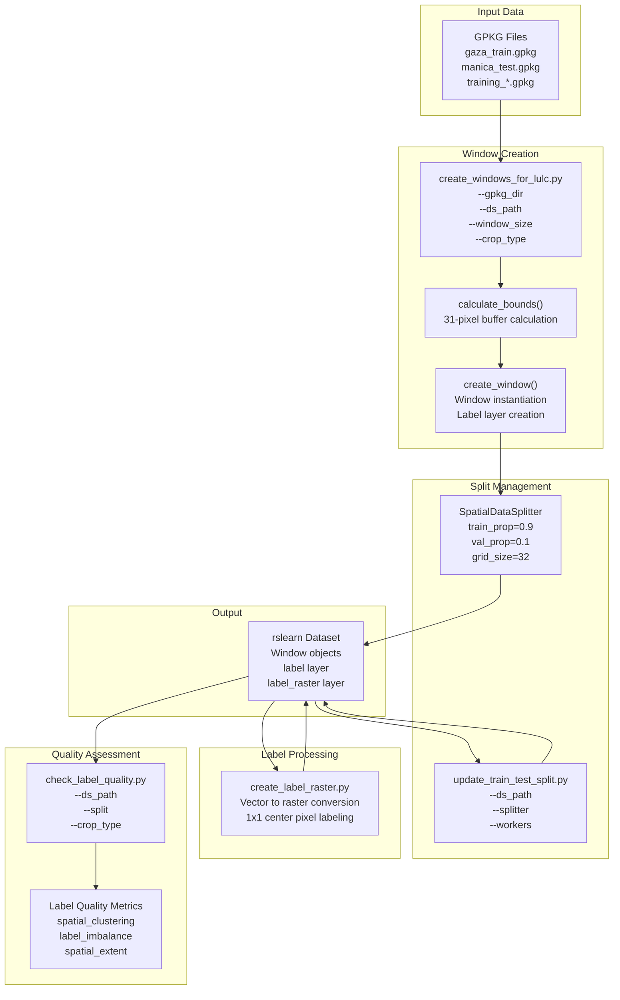
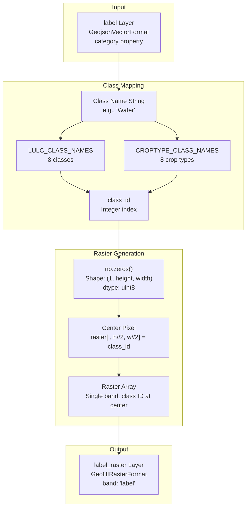
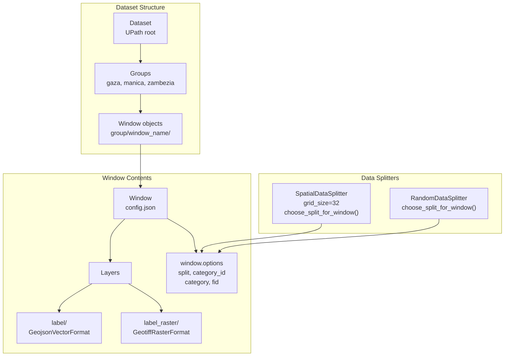

<!-- source: DeepWiki mcp.deepwiki.com · repo allenai/olmoearth_projects · page 10.3 Utility Scripts Reference · fetched 2026-10-26 -->

# Utility Scripts Reference

<details>
<summary>Relevant source files</summary>

The following files were used as context for generating this wiki page:

- [olmoearth_projects/projects/mozambique_lulc/__init__.py](olmoearth_projects/projects/mozambique_lulc/__init__.py)
- [olmoearth_projects/projects/mozambique_lulc/check_label_quality.py](olmoearth_projects/projects/mozambique_lulc/check_label_quality.py)
- [olmoearth_projects/projects/mozambique_lulc/create_label_raster.py](olmoearth_projects/projects/mozambique_lulc/create_label_raster.py)
- [olmoearth_projects/projects/mozambique_lulc/create_windows_for_lulc.py](olmoearth_projects/projects/mozambique_lulc/create_windows_for_lulc.py)
- [olmoearth_projects/projects/mozambique_lulc/update_train_test_split.py](olmoearth_projects/projects/mozambique_lulc/update_train_test_split.py)
- [olmoearth_projects/utils/label_quality/spatial_extent.py](olmoearth_projects/utils/label_quality/spatial_extent.py)
- [olmoearth_run_data/mozambique_lulc/prediction_request_geometry.geojson](olmoearth_run_data/mozambique_lulc/prediction_request_geometry.geojson)

</details>


This page documents the utility scripts used for data preparation, quality assessment, and dataset management in the olmoearth_projects repository. These scripts are primarily used during the data curation phase before model training, handling tasks such as window generation from geospatial data, train/validation split management, and label quality assessment.

For information about training configuration files, see [Training Configuration Files](#5.1). For details about the training process itself, see [Model Training](#5).

## Overview

The repository contains several utility scripts organized by project:

| Script | Purpose | Primary Use Case |
|--------|---------|------------------|
| `create_windows_for_lulc.py` | Generate training windows from GPKG files | Initial dataset creation from field survey data |
| `update_train_test_split.py` | Update train/val/test split assignments | Modifying split strategy after initial window creation |
| `check_label_quality.py` | Assess label quality metrics | Dataset quality validation before training |
| `create_label_raster.py` | Convert vector labels to raster format | Creating raster label layers for training |

**Sources:** [olmoearth_projects/projects/mozambique_lulc/create_windows_for_lulc.py:1-339](), [olmoearth_projects/projects/mozambique_lulc/update_train_test_split.py:1-86](), [olmoearth_projects/projects/mozambique_lulc/check_label_quality.py:1-51](), [olmoearth_projects/projects/mozambique_lulc/create_label_raster.py:1-110]()

## Data Preparation Workflow

The following diagram shows how these utility scripts fit into the data preparation pipeline:

**Diagram: Data Preparation Pipeline with Utility Scripts**



**Sources:** [olmoearth_projects/projects/mozambique_lulc/create_windows_for_lulc.py:1-339](), [olmoearth_projects/projects/mozambique_lulc/update_train_test_split.py:1-86](), [olmoearth_projects/projects/mozambique_lulc/check_label_quality.py:1-51](), [olmoearth_projects/projects/mozambique_lulc/create_label_raster.py:1-110]()

## create_windows_for_lulc.py

This script creates training windows from GPKG (GeoPackage) files containing point or polygon annotations with class labels. It generates `Window` objects in the rslearn dataset format, computing appropriate UTM projections and bounds for each annotation.

**Sources:** [olmoearth_projects/projects/mozambique_lulc/create_windows_for_lulc.py:1-339]()

### Command-Line Interface

```bash
python create_windows_for_lulc.py \
  --gpkg_dir /path/to/gpkg/files \
  --ds_path /path/to/output/dataset \
  --window_size 1 \
  --max_workers 32 \
  [--crop_type]
```

| Argument | Required | Default | Description |
|----------|----------|---------|-------------|
| `--gpkg_dir` | Yes | - | Directory containing `{province}_{split}.gpkg` files |
| `--ds_path` | Yes | - | Output dataset root path (supports local or cloud paths via UPath) |
| `--window_size` | No | 1 | Window size in pixels (each pixel = 10m at output resolution) |
| `--max_workers` | No | 32 | Number of worker processes for parallel window creation |
| `--crop_type` | No | False | Process crop type labels instead of LULC labels |

**Sources:** [olmoearth_projects/projects/mozambique_lulc/create_windows_for_lulc.py:268-298]()

### Input Data Requirements

The script expects GPKG files following specific naming conventions:

**For LULC classification:**
- `gaza_train.gpkg`, `gaza_test.gpkg`
- `manica_train.gpkg`, `manica_test.gpkg`
- `zambezia_train.gpkg`, `zambezia_test.gpkg`

Required columns: `class` (integer), `geometry`

**For crop type classification:**
- `training_gaza_zambezia_manica.gpkg`
- `test_gaza_zambezia_manica.gpkg`

Required columns: `crop1` (string), `geometry`

**Sources:** [olmoearth_projects/projects/mozambique_lulc/create_windows_for_lulc.py:110-145](), [olmoearth_projects/projects/mozambique_lulc/create_windows_for_lulc.py:299-314]()

### Class Mappings

The script uses predefined class mappings:

**LULC Classes:**

```python
CLASS_MAP = {
    0: "Water",
    1: "Bare Ground",
    2: "Rangeland",
    3: "Flooded Vegetation",
    4: "Trees",
    5: "Cropland",
    6: "Buildings",
}
```

**Crop Type Classes:**

```python
CROP_TYPE_MAP = {
    "corn": 0,
    "cassava": 1,
    "rice": 2,
    "sesame": 3,
    "beans": 4,
    "millet": 5,
    "sorghum": 6,
}
```

**Sources:** [olmoearth_projects/projects/mozambique_lulc/create_windows_for_lulc.py:29-50]()

### Temporal Coverage Configuration

Each province or group has defined temporal coverage for satellite data acquisition:

```python
GROUP_TIME = {
    "gaza": (datetime(2024, 10, 23, tzinfo=UTC), datetime(2025, 6, 20, tzinfo=UTC)),
    "manica": (datetime(2024, 10, 23, tzinfo=UTC), datetime(2025, 6, 20, tzinfo=UTC)),
    "zambezia": (datetime(2024, 10, 23, tzinfo=UTC), datetime(2025, 6, 20, tzinfo=UTC)),
    "crop_type": (datetime(2024, 10, 23, tzinfo=UTC), datetime(2025, 6, 20, tzinfo=UTC)),
}
```

These time ranges define the satellite imagery acquisition window stored in each `Window`'s `time_range` property.

**Sources:** [olmoearth_projects/projects/mozambique_lulc/create_windows_for_lulc.py:53-74]()

### Window Creation Process

**Diagram: Window Creation from GPKG Annotation**

```mermaid
graph LR
    subgraph "Input"
        POINT["GPKG Point/Polygon<br/>longitude, latitude<br/>class or crop1"]
    end
    
    subgraph "Coordinate Transformation"
        WGS84["WGS84 Point<br/>shapely.Point"]
        UTM["get_utm_ups_crs()<br/>Appropriate UTM zone"]
        PROJ["Projection<br/>resolution=10m<br/>y_resolution=-10m"]
        DST_GEOM["Projected Geometry<br/>STGeometry"]
    end
    
    subgraph "Bounds Calculation"
        CALC["calculate_bounds()<br/>window_size parameter<br/>centered on point"]
        BOUNDS["Bounds Tuple<br/>(x_min, y_min, x_max, y_max)"]
    end
    
    subgraph "Window Object"
        WINDOW["Window<br/>path, group, name<br/>projection, bounds<br/>time_range, options"]
        LABEL["Label Layer<br/>GeojsonVectorFormat<br/>category_id, category, fid"]
    end
    
    POINT --> WGS84
    WGS84 --> UTM
    UTM --> PROJ
    PROJ --> DST_GEOM
    DST_GEOM --> CALC
    CALC --> BOUNDS
    BOUNDS --> WINDOW
    WINDOW --> LABEL
```



The `calculate_bounds()` function computes window bounds centered on the annotation point:

- Even window sizes: `x_center ± window_size/2`
- Odd window sizes: `x_center ± (window_size/2 + adjustment)` to ensure proper centering

**Sources:** [olmoearth_projects/projects/mozambique_lulc/create_windows_for_lulc.py:77-108](), [olmoearth_projects/projects/mozambique_lulc/create_windows_for_lulc.py:147-216]()

### Window Metadata

Each created window includes metadata in the `options` dictionary:

```python
window.options = {
    "split": "train" or "val" or "test",
    "category_id": 0-6,  # integer class index
    "category": "Water",  # human-readable class name
    "fid": 12345,  # original feature ID from GPKG
    "source": "gpkg",
}
```

The `split` assignment for training data is determined by `SpatialDataSplitter` to ensure spatial separation between train/val splits.

**Sources:** [olmoearth_projects/projects/mozambique_lulc/create_windows_for_lulc.py:182-201]()

### Parallel Processing

The script uses multiprocessing for efficient window creation:

- Single-process mode (`--max_workers 1`): Sequential processing with `tqdm` progress bar
- Multi-process mode: Uses `multiprocessing.Pool` with `star_imap_unordered()` for parallel execution
- Forkserver start method ensures clean process initialization

**Sources:** [olmoearth_projects/projects/mozambique_lulc/create_windows_for_lulc.py:257-266](), [olmoearth_projects/projects/mozambique_lulc/create_windows_for_lulc.py:269]()

## update_train_test_split.py

This script updates the train/validation/test split assignments for existing windows in a dataset. It is used when you want to change the splitting strategy after initial window creation without regenerating the entire dataset.

**Sources:** [olmoearth_projects/projects/mozambique_lulc/update_train_test_split.py:1-86]()

### Command-Line Interface

```bash
python update_train_test_split.py \
  --ds_path /path/to/dataset \
  --workers 1 \
  --splitter spatial \
  [--crop_type]
```

| Argument | Required | Default | Description |
|----------|----------|---------|-------------|
| `--ds_path` | Yes | - | Path to the dataset |
| `--workers` | No | 1 | Number of worker processes |
| `--splitter` | No | spatial | Splitter type: `spatial` or `random` |
| `--crop_type` | No | False | Process crop_type group instead of province groups |

**Sources:** [olmoearth_projects/projects/mozambique_lulc/update_train_test_split.py:31-53]()

### Splitter Options

**SpatialDataSplitter:**

```python
SpatialDataSplitter(
    train_prop=0.9,
    val_prop=0.1,
    test_prop=0.0,
    grid_size=32
)
```

Ensures spatial separation between train/val splits using a 32-pixel grid. Samples in the same grid cell are assigned to the same split to prevent data leakage.

**RandomDataSplitter:**

```python
RandomDataSplitter(
    train_prop=0.9,
    val_prop=0.1,
    test_prop=0.0
)
```

Randomly assigns windows to splits without spatial considerations.

**Sources:** [olmoearth_projects/projects/mozambique_lulc/update_train_test_split.py:55-65]()

### Update Logic

The `update_train_val_split()` function only modifies windows with `split` in `["train", "val"]`:

```python
def update_train_val_split(window: Window, splitter: DataSplitterInterface) -> None:
    if window.options["split"] in ["train", "val"]:
        split = splitter.choose_split_for_window(window)
        print(f"Window was {window.options['split']}, changing to {split}")
        window.options["split"] = split
        window.save()
```

Test split windows are never modified, preserving the original test set.

**Sources:** [olmoearth_projects/projects/mozambique_lulc/update_train_test_split.py:22-28]()

## check_label_quality.py

This script assesses the quality of training labels using multiple metrics defined in the `utils.label_quality` module. It helps identify potential issues with label distribution, spatial coverage, and class imbalance before training.

**Sources:** [olmoearth_projects/projects/mozambique_lulc/check_label_quality.py:1-51]()

### Command-Line Interface

```bash
python check_label_quality.py \
  --ds_path /path/to/dataset \
  --split train \
  [--crop_type]
```

| Argument | Required | Default | Description |
|----------|----------|---------|-------------|
| `--ds_path` | Yes | - | Path to the dataset |
| `--split` | No | train | Split to assess: `train`, `val`, `test`, or `all` |
| `--crop_type` | No | False | Process crop_type group instead of province groups |

**Sources:** [olmoearth_projects/projects/mozambique_lulc/check_label_quality.py:12-28]()

### Data Loading

The script loads windows from the dataset and extracts label and geometry information:

```python
windows = dataset.load_windows(show_progress=True, groups=groups)
labels, geometry = [], []
for window in windows:
    split = window.options["split"]
    if split in splits_to_keep:
        labels.append(window.options["category"])
        geometry.append(window.get_geometry().to_projection(WGS84_PROJECTION).shp)

df = gpd.GeoDataFrame({"label": labels, "geometry": geometry})
```

The resulting `GeoDataFrame` is passed to `check_label_quality()` for analysis.

**Sources:** [olmoearth_projects/projects/mozambique_lulc/check_label_quality.py:35-50]()

### Label Quality Metrics

The `check_label_quality()` function (referenced but not shown in provided files) computes multiple quality metrics. Based on the utility functions provided, the following metric is implemented:

**Spatial Extent Metric:**

The `spatial_extent()` function calculates what fraction of the total labeled area each class occupies:

```python
def spatial_extent(df: gpd.GeoDataFrame) -> dict[str | int, float]:
    """How much of the total label spatial extent does each class occupy?
    
    For each class, values close to 1 are desirable.
    """
    total_area = relative_area(df.total_bounds)
    
    output_dict: dict[str | int, float] = {}
    for class_label in df.label.unique():
        label_area = relative_area(df[df.label == class_label].total_bounds)
        output_dict[class_label] = label_area / total_area
    
    return output_dict
```

The `relative_area()` function computes approximate area using spherical geometry:

```python
def relative_area(bounds: tuple[float, float, float, float]) -> float:
    """A = R^2 * (sin(f2)-sin(f1)) * (l2-l1) / 180"""
    min_lon, min_lat, max_lon, max_lat = bounds
    return (np.sin(np.radians(max_lat)) - np.sin(np.radians(min_lat))) * (
        max_lon - min_lon
    )
```

Values close to 1.0 indicate that a class is well-distributed spatially across the entire labeled region. Lower values suggest the class is concentrated in a small geographic area, which may lead to poor generalization.

**Sources:** [olmoearth_projects/utils/label_quality/spatial_extent.py:1-32]()

## create_label_raster.py

This script converts vector label layers to raster format, creating a `label_raster` layer with the class ID encoded in the center pixel of each window. This is used by training configurations that expect raster labels rather than vector labels.

**Sources:** [olmoearth_projects/projects/mozambique_lulc/create_label_raster.py:1-110]()

### Command-Line Interface

```bash
python create_label_raster.py \
  --ds_path /path/to/dataset \
  --workers 64 \
  [--crop_type]
```

| Argument | Required | Default | Description |
|----------|----------|---------|-------------|
| `--ds_path` | Yes | - | Path to the dataset |
| `--workers` | No | 64 | Number of worker processes |
| `--crop_type` | No | False | Process crop_type group instead of province groups |

**Sources:** [olmoearth_projects/projects/mozambique_lulc/create_label_raster.py:79-95]()

### Raster Creation Process

**Diagram: Vector to Raster Label Conversion**



**Sources:** [olmoearth_projects/projects/mozambique_lulc/create_label_raster.py:54-77]()

### Class Name Arrays

The script defines class name arrays for looking up class IDs:

```python
LULC_CLASS_NAMES = [
    "invalid",
    "Water",
    "Bare Ground",
    "Rangeland",
    "Flooded Vegetation",
    "Trees",
    "Cropland",
    "Buildings",
]

CROPTYPE_CLASS_NAMES = [
    "invalid",
    "corn",
    "cassava",
    "rice",
    "sesame",
    "beans",
    "millet",
    "sorghum",
]
```

The class ID is determined by finding the index of the class name in the appropriate array.

**Sources:** [olmoearth_projects/projects/mozambique_lulc/create_label_raster.py:30-49]()

### Dataset Configuration Update

After running this script, the dataset's `config.json` must be updated to include the new layer:

```json
{
  "label_raster": {
    "band_sets": [
      {
        "bands": ["label"],
        "dtype": "int32"
      }
    ],
    "type": "raster"
  }
}
```

This configuration enables the training system to load the raster labels.

**Sources:** [olmoearth_projects/projects/mozambique_lulc/create_label_raster.py:1-17]()

## Common Usage Patterns

### Complete Dataset Preparation Workflow

The following sequence is typically used to prepare a dataset from scratch:

```bash
# 1. Create windows from GPKG files
python create_windows_for_lulc.py \
  --gpkg_dir /data/raw/gpkg \
  --ds_path /data/datasets/mozambique_lulc \
  --window_size 1 \
  --max_workers 32

# 2. Check initial label quality
python check_label_quality.py \
  --ds_path /data/datasets/mozambique_lulc \
  --split all

# 3. (Optional) Update split strategy if needed
python update_train_test_split.py \
  --ds_path /data/datasets/mozambique_lulc \
  --workers 16 \
  --splitter spatial

# 4. Create raster labels if required by training config
python create_label_raster.py \
  --ds_path /data/datasets/mozambique_lulc \
  --workers 64

# 5. Final quality check on training split
python check_label_quality.py \
  --ds_path /data/datasets/mozambique_lulc \
  --split train
```

**Sources:** [olmoearth_projects/projects/mozambique_lulc/create_windows_for_lulc.py:268-339](), [olmoearth_projects/projects/mozambique_lulc/update_train_test_split.py:31-86](), [olmoearth_projects/projects/mozambique_lulc/check_label_quality.py:12-51](), [olmoearth_projects/projects/mozambique_lulc/create_label_raster.py:79-110]()

### Crop Type vs LULC Processing

The scripts support two distinct use cases controlled by the `--crop_type` flag:

| Aspect | LULC Mode | Crop Type Mode |
|--------|-----------|----------------|
| Groups | `["gaza", "manica", "zambezia"]` | `["crop_type"]` |
| Input Files | `{province}_{train\|test}.gpkg` | `training_*.gpkg`, `test_*.gpkg` |
| Class Column | `class` (integer) | `crop1` (string) |
| Number of Classes | 7 | 7 |
| Spatial Organization | Per-province | Combined provinces |

**Sources:** [olmoearth_projects/projects/mozambique_lulc/create_windows_for_lulc.py:296-314](), [olmoearth_projects/projects/mozambique_lulc/update_train_test_split.py:52-74](), [olmoearth_projects/projects/mozambique_lulc/check_label_quality.py:26-40]()

## Integration with rslearn Dataset Format

All utility scripts interact with rslearn's `Dataset` and `Window` classes:

**Diagram: rslearn Dataset Structure**



**Sources:** [olmoearth_projects/projects/mozambique_lulc/create_windows_for_lulc.py:18-24](), [olmoearth_projects/projects/mozambique_lulc/update_train_test_split.py:6-19](), [olmoearth_projects/projects/mozambique_lulc/create_label_raster.py:24-28]()

## Multiprocessing Considerations

All scripts use Python's multiprocessing for parallel execution:

- **Start method:** `forkserver` is explicitly set for clean process initialization
- **Progress tracking:** `tqdm` progress bars work with both single-process and multi-process modes
- **Worker count:** Configurable via command-line arguments, typically 1-64 workers
- **Job distribution:** Uses `star_imap_unordered()` for efficient parallel mapping

```python
multiprocessing.set_start_method("forkserver", force=True)
p = multiprocessing.Pool(max_workers)
outputs = star_imap_unordered(p, function, jobs)
for _ in tqdm.tqdm(outputs, total=len(jobs)):
    pass
p.close()
```

**Sources:** [olmoearth_projects/projects/mozambique_lulc/create_windows_for_lulc.py:269](), [olmoearth_projects/projects/mozambique_lulc/update_train_test_split.py:32](), [olmoearth_projects/projects/mozambique_lulc/create_label_raster.py:80]()