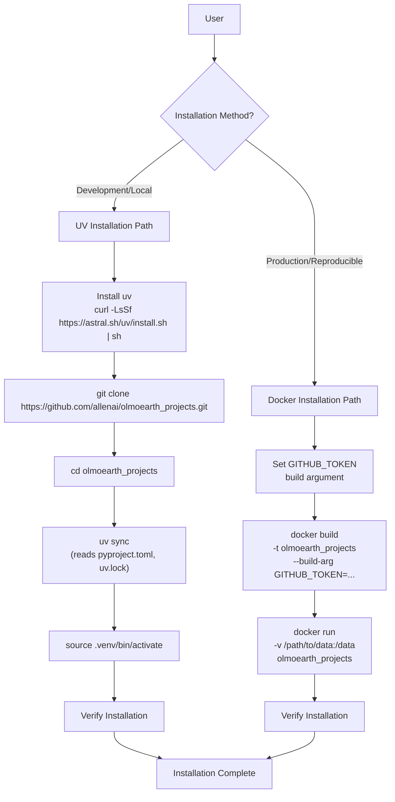
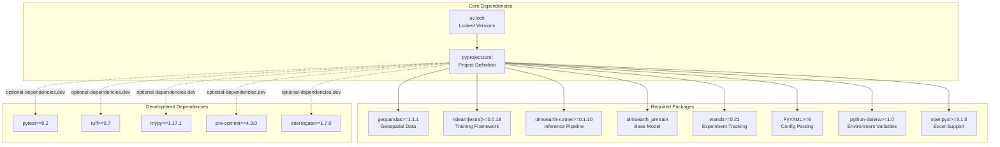
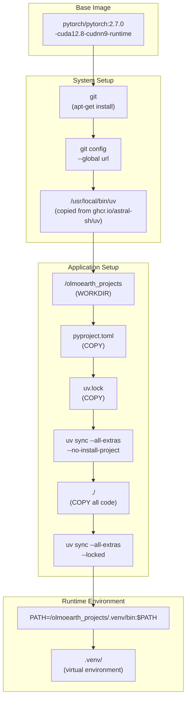
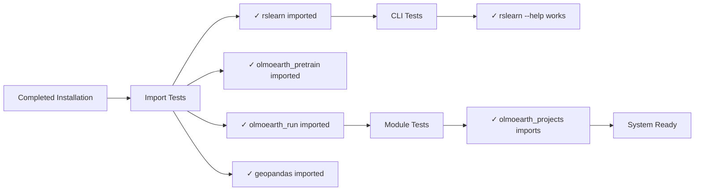
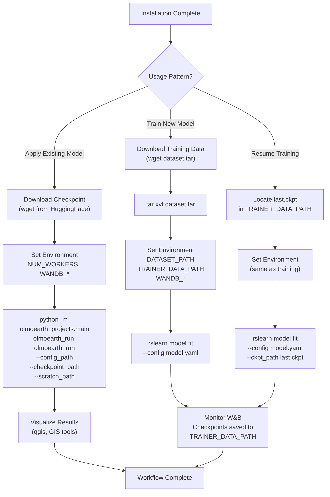

<!-- source: DeepWiki mcp.deepwiki.com · repo allenai/olmoearth_projects · page 2 Getting Started · fetched 2026-10-26 -->

# Getting Started

<details>
<summary>Relevant source files</summary>

The following files were used as context for generating this wiki page:

- [Dockerfile](Dockerfile)
- [LICENSE](LICENSE)
- [README.md](README.md)
- [pyproject.toml](pyproject.toml)
- [uv.lock](uv.lock)

</details>


This page guides you through installing the olmoearth_projects repository, setting up your development environment, and preparing your system for basic usage. This covers dependency management with `uv`, Docker containerization, and environment configuration needed to apply existing models or develop new ones.

For information about the overall system architecture, see [System Architecture](#3). For details on running inference with trained models, see [Inference and Deployment](#7). For model training procedures, see [Model Training](#5).

---

## Prerequisites

Before installing olmoearth_projects, ensure your system meets the following requirements:

| Requirement | Specification | Purpose |
|------------|---------------|----------|
| Python Version | ≥ 3.11 | Required by project dependencies |
| Operating System | Linux, macOS, or Windows | Cross-platform support |
| Disk Space | ≥ 10 GB | For dependencies and model checkpoints |
| GPU (Optional) | CUDA-compatible | For model training and inference |
| Git | Any recent version | For cloning the repository |

**Sources:** [pyproject.toml:10](), [Dockerfile:1]()

---

## Installation Methods

The repository supports two primary installation methods: local installation using `uv` (recommended for development) and Docker containerization (recommended for reproducible environments).

### Installation Flow



**Sources:** [README.md:36-47](), [Dockerfile:1-19]()

---

## Local Installation with uv

The `uv` package manager provides fast, reliable dependency resolution with lock file support.

### Step 1: Install uv

```bash
# Linux/macOS
curl -LsSf https://astral.sh/uv/install.sh | sh

# Windows
powershell -c "irm https://astral.sh/uv/install.ps1 | iex"
```

### Step 2: Clone and Set Up the Repository

```bash
git clone https://github.com/allenai/olmoearth_projects.git
cd olmoearth_projects
uv sync
source .venv/bin/activate  # Linux/macOS
# or
.venv\Scripts\activate  # Windows
```

The `uv sync` command reads [pyproject.toml:1-67]() and [uv.lock:1-21]() to install all dependencies into a virtual environment at `.venv/`.

### Dependency Structure



**Sources:** [pyproject.toml:12-21](), [pyproject.toml:24-34](), [README.md:38-47]()

---

## Docker Installation

Docker provides a containerized environment with all dependencies pre-configured, including PyTorch with CUDA support.

### Step 1: Build the Docker Image

```bash
docker build -t olmoearth_projects \
  --build-arg GITHUB_TOKEN=your_token_here \
  .
```

The `GITHUB_TOKEN` build argument is required for accessing private Git repositories during the build process (see [Dockerfile:5-6]()).

### Step 2: Run the Container

```bash
docker run -it \
  -v $PWD/project_data:/project_data \
  -v $PWD/checkpoints:/checkpoints \
  olmoearth_projects \
  bash
```

### Docker Environment Structure



**Sources:** [Dockerfile:1-19]()

---

## Environment Configuration

After installation, configure environment variables required by the system. These variables control training behavior, inference settings, and integration with external services.

### Required Environment Variables

Create a `.env` file in the repository root or export variables in your shell:

```bash
# Data and Output Paths
export DATASET_PATH=/path/to/your/dataset/
export TRAINER_DATA_PATH=./trainer_data
export PREDICTION_OUTPUT_LAYER=output

# Processing Configuration
export NUM_WORKERS=32

# Weights & Biases Integration
export WANDB_PROJECT=olmoearth_projects
export WANDB_NAME=my_experiment_name
export WANDB_ENTITY=your_wandb_username

# Optional: Microsoft Planetary Computer
export PC_SDK_SUBSCRIPTION_KEY=your_key_here
```

### Environment Variable Reference

| Variable | Purpose | Default/Example | Required By |
|----------|---------|-----------------|-------------|
| `DATASET_PATH` | Path to rslearn dataset directory | `/path/to/dataset/` | Training, Inference |
| `TRAINER_DATA_PATH` | Output directory for checkpoints | `./trainer_data` | Training |
| `NUM_WORKERS` | Number of data loading workers | `32` | Training, Inference |
| `WANDB_PROJECT` | W&B project name | `olmoearth_projects` | Training (if using W&B) |
| `WANDB_NAME` | W&B run name | `my_run` | Training (if using W&B) |
| `WANDB_ENTITY` | W&B username or team | - | Training (if using W&B) |
| `PREDICTION_OUTPUT_LAYER` | Output layer name for inference | `output` | Inference |
| `PC_SDK_SUBSCRIPTION_KEY` | Planetary Computer API key | - | Data Download (optional) |

**Sources:** [README.md:118-123](), [README.md:156-166]()

---

## Verifying Installation

After completing installation, verify that all components are correctly configured.

### Verification Commands

```bash
# Check Python version
python --version  # Should be >= 3.11

# Verify core packages
python -c "import rslearn; print(rslearn.__version__)"
python -c "import olmoearth_pretrain; print('OlmoEarth pretrain loaded')"
python -c "import olmoearth_run; print('olmoearth_run loaded')"
python -c "import geopandas; print('geopandas loaded')"

# Verify rslearn CLI
rslearn --help

# Verify olmoearth_projects module
python -c "import olmoearth_projects; print('Module loaded successfully')"
```

### Expected Output Structure



**Sources:** [pyproject.toml:12-21]()

---

## Directory Structure

After installation, your working directory should have the following structure:

```
olmoearth_projects/
├── .venv/                          # Virtual environment (uv installation)
├── olmoearth_projects/             # Python package source code
├── olmoearth_run_data/             # Model configurations
│   ├── lfmc/
│   │   ├── dataset.json
│   │   ├── model.yaml
│   │   └── olmoearth_run.yaml
│   ├── forest_loss_driver/
│   ├── mangrove/
│   └── ...
├── tests/                          # Test suite
├── pyproject.toml                  # Project definition
├── uv.lock                         # Locked dependencies
├── Dockerfile                      # Container definition
├── README.md                       # Main documentation
└── LICENSE                         # OlmoEarth Artifact License
```

### User-Created Directories

During usage, you will create additional directories:

```
olmoearth_projects/
├── checkpoints/                    # Downloaded model checkpoints
│   └── lfmc.ckpt
├── project_data/                   # Inference scratch space
│   └── lfmc/
│       ├── dataset/                # rslearn dataset
│       ├── windows/                # Partitioned windows
│       └── results/                # Output GeoTIFFs
└── trainer_data/                   # Training outputs
    ├── last.ckpt                   # Latest checkpoint
    └── epoch=X.ckpt                # Best checkpoint
```

**Sources:** [README.md:62-73](), [README.md:129](), [README.md:176-177]()

---

## Basic Usage Patterns

Once installed and configured, the repository supports three primary usage patterns:

### Pattern 1: Applying Existing Models (Inference)

```bash
# Download a model checkpoint
mkdir ./checkpoints
wget https://huggingface.co/allenai/OlmoEarth-v1-FT-LFMC-Base/resolve/main/model.ckpt \
  -O checkpoints/lfmc.ckpt

# Set environment variables
export NUM_WORKERS=32
export WANDB_PROJECT=lfmc_inference

# Run inference
mkdir ./project_data
python -m olmoearth_projects.main olmoearth_run olmoearth_run \
  --config_path $PWD/olmoearth_run_data/lfmc/ \
  --checkpoint_path $PWD/checkpoints/lfmc.ckpt \
  --scratch_path project_data/lfmc/
```

### Pattern 2: Fine-tuning Models

```bash
# Download training dataset
wget https://huggingface.co/datasets/allenai/olmoearth_projects_lfmc/blob/main/dataset.tar
tar xvf dataset.tar

# Set environment variables
export DATASET_PATH=/path/to/extracted/dataset/
export TRAINER_DATA_PATH=./trainer_data
export WANDB_PROJECT=olmoearth_projects
export WANDB_NAME=my_training_run

# Start training
rslearn model fit --config olmoearth_run_data/lfmc/model.yaml
```

### Pattern 3: Resuming Training

```bash
# Resume from last checkpoint
rslearn model fit \
  --config olmoearth_run_data/lfmc/model.yaml \
  --ckpt_path $TRAINER_DATA_PATH/last.ckpt
```

### Usage Flow



**Sources:** [README.md:49-140](), [README.md:143-185]()

---

## Next Steps

After completing installation and verification:

1. **Review Model Documentation:** Explore available models and their specific requirements in [Available Models](#6)
2. **Understand the Architecture:** Learn how components interact in [System Architecture](#3)
3. **Run Inference:** Follow detailed inference procedures in [Inference and Deployment](#7)
4. **Train Models:** Review training workflows in [Model Training](#5)
5. **Process Data:** Understand data preparation in [Data Processing Pipeline](#4)

**Sources:** [README.md:1-190]()

---

