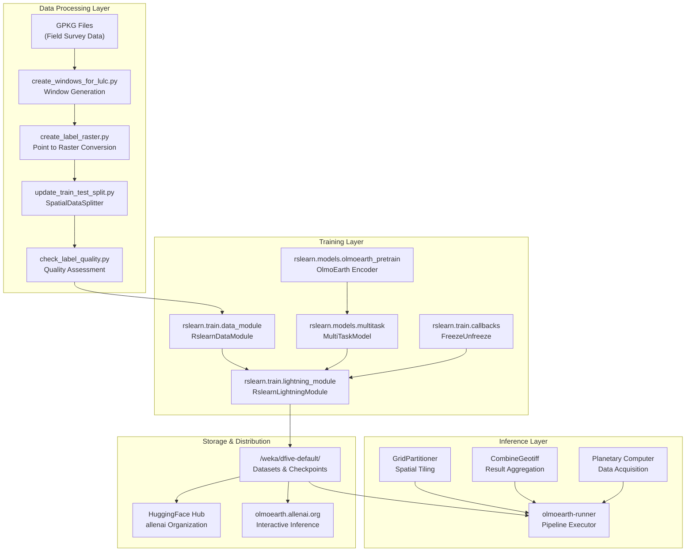
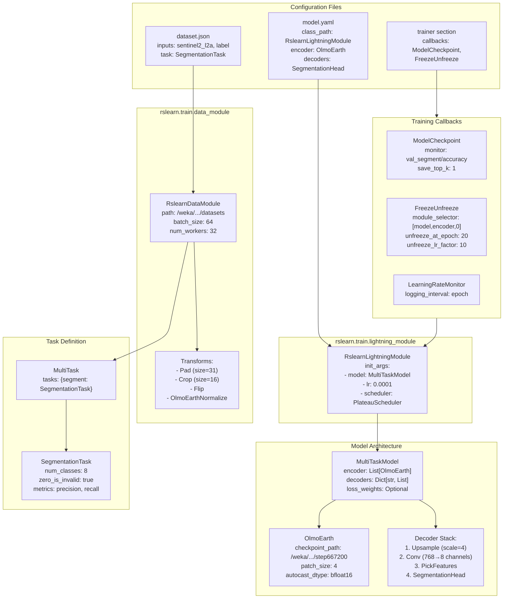
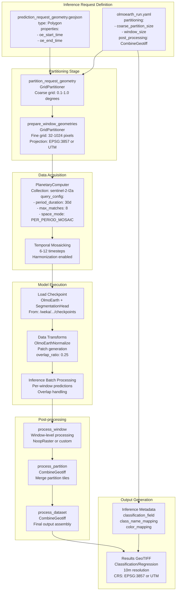
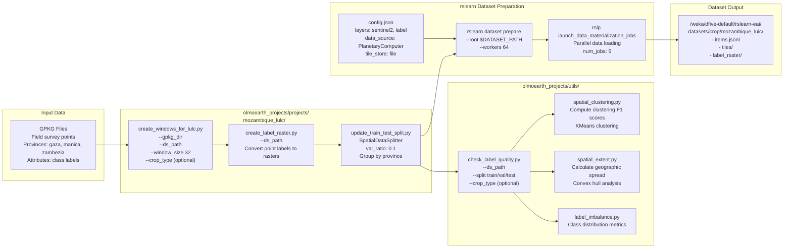
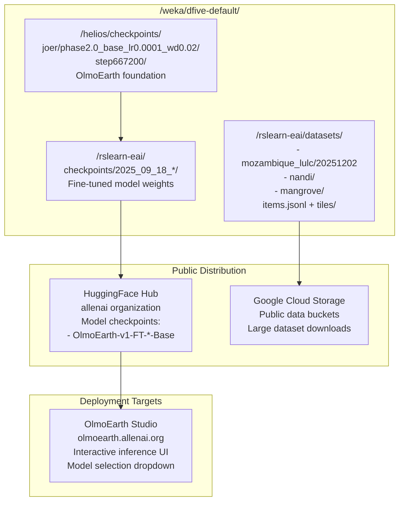
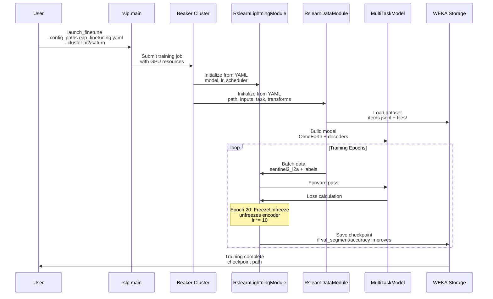
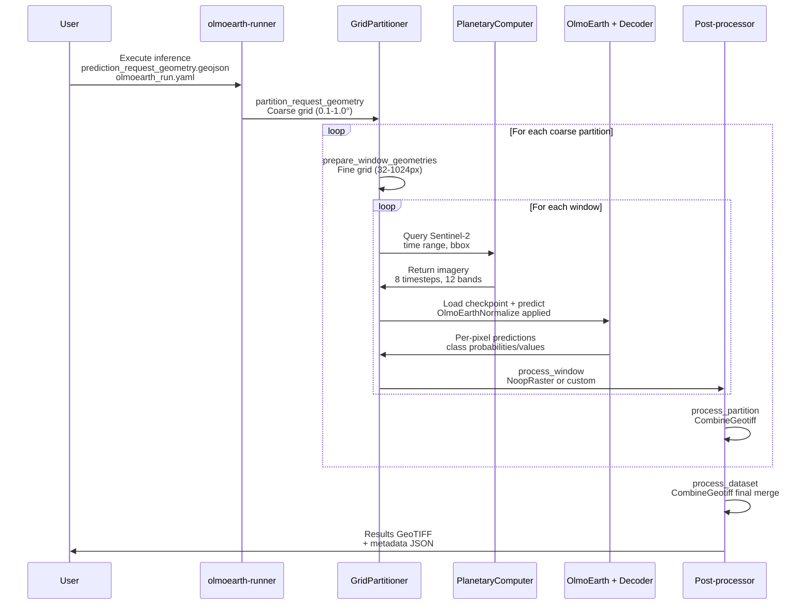

<!-- source: DeepWiki mcp.deepwiki.com · repo allenai/olmoearth_projects · page 3 System Architecture · fetched 2026-10-26 -->

# System Architecture

<details>
<summary>Relevant source files</summary>

The following files were used as context for generating this wiki page:

- [Dockerfile](Dockerfile)
- [olmoearth_run_data/mozambique_lulc/README.md](olmoearth_run_data/mozambique_lulc/README.md)
- [olmoearth_run_data/mozambique_lulc/config.json](olmoearth_run_data/mozambique_lulc/config.json)
- [olmoearth_run_data/mozambique_lulc/rslp_finetuning.yaml](olmoearth_run_data/mozambique_lulc/rslp_finetuning.yaml)
- [olmoearth_run_data/mozambique_lulc/rslp_finetuning_croptype.yaml](olmoearth_run_data/mozambique_lulc/rslp_finetuning_croptype.yaml)
- [olmoearth_run_data/mozambique_lulc/rslp_finetuning_croptype_in_season_novmar.yaml](olmoearth_run_data/mozambique_lulc/rslp_finetuning_croptype_in_season_novmar.yaml)
- [olmoearth_run_data/mozambique_lulc/rslp_finetuning_in_season_novmar.yaml](olmoearth_run_data/mozambique_lulc/rslp_finetuning_in_season_novmar.yaml)
- [pyproject.toml](pyproject.toml)
- [uv.lock](uv.lock)

</details>


## Purpose and Scope

This document describes the high-level architecture of the olmoearth_projects system, explaining how the major components interact to enable fine-tuning OlmoEarth foundation models for remote sensing applications and deploying them for inference. The architecture encompasses data processing, model training, inference execution, and storage management.

For detailed information about specific subsystems, see:
- Data processing workflow: [Data Processing Pipeline](#4)
- Model training procedures: [Model Training](#5)
- Inference execution: [Inference and Deployment](#7)
- Development practices: [Development Guide](#9)

## System Overview

The olmoearth_projects system is organized into four primary architectural layers that work together to support the complete lifecycle of remote sensing model development and deployment:



**Sources:** [pyproject.toml](), [olmoearth_run_data/mozambique_lulc/rslp_finetuning.yaml](), Diagram 1 and 2 from high-level architecture

## Core Components

### Training System Architecture

The training system is built on the rslearn framework and uses PyTorch Lightning for distributed training. The architecture follows a modular design with clear separation between data loading, model definition, and training orchestration.



**Sources:** [olmoearth_run_data/mozambique_lulc/rslp_finetuning.yaml:1-268](), Diagram 2 from high-level architecture

#### Model Configuration Structure

The training configuration follows a hierarchical YAML structure defined in files like `rslp_finetuning.yaml`. Key configuration sections:

| Section | Purpose | Key Parameters |
|---------|---------|----------------|
| `model.init_args.model.encoder` | Defines the OlmoEarth pre-trained encoder | `checkpoint_path`, `patch_size: 4`, `autocast_dtype: bfloat16` |
| `model.init_args.model.decoders` | Task-specific decoder heads | `Upsample`, `Conv`, `SegmentationHead` |
| `model.init_args.lr` | Learning rate configuration | Base: `0.0001`, Unfrozen: `0.001` (10x) |
| `model.init_args.scheduler` | Learning rate scheduling | `PlateauScheduler` with `factor: 0.2`, `patience: 2` |
| `data.init_args.inputs` | Input data specifications | `sentinel2_l2a` (12 bands), `label` (targets) |
| `data.init_args.task` | Task definition | `SegmentationTask` with `num_classes: 8` |
| `trainer.callbacks` | Training callbacks | `FreezeUnfreeze`, `ModelCheckpoint`, `LearningRateMonitor` |

**Sources:** [olmoearth_run_data/mozambique_lulc/rslp_finetuning.yaml:1-268]()

### Inference System Architecture

The inference system uses the `olmoearth-runner` package to execute predictions over large geographic areas. It implements a hierarchical partitioning strategy to process data efficiently.



**Sources:** [olmoearth_run_data/mozambique_lulc/config.json](), Diagram 4 from high-level architecture

### Data Processing Pipeline Components

The data processing system transforms raw field survey data (GPKG files) into training-ready datasets through a series of Python scripts.



**Sources:** [olmoearth_run_data/mozambique_lulc/README.md:14-37](), [olmoearth_run_data/mozambique_lulc/config.json]()

## Configuration System

The system uses three primary configuration formats to define different aspects of the pipeline:

### YAML Configuration Hierarchy

Training configuration in `rslp_finetuning.yaml` follows this structure:

```yaml
model:
  class_path: rslearn.train.lightning_module.RslearnLightningModule
  init_args:
    model:
      class_path: rslearn.models.multitask.MultiTaskModel
      init_args:
        encoder: [OlmoEarth configuration]
        decoders: {segment: [Upsample, Conv, SegmentationHead]}
    lr: 0.0001
    scheduler: {PlateauScheduler configuration}

data:
  class_path: rslearn.train.data_module.RslearnDataModule
  init_args:
    path: /weka/dfive-default/rslearn-eai/datasets/...
    inputs: {sentinel2_l2a, label specifications}
    task: {MultiTask with SegmentationTask}
    batch_size: 64
    transforms: [Pad, Crop, Flip, OlmoEarthNormalize]

trainer:
  max_epochs: 100
  callbacks: [LearningRateMonitor, ModelCheckpoint, FreezeUnfreeze]
```

**Sources:** [olmoearth_run_data/mozambique_lulc/rslp_finetuning.yaml:1-268]()

### JSON Dataset Configuration

The `config.json` file defines data sources and layer specifications:

```json
{
  "layers": {
    "sentinel2": {
      "type": "raster",
      "data_source": {
        "name": "rslearn.data_sources.planetary_computer.Sentinel2",
        "query_config": {
          "max_matches": 8,
          "period_duration": "30d",
          "space_mode": "PER_PERIOD_MOSAIC"
        }
      }
    },
    "label_raster": {
      "type": "raster",
      "band_sets": [{"bands": ["label"], "dtype": "int32"}]
    }
  }
}
```

**Sources:** [olmoearth_run_data/mozambique_lulc/config.json:1-70]()

## Storage and Distribution Architecture



**Sources:** [olmoearth_run_data/mozambique_lulc/rslp_finetuning.yaml:10](), Diagram 1 from high-level architecture

## Component Interaction Flows

### Training Execution Flow



**Sources:** [olmoearth_run_data/mozambique_lulc/README.md:119-123](), [olmoearth_run_data/mozambique_lulc/rslp_finetuning.yaml:261-265]()

### Inference Execution Flow



**Sources:** Diagram 4 from high-level architecture, [olmoearth_run_data/mozambique_lulc/config.json:54-59]()

## Dependency Management

The system uses `uv` for fast, reproducible dependency management as defined in [pyproject.toml]():

| Package | Version | Purpose |
|---------|---------|---------|
| `rslearn[extra]` | >=0.0.18 | Core training framework, data loading, transforms |
| `olmoearth-runner` | >=0.1.10 | Inference pipeline execution |
| `olmoearth_pretrain` | - | OlmoEarth encoder model definitions |
| `geopandas` | >=1.1.1 | Geospatial vector data processing |
| `wandb` | >=0.21 | Training metrics logging |
| `PyYAML` | >=6 | Configuration file parsing |

The Docker container [Dockerfile:1-19]() is built on `pytorch/pytorch:2.7.0-cuda12.8-cudnn9-runtime` and uses `uv sync` to install all dependencies in a virtual environment at `/olmoearth_projects/.venv`.

**Sources:** [pyproject.toml:12-21](), [Dockerfile:1-19](), [uv.lock:1-21]()

## Key Implementation Details

### OlmoEarth Encoder Initialization

The encoder is loaded from a checkpoint at `/weka/dfive-default/helios/checkpoints/joer/phase2.0_base_lr0.0001_wd0.02/step667200` with these parameters:

- **selector**: `["encoder"]` - extracts only encoder weights
- **patch_size**: `4` - spatial patch size for vision transformer
- **random_initialization**: `false` - uses pre-trained weights
- **autocast_dtype**: `bfloat16` - mixed precision training
- **embedding_size**: `null` - uses default 768 dimensions

**Sources:** [olmoearth_run_data/mozambique_lulc/rslp_finetuning.yaml:8-16]()

### Segmentation Decoder Architecture

The decoder transforms encoder outputs (768 channels) to class predictions through:

1. **Upsample** - `scale_factor: 4`, `mode: bilinear` - upsamples from patch resolution to pixel resolution
2. **Conv** - `in_channels: 768`, `out_channels: 8`, `kernel_size: 1` - 1x1 convolution for classification
3. **PickFeatures** - `indexes: [0]`, `collapse: true` - extracts first feature map
4. **SegmentationHead** - applies softmax and computes segmentation metrics

**Sources:** [olmoearth_run_data/mozambique_lulc/rslp_finetuning.yaml:17-38]()

### FreezeUnfreeze Training Strategy

The `FreezeUnfreeze` callback implements progressive unfreezing:

- **module_selector**: `["model", "encoder", 0]` - selects first encoder in model
- **unfreeze_at_epoch**: `20` - encoder frozen for first 20 epochs
- **unfreeze_lr_factor**: `10` - learning rate boosted 10x when unfrozen (0.0001 → 0.001)

This allows the decoder to train on frozen encoder features initially, then fine-tunes the entire model with a higher learning rate for the encoder.

**Sources:** [olmoearth_run_data/mozambique_lulc/rslp_finetuning.yaml:261-265]()

### Planetary Computer Data Query

Sentinel-2 data acquisition uses these query parameters in [config.json:54-59]():

- **max_matches**: `8` - retrieve 8 images per time period
- **min_matches**: `8` - ensure 8 images available
- **period_duration**: `"30d"` - 30-day temporal windows
- **space_mode**: `"PER_PERIOD_MOSAIC"` - mosaic all images within each period
- **harmonize**: `true` - apply harmonization for consistency across sensors

This creates temporal sequences of 6-12 timesteps (depending on date range) with consistent radiometry.

**Sources:** [olmoearth_run_data/mozambique_lulc/config.json:54-61]()

---

