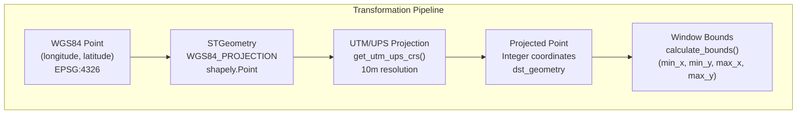
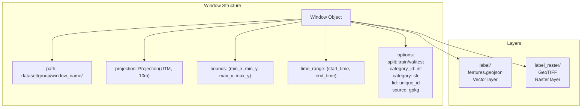
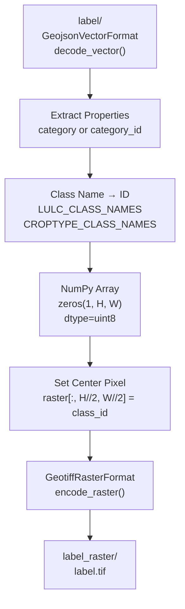
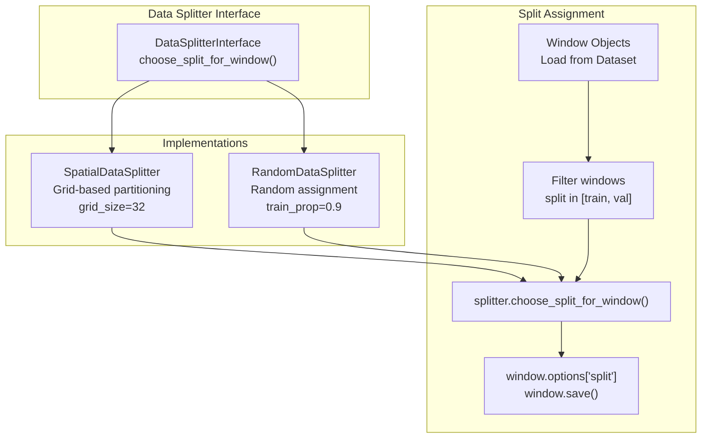
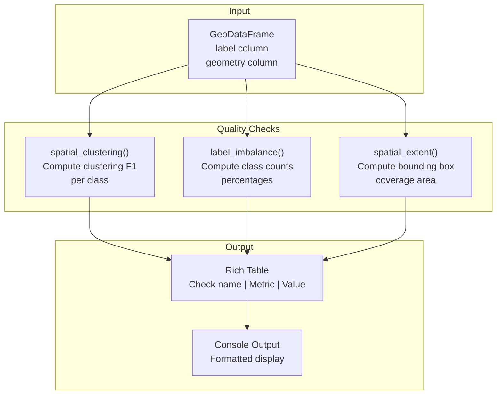

<!-- source: DeepWiki mcp.deepwiki.com · repo allenai/olmoearth_projects · page 4 Data Processing Pipeline · fetched 2026-10-26 -->

# Data Processing Pipeline

<details>
<summary>Relevant source files</summary>

The following files were used as context for generating this wiki page:

- [.github/workflows/build-test.yml](.github/workflows/build-test.yml)
- [olmoearth_projects/projects/mozambique_lulc/__init__.py](olmoearth_projects/projects/mozambique_lulc/__init__.py)
- [olmoearth_projects/projects/mozambique_lulc/create_label_raster.py](olmoearth_projects/projects/mozambique_lulc/create_label_raster.py)
- [olmoearth_projects/projects/mozambique_lulc/create_windows_for_lulc.py](olmoearth_projects/projects/mozambique_lulc/create_windows_for_lulc.py)
- [olmoearth_projects/projects/mozambique_lulc/update_train_test_split.py](olmoearth_projects/projects/mozambique_lulc/update_train_test_split.py)
- [olmoearth_projects/utils/label_quality/__init__.py](olmoearth_projects/utils/label_quality/__init__.py)
- [olmoearth_run_data/mozambique_lulc/prediction_request_geometry.geojson](olmoearth_run_data/mozambique_lulc/prediction_request_geometry.geojson)
- [tests/unit/utils/label_quality/test_wrapper.py](tests/unit/utils/label_quality/test_wrapper.py)

</details>


The Data Processing Pipeline transforms raw geospatial annotations into training-ready datasets for OlmoEarth model fine-tuning. This pipeline handles window generation, label conversion, spatial splitting, and quality validation. The output is an rslearn `Dataset` with properly formatted windows, projections, and metadata ready for training with the rslearn framework.

For information about model training with these datasets, see [Model Training](#5). For inference using trained models, see [Inference and Deployment](#7).

## Overview

The data processing workflow consists of four primary stages executed sequentially:

```mermaid
graph LR
    subgraph "Stage 1: Window Creation"
        GPKG["GPKG Files<br/>Point/Polygon Labels"]
        CREATE_WIN["create_windows_for_lulc.py<br/>calculate_bounds()<br/>create_window()"]
        WINDOWS["Window Objects<br/>window.json<br/>label/ layer"]
    end
    
    subgraph "Stage 2: Label Rasterization"
        RASTERIZE["create_label_raster.py<br/>create_label_raster()"]
        LABEL_RASTER["label_raster/<br/>GeoTIFF with<br/>class_id values"]
    end
    
    subgraph "Stage 3: Split Management"
        UPDATE_SPLIT["update_train_test_split.py<br/>SpatialDataSplitter<br/>RandomDataSplitter"]
        SPLITS["Updated Splits<br/>train/val/test<br/>in window.options"]
    end
    
    subgraph "Stage 4: Quality Assessment"
        QA["check_label_quality()<br/>spatial_clustering()<br/>label_imbalance()<br/>spatial_extent()"]
        REPORT["Quality Metrics<br/>F1 scores<br/>Class balance<br/>Coverage area"]
    end
    
    GPKG --> CREATE_WIN
    CREATE_WIN --> WINDOWS
    WINDOWS --> RASTERIZE
    RASTERIZE --> LABEL_RASTER
    LABEL_RASTER --> UPDATE_SPLIT
    UPDATE_SPLIT --> SPLITS
    SPLITS --> QA
    QA --> REPORT
```



**Sources:** [olmoearth_projects/projects/mozambique_lulc/create_windows_for_lulc.py](), [olmoearth_projects/projects/mozambique_lulc/create_label_raster.py](), [olmoearth_projects/projects/mozambique_lulc/update_train_test_split.py](), [olmoearth_projects/utils/label_quality/__init__.py]()

## Input Data Format

The pipeline accepts GeoPackage (`.gpkg`) files containing labeled geographic features. Input files must conform to specific column requirements:

| Model Type | Required Columns | Label Column Type | Example Values |
|------------|------------------|-------------------|----------------|
| LULC Classification | `class`, `geometry` | `int` | 0-6 (Water, Bare Ground, Rangeland, etc.) |
| Crop Type Classification | `crop1`, `geometry` | `str` | "corn", "cassava", "rice", "sesame", etc. |

The `geometry` column contains either Point or Polygon features in any valid CRS. The pipeline automatically converts all geometries to WGS84 (EPSG:4326) before processing. For Polygon features, centroids are computed and used as the window center points.

**Sources:** [olmoearth_projects/projects/mozambique_lulc/create_windows_for_lulc.py:110-145]()

## Window Generation Process

### Coordinate Transformation and Projection

The `create_windows_for_lulc.py` script generates training windows through a multi-step coordinate transformation:



The transformation uses `get_utm_ups_crs()` from rslearn to determine the appropriate UTM zone based on the point's longitude and latitude. All windows are generated at 10-meter resolution as defined by `WINDOW_RESOLUTION = 10` [olmoearth_projects/projects/mozambique_lulc/create_windows_for_lulc.py:26]().

**Sources:** [olmoearth_projects/projects/mozambique_lulc/create_windows_for_lulc.py:77-107, 170-176]()

### Window Bounds Calculation

The `calculate_bounds()` function computes pixel bounds around a projected point. For a window of size `N` pixels:

- **Even size**: Center pixel at `(x, y)` creates bounds `[x - N/2, y - N/2, x + N/2, y + N/2]`
- **Odd size**: Center pixel at `(x, y)` creates bounds `[x - N/2, y - N/2 - 1, x + N/2 + 1, y + N/2]`

The asymmetry for odd-sized windows ensures the center pixel is consistently positioned [olmoearth_projects/projects/mozambique_lulc/create_windows_for_lulc.py:89-105]().

**Sources:** [olmoearth_projects/projects/mozambique_lulc/create_windows_for_lulc.py:77-107]()

### Window Creation and Storage

Each window is created as a `Window` object with comprehensive metadata:



The `create_window()` function performs the following operations:

1. Creates `Window` object with projection, bounds, and time range
2. Saves window metadata to `window.json`
3. Creates a vector `Feature` with window geometry and label properties
4. Encodes feature to `label/` layer using `GeojsonVectorFormat`
5. Marks layer as completed

**Sources:** [olmoearth_projects/projects/mozambique_lulc/create_windows_for_lulc.py:147-216]()

### Group Organization and Temporal Coverage

Windows are organized by `group`, which corresponds to geographic regions or provinces. Each group has defined temporal coverage:

| Group | Start Time | End Time | Purpose |
|-------|-----------|----------|---------|
| `gaza` | 2024-10-23 | 2025-06-20 | Gaza province LULC |
| `manica` | 2024-10-23 | 2025-06-20 | Manica province LULC |
| `zambezia` | 2024-10-23 | 2025-06-20 | Zambezia province LULC |
| `crop_type` | 2024-10-23 | 2025-06-20 | All provinces combined |

The `GROUP_TIME` dictionary [olmoearth_projects/projects/mozambique_lulc/create_windows_for_lulc.py:54-74]() defines these temporal ranges, which are used to query satellite imagery during training and inference.

**Sources:** [olmoearth_projects/projects/mozambique_lulc/create_windows_for_lulc.py:54-74, 177-195]()

### Parallel Processing

The window creation process uses multiprocessing for efficiency:


The `create_windows_from_gpkg()` function creates a job specification for each point, then dispatches jobs to a worker pool [olmoearth_projects/projects/mozambique_lulc/create_windows_for_lulc.py:237-265](). The default is 32 workers, configurable via `--max_workers`.

**Sources:** [olmoearth_projects/projects/mozambique_lulc/create_windows_for_lulc.py:218-266]()

## Label Raster Generation

After vector label layers are created, the `create_label_raster.py` script converts them to raster format for efficient training:

### Rasterization Process



The `create_label_raster()` function performs the following:

1. Decodes vector features from `label/` directory
2. Extracts class name from feature properties
3. Maps class name to integer ID using `LULC_CLASS_NAMES` or `CROPTYPE_CLASS_NAMES`
4. Creates a zero-filled raster matching window dimensions
5. Sets the center pixel to the class ID value
6. Encodes raster as GeoTIFF in `label_raster/` directory

This creates a single-pixel label in the center of each window [olmoearth_projects/projects/mozambique_lulc/create_label_raster.py:54-76]().

**Sources:** [olmoearth_projects/projects/mozambique_lulc/create_label_raster.py:54-76]()

### Class Mapping

Two class mapping schemes are defined:

**LULC Classes** [olmoearth_projects/projects/mozambique_lulc/create_label_raster.py:30-39]():
```
0: invalid
1: Water
2: Bare Ground
3: Rangeland
4: Flooded Vegetation
5: Trees
6: Cropland
7: Buildings
```

**Crop Type Classes** [olmoearth_projects/projects/mozambique_lulc/create_label_raster.py:40-49]():
```
0: invalid
1: corn
2: cassava
3: rice
4: sesame
5: beans
6: millet
7: sorghum
```

The class ID of 0 is reserved for "invalid" to represent unlabeled pixels or regions outside the label area.

**Sources:** [olmoearth_projects/projects/mozambique_lulc/create_label_raster.py:30-49]()

## Data Splitting Strategies

The `update_train_test_split.py` script manages the assignment of windows to train, validation, and test splits using pluggable splitting strategies.

### Splitting Architecture



**Sources:** [olmoearth_projects/projects/mozambique_lulc/update_train_test_split.py]()

### SpatialDataSplitter

The `SpatialDataSplitter` partitions windows based on spatial clustering to minimize spatial autocorrelation between splits. Configuration:

- `train_prop=0.9`: 90% of data for training
- `val_prop=0.1`: 10% of data for validation
- `test_prop=0.0`: 0% for test (test split comes from separate GPKG files)
- `grid_size=32`: Spatial grid resolution for clustering

This strategy ensures that nearby windows are assigned to the same split, preventing information leakage from spatially correlated features [olmoearth_projects/projects/mozambique_lulc/update_train_test_split.py:55-58]().

**Sources:** [olmoearth_projects/projects/mozambique_lulc/update_train_test_split.py:55-58]()

### RandomDataSplitter

The `RandomDataSplitter` assigns windows randomly according to specified proportions:

- `train_prop=0.9`: 90% training
- `val_prop=0.1`: 10% validation
- `test_prop=0.0`: 0% test

Random splitting is simpler but may result in spatially nearby windows appearing in different splits [olmoearth_projects/projects/mozambique_lulc/update_train_test_split.py:59-60]().

**Sources:** [olmoearth_projects/projects/mozambique_lulc/update_train_test_split.py:59-60]()

### Split Update Process

The `update_train_val_split()` function only modifies windows that are currently marked as `train` or `val`:

```python
if window.options["split"] in ["train", "val"]:
    split = splitter.choose_split_for_window(window)
    window.options["split"] = split
    window.save()
```

Windows marked as `test` (from test GPKG files) are never modified [olmoearth_projects/projects/mozambique_lulc/update_train_test_split.py:22-28]().

**Sources:** [olmoearth_projects/projects/mozambique_lulc/update_train_test_split.py:22-28]()

## Label Quality Assessment

The `label_quality` module provides utilities to validate dataset quality before training. The `check_label_quality()` function runs three distinct quality checks:



**Sources:** [olmoearth_projects/utils/label_quality/__init__.py:14-61]()

### Spatial Clustering Metric

The `spatial_clustering()` check computes an F1 score measuring whether spatially proximate labels belong to the same class. High F1 scores (close to 1.0) indicate strong spatial clustering, which is common in remote sensing data where similar land cover types occur in contiguous regions.

This metric helps identify:
- Annotation inconsistencies where nearby areas have conflicting labels
- Spatially scattered minority classes that may be difficult to learn
- Dataset suitability for spatial splitting strategies

**Sources:** [olmoearth_projects/utils/label_quality/__init__.py:9-10, 32-34]()

### Label Imbalance Metric

The `label_imbalance()` check computes class frequency statistics:

| Metric | Description |
|--------|-------------|
| Class counts | Number of instances per class |
| Class percentages | Proportion of total instances |
| Imbalance ratio | Ratio of most to least frequent class |

Severe imbalance (e.g., 100:1 ratio) may require:
- Class-weighted loss functions
- Oversampling minority classes
- Stratified data splitting

**Sources:** [olmoearth_projects/utils/label_quality/__init__.py:9, 32-34]()

### Spatial Extent Metric

The `spatial_extent()` check computes the geographic coverage:

- Bounding box coordinates (min/max longitude, min/max latitude)
- Total area in square degrees
- Geographic span

This helps verify:
- Dataset covers the intended region
- Labels are not concentrated in a small subregion
- No outlier points in incorrect locations

**Sources:** [olmoearth_projects/utils/label_quality/__init__.py:11, 32-34]()

### Running Quality Checks

The `check_label_quality()` function accepts a `checks_to_run` parameter to selectively execute checks:

```python
check_label_quality(gdf, checks_to_run=["label_imbalance"])
```

If `checks_to_run` is `None`, all three checks execute. Results are displayed in a formatted Rich table to the console [olmoearth_projects/utils/label_quality/__init__.py:46-60]().

**Sources:** [olmoearth_projects/utils/label_quality/__init__.py:14-61](), [tests/unit/utils/label_quality/test_wrapper.py:7-22]()

## Output Dataset Structure

The complete pipeline produces an rslearn `Dataset` with the following directory structure:

```
dataset_root/
├── config.json                          # Dataset configuration
├── {group}/                             # e.g., "gaza", "manica", "zambezia"
│   ├── {window_name}/                   # e.g., "123_-25.140374_33.664738"
│   │   ├── window.json                  # Window metadata
│   │   ├── label/                       # Vector label layer
│   │   │   └── features.geojson
│   │   ├── label_raster/                # Raster label layer
│   │   │   └── label.tif
│   │   └── .completed/                  # Layer completion markers
│   │       ├── label
│   │       └── label_raster
```

Each `window.json` contains:
- `projection`: UTM/UPS CRS with 10m resolution
- `bounds`: Integer pixel coordinates
- `time_range`: Start and end datetime in UTC
- `options`: Split assignment, category ID, category name, FID, source

The dataset is ready for use with `RslearnDataModule` for model training. See [Data Module and Transforms](#5.4) for details on loading and transforming this data during training.

**Sources:** [olmoearth_projects/projects/mozambique_lulc/create_windows_for_lulc.py:182-215](), [olmoearth_projects/projects/mozambique_lulc/create_label_raster.py:54-76]()

## Command-Line Usage

### Creating Windows

```bash
python -m olmoearth_projects.projects.mozambique_lulc.create_windows_for_lulc \
  --gpkg_dir /path/to/gpkg/files \
  --ds_path /path/to/output/dataset \
  --window_size 1 \
  --max_workers 32
```

For crop type datasets, add `--crop_type` flag [olmoearth_projects/projects/mozambique_lulc/create_windows_for_lulc.py:296]().

**Sources:** [olmoearth_projects/projects/mozambique_lulc/create_windows_for_lulc.py:268-337]()

### Creating Label Rasters

```bash
python -m olmoearth_projects.projects.mozambique_lulc.create_label_raster \
  --ds_path /path/to/dataset \
  --workers 64
```

For crop type datasets, add `--crop_type` flag [olmoearth_projects/projects/mozambique_lulc/create_label_raster.py:94]().

**Sources:** [olmoearth_projects/projects/mozambique_lulc/create_label_raster.py:79-109]()

### Updating Splits

```bash
python -m olmoearth_projects.projects.mozambique_lulc.update_train_test_split \
  --ds_path /path/to/dataset \
  --workers 32 \
  --splitter spatial
```

The `--splitter` argument accepts `spatial` or `random` [olmoearth_projects/projects/mozambique_lulc/update_train_test_split.py:47-65]().

**Sources:** [olmoearth_projects/projects/mozambique_lulc/update_train_test_split.py:31-85]()

## Integration with Training Pipeline

The datasets produced by this pipeline are consumed by the training system through the `dataset.json` configuration file, which specifies:

- Data sources (Sentinel-2, Sentinel-1)
- Label layer names (`label` or `label_raster`)
- Temporal parameters for satellite data queries
- Band configurations and data types

For complete training configuration details, see [Training Configuration Files](#5.1) and [Data Module and Transforms](#5.4).

**Sources:** [olmoearth_projects/projects/mozambique_lulc/create_label_raster.py:1-17]()

---

