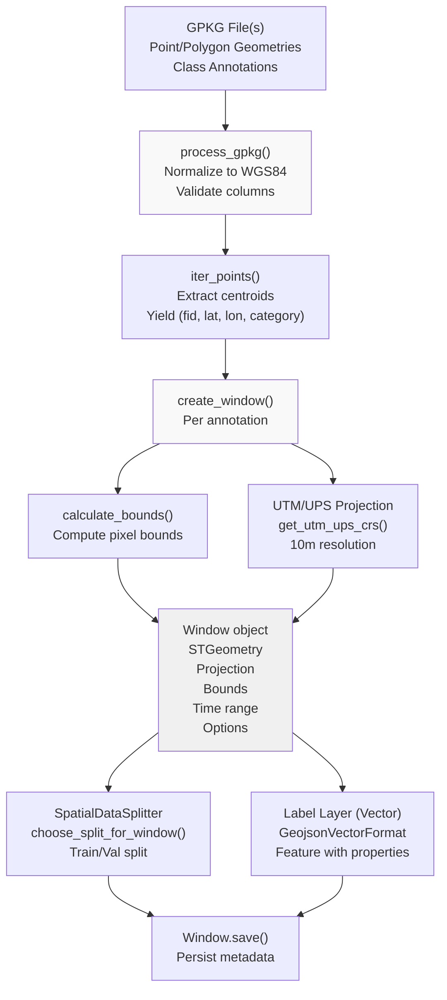
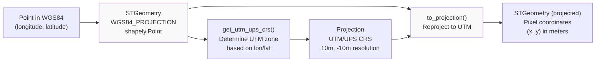
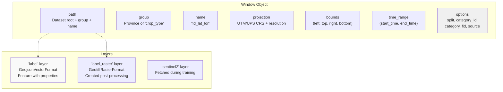
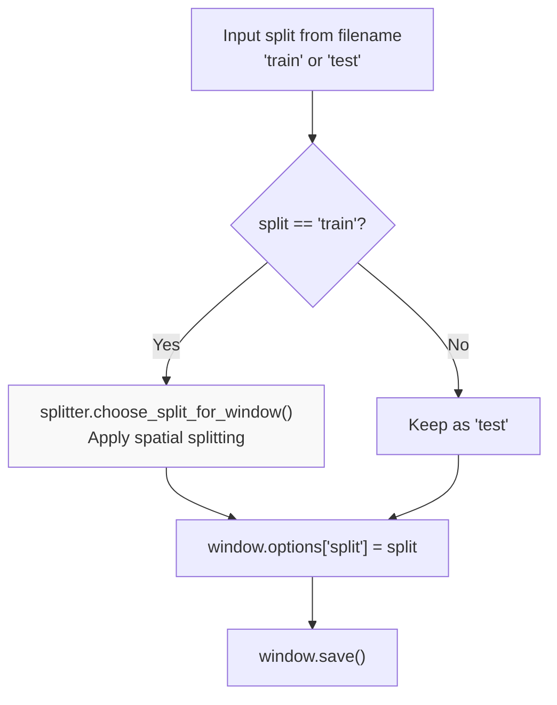

<!-- source: DeepWiki mcp.deepwiki.com · repo allenai/olmoearth_projects · page 4.1 Creating Training Windows · fetched 2026-10-26 -->

# Creating Training Windows

<details>
<summary>Relevant source files</summary>

The following files were used as context for generating this wiki page:

- [olmoearth_projects/projects/mozambique_lulc/__init__.py](olmoearth_projects/projects/mozambique_lulc/__init__.py)
- [olmoearth_projects/projects/mozambique_lulc/create_label_raster.py](olmoearth_projects/projects/mozambique_lulc/create_label_raster.py)
- [olmoearth_projects/projects/mozambique_lulc/create_windows_for_lulc.py](olmoearth_projects/projects/mozambique_lulc/create_windows_for_lulc.py)
- [olmoearth_projects/projects/mozambique_lulc/update_train_test_split.py](olmoearth_projects/projects/mozambique_lulc/update_train_test_split.py)
- [olmoearth_run_data/mozambique_lulc/README.md](olmoearth_run_data/mozambique_lulc/README.md)
- [olmoearth_run_data/mozambique_lulc/config.json](olmoearth_run_data/mozambique_lulc/config.json)
- [olmoearth_run_data/mozambique_lulc/prediction_request_geometry.geojson](olmoearth_run_data/mozambique_lulc/prediction_request_geometry.geojson)

</details>


## Purpose and Scope

This page documents the process of creating training windows from raw geospatial annotation files (GPKG format). Training windows are the fundamental data units used in the rslearn framework for model training. Each window represents a spatially and temporally bounded region with associated labels.

This page covers the window creation workflow, coordinate transformations, label layer generation, and data organization strategies. For information about assessing the quality of generated windows, see [Label Quality Assessment](#4.2). For details on managing train/validation/test splits after window creation, see [Data Splitting and Organization](#4.3). For using these windows in model training, see [Model Training](#5).

## Overview

The window creation process transforms raw point or polygon annotations stored in GPKG files into structured training windows ready for model training. Each window is a georeferenced image patch with associated label data, organized into groups (typically provinces or regions) and splits (train/val/test).

The primary implementation is in [olmoearth_projects/projects/mozambique_lulc/create_windows_for_lulc.py:1-339]().

### Window Creation Workflow



**Diagram: Window Creation Pipeline**

This diagram shows the core functions and data transformations in the window creation process. The `process_gpkg()` function normalizes input data, `iter_points()` extracts point geometries, and `create_window()` orchestrates the creation of each training window with appropriate projections and splits.

Sources: [olmoearth_projects/projects/mozambique_lulc/create_windows_for_lulc.py:110-339]()

## Input Data Format

### GPKG File Structure

Training windows are created from GPKG (GeoPackage) files containing point or polygon annotations. The expected structure varies by task:

| Task Type | Required Column | Data Type | Description |
|-----------|----------------|-----------|-------------|
| LULC Classification | `class` | integer | Class ID (0-6) |
| Crop Type Classification | `crop1` | string | Crop name |
| Both | `geometry` | Point/Polygon | Spatial geometry |

The system supports multiple provinces/regions organized by filename:

```
gpkg_dir/
├── gaza_train.gpkg
├── gaza_test.gpkg
├── manica_train.gpkg
├── manica_test.gpkg
├── zambezia_train.gpkg
├── zambezia_test.gpkg
└── training_gaza_zambezia_manica.gpkg  # for crop type
```

Sources: [olmoearth_projects/projects/mozambique_lulc/create_windows_for_lulc.py:110-145](), [olmoearth_run_data/mozambique_lulc/README.md:7-14]()

### Class Mappings

Two classification schemes are supported with predefined class mappings:

**LULC Classes:**
```python
CLASS_MAP = {
    0: "Water",
    1: "Bare Ground",
    2: "Rangeland",
    3: "Flooded Vegetation",
    4: "Trees",
    5: "Cropland",
    6: "Buildings",
}
```

**Crop Type Classes:**
```python
CROP_TYPE_MAP = {
    "corn": 0,
    "cassava": 1,
    "rice": 2,
    "sesame": 3,
    "beans": 4,
    "millet": 5,
    "sorghum": 6,
}
```

Sources: [olmoearth_projects/projects/mozambique_lulc/create_windows_for_lulc.py:29-50]()

## Window Generation Process

### Coordinate Transformation

The window creation process involves transforming geographic coordinates (WGS84) to projected coordinates (UTM/UPS) to create pixel-aligned windows:



**Diagram: Coordinate Transformation Workflow**

The transformation uses `get_utm_ups_crs()` from rslearn to automatically select the appropriate UTM or UPS zone based on the point's location, ensuring minimal distortion.

Sources: [olmoearth_projects/projects/mozambique_lulc/create_windows_for_lulc.py:170-176]()

### Window Size and Bounds Calculation

Windows are created with a configurable size (default 32 pixels) centered on the annotation point:

```python
def calculate_bounds(
    geometry: STGeometry, window_size: int
) -> tuple[int, int, int, int]:
    """Calculate the bounds of a window around a geometry.
    
    Returns (left, top, right, bottom) in projected coordinates.
    """
```

For even window sizes (e.g., 32):
- `left = x - window_size // 2`
- `top = y - window_size // 2`
- `right = x + window_size // 2`
- `bottom = y + window_size // 2`

For odd window sizes, an asymmetric adjustment is applied to the top bound.

At 10m resolution, a 32-pixel window covers 320m × 320m on the ground, providing sufficient spatial context around each annotation point.

Sources: [olmoearth_projects/projects/mozambique_lulc/create_windows_for_lulc.py:77-107]()

## Window Structure and Metadata

### Window Object Composition

Each `Window` object contains comprehensive metadata:



**Diagram: Window Object Structure**

The `Window` object encapsulates all spatial, temporal, and metadata information needed for training. The `options` dictionary stores task-specific information including the train/val/test split assignment.

Sources: [olmoearth_projects/projects/mozambique_lulc/create_windows_for_lulc.py:182-201]()

### Temporal Coverage

Each group (province or region) has a defined temporal range for data collection:

| Group | Start Time (UTC) | End Time (UTC) | Duration |
|-------|-----------------|----------------|----------|
| gaza | 2024-10-23 | 2025-06-20 | ~8 months |
| manica | 2024-10-23 | 2025-06-20 | ~8 months |
| zambezia | 2024-10-23 | 2025-06-20 | ~8 months |
| crop_type | 2024-10-23 | 2025-06-20 | ~8 months |

These temporal ranges are used when querying satellite imagery during training data preparation. The ranges are aligned across provinces to ensure consistent seasonal coverage.

Sources: [olmoearth_projects/projects/mozambique_lulc/create_windows_for_lulc.py:53-74](), [olmoearth_run_data/mozambique_lulc/README.md:46-49]()

## Label Layer Creation

### Vector Label Format

Labels are stored as vector features using `GeojsonVectorFormat`:

```python
feature = Feature(
    window.get_geometry(),  # Geometry covering entire window
    {
        "category_id": category_id,      # Integer class ID
        "category": category_label,      # String class name
        "fid": fid,                       # Feature ID from GPKG
        "split": split,                  # train/val/test
    },
)
```

The vector label represents the entire window extent, with properties storing classification information. This format is suitable for point-based classification tasks.

Sources: [olmoearth_projects/projects/mozambique_lulc/create_windows_for_lulc.py:204-215]()

### Raster Label Conversion

For segmentation-based training (which is faster than classification), vector labels are converted to rasters using [olmoearth_projects/projects/mozambique_lulc/create_label_raster.py:1-110]():

```python
def create_label_raster(window: Window) -> None:
    """Create label raster for the given window."""
    # Read vector label
    features = GeojsonVectorFormat().decode_vector(label_dir, ...)
    class_id = get_class_id(features[0].properties["category"])
    
    # Create raster with class_id in center pixel
    raster = np.zeros((1, height, width), dtype=np.uint8)
    raster[:, height // 2, width // 2] = class_id
    
    # Write as GeoTIFF
    GeotiffRasterFormat().encode_raster(raster_dir, ...)
```

The raster is initialized to zeros except for the center pixel, which contains the class ID. This approach treats the task as segmentation while effectively performing classification on the center pixel.

Sources: [olmoearth_projects/projects/mozambique_lulc/create_label_raster.py:54-77](), [olmoearth_run_data/mozambique_lulc/README.md:33-37]()

## Data Splitting Strategies

### Spatial Data Splitter

The `SpatialDataSplitter` from `olmoearth_run` is used to create spatially-aware train/validation splits:

```python
splitter = SpatialDataSplitter(
    train_prop=0.9,   # 90% train
    val_prop=0.1,     # 10% validation
    test_prop=0.0,    # Test split from separate files
    grid_size=32      # Grid cell size for spatial grouping
)
```

The splitter uses a grid-based approach to ensure that nearby points are assigned to the same split, reducing spatial autocorrelation between training and validation sets:

1. Project window coordinates to a spatial grid
2. Hash grid cell coordinates to deterministically assign split
3. Ensures windows in the same grid cell have the same split

This is crucial for geospatial data where nearby observations are highly correlated.

Sources: [olmoearth_projects/projects/mozambique_lulc/create_windows_for_lulc.py:233-235](), [olmoearth_projects/projects/mozambique_lulc/update_train_test_split.py:55-65]()

### Split Assignment Workflow



**Diagram: Split Assignment Logic**

Windows from files marked as "train" are further split into train/val using `SpatialDataSplitter`, while windows from "test" files remain in the test split. This allows for a fixed test set with spatial validation splitting.

Sources: [olmoearth_projects/projects/mozambique_lulc/create_windows_for_lulc.py:198-201]()

### Updating Splits Post-Creation

Splits can be updated after initial window creation using [olmoearth_projects/projects/mozambique_lulc/update_train_test_split.py:1-86]():

```bash
python update_train_test_split.py \
    --ds_path /path/to/dataset \
    --splitter spatial \
    --workers 32
```

This script re-applies the splitting logic to existing windows, useful when changing validation ratios or switching between random and spatial splitting strategies.

Sources: [olmoearth_projects/projects/mozambique_lulc/update_train_test_split.py:22-86](), [olmoearth_run_data/mozambique_lulc/README.md:40-45]()

## Usage and Command Line Interface

### Basic Window Creation

The main script supports parallel processing for efficient window generation:

```bash
python create_windows_for_lulc.py \
    --gpkg_dir /path/to/gpkg/files \
    --ds_path /path/to/output/dataset \
    --window_size 32 \
    --max_workers 32
```

### Parameters

| Parameter | Type | Default | Description |
|-----------|------|---------|-------------|
| `--gpkg_dir` | str | required | Directory containing GPKG files |
| `--ds_path` | str | required | Output dataset root path |
| `--window_size` | int | 1 | Window size in pixels (typically 32) |
| `--max_workers` | int | 32 | Number of parallel worker processes |
| `--crop_type` | flag | False | Create crop type windows instead of LULC |

### Crop Type Mode

For crop type classification, use the `--crop_type` flag:

```bash
python create_windows_for_lulc.py \
    --gpkg_dir /path/to/gpkg/files \
    --ds_path /path/to/output/dataset \
    --window_size 32 \
    --crop_type
```

This expects different GPKG files with crop labels in the `crop1` column instead of numeric `class` values.

Sources: [olmoearth_projects/projects/mozambique_lulc/create_windows_for_lulc.py:268-337](), [olmoearth_run_data/mozambique_lulc/README.md:14-21]()

### Complete Dataset Preparation Pipeline

After creating windows, additional steps are needed to prepare the dataset for training:

1. **Create windows** (this page):
```bash
python create_windows_for_lulc.py --gpkg_dir ... --ds_path $DATASET_PATH
```

2. **Copy configuration**:
```bash
cp config.json $DATASET_PATH/
```

3. **Prepare dataset** (materialize satellite imagery):
```bash
rslearn dataset prepare --root $DATASET_PATH --workers 64
```

4. **Convert labels to rasters**:
```bash
python create_label_raster.py --ds_path $DATASET_PATH
```

5. **Assess label quality** (see [Label Quality Assessment](#4.2)):
```bash
python check_label_quality.py --ds_path $DATASET_PATH --split train
```

Sources: [olmoearth_run_data/mozambique_lulc/README.md:14-37]()

## Multiprocessing and Performance

The window creation process uses multiprocessing for parallel execution:

```python
multiprocessing.set_start_method("forkserver", force=True)

if max_workers <= 1:
    # Single-threaded for debugging
    for kw in tqdm.tqdm(jobs):
        create_window(**kw)
else:
    # Parallel processing
    p = multiprocessing.Pool(max_workers)
    outputs = star_imap_unordered(p, create_window, jobs)
    for _ in tqdm.tqdm(outputs, total=len(jobs)):
        pass
```

The `forkserver` start method is used to avoid issues with complex initialization in forked processes. The `star_imap_unordered` utility from rslearn provides efficient parallel mapping with progress tracking.

For typical datasets with thousands of annotations, using 32-64 workers can complete window creation in minutes rather than hours.

Sources: [olmoearth_projects/projects/mozambique_lulc/create_windows_for_lulc.py:257-265](), [olmoearth_projects/projects/mozambique_lulc/create_windows_for_lulc.py:269]()

## Window Organization Structure

Windows are organized on disk in a hierarchical structure:

```
dataset_root/
├── config.json
├── groups/
│   ├── gaza/
│   │   ├── windows/
│   │   │   ├── 123_-25.140374_33.664738/
│   │   │   │   ├── window.json           # Window metadata
│   │   │   │   ├── layers/
│   │   │   │   │   ├── label/            # Vector label
│   │   │   │   │   │   └── features.geojson
│   │   │   │   │   ├── label_raster/     # Raster label
│   │   │   │   │   │   └── label.tif
│   │   │   │   │   └── sentinel2/        # Satellite data
│   │   │   │   │       └── *.tif
│   ├── manica/
│   │   └── windows/...
│   ├── zambezia/
│   │   └── windows/...
│   └── crop_type/
│       └── windows/...
```

Each window is named using the format `{fid}_{latitude}_{longitude}` and stored under its group directory. The group typically corresponds to the province or region, allowing for group-based training and evaluation.

Sources: [olmoearth_projects/projects/mozambique_lulc/create_windows_for_lulc.py:180-196]()

## Integration with Dataset Configuration

The window creation process integrates with rslearn's dataset configuration system. A `config.json` file defines the data layers:

```json
{
  "layers": {
    "label": {
      "type": "vector"
    },
    "label_raster": {
      "type": "raster",
      "band_sets": [{
        "bands": ["label"],
        "dtype": "int32"
      }]
    },
    "sentinel2": {
      "type": "raster",
      "data_source": {
        "name": "rslearn.data_sources.planetary_computer.Sentinel2",
        "query_config": {
          "max_matches": 8,
          "min_matches": 8,
          "period_duration": "30d",
          "space_mode": "PER_PERIOD_MOSAIC"
        }
      }
    }
  }
}
```

This configuration is used during dataset preparation (see [Data Module and Transforms](#5.4)) to fetch satellite imagery for each window's spatial and temporal extent.

Sources: [olmoearth_run_data/mozambique_lulc/config.json:1-70](), [olmoearth_run_data/mozambique_lulc/README.md:22-32]()

---

