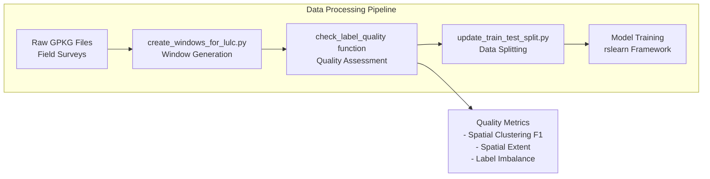
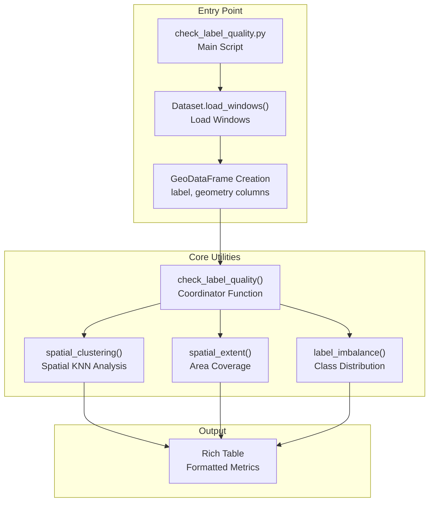
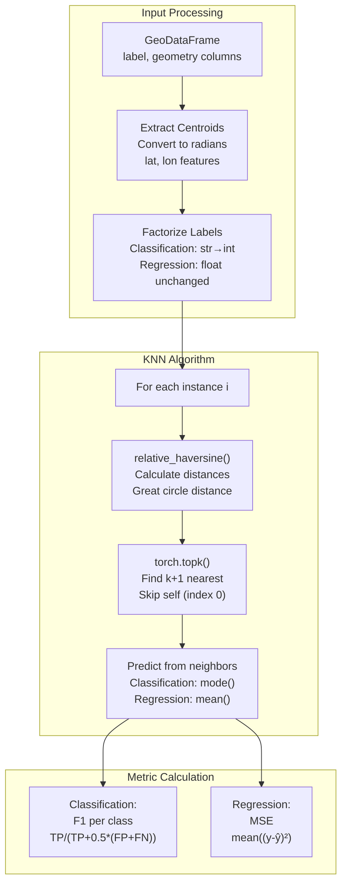
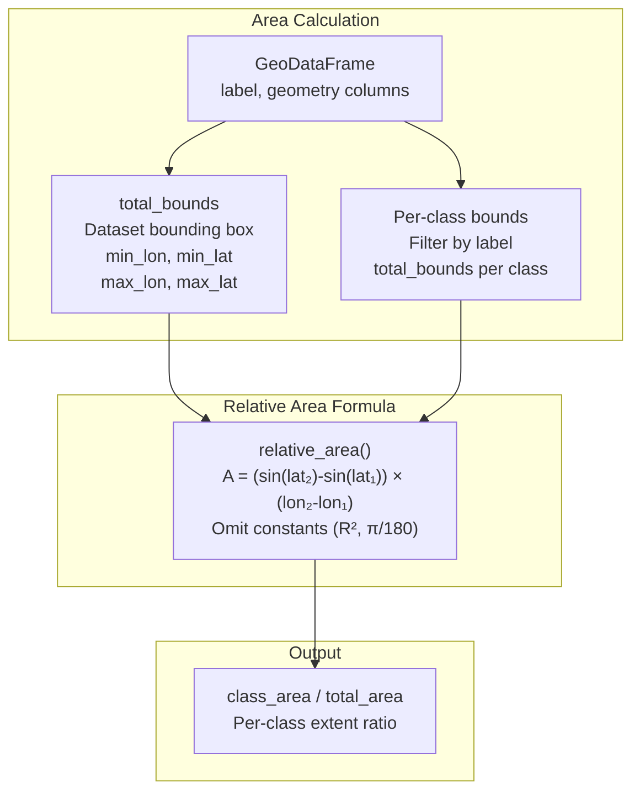
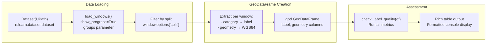

<!-- source: DeepWiki mcp.deepwiki.com · repo allenai/olmoearth_projects · page 4.2 Label Quality Assessment · fetched 2026-10-26 -->

# Label Quality Assessment

<details>
<summary>Relevant source files</summary>

The following files were used as context for generating this wiki page:

- [olmoearth_projects/projects/mozambique_lulc/check_label_quality.py](olmoearth_projects/projects/mozambique_lulc/check_label_quality.py)
- [olmoearth_projects/utils/label_quality/README.md](olmoearth_projects/utils/label_quality/README.md)
- [olmoearth_projects/utils/label_quality/spatial_clustering.py](olmoearth_projects/utils/label_quality/spatial_clustering.py)
- [olmoearth_projects/utils/label_quality/spatial_extent.py](olmoearth_projects/utils/label_quality/spatial_extent.py)
- [tests/unit/utils/__init__.py](tests/unit/utils/__init__.py)
- [tests/unit/utils/label_quality/__init__.py](tests/unit/utils/label_quality/__init__.py)
- [tests/unit/utils/label_quality/test_spatial_clustering.py](tests/unit/utils/label_quality/test_spatial_clustering.py)

</details>


## Purpose and Scope

This document describes the label quality assessment utilities used to evaluate training datasets before model fine-tuning. These utilities provide quantitative metrics to assess whether a set of labeled geospatial data is suitable for training high-quality models.

For information about creating training windows from raw data, see [Creating Training Windows](#4.1). For information about organizing and splitting the assessed data, see [Data Splitting and Organization](#4.3).

## Overview

Label quality assessment is a critical step in the data processing pipeline that occurs after training windows have been created and before model training begins. The quality of model predictions depends directly on the quality of training labels. While domain experts provide the best assessment, the utilities in this system provide quantitative indicators of dataset suitability.

The assessment system evaluates three key aspects of label quality:
- **Spatial Clustering**: How spatially distributed different classes are
- **Spatial Extent**: How much of the total labeled area each class covers
- **Label Imbalance**: The proportion of labels in each class



**Sources**: [olmoearth_projects/utils/label_quality/README.md:1-86](), [olmoearth_projects/projects/mozambique_lulc/check_label_quality.py:1-51]()

## System Architecture

The label quality assessment system consists of a main entry point that coordinates three independent metric calculators, each operating on a GeoDataFrame with `label` and `geometry` columns.



**Sources**: [olmoearth_projects/projects/mozambique_lulc/check_label_quality.py:1-51](), [olmoearth_projects/utils/label_quality/README.md:1-86]()

## Spatial Clustering Metric

### Concept

The spatial clustering metric assesses how geographically dispersed different classes are within the dataset. Ideally, different classes should be well-distributed across the study area rather than concentrated in isolated clusters. High spatial clustering indicates that a class's label can be predicted solely from its spatial location, which may lead to models that fail to generalize to new geographic areas.

The metric uses a spatial k-nearest neighbors (KNN) approach: for each instance, it predicts the class based on the k nearest spatial neighbors. High prediction accuracy indicates high spatial clustering, which is generally undesirable for robust model training.



**Sources**: [olmoearth_projects/utils/label_quality/spatial_clustering.py:1-90](), [olmoearth_projects/utils/label_quality/README.md:10-29]()

### Implementation

The `spatial_clustering` function in [olmoearth_projects/utils/label_quality/spatial_clustering.py:30-89]() implements the spatial KNN algorithm:

| Component | Implementation Details |
|-----------|----------------------|
| **Distance Metric** | `relative_haversine()` function [10-27]() calculates great circle distance using Haversine formula on radians |
| **Feature Extraction** | Geometry centroids converted to latitude/longitude in radians [42-48]() |
| **Task Detection** | Automatically detects classification vs regression based on label type [51-54]() |
| **k Parameter** | Default k=5, finds k+1 nearest to exclude self [61-63]() |
| **Classification Output** | F1 score per class using precision and recall [77-88]() |
| **Regression Output** | Mean squared error (MSE) [73]() |

The Haversine formula calculates the great circle distance between two points on Earth:

```
a = sin²(Δlat/2) + cos(lat₁) × cos(lat₂) × sin²(Δlon/2)
distance = 2 × R × arcsin(√a)
```

Since we only need relative distances for KNN, the Earth radius R is omitted [olmoearth_projects/utils/label_quality/spatial_clustering.py:10-27]().

**Sources**: [olmoearth_projects/utils/label_quality/spatial_clustering.py:1-90]()

### Interpretation

For classification tasks, the output is an F1 score per class:

| F1 Score Range | Interpretation | Recommendation |
|---------------|----------------|----------------|
| 0.0 - 0.5 | Low spatial clustering | Good - classes are spatially distributed |
| 0.5 - 0.7 | Moderate clustering | Acceptable - some spatial patterns exist |
| 0.7 - 1.0 | High spatial clustering | Concerning - may limit generalization |

For regression tasks, lower MSE values indicate higher spatial clustering. The metric should be compared against the variance of the target variable to assess relative clustering.

**Sources**: [olmoearth_projects/utils/label_quality/README.md:10-29](), [tests/unit/utils/label_quality/test_spatial_clustering.py:7-30]()

## Spatial Extent Metric

### Concept

The spatial extent metric measures how much of the total labeled area each class occupies. Ideally, each class should be present across a large fraction of the study area rather than concentrated in a small region. This ensures that the model encounters each class across diverse spatial contexts.

The metric calculates the ratio of each class's bounding box area to the total dataset's bounding box area. Values close to 1.0 indicate that a class is distributed throughout the entire study area.



**Sources**: [olmoearth_projects/utils/label_quality/spatial_extent.py:1-32](), [olmoearth_projects/utils/label_quality/README.md:30-46]()

### Implementation

The `spatial_extent` function in [olmoearth_projects/utils/label_quality/spatial_extent.py:19-31]() calculates extent ratios using spherical geometry:

| Component | Implementation Details |
|-----------|----------------------|
| **Area Formula** | Spherical rectangle area: `A = R² × (sin(φ₂)-sin(φ₁)) × (λ₂-λ₁) / 180` [7-16]() |
| **Constant Omission** | R (Earth radius) and 180 factor omitted since using ratios [11]() |
| **Total Bounds** | `df.total_bounds` provides overall bounding box [24]() |
| **Class Bounds** | Filter by class label then compute `total_bounds` [28]() |
| **Output** | Dictionary mapping class label to extent ratio [26-29]() |

The spherical area calculation accounts for Earth's curvature by using the sine of latitude values, which properly handles the convergence of meridians at higher latitudes [olmoearth_projects/utils/label_quality/spatial_extent.py:7-16]().

**Sources**: [olmoearth_projects/utils/label_quality/spatial_extent.py:1-32]()

### Interpretation

| Extent Ratio | Interpretation | Recommendation |
|--------------|----------------|----------------|
| 0.8 - 1.0 | Excellent coverage | Class is distributed across study area |
| 0.5 - 0.8 | Good coverage | Class is reasonably distributed |
| 0.2 - 0.5 | Limited coverage | Class may be geographically constrained |
| 0.0 - 0.2 | Poor coverage | Class is highly localized |

Classes with low spatial extent ratios may indicate:
- Naturally rare phenomena (acceptable)
- Insufficient sampling in certain regions (concerning)
- Geographic specificity that may limit model generalization

**Sources**: [olmoearth_projects/utils/label_quality/README.md:30-46]()

## Label Imbalance Metric

### Concept

The label imbalance metric measures the proportion of labels belonging to each class. Severe class imbalance can lead to models that are biased toward majority classes and perform poorly on minority classes. The metric simply calculates: `count(class) / count(total)`.

While perfect balance (equal proportions) is not always necessary or desirable—some land cover types are naturally more prevalent—extreme imbalance (e.g., <1% or >90% for a class) often indicates data collection issues or suggests the need for class-weighted loss functions during training.

**Sources**: [olmoearth_projects/utils/label_quality/README.md:48-50]()

### Interpretation

| Class Proportion | Assessment | Considerations |
|-----------------|------------|----------------|
| > 50% | Dominant class | Risk of model bias toward this class |
| 20% - 50% | Well-represented | Generally good for training |
| 5% - 20% | Adequately represented | May need attention during training |
| < 5% | Minority class | Consider class weighting or oversampling |

The label imbalance values should be considered alongside the actual number of samples. A class with 5% representation is concerning if the dataset has 100 samples (5 instances) but acceptable with 10,000 samples (500 instances).

**Sources**: [olmoearth_projects/utils/label_quality/README.md:48-50]()

## Usage

### Command-Line Interface

The label quality assessment is typically run via the example script [olmoearth_projects/projects/mozambique_lulc/check_label_quality.py:1-51]():

```bash
python olmoearth_projects/projects/mozambique_lulc/check_label_quality.py \
    --ds_path /weka/dfive-default/rslearn-eai/datasets/crop/mozambique_lulc/20251202 \
    --split train \
    --crop_type  # Optional flag for crop type datasets
```

### Parameters

| Parameter | Type | Default | Description |
|-----------|------|---------|-------------|
| `--ds_path` | str | Required | Path to the rslearn dataset |
| `--split` | str | `"train"` | Dataset split to assess: `"train"`, `"val"`, `"test"`, or `"all"` |
| `--crop_type` | flag | False | Use `["crop_type"]` groups instead of province groups |

**Sources**: [olmoearth_projects/projects/mozambique_lulc/check_label_quality.py:12-28]()

### Integration Workflow



**Sources**: [olmoearth_projects/projects/mozambique_lulc/check_label_quality.py:35-50]()

### Example Code Pattern

The typical usage pattern from [olmoearth_projects/projects/mozambique_lulc/check_label_quality.py:35-50]():

1. **Load Dataset**: Initialize `Dataset` object with path
2. **Define Groups**: Specify groups to load (e.g., provinces or crop types)
3. **Filter Windows**: Select windows matching desired split(s)
4. **Extract Data**: Convert window options and geometries to GeoDataFrame format
5. **Transform Geometry**: Convert to `WGS84_PROJECTION` for spatial calculations
6. **Run Assessment**: Call `check_label_quality()` with the prepared GeoDataFrame

The geometry transformation is critical because spatial calculations assume WGS84 coordinates (latitude/longitude) [olmoearth_projects/projects/mozambique_lulc/check_label_quality.py:46]().

**Sources**: [olmoearth_projects/projects/mozambique_lulc/check_label_quality.py:35-50]()

## Output Format

The assessment produces a formatted table with three sections, one for each metric. Example output from the Mozambique LULC training split:

```
┏━━━━━━━━━━━━━━━━━━━━┳━━━━━━━━━━━━━━━━━━━━━━━┳━━━━━━━━━━━━━━━━━━━━━┓
┃         Check name ┃ Metric                ┃               Value ┃
┡━━━━━━━━━━━━━━━━━━━━╇━━━━━━━━━━━━━━━━━━━━━━━╇━━━━━━━━━━━━━━━━━━━━━┩
│    label_imbalance │ Bare Ground           │ 0.12681827494365908 │
│    label_imbalance │ Trees                 │ 0.09813562794509322 │
│    label_imbalance │ Cropland              │ 0.27760704773611966 │
│    label_imbalance │ Flooded Vegetation    │  0.1024380249948781 │
│    label_imbalance │ Water                 │ 0.11391108379430445 │
│    label_imbalance │ Rangeland             │ 0.10530628969473468 │
│    label_imbalance │ Buildings             │  0.1757836508912108 │
│ spatial_clustering │ Bare Ground_f1        │  0.7763055339049103 │
│ spatial_clustering │ Trees_f1              │               0.918 │
│ spatial_clustering │ Cropland_f1           │  0.8201489890031926 │
│ spatial_clustering │ Flooded Vegetation_f1 │  0.6470588235294118 │
│ spatial_clustering │ Water_f1              │  0.5609756097560976 │
│ spatial_clustering │ Rangeland_f1          │  0.7097480832420592 │
│ spatial_clustering │ Buildings_f1          │  0.9638554216867469 │
│     spatial_extent │ Bare Ground           │   0.906388431021162 │
│     spatial_extent │ Trees                 │  0.8143211426450099 │
│     spatial_extent │ Cropland              │  0.8178565572914295 │
│     spatial_extent │ Flooded Vegetation    │  0.8195186876112993 │
│     spatial_extent │ Water                 │  0.8015534585021155 │
│     spatial_extent │ Rangeland             │  0.9892764881988351 │
│     spatial_extent │ Buildings             │  0.7256137393021044 │
└────────────────────┴───────────────────────┴─────────────────────┘
```

### Interpreting the Example

This Mozambique LULC dataset shows:

**Label Imbalance**: Relatively balanced with classes ranging from 9.8% (Trees) to 27.8% (Cropland). No severe imbalance issues.

**Spatial Clustering**: 
- High clustering concerns: Buildings (F1=0.964), Trees (F1=0.918) are highly spatially clustered
- Moderate clustering: Cropland (F1=0.820), Bare Ground (F1=0.776), Rangeland (F1=0.710)
- Good distribution: Water (F1=0.561), Flooded Vegetation (F1=0.647)

**Spatial Extent**: All classes show good coverage (>0.72), with Rangeland having excellent coverage (0.989). This indicates the dataset spans diverse geographic regions.

**Sources**: [olmoearth_projects/utils/label_quality/README.md:57-85]()

## Testing

Unit tests verify the correctness of each metric implementation:

### Spatial Clustering Tests

[tests/unit/utils/label_quality/test_spatial_clustering.py:7-30]() tests classification:
- **Perfect clustering**: South American cities labeled by hemisphere achieve F1=1.0 for both classes
- **No clustering**: Random labels achieve F1=0.0 for all classes

[tests/unit/utils/label_quality/test_spatial_clustering.py:32-51]() tests regression:
- **Perfect clustering**: Spatially consistent values achieve MSE=0.0
- **No clustering**: Spatially inconsistent values produce MSE=1.0

These tests validate that the spatial KNN algorithm correctly quantifies spatial clustering patterns.

**Sources**: [tests/unit/utils/label_quality/test_spatial_clustering.py:1-51]()

## Best Practices

### When to Run Assessment

Run label quality assessment:
1. **After initial window creation**: Identify data collection issues early
2. **After adding new labels**: Ensure new data maintains quality
3. **Before model training**: Verify dataset is suitable for training
4. **Per split**: Assess train, validation, and test splits separately to identify split-specific issues

### Addressing Quality Issues

| Issue | Potential Solutions |
|-------|-------------------|
| High spatial clustering | Collect more geographically diverse samples; use spatial cross-validation |
| Low spatial extent | Expand data collection to cover more of study area |
| Severe label imbalance | Use class-weighted loss functions; oversample minority classes; collect more minority samples |

### Multi-Split Assessment

Use `--split all` to assess all splits simultaneously [olmoearth_projects/projects/mozambique_lulc/check_label_quality.py:30-33](). This reveals whether spatial splitting strategies (see [Data Splitting and Organization](#4.3)) have created unintended biases between splits.

**Sources**: [olmoearth_projects/utils/label_quality/README.md:1-86](), [olmoearth_projects/projects/mozambique_lulc/check_label_quality.py:1-51]()

---

