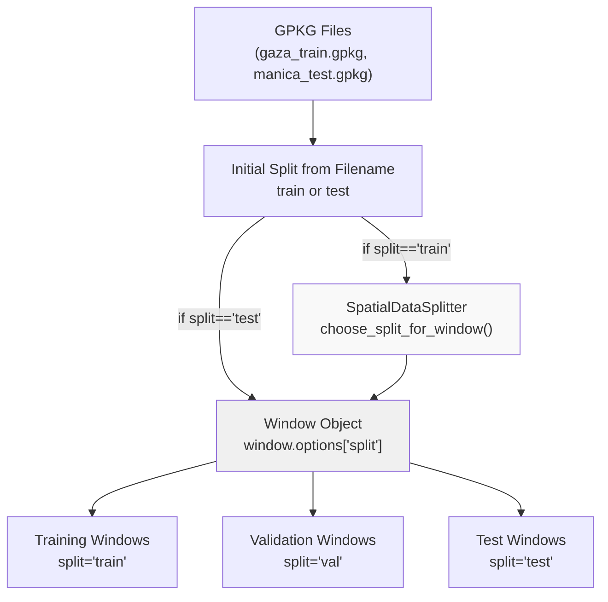
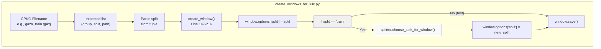
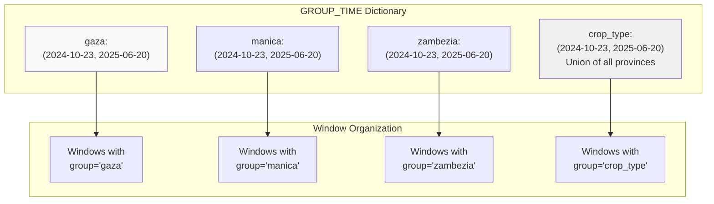
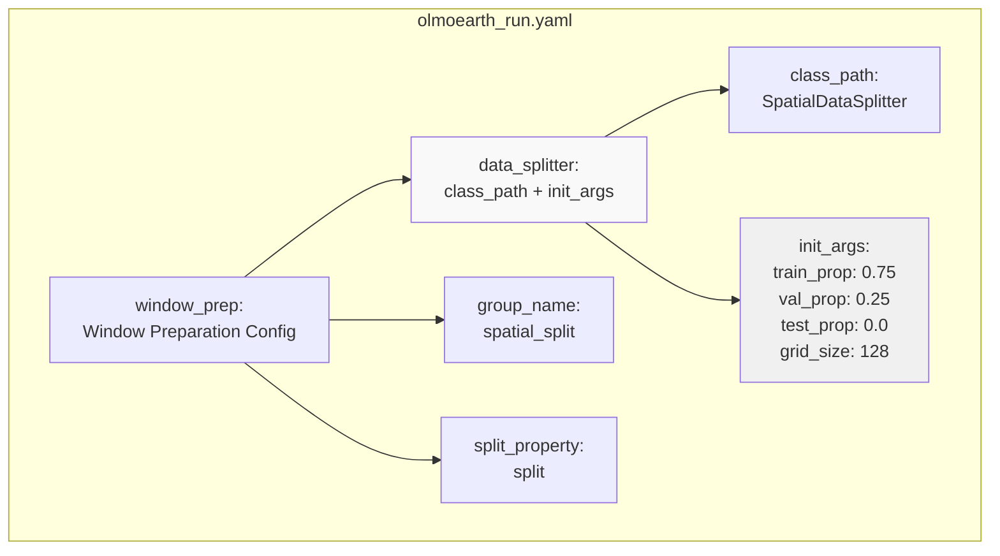

<!-- source: DeepWiki mcp.deepwiki.com · repo allenai/olmoearth_projects · page 4.3 Data Splitting and Organization · fetched 2026-10-26 -->

# Data Splitting and Organization

<details>
<summary>Relevant source files</summary>

The following files were used as context for generating this wiki page:

- [olmoearth_projects/projects/mozambique_lulc/__init__.py](olmoearth_projects/projects/mozambique_lulc/__init__.py)
- [olmoearth_projects/projects/mozambique_lulc/create_label_raster.py](olmoearth_projects/projects/mozambique_lulc/create_label_raster.py)
- [olmoearth_projects/projects/mozambique_lulc/create_windows_for_lulc.py](olmoearth_projects/projects/mozambique_lulc/create_windows_for_lulc.py)
- [olmoearth_projects/projects/mozambique_lulc/update_train_test_split.py](olmoearth_projects/projects/mozambique_lulc/update_train_test_split.py)
- [olmoearth_run_data/awf/olmoearth_run.yaml](olmoearth_run_data/awf/olmoearth_run.yaml)
- [olmoearth_run_data/mozambique_lulc/prediction_request_geometry.geojson](olmoearth_run_data/mozambique_lulc/prediction_request_geometry.geojson)
- [olmoearth_run_data/nandi/olmoearth_run.yaml](olmoearth_run_data/nandi/olmoearth_run.yaml)

</details>


This document explains how training data is organized into groups and split into train, validation, and test sets within the olmoearth_projects repository. It covers the data splitter interfaces, spatial and random splitting strategies, and how splits are managed throughout the data processing pipeline.

For information about creating the windows themselves, see [Creating Training Windows](#4.1). For information about assessing the quality of splits and labels, see [Label Quality Assessment](#4.2).

## Overview of Data Organization

The system organizes training data using two primary concepts:

1. **Groups**: Logical divisions of the dataset, typically by geographic region or province (e.g., `gaza`, `manica`, `zambezia` for Mozambique LULC, or `spatial_split` for Nandi)
2. **Splits**: Division of data into `train`, `val`, and `test` subsets for model training and evaluation

Each window in a dataset has a `group` attribute and a `split` property stored in `window.options["split"]`. This dual organization enables both geographic partitioning and proper train/validation/test separation.

**Data Flow in Split Assignment**:



**Sources**: [olmoearth_projects/projects/mozambique_lulc/create_windows_for_lulc.py:1-339]()

## Data Splitter Interfaces

The system defines a common interface for data splitting strategies through the `DataSplitterInterface` class from `olmoearth_run`. Two primary implementations are available:

| Splitter | Strategy | Use Case | Parameters |
|----------|----------|----------|------------|
| `SpatialDataSplitter` | Grid-based spatial hashing | Ensures spatial separation between train/val/test | `train_prop`, `val_prop`, `test_prop`, `grid_size` |
| `RandomDataSplitter` | Random assignment | Simple random splitting without spatial consideration | `train_prop`, `val_prop`, `test_prop` |

Both implementations provide a `choose_split_for_window(window)` method that deterministically assigns a split based on the window's properties.

**Sources**: [olmoearth_projects/projects/mozambique_lulc/update_train_test_split.py:1-86](), [olmoearth_projects/projects/mozambique_lulc/create_windows_for_lulc.py:12-17]()

## Spatial Splitting Strategy

The `SpatialDataSplitter` implements a grid-based spatial hashing approach to ensure that geographically nearby samples are placed in the same split. This prevents data leakage where spatially correlated training and validation samples could lead to overly optimistic performance estimates.

**Spatial Splitting Algorithm**:


**Configuration Parameters**:

- **`grid_size`**: Size of spatial grid cells in pixels (e.g., 32, 128). Larger values create larger contiguous regions with the same split
- **`train_prop`**: Proportion of data for training (e.g., 0.75 or 0.9)
- **`val_prop`**: Proportion of data for validation (e.g., 0.25 or 0.1)
- **`test_prop`**: Proportion of data for testing (typically 0.0 when test set is predefined)

**Example Configuration** from Mozambique LULC:

```python
splitter = SpatialDataSplitter(
    train_prop=0.9, 
    val_prop=0.1, 
    test_prop=0.0, 
    grid_size=32
)
```

The `grid_size=32` means that windows within a 32×32 pixel region will be assigned to the same split, creating spatial clusters.

**Sources**: [olmoearth_projects/projects/mozambique_lulc/create_windows_for_lulc.py:233-236](), [olmoearth_projects/projects/mozambique_lulc/update_train_test_split.py:55-58](), [olmoearth_run_data/nandi/olmoearth_run.yaml:11-17]()

## Split Assignment During Window Creation

The window creation process handles split assignment in two stages:

1. **Initial Split from Filename**: GPKG files are named with the intended split (e.g., `gaza_train.gpkg`, `gaza_test.gpkg`)
2. **Spatial Re-splitting of Training Data**: Windows initially marked as `train` are further divided into `train` and `val` using the spatial splitter

**Split Assignment Code Flow**:



**Code Reference**: The split assignment logic is in [olmoearth_projects/projects/mozambique_lulc/create_windows_for_lulc.py:198-201]():

```python
if split == "train":
    split = splitter.choose_split_for_window(window)
    window.options["split"] = split
window.save()
```

This ensures that:
- Test data remains in the test split (no re-splitting)
- Training data is spatially divided into train and validation subsets

**Sources**: [olmoearth_projects/projects/mozambique_lulc/create_windows_for_lulc.py:147-216](), [olmoearth_projects/projects/mozambique_lulc/create_windows_for_lulc.py:218-266]()

## Group-Based Organization

Datasets are organized into **groups** that typically represent geographic regions or project-specific categories. Each group can have its own temporal coverage and processing parameters.

**Group Definition Structure**:



**GROUP_TIME Configuration** from [olmoearth_projects/projects/mozambique_lulc/create_windows_for_lulc.py:54-74]():

The `GROUP_TIME` dictionary maps group names to temporal ranges:

```python
GROUP_TIME = {
    "gaza": (
        datetime(2024, 10, 23, tzinfo=UTC),
        datetime(2025, 6, 20, tzinfo=UTC),
    ),
    "manica": (
        datetime(2024, 10, 23, tzinfo=UTC),
        datetime(2025, 6, 20, tzinfo=UTC),
    ),
    "zambezia": (
        datetime(2024, 10, 23, tzinfo=UTC),
        datetime(2025, 6, 20, tzinfo=UTC),
    ),
    "crop_type": (
        datetime(2024, 10, 23, tzinfo=UTC),
        datetime(2025, 6, 20, tzinfo=UTC),
    ),
}
```

Groups enable:
- **Geographic partitioning**: Train separate models per region or a unified model
- **Temporal alignment**: Different regions can have different satellite imagery availability
- **Selective loading**: Filter windows by group during training or processing

**Sources**: [olmoearth_projects/projects/mozambique_lulc/create_windows_for_lulc.py:53-74](), [olmoearth_projects/projects/mozambique_lulc/create_windows_for_lulc.py:324-336]()

## Updating Splits After Creation

The `update_train_test_split.py` utility allows re-splitting existing datasets with different strategies or parameters. This is useful when:
- Changing from random to spatial splitting
- Adjusting train/validation proportions
- Modifying grid size for spatial splitting

**Update Split Workflow**:


**Usage Example**:

```bash
# Update splits using spatial strategy
python update_train_test_split.py \
    --ds_path /path/to/dataset \
    --splitter spatial \
    --workers 32

# Update splits using random strategy
python update_train_test_split.py \
    --ds_path /path/to/dataset \
    --splitter random \
    --workers 32
```

**Key Implementation** from [olmoearth_projects/projects/mozambique_lulc/update_train_test_split.py:22-28]():

```python
def update_train_val_split(window: Window, splitter: DataSplitterInterface) -> None:
    """Create label raster for the given window."""
    if window.options["split"] in ["train", "val"]:
        split = splitter.choose_split_for_window(window)
        print(f"Window was {window.options['split']}, changing to {split}")
        window.options["split"] = split
        window.save()
```

Note that test splits are never modified to preserve the integrity of the test set.

**Sources**: [olmoearth_projects/projects/mozambique_lulc/update_train_test_split.py:1-86]()

## Configuration in YAML Files

Data splitter configuration is specified in `olmoearth_run.yaml` files for inference and window preparation workflows. These configurations define how data should be split during window preparation from raw labels.

**YAML Configuration Structure**:



**Example Configuration** from [olmoearth_run_data/nandi/olmoearth_run.yaml:11-20]():

```yaml
window_prep:
  data_splitter:
    class_path: olmoearth_run.runner.tools.data_splitters.spatial_data_splitter.SpatialDataSplitter
    init_args:
      train_prop: 0.75
      val_prop: 0.25
      test_prop: 0.0
      grid_size: 128  # in pixels
  label_layer: "label"
  group_name: "spatial_split"
  split_property: "split"
```

**Configuration Parameters**:

| Parameter | Purpose | Example Values |
|-----------|---------|----------------|
| `class_path` | Fully qualified class name of splitter | `SpatialDataSplitter`, `RandomDataSplitter` |
| `train_prop` | Training set proportion | 0.75, 0.9 |
| `val_prop` | Validation set proportion | 0.25, 0.1 |
| `test_prop` | Test set proportion | 0.0 (typically predefined) |
| `grid_size` | Spatial grid cell size in pixels | 32, 128 |
| `group_name` | Name assigned to created windows | `"spatial_split"`, `"gaza"` |
| `split_property` | Window option key for split storage | `"split"` |

**Sources**: [olmoearth_run_data/nandi/olmoearth_run.yaml:11-20](), [olmoearth_run_data/awf/olmoearth_run.yaml:11-20]()

## Filtering Windows by Group and Split

During training and processing, windows can be filtered by group and split to create specific subsets:

**Dataset Loading with Filters**:

```python
# Load windows for specific groups
dataset = Dataset(UPath(args.ds_path))
windows = dataset.load_windows(
    workers=args.workers, 
    show_progress=True, 
    groups=["gaza", "manica", "zambezia"]  # Filter by group
)

# For crop type dataset
windows = dataset.load_windows(
    workers=args.workers,
    show_progress=True,
    groups=["crop_type"]
)
```

**Filtering by Split in Training**:

During training, the data module typically filters windows based on the split property:

```python
train_windows = [w for w in windows if w.options["split"] == "train"]
val_windows = [w for w in windows if w.options["split"] == "val"]
test_windows = [w for w in windows if w.options["split"] == "test"]
```

**Sources**: [olmoearth_projects/projects/mozambique_lulc/create_label_raster.py:67-104](), [olmoearth_projects/projects/mozambique_lulc/update_train_test_split.py:67-74]()

## Summary Table: Split Management Across Files

| File | Purpose | Split Handling | Group Usage |
|------|---------|----------------|-------------|
| `create_windows_for_lulc.py` | Create windows from GPKG files | Assigns initial split from filename; re-splits train data spatially | Creates windows with group names (gaza, manica, zambezia, crop_type) |
| `update_train_test_split.py` | Update existing window splits | Re-assigns splits for train/val windows using specified splitter | Filters windows by group list |
| `create_label_raster.py` | Create raster labels from vector labels | Reads split from `window.options["split"]` | Filters windows by group list |
| `olmoearth_run.yaml` | Configure inference and window prep | Defines splitter configuration for window preparation | Specifies `group_name` for created windows |

**Sources**: [olmoearth_projects/projects/mozambique_lulc/create_windows_for_lulc.py:1-339](), [olmoearth_projects/projects/mozambique_lulc/update_train_test_split.py:1-86](), [olmoearth_projects/projects/mozambique_lulc/create_label_raster.py:1-110](), [olmoearth_run_data/nandi/olmoearth_run.yaml:1-92]()

---

