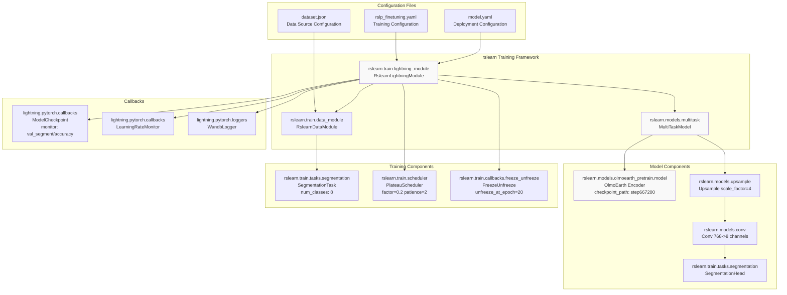
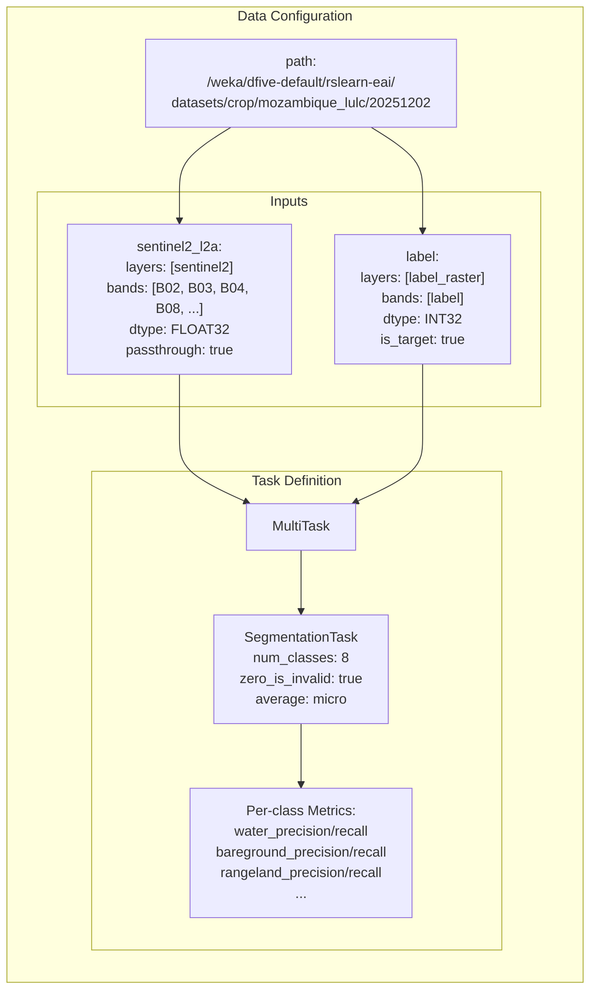
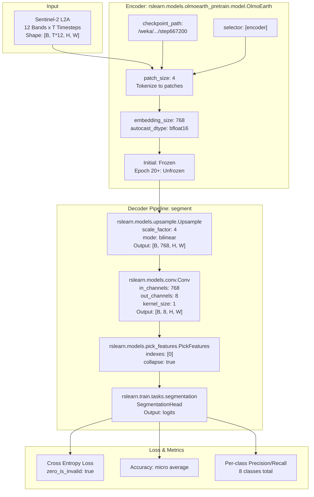
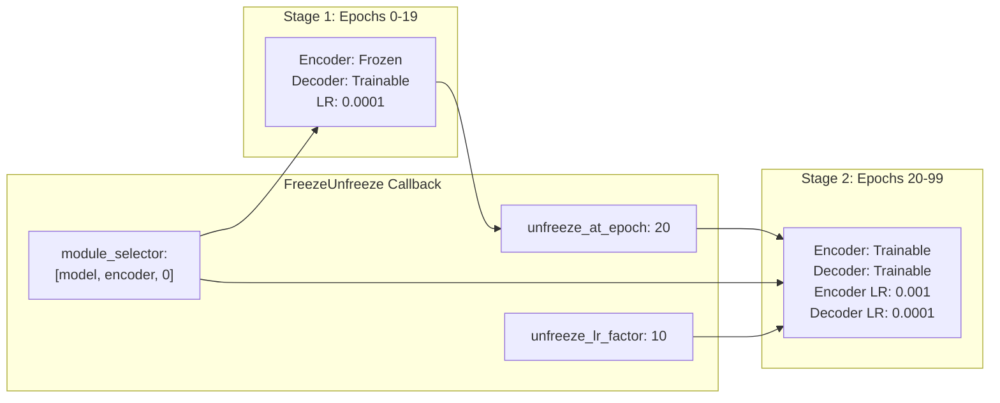
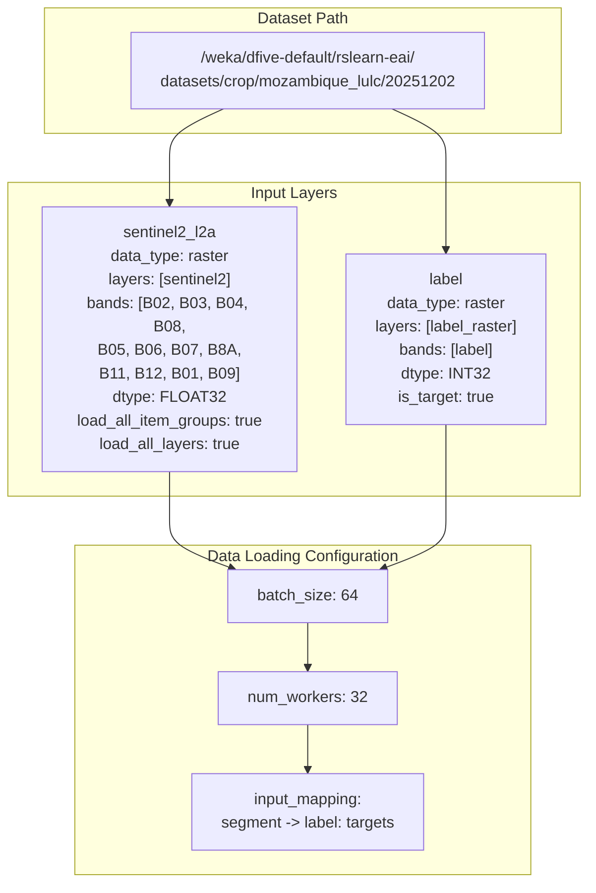
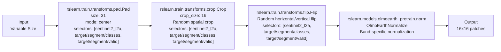
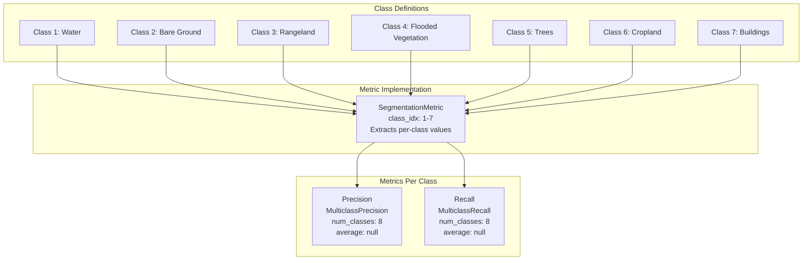

<!-- source: DeepWiki mcp.deepwiki.com · repo allenai/olmoearth_projects · page 5 Model Training · fetched 2026-10-26 -->

# Model Training

<details>
<summary>Relevant source files</summary>

The following files were used as context for generating this wiki page:

- [olmoearth_run_data/mozambique_lulc/dataset.json](olmoearth_run_data/mozambique_lulc/dataset.json)
- [olmoearth_run_data/mozambique_lulc/model.yaml](olmoearth_run_data/mozambique_lulc/model.yaml)
- [olmoearth_run_data/mozambique_lulc/olmoearth_run.yaml](olmoearth_run_data/mozambique_lulc/olmoearth_run.yaml)
- [olmoearth_run_data/mozambique_lulc/rslp_finetuning.yaml](olmoearth_run_data/mozambique_lulc/rslp_finetuning.yaml)
- [olmoearth_run_data/mozambique_lulc/rslp_finetuning_croptype.yaml](olmoearth_run_data/mozambique_lulc/rslp_finetuning_croptype.yaml)
- [olmoearth_run_data/mozambique_lulc/rslp_finetuning_croptype_in_season_novmar.yaml](olmoearth_run_data/mozambique_lulc/rslp_finetuning_croptype_in_season_novmar.yaml)
- [olmoearth_run_data/mozambique_lulc/rslp_finetuning_in_season_novmar.yaml](olmoearth_run_data/mozambique_lulc/rslp_finetuning_in_season_novmar.yaml)

</details>


This document describes the model training system in the olmoearth_projects repository, which uses the rslearn framework to fine-tune OlmoEarth foundation models for specific remote sensing tasks. Training is configured through YAML files that define model architecture, data loading, optimization, and callbacks.

For configuration file schemas, see [Training Configuration Files](#5.1). For details on the OlmoEarth encoder architecture, see [OlmoEarth Encoder Architecture](#5.2). For fine-tuning strategies, see [Fine-tuning Process](#5.3). For data loading details, see [Data Module and Transforms](#5.4). For evaluation metrics, see [Metrics and Evaluation](#5.5).

## Training System Overview

The training system uses PyTorch Lightning through the rslearn framework. All training is orchestrated by the `RslearnLightningModule` class with configurations specified in YAML files.



**Sources:** [olmoearth_run_data/mozambique_lulc/rslp_finetuning.yaml:1-268](), [olmoearth_run_data/mozambique_lulc/model.yaml:1-278]()

## Configuration Structure

Training configurations are organized into three main sections: `model`, `data`, and `trainer`. Each section is specified using PyTorch Lightning's CLI configuration format with `class_path` and `init_args` patterns.

### Model Configuration Section

The model configuration defines the neural network architecture through a hierarchical structure:

| Component | Class Path | Key Parameters |
|-----------|-----------|----------------|
| Lightning Module | `rslearn.train.lightning_module.RslearnLightningModule` | `lr`, `scheduler` |
| Task Model | `rslearn.models.multitask.MultiTaskModel` | `encoder`, `decoders`, `loss_weights` |
| Encoder | `rslearn.models.olmoearth_pretrain.model.OlmoEarth` | `checkpoint_path`, `patch_size`, `autocast_dtype` |
| Decoder Upsample | `rslearn.models.upsample.Upsample` | `scale_factor: 4`, `mode: bilinear` |
| Decoder Conv | `rslearn.models.conv.Conv` | `in_channels: 768`, `out_channels: 8` |
| Task Head | `rslearn.train.tasks.segmentation.SegmentationHead` | - |

**Sources:** [olmoearth_run_data/mozambique_lulc/rslp_finetuning.yaml:1-41](), [olmoearth_run_data/mozambique_lulc/model.yaml:1-31]()

### Data Configuration Section

The data configuration specifies dataset location, input/output layers, and task definitions:



**Sources:** [olmoearth_run_data/mozambique_lulc/rslp_finetuning.yaml:50-209](), [olmoearth_run_data/mozambique_lulc/model.yaml:32-191]()

### Trainer Configuration Section

The trainer configuration sets training duration, callbacks, and logging:

| Parameter | Value | Purpose |
|-----------|-------|---------|
| `max_epochs` | 100 | Maximum training epochs |
| `callbacks[0]` | `LearningRateMonitor` | Log learning rate per epoch |
| `callbacks[1]` | `ModelCheckpoint` | Save best model on `val_segment/accuracy` |
| `callbacks[2]` | `FreezeUnfreeze` | Unfreeze encoder at epoch 20 |
| `logger` | `WandbLogger` | Log metrics to Weights & Biases |

**Sources:** [olmoearth_run_data/mozambique_lulc/rslp_finetuning.yaml:249-268](), [olmoearth_run_data/mozambique_lulc/model.yaml:246-278]()

## Model Architecture

The training system uses a encoder-decoder architecture where the OlmoEarth foundation model serves as the encoder and task-specific decoders are added for each task.



**Sources:** [olmoearth_run_data/mozambique_lulc/rslp_finetuning.yaml:7-38](), [olmoearth_run_data/mozambique_lulc/model.yaml:7-25]()

### OlmoEarth Encoder Initialization

The OlmoEarth encoder is initialized from a pre-trained checkpoint with specific configuration:

```yaml
class_path: rslearn.models.olmoearth_pretrain.model.OlmoEarth
init_args:
  checkpoint_path: /weka/dfive-default/helios/checkpoints/joer/phase2.0_base_lr0.0001_wd0.02/step667200
  selector: ["encoder"]
  patch_size: 4
  random_initialization: false
  embedding_size: null
  autocast_dtype: bfloat16
```

The `selector: ["encoder"]` parameter indicates that only the encoder portion of the checkpoint is loaded. The `patch_size: 4` divides input images into 4x4 pixel patches for processing. The `autocast_dtype: bfloat16` enables mixed-precision training for efficiency.

**Sources:** [olmoearth_run_data/mozambique_lulc/rslp_finetuning.yaml:8-16]()

### Decoder Architecture

The decoder pipeline consists of three sequential modules followed by a task head:

1. **Upsample Layer**: Upsamples features by 4x using bilinear interpolation to match input resolution
2. **Convolution Layer**: 1x1 convolution projecting 768 encoder features to 8 class channels
3. **PickFeatures**: Selects and collapses specific feature dimensions
4. **SegmentationHead**: Applies task-specific processing and loss computation

**Sources:** [olmoearth_run_data/mozambique_lulc/rslp_finetuning.yaml:18-38](), [olmoearth_run_data/mozambique_lulc/model.yaml:14-25]()

## Training Loop and Optimization

The training loop is managed by PyTorch Lightning's `Trainer` with custom schedulers and callbacks.

### Learning Rate and Scheduling

The system uses a plateau-based learning rate scheduler that reduces the learning rate when validation metrics plateau:

| Parameter | Value | Description |
|-----------|-------|-------------|
| Initial LR | 0.0001 | Starting learning rate |
| Scheduler | `PlateauScheduler` | Reduces LR on plateau |
| Factor | 0.2 | LR multiplier on reduction |
| Patience | 2 | Epochs to wait before reduction |
| Min LR | 0 | Minimum learning rate |
| Cooldown | 10 | Epochs to wait after reduction |

**Sources:** [olmoearth_run_data/mozambique_lulc/rslp_finetuning.yaml:42-49]()

### FreezeUnfreeze Training Strategy

The `FreezeUnfreeze` callback implements a two-stage training strategy:



This strategy first trains only the decoder while keeping the encoder frozen, then unfreezes the encoder with a 10x higher learning rate for fine-tuning. The `module_selector: ["model", "encoder", 0]` specifies the exact module path to freeze/unfreeze.

**Sources:** [olmoearth_run_data/mozambique_lulc/rslp_finetuning.yaml:261-265](), [olmoearth_run_data/mozambique_lulc/model.yaml:265-268]()

## Data Loading

The `RslearnDataModule` handles data loading, batching, and preprocessing for training, validation, and testing.

### Dataset Configuration

Datasets are loaded from rslearn archive format with specified input layers and target labels:



**Sources:** [olmoearth_run_data/mozambique_lulc/rslp_finetuning.yaml:53-209]()

### Split Configurations

The data module uses separate configurations for training, validation, and testing:

| Split | Patch Size | Groups | Split Tag | Load Mode |
|-------|-----------|--------|-----------|-----------|
| train | Dynamic (crop to 16) | ["gaza", "manica", "zambezia"] | "train" | Random crops with transforms |
| val | 16 | ["gaza", "manica", "zambezia"] | "val" | Fixed patches |
| test | 16 | ["gaza", "manica", "zambezia"] | "test" | Fixed patches |

Training uses random cropping and augmentation while validation and testing use fixed patch sizes without augmentation.

**Sources:** [olmoearth_run_data/mozambique_lulc/rslp_finetuning.yaml:218-248]()

## Transforms Pipeline

The training pipeline applies different transforms for training versus validation/testing.

### Default Transforms

All data loading configurations include normalization:

```yaml
default_config:
  transforms:
    - class_path: rslearn.models.olmoearth_pretrain.norm.OlmoEarthNormalize
      init_args:
        band_names:
          sentinel2_l2a: ["B02", "B03", "B04", "B08", "B05", "B06", "B07", "B8A", "B11", "B12", "B01", "B09"]
```

The `OlmoEarthNormalize` transform applies band-specific normalization to match the pre-training distribution.

**Sources:** [olmoearth_run_data/mozambique_lulc/rslp_finetuning.yaml:212-217]()

### Training Transforms

Training data undergoes a sequence of augmentation transforms:



The padding with size 31 pixels creates a 31-pixel border around the data to enable edge handling during cropping. The final crop to 16x16 provides the training patch size.

**Sources:** [olmoearth_run_data/mozambique_lulc/rslp_finetuning.yaml:218-235]()

### Validation/Test Transforms

Validation and test data use only normalization without augmentation:

- **Patch Size**: Fixed 16x16 pixels
- **Overlap**: None during validation/test
- **Transforms**: Only `OlmoEarthNormalize`

**Sources:** [olmoearth_run_data/mozambique_lulc/rslp_finetuning.yaml:239-248]()

### Prediction Configuration

For inference, the model uses overlapping patches to ensure smooth boundaries:

```yaml
predict_config:
  load_all_patches: true
  patch_size: 16
  overlap_ratio: 0.25  # 4 / 16
  skip_targets: true
  transforms:
    - class_path: rslearn.models.olmoearth_pretrain.norm.OlmoEarthNormalize
```

The `overlap_ratio: 0.25` means 4 pixels of overlap on each side of 16x16 patches, enabling smooth merging during inference.

**Sources:** [olmoearth_run_data/mozambique_lulc/model.yaml:236-245]()

## Task Definition and Metrics

The training system uses `SegmentationTask` with comprehensive per-class metrics.

### Segmentation Task Configuration

The segmentation task is configured with the following parameters:

| Parameter | Value | Purpose |
|-----------|-------|---------|
| `num_classes` | 8 | Number of classification classes |
| `zero_is_invalid` | true | Class 0 treated as invalid/ignore |
| `metric_kwargs.average` | "micro" | Micro-averaged overall accuracy |

**Sources:** [olmoearth_run_data/mozambique_lulc/rslp_finetuning.yaml:73-79]()

### Per-Class Metrics

For each of the 7 valid classes (excluding class 0), the system tracks precision and recall:



Each metric is defined using the `SegmentationMetric` wrapper that extracts the specific class index from the multi-class metric output:

```yaml
water_precision:
  class_path: rslearn.train.tasks.segmentation.SegmentationMetric
  init_args:
    metric:
      class_path: torchmetrics.classification.MulticlassPrecision
      init_args:
        num_classes: 8
        average: null
    class_idx: 1
```

**Sources:** [olmoearth_run_data/mozambique_lulc/rslp_finetuning.yaml:80-206]()

## Checkpointing and Logging

The training system uses multiple callbacks for model checkpointing and metric logging.

### Model Checkpointing

The `ModelCheckpoint` callback saves model weights based on validation performance:

| Parameter | Value | Description |
|-----------|-------|-------------|
| `save_top_k` | 1 | Save only best checkpoint |
| `save_last` | true | Also save last checkpoint |
| `monitor` | `val_segment/accuracy` | Metric to monitor |
| `mode` | max | Save checkpoint with maximum metric |

This configuration saves two checkpoints: one with the highest validation accuracy and one from the final epoch.

**Sources:** [olmoearth_run_data/mozambique_lulc/rslp_finetuning.yaml:255-260]()

### Learning Rate Monitoring

The `LearningRateMonitor` callback logs the current learning rate:

```yaml
callbacks:
  - class_path: lightning.pytorch.callbacks.LearningRateMonitor
    init_args:
      logging_interval: "epoch"
```

This logs learning rates once per epoch, useful for tracking the `PlateauScheduler` behavior and `FreezeUnfreeze` learning rate adjustments.

**Sources:** [olmoearth_run_data/mozambique_lulc/rslp_finetuning.yaml:252-254]()

### Experiment Tracking

Training experiments are tracked using Weights & Biases:

```yaml
logger:
  class_path: lightning.pytorch.loggers.WandbLogger
  init_args:
    project: ${WANDB_PROJECT}
    name: ${WANDB_NAME}
    entity: ${WANDB_ENTITY}
```

The `rslp_project` and `rslp_experiment` fields at the end of the configuration file provide experiment metadata:

```yaml
rslp_project: 2025_09_18_mozambique_lulc
rslp_experiment: mozambique_lulc_helios_base_S2_ts_ws16_ps1_gaza
```

**Sources:** [olmoearth_run_data/mozambique_lulc/model.yaml:249-254](), [olmoearth_run_data/mozambique_lulc/rslp_finetuning.yaml:266-267]()

## Data Source Configuration

The `dataset.json` file defines how satellite imagery is queried and loaded during training.

### Sentinel-2 Configuration

Sentinel-2 data is configured with temporal mosaicking and harmonization:

```json
{
  "layers": {
    "sentinel2": {
      "band_sets": [{"bands": ["B01", "B02", "B03", "B04", "B05", "B06", "B07", "B08", "B8A", "B09", "B11", "B12"], "dtype": "uint16"}],
      "data_source": {
        "class_path": "rslearn.data_sources.planetary_computer.Sentinel2",
        "ingest": false,
        "init_args": {
          "cache_dir": "cache/planetary_computer",
          "harmonize": true,
          "sort_by": "eo:cloud_cover"
        },
        "query_config": {
          "max_matches": 8,
          "min_matches": 8,
          "period_duration": "30d",
          "space_mode": "PER_PERIOD_MOSAIC"
        }
      },
      "type": "raster"
    }
  }
}
```

Key parameters:

- **harmonize**: `true` - Applies radiometric harmonization across Sentinel-2A/2B satellites
- **max_matches** / **min_matches**: 8 - Loads exactly 8 temporal observations
- **period_duration**: "30d" - Each observation spans a 30-day period
- **space_mode**: "PER_PERIOD_MOSAIC" - Creates cloud-free mosaics within each period
- **sort_by**: "eo:cloud_cover" - Prioritizes images with less cloud coverage

**Sources:** [olmoearth_run_data/mozambique_lulc/dataset.json:25-62]()

### Layer Definitions

The dataset includes three layer types:

| Layer | Type | Bands | Data Type | Purpose |
|-------|------|-------|-----------|---------|
| `sentinel2` | raster | 12 optical bands | uint16 | Input imagery |
| `label` | raster | category | int32 | Ground truth labels |
| `output` | raster | output | float32 | Model predictions |

**Sources:** [olmoearth_run_data/mozambique_lulc/dataset.json:2-24]()

## Training Variants

The repository includes multiple training configuration variants for different tasks and temporal configurations.

### Standard Configuration

- **File**: `rslp_finetuning.yaml`
- **Purpose**: LULC classification using single-timestep Sentinel-2
- **Classes**: 8 (Water, Bare Ground, Rangeland, Flooded Vegetation, Trees, Cropland, Buildings, plus invalid)
- **Groups**: gaza, manica, zambezia provinces

**Sources:** [olmoearth_run_data/mozambique_lulc/rslp_finetuning.yaml:1-268]()

### Crop Type Configuration

- **File**: `rslp_finetuning_croptype.yaml`
- **Purpose**: Crop type classification
- **Classes**: 8 (Corn, Cassava, Rice, Sesame, Beans, Millet, Sorghum, plus invalid)
- **Groups**: crop_type

**Sources:** [olmoearth_run_data/mozambique_lulc/rslp_finetuning_croptype.yaml:1-268]()

### Multi-Timestep Configuration

- **File**: `rslp_finetuning_in_season_novmar.yaml`
- **Purpose**: In-season LULC classification using 5 temporal observations
- **Layers**: `["sentinel2", "sentinel2.1", "sentinel2.2", "sentinel2.3", "sentinel2.4"]`
- **Temporal Coverage**: November-March growing season

This configuration loads 5 separate temporal layers (60 total bands = 12 bands × 5 timesteps) to capture phenological changes during the growing season.

**Sources:** [olmoearth_run_data/mozambique_lulc/rslp_finetuning_in_season_novmar.yaml:54-61]()

---

