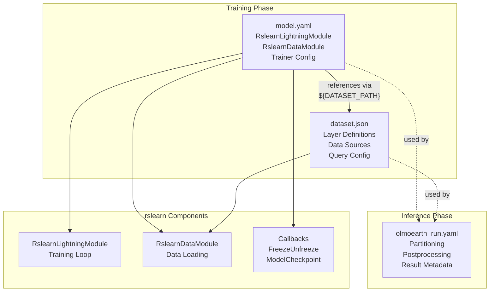
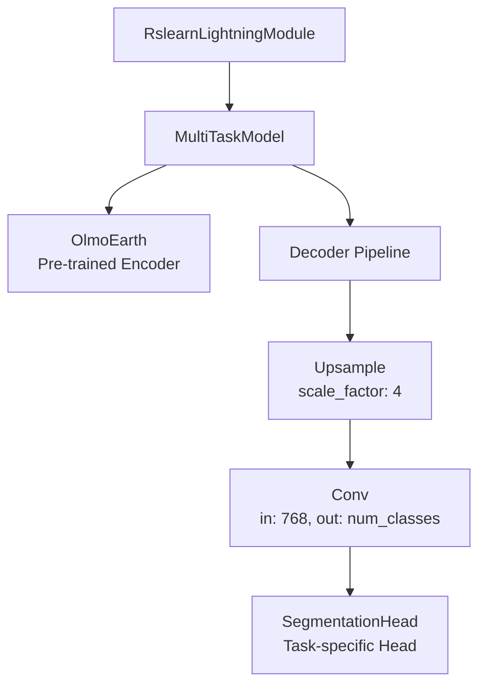
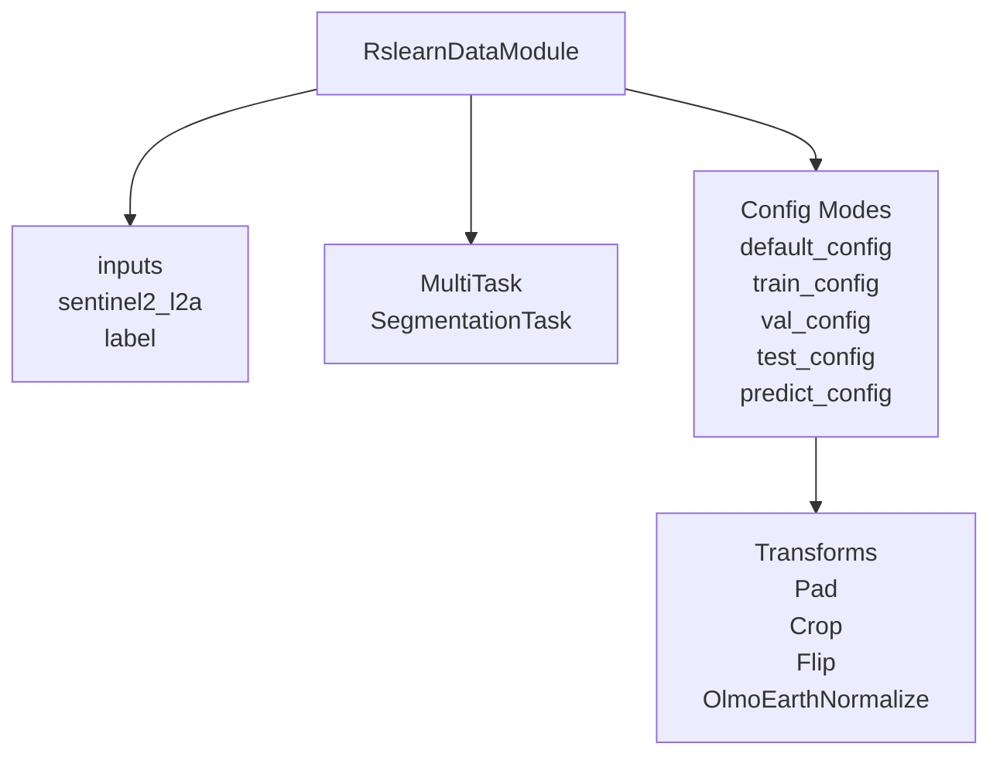
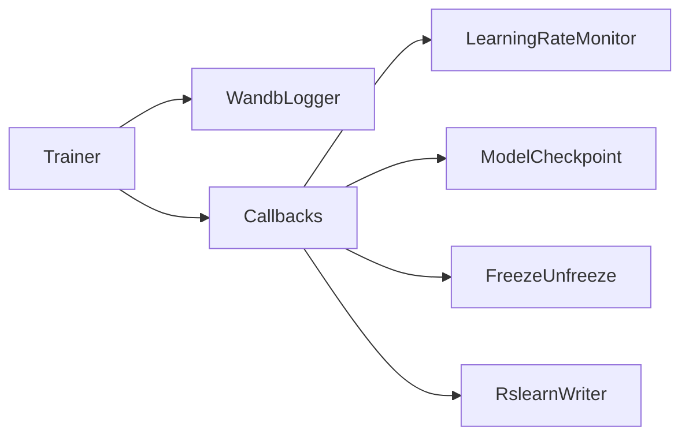
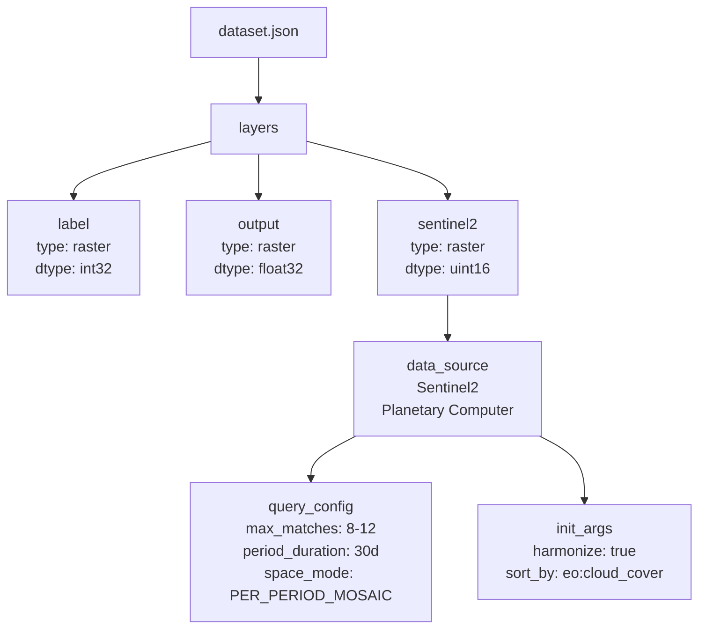
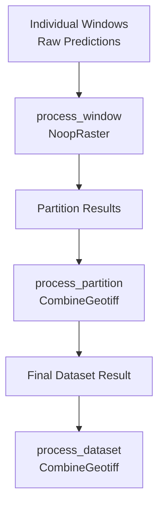
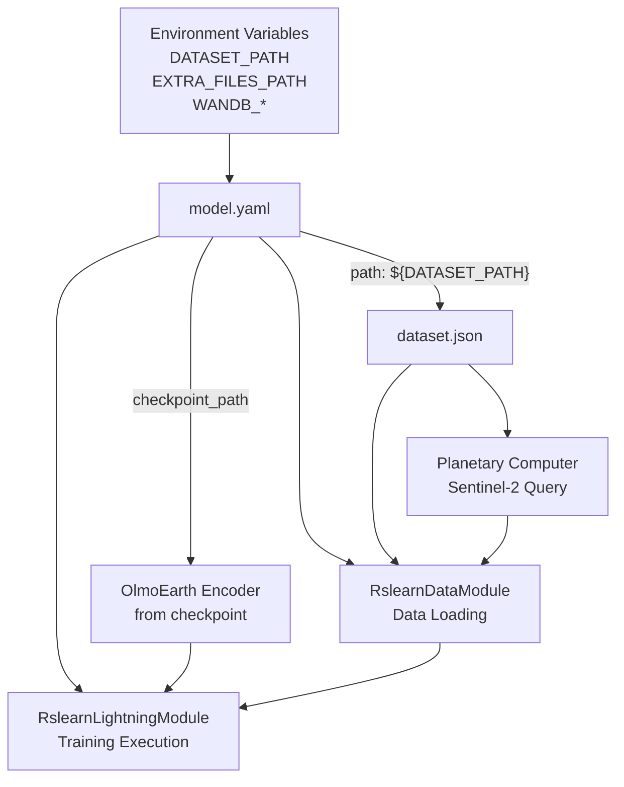

<!-- source: DeepWiki mcp.deepwiki.com · repo allenai/olmoearth_projects · page 5.1 Training Configuration Files · fetched 2026-10-26 -->

# Training Configuration Files

<details>
<summary>Relevant source files</summary>

The following files were used as context for generating this wiki page:

- [olmoearth_run_data/awf/dataset.json](olmoearth_run_data/awf/dataset.json)
- [olmoearth_run_data/awf/olmoearth_run.yaml](olmoearth_run_data/awf/olmoearth_run.yaml)
- [olmoearth_run_data/mozambique_lulc/dataset.json](olmoearth_run_data/mozambique_lulc/dataset.json)
- [olmoearth_run_data/mozambique_lulc/model.yaml](olmoearth_run_data/mozambique_lulc/model.yaml)
- [olmoearth_run_data/mozambique_lulc/olmoearth_run.yaml](olmoearth_run_data/mozambique_lulc/olmoearth_run.yaml)
- [olmoearth_run_data/nandi/dataset.json](olmoearth_run_data/nandi/dataset.json)
- [olmoearth_run_data/nandi/olmoearth_run.yaml](olmoearth_run_data/nandi/olmoearth_run.yaml)

</details>


## Purpose and Scope

This document describes the structure and parameters of the three primary configuration files used to train OlmoEarth models: `model.yaml`, `dataset.json`, and `olmoearth_run.yaml`. These YAML and JSON files define the model architecture, data loading pipelines, training parameters, and inference settings.

For information about the actual training process and callbacks, see [Fine-tuning Process](#5.3). For details about data transforms and the data module implementation, see [Data Module and Transforms](#5.4). For inference pipeline configuration details, see [olmoearth_run Pipeline](#7.1).

## Configuration File Overview

Training an OlmoEarth model requires three configuration files that work together to define the complete training and inference pipeline:

| Configuration File | Purpose | Primary Contents |
|-------------------|---------|------------------|
| `model.yaml` | Training configuration | Model architecture, Lightning module parameters, data module setup, trainer callbacks |
| `dataset.json` | Data source specification | Layer definitions, band configurations, Planetary Computer query parameters |
| `olmoearth_run.yaml` | Inference and data preparation | Window preparation, partitioning strategies, postprocessing, result metadata |

**Configuration File Relationships**



**Sources:** [olmoearth_run_data/mozambique_lulc/model.yaml:1-278](), [olmoearth_run_data/mozambique_lulc/dataset.json:1-64](), [olmoearth_run_data/mozambique_lulc/olmoearth_run.yaml:1-81]()

## model.yaml Structure

The `model.yaml` file is the primary training configuration file containing three top-level sections: `model`, `data`, and `trainer`.

### model Section

Defines the Lightning module and model architecture using the `class_path` pattern for component instantiation.

**Model Architecture Hierarchy**



**Sources:** [olmoearth_run_data/mozambique_lulc/model.yaml:1-31]()

**Key Parameters:**

| Parameter | Type | Description | Example Value |
|-----------|------|-------------|---------------|
| `class_path` | string | Fully qualified class name | `rslearn.train.lightning_module.RslearnLightningModule` |
| `encoder.checkpoint_path` | string | Path to pre-trained encoder | `${EXTRA_FILES_PATH}` |
| `encoder.selector` | list | Components to load from checkpoint | `["encoder"]` |
| `encoder.patch_size` | int | Patch size for vision transformer | `4` |
| `decoders` | dict | Task-specific decoder pipelines | See decoder configuration |
| `lr` | float | Learning rate | `0.0001` |
| `plateau` | bool | Enable plateau learning rate scheduler | `true` |
| `plateau_factor` | float | LR reduction factor on plateau | `0.2` |
| `plateau_patience` | int | Epochs to wait before reducing LR | `2` |

**Sources:** [olmoearth_run_data/mozambique_lulc/model.yaml:1-31]()

**Decoder Configuration:**

Decoders are defined per task (e.g., `segment`) as a list of sequential operations:

```yaml
decoders:
  segment:
    - class_path: rslearn.models.upsample.Upsample
      init_args:
        scale_factor: 4
    - class_path: rslearn.models.conv.Conv
      init_args:
        in_channels: 768
        out_channels: 8
        kernel_size: 1
    - class_path: rslearn.train.tasks.segmentation.SegmentationHead
```

**Sources:** [olmoearth_run_data/mozambique_lulc/model.yaml:13-25]()

### data Section

Defines the `RslearnDataModule` configuration including input layers, task definitions, batch processing, and data transforms.

**Data Module Configuration Structure**



**Sources:** [olmoearth_run_data/mozambique_lulc/model.yaml:32-245]()

**Input Layer Configuration:**

Each input layer specifies:

| Parameter | Description | Example |
|-----------|-------------|---------|
| `data_type` | Type of data layer | `"raster"` |
| `layers` | Layer names from dataset.json | `["sentinel2"]` |
| `bands` | Band names to load | `["B02", "B03", "B04", ...]` |
| `passthrough` | Pass data through without modification | `true` |
| `dtype` | Data type for loading | `FLOAT32`, `INT32` |
| `is_target` | Indicates target/label data | `true` (for labels) |
| `load_all_item_groups` | Load all temporal groups | `true` |
| `load_all_layers` | Load all layer instances | `true` |

**Sources:** [olmoearth_run_data/mozambique_lulc/model.yaml:36-50]()

**Task Configuration:**

```yaml
task:
  class_path: rslearn.train.tasks.multi_task.MultiTask
  init_args:
    tasks:
      segment:
        class_path: rslearn.train.tasks.segmentation.SegmentationTask
        init_args:
          num_classes: 8
          zero_is_invalid: true
          metric_kwargs:
            average: "micro"
          other_metrics:
            water_precision:
              class_path: rslearn.train.tasks.segmentation.SegmentationMetric
```

The task configuration includes per-class metrics for precision and recall tracking. See [Metrics and Evaluation](#5.5) for details on metric configuration.

**Sources:** [olmoearth_run_data/mozambique_lulc/model.yaml:51-188]()

**Configuration Modes:**

Five configuration modes control data loading behavior for different training phases:

| Config Mode | Purpose | Key Parameters |
|-------------|---------|----------------|
| `default_config` | Shared base configuration | `transforms` (Pad, OlmoEarthNormalize) |
| `train_config` | Training data loading | `transforms` (Pad, Crop, Flip), `groups`, `tags: {split: "train"}` |
| `val_config` | Validation data loading | `patch_size: 16`, `groups`, `tags: {split: "test"}` |
| `test_config` | Test data loading | Same as validation |
| `predict_config` | Inference data loading | `load_all_patches: true`, `overlap_ratio: 0.25`, `skip_targets: true` |

**Sources:** [olmoearth_run_data/mozambique_lulc/model.yaml:194-245]()

**Transform Pipeline:**

Training transforms include data augmentation:

```yaml
train_config:
  transforms:
    - class_path: rslearn.train.transforms.pad.Pad
      init_args:
        size: 31
        mode: "center"
    - class_path: rslearn.train.transforms.crop.Crop
      init_args:
        crop_size: 16
    - class_path: rslearn.train.transforms.flip.Flip
    - class_path: rslearn.models.olmoearth_pretrain.norm.OlmoEarthNormalize
      init_args:
        band_names:
          sentinel2_l2a: ["B02", "B03", "B04", ...]
```

**Sources:** [olmoearth_run_data/mozambique_lulc/model.yaml:206-222]()

### trainer Section

Defines PyTorch Lightning trainer configuration including callbacks, logging, and checkpointing.

**Trainer Component Hierarchy**



**Sources:** [olmoearth_run_data/mozambique_lulc/model.yaml:246-278]()

**Key Trainer Parameters:**

| Parameter | Value | Description |
|-----------|-------|-------------|
| `max_epochs` | `100` | Maximum training epochs |
| `default_root_dir` | `${TRAINER_DATA_PATH}` | Directory for logs and checkpoints |

**Callback Configuration:**

```yaml
callbacks:
  - class_path: lightning.pytorch.callbacks.LearningRateMonitor
    init_args:
      logging_interval: "epoch"
  
  - class_path: lightning.pytorch.callbacks.ModelCheckpoint
    init_args:
      save_top_k: 1
      save_last: true
      monitor: val_loss
      mode: min
  
  - class_path: rslearn.train.callbacks.freeze_unfreeze.FreezeUnfreeze
    init_args:
      module_selector: ["model", "encoder", 0]
      unfreeze_at_epoch: 2
  
  - class_path: rslearn.train.prediction_writer.RslearnWriter
    init_args:
      path: placeholder
      output_layer: ${PREDICTION_OUTPUT_LAYER}
      selector: ["segment"]
      merger:
        class_path: rslearn.train.prediction_writer.RasterMerger
        init_args:
          padding: 2
```

The `FreezeUnfreeze` callback implements transfer learning by freezing the encoder initially and unfreezing at epoch 2. See [Fine-tuning Process](#5.3) for details.

**Sources:** [olmoearth_run_data/mozambique_lulc/model.yaml:255-278]()

## dataset.json Structure

The `dataset.json` file defines data layers, their band configurations, and data source specifications for querying satellite imagery.

**dataset.json Layer Structure**



**Sources:** [olmoearth_run_data/mozambique_lulc/dataset.json:1-64]()

### Layer Definitions

Each layer contains `band_sets` specifying bands and data types:

```json
{
  "layers": {
    "label": {
      "band_sets": [
        {
          "bands": ["category"],
          "dtype": "int32"
        }
      ],
      "type": "raster"
    },
    "sentinel2": {
      "band_sets": [
        {
          "bands": ["B01", "B02", "B03", "B04", "B05", "B06", 
                    "B07", "B08", "B8A", "B09", "B11", "B12"],
          "dtype": "uint16"
        }
      ],
      "type": "raster",
      "data_source": { ... }
    }
  }
}
```

**Sources:** [olmoearth_run_data/mozambique_lulc/dataset.json:2-62]()

### Data Source Configuration

For Sentinel-2 imagery, the data source configuration specifies:

| Parameter | Description | Example Values |
|-----------|-------------|----------------|
| `class_path` | Data source implementation | `rslearn.data_sources.planetary_computer.Sentinel2` |
| `ingest` | Whether to ingest data locally | `false` |
| `harmonize` | Apply cross-sensor harmonization | `true` |
| `sort_by` | Metadata field for sorting images | `"eo:cloud_cover"` |
| `cache_dir` | Local cache directory | `"cache/planetary_computer"` |

**Sources:** [olmoearth_run_data/mozambique_lulc/dataset.json:45-52]()

### Query Configuration

The `query_config` section controls temporal mosaicking and image selection:

| Parameter | Mozambique LULC | AWF/Nandi | Description |
|-----------|-----------------|-----------|-------------|
| `max_matches` | `8` | `12` | Maximum images per period |
| `min_matches` | `8` | `12` | Minimum images required |
| `period_duration` | `"30d"` | `"30d"` | Duration of each temporal period |
| `space_mode` | `"PER_PERIOD_MOSAIC"` | `"PER_PERIOD_MOSAIC"` | Spatial mosaicking strategy |

**Sources:** [olmoearth_run_data/mozambique_lulc/dataset.json:53-58](), [olmoearth_run_data/awf/dataset.json:53-58](), [olmoearth_run_data/nandi/dataset.json:53-58]()

## olmoearth_run.yaml Structure

The `olmoearth_run.yaml` file configures window preparation, partitioning strategies, postprocessing operations, and inference result metadata. This file is used both for creating training datasets and running inference.

### Window Preparation Configuration

**Window Preparation Pipeline**


**Sources:** [olmoearth_run_data/mozambique_lulc/olmoearth_run.yaml:29-48]()

```yaml
window_prep:
  sampler:
    class_path: olmoearth_run.runner.tools.samplers.noop_sampler.NoopSampler
  labeled_window_preparer:
    class_path: olmoearth_run.runner.tools.labeled_window_preparers.point_to_raster_window_preparer.PointToRasterWindowPreparer
    init_args:
      window_buffer: 31  # in pixels
      window_resolution: 10.0
      dtype: INT32
      nodata_value: 255
  data_splitter:
    class_path: olmoearth_run.runner.tools.data_splitters.spatial_data_splitter.SpatialDataSplitter
    init_args:
      train_prop: 0.75
      val_prop: 0.25
      test_prop: 0.0
      grid_size: 128  # in pixels
```

**Sources:** [olmoearth_run_data/mozambique_lulc/olmoearth_run.yaml:29-48]()

### Partitioning Strategies

Two partitioning strategies define hierarchical spatial subdivision:

| Strategy | Grid Size | Purpose | Projection |
|----------|-----------|---------|------------|
| `partition_request_geometry` | `0.25` - `1.0` degrees | Coarse geographic partitioning | WGS84 (EPSG:4326) |
| `prepare_window_geometries` | `1024` pixels | Fine processing windows | EPSG:3857 or UTM (auto-selected) |

```yaml
partition_strategies:
  partition_request_geometry:
    class_path: olmoearth_run.runner.tools.partitioners.grid_partitioner.GridPartitioner
    init_args:
      grid_size: 0.25
  
  prepare_window_geometries:
    class_path: olmoearth_run.runner.tools.partitioners.grid_partitioner.GridPartitioner
    init_args:
      grid_size: 1024
      output_projection:
        class_path: rslearn.utils.geometry.Projection
        init_args:
          crs: EPSG:3857
          x_resolution: 10
          y_resolution: -10
      use_utm: true
```

**Sources:** [olmoearth_run_data/mozambique_lulc/olmoearth_run.yaml:50-67]()

### Postprocessing Strategies

Three-level postprocessing hierarchy for aggregating inference results:

**Postprocessing Hierarchy**



**Sources:** [olmoearth_run_data/mozambique_lulc/olmoearth_run.yaml:68-81]()

```yaml
postprocessing_strategies:
  process_window:
    class_path: olmoearth_run.runner.tools.postprocessors.noop_raster.NoopRaster
  
  process_partition:
    class_path: olmoearth_run.runner.tools.postprocessors.combine_geotiff.CombineGeotiff
    init_args:
      nodata_value: 255
  
  process_dataset:
    class_path: olmoearth_run.runner.tools.postprocessors.combine_geotiff.CombineGeotiff
    init_args:
      nodata_value: 255
```

**Sources:** [olmoearth_run_data/mozambique_lulc/olmoearth_run.yaml:68-81]()

### Inference Results Configuration

Defines output metadata including class labels, colors, and value mappings:

```yaml
inference_results_config:
  data_type: RASTER
  classification_fields:
    - property_name: crop_type_classification
      band_index: 1
      allowed_values:
        - value: 1
          label: Water
          color: [136, 33, 233]
        - value: 2
          label: Bare Ground
          color: [124, 67, 18]
        - value: 3
          label: Rangeland
          color: [51, 160, 44]
```

This configuration enables automatic visualization in GIS tools and the OlmoEarth Studio interface.

**Sources:** [olmoearth_run_data/mozambique_lulc/olmoearth_run.yaml:1-27]()

## Environment Variables and Placeholders

Configuration files use environment variable placeholders that are resolved at runtime:

| Placeholder | Description | Typical Value |
|-------------|-------------|---------------|
| `${DATASET_PATH}` | Path to rslearn dataset | `/path/to/dataset.tar` |
| `${EXTRA_FILES_PATH}` | Path to model checkpoint | `/path/to/checkpoint.ckpt` |
| `${TRAINER_DATA_PATH}` | Training output directory | `/path/to/training_output` |
| `${NUM_WORKERS}` | Data loader worker processes | `4` - `16` |
| `${WANDB_PROJECT}` | Weights & Biases project name | `"olmoearth-finetuning"` |
| `${WANDB_NAME}` | Experiment run name | `"mozambique-lulc-v1"` |
| `${WANDB_ENTITY}` | W&B entity/team name | `"allenai"` |
| `${PREDICTION_OUTPUT_LAYER}` | Output layer for predictions | `"output"` |

**Sources:** [olmoearth_run_data/mozambique_lulc/model.yaml:10-11](), [olmoearth_run_data/mozambique_lulc/model.yaml:35-36](), [olmoearth_run_data/mozambique_lulc/model.yaml:248-254](), [olmoearth_run_data/mozambique_lulc/model.yaml:272]()

## Configuration Usage Examples

**Relationship Between Configurations During Training**



**Sources:** [olmoearth_run_data/mozambique_lulc/model.yaml:1-278](), [olmoearth_run_data/mozambique_lulc/dataset.json:1-64]()

### Common Configuration Patterns

**Multi-temporal Sentinel-2:**
- Mozambique LULC: 8 timesteps, 30-day periods
- AWF/Nandi: 12 timesteps, 30-day periods

**Spatial Resolution:**
- All models use 10m resolution (`x_resolution: 10`, `y_resolution: -10`)
- Window buffers typically 31 pixels (310m total window size)

**Data Splitting:**
- 75% training, 25% validation (standard across projects)
- Grid-based spatial splitting with 128-pixel grid cells

**Transform Pipelines:**
- Training: Pad → Crop → Flip → OlmoEarthNormalize
- Validation/Test: Pad → OlmoEarthNormalize
- Prediction: OlmoEarthNormalize only, with overlap handling

**Sources:** [olmoearth_run_data/mozambique_lulc/dataset.json:53-58](), [olmoearth_run_data/awf/dataset.json:53-58](), [olmoearth_run_data/mozambique_lulc/olmoearth_run.yaml:29-48](), [olmoearth_run_data/mozambique_lulc/model.yaml:194-245]()

---

