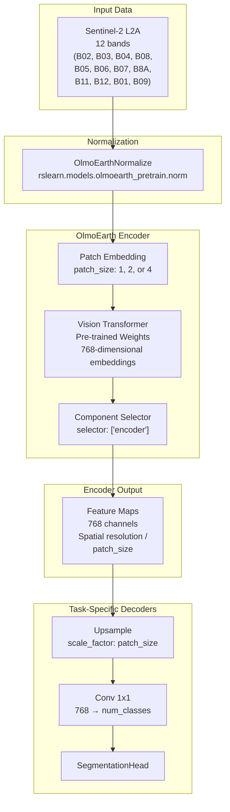
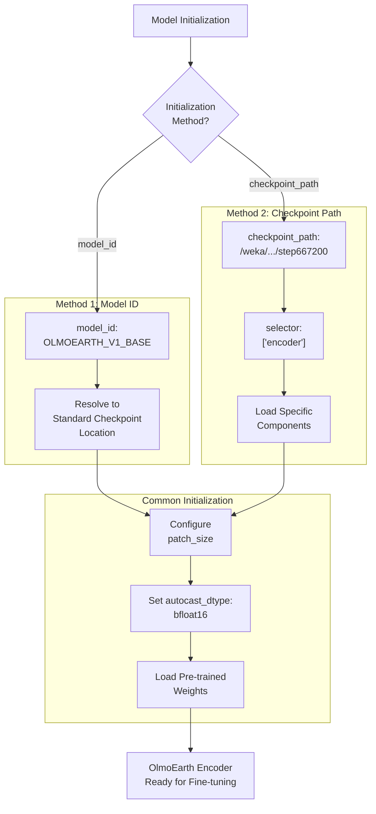
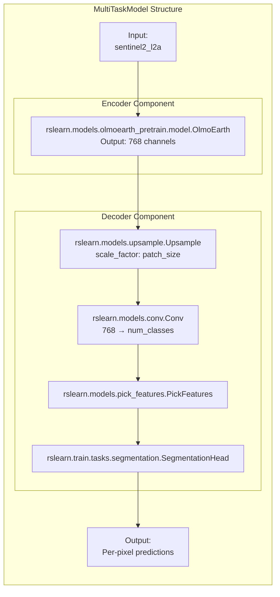

<!-- source: DeepWiki mcp.deepwiki.com · repo allenai/olmoearth_projects · page 5.2 OlmoEarth Encoder Architecture · fetched 2026-10-26 -->

# OlmoEarth Encoder Architecture

<details>
<summary>Relevant source files</summary>

The following files were used as context for generating this wiki page:

- [olmoearth_run_data/awf/model.yaml](olmoearth_run_data/awf/model.yaml)
- [olmoearth_run_data/mangrove/dataset.json](olmoearth_run_data/mangrove/dataset.json)
- [olmoearth_run_data/mangrove/model.yaml](olmoearth_run_data/mangrove/model.yaml)
- [olmoearth_run_data/mangrove/olmoearth_run.yaml](olmoearth_run_data/mangrove/olmoearth_run.yaml)
- [olmoearth_run_data/mozambique_lulc/rslp_finetuning.yaml](olmoearth_run_data/mozambique_lulc/rslp_finetuning.yaml)
- [olmoearth_run_data/mozambique_lulc/rslp_finetuning_croptype.yaml](olmoearth_run_data/mozambique_lulc/rslp_finetuning_croptype.yaml)
- [olmoearth_run_data/mozambique_lulc/rslp_finetuning_croptype_in_season_novmar.yaml](olmoearth_run_data/mozambique_lulc/rslp_finetuning_croptype_in_season_novmar.yaml)
- [olmoearth_run_data/mozambique_lulc/rslp_finetuning_in_season_novmar.yaml](olmoearth_run_data/mozambique_lulc/rslp_finetuning_in_season_novmar.yaml)
- [olmoearth_run_data/nandi/model.yaml](olmoearth_run_data/nandi/model.yaml)

</details>


## Purpose and Scope

This document describes the OlmoEarth pre-trained encoder architecture, its initialization parameters, output characteristics, and usage patterns across different fine-tuned models in the repository. The OlmoEarth encoder serves as the foundation model that is fine-tuned for all downstream tasks.

For information about fine-tuning the encoder, see [Fine-tuning Process](#5.3). For configuration file structure, see [Training Configuration Files](#5.1). For the decoder architectures that process encoder outputs, refer to the individual model documentation in [Available Models](#6).

## Encoder Overview

The OlmoEarth encoder is implemented in the `rslearn.models.olmoearth_pretrain.model.OlmoEarth` class. It is a vision transformer-based model pre-trained on diverse satellite imagery to extract spatial features from multispectral remote sensing data.

**Key Characteristics**:
- **Output dimensionality**: 768-channel feature maps
- **Architecture**: Vision transformer with configurable patch sizes
- **Input**: Multi-band satellite imagery (typically 12 Sentinel-2 bands)
- **Pre-training**: Phase 2.0 base model trained on diverse earth observation datasets

The encoder is used consistently across all models in the repository as the feature extraction backbone, with task-specific decoder heads attached for different applications.

**Sources**: [olmoearth_run_data/mozambique_lulc/rslp_finetuning.yaml:7-16](), [olmoearth_run_data/mangrove/model.yaml:9-13](), [olmoearth_run_data/awf/model.yaml:7-11]()

## Architecture Structure

The following diagram illustrates the OlmoEarth encoder architecture and its position in the complete model pipeline:



**Sources**: [olmoearth_run_data/mozambique_lulc/rslp_finetuning.yaml:7-38](), [olmoearth_run_data/mangrove/model.yaml:9-25]()

## Initialization Methods

The OlmoEarth encoder supports two initialization methods:

### Method 1: Model ID (Recommended)

Uses a pre-defined model identifier to load the foundation model from a standard location:

```yaml
encoder:
  - class_path: rslearn.models.olmoearth_pretrain.model.OlmoEarth
    init_args:
      model_id: OLMOEARTH_V1_BASE
      patch_size: 4
```

This method automatically handles checkpoint loading and is used by most models in the repository.

### Method 2: Direct Checkpoint Path

Specifies an explicit path to a checkpoint file with additional control over component selection:

```yaml
encoder:
  - class_path: rslearn.models.olmoearth_pretrain.model.OlmoEarth
    init_args:
      checkpoint_path: /weka/dfive-default/helios/checkpoints/joer/phase2.0_base_lr0.0001_wd0.02/step667200
      selector:
        - encoder
      patch_size: 4
      random_initialization: false
      embedding_size: null
      autocast_dtype: bfloat16
```

This method provides fine-grained control and is used when working with specific checkpoint versions during development.

**Sources**: [olmoearth_run_data/mozambique_lulc/rslp_finetuning.yaml:7-16](), [olmoearth_run_data/mangrove/model.yaml:9-13](), [olmoearth_run_data/awf/model.yaml:8-11]()

## Configuration Parameters

The following table describes all initialization parameters for the OlmoEarth encoder:

| Parameter | Type | Required | Description | Common Values |
|-----------|------|----------|-------------|---------------|
| `model_id` | string | Yes (Method 1) | Pre-defined model identifier | `OLMOEARTH_V1_BASE` |
| `checkpoint_path` | string | Yes (Method 2) | Explicit path to checkpoint file | `/weka/dfive-default/helios/checkpoints/...` |
| `patch_size` | integer | Yes | Size of image patches for transformer | `1`, `2`, `4` |
| `selector` | list | No | Components to load from checkpoint | `["encoder"]` |
| `random_initialization` | boolean | No | Whether to use random weights instead of pre-trained | `false` |
| `embedding_size` | integer | No | Custom embedding dimension (null uses default) | `null` (768) |
| `autocast_dtype` | string | No | Data type for automatic mixed precision | `bfloat16` |

### Patch Size Selection

The `patch_size` parameter determines the spatial downsampling factor applied by the encoder:

- **patch_size=1**: No spatial downsampling, highest resolution output (used in Nandi model)
- **patch_size=2**: 2x downsampling, balanced efficiency (used in Mangrove model)
- **patch_size=4**: 4x downsampling, most efficient (used in Mozambique LULC, AWF models)

The decoder must compensate for this downsampling with an upsampling layer of corresponding `scale_factor`.

**Sources**: [olmoearth_run_data/mozambique_lulc/rslp_finetuning.yaml:8-16](), [olmoearth_run_data/nandi/model.yaml:8-11](), [olmoearth_run_data/mangrove/model.yaml:10-13]()

## Encoder Initialization Flow



**Sources**: [olmoearth_run_data/mozambique_lulc/rslp_finetuning.yaml:7-16](), [olmoearth_run_data/mangrove/model.yaml:9-13]()

## Output Characteristics

The OlmoEarth encoder produces feature maps with the following properties:

### Spatial Dimensions

For an input image of size `(B, C, H, W)`:
- Output size: `(B, 768, H/patch_size, W/patch_size)`
- Batch dimension preserved
- Channel dimension fixed at 768
- Spatial dimensions downsampled by `patch_size`

### Feature Representation

- **Channels**: 768 feature channels
- **Data type**: Typically `bfloat16` for memory efficiency
- **Semantic content**: Multi-scale spatial features learned from diverse satellite imagery
- **Usage**: Input to task-specific decoder heads

### Example Output Shapes

| Input Size | patch_size | Output Size |
|------------|------------|-------------|
| (32, 12, 64, 64) | 1 | (32, 768, 64, 64) |
| (32, 12, 64, 64) | 2 | (32, 768, 32, 32) |
| (32, 12, 64, 64) | 4 | (32, 768, 16, 16) |

The decoder architecture must account for this spatial downsampling and typically includes an upsampling layer.

**Sources**: [olmoearth_run_data/mozambique_lulc/rslp_finetuning.yaml:19-27](), [olmoearth_run_data/awf/model.yaml:14-24]()

## Integration with MultiTaskModel

The OlmoEarth encoder is used within the `rslearn.models.multitask.MultiTaskModel` wrapper, which provides the interface for connecting encoders to task-specific decoders:



Configuration structure:

```yaml
model:
  class_path: rslearn.models.multitask.MultiTaskModel
  init_args:
    encoder:
      - class_path: rslearn.models.olmoearth_pretrain.model.OlmoEarth
        init_args:
          model_id: OLMOEARTH_V1_BASE
          patch_size: 4
    decoders:
      segment:
        - class_path: rslearn.models.upsample.Upsample
          init_args:
            scale_factor: 4
        - class_path: rslearn.models.conv.Conv
          init_args:
            in_channels: 768
            out_channels: 8
```

**Sources**: [olmoearth_run_data/mozambique_lulc/rslp_finetuning.yaml:4-38](), [olmoearth_run_data/mangrove/model.yaml:4-26]()

## Usage Patterns Across Models

Different models in the repository use varying encoder configurations based on their specific requirements:

### Patch Size Selection by Model

| Model | patch_size | Reasoning |
|-------|------------|-----------|
| Mozambique LULC | 4 | Efficient training with acceptable spatial detail |
| Mozambique Crop Type | 4 | Consistent with LULC model, same dataset |
| Mangrove Extent | 2 | Balance between detail and efficiency for coastline mapping |
| Nandi Crop Classification | 1 | Maximum spatial resolution for fine-grained crop boundaries |
| AWF Land Cover | 4 | Large-area mapping with computational efficiency |
| Ecosystem Type Mapping | Not specified in provided files | |
| LFMC | Not specified in provided files | |

### Decoder Architecture Patterns

**Pattern 1: Upsample + Conv (Most Common)**

Used by: Mozambique LULC, AWF, Nandi

```yaml
decoders:
  segment:
    - class_path: rslearn.models.upsample.Upsample
      init_args:
        scale_factor: 4
        mode: bilinear
    - class_path: rslearn.models.conv.Conv
      init_args:
        in_channels: 768
        out_channels: [num_classes]
        kernel_size: 1
```

**Pattern 2: Pooling Decoder**

Used by: Mangrove model

```yaml
decoders:
  mangrove_classification:
    - class_path: rslearn.models.pooling_decoder.SegmentationPoolingDecoder
      init_args:
        in_channels: 768
        out_channels: 4
        num_conv_layers: 0
        num_fc_layers: 0
```

**Sources**: [olmoearth_run_data/mozambique_lulc/rslp_finetuning.yaml:17-38](), [olmoearth_run_data/mangrove/model.yaml:14-26](), [olmoearth_run_data/nandi/model.yaml:8-24](), [olmoearth_run_data/awf/model.yaml:8-24]()

## Encoder Configuration Examples

### Example 1: Standard Fine-tuning Configuration

```yaml
model:
  class_path: rslearn.train.lightning_module.RslearnLightningModule
  init_args:
    model:
      class_path: rslearn.models.multitask.MultiTaskModel
      init_args:
        encoder:
          - class_path: rslearn.models.olmoearth_pretrain.model.OlmoEarth
            init_args:
              model_id: OLMOEARTH_V1_BASE
              patch_size: 4
        decoders:
          segment:
            - class_path: rslearn.models.upsample.Upsample
              init_args:
                scale_factor: 4
                mode: bilinear
            - class_path: rslearn.models.conv.Conv
              init_args:
                in_channels: 768
                out_channels: 10
                kernel_size: 1
            - class_path: rslearn.train.tasks.segmentation.SegmentationHead
```

**Sources**: [olmoearth_run_data/awf/model.yaml:1-24]()

### Example 2: Development Configuration with Explicit Checkpoint

```yaml
model:
  class_path: rslearn.train.lightning_module.RslearnLightningModule
  init_args:
    model:
      class_path: rslearn.models.multitask.MultiTaskModel
      init_args:
        encoder:
          - class_path: rslearn.models.olmoearth_pretrain.model.OlmoEarth
            init_args:
              checkpoint_path: /weka/dfive-default/helios/checkpoints/joer/phase2.0_base_lr0.0001_wd0.02/step667200
              selector:
                - encoder
              patch_size: 4
              random_initialization: false
              embedding_size: null
              autocast_dtype: bfloat16
```

**Sources**: [olmoearth_run_data/mozambique_lulc/rslp_finetuning.yaml:1-16]()

### Example 3: High-Resolution Configuration

```yaml
encoder:
  - class_path: rslearn.models.olmoearth_pretrain.model.OlmoEarth
    init_args:
      model_id: OLMOEARTH_V1_BASE
      patch_size: 1  # No downsampling
decoders:
  segment:
    - class_path: rslearn.models.upsample.Upsample
      init_args:
        scale_factor: 1  # No upsampling needed
```

**Sources**: [olmoearth_run_data/nandi/model.yaml:7-16]()

## Input Data Requirements

The OlmoEarth encoder expects normalized input data with specific band configurations:

### Expected Input Format

```yaml
inputs:
  sentinel2_l2a:
    data_type: "raster"
    layers: ["sentinel2"]
    bands: ["B02", "B03", "B04", "B08", "B05", "B06", "B07", "B8A", "B11", "B12", "B01", "B09"]
    passthrough: true
    dtype: FLOAT32
    load_all_item_groups: true
    load_all_layers: true
```

### Normalization Requirements

All models use `rslearn.models.olmoearth_pretrain.norm.OlmoEarthNormalize` to prepare input data:

```yaml
transforms:
  - class_path: rslearn.models.olmoearth_pretrain.norm.OlmoEarthNormalize
    init_args:
      band_names:
        sentinel2_l2a: ["B02", "B03", "B04", "B08", "B05", "B06", "B07", "B8A", "B11", "B12", "B01", "B09"]
      std_multiplier: 2.0  # Optional, default varies by model
```

This normalization is applied in both training and inference to ensure consistent preprocessing. See [Data Module and Transforms](#5.4) for detailed information about normalization.

**Sources**: [olmoearth_run_data/mozambique_lulc/rslp_finetuning.yaml:54-62](), [olmoearth_run_data/mozambique_lulc/rslp_finetuning.yaml:214-217](), [olmoearth_run_data/mangrove/model.yaml:59-83](), [olmoearth_run_data/mangrove/model.yaml:270-286]()

## Encoder Freezing and Unfreezing

During fine-tuning, the encoder is typically frozen initially and then unfrozen later in training using the `FreezeUnfreeze` callback. This is configured at the trainer level:

```yaml
trainer:
  callbacks:
    - class_path: rslearn.train.callbacks.freeze_unfreeze.FreezeUnfreeze
      init_args:
        module_selector: ["model", "encoder", 0]
        unfreeze_at_epoch: 20
        unfreeze_lr_factor: 10
```

The `module_selector` path `["model", "encoder", 0]` refers to:
- `"model"`: The MultiTaskModel instance
- `"encoder"`: The encoder list within MultiTaskModel
- `0`: The first (and typically only) encoder in the list

This strategy allows the task-specific decoder to train first, then fine-tunes the entire model including encoder weights. See [Fine-tuning Process](#5.3) for more details.

**Sources**: [olmoearth_run_data/mozambique_lulc/rslp_finetuning.yaml:261-265](), [olmoearth_run_data/mangrove/model.yaml:379-386](), [olmoearth_run_data/awf/model.yaml:303-307]()

## Model Component References

The following table maps configuration elements to their implementation classes in the rslearn framework:

| Configuration Class Path | Purpose | Location in Pipeline |
|-------------------------|---------|---------------------|
| `rslearn.models.olmoearth_pretrain.model.OlmoEarth` | Main encoder class | Feature extraction |
| `rslearn.models.olmoearth_pretrain.norm.OlmoEarthNormalize` | Input normalization | Preprocessing |
| `rslearn.models.multitask.MultiTaskModel` | Encoder-decoder wrapper | Model container |
| `rslearn.models.upsample.Upsample` | Spatial upsampling | Decoder |
| `rslearn.models.conv.Conv` | Convolutional layers | Decoder |
| `rslearn.models.pooling_decoder.SegmentationPoolingDecoder` | Alternative decoder | Decoder (Mangrove) |
| `rslearn.train.tasks.segmentation.SegmentationHead` | Final output layer | Task head |
| `rslearn.train.callbacks.freeze_unfreeze.FreezeUnfreeze` | Progressive unfreezing | Training strategy |

**Sources**: [olmoearth_run_data/mozambique_lulc/rslp_finetuning.yaml:1-267](), [olmoearth_run_data/mangrove/model.yaml:1-394]()

---

