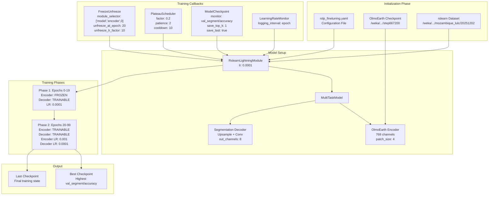
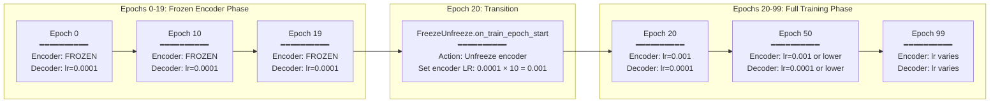
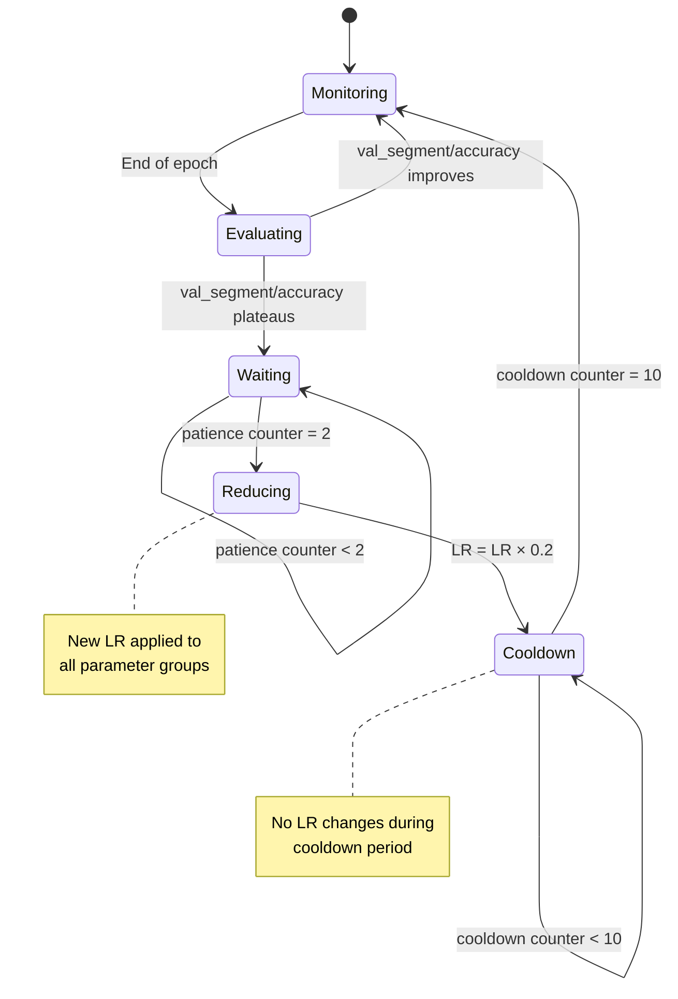
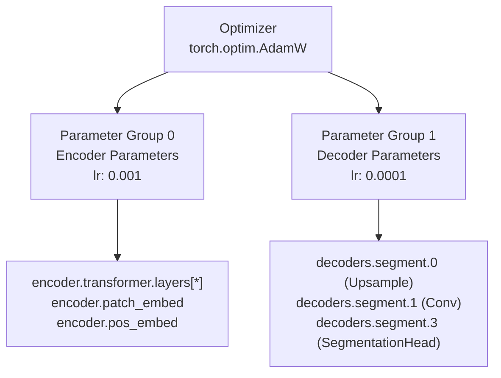
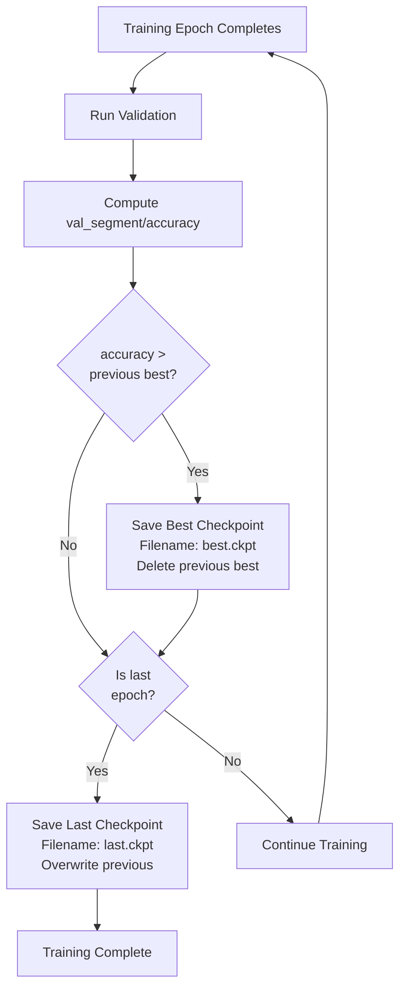
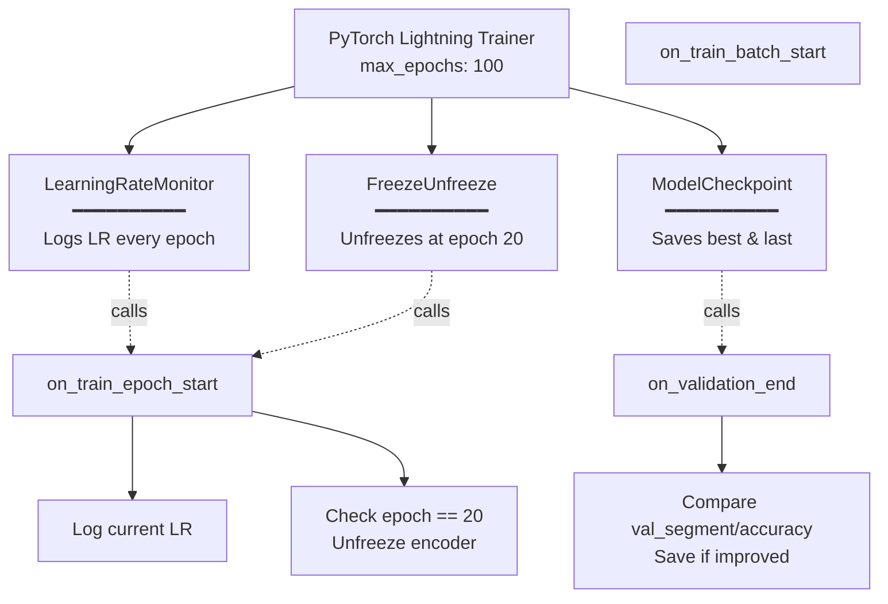
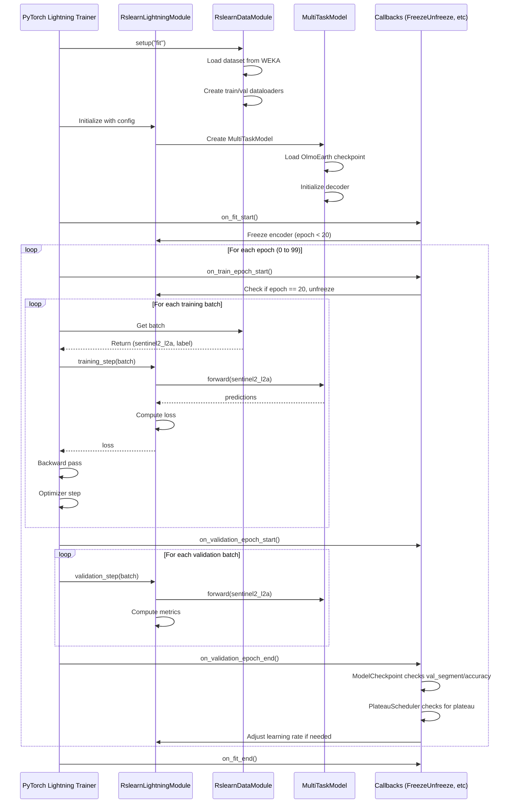

<!-- source: DeepWiki mcp.deepwiki.com · repo allenai/olmoearth_projects · page 5.3 Fine-tuning Process · fetched 2026-10-26 -->

# Fine-tuning Process

<details>
<summary>Relevant source files</summary>

The following files were used as context for generating this wiki page:

- [olmoearth_run_data/mozambique_lulc/rslp_finetuning.yaml](olmoearth_run_data/mozambique_lulc/rslp_finetuning.yaml)
- [olmoearth_run_data/mozambique_lulc/rslp_finetuning_croptype.yaml](olmoearth_run_data/mozambique_lulc/rslp_finetuning_croptype.yaml)
- [olmoearth_run_data/mozambique_lulc/rslp_finetuning_croptype_in_season_novapr.yaml](olmoearth_run_data/mozambique_lulc/rslp_finetuning_croptype_in_season_novapr.yaml)
- [olmoearth_run_data/mozambique_lulc/rslp_finetuning_croptype_in_season_novmar.yaml](olmoearth_run_data/mozambique_lulc/rslp_finetuning_croptype_in_season_novmar.yaml)
- [olmoearth_run_data/mozambique_lulc/rslp_finetuning_croptype_in_season_novmay.yaml](olmoearth_run_data/mozambique_lulc/rslp_finetuning_croptype_in_season_novmay.yaml)
- [olmoearth_run_data/mozambique_lulc/rslp_finetuning_in_season_novapr.yaml](olmoearth_run_data/mozambique_lulc/rslp_finetuning_in_season_novapr.yaml)
- [olmoearth_run_data/mozambique_lulc/rslp_finetuning_in_season_novmar.yaml](olmoearth_run_data/mozambique_lulc/rslp_finetuning_in_season_novmar.yaml)
- [olmoearth_run_data/mozambique_lulc/rslp_finetuning_in_season_novmay.yaml](olmoearth_run_data/mozambique_lulc/rslp_finetuning_in_season_novmay.yaml)

</details>


## Purpose and Scope

This document describes the fine-tuning workflow for OlmoEarth models in the olmoearth_projects repository. It covers the progressive training strategy using the `FreezeUnfreeze` callback, learning rate scheduling with `PlateauScheduler`, and checkpoint management during training. The fine-tuning process enables transfer learning from the pre-trained OlmoEarth encoder to domain-specific tasks.

For configuration file structure, see [Training Configuration Files](#5.1). For encoder architecture details, see [OlmoEarth Encoder Architecture](#5.2). For data loading specifics, see [Data Module and Transforms](#5.4). For evaluation metrics, see [Metrics and Evaluation](#5.5).

---

## Fine-tuning Workflow Overview

The fine-tuning process uses PyTorch Lightning's `RslearnLightningModule` to orchestrate training with a two-phase strategy: initial training with a frozen encoder followed by unfrozen full-model training.



**Sources:** [olmoearth_run_data/mozambique_lulc/rslp_finetuning.yaml:1-268]()

---

## FreezeUnfreeze Callback

The `FreezeUnfreeze` callback implements progressive training by initially freezing the pre-trained encoder and unfreezing it after a specified number of epochs. This strategy allows the decoder to learn task-specific features before fine-tuning the encoder.

### Configuration Parameters

| Parameter | Value | Description |
|-----------|-------|-------------|
| `module_selector` | `["model", "encoder", 0]` | Selects the encoder module within the model hierarchy |
| `unfreeze_at_epoch` | `20` | Epoch at which the encoder is unfrozen |
| `unfreeze_lr_factor` | `10` | Learning rate multiplier applied to encoder when unfrozen |

### Behavior Over Training



### Module Selection Mechanism

The `module_selector` parameter `["model", "encoder", 0]` traverses the model hierarchy:

1. Start at `RslearnLightningModule.model`
2. Access `MultiTaskModel.encoder`
3. Select element `0` (the `OlmoEarth` encoder in the encoder list)

This targets the pre-trained encoder while leaving the decoder trainable throughout.

**Sources:** [olmoearth_run_data/mozambique_lulc/rslp_finetuning.yaml:261-265]()

---

## Learning Rate Scheduling

The `PlateauScheduler` dynamically adjusts learning rates based on validation performance, enabling adaptive learning throughout training.

### PlateauScheduler Configuration

```yaml
scheduler:
  class_path: rslearn.train.scheduler.PlateauScheduler
  init_args:
    factor: 0.2        # Multiply LR by 0.2 when reducing
    patience: 2        # Wait 2 epochs of no improvement
    min_lr: 0          # Minimum allowed learning rate
    cooldown: 10       # Wait 10 epochs after reduction
```

### Learning Rate Adjustment Logic



### Learning Rate Evolution Example

| Epoch | Event | Encoder LR | Decoder LR | Notes |
|-------|-------|------------|------------|-------|
| 0-19 | Frozen encoder | N/A | 0.0001 | Decoder training only |
| 20 | Unfreeze trigger | 0.001 | 0.0001 | 10× boost for encoder |
| 20-40 | Steady training | 0.001 | 0.0001 | Both components training |
| 41 | Plateau detected | 0.0002 | 0.00002 | Reduced by factor 0.2 |
| 41-50 | Cooldown | 0.0002 | 0.00002 | No further reductions |
| 65 | Second plateau | 0.00004 | 0.000004 | Reduced again |
| 65-74 | Cooldown | 0.00004 | 0.000004 | Monitoring resumes after |

**Sources:** [olmoearth_run_data/mozambique_lulc/rslp_finetuning.yaml:43-49]()

---

## Training Phase Dynamics

### Phase 1: Decoder-Only Training (Epochs 0-19)

During the initial phase, the OlmoEarth encoder parameters remain frozen while the decoder learns task-specific patterns.

**Trainable Parameters:**
- `Upsample` layer: scale_factor=4, mode=bilinear
- `Conv` layer: 768 input channels → 8 output channels
- `SegmentationHead` task-specific components

**Frozen Parameters:**
- All OlmoEarth encoder weights (loaded from checkpoint)
- Encoder normalization layers
- Encoder attention mechanisms

**Rationale:** The frozen encoder provides stable, pre-trained features while the decoder adapts to the segmentation task. This prevents catastrophic forgetting of the pre-trained representations.

### Phase 2: Full-Model Fine-tuning (Epochs 20-99)

After epoch 20, the encoder is unfrozen with a higher learning rate, allowing end-to-end optimization.

**Learning Rate Configuration:**
```python
# At epoch 20, FreezeUnfreeze applies:
encoder_lr = base_lr * unfreeze_lr_factor  # 0.0001 × 10 = 0.001
decoder_lr = base_lr                        # 0.0001
```

**Parameter Group Structure:**


**Rationale:** The higher encoder learning rate (10×) enables rapid adaptation to task-specific patterns while the lower decoder rate maintains stability in the already-trained decoder weights.

**Sources:** [olmoearth_run_data/mozambique_lulc/rslp_finetuning.yaml:7-41](), [olmoearth_run_data/mozambique_lulc/rslp_finetuning.yaml:261-265]()

---

## Checkpoint Management

### ModelCheckpoint Callback

The `ModelCheckpoint` callback saves model states during training based on validation performance.

```yaml
callbacks:
  - class_path: lightning.pytorch.callbacks.ModelCheckpoint
    init_args:
      save_top_k: 1                      # Keep only the best checkpoint
      save_last: true                    # Also save the last checkpoint
      monitor: val_segment/accuracy      # Metric to track
      mode: max                          # Higher is better
```

### Checkpoint Saving Strategy



### Checkpoint Contents

Saved checkpoints contain:
- Model state_dict: All trainable parameters
- Optimizer state_dict: Momentum and learning rate history
- Epoch number: Current training progress
- Global step: Total batches processed
- Callback states: FreezeUnfreeze freeze status, PlateauScheduler history
- Hyperparameters: From configuration file
- Metric values: Best validation accuracy

**Sources:** [olmoearth_run_data/mozambique_lulc/rslp_finetuning.yaml:255-260]()

---

## Training Configuration Summary

### Core Training Parameters

| Parameter | Value | Location | Purpose |
|-----------|-------|----------|---------|
| `max_epochs` | 100 | `trainer.max_epochs` | Maximum training duration |
| `batch_size` | 64 | `data.init_args.batch_size` | Samples per training batch |
| `num_workers` | 32 | `data.init_args.num_workers` | Data loading parallelism |
| `lr` | 0.0001 | `model.init_args.lr` | Base learning rate |
| `crop_size` | 16 | `train_config.transforms` | Training patch size |
| `patch_size` | 16 | `val_config.patch_size` | Validation patch size |

### Callback Hierarchy



**Sources:** [olmoearth_run_data/mozambique_lulc/rslp_finetuning.yaml:249-268]()

---

## Seasonal and Multi-Temporal Variants

The repository includes fine-tuning configurations for different temporal resolutions and seasonal windows.

### Temporal Configuration Variants

| Variant | Layers Configuration | Use Case |
|---------|---------------------|----------|
| Single timestep | `["sentinel2"]` | Year-round LULC/crop type |
| 5 timesteps | `["sentinel2", "sentinel2.1", ..., "sentinel2.4"]` | In-season (Nov-Mar) |
| 6 timesteps | `["sentinel2", "sentinel2.1", ..., "sentinel2.5"]` | Extended season (Nov-Apr) |
| 7 timesteps | `["sentinel2", "sentinel2.1", ..., "sentinel2.6"]` | Full season (Nov-May) |

### Multi-Temporal Training Example

```yaml
# rslp_finetuning_in_season_novmar.yaml
inputs:
  sentinel2_l2a:
    layers: ["sentinel2", "sentinel2.1", "sentinel2.2", "sentinel2.3", "sentinel2.4"]
    bands: ["B02", "B03", "B04", "B08", "B05", "B06", "B07", "B8A", "B11", "B12", "B01", "B09"]
    load_all_layers: true
```

**Impact on Training:**
- Input channels multiply by number of timesteps (e.g., 12 bands × 5 timesteps = 60 channels)
- Encoder processes concatenated temporal stack
- Increased memory requirements during training
- Improved temporal feature extraction for phenology-dependent tasks

**Sources:** [olmoearth_run_data/mozambique_lulc/rslp_finetuning_in_season_novmar.yaml:54-61](), [olmoearth_run_data/mozambique_lulc/rslp_finetuning_in_season_novapr.yaml:54-61](), [olmoearth_run_data/mozambique_lulc/rslp_finetuning_in_season_novmay.yaml:54-61]()

---

## Training Execution Flow

### Complete Training Loop



**Sources:** [olmoearth_run_data/mozambique_lulc/rslp_finetuning.yaml:1-268]()

---

## Best Practices and Recommendations

### Hyperparameter Selection

**FreezeUnfreeze Timing:**
- `unfreeze_at_epoch: 20` is suitable for most tasks
- Increase if decoder requires more pre-training (complex tasks)
- Decrease if dataset is large and well-aligned with pre-training

**Learning Rate Factor:**
- `unfreeze_lr_factor: 10` provides strong encoder adaptation
- Reduce to 5 if encoder overfits quickly
- Increase to 20 if encoder needs aggressive fine-tuning

**PlateauScheduler Patience:**
- `patience: 2` for fast convergence detection
- Increase to 3-5 for noisy validation metrics
- Decrease to 1 for stable, monotonic improvements

### Training Monitoring

Key metrics to track:
1. `train_segment/loss` - Training loss trajectory
2. `val_segment/accuracy` - Overall validation performance
3. `val_segment/{class}_precision` - Per-class precision
4. `val_segment/{class}_recall` - Per-class recall
5. `lr-{optimizer_group}` - Learning rate evolution

### Convergence Indicators

Training has converged when:
- Validation accuracy plateaus for >10 epochs
- Learning rate reduced to near `min_lr` (approaching 0)
- Training and validation losses stabilize
- Per-class metrics show consistent performance

**Sources:** [olmoearth_run_data/mozambique_lulc/rslp_finetuning.yaml:43-49](), [olmoearth_run_data/mozambique_lulc/rslp_finetuning.yaml:261-265]()

---

