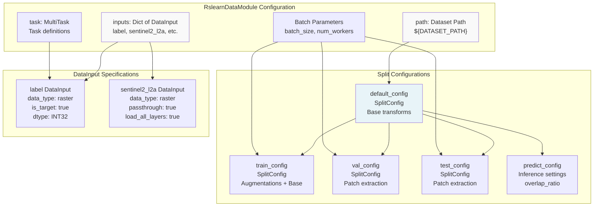
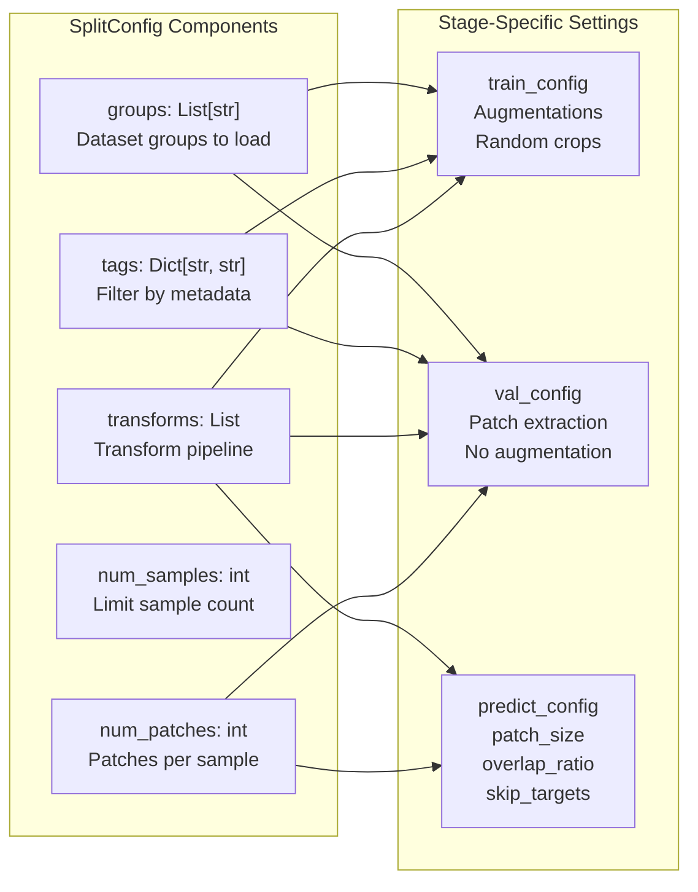
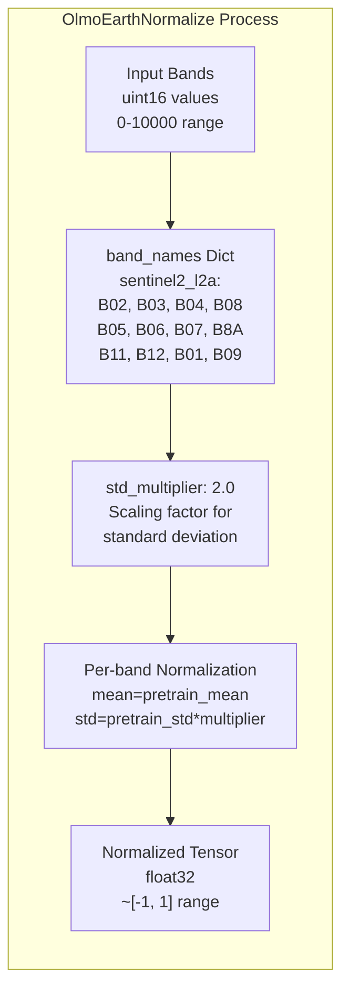
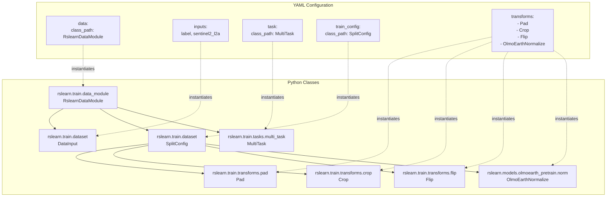

<!-- source: DeepWiki mcp.deepwiki.com · repo allenai/olmoearth_projects · page 5.4 Data Module and Transforms · fetched 2026-10-26 -->

# Data Module and Transforms

<details>
<summary>Relevant source files</summary>

The following files were used as context for generating this wiki page:

- [olmoearth_run_data/mangrove/dataset.json](olmoearth_run_data/mangrove/dataset.json)
- [olmoearth_run_data/mangrove/model.yaml](olmoearth_run_data/mangrove/model.yaml)
- [olmoearth_run_data/mangrove/olmoearth_run.yaml](olmoearth_run_data/mangrove/olmoearth_run.yaml)
- [olmoearth_run_data/mozambique_lulc/dataset.json](olmoearth_run_data/mozambique_lulc/dataset.json)
- [olmoearth_run_data/mozambique_lulc/model.yaml](olmoearth_run_data/mozambique_lulc/model.yaml)
- [olmoearth_run_data/mozambique_lulc/olmoearth_run.yaml](olmoearth_run_data/mozambique_lulc/olmoearth_run.yaml)

</details>


## Purpose and Scope

This document explains the data loading and transformation infrastructure used during model training and inference in the olmoearth_projects repository. It covers the `RslearnDataModule` configuration, data input specifications, batch processing parameters, and the transformation pipeline including normalization, padding, cropping, and augmentation operations.

For information about the overall training process, see [Model Training](#5). For details on training configuration files, see [Training Configuration Files](#5.1). For metrics and evaluation, see [Metrics and Evaluation](#5.5).

## RslearnDataModule Architecture

The `RslearnDataModule` is a PyTorch Lightning `DataModule` that orchestrates data loading for training and inference. It manages dataset paths, input specifications, transformation pipelines, and split configurations for train/validation/test/predict stages.



**Sources:** [olmoearth_run_data/mangrove/model.yaml:41-340](), [olmoearth_run_data/mozambique_lulc/model.yaml:32-246]()

## Data Input Configuration

Each input to the model is defined using the `rslearn.train.dataset.DataInput` class. The data module accepts a dictionary of named inputs under the `inputs` key, where each input specifies how a particular data layer should be loaded and processed.

### DataInput Parameters

| Parameter | Type | Description |
|-----------|------|-------------|
| `data_type` | string | Type of data: `"raster"` or `"vector"` |
| `layers` | list[string] | Layer names to load from dataset (e.g., `["sentinel2"]`, `["label_raster"]`) |
| `bands` | list[string] | Specific bands to extract (e.g., `["B02", "B03", "B04"]` for Sentinel-2) |
| `required` | boolean | Whether this input must be present |
| `passthrough` | boolean | If true, data is passed through encoder without modification |
| `is_target` | boolean | Indicates this input contains ground truth labels |
| `dtype` | string | Data type: `FLOAT32`, `INT32`, `UINT16`, etc. |
| `load_all_layers` | boolean | Load all timesteps/layers for temporal data |
| `load_all_item_groups` | boolean | Load all item groups in the dataset |

**Sources:** [olmoearth_run_data/mangrove/model.yaml:44-83](), [olmoearth_run_data/mozambique_lulc/model.yaml:36-50]()

### Example: Label Input Configuration

```yaml
label:
  class_path: rslearn.train.dataset.DataInput
  init_args:
    data_type: raster
    layers:
      - label_raster
    bands:
      - label
    required: true
    passthrough: false
    is_target: true
    dtype: INT32
```

This configuration loads integer-valued labels from the `label_raster` layer. The `is_target: true` flag indicates this data will be used for loss computation rather than as model input.

**Sources:** [olmoearth_run_data/mangrove/model.yaml:45-58]()

### Example: Sentinel-2 Input Configuration

```yaml
sentinel2_l2a:
  class_path: rslearn.train.dataset.DataInput
  init_args:
    data_type: raster
    layers:
      - sentinel2
    bands:
      - B02  # Blue
      - B03  # Green
      - B04  # Red
      - B08  # NIR
      - B05  # Red Edge 1
      - B06  # Red Edge 2
      - B07  # Red Edge 3
      - B8A  # Red Edge 4
      - B11  # SWIR 1
      - B12  # SWIR 2
      - B01  # Coastal Aerosol
      - B09  # Water Vapor
    required: true
    passthrough: true
    is_target: false
    dtype: FLOAT32
    load_all_layers: true
    load_all_item_groups: true
```

This configuration loads all 12 Sentinel-2 bands. The `load_all_layers: true` and `load_all_item_groups: true` flags ensure temporal sequences are loaded when available (e.g., 12 timesteps for mangrove mapping, 8 timesteps for Mozambique LULC).

**Sources:** [olmoearth_run_data/mangrove/model.yaml:59-83](), [olmoearth_run_data/mozambique_lulc/model.yaml:37-44]()

## Split Configurations

The data module uses `rslearn.train.dataset.SplitConfig` objects to define how data is loaded for different stages. Each split can specify different transforms, data selection criteria, and processing parameters.



**Sources:** [olmoearth_run_data/mangrove/model.yaml:252-311](), [olmoearth_run_data/mozambique_lulc/model.yaml:194-245]()

### default_config

The `default_config` defines base transforms applied to all splits unless overridden. This typically includes padding to accommodate the encoder's patch size and normalization.

```yaml
default_config:
  class_path: rslearn.train.dataset.SplitConfig
  init_args:
    transforms:
      - class_path: rslearn.train.transforms.pad.Pad
        init_args:
          size: 4
          mode: "center"
          image_selectors: ["sentinel2_l2a"]
      - class_path: rslearn.models.olmoearth_pretrain.norm.OlmoEarthNormalize
        init_args:
          band_names:
            sentinel2_l2a: ["B02", "B03", "B04", "B08", "B05", "B06", "B07", "B8A", "B11", "B12", "B01", "B09"]
```

**Sources:** [olmoearth_run_data/mozambique_lulc/model.yaml:194-204]()

### train_config

The `train_config` adds data augmentation transforms for training. It specifies which groups to load and filters by split tag.

```yaml
train_config:
  class_path: rslearn.train.dataset.SplitConfig
  init_args:
    transforms:
      - class_path: rslearn.train.transforms.pad.Pad
        init_args:
          size: 31
          mode: "center"
          image_selectors: ["sentinel2_l2a", "target/segment/classes", "target/segment/valid"]
      - class_path: rslearn.train.transforms.crop.Crop
        init_args:
          crop_size: 16
          image_selectors: ["sentinel2_l2a", "target/segment/classes", "target/segment/valid"]
      - class_path: rslearn.train.transforms.flip.Flip
        init_args:
          image_selectors: ["sentinel2_l2a", "target/segment/classes", "target/segment/valid"]
      - class_path: rslearn.models.olmoearth_pretrain.norm.OlmoEarthNormalize
        init_args:
          band_names:
            sentinel2_l2a: ["B02", "B03", "B04", "B08", "B05", "B06", "B07", "B8A", "B11", "B12", "B01", "B09"]
    groups: ["gaza", "manica", "zambezia"]
    tags:
      split: "train"
```

The Mozambique LULC model uses a 31-pixel pad followed by a 16-pixel random crop for augmentation, ensuring diverse spatial contexts during training.

**Sources:** [olmoearth_run_data/mozambique_lulc/model.yaml:205-225]()

### val_config and test_config

Validation and test splits use patch-based extraction without augmentation. The `patch_size` parameter determines the size of extracted patches.

```yaml
val_config:
  patch_size: 16
  groups: ["gaza", "manica", "zambezia"]
  tags:
    split: "test"
```

**Sources:** [olmoearth_run_data/mozambique_lulc/model.yaml:226-230]()

### predict_config

The `predict_config` is used during inference. It specifies how to break large images into overlapping patches for efficient processing.

```yaml
predict_config:
  load_all_patches: true
  patch_size: 16
  overlap_ratio: 0.25  # 4-pixel overlap with 16-pixel patches
  skip_targets: true
  transforms:
    - class_path: rslearn.models.olmoearth_pretrain.norm.OlmoEarthNormalize
      init_args:
        band_names:
          sentinel2_l2a: ["B02", "B03", "B04", "B08", "B05", "B06", "B07", "B8A", "B11", "B12", "B01", "B09"]
```

The `overlap_ratio: 0.25` creates a 4-pixel overlap between adjacent 16-pixel patches, reducing boundary artifacts in the final prediction.

**Sources:** [olmoearth_run_data/mozambique_lulc/model.yaml:236-245]()

## Transform Pipeline

Transforms are applied sequentially to data samples. The pipeline typically includes geometric operations (pad, crop, flip) followed by normalization.

```mermaid
graph TB
    subgraph "Training Transform Pipeline"
        INPUT["Raw Data<br/>Variable size<br/>uint16 or int32"]
        PAD1["rslearn.train.transforms.pad.Pad<br/>size: 31 pixels<br/>mode: center"]
        CROP["rslearn.train.transforms.crop.Crop<br/>crop_size: 16<br/>Random spatial crop"]
        FLIP["rslearn.train.transforms.flip.Flip<br/>Random horizontal/vertical"]
        NORM["rslearn.models.olmoearth_pretrain.norm.OlmoEarthNormalize<br/>Band-wise normalization<br/>std_multiplier: 2.0"]
        OUTPUT["Normalized Tensor<br/>16x16 patches<br/>float32"]
    end
    
    subgraph "Inference Transform Pipeline"
        INPUT2["Raw Data<br/>Large image"]
        PAD2["rslearn.train.transforms.pad.Pad<br/>size: 2 or 4<br/>mode: center"]
        NORM2["OlmoEarthNormalize<br/>Band-wise normalization"]
        OUTPUT2["Normalized Tensor<br/>Fixed patch size"]
    end
    
    INPUT --> PAD1
    PAD1 --> CROP
    CROP --> FLIP
    FLIP --> NORM
    NORM --> OUTPUT
    
    INPUT2 --> PAD2
    PAD2 --> NORM2
    NORM2 --> OUTPUT2
```



**Sources:** [olmoearth_run_data/mozambique_lulc/model.yaml:206-222](), [olmoearth_run_data/mangrove/model.yaml:317-338]()

### Pad Transform

The `rslearn.train.transforms.pad.Pad` transform adds padding to images to accommodate the encoder's patch size requirements. The OlmoEarth encoder processes images in patches (typically 2x2 or 4x4 pixels per patch token), so input dimensions must be compatible.

**Key Parameters:**
- `size`: Number of pixels to pad on each side
- `mode`: Padding mode - `"center"` pads equally on all sides
- `image_selectors`: List of data keys to pad (e.g., `["sentinel2_l2a", "target/segment/classes"]`)

```yaml
class_path: rslearn.train.transforms.pad.Pad
init_args:
  size: 31
  mode: "center"
  image_selectors: ["sentinel2_l2a", "target/segment/classes", "target/segment/valid"]
```

For training with patch_size=4 and crop_size=16, a 31-pixel pad ensures room for random 16-pixel crops that remain evenly divisible by the patch size.

**Sources:** [olmoearth_run_data/mozambique_lulc/model.yaml:196-200](), [olmoearth_run_data/mangrove/model.yaml:261-268]()

### Crop Transform

The `rslearn.train.transforms.crop.Crop` transform extracts random spatial crops during training, providing data augmentation and enabling batch processing of large images.

```yaml
class_path: rslearn.train.transforms.crop.Crop
init_args:
  crop_size: 16
  image_selectors: ["sentinel2_l2a", "target/segment/classes", "target/segment/valid"]
```

**Sources:** [olmoearth_run_data/mozambique_lulc/model.yaml:212-215]()

### Flip Transform

The `rslearn.train.transforms.flip.Flip` transform randomly flips images horizontally and/or vertically, providing additional augmentation without changing class distributions.

```yaml
class_path: rslearn.train.transforms.flip.Flip
init_args:
  image_selectors: ["sentinel2_l2a", "target/segment/classes", "target/segment/valid"]
```

**Sources:** [olmoearth_run_data/mozambique_lulc/model.yaml:216-218]()

### OlmoEarthNormalize Transform

The `rslearn.models.olmoearth_pretrain.norm.OlmoEarthNormalize` transform normalizes satellite imagery to match the distribution expected by the pre-trained OlmoEarth encoder.



**Key Parameters:**
- `band_names`: Dictionary mapping input keys to lists of band names
- `std_multiplier`: Scaling factor for standard deviation (default 2.0)

```yaml
class_path: rslearn.models.olmoearth_pretrain.norm.OlmoEarthNormalize
init_args:
  band_names:
    sentinel2_l2a:
      - B02
      - B03
      - B04
      - B08
      - B05
      - B06
      - B07
      - B8A
      - B11
      - B12
      - B01
      - B09
  std_multiplier: 2.0
```

The normalization uses pre-computed mean and standard deviation statistics from the OlmoEarth pre-training dataset. The `std_multiplier: 2.0` parameter allows finer control over the normalized value range.

**Sources:** [olmoearth_run_data/mangrove/model.yaml:270-286](), [olmoearth_run_data/mozambique_lulc/model.yaml:201-204](), [olmoearth_run_data/mozambique_lulc/model.yaml:242-245]()

## Batch Processing Configuration

The data module configures batch processing parameters that affect training performance and memory usage.

### Core Parameters

| Parameter | Description | Typical Values |
|-----------|-------------|----------------|
| `batch_size` | Number of samples per batch | 32-128 for training, higher for inference |
| `num_workers` | Number of data loading subprocesses | Set via `${NUM_WORKERS}` environment variable |
| `init_workers` | Workers to initialize at startup | Usually 0 |
| `retries` | Number of retry attempts for failed loads | Usually 0 |

```yaml
batch_size: 64
num_workers: ${NUM_WORKERS}
init_workers: 0
retries: 0
```

The mangrove model uses `batch_size: 128` while the Mozambique LULC model uses `batch_size: 64`, reflecting different memory requirements based on patch size and model complexity.

**Sources:** [olmoearth_run_data/mangrove/model.yaml:249-250](), [olmoearth_run_data/mozambique_lulc/model.yaml:192-193]()

### Inference Parameters

During inference, additional parameters control how large images are processed:

```yaml
predict_config:
  patch_size: 16
  overlap_ratio: 0.25
  load_all_patches: true
  skip_targets: true
```

- `patch_size`: Size of processing window in pixels
- `overlap_ratio`: Fraction of overlap between adjacent patches (0.25 = 25% overlap)
- `load_all_patches`: Process entire image in patches
- `skip_targets`: Don't load ground truth labels during inference

**Sources:** [olmoearth_run_data/mozambique_lulc/model.yaml:236-240]()

## Configuration Mapping: Code to Concepts

This diagram maps the YAML configuration structure to actual rslearn Python classes and their relationships:



**Sources:** [olmoearth_run_data/mangrove/model.yaml:41-340](), [olmoearth_run_data/mozambique_lulc/model.yaml:32-246]()

## Complete Configuration Examples

### Example 1: Mangrove Classification

This configuration loads 12 timesteps of Sentinel-2 data over a year, with minimal padding for the patch_size=2 encoder:

```yaml
data:
  class_path: rslearn.train.data_module.RslearnDataModule
  init_args:
    path: ${DATASET_PATH}
    batch_size: 128
    num_workers: ${NUM_WORKERS}
    
    inputs:
      label:
        data_type: raster
        layers: [label_raster]
        bands: [label]
        is_target: true
        dtype: INT32
      
      sentinel2_l2a:
        data_type: raster
        layers: [sentinel2]
        bands: [B02, B03, B04, B08, B05, B06, B07, B8A, B11, B12, B01, B09]
        passthrough: true
        dtype: FLOAT32
        load_all_layers: true
        load_all_item_groups: true
    
    default_config:
      transforms:
        - class_path: rslearn.train.transforms.pad.Pad
          init_args:
            size: 2
            mode: center
            image_selectors: [sentinel2_l2a]
        - class_path: rslearn.models.olmoearth_pretrain.norm.OlmoEarthNormalize
          init_args:
            band_names:
              sentinel2_l2a: [B02, B03, B04, B08, B05, B06, B07, B8A, B11, B12, B01, B09]
            std_multiplier: 2.0
    
    train_config:
      groups: [sample_100K]
      tags: {split: train}
      num_samples: 10000
    
    predict_config:
      patch_size: 2
      load_all_patches: true
      skip_targets: true
```

**Sources:** [olmoearth_run_data/mangrove/model.yaml:41-340]()

### Example 2: Mozambique LULC

This configuration uses aggressive augmentation with large padding (31 pixels) followed by random crops:

```yaml
data:
  class_path: rslearn.train.data_module.RslearnDataModule
  init_args:
    path: ${DATASET_PATH}
    batch_size: 64
    num_workers: ${NUM_WORKERS}
    
    train_config:
      transforms:
        - class_path: rslearn.train.transforms.pad.Pad
          init_args:
            size: 31
            mode: center
            image_selectors: [sentinel2_l2a, target/segment/classes, target/segment/valid]
        - class_path: rslearn.train.transforms.crop.Crop
          init_args:
            crop_size: 16
            image_selectors: [sentinel2_l2a, target/segment/classes, target/segment/valid]
        - class_path: rslearn.train.transforms.flip.Flip
          init_args:
            image_selectors: [sentinel2_l2a, target/segment/classes, target/segment/valid]
        - class_path: rslearn.models.olmoearth_pretrain.norm.OlmoEarthNormalize
          init_args:
            band_names:
              sentinel2_l2a: [B02, B03, B04, B08, B05, B06, B07, B8A, B11, B12, B01, B09]
      groups: [gaza, manica, zambezia]
      tags: {split: train}
    
    val_config:
      patch_size: 16
      groups: [gaza, manica, zambezia]
      tags: {split: test}
    
    predict_config:
      patch_size: 16
      overlap_ratio: 0.25
      load_all_patches: true
      skip_targets: true
```

**Sources:** [olmoearth_run_data/mozambique_lulc/model.yaml:32-246]()

## Transform Selector Patterns

When specifying transforms, the `image_selectors` parameter determines which data tensors are affected. The selector patterns follow these conventions:

| Selector Pattern | Description |
|------------------|-------------|
| `sentinel2_l2a` | Input satellite imagery |
| `label` | Raw label data |
| `target/segment/classes` | Segmentation class predictions |
| `target/segment/valid` | Valid pixel mask |
| `target/mangrove_classification/classes` | Task-specific class outputs |

These selectors must match the data keys used in the `inputs` configuration and task definitions. All tensors that should undergo geometric transformations (pad, crop, flip) must be included in the selector list to maintain spatial alignment.

**Sources:** [olmoearth_run_data/mozambique_lulc/model.yaml:200](), [olmoearth_run_data/mozambique_lulc/model.yaml:211](), [olmoearth_run_data/mangrove/model.yaml:266-268]()

---

